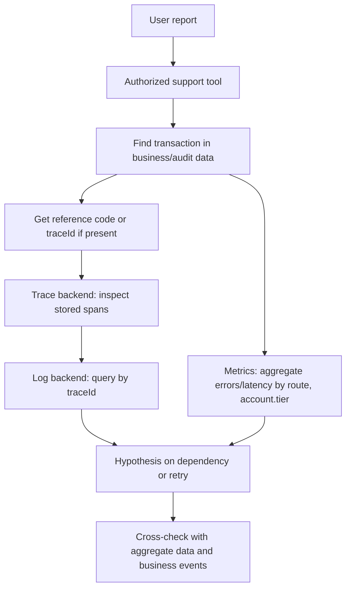

# User ID tagging in Spring Boot Observability

A development team wants to know **which users encounter the most errors** and decides to add `user.id` to the metric for the `POST /checkout` endpoint. Initially, the dashboard looks convenient because errors and latency can be filtered per account. However, as users grow from dozens to hundreds of thousands, the same metric can generate a huge number of time series. Storage and query costs rise, alerting can become unstable, and user identifiers get scattered into monitoring systems not designed to store personal data.

The lesson **“User ID tagging”** belongs to the **Cardinality and metadata** chapter of the **SPRING_BOOT_OBSERVABILITY** module. Within the scope of setting up observability for Spring Boot using Micrometer Observation, metrics, logs, and distributed tracing, this lesson explains the impact of `user.id` on cardinality, how to classify metadata, alternative approaches to investigate errors/latency, and the limits of exporters, sampling, propagation, and user data protection.

**Default rule:** Do not use individual user identifiers as metric labels. If you need to investigate a specific user, choose a data source and correlation mechanism aligned with business needs, security, access permissions, and retention limits.

## 1. What does “user ID tagging” mean?

In Micrometer, a **tag** or **label** is a key–value pair used to distinguish metric series.

Example of two calls to an endpoint:

```text
http.server.requests
  method=POST, uri=/checkout, status=200, user.id=usr-0001
http.server.requests
  method=POST, uri=/checkout, status=200, user.id=usr-0002
```

Despite having the same endpoint, HTTP method, and status, two different `user.id` values force the metrics system to maintain **two separate time series**. If the tag takes 100,000 distinct values, the number of related series can grow correspondingly, especially alongside other labels.

Distinguishing concepts:

| Concept | Example | Cardinality | Impact |
| --- | --- | --- | --- |
| Metric name | `http.server.requests` | Usually fixed | Identifies the measurement type |
| Low-cardinality tag | `method=POST`, `status=500` | Finite | Useful for statistics and alerting |
| Normalized route | `uri=/orders/{id}` | Controllable | Groups traffic by endpoint |
| User ID as metric tag | `user.id=usr-0001` | High, scales with users | Creates extra series per user |
| Trace ID as metric tag | `traceId=...` | Nearly unique per trace | Creates series per trace if misused |
| Detailed span attribute | `subject.ref=ref-8c1e` | Can be high | Belongs to one execution; collect only with justification and approval |
| Field in audit record | `actor.id=...` | Can be high | Serves auditing with proper access control, retention, and clear purpose |

Just because a value is **useful for lookup** does not mean it is **suitable as a metric label**. Metrics are optimized to answer aggregate questions, whereas traces and business logs describe a specific execution.

## 2. How fast does cardinality grow?

A time series is identified by metric name and label value combination. The number of series can grow roughly as the product of the value counts across each dimension, if those combinations actually occur.

Consider a hypothetical HTTP metric with:

| Grouping dimension | Example value count |
| --- | ---: |
| `instance` | 2 |
| `method` | 2 |
| `uri` | 4 |
| `status` group | 3 |
| `user.id` | 10,000 |

Combination bound in the example:

\[
2 \times 2 \times 4 \times 3 \times 10\,000 = 480\,000
\]

This is the **number of possible combinations**, not an assertion that the application will definitely emit 480,000 series. Combinations that never receive a request will not appear on their own. Still, the calculation shows why adding just **one tag** with a large value set changes system scale dramatically.

If `user.id` is replaced by `account.tier` having only `free`, `premium`, `enterprise`, and `unknown`, the same remaining dimensions yield at most:

\[
2 \times 2 \times 4 \times 3 \times 4 = 192
\]

The difference between the two designs lies in the **value set**, not the length of the tag name.

### Why do histograms further amplify costs?

A timer can be exported as count/sum and, if histograms are enabled, many latency distribution buckets. Each label combination can correspond to multiple series such as `_count`, `_sum`, and `_bucket{le=...}`. Therefore, adding user IDs to a timer with histograms is usually much more expensive than looking at a simple counter.

Cost is not just disk space. High cardinality can also affect:

- Memory of the application/`MeterRegistry` and collection system.
- Scrape/export payload sizes, sample counts, and bandwidth.
- Indexing, query latency, dashboards, and alerting rules.
- Short series lifetimes when many users make only a few requests and disappear.
- Series limits, quotas, and costs under backend policies.

Actual numbers depend on concurrent active users, other labels, retention, meter type, and backend. Do not convert a combination bound into concrete memory or dollar costs without measuring on the real system.

## 3. Anti-pattern: adding `user.id` to a Timer

Suppose a service knows the user ID after authentication and creates a separate Timer per user:

```java
import io.micrometer.core.instrument.MeterRegistry;
import io.micrometer.core.instrument.Timer;
import org.springframework.stereotype.Service;

@Service
public class CheckoutMetricsAntiPattern {
    private final MeterRegistry registry;

    public CheckoutMetricsAntiPattern(MeterRegistry registry) {
        this.registry = registry;
    }

    public void checkout(String userId, Runnable paymentAction) {
        Timer.builder("checkout.duration")
                .tag("user.id", userId) // Should NOT be used
                .register(registry)
                .record(paymentAction);
    }
}
```

With many IDs, each `register(registry)` call looks up or creates a meter carrying the corresponding tag combination. The registry normally does not treat each request as a new meter if name and tags match, but **each new user ID can create a new meter/series**.

Renaming the key to `customer`, `subject`, `actorId`, or `principal` does not fix the problem. Hashing, encrypting, or substituting a UUID for the original ID does not automatically lower cardinality either: if each person still has a distinct value, the value count remains large.

### The same mistake with Micrometer Observation

Observation typically distinguishes:

```java
observation.lowCardinalityKeyValue("account.tier", "premium");
observation.highCardinalityKeyValue("subject.ref", "opaque-ref-8c1e");
```

If you put user ID into **`lowCardinalityKeyValue("user.id", userId)`**, a metrics `ObservationHandler` can turn it into a timer tag. Switching to `highCardinalityKeyValue` expresses the intent to use the detailed attribute for tracing, but **does not guarantee privacy, does not guarantee the trace will be stored**, and custom handlers can still process keys in their own way.

Having many attributes on an Observation does not mean all of them should become metric labels. Always inspect the actual tags exported from `MeterRegistry` or the backend, especially when custom conventions/filters/handlers exist.

## 4. Good design: aggregating by finite user groups

If the goal is to know **which account group experiences more errors or slowness**, group by business-meaningful characteristics with a finite value set, such as:

| Operational question | Suitable label | Example value set |
| --- | --- | --- |
| Are free users slower than paid users? | `account.tier` | `free`, `premium`, `enterprise`, `unknown` |
| Do authenticated requests fail more than anonymous ones? | `auth.state` | `authenticated`, `anonymous` |
| Is a payment method slow? | `payment.method` | `card`, `wallet`, `bank_transfer`, `unknown` |
| Is a route group failing? | `http.route` | Route template, e.g., `/checkout`, `/orders/{id}` |
| Which business outcome is spiking unusually? | `result` | `success`, `rejected`, `timeout`, `error` |

A finite group is only useful if it **stays genuinely bounded**. If teams can create an arbitrary account tier named after each customer, `account.tier` will gradually become high-cardinality even though the key name sounds fine.

### Spring Boot example with Micrometer Observation

The following code records only a normalized account tier, never taking user ID as a label:

```java
import io.micrometer.observation.Observation;
import io.micrometer.observation.ObservationRegistry;
import org.springframework.stereotype.Service;

import java.util.Locale;
import java.util.function.Supplier;

@Service
public class CheckoutObservationService {
    public enum AccountTier {
        FREE, PREMIUM, ENTERPRISE, UNKNOWN
    }

    private final ObservationRegistry observations;

    public CheckoutObservationService(ObservationRegistry observations) {
        this.observations = observations;
    }

    public <T> T runCheckout(AccountTier tier, Supplier<T> work) {
        String safeTier = (tier == null ? AccountTier.UNKNOWN : tier)
                .name().toLowerCase(Locale.ROOT);

        return Observation.createNotStarted(
                        "checkout.process", observations)
                .lowCardinalityKeyValue("account.tier", safeTier)
                .observe(work::get);
    }
}
```

Usage example:

```java
String result = checkoutObservationService.runCheckout(
        CheckoutObservationService.AccountTier.PREMIUM,
        () -> paymentGateway.authorize()
);
```

`paymentGateway.authorize()` is an illustrative business method. With the corresponding metrics handler, a timer can aggregate by `account.tier=premium`. If a tracing handler is configured, the Observation can also create a span for the `checkout.process` step. The presence of `ObservationRegistry` **does not by itself guarantee** that metrics or traces are exported to a backend.

**Important point:** arbitrary input values must not be fed straight into `account.tier`. An enum with a bounded value set prevents users from creating extra series by sending arbitrary strings.

### If you need user breakdowns by region or organization

Pick manageable groups, such as deployment region or geographic area at an aggregate level if policy permits. **`tenant.id` or `organization.id` can still be high cardinality** when tenant counts are large or grow unchecked. Do not treat “not a user ID” as “safe to use as a metric tag.”

## 5. When you truly need to investigate a specific user

There are valid requirements like customer support, transaction investigation, or auditing: “Why couldn't account X check out at 10:05?”. You need a controlled path from **business context** to **traces/logs**.

Separate storage purposes:

| Purpose | Suitable data | Why |
| --- | --- | --- |
| Alerting on service-wide error rates and latency | Metrics aggregated by low-cardinality labels | Fast queries, stable cardinality |
| Investigating a specific slow request | Trace ID and permitted spans/attributes | Shows execution path and slow dependencies |
| Inspecting exceptions, retries, and fallback decisions | Logs with correlation ID, sensitive data filtered | Reveals detailed progression |
| Finding all transactions for an account | Governed business data store or audit trail | Complete, with proper RBAC and retention |
| Jumping from a transaction to the related trace | Permitted mapping record, or technical reference in trace/log | Avoids turning user ID into a metric label |

In many systems, an effective workflow is:

1. Support staff use an authorized business tool to look up the user's transaction.
2. The tool returns the transaction's request reference or trace ID, if available.
3. From the trace ID, the operator opens the distributed trace; from the trace, finds correlated logs.
4. Use aggregated metrics to verify whether the issue affects a customer group or the whole system.

This keeps **per-account lookups** in data stores designed for account queries, while metrics answer **scale** questions.

### High-cardinality span attribute: usable but requires approval

If application policy permits storing a **reference code that does not directly contain personal identifiers**, consider attaching it to the Observation as a detailed attribute:

```java
Observation observation = Observation.createNotStarted(
                "checkout.process", registry)
        .lowCardinalityKeyValue("account.tier", "premium");

// Only do this when collection policy allows,
// the value has been handled appropriately, and it is truly needed for investigation.
if (traceCorrelationAllowed && approvedReference != null) {
    observation.highCardinalityKeyValue(
            "checkout.operation_ref", approvedReference);
}

observation.observe(() -> performCheckout());
```

`traceCorrelationAllowed`, `approvedReference`, and `performCheckout()` are illustrative data/logic provided by the application. Never assume pseudonymous, hashed, or opaque IDs are anonymous: a value can still link back to an individual if a mapping table exists.

A sampled trace may **not be stored**, so a high-cardinality span attribute is unsuitable as the sole source for guaranteeing lookup of **every** transaction. If the business requires completeness or legal auditability, use a dedicated audit/transaction store with its own policy.

## 6. Logs, trace IDs, and propagation

For Spring Boot using Micrometer Tracing, trace context can be populated into MDC so logs include `traceId`/`spanId`. That allows finding a request's logs by trace ID without adding `user.id` to every log line.

```text
time=10:05:12.241 level=ERROR
service=checkout-service
traceId=4bf92f3577b34da6a3ce929d0e0e4736
spanId=00f067aa0ba902b7
event=payment.timeout
message="Payment gateway did not respond"
```

This is an illustrative log. In real systems, MDC, JSON format, log pipeline, and field mappings depend on configuration. A log containing a trace ID **does not prove** the corresponding trace was exported/stored in the backend.

### User ID is not trace context

The W3C `traceparent` header carries trace information, for example:

```http
traceparent: 00-4bf92f3577b34da6a3ce929d0e0e4736-00f067aa0ba902b7-01
```

By design, it does not contain a user ID. `highCardinalityKeyValue("user.id", ...)` also does not automatically become W3C `baggage` or an HTTP header; those are two separate mechanisms.

**Do not add user ID to baggage just for lookup convenience** without an evaluated need. Baggage can traverse multiple services and trust boundaries, widening data exposure. Likewise, do not put user IDs, emails, or tokens into URLs, HTTP headers, or logs in ways that bypass data-protection policies.

### Context propagation across async boundaries

A request can hop from a servlet thread to an `Executor`, `CompletableFuture`, or a message consumer. If tracing propagation breaks, downstream logs can lose the trace ID or start a new trace. That is a context-propagation bug that must be fixed with proper instrumentation and context propagation. **Attaching user ID as a metric tag cannot fix propagation bugs.**

## 7. Sampling does not solve metric cardinality

A common misconception: “The system samples 10% of traces, so a metric with user ID won't grow too big.”

These are two independent mechanisms:

| Mechanism | Primary effect | Does it solve user ID in metric labels? |
| --- | --- | --- |
| Trace head sampling | Decides early whether to keep/drop a trace per sampler strategy | **No** |
| Trace tail sampling | Decides to keep a trace after inspecting multiple spans, if supported by pipeline | **No** |
| Metric sampling/downsampling in backend | Reduces data or resolution depending on system | Does not eliminate cardinality created at the source |
| Meter filter limiting tag values | Blocks some new series past threshold | Can limit damage but causes missing data |
| Designing low-cardinality metric labels | Bounds combinations right at instrumentation | **Yes, this is the root solution** |

A request excluded from trace sampling still updates request counters/timers if the metrics handler is active. Thus a metric with `user.id` still grows series count even when only a fraction of traces are retained.

Conversely, when tracking down a specific user, you cannot rely blindly on traces because sampling may drop that request. During investigation, metrics show **magnitude of impact**, audit/transaction logs identify **which transaction**, and tracing provides the **path of recorded requests**.

## 8. Using MeterFilter as an extra defensive layer

A `MeterFilter` can cap how many values a tag is allowed to create within a meter scope. For example:

```java
import io.micrometer.core.instrument.config.MeterFilter;
import org.springframework.context.annotation.Bean;
import org.springframework.context.annotation.Configuration;

@Configuration
public class MeterGuardrails {

    @Bean
    MeterFilter limitAccidentalUserLabels() {
        return MeterFilter.maximumAllowableTags(
                "checkout.",  // Meter name prefix to protect
                "user.id",    // Tag whose cardinality needs capping
                100,          // Value count threshold
                MeterFilter.deny()
        );
    }
}
```

This is a **second line of defense**, not the primary implementation approach. If user ID has already entered metrics, up to 100 IDs is still account data that should not necessarily be leaked to the backend. Once the threshold is exceeded, the filter can deny new meters and leave dashboards **missing data** for denied series.

Keep in mind:

- A filter affects the `MeterRegistry` where it is configured; verify actual wiring if the application uses multiple registries or exporters.
- The `checkout.` prefix and `user.id` key are examples; other names like `userId` or `principal.id` need their own rules.
- Filters auto-registered by Spring Boot may depend on version, ordering, and configuration.
- If the limit triggers, log/alert on it and fix the instrumentation causing high cardinality rather than treating denials as normal.
- A filter does not undo sensitive data already sent through logs, traces, or previously created metric series.

**The root fix** is removing the `user.id` label from the instrumentation point and replacing it with a small set of managed groups if a valid analytical need exists.

## 9. Observing cardinality in a real system

Once dashboards and exporters are running, check cardinality using live data rather than reading code alone:

1. **List metric names and label keys.** Look for identifier keys such as `user.id`, `subject`, `customer`, `email`, `session.id`, `request.id`, or dynamic URL values.
2. **Count series or distinct label values** with backend tools; check active series, new series rate, memory, and scrape size.
3. **Compare across deployments.** If series spike after adding a tag, check instrumentation or convention change history.
4. **Separate metrics with histograms.** Buckets plus multiple label dimensions grow series faster than a counter estimate suggests.
5. **Inspect measurement endpoints.** With Spring Boot Actuator and a compatible registry, inspect meter names and tag keys via the actuator metrics endpoint when enabled and properly secured. Never open endpoints publicly just to check.
6. **Check the full pipeline.** An exporter may rename metrics/tags; the backend may drop or relabel them. What appears in the app and in the backend need not match verbatim.

In Prometheus, you can inspect series and label value counts via Prometheus APIs/admin status pages if authorized. Avoid running overly broad, expensive queries during peak hours; scope to specific metrics and time ranges.

### PromQL examples to investigate by group instead of user ID

Suppose the metrics handler exports the `checkout.process` timer as Prometheus series `checkout_process_seconds_count` and converts the `account.tier` tag to label `account_tier`. You can inspect operations/second by tier:

```promql
sum by (account_tier) (
  rate(checkout_process_seconds_count[5m])
)
```

If the application has HTTP server metrics, the 5xx response rate by route can be illustrated as:

```promql
sum by (uri) (
  rate(http_server_requests_seconds_count{status=~"5.."}[5m])
)
/
sum by (uri) (
  rate(http_server_requests_seconds_count[5m])
)
```

These meter/label names are examples only; actual names depend on Spring Boot/Micrometer, registry, version, and exporter. The timer metric must actually be recorded and emitted, and the `account_tier` label must exist. Error-rate queries must handle zero denominators or missing data before being used for alerting.

When histograms are enabled and the exporter supports buckets, computing p95 by **finite labels** can use `histogram_quantile` over bucket series. You cannot compute accurate p95 from mean and count alone.

## 10. Case study: “A user reports slow checkout”

Suppose support receives a report: user A checked out at 10:05 and the app hung for about 6 seconds.

### Incident-prone design

The operations team modifies the HTTP timer by attaching `user.id=A` and making `user.id` a label on every request. Dashboards can filter for user A, but as user counts grow, cardinality skyrockets. The metrics backend also ends up storing account identifiers in an operational layer.

### Controlled design



Resolution workflow:

1. Support looks up the specific transaction in the business tool per granted permissions; no need to add user ID to meters.
2. If the transaction has a stored trace ID, open the trace to find the slow branch: database, payment gateway, cache, or retry.
3. From the trace ID, find logs for the same request and check related exceptions or timeouts.
4. Check HTTP and payment gateway metrics to confirm whether 6 seconds was an isolated case or multiple requests were affected together.
5. If the trace is missing due to sampling, continue investigating with audit records, valid transaction logs, and metrics. Never infer the transaction didn't exist.

This investigative approach uses **the right signal for the right question**. Data used to look up all transactions requires its own policy; sampled traces cannot guarantee replacing audit logs.

## 11. Data protection: user ID is contextually sensitive metadata

A technical ID that does not contain a person's name can still constitute personal data when a mapping table, behavioral linkage, or access to the source system exists. Evaluate it against regulations and your organization's data policies.

Practical principles:

- **Data minimization:** record attributes only for defined monitoring or investigative purposes.
- **Separation of privileges:** do not turn general-purpose metrics systems into user identity lookup stores.
- **Retention limits:** metrics, traces, logs, and audit trails have different retention needs; do not apply one policy to all.
- **Exporter controls:** metadata may pass through collectors or third-party vendors; review data residency and processing agreements.
- **Query and access controls:** labels, span attributes, log fields, and baggage all require proportionate protection.
- **No secrets:** never put tokens, cookies, passwords, raw payloads, or credentials into metric labels, logs, or traces.
- **Review derived data:** hashes/pseudonyms can still be traced back or correlated; do not assume safety just because it doesn't look like a user ID.
- **Deletion/retention paths:** if data deletion requests apply, trace/log/metadata stores must support them or have clear handling procedures.

Changing `user.id` to `user.hash` **does not solve** cardinality; it even creates a false sense of security. If the sole goal is measuring errors by group, using cohort or account tier avoids the problem right at the source.

## 12. Common misconceptions

| Claim | Problem | Right approach |
| --- | --- | --- |
| “A tag per user makes alerting easier” | Alerts must track huge numbers of series, hard to aggregate, costly | Alert by route, status, service, and finite groups |
| “Hashing user ID reduces cardinality” | Every user still has a different hash | Use cohorts; handle per-entity references separately in audit/tracing if needed |
| “High cardinality just means long strings” | Cardinality is **number of distinct values/combinations** | Count distinct values and active series |
| “Tagging user ID only on errors is low risk” | Erroring user count can still be huge; data is skewed and hard to query | Record error metrics by group; use proper logs/traces for individual cases |
| “10% trace sampling reduces metric labels” | Trace sampling does not cap meter series counts | Control labels at the source and `MeterRegistry` |
| “Putting IDs in `highCardinalityKeyValue` is completely safe” | Spans can still carry personal data and be exported | Use only with clear purpose, authorization, and collection policy |
| “`user.id` tag is needed for HTTP propagation” | Trace propagation does not need user ID as a meter label | Use trace context; use baggage only for valid requirements |
| “Capping at 100 tags with MeterFilter solves it” | The first 100 IDs still remain, and other series get dropped | Fix instrumentation; use filters as guardrails |
| “One error trace proves all users are failing” | Traces are samples and may reflect sampling bias | Confirm using aggregate metrics and audit data |
| “Not seeing user ID on dashboards means it isn't collected” | It may be in exporters, logs, traces, or hidden by display filters | Audit the entire pipeline and storage policies |

## 13. Practice: detecting and fixing a metric with user ID

Run this in a test environment with synthetic IDs; do not use real customer information.

### Step 1 — Reproduce the flawed case

Use `CheckoutMetricsAntiPattern` from section 3 and run a few hundred simulated checkouts with many synthetic user IDs. Observe the meter/series count for `checkout.duration` and the `user.id` values.

There is no need to generate millions of IDs to prove the point; a few dozen or a few hundred values suffice to see the trend. Avoid running heavy load that impacts shared backends.

### Step 2 — Switch to finite groups

Replace the instrumentation with `CheckoutObservationService` from section 4. Run a comparable number of requests distributed across the four `AccountTier` values. Verify that `account.tier` values remain bounded and `user.id` does not appear in metric tags.

### Step 3 — Check the other signals

If the application has Micrometer Tracing:

- Inspect a representative trace to confirm whether the `checkout.process` span exists.
- Check logs with the same `traceId`, paying attention to MDC and propagation if work runs asynchronously.
- If no trace appears, inspect the sampler, tracing handler, exporter, and backend before concluding the Observation code isn't working.
- Verify logs and traces do not accidentally include real IDs without an approving policy.

### Step 4 — Try the guardrail layer

Enable `MeterFilter.maximumAllowableTags(...)` in the test environment, test behavior when tag values exceed the threshold, and observe metric series being denied. The takeaway from the exercise is that **a filter can limit blast radius but drops data for blocked series**; the lasting fix is removing IDs from tags.

### Step 5 — Answer for yourself

1. Why can `user.id` create many series even when adding just one label to one timer?
2. If you hash the ID with SHA-256, does the number of distinct label values decrease?
3. Is `account.tier` inherently low-cardinality in every organization? What conditions are required?
4. Does `Observation.highCardinalityKeyValue("subject.ref", ...)` automatically turn into a Prometheus label or log field?
5. When trace sampling drops a specific request, which data sources should you rely on to look up that transaction?
6. Why can putting user ID into baggage create data-propagation risks across multiple services?
7. When active series rise after a deployment, in what order should you inspect code, registry, and exporter?
8. What makes an alert genuinely valuable for users: error rate by route or an individual alert per user? Are there business scenarios needing a different approach and special governance?

## Conclusion

**Attaching `user.id` as a metric tag is usually the wrong choice for observability at scale** because it scales cardinality with user count and widens identifier storage scope. In Spring Boot, use Micrometer Observation and `MeterRegistry` with low-cardinality tags that have finite value sets such as route, status, payment method, or normalized account tier.

When you need to investigate a specific user, combine authorized business/audit tools with trace IDs, logs, and distributed tracing; store detailed attributes only with clear purpose, permissions, and safeguards. Sampling, exporters, and propagation determine which data is actually discoverable, yet they **do not replace** designing proper tags right at the source.
