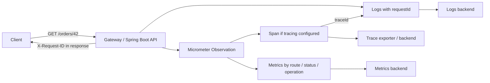

# Request ID tagging

In the **Cardinality and metadata** chapter of the **SPRING_BOOT_OBSERVABILITY** module, attaching a **request ID** to telemetry raises an important question: *how can we track down a specific request without forcing the metrics system to store millions of time series?*

Spring Boot can combine **Micrometer Observation, metrics, logs, and distributed tracing** to investigate errors, latency, and request flow. A request ID is very useful for correlating logs and tracing events. However, it is almost always a **high-cardinality** value: every request carries a new ID. Attaching the request ID directly as a metric label can cause collection and storage costs to scale with traffic. This lesson guides you on choosing the right place for request IDs across observability signals, as well as propagating, governing, and using them safely in production applications.

## 1. Learning objectives

After this lesson, you will be able to:

1. Distinguish **request ID**, **trace ID**, **span ID**, and observation **metadata**.
2. Explain why `request.id` is unsuitable as a **low-cardinality tag** on metrics.
3. Put request IDs in **logs/MDC**, and only when needed add them as an observation **high-cardinality key-value** to support tracing.
4. Generate and return `X-Request-ID` in a Spring MVC application while avoiding leaking MDC across requests.
5. Use Micrometer Observation to measure business operations without blowing up time series counts.
6. Distinguish application-managed request IDs from standard W3C context used for distributed tracing.
7. Assess the impact of propagation, sampling, exporters, log access permissions, and retention policies on incident investigation capability.

## 2. What is a Request ID?

A **Request ID** is an identifier used to correlate events belonging to a request or an activity the application cares about. A gateway can generate an ID and return it to the client via `X-Request-ID`. When users report an error, they provide this ID so the operations team can look up logs.

For example, a response might contain:

```http
HTTP/1.1 500 Internal Server Error
X-Request-ID: 47bc07fe-6261-4d1d-9570-4f36f4ae0ec5
Content-Type: application/json
```

The corresponding log line might be:

```text
2026-11-22T10:12:08Z ERROR order-api requestId=47bc07fe-6261-4d1d-9570-4f36f4ae0ec5 traceId=6a2e78b9b0b44a12b22d1ece653b58a7 spanId=807766d1a369b828 Dependency timeout: inventory-service
```

Here, the request ID helps find the event; `traceId` opens the distributed trace if the trace was captured; `spanId` identifies the active span when the log was written. They can appear together yet serve different purposes.

| ID type | Role | Typical lifecycle | Appropriate usage |
| --- | --- | --- | --- |
| **Request ID** | Correlation code defined by gateway/application. | Usually one request from the issuing system's perspective; may be forwarded. | Response header, log field, occasionally trace attribute. |
| **Trace ID** | Identifies a trace consisting of related spans. | Can span multiple services and multiple hops. | Log correlation, tracing backend lookup, exemplars if supported. |
| **Span ID** | Identifies a specific span. | One unit of work within a trace. | Identifies the span corresponding to a log or error. |
| **Low-cardinality tag** | Groups aggregated metrics across a finite value set. | Repeated across very many requests. | Metrics by `operation`, route template, status, outcome. |

`X-Request-ID` is a common convention and **does not replace the W3C Trace Context standard**. Two different requests may be linked within the same trace depending on system flow, and a request ID may only have meaning within one gateway. Never assume request ID always equals trace ID.

## 3. Why is attaching request ID to metrics dangerous?

A time series in a system like Prometheus is distinguished by **the metric name and the full set of label name–value pairs**. If every request has a distinct request ID, adding `request_id` to a metric creates a new label combination on almost every execution.

### Cardinality example

Suppose an API handles an average of **100 requests/second** over 24 hours:

```text
100 requests/second × 60 seconds × 60 minutes × 24 hours
= 8,640,000 requests/day
```

If each request has a unique ID, a timer labeled with `request_id` can generate roughly **8.64 million distinct label values per day**, even when all requests hit the same route. Other labels such as method, status, instance, or histogram buckets further multiply series count and stored samples.

Example design **to avoid**:

```text
http_server_requests_seconds_count{
  method="GET",
  uri="/orders/{id}",
  request_id="47bc07fe-6261-4d1d-9570-4f36f4ae0ec5"
} 1

http_server_requests_seconds_count{
  method="GET",
  uri="/orders/{id}",
  request_id="d781042c-ea3d-4d16-9f77-9d003b3ba840"
} 1
```

Two requests of the same kind with different `request_id` values will not land in the same series. High series count drives up backend memory/indexing, strains scraping and queries, and makes retention hard to manage. Even if dashboards aggregate them via PromQL, the system still has to collect all those raw series initially.

For the same endpoint, a better metric is:

```text
http_server_requests_seconds_count{
  method="GET",
  uri="/orders/{id}",
  status="200"
} 8295
```

This metric describes a **group of requests** rather than each individual request. With Micrometer, routes should be normalized like `/orders/{id}`, never using URLs containing real IDs like `/orders/478219` as the `uri` label.

**Principle:** request ID is great for locating **one event**, but unsuitable for **grouping all metric measurements**.

## 4. The right place for Request ID

Not every observability field belongs in a metric tag. A system typically has three kinds of data:

| Storage location | Use request ID? | Explanation |
| --- | --- | --- |
| **Micrometer Observation low-cardinality key-value** | **No** | Metrics handlers can turn it into time-series labels, causing very high cardinality. |
| **Observation high-cardinality key-value** | **Selectively** | Tracing handlers can use it as a span attribute; still incurs trace storage/index cost. |
| **Structured logs or MDC** | **Usually suitable** | Can filter to the exact request, combined with service, environment, timestamp, and error type. |
| **HTTP response header** | **Yes** | Gives the client a reference code when reporting incidents. |
| **Prometheus label or metric name** | **No** | Do not create a time series or metric name per request. |
| **W3C `traceparent`** | **Do not inject custom request IDs here** | Standard header holding trace ID, parent span ID, and trace flags; must be managed by the proper propagator. |

In Micrometer Observation, metric-grouping metadata belongs in `lowCardinalityKeyValue(...)`:

```java
Observation.createNotStarted("order.lookup", registry)
        .lowCardinalityKeyValue("operation", "lookup")
        .lowCardinalityKeyValue("dependency", "order-database");
```

If there is an investigative requirement on the tracing backend and access/data policies have been evaluated, request ID can be placed separately in `highCardinalityKeyValue(...)`:

```java
Observation.createNotStarted("order.lookup", registry)
        .lowCardinalityKeyValue("operation", "lookup")
        .highCardinalityKeyValue("request.id", requestId);
```

With standard handlers, high-cardinality key-values are reserved for detailed tracing info rather than aggregated metric labels. However, **high cardinality is neither free nor automatically safe**. Depending on the backend, request ID can still load indexes, incur storage costs, and introduce data-exposure risks via trace query permissions.

Never put request ID into the observation name:

```java
// Wrong: name changes for every request.
Observation.createNotStarted("order.lookup." + requestId, registry);

// Right: stable name, variable values kept in the appropriate place.
Observation.createNotStarted("order.lookup", registry);
```

Similarly, do not set request ID as an application-wide `management.metrics.tags.*` common tag or attach it to every timer.

## 5. Flow linking the three signals

A typical request observability workflow looks like this:



In the diagram, logs are typically emitted by the application or logging library; Micrometer Observation does not automatically write every log line. Tracing integration can populate `traceId`/`spanId` into MDC for logs, whereas `requestId` is usually application-managed metadata.

When an error occurs, the ideal investigation sequence is:

1. **Metrics** reveal error rates or latency by route, time, and service.
2. The user or alert provides the **request ID**; operations uses it to search logs in the corresponding time window.
3. From the log line, grab the **trace ID** (if present) to open the distributed trace.
4. Inspect the span tree, durations, retries, dependencies, and attributes to form a root-cause hypothesis.
5. After fixing the bug, return to metrics to verify improvement across a sufficiently large sample of requests.

Not every request has a stored trace, due to **sampling** or exporter/collector failures. Request ID in logs remains a useful lookup path when the corresponding trace is absent.

## 6. Spring Boot example: generating Request ID at the entry point

The following example uses **Spring Boot 3.x, Spring MVC, and Java 17+**. At the public HTTP boundary, the application generates a random request ID, stores it in a request attribute, returns it in a response header, and sets it in SLF4J MDC for logs written on the current thread.

With Gradle, include the appropriate starters:

```groovy
dependencies {
    implementation 'org.springframework.boot:spring-boot-starter-web'
    implementation 'org.springframework.boot:spring-boot-starter-actuator'
}
```

Use `OncePerRequestFilter`:

```java
import java.io.IOException;
import java.util.UUID;

import jakarta.servlet.FilterChain;
import jakarta.servlet.ServletException;
import jakarta.servlet.http.HttpServletRequest;
import jakarta.servlet.http.HttpServletResponse;

import org.slf4j.MDC;
import org.springframework.stereotype.Component;
import org.springframework.web.filter.OncePerRequestFilter;

@Component
public class RequestIdFilter extends OncePerRequestFilter {

    public static final String REQUEST_ID_ATTRIBUTE =
            RequestIdFilter.class.getName() + ".requestId";

    @Override
    protected void doFilterInternal(HttpServletRequest request,
                                    HttpServletResponse response,
                                    FilterChain chain)
            throws ServletException, IOException {

        String requestId = UUID.randomUUID().toString();
        String previous = MDC.get("requestId");

        request.setAttribute(REQUEST_ID_ATTRIBUTE, requestId);
        response.setHeader("X-Request-ID", requestId);
        MDC.put("requestId", requestId);

        try {
            chain.doFilter(request, response);
        } finally {
            // Do not let previous request metadata linger on a reused thread.
            if (previous == null) {
                MDC.remove("requestId");
            } else {
                MDC.put("requestId", previous);
            }
        }
    }
}
```

**Why generate a random request ID?** `UUID.randomUUID()` minimizes collisions and avoids trusting arbitrary values from clients. A request ID is a **correlation code**, not an authentication token, authorization key, or credential granting access to user data.

**Why clean up MDC?** Servlet containers reuse threads across requests. Forgetting to restore or remove MDC in `finally` can cause a subsequent request to inherit the previous request's ID, making logs untrustworthy. `OncePerRequestFilter` in this example handles **synchronous** request processing; with asynchronous dispatch, thread pools, or reactive execution, a compatible context propagation mechanism is required. Do not expect MDC to propagate automatically across threads.

**Example scope:** this filter generates a new ID at an **external entry point**. If the service sits behind a gateway that already issued an ID and you want to preserve the same ID across multiple services, do not blindly generate a new UUID at every hop. Accept and forward request IDs only from **trusted** sources, with length/character validation; distributed tracing continues using standard propagation headers.

### Displaying MDC in logs

An illustrative logging configuration:

```yaml
logging:
  pattern:
    level: "%5p [requestId=%X{requestId:-} traceId=%X{traceId:-} spanId=%X{spanId:-}]"
```

This configuration places MDC fields inside the level portion of console log lines per the example pattern. If your environment uses structured JSON logging, define three distinct fields for indexing/searching rather than relying solely on a text pattern. Customizing the pattern may override the default correlation format of your Spring Boot version; inspect actual logs after applying.

`requestId` is placed into MDC by the filter. `traceId` and `spanId` appear only if the tracing integration provides the appropriate context. Do not assume tracing is fully working just because logs contain `requestId`.

## 7. Attaching Request ID to a custom observation properly

Suppose `OrderController` handles `/orders/{id}`. The filter above stored the request ID in a request attribute. The controller passes that ID down to the service; the service puts it only into **high-cardinality metadata**, while metric tags use stable values.

Controller example:

```java
import jakarta.servlet.http.HttpServletRequest;

import org.slf4j.Logger;
import org.slf4j.LoggerFactory;
import org.springframework.web.bind.annotation.GetMapping;
import org.springframework.web.bind.annotation.PathVariable;
import org.springframework.web.bind.annotation.RequestMapping;
import org.springframework.web.bind.annotation.RestController;

@RestController
@RequestMapping("/orders")
public class OrderController {

    private static final Logger log =
            LoggerFactory.getLogger(OrderController.class);

    private final OrderLookupService service;

    public OrderController(OrderLookupService service) {
        this.service = service;
    }

    @GetMapping("/{id}")
    public Order getOrder(@PathVariable Long id, HttpServletRequest request) {
        String requestId = (String) request.getAttribute(
                RequestIdFilter.REQUEST_ID_ATTRIBUTE);

        log.info("Looking up order");
        return service.load(id, requestId);
    }
}
```

Service example:

```java
import java.util.NoSuchElementException;

import io.micrometer.observation.Observation;
import io.micrometer.observation.ObservationRegistry;
import org.springframework.stereotype.Service;

@Service
public class OrderLookupService {

    private final ObservationRegistry registry;
    private final OrderRepository repository;

    public OrderLookupService(ObservationRegistry registry,
                              OrderRepository repository) {
        this.registry = registry;
        this.repository = repository;
    }

    public Order load(Long orderId, String requestId) {
        Observation observation =
                Observation.createNotStarted("order.lookup", registry)
                        .contextualName("load order")
                        .lowCardinalityKeyValue("operation", "lookup")
                        .lowCardinalityKeyValue("backend", "order-database");

        if (requestId != null) {
            observation.highCardinalityKeyValue("request.id", requestId);
        }

        return observation.observe(() ->
                repository.findById(orderId)
                        .orElseThrow(() ->
                                new NoSuchElementException("Order not found")));
    }
}
```

`Order` and `OrderRepository` are application types that must be defined in real use. `observe(...)` manages the observation lifecycle for a synchronous lambda; it does not alter the REST controller's exception handling. Spring Boot still needs an appropriate exception handler to map `NoSuchElementException` to the desired HTTP status instead of treating it as a server error by default.

**Expected signals** when handlers are configured:

- The `order.lookup` metric is grouped by `operation=lookup` and `backend=order-database`. **Do not add `request.id` to low-cardinality metric tags.**
- If the tracing handler is active and the trace is captured, the operation's span can contain the `request.id` attribute.
- Logs from the controller/service within the proper scope carry the `requestId` field from MDC; tracing integration can add `traceId`/`spanId`.
- The response carries `X-Request-ID`, enabling clients to report the code on failure.

Attaching request ID as a high-cardinality key-value on **every** custom observation also has a cost. In very large systems, having the ID in logs and using the trace ID to open spans may be sufficient. Deciding to add an attribute to spans should weigh search needs, sampling, indexing policy, and retention.

## 8. Request ID vs. trace context and baggage

### 8.1 Distributed tracing uses `traceparent`

When one Spring Boot service calls another, spans are linked into the same distributed trace through propagation. Over HTTP, W3C Trace Context uses `traceparent` and optionally `tracestate`:

```http
GET /stock HTTP/1.1
Host: inventory-service
traceparent: 00-6a2e78b9b0b44a12b22d1ece653b58a7-807766d1a369b828-01
```

The trace ID in the example has 32 hex characters; the parent span ID has 16 hex characters. Properly instrumented client and server libraries inject/extract context. A custom request ID **cannot replace** parent span info, sampling flags, or this propagation standard.

If you need the same request ID in logs across multiple services, you can forward `X-Request-ID` **explicitly** among trusted services. However:

- Define clearly which gateway issues the ID and which services may overwrite it.
- Validate the source and cap length/characters when accepting an ID from headers; never inject untrusted raw input into logs or labels.
- Do not treat request ID as secret data or authentication credentials.
- With retries, fan-out, or async messaging, define whether request ID represents the initial request or each execution attempt; multiple spans may share one request ID.
- Tracing still requires `traceparent`; if a service loses propagation, having the same request ID in logs **will not restore parent–child span relationships**.

### 8.2 Baggage is not the default home for every Request ID

Micrometer Tracing and tracing systems have *baggage*: key-value pairs that can be propagated inside trace context when configured. However, baggage can cross many hops, bloat header sizes, reach external components, and leak data into unintended places.

Do not turn every request ID into baggage by default just to avoid writing propagation code. If a system needs cross-service metadata, establish a field allowlist, size limits, trust-boundary handling, and propagator compatibility. For many use cases, **trace ID is enough** to link internal logs, while request ID stays primarily at the gateway and in logs for customer support.

### 8.3 Async and Reactor

Traditional MDC is bound to thread execution context. When code uses `@Async`, `CompletableFuture`, thread pools, or Reactor, a log emitted on another thread can **lack `requestId`** or trace context without proper propagation.

```java
// Illustrating a context bug, not recommended implementation.
CompletableFuture.runAsync(() -> {
    log.info("Background processing"); // MDC requestId may be missing.
});
```

Use the context propagation mechanism compatible with Spring Boot/Micrometer/Reactor and your application executors, and clean up context within the proper scope. Never store request IDs in shared static variables or scatter `ThreadLocal` usage without cleanup.

## 9. What information should metrics keep?

Useful labels are dimensions with a relatively small number of values and clear operational meaning:

| Tag | Example | Assessment |
| --- | --- | --- |
| `method` | `GET`, `POST` | Usually low cardinality. |
| `uri` as route template | `/orders/{id}`, `/checkout` | Good when normalized. |
| `status` or `outcome` | `200`, `500`, `success`, `error` | Usually low cardinality. |
| `dependency` | `inventory-service`, `payment-service` | Usable when the catalog is controlled. |
| `request.id` | New UUID per request | High cardinality; avoid on metrics. |
| `user.id`, `order.id` | User/order ID | High cardinality and potentially sensitive. |
| Raw URL path | `/orders/487213` | Should not be used directly as the `uri` metric tag. |

PromQL example identifying 5xx errors for a route (assuming Micrometer Prometheus exports metrics with these names and labels):

```promql
sum(
  rate(http_server_requests_seconds_count{
    method="GET",uri="/orders/{id}",status=~"5.."
  }[5m])
)
```

To compare against total traffic:

```promql
sum(
  rate(http_server_requests_seconds_count{
    method="GET",uri="/orders/{id}"
  }[5m])
)
```

These queries track **trends** rather than answering “which request ID failed?”. Per-request answers belong to logs and traces. When multiple services or environments share one Prometheus, add filters on actual distinguishing labels so data is not mixed incorrectly.

To see the exact metric names and labels exported, check `/actuator/prometheus` in a protected environment; names depend on version, registry, and convention. Avoid assuming that simply adding a `request_id` label lets you query individual requests without hurting performance.

## 10. Exporters and sampling affect lookup

When using Micrometer Tracing with a bridge like OpenTelemetry and its exporter, observations can produce tracing spans and export them to a collector/backend. A Spring Boot 3.x test configuration typically adds:

```groovy
dependencies {
    implementation 'io.micrometer:micrometer-tracing-bridge-otel'
    implementation 'io.opentelemetry:opentelemetry-exporter-otlp'
    implementation 'io.micrometer:micrometer-registry-prometheus'
}
```

Illustrative `application.yml`:

```yaml
spring:
  application:
    name: order-api

management:
  endpoints:
    web:
      exposure:
        include: health,metrics,prometheus
  tracing:
    sampling:
      probability: 1.0
  otlp:
    tracing:
      endpoint: http://otel-collector:4318/v1/traces
```

This configuration assumes a collector listening for OTLP HTTP on port `4318` at path `/v1/traces`. `sampling.probability: 1.0` should only be used in testing or when cost and load are controlled; production needs an appropriate sampling policy. Actuator endpoints must also have access controls restricted.

If the support team has a request ID but cannot find a trace:

1. Search logs by request ID and timestamp to verify whether the request actually reached the service.
2. Find `traceId` in the log and check service/environment filters in the tracing backend.
3. Verify whether the trace was sampled; **no stored trace** does not mean the request never occurred.
4. Check for exporter, collector, queue/drop, or backend errors.
5. Verify whether the span attached `request.id`, if the application intended to include that attribute.
6. If `traceId` is missing from logs, check instrumentation, logging/MDC, and async propagation.

**Metrics sampling and trace sampling are two separate stories:** a metric timer can aggregate every execution while only a subset of traces are exported. Therefore, never design alerts, dashboards, or SLOs based on counting request IDs present in the tracing backend.

## 11. Security and governance of Request ID

A Request ID is usually a random string, yet it can still serve as a **linking key** to sensitive data in logs. Receiving, storing, and displaying it requires clear rules:

- **Do not trust arbitrary input.** If reading `X-Request-ID` from clients, define trust boundaries, enforce length limits, validate character sets, and prevent log forging/header injection. At the public edge, issuing a new ID is a simple policy.
- **Do not use request ID as an access token.** Knowing a request ID must not grant someone access to view orders, personal info, or corresponding logs.
- **Do not add sensitive data to tags.** Keep request bodies, emails, access tokens, and customer identifiers out.
- **Govern log/trace read permissions.** Support dashboards should expose only appropriate fields and time ranges.
- **Enforce retention, masking, and size limits.** Span attributes and log fields incur storage/index costs; request ID is not exempt from these policies.
- **Define ID scope.** If IDs are generated per service, one end-to-end request may carry multiple request IDs. Document which service/gateway issues the ID, and correlate via trace ID when tracing data is available.

The uniqueness of a UUID does not turn a request ID into a legal identifier or definitive proof of a user. It is strictly a **correlation datum**.

## 12. Hands-on workflow and verification

Suppose you have just implemented the filter from section 6 and the custom observation from section 7.

### Step 1: Call the endpoint and inspect the header

```bash
curl -i http://localhost:8080/orders/42
```

With a running application and existing route, the response is expected to include `X-Request-ID`. If the request errors, the header can still be returned because the filter attached it before running the controller, unless another layer overwrites the response or the response is handled outside the filter's scope.

### Step 2: Search logs by Request ID

Search for the `requestId` field using the value obtained from the response. Verify the same ID appears in logs emitted on the request-handling thread, and **does not leak mistakenly** into the next request.

If logs lack `traceId`, check the tracing bridge and active context. If code hops to another thread, check MDC propagation.

### Step 3: Inspect metrics without adding a Request ID label

```bash
curl -s http://localhost:8080/actuator/metrics
curl -s http://localhost:8080/actuator/metrics/order.lookup
curl -s http://localhost:8080/actuator/prometheus
```

`order.lookup` appears at `/actuator/metrics/order.lookup` only if handlers actually create that metric. Inspect exported labels: grouped by `operation`, `backend`, and stable tags; do not expect `request.id` to be a metric label.

### Step 4: Open the trace if available

Use `traceId` from logs to look up the corresponding trace. If the `order.lookup` span was retained and the backend stores high-cardinality attributes, you can see `request.id` on the span. Check parent/child relationships, durations, and exceptions; never use a single trace to infer the overall request error rate.

### Step 5: Test error cases and repeated load

Trigger a controlled error response; verify `X-Request-ID` and logs still allow correlation. Then send multiple repeated requests. Verify neither execution time nor metric series grow with the **number of unique IDs**. In production environments, add monitoring for active series/ingestion and retention in the observability system.

This is a lesson-level manual verification workflow; add proper integration tests if your project shares a common filter across multiple services or execution models.

## 13. Common errors

| Symptom | Possible cause | Resolution |
| --- | --- | --- |
| Prometheus series surge after adding request ID | `requestId` attached as a low-cardinality tag or common label. | Remove high-cardinality labels from metrics; use logs/traces for per-request investigation. |
| Route dashboard has thousands of `uri` values | Instrumentation uses raw URLs containing IDs. | Use route templates and URL normalization rules. |
| Response has request ID but logs do not | MDC not set, logging pattern not updated, or logs ran out of scope. | Check filter, log config, and propagation. |
| Next request's logs carry previous request's ID | MDC not cleaned up when thread is reused. | Clean up in `finally`; check async execution. |
| Cannot find span by request ID | Attribute not added, trace sampled out, or exporter/backend doesn't store it. | Search logs to get trace ID; check instrumentation and tracing pipeline. |
| Two services log different request IDs | Each service generates a new ID instead of forwarding from trusted gateway. | Define issuing/forwarding policy; use `traceparent` for cross-service traces. |
| Span has request ID but metric dashboard does not | Usually the **intended** design. | Use metrics for trends, logs/traces to look up specific requests. |
| Logs have request ID but no trace ID | Tracing unconfigured, missing active context, or missing logging correlation. | Check bridge, scope, MDC, and async propagation. |

## 14. Self-check exercises

### Exercise 1: Choosing where to attach Request ID

Consider this snippet:

```java
Observation.createNotStarted("checkout.process", registry)
        .lowCardinalityKeyValue("request.id", requestId)
        .observe(() -> checkout());
```

**Question:** What is the issue and how should it be fixed?

**Answer:** `request.id` has far too many distinct values to serve as a low-cardinality tag. Keep `checkout.process` and finite-value tags such as `operation=checkout`, `outcome=success/error`. Put request ID in logs/MDC; if trace lookup by ID is needed and cost has been evaluated, use `highCardinalityKeyValue("request.id", requestId)`.

### Exercise 2: Request ID and Trace ID

A user provides `X-Request-ID`, but the tracing backend only searches by trace ID. How do you investigate?

**Answer:** Filter logs by request ID and service/time; grab the trace ID from the log line, then open the trace. If there is no trace ID or the trace was sampled out, continue investigating with logs and metrics while checking instrumentation/propagation.

### Exercise 3: Calculating cardinality

An API receives 50 requests/second, with a unique request ID every time. Approximately how many distinct ID values occur in one day?

**Answer:**

```text
50 × 60 × 60 × 24 = 4,320,000 values/day
```

If placed in a metric label, the ID alone yields millions of label values per day. That is not even the full actual series count, since metrics can have multiple series types and tag combinations.

### Exercise 4: Why did logs get the wrong ID?

Two consecutive requests arrive on the same servlet thread; the second request's logs display the first request's ID. Which cause should you check first?

**Answer:** MDC was not cleared or restored in `finally`, or context propagation across a thread pool failed. Check exception paths and cleanup logic rather than assuming the client reused an ID.

### Exercise 5: Does a trace attribute mean a metric tag?

A custom observation has `highCardinalityKeyValue("request.id", requestId)`; a span displays the request ID, yet Prometheus has no `request.id` label. Is data missing?

**Answer:** No. This is the intended separation between detailed attributes for tracing investigation and metric labels for aggregation. Also check tracing policies, privacy, and attribute storage/indexing costs.

## 15. Implementation checklist

- [ ] Define where request ID is generated, whether it is forwarded, and its scope.
- [ ] Do not put request ID into metric names, low-cardinality tags, or Prometheus common labels.
- [ ] Keep observation names and route templates stable.
- [ ] Attach request ID in logs/MDC, with cleanup after every request.
- [ ] Add request ID to trace attributes only when needed and after reviewing cost/retention.
- [ ] Use `traceparent` and proper instrumentation for distributed tracing; do not use request ID to replace parent context.
- [ ] Verify async/reactive context propagation; never store request info in static variables.
- [ ] Do not trust client-sent IDs without validation/trust-boundary rules.
- [ ] Do not use request ID as an authorization token or as justification to widen log access.
- [ ] Verify metrics, logs, and traces with the same test request, and test the case where a trace is sampled out.

**Key takeaway:** **Request IDs serve correlation and per-request lookup; metric tags serve aggregation across finite value groups.** With Spring Boot and Micrometer Observation, keep request IDs in logs/MDC, optionally in high-cardinality trace attributes, and out of low-cardinality metrics. Combining this metadata design with proper propagation, sampling, exporters, and backend access controls lets operations teams investigate accurately without sacrificing observability system stability.
