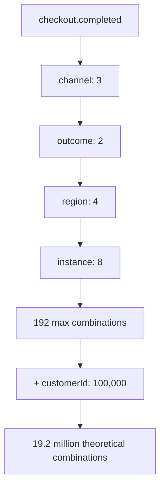

# Risks of creating metrics from dynamic values

## 1. Objectives and context

In a Spring Boot system with observability, metrics quickly answer questions like: *how many orders failed in the last 5 minutes*, *is checkout processing latency increasing*, and *which service is overloaded*. However, adding more data to a metric does not always improve observability. If a metric name or **tag value** is built from unbounded IDs, URLs, error messages, or user input, the system can create a massive number of **time series**.

This lesson belongs to the **Cardinality and metadata** chapter of the **SPRING_BOOT_OBSERVABILITY** module. The content focuses on the concrete risks of **creating metrics from dynamic values**, how to avoid them when using Micrometer Metrics and Micrometer Observation in Spring Boot, and how to detect, control, and investigate incidents on the metrics backend. Connections to logs, distributed tracing, propagation, exporters, and sampling are explained where they affect metadata choices.

After this lesson, you will be able to:

1. Identify how a metric is distinguished by name and tag set.
2. Distinguish cardinality, current time series count, and series churn (continuously appearing new series).
3. Estimate series counts from tag dimensions, histograms, and instance counts.
4. Spot bugs that concatenate dynamic values into metric names, low-cardinality tags, or `MeterRegistry.counter(...)`.
5. Fix Spring Boot code using stable names, route templates, and finite tag groups.
6. Use `MeterFilter` as a defensive limit while understanding the side effects when meters are denied.
7. Diagnose cardinality spikes in Micrometer/Prometheus and choose traces/logs for request-level data.

## 2. The problem: one dynamic value can create a new series

Look at how successful orders are counted:

```java
meterRegistry.counter("checkout.completed",
        "result", "success").increment();
```

All calls with the same name `checkout.completed` and the same tag set `result=success` share one meter in the corresponding registry. With Prometheus, the counter name is typically converted to `checkout_completed_total`.

But if you add the order ID:

```java
// WRONG: each order can register a separate meter.
meterRegistry.counter("checkout.completed",
        "result", "success",
        "orderId", order.getId().toString()).increment();
```

The first call has `orderId=1001`, the next has `orderId=1002`, and so on. Each unique label set creates a new **meter identity** and typically leads to a new time series in the exporter/backend. With millions of orders, a counter that only needed a few series gets split per order.

Key point to remember:

> In Micrometer Metrics, meter identity depends on the **metric name and tag set** after configuration/mapping steps. A tag with a new value typically corresponds to a new meter/time series, even though the developer only wrote one `counter(...)` call.

Dynamic values are not just random numbers. Any field that can produce many distinct values over time must be evaluated: request ID, customer ID, unnormalized URL, error message, SQL query, timestamp, session ID, or user-supplied string.

## 3. What is cardinality and why is it hard to control?

**Tag cardinality** is the number of distinct values that can appear for one tag. Metric cardinality (at the series-set level) depends on the number of **tag value combinations that actually occur**, not just the number of tags attached.

Example for a checkout metric:

| Tag dimension | Assumed value count | Examples |
| --- | ---: | --- |
| `channel` | 3 | `web`, `mobile`, `other` |
| `outcome` | 2 | `success`, `failure` |
| `region` | 4 | Four deployment regions |
| `instance` | 8 | Eight running instances |

If every combination occurs, the maximum number of series for **one counter** is:

\[
3 \times 2 \times 4 \times 8 = 192\ \text{series}
\]

Suppose you add `customerId` with 100,000 independent values; the **theoretical upper bound** becomes:

\[
192 \times 100{,}000 = 19{,}200{,}000\ \text{series}
\]

The system will not immediately create all 19.2 million series: only combinations **actually recorded** appear. Still, the count can climb with customers, traffic, new instances, and unseen values. The problem becomes unpredictable when input data lacks a finite bound.

### 3.1. Visualizing the multiplication



The unit to monitor in the backend is **actual series count** together with the rate of new series creation. A dashboard showing just one aggregated `checkout.completed` line can still be querying across millions of series underneath.

### 3.2. Histograms add even more cost

A `Timer` configured to export classic Prometheus histograms can generate:

- One `_bucket` series per boundary, including the `+Inf` bucket.
- One `_count` series.
- One `_sum` series.

For example, a histogram with **8 finite boundaries** will have **9 buckets** when counting `+Inf`, plus `_count` and `_sum`: at least 11 output series per label combination, excluding other statistics or export formats.

If a metric has 5,000 label combinations, this histogram style alone can require around `5,000 × 11 = 55,000` time series. Enabling more buckets or SLO boundaries while a tag carries dynamic values worsens the issue. You cannot divide `_sum / _count` to infer p95; computing quantiles on classic histograms requires appropriate buckets.

### 3.3. Series churn differs from active series count

Suppose the system generates 10,000 new request IDs every minute, and each request ID is used only once. Even if not all series exist concurrently, the backend must **continuously process new series**: identity, indexing, samples, metadata, and storage/retention lifecycle.

Therefore, distinguish two metrics:

- **Active series/cardinality:** the number of series receiving samples in the recent data window.
- **Series churn:** the rate at which new label sets are created and old ones stop receiving samples.

Continuously generated IDs usually cause high churn, increasing CPU, memory, disk, network, and query time. Removing a tag from new code does not make historical data vanish immediately from the backend.

## 4. Dangerous sources of dynamic values

| Source | Example to avoid as metric tag/name | Why risky | Typical suitable replacement |
| --- | --- | --- | --- |
| Order ID | `orderId=583214` | Nearly one value per transaction | `outcome=success|failure` |
| User/customer ID | `userId=76422` | Scales with users, privacy concerns | `customerTier=free|pro|enterprise` |
| Actual URL | `uri=/orders/583214` | Every ID creates a different label | Route template `/orders/{id}` |
| Path/query string | `path=/search?q=abc...` | Can come straight from input | Fixed route name, `operation=search` |
| Exception message | `error=timeout for order 583214` | Unstable, may contain secrets | `errorType=timeout|validation|other` |
| Stack trace or SQL | `sql=SELECT ... WHERE id=583214` | Very long, varies with parameters | `dbOperation=select`, `dbSystem=postgresql` |
| Session/trace ID | `traceId=4f...` | Almost every request gets a new value | Put in trace/log correlation when permitted |
| Timestamp | `window=2026-11-22T12:01:15Z` | Every instant creates a new label | Use the metric sample's timestamp |
| Arbitrary request header | `client=...input from user...` | Unbounded, easy to abuse | Allowlist/controlled groups |
| Metric name with ID | `checkout.completed.customer.123` | Each new name is a metric family | Fixed name and finite tags |

**Note on `tenantId`:** even though tenant counts may be low in a test environment, they can grow to tens or hundreds of thousands as the product scales. Treat it as a high-risk label unless there is a clear cardinality budget and enforced limit.

Non-sensitive data can still blow up cardinality. Conversely, low-cardinality data can still be disallowed in metrics if it contains sensitive info or personal identifiers.

## 5. First mistake: metric name changes per request

### Risky code

```java
String metricName = "payment.completed." + payment.getId();
meterRegistry.counter(metricName).increment();
```

For every new ID, the application creates a meter with a **new name**. Even with zero tags, meter count grows.

### Better code

```java
meterRegistry.counter("payment.completed",
        "provider", normalizeProvider(payment.getProvider()),
        "outcome", payment.isApproved() ? "approved" : "declined")
        .increment();
```

Here `normalizeProvider(...)` must return a controlled group of values (for example `bank-a`, `bank-b`, `other`), not an arbitrary string from the payment gateway.

The name `payment.completed` represents the **event/quantity to track**. Tags only describe bounded analytical dimensions. You do not need a different name per ID to know total payments.

## 6. Second mistake: attaching dynamic IDs to `MeterRegistry`

Anti-pattern:

```java
// BAD: customerId can have millions of values.
meterRegistry.counter("checkout.completed",
        "customerId", request.customerId(),
        "channel", request.channel())
        .increment();
```

Renaming the label to `customer` or `customer_id` solves nothing: the risk lies in the **number of values** of the tag, not the key name.

### 6.1. Better Spring Boot example: normalize before registering the meter

A Spring Boot 3.5.x application using `spring-boot-starter-actuator` can inject `MeterRegistry`. The following service classifies `channel` into a finite set and records only the checkout `outcome`:

```java
package com.example.checkout;

import io.micrometer.core.instrument.MeterRegistry;
import org.springframework.stereotype.Service;

@Service
public class CheckoutMetrics {
    private final MeterRegistry meters;

    public CheckoutMetrics(MeterRegistry meters) {
        this.meters = meters;
    }

    public void recordCompleted(String rawChannel, boolean succeeded) {
        String channel = normalizeChannel(rawChannel);
        String outcome = succeeded ? "success" : "failure";

        meters.counter("checkout.completed",
                "channel", channel,
                "outcome", outcome)
                .increment();
    }

    private static String normalizeChannel(String value) {
        if ("web".equals(value)) {
            return "web";
        }
        if ("mobile".equals(value)) {
            return "mobile";
        }
        return "other";
    }
}
```

The critical control point is `normalizeChannel`: any unknown value collapses into `other`, so `channel` has at most three values and `outcome` has two. With these tags, the counter has at most `3 × 2 = 6` combinations **within one registry**, before labels added by pipelines/backends at the instance, namespace, or environment level.

You can call:

```java
checkoutMetrics.recordCompleted("web", true);
checkoutMetrics.recordCompleted("web", false);
checkoutMetrics.recordCompleted("mobile", true);
checkoutMetrics.recordCompleted("some-untrusted-input", false);
```

All data rolls up into finite series. If you need to know whether a specific `customerId` paid, use an event database, audit system, or controlled business query; an aggregate counter is not a customer-ID search engine.

### 6.2. Watch the habit of calling `register` on the hot path

```java
Counter counter = Counter.builder("checkout.completed")
        .tag("orderId", String.valueOf(order.getId()))
        .register(meterRegistry);
counter.increment();
```

Although `Counter.builder(...).register(...)` is called on every request, the registry normally returns the already-registered meter when **name/tags match**. However, when new `orderId` values keep arriving, the registry must register **new meters**. Do not assume putting `register()` inside a method causes the meter to be automatically deleted when the method finishes.

If you want to optimize CPU, you can reuse meters with fixed tag sets; however, **reusing objects cannot fix a flawed tag cardinality design**. Storing `Counter` as a field in a singleton does not solve a metric with millions of labels either.

## 7. Third mistake: URIs and dynamic paths

An error-prone design:

```java
String rawPath = request.getRequestURI(); // /orders/1001, /orders/1002 ...
meterRegistry.timer("checkout.http.duration",
        "uri", rawPath)
        .record(() -> handleRequest(request));
```

This snippet illustrates what to avoid, not a pattern to drop into a controller already covered by Spring MVC instrumentation.

In Spring MVC, framework-provided HTTP server metrics/observations normally use a **route template** like `/orders/{id}` instead of the full URI containing IDs, provided the framework can resolve the route. When adding custom business metrics, use a fixed operation name (`checkout.process`) or a finite `operation` group, rather than pasting the raw URL into a tag.

Also avoid attaching the full query string because `?q=...`, `?page=...`, or `?token=...` can have unbounded values and contain sensitive information.

| Input value | Desired metric label |
| --- | --- |
| `/orders/1001` | `uri=/orders/{id}` |
| `/orders/1002` | `uri=/orders/{id}` |
| `/orders/1003?expand=lines` | `uri=/orders/{id}` |
| `/health` | `uri=/health` if route needs observing |
| Unrecognized route | Stable group like `UNKNOWN`/framework-defined label, depending on use case |

Do not truncate a few characters of an ID to “reduce” cardinality; that still creates many meaningless groups and invites collisions. Normalize **by route structure** or a finite set of business operations.

## 8. Observation: low-cardinality and high-cardinality metadata

Micrometer Observation supports two distinct groups of key-values:

| Metadata group | Examples | Effect on metrics/traces |
| --- | --- | --- |
| `lowCardinalityKeyValue` | `channel=web`, `outcome=success` | Can become metric tags and span attributes via handlers |
| `highCardinalityKeyValue` | Technical workflow ID, if permitted | Typically for span attributes; not used as metric tags by standard observation handlers |
| Internal data in `Observation.Context` | `checkout.phase=validating` | Does not automatically become tags/attributes; handlers must explicitly export it |

### Anti-pattern with Observation

```java
// BAD: low-cardinality key whose value is nearly unique per order.
Observation.createNotStarted("checkout.process", observationRegistry)
        .lowCardinalityKeyValue("order.id", order.id())
        .observe(() -> process(order));
```

An observation can create a Timer metric with `order.id` as a label; this carries the same risk of creating massive numbers of time series as `MeterRegistry.counter(...)`.

### Appropriate version

```java
String channel = "web".equals(order.channel()) ? "web" : "other";

Observation.createNotStarted("checkout.process", observationRegistry)
        .contextualName("process checkout")
        .lowCardinalityKeyValue("channel", channel)
        .observe(() -> process(order));
```

If a system needs to look up traces for individual workflows, an **opaque ID that is permitted for recording and data-checked** can be attached to high-cardinality metadata:

```java
Observation.createNotStarted("checkout.process", observationRegistry)
        .lowCardinalityKeyValue("channel", channel)
        .highCardinalityKeyValue("workflow.id", safeWorkflowId)
        .observe(() -> process(order));
```

This is a *policy-dependent* option, not a recommendation to record every ID. `highCardinalityKeyValue` does not turn the value into a metric tag via standard metrics handlers, yet the trace backend still stores the attribute; it incurs storage, search, retention costs, and security requirements. Sampling can reduce how many traces are sent, but cannot fix a metric that already generated dynamic labels at the metrics layer.

**Propagation note:** W3C `traceparent` primarily carries trace context to link spans; it **does not automatically propagate** every high-cardinality key-value or `Observation.Context` to other services. Baggage requires its own configuration and should not be used to broadcast unnecessary IDs or secrets.

## 9. Metrics, traces, and logs do not share the same metadata budget

A payment event may require two levels of observability:

- **Aggregate observability:** transaction counts by `provider`, `channel`, `outcome`; p95 latency by service or route.
- **Individual investigation:** why a specific workflow was slow or failed, which exception, which request ID, which span.

Different tools solve each goal:

| Signal | Suitable data | Main limitation |
| --- | --- | --- |
| Metrics | Aggregated along a few finite dimensions | Series explosion if tags are too diverse |
| Traces | Span chains for sampled requests and controlled attributes | Span/attribute cost, sampling, privacy, retention |
| Logs | Event/exception details with correlation ID | Volume, ingestion cost, search cost, data exposure risk |
| Database/audit/analytics | User/order-level events requiring exact lookup | Dedicated storage, query, and access-control design |

In Spring Boot, metrics can flow through Micrometer Registry to Prometheus or OTLP. Tracing flows through Micrometer Tracing/bridges and exporters; logs usually go through SLF4J/Logback via another pipeline. Never try to turn metrics into a per-request log.

Trace sampling **has no effect on reducing the number of series** created by code in `MeterRegistry`; only metric/tag selection policies and meter filters control cardinality at the metrics layer.

## 10. Extra defense: limiting value counts with `MeterFilter`

The most durable solution is **normalizing labels at the source**. In large systems where many libraries create meters, you can add a defensive cap to stop a tag from taking too many values:

```java
package com.example.checkout.config;

import io.micrometer.core.instrument.config.MeterFilter;
import org.springframework.context.annotation.Bean;
import org.springframework.context.annotation.Configuration;

@Configuration(proxyBeanMethods = false)
public class MetricCardinalityGuardrails {

    @Bean
    MeterFilter limitCheckoutChannels() {
        return MeterFilter.maximumAllowableTags(
                "checkout.completed",   // Meter name prefix to control
                "channel",              // Tag key
                3,                      // Allowed distinct value count
                MeterFilter.deny());    // Deny meters exceeding threshold
    }
}
```

Spring Boot Actuator automatically applies `MeterFilter` beans to the `MeterRegistry` it manages. A `MeterRegistry` instantiated manually outside Spring Boot will not pick up this configuration automatically.

How it works at a design level:

1. `maximumAllowableTags` tracks the number of distinct tag values for meters whose names match the prefix.
2. When a new value exceeds the limit, `onMaxReached` decides what to do; `MeterFilter.deny()` rejects meters past the threshold.
3. Denied meters do not record measurements for that tag set. Thus **total counts can underreport** if you rely solely on the filter instead of fixing the code emitting the tag.

This limit **does not** automatically cap other tags like `orderId`, changing metric names, or issues in an exporter outside the Micrometer Registry flow. It does not automatically roll a fourth value into `other`; for accurate aggregation, normalize before creating the meter.

### When the limit does not fix the root cause

If upstream code generates 100,000 `channel` values, a limit of three values can block most new meters and protect memory. However, dashboards then **stop reflecting all requests**. You must fix the producer to map unknown values to `other`, review alerting rules, and re-verify total count accuracy.

`MeterFilter` also supports certain deny/rename/map operations, which can affect meter names/identities after mapping; test them against a real registry with clear rules. For Observation naming/tags, `ObservationConvention` or `ObservationFilter` modifies metadata at a different layer and does not fully replace `MeterFilter`.

## 11. Verifying cardinality via Spring Boot Actuator and Prometheus

### 11.1. Setting up the measurement environment

With Spring Boot 3.5.x, a Maven example using the Spring Boot BOM:

```xml
<dependencies>
    <dependency>
        <groupId>org.springframework.boot</groupId>
        <artifactId>spring-boot-starter-actuator</artifactId>
    </dependency>
    <dependency>
        <groupId>io.micrometer</groupId>
        <artifactId>micrometer-registry-prometheus</artifactId>
    </dependency>
</dependencies>
```

A local test configuration:

```yaml
management:
  endpoints:
    web:
      exposure:
        include: health,metrics,prometheus
```

If the application also uses Spring MVC or WebFlux, Spring Boot normally provides HTTP server metrics/observations as well. The `/actuator/prometheus` endpoint requires the Prometheus registry and web exposure. In production, restrict access to operational endpoints.

Verification steps:

1. Call `CheckoutMetrics.recordCompleted` with many different order IDs across only three `channel` groups and two `outcome` groups.
2. Query `GET /actuator/metrics/checkout.completed` after the code runs to inspect tags present in the registry.
3. Check `GET /actuator/prometheus`, looking for the corresponding metric such as `checkout_completed_total` (exact name depends on registry/naming conventions).
4. Confirm tag combinations stay finite as order count increases; no `orderId`, `customerId`, `traceId`, or raw URL labels appear.
5. If testing the filter from section 10, verify clearly that over-threshold cases are denied and check whether total counts remain accurate.

### 11.2. Illustrative PromQL queries

**Current number of series returned for the checkout counter:**

```promql
count(checkout_completed_total)
```

If the metric has three `channel` values and two `outcome` values, theoretically there are at most six series per instance/added label group. When Prometheus scrapes multiple instances with distinct `instance` labels, the actual series count can exceed six.

**Series count per outcome group:**

```promql
count by (outcome) (checkout_completed_total)
```

This query counts **series**, not successful/failed transactions. To compute transaction rate, apply `rate` to the counter:

```promql
sum by (outcome) (rate(checkout_completed_total[5m]))
```

**Number of series currently in Prometheus's head block (when this internal metric is exposed):**

```promql
prometheus_tsdb_head_series
```

This is a Prometheus server-level indicator, not specific to one metric; it can be broken down by Prometheus instance on operational dashboards. To analyze series churn, you can also use internal metrics for newly created series if your deployment exposes them. Cross-check total series count, ingestion rate, CPU/RAM, and storage usage together.

**Warning:** the Prometheus query engine can consume heavy resources when querying a metric that already has millions of series. Limit label/time-range scope and watch query cost on live systems; never run broad scans across the entire TSDB while overloaded.

### 11.3. Real-world signs of a cardinality incident

- Active series surge after a deployment even though request rate did not rise proportionally.
- Registry or exporter uses more RAM/CPU; scrapes slow down, time out, or metric payloads bloat.
- Metrics backend stores much more data; queries and dashboards slow down; alerts miss data.
- New metric names keep appearing or labels like `orderId`, `url`, `session` have huge value counts.
- Series churn spikes when traffic hits endpoints with dynamic IDs.

Do not conclude from a single symptom: adding instances, enabling histogram buckets, changing naming conventions, or adding instrumentation can also raise series counts. Compare metric families, label sets, and deployment timestamps to find the cause.

## 12. Handling a high-cardinality incident

Example: after deploying a new version, series from checkout spike abnormally and Prometheus starts timing out scrapes.

1. **Narrow down:** identify the fastest-growing metric family and inspect sample names/tags. If you see `orderId` or raw `uri`, flag it as a suspected cardinality source.
2. **Assess impact:** check active series, series creation rate, scrape duration, RAM, CPU, and backend health.
3. **Contain impact:** temporarily disable the dangerous metric at the source or apply an appropriate `MeterFilter`; note that blocking meters may leave gaps in metrics.
4. **Fix the root cause:** remove IDs from names/tags; use route templates and finite value sets; if request-level data is needed, choose traces/logs/audit per policy.
5. **Verify:** drive many distinct requests/IDs in a test environment; confirm meter counts per tag group do not grow with ID count.
6. **Monitor post-deploy:** active series may drop gradually or according to backend retention; historical data does not vanish the instant the app stops emitting dynamic labels.

Making an incompatible change to a metric family can affect dashboards, alerts, and recording rules. Update queries after modifying metric schemas and confirm key indicators like error rate still reflect full traffic.

## 13. Designing a cardinality budget before adding tags

Before adding tags to a new metric, build a projection table:

| Tag | Valid values | Expected count | Who controls it? |
| --- | --- | ---: | --- |
| `channel` | `web`, `mobile`, `other` | 3 | Normalization code |
| `outcome` | `success`, `failure` | 2 | Business logic |
| `provider` | Finite partner list, `other` | 5 | Config/allowlist |
| `region` | Managed deployment region set | 4 | Infrastructure |
| `customerId` | Every customer | No small finite bound | **Do not put in metric tags** |

Estimate the upper bound at 3 × 2 × 5 × 4 = **120 combinations** before labels like instance. With an 11-series/combination Timer histogram as in section 3, that can already require about 1,320 series per instance when every combination is exercised. This is a **rough estimate** to decide which tags are genuinely needed for dashboards, not an exact TSDB predictor across all exporters.

Practices to maintain:

- Document metric names, semantics, units, valid tag sets, and owners.
- Use enums/allowlists/route templates and fallback values like `other`; never trust raw input.
- Keep naming/tagging stable across deploys; avoid build hashes, timestamps, or request IDs as per-request labels.
- Carefully weigh histogram buckets, instance counts, regions, and all infrastructure labels.
- Add `MeterFilter` caps for critical metrics where appropriate, while monitoring denials.
- Test cardinality with diverse test inputs, not just one happy-path request.
- Choose traces/logs/audit for request-level info; attach `traceId` for investigations when propagation and export are properly configured.
- Audit sensitive data across metrics, span attributes, baggage, and log fields.

## 14. Questions and self-practice exercises

1. Why do two calls to `meterRegistry.counter("checkout.completed", "outcome", "success")` share one meter, whereas adding different `orderId` values can create many meters?
2. A metric has 4 `method` values, 5 `status` values, 40 `route` values, and 6 `instance` values. Calculate the upper bound on combinations. What happens if you add `sessionId` with 50,000 values?
3. Why can a histogram produce more time series than a counter even when both metrics share the exact same tag set?
4. Fix `counter("user.purchase." + userId)` to aggregate transaction counts by `channel` and `outcome`.
5. A `/orders/{id}` route serves 100,000 requests with distinct IDs. Why can attaching the raw request URI as a metric tag produce higher cardinality than a route template tag?
6. How can `MeterFilter.maximumAllowableTags(..., MeterFilter.deny())` protect resources? Why can total counts end up underreporting?
7. Why does 10% trace sampling not fix a counter using `customerId` as a tag?
8. Two dashboards show the same overall checkout line, yet one backend has 6 series and the other has 200,000 series. Explain the difference in storage and query costs.
9. If you need to investigate a specific checkout, where would you store `workflowId` and what privacy/retention limits would you enforce?
10. After removing a dynamic tag, active series do not drop immediately. What causes related to retention and historical data could explain this?

## References

- [Micrometer Reference — Meter Filters](https://docs.micrometer.io/micrometer/reference/concepts/meter-filters.html)
- [Micrometer Reference — Naming Meters](https://docs.micrometer.io/micrometer/reference/concepts/naming.html)
- [Micrometer Reference — Counters](https://docs.micrometer.io/micrometer/reference/concepts/counters.html)
- [Micrometer Reference — Timers](https://docs.micrometer.io/micrometer/reference/concepts/timers.html)
- [Micrometer Reference — Observation Components](https://docs.micrometer.io/micrometer/reference/observation/components.html)
- [Spring Boot 3.5 — Metrics](https://docs.spring.io/spring-boot/3.5/reference/actuator/metrics.html)
- [Spring Boot 3.5 — Observability](https://docs.spring.io/spring-boot/3.5/reference/actuator/observability.html)
- [Prometheus Documentation — Data Model](https://prometheus.io/docs/concepts/data_model/)
- [Prometheus Documentation — Histograms and Summaries](https://prometheus.io/docs/practices/histograms/)
