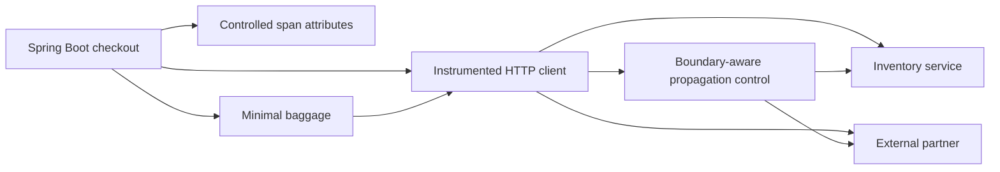
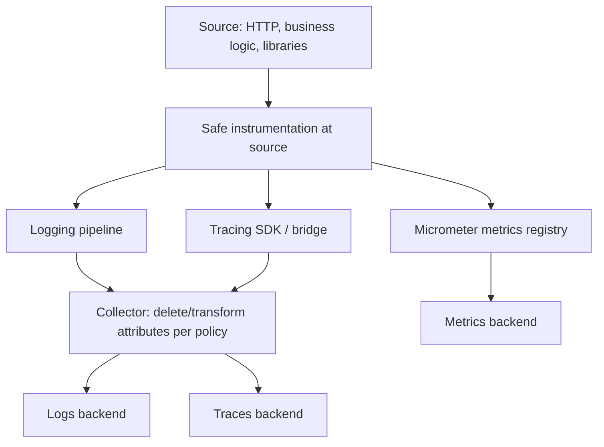

# Sensitive data filtering policy in Spring Boot Observability

A good observability system helps answer: *which API is slow? How many requests failed? Which services did a request pass through, and where did the error happen?* However, metrics, logs, and distributed tracing pipelines can also accidentally carry emails, customer IDs, access tokens, or order contents into monitoring tools. A seemingly harmless metric label can create millions of time series; a log line containing a token can become a security incident.

The lesson **Sensitive data filtering policy**, belonging to the **Cardinality and metadata** chapter of the **SPRING_BOOT_OBSERVABILITY** module, presents how to classify, minimize, filter, and verify data before exporting telemetry. Its scope covers Micrometer Observation, metrics, logs, distributed tracing, context propagation, tags/cardinality, exporters, sampling, and correlating signals to investigate errors, latency, and Spring Boot application behavior in production environments.

**Goal:** after this lesson, you will be able to identify which data must stay out of telemetry, design a safe attribute set, place controls at the right layers, and verify that sensitive data does not leak through common collection paths.

## 1. Why is a data filtering policy needed?

Telemetry passes through more components than code authors usually see: the application, logging libraries, tracing SDKs, exporters, collectors, storage backends, dashboards, search tools, and incident-sharing workflows. Data placed into one signal can be copied, indexed, and retained longer than a request's lifetime.

Unsafe examples:

```text
http.route=/orders/482719
request.email=someone@example.test
http.request.header.authorization=Bearer <token>
exception.message=Payment rejected for card 4111...1111
```

These values are **synthetic sample data** only. They illustrate four distinct issues: a URL containing an identifier, a personally identifying attribute, a credential, and an error message potentially leaking payment details. Even if it never reaches a dashboard, the data may have already passed through memory, buffers, or collectors.

A protection policy must address all four concerns simultaneously:

- **Security and privacy:** prevent leaking secrets, personal data, and sensitive business payloads.
- **Cardinality and cost:** avoid generating nearly unique time series per request.
- **Investigative reliability:** keep enough safe attributes to query, group, and correlate metrics, logs, and traces.
- **Data governance:** define who can view data, how long it is retained, where it travels, and how to respond if a leak is detected.

**Top priority principle:** do not collect sensitive data in the first place; normalize or drop it at the source; apply additional controls along export and storage paths. Scrubbing data in a collector is an extra defensive layer, not a substitute for safe instrumentation design in the application.

## 2. Classify data before designing telemetry

A clear policy starts with **data classification**, rather than trying to write one regex to mask everything. Illustrative matrix:

| Data category | Examples | Default policy |
| --- | --- | --- |
| **Authentication secrets** | Passwords, API keys, OAuth access/refresh tokens, session cookies, Authorization header | **Do not collect** into metrics, logs, traces, or baggage |
| **Personal data** | Email, phone number, address, full name, user identifier | Avoid collecting; use only in workflows with an approved purpose and protections |
| **Sensitive transaction data** | Card numbers, payment details, order payloads, health data | Never put verbatim into telemetry; use safe error codes/outcome groups |
| **High-cardinality identifiers** | orderId, customerId, requestId, URLs containing IDs | Do not use as metric labels; if correlation is needed, enforce access control and retention limits |
| **Finite grouping attributes** | Route template, HTTP method, status class, outcome, region, channel | Usable after verifying value sets and content |
| **Technical correlation IDs** | traceId, spanId, independent correlationId | Used to link signals per policy; do not treat as public data by default |

A random ID is not necessarily a secret, yet it can link activities of the same user when combined with other data. Never assume **“not direct PII” = “always safe”**.

Classification must examine **values**, not just key names. For instance, `http.route` is only safe when it holds a route template like `/orders/{id}`; the string `/orders/482719`, even under the key `http.route`, can still expose an identifier. Likewise, `outcome` is unsafe if its value is a free-form error message containing an email or token.

## 3. Build a data contract for each signal

A solid policy specifies which keys are allowed, value sources, normalization rules, storage locations, and value-count limits.

| Signal | Keep | Remove or replace | Why |
| --- | --- | --- | --- |
| **Metrics** | `http.method=POST`, `http.route=/orders/{id}`, `outcome=error` | `userId`, email, raw URL, request/trace ID, arbitrary error messages | Labels require low cardinality for aggregation |
| **Logs** | Timestamp, service, event code, error category, traceId if permitted | Auth headers, bodies, sensitive query strings, unchecked exception messages | Logs are easy to search/copy and often kept long-term |
| **Traces** | Span name, duration, status, HTTP route template, approved attributes | Secrets, raw payloads, user profiles, URLs with sensitive queries | Span attributes/events typically flow through exporters and backends |
| **Baggage/propagation** | Approved technical values, minimal set needed downstream | Tokens, emails, customer profiles, unnecessary internal data | Baggage can cross service boundaries and third parties |
| **Resource metadata** | Service name, environment, normalized deployment region | Credentials, host/account names containing sensitive identifiers | Metadata attaches to many signals and has wide visibility |

Do not read this table as permission to auto-collect every attribute in the “Keep” column. Each organization must approve key/value lists based on business context, data policies, and system access scopes.

Example minimal contract for `checkout.submit`:

```yaml
operation: checkout.submit
allowed_metric_labels:
  channel: [web, mobile, partner, other]
  outcome: [accepted, rejected, error]
  payment_provider: [provider_a, provider_b, other]
allowed_trace_attributes:
  - channel
  - outcome
  - error.category
allowed_log_fields:
  - service
  - event
  - error_category
  - trace_id
forbidden_everywhere:
  - authorization
  - cookie
  - access_token
  - password
  - card_number
  - email
```

This is an **illustrative policy template**, not a configuration format automatically read by Spring Boot or Micrometer. In practice, engineering teams must enforce this contract in instrumentation, logging, tracing SDKs, collectors, and automated tests.

## 4. How does cardinality relate to sensitive data?

**Metric cardinality** is the number of distinct label value combinations that can create separate time series. A metric with `channel` (4 values), `outcome` (3 values), and `region` (5 values) has at most:

\[
4 \times 3 \times 5 = 60 \text{ label combinations}
\]

If you add `orderId` with 100,000 distinct values, potential combinations can jump to **6 million**, before counting instances, services, pods, or other labels. Actual combinations depend on traffic and data distribution; this multiplication illustrates **explosion risk**, not a guaranteed count.

In Micrometer Observation:

- **Low-cardinality key-values** are designed for finite value groups and are typically used as metric labels.
- **High-cardinality key-values** can be helpful when investigating individual traces, but **are not a license to record personal data or secrets**.
- **Metric, span, and event names** must also stay stable; never embed IDs into names themselves.

Two separate rules must be checked independently: **low cardinality** and **non-sensitive**. For example, `auth_token_type=bearer` has low cardinality yet is usually unnecessary; an `outcome` value containing user data remains unsafe even though the key is allowlisted.

## 5. Blocking data at the source with Micrometer Observation

The most important control point is **where the observation is created**. Attach only operationally meaningful attributes with values reduced to a finite set.

Java example for Spring Boot:

```java
import io.micrometer.observation.Observation;
import io.micrometer.observation.ObservationRegistry;
import org.springframework.stereotype.Service;

@Service
public class CheckoutTelemetry {
    private final ObservationRegistry registry;

    public CheckoutTelemetry(ObservationRegistry registry) {
        this.registry = registry;
    }

    public void observeCheckout(String sourceChannel, Runnable action) {
        String channel = SafeTelemetryTags.channel(sourceChannel);

        Observation observation = Observation.createNotStarted(
                "checkout.submit", registry)
            .lowCardinalityKeyValue("channel", channel)
            .start();

        try (Observation.Scope ignored = observation.openScope()) {
            action.run();
            observation.lowCardinalityKeyValue("outcome", "accepted");
        } catch (RuntimeException ex) {
            observation.lowCardinalityKeyValue("outcome", "error");
            // Check exception policy before recording error details.
            throw ex;
        } finally {
            observation.stop();
        }
    }
}

final class SafeTelemetryTags {
    private SafeTelemetryTags() {}

    static String channel(String input) {
        if ("web".equals(input)) return "web";
        if ("mobile".equals(input)) return "mobile";
        if ("partner".equals(input)) return "partner";
        return "other";
    }
}
```

This snippet is an instrumentation example: `action` represents real business logic. `sourceChannel` may come from untrusted input, yet only the four values in `SafeTelemetryTags.channel` can appear in telemetry. Never write emails, access tokens, customer IDs, request bodies, or raw URLs into the observation.

In this example, the exception branch sets `outcome=error` and rethrows. **Exception recording policy** must be handled separately: `observation.error(ex)` can pass exception details to handlers/traces; an exception message containing a payload or credential will cause a leak. For sensitive data paths, use controlled error/exception types or proper sanitization before calling error-recording APIs. Setting `outcome=error` alone does not fully replace tracing error semantics.

If the system needs to distinguish a valid `declined` result from a technical error, use an enum or finite outcome code. Never infer the outcome by copying raw messages from the payment gateway into a tag.

### Operation names and route templates

Use `checkout.submit` instead of `checkout.submit.order-482719`; use `/orders/{id}` instead of `/orders/482719?email=...`. For automatic HTTP server/client instrumentation, verify whether the framework records the **route template** or **raw URL**, and whether it captures query strings or sensitive headers. Libraries evolve across versions; inspect actual data in the registry/tracing exporter.

## 6. ObservationConvention, ObservationFilter, and MeterFilter: placing controls in the right place

Three mechanisms in Micrometer solve different problems:

| Mechanism | Point of impact | Role in the policy |
| --- | --- | --- |
| `ObservationConvention` | Defines name and key-values for an observation type | Establishes name/tag contract right at instrumentation |
| `ObservationFilter` | Maps `Observation.Context`, typically at the `stop` phase | Adds or normalizes attributes used later by handlers |
| `MeterFilter` | Meter registration/configuration in `MeterRegistry` | Blocks meters with invalid tags or caps metric configuration |

**Do not use `ObservationFilter` as the sole security shield.** Filters typically run near observation completion, whereas tracing handlers may have created spans at `start` and application logs may have been written mid-lifecycle. Adding or modifying a tag at `stop` does not erase records already emitted earlier. Furthermore, some data can be emitted from other instrumentation without passing through this registry's filter.

A second line of defense at the metrics layer can deny meters containing **forbidden tag names**:

```java
import io.micrometer.core.instrument.Tag;
import io.micrometer.core.instrument.config.MeterFilter;
import java.util.Set;
import org.springframework.context.annotation.Bean;
import org.springframework.context.annotation.Configuration;

@Configuration(proxyBeanMethods = false)
public class MetricsPrivacyConfiguration {
    private static final Set<String> FORBIDDEN_TAG_KEYS = Set.of(
        "user.id", "customer.id", "email", "authorization",
        "access_token", "request.id");

    @Bean
    MeterFilter denySensitiveMetricTags() {
        return MeterFilter.deny(id ->
            id.getTags().stream()
                .map(Tag::getKey)
                .anyMatch(FORBIDDEN_TAG_KEYS::contains));
    }
}
```

This example denies the **entire meter** if it carries a key in the denylist. It does not sanitize tag values, catch new aliases like `userEmail`, or protect logs/traces. Moreover, sensitive data may already have been constructed in the application before meter registration. Thus this is a **secondary guardrail**, to be paired with allowlists and value checks **at the source**.

If **values** must be sanitized, normalize them into safe groups before calling `lowCardinalityKeyValue(...)`. Do not apply an ad-hoc regex and assume the output is guaranteed safe.

## 7. Logging: avoiding secrets in messages, MDC, and exceptions

Logs can leak data in three places: messages, structured fields/MDC, and stack traces/exception messages. Examples to avoid:

```java
// Unsafe: raw input and token appear verbatim in logs.
log.info("Checkout request {}", requestBody);
log.warn("Payment authorization failed token={}", accessToken);
log.error("Downstream request failed: {}", exception.getMessage());
```

Instead, log **events with stable codes**, appropriate levels, and controlled context:

```java
enum PaymentFailureCategory {
    TIMEOUT, DECLINED, UNAVAILABLE, UNKNOWN
}

void logPaymentFailure(PaymentFailureCategory category) {
    log.warn("payment.authorization.failed category={}", category.name());
}
```

The second example assumes a configured `log` logger. `category` comes from an internal enum; it is not a free-form error string from clients or partners. Before logging detailed stack traces for investigation, verify whether the exception and its message/causes can contain sensitive data, and enforce access controls and retention.

Points to check in Spring Boot:

- **HTTP access logs:** proxies, gateways, containers, and apps can log request URIs/query strings. Cleaning the application logger does not automatically fix another component's access logs.
- **Structured logging:** include only approved fields in JSON; key-based masking is a backup layer and cannot catch secrets interpolated into free-text messages.
- **MDC:** `traceId`/`spanId` help correlation; never put emails, JWTs, or customer profiles into MDC. MDC must also be managed across thread switches.
- **Exceptions:** messages can originate from databases, HTTP clients, or third parties. Never assume logging a raw `Throwable` is safe by default.
- **Debug logging:** enabling TRACE/DEBUG logging, request/response bodies, or headers in production can open a new leak path; keep it environment-scoped and time-bounded.

Disabling one log statement in the application does not guarantee HTTP libraries, agents, load balancers, or collectors aren't logging the same data elsewhere. Policies must cover all log-emitting points.

## 8. Distributed tracing: span attributes, events, baggage, and propagation

Traces provide request paths and durations; they do not need payload contents to be useful. Safe span attributes typically include `http.request.method`, route template, status code, operation name, downstream system name, and normalized `error.category`. Attributes for Authorization, Cookie, card data, queries containing PII, or bodies must be excluded at instrumentation.

**Span events** can also leak data if messages or attributes are built from untrusted input. Never record `span.addEvent("failed for user alice@example.test")`; use a stable event name like `payment.authorization.failed` and a safe category.

**Baggage** differs from span attributes: baggage can be forwarded over HTTP/messaging if the propagator supports it. Therefore, strictly keep tokens, emails, addresses, card numbers, or user data out of baggage. A service calling a third-party API might forward certain propagation headers; inspect **trust boundaries** and restrict what gets injected.



The W3C `traceparent` header carries technical tracing identifiers/context; never embed business data in trace headers. Baggage and custom propagation headers have their own rules. Maintaining accurate parent–child trace relationships does not depend on tag names; it requires instrumentation and propagation across threads, executors, HTTP clients/servers, or message brokers.

**Sampling is not a sensitive-data protection mechanism.** Sampling 10% of traces can still capture the exact request containing a token. Even if a trace is not exported, sensitive data may already have entered logs, metrics, or buffers. Filter before sampling and before exporting whenever possible.

## 9. Exporters and OpenTelemetry Collector: an extra defensive layer

A system typically has multiple telemetry paths:



A collector can add a control layer before data reaches the backend. For example, the OpenTelemetry Collector supports the **attributes processor** to delete specified span/log attributes. The following snippet is an **illustrative fragment** for a traces pipeline:

```yaml
processors:
  attributes/privacy:
    actions:
      - key: enduser.id
        action: delete
      - key: user.email
        action: delete
      - key: http.request.header.authorization
        action: delete

service:
  pipelines:
    traces:
      receivers: [otlp]
      processors: [attributes/privacy, batch]
      exporters: [otlp]
```

This configuration **does not run standalone**: `receivers`, `exporters`, `batch`, and endpoints must be declared compatibly elsewhere in the Collector config. Semantic attribute names and processor capabilities vary by version/distribution. The `attributes` processor operates on attributes of supported spans/logs; it **does not automatically scrub data inside log bodies**, resource attributes, or all metric datapoint labels. Other data types require appropriate processors/views/sanitizers, such as a verified resource processor or transform processor configuration.

For the policy to be effective:

1. Place processors in **every relevant pipeline**, before exporters send data outside the trust boundary.
2. Check whether any alternate route bypasses the collector; a direct exporter can skip the scrubbing step.
3. Restrict collector access, configure TLS/authentication, and limit backend query permissions.
4. Monitor processor errors, queues/buffers, dropped data, and export status so observability isn't lost silently.
5. Audit retention, backups, dashboard sharing, and data access rights in the backend.

A collector can only scrub what it receives. If a secret already entered logs elsewhere or was sent to two independent backends, deleting it in one collector does not remove the other copy.

## 10. Multi-layer policy blueprint

A sensitive-data filtering policy should be enforced across multiple layers, each with concrete duties:

| Layer | Action items | Verification example |
| --- | --- | --- |
| **API/business design** | Never pass secrets into operation names, events, or tags | Review checkout instrumentation |
| **Instrumentation/Observation** | Use only allowlists and normalized values | `outcome=error`, no email/ID in low-cardinality |
| **Metrics registry** | Cap tag sets, reject non-compliant meters | MeterFilter blocks forbidden keys |
| **Logging** | Approved structured fields; control messages, MDC, and exceptions | Search test logs for sentinel secrets |
| **Tracing SDK** | Disable sensitive body/header capture; limit span attributes/events/baggage | Span dump contains no Authorization/query |
| **Exporter/Collector** | Delete leftover attributes, secure transport | Test pipeline with synthetic data |
| **Backend and operations** | RBAC, retention, auditing, incident response | Review data permissions and access logs |

Policies need **owners**, versioning, and a change process. Whenever adding new instrumentation, exporters, HTTP libraries, logging encoders, or labels, re-evaluate what data can escape and where it gets stored.

A practical allowlist must specify both **keys and how values are produced**. For example, `error.category` allows only `timeout, unavailable, rejected, unknown`; never take raw `exception.getMessage()` and store it under an approved key.

## 11. Testing the policy with synthetic data

Do not just read code and conclude data is safe. Create a test dataset **with recognizable markers that are not real secrets**, then inspect the output of every pipeline.

Example unit test for the normalizer:

```java
import org.junit.jupiter.api.Test;
import static org.junit.jupiter.api.Assertions.assertEquals;

class SafeTelemetryTagsTest {
    @Test
    void acceptsOnlyKnownChannelValues() {
        assertEquals("web", SafeTelemetryTags.channel("web"));
        assertEquals("partner", SafeTelemetryTags.channel("partner"));
        assertEquals("other", SafeTelemetryTags.channel(
            "someone@example.test"));
        assertEquals("other", SafeTelemetryTags.channel(
            "Bearer FAKE-TEST-TOKEN"));
    }
}
```

This tests the helper from section 5; it does not yet verify tracing or exporters. With Micrometer, extend testing by:

- Using `TestObservationRegistry` to assert low/high-cardinality key-values on completed observations.
- Using `SimpleMeterRegistry` wired with a metrics observation handler to assert `email`, `user.id`, and `request.id` labels are absent, while checking valid labels.
- Using a logging test appender/capture to verify messages, structured fields, and exceptions comply with policy.
- Using an in-memory span exporter of your tracing SDK to inspect **all attributes/events** and confirm propagation keeps the trace intact without carrying forbidden data.
- Using a test Collector/backend to verify processors, export paths, and actual semantic attributes; never assume one processor covers every signal.

### Testing with sentinels

For instance, synthetic test values like `SENSITIVE-TEST-EMAIL@example.test` or `FAKE-TOKEN-DO-NOT-USE` can be injected into a test request. Then search across **exported metrics, encoded logs, exported spans, and post-collector data**. If a sentinel appears, identify which layer emitted it and fix it at the source or appropriate pipeline stage.

Never use active credentials or real customer data as sentinels. Design tests so test data does not leak into shared monitoring environments outside test scope.

**Negative testing alone is not enough:** if a sanitizer strips everything, the system loses investigative power. Therefore, test in parallel that allowed attributes like `http.route`, `outcome`, `error.category`, and trace correlation remain present and meaningful.

## 12. Correlating signals safely during incident investigation

A sound policy still allows investigating real failures. Suppose after a release, the checkout API sees p95 jump from 250 ms to 1.6 seconds and 5xx rates climb. We can keep:

| Signal | Safe illustrative data | Question answered |
| --- | --- | --- |
| Metrics | `http.route=/checkout`, `outcome=error`, p95, error rate | Scope and severity of impact |
| Trace | `checkout.submit`, payment call span 1.3 s, `error.category=timeout` | Which step is slow? |
| Log | `event=payment.authorization.failed`, `error_category=timeout`, `traceId` | Event and error type of the matching request |

You do not need emails, card numbers, payment bodies, or bearer tokens to see that downstream payment timed out. `traceId` and `spanId` help locate related signals when tracing correlation works, yet **a trace ID does not guarantee the trace was kept**: sampling, exporters, collectors, or retention may make it absent in the backend.

Illustrative investigation workflow:

1. From metrics, narrow down route, time window, error rate, and latency percentiles.
2. Open a sampled trace for a slow request; inspect relevant spans, errors, and safe attributes.
3. Search logs by trace ID and timestamp; read event codes and error categories instead of searching with personal data.
4. Cross-check multiple requests and downstream metrics before concluding root cause.
5. After remediation, re-measure p95/error rate and confirm telemetry still complies with policy.

When you need to look up a specific transaction by `orderId`, use an **authorized business data system** to find the timestamp and approved correlation ID. Using an ID inside a controlled investigative workflow is very different from broadcasting that ID into every time series or span.

## 13. When sensitive data is discovered in telemetry

Discovering a token in logs or traces must be handled as a **data incident**, not just a bad-tag bug. A sound response sequence:

1. **Stop further emission:** disable the offending instrumentation/header capture or fix the emitting code; if needed, deploy an emergency collector policy to curb spread.
2. **Determine scope:** data type, start time, services, exporters, collectors, backends, and replicas that may have received it.
3. **Revoke/rotate secrets:** if active credentials or tokens leaked, execute revocation/rotation procedures per organizational authority and policy.
4. **Restrict access and remediate stored data:** coordinate with backend owners to delete/shorten retention and review backups according to platform capabilities.
5. **Assess impact and report:** follow internal procedures, legal obligations, and contractual requirements; never paste the sensitive data into the incident ticket or report itself.
6. **Add tests and guardrails:** add sentinel/negative tests, audit pipelines, and prevent regressions when upgrading SDKs or adding exporters.

Simply updating a regex in the collector is insufficient if secrets are still logged by the application, proxy logs, or another exporter. Likewise, deleting data in a dashboard UI does not guarantee it is gone from storage, indexes, or backups.

## 14. Common mistakes

| Mistake | Consequence | Fix |
| --- | --- | --- |
| Adding `customerId` as a low-cardinality tag | Time series explosion, privacy risk | Use finite value sets and controlled business lookups |
| Filtering only in `ObservationFilter` at stop | Earlier logs/spans may already have leaked | Strip data at source and audit all instrumentation |
| Only renaming a sensitive key | Sensitive value still remains | Minimize, drop, or normalize values |
| Capturing full HTTP headers/bodies for debugging | Tokens/cookies/payloads enter logs or traces | Disable default capture or allowlist only safe fields |
| Putting emails into baggage | Can spread across services/partners | Propagate only minimal technical data |
| Treating sampling as a security mechanism | Requests with secrets can still be sampled | Sanitize independently of sampling |
| Using `exception.getMessage()` as `error.category` | Can leak payloads and raise cardinality | Map to an enum/finite error code |
| Deleting span attributes only at the collector | Log bodies, resource/metric data, or other exporters still keep data | Enforce controls per pipeline and emission point |
| Unit tests pass while backend leaks data | Tests did not cover exporters/collectors | Add integration tests and sentinel scans |
| Retaining telemetry data indefinitely | Increases blast radius on leaks | Enforce retention, RBAC, auditing, and deletion procedures |

## 15. Self-check exercises

**Scenario A.** A developer wants to add `userId` to find slow requests per user. Should it be used as a low-cardinality tag on `http.server.requests`?

*Hint:* No. `userId` has many values, can be sensitive, and blows up time series. Review investigative requirements and use controlled correlation/business data instead of attaching `userId` to metrics.

**Scenario B.** The system has an `ObservationFilter` stripping the `email` tag at `stop()`, yet a log mid-request still contains the email. Is that a contradiction?

*Hint:* No. Filters do not retroactively edit logs already emitted earlier. Policies must be enforced right at the logger/instrumentation and other layers.

**Scenario C.** Logs do not contain the Authorization header, yet the OTLP trace contains `http.request.header.authorization`. Where should you check?

*Hint:* Check tracing instrumentation/header capture, SDK, tracing handler, exporter, and collector. Block at the source; an attributes processor can serve as an extra defensive layer.

**Scenario D.** Someone replaces all `userId` values with SHA-256 and puts the hash into metric labels. Does this reliably solve cardinality and privacy?

*Hint:* No. Unique hashes still create just as many distinct values; data remains linkable, and identifiers from a small input space can be guessed. Hashing does not replace evaluating purpose and sensitivity.

**Scenario E.** Traces are sampled at 1%, while metrics are always collected. Why must both signals still be filtered?

*Hint:* Sampling affects only the tracing path; metrics can still carry sensitive labels, and sampled traces can still leak secrets. Filtering must apply to each source and pipeline.

**Scenario F.** The team wants to verify the sanitizer works without putting real credentials into tests. What can they do?

*Hint:* Use fake sentinels, assert their absence in exported metrics/logs/traces, and simultaneously verify that safe labels and trace correlation remain intact for investigation.

## 16. Key things to remember

- **A sensitive data filtering policy** is a contract defining *which data may be collected, normalized, exported, stored, and viewed*, not merely a string-replacement expression.
- **Filter at the source first:** never create metric labels, log fields, span attributes/events, or baggage containing secrets, personal data, or unnecessary payloads.
- **Cardinality and privacy are two independent checks.** Low-cardinality tags need finite and safe value sets; high-cardinality does not mean permission to store sensitive data.
- **`ObservationConvention`, `ObservationFilter`, and `MeterFilter`** act at different times/layers; a filter at stop time cannot erase data already emitted earlier.
- **Sampling, exporters, and Collectors** are operational components, not automatic guarantees of data safety. Test every pipeline, restrict access/retention, and maintain a leak-response procedure.
- A system can still investigate errors and latency using **aggregated metrics + controlled traces + event-coded logs and trace correlation**, without broadly collecting secrets or user identifiers.
