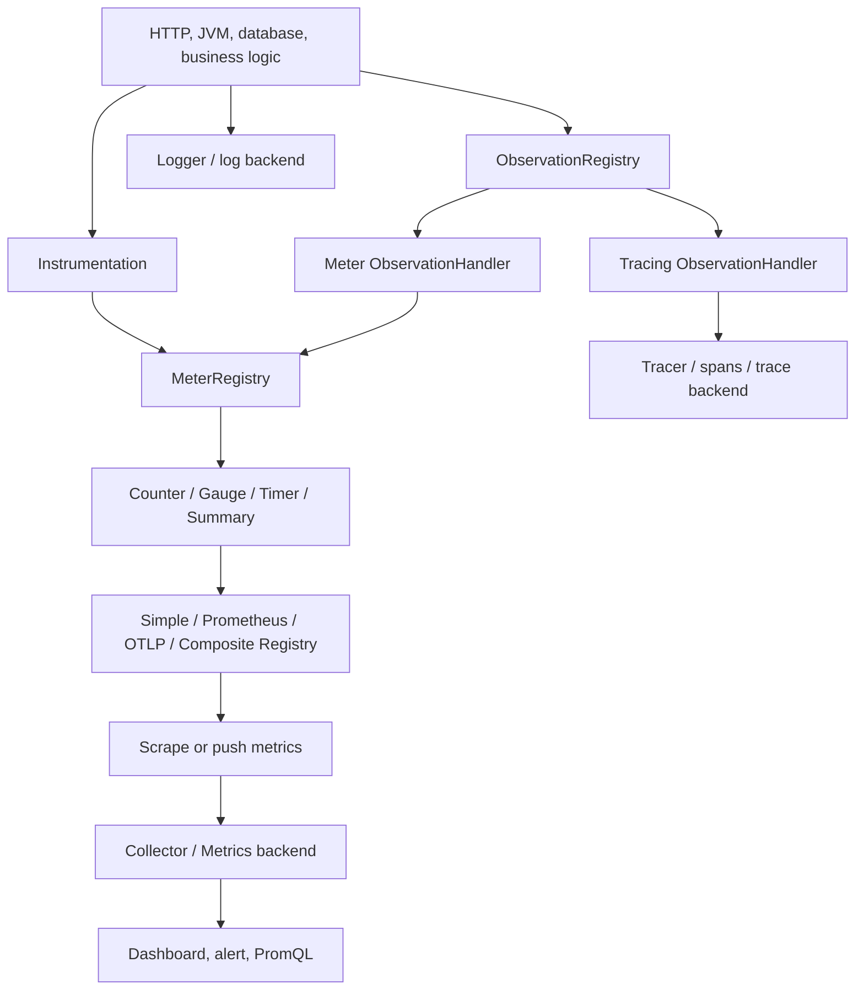
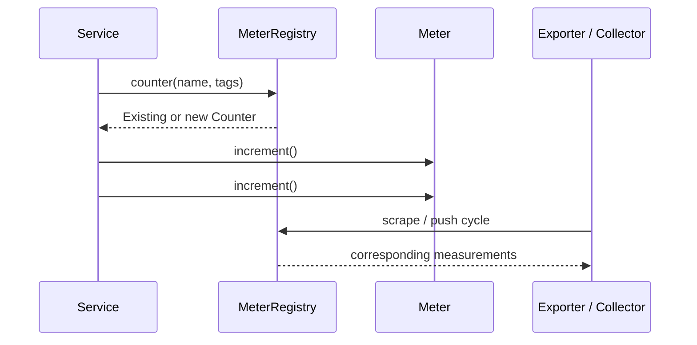

# MeterRegistry

When a Spring Boot API starts slowing down, the operations team wants to know how much latency increased, which endpoints are affected, and when the issue started. To answer that, the application needs to record numerical values such as request counts, processing duration, failure counts, and queue depth. **Micrometer's `MeterRegistry` is the component that manages these numerical measurements**.

The **MeterRegistry** lesson belongs to the **Metrics Foundation** chapter of the **SPRING_BOOT_OBSERVABILITY** module. The module aims to set up observability for Spring Boot using Micrometer Observation, metrics, logs, and distributed tracing; explore context propagation, tags/cardinality, exporters, sampling, and correlating signals to investigate errors, latency, and application behavior in real-world environments.

> **Key idea:** `MeterRegistry` holds and manages `Meter` instances in the process. Application code records measurements into a meter; the registry implementation determines how data is stored or exported to a backend. A registry is not a centralized time-series database, does not automatically capture all logs, and does not replace tracing.

## 1. Learning Objectives

After this lesson, you will be able to:

1. Explain `MeterRegistry`, `Meter`, `Meter.Id`, metric names, tags, and measurements.
2. Distinguish between `Counter`, `Gauge`, `Timer`, `DistributionSummary`, and `LongTaskTimer`.
3. Use `SimpleMeterRegistry`, and understand `CompositeMeterRegistry` and backend registries.
4. Inject `MeterRegistry` into Spring Boot, register custom metrics, and inspect results via Actuator.
5. Properly configure a Prometheus exporter, common tags, `MeterFilter`, and histograms.
6. Explain the relationship between `MeterRegistry`, Micrometer Observation, and tracing.
7. Detect issues caused by cardinality, meter names, counter resets, gauge lifecycle, and discrepancies in scraping/exporting.
8. Use metrics alongside logs/traces to investigate real-world issues.

## 2. Where Does MeterRegistry Fit in Spring Boot?



There are two common instrumentation flows:

- **Recording metrics directly:** the application obtains a `Counter`, `Timer`, or `Gauge` from `MeterRegistry` and calls `increment()`, `record(...)`, or lets a gauge read the current state.
- **Using Observation:** the application or Spring Framework creates an `Observation`; when the registry has a metrics handler, the observation is converted into meter data; if there is a tracing handler, the same operation can also create a span.

The same API can produce automatic HTTP metrics, a custom business metric for payment outcomes, and a trace for sampled requests. **`MeterRegistry` only manages the metrics part.** Traces and logs are handled by other components, though they can be correlated with metrics by time, service, route, and exemplars when supported by the system.

### 2.1 Responsibility Boundaries

| Component | Responsibility | What It Is Not |
|---|---|---|
| `MeterRegistry` | Registers, looks up, and manages meters; integrates exporters per implementation. | A storage engine for full request history. |
| `Meter` | A numerical measurement with a name, type, and tags. | A trace span for a specific request. |
| `Meter.Id` | Meter metadata including name, tags, type, unit, and description. | A business transaction ID. |
| `MeterFilter` | Accepts, denies, or modifies metric metadata/config. | A mechanism to modify logs or span attributes. |
| Registry implementation | Converts measurements to the corresponding representation/backend. | A guarantee that the collector is always online. |
| Metrics backend | Stores time series, enables queries, dashboards, and alerts. | Something that fixes the semantics of an improperly instrumented metric. |

## 3. How Are Meter and Meter.Id Identified?

For example, a business flow has two outcomes:

```text
name = checkout.authorization.result
tags = {outcome=approved, channel=web}

name = checkout.authorization.result
tags = {outcome=declined, channel=web}
```

These are two different **meter IDs/logical series** because the `outcome` value differs, even though the name is the same. A registry typically looks up or registers a meter by the combination of name and tags (subject to compatible type/metadata constraints). Calling `registry.counter(...)` multiple times with the same name and tags usually returns the same Counter.

| Field | Example | Meaning |
|---|---|---|
| Name | `checkout.authorization.result` | Stable name for what is being measured. |
| Type | `COUNTER` / `GAUGE` / `TIMER` | Semantics of the measurement. |
| Tags | `channel=web`, `outcome=approved` | Grouping dimensions with a controlled number of values. |
| Base unit | `bytes` for payload size | Unit aiding naming/export. |
| Description | `Number of checkout authorizations` | Description for operators. |

A `Meter.Id` does not represent a single API call. Thousands of requests can contribute to one Counter or Timer. When you need to investigate an individual request, you must use logs/tracing by `traceId`.

### 3.1 Micrometer Names Differ from Prometheus Names

Micrometer names should follow lowercase dot-separated style:

```text
checkout.authorization.result
checkout.authorization.duration
checkout.queue.depth
http.server.requests
jvm.memory.used
```

When exported to Prometheus, naming conventions may transform them:

```text
In code                           On Prometheus, e.g.
checkout.authorization.result     checkout_authorization_result_total
checkout.authorization.duration   checkout_authorization_duration_seconds_count
                                  checkout_authorization_duration_seconds_sum
checkout.queue.depth              checkout_queue_depth
```

Suffixes depend on the meter type, base unit, and exporter. Therefore, `/actuator/metrics/checkout.authorization.duration` uses the **Micrometer name**, whereas PromQL queries the **actual exported series name**. Do not name an observation `...seconds_count` yourself.

## 4. Meter Types: Choosing Based on the Question

| Meter | Question to Answer | Examples |
|---|---|---|
| **Counter** | How many times did it happen? | Declined payments, retries, dead-letter messages. |
| **Gauge** | What is the value right now? | Queue depth, connections in use. |
| **Timer** | How long did one operation take? | HTTP client latency, payment, query duration. |
| **DistributionSummary** | How are non-time values distributed? | Payload size, number of items in a batch. |
| **LongTaskTimer** | How many long tasks are running, and for how long? | Import, backup, index rebuild. |
| **FunctionCounter / FunctionTimer** | Read values from functions backed by existing counters. | Statistics provided by an external library. |

### 4.1 Counter: Monotonically Increasing Event Total

```java
import io.micrometer.core.instrument.Counter;

Counter declined = Counter.builder("checkout.authorization.result")
        .description("Checkout authorization results")
        .tag("outcome", "declined")
        .register(registry);

declined.increment();
declined.increment(2.0);
```

A `Counter` only increases, and `increment(amount)` requires a positive value. When an application restarts, the counter value in the new process may reset to 0. Therefore, in Prometheus you typically analyze **rate or increase** over a time window to detect trends, rather than treating the accumulated value as a permanent system-wide total.

**Do not create a Counter that duplicates a Timer's semantics:** A `Timer` already reports the count of recordings it makes. Only create a separate Counter if it measures a distinct business event, such as the number of declined payments or the number of jobs sent to dead-letter.

### 4.2 Gauge: Reading Current State

```java
import java.util.concurrent.atomic.AtomicInteger;
import io.micrometer.core.instrument.Gauge;

AtomicInteger queueDepth = new AtomicInteger();

Gauge.builder("checkout.queue.depth", queueDepth, AtomicInteger::get)
        .description("Current number of queued jobs")
        .register(registry);

queueDepth.set(12);
```

A Gauge reflects the **value when the registry reads it**, not every call to `set()`. If a queue spikes to 1000 and drops back to 12 between two scrapes, the backend may only see 12. To count how many times the queue exceeded a threshold, instrument an event/counter or use an appropriate sampling mechanism.

**Lifecycle pitfall:** Micrometer typically holds a **weak reference** to the object observed by a Gauge. The application must retain a **strong reference** to `queueDepth` (usually via a Spring bean field). If the object is garbage collected, the gauge may report `NaN` or lose data. Do not create a new object/gauge per request and expect all of them to be measured accurately.

### 4.3 Timer: Counting and Measuring Duration

```java
import java.time.Duration;
import io.micrometer.core.instrument.Timer;

Timer authorizationDuration =
        Timer.builder("checkout.authorization.duration")
                .description("Time spent authorizing checkout")
                .register(registry);

authorizationDuration.record(Duration.ofMillis(125));
authorizationDuration.record(Duration.ofMillis(240));
System.out.println(authorizationDuration.count()); // 2
```

A basic Timer tracks `count` and `totalTime`; max, histograms, and percentiles depend on configuration/backend. For code blocks requiring dynamic timing, `Timer.Sample` helps:

```java
Timer.Sample sample = Timer.start(registry);
try {
    authorizePayment();
} finally {
    sample.stop(authorizationDuration);
}
```

Put `stop(...)` in `finally` so duration is still recorded if the block throws an exception. Timers are not suitable for negative durations. For tasks lasting several minutes where you need visibility into **in-flight tasks**, consider `LongTaskTimer`.

### 4.4 DistributionSummary: Distribution of Non-Time Values

```java
import io.micrometer.core.instrument.DistributionSummary;

DistributionSummary payload =
        DistributionSummary.builder("checkout.request.payload")
                .baseUnit("bytes")
                .description("Checkout request payload size")
                .register(registry);

payload.record(1_024);
payload.record(2_048);
```

`DistributionSummary` is suited for bytes or items per batch, whereas durations should use `Timer` because it understands time units and exports accordingly. A summary can provide count, total amount, and other distribution statistics depending on registry capabilities.

### 4.5 LongTaskTimer and Other Meters

`LongTaskTimer` is used for **long-running active work**: a 20-minute report generator, a data import job, or a large batch sync. It measures the number of active tasks and the elapsed duration of running tasks (depending on backend); a regular Timer usually records a measurement only after the invocation finishes.

`FunctionCounter` and `FunctionTimer` fit when a library already exposes monotonic counters or total-time functions. Do not use a function returning a fluctuating up-and-down value to impersonate a Counter: the semantics will break, especially when the backend computes rates.

## 5. How Does MeterRegistry Register and Look Up Meters?



Example:

```java
Counter a = registry.counter("inventory.rejection",
                             "reason", "out_of_stock");
Counter b = registry.counter("inventory.rejection",
                             "reason", "out_of_stock");
a.increment();
b.increment();

// Both record to the same logical series in the registry.
double count = registry.get("inventory.rejection")
        .tag("reason", "out_of_stock")
        .counter()
        .count();
```

`registry.get(...)` typically throws an error if the matching meter does not exist; `registry.find(...)` returns `null` when not found. On hot paths, keeping a field reference to the meter avoids repeated lookups.

**Do not register the same name/tags with incompatible meter types** and expect them to merge automatically. Design one name for one measurement with consistent meaning, unit, and type.

### 5.1 Registration Does Not Mean Immediate Delivery

`Counter.builder(...).register(registry)` creates or retrieves a meter, but does not guarantee the backend has received data. Depending on the registry type, metrics may be scraped or pushed periodically; export can fail due to network errors, auth rejection, or missing targets. To investigate a "missing metric," distinguish between **instrumentation**, **export**, **ingestion**, and **querying**.

## 6. Commonly Used MeterRegistry Types

### 6.1 SimpleMeterRegistry

`SimpleMeterRegistry` keeps metrics in memory and **does not send them to a backend**:

```java
import io.micrometer.core.instrument.simple.SimpleMeterRegistry;

try (SimpleMeterRegistry simple = new SimpleMeterRegistry()) {
    simple.counter("demo.orders").increment();
    System.out.println(simple.get("demo.orders").counter().count());
}
```

It is suitable for learning, experimentation, and unit tests. In Spring Boot, the simple registry is typically a fallback when no other registry implementation is present; if another backend is present, the fallback may be disabled.

### 6.2 CompositeMeterRegistry

`CompositeMeterRegistry` lets a single API write to multiple child registries:

```java
import io.micrometer.core.instrument.Counter;
import io.micrometer.core.instrument.composite.CompositeMeterRegistry;
import io.micrometer.core.instrument.simple.SimpleMeterRegistry;

try (CompositeMeterRegistry composite = new CompositeMeterRegistry();
     SimpleMeterRegistry simple = new SimpleMeterRegistry()) {

    Counter events = composite.counter("demo.events");
    events.increment();  // No child registry yet: measurement is not stored.

    composite.add(simple);
    events.increment();  // Now simple begins receiving measurements.

    System.out.println(simple.get("demo.events").counter().count()); // 1
}
```

When there are no child registries yet, a composite usually **does not backfill** increments that occurred earlier. Spring Boot auto-configures a composite registry and adds backend registries found on the classpath.

### 6.3 Prometheus Registry and Push-Based Registries

| Implementation | Typical Mechanism | How to Understand It |
|---|---|---|
| `PrometheusMeterRegistry` | **Scrape/pull** | Prometheus periodically calls an endpoint to collect metrics from an instance. |
| OTLP registry | **Export/push** to receiver/collector | Fits OpenTelemetry metrics pipelines. |
| StatsD/Datadog or SaaS registries | Push/agent via specific protocol and interval | Configured per ingestion system. |
| `SimpleMeterRegistry` | In-memory, no export | Metrics are only visible locally. |
| `CompositeMeterRegistry` | Coordinates child registries | One code path can export to multiple destinations. |

Some backends use cumulative metrics, while others display step/rate values. Do not assume all backends represent Timer, Count, or Max the same way. In particular, **Prometheus does not stay connected to the application to "listen for events" continuously**; it actively pulls metrics at the scrape interval.

## 7. Spring Boot Auto-Configuration of MeterRegistry

Spring Boot Actuator provides dependency management and auto-configuration for Micrometer. When a backend registry is placed on the runtime classpath, Boot typically creates the corresponding bean and can add it to the composite registry. Many built-in instrumentations are available: JVM, process/system, HTTP server/client, pools, logging, or external libraries depending on dependencies.

### 7.1 Adding Dependencies

For a project already configured with the Spring Boot Gradle plugin and a version-appropriate web starter:

```groovy
dependencies {
    implementation 'org.springframework.boot:spring-boot-starter-actuator'
    runtimeOnly 'io.micrometer:micrometer-registry-prometheus'
}
```

These dependencies enable metrics observation and Prometheus exposition; they **do not yet set up a tracing backend or log collector**. Distributed tracing requires additional tracing integrations, exporters, and backends depending on your Spring Boot version.

### 7.2 Local Configuration

```yaml
spring:
  application:
    name: checkout-service

management:
  endpoints:
    web:
      exposure:
        include: "health,info,metrics,prometheus"
  metrics:
    tags:
      application: checkout-service
      region: local
```

`/actuator/metrics` lets you inspect meter names and measurements on the application. `/actuator/prometheus` outputs scrape format when a Prometheus registry is present. These endpoints are not exposed over HTTP by default in all configurations; in production, restrict management access using networking and proper authentication/authorization.

Example snippet of external Prometheus configuration:

```yaml
scrape_configs:
  - job_name: "checkout-service"
    metrics_path: "/actuator/prometheus"
    scrape_interval: 15s
    static_configs:
      - targets: ["checkout-service:8080"]
```

`checkout-service:8080` is an illustrative address. In practice, you need service discovery, security, and an address reachable by Prometheus.

### 7.3 Global Registry vs. Spring-Managed Registry

Micrometer provides a static `Metrics.globalRegistry`. Spring Boot may add auto-configured registries to the global registry unless disabled with:

```yaml
management:
  metrics:
    use-global-registry: false
```

In Spring Boot, prefer **injecting the `MeterRegistry` bean** so it uses the application context's configuration and can be tested in isolation:

```java
@Service
public class CheckoutService {
    private final MeterRegistry registry;

    public CheckoutService(MeterRegistry registry) {
        this.registry = registry;
    }
}
```

Using static `Metrics.counter(...)` couples code to global state, making it harder to control across multiple test contexts or apps with custom configurations.

## 8. Spring Boot Example: Metrics for Checkout Business Logic

Design the measurements:

- `checkout.authorization.result`: how many times approved, declined, failed.
- `checkout.authorization.duration`: latency per call.
- `checkout.queue.depth`: number of waiting jobs.
- `checkout.request.payload`: payload size.

```java
import java.util.concurrent.Callable;
import java.util.concurrent.atomic.AtomicInteger;

import io.micrometer.core.instrument.Counter;
import io.micrometer.core.instrument.DistributionSummary;
import io.micrometer.core.instrument.Gauge;
import io.micrometer.core.instrument.MeterRegistry;
import io.micrometer.core.instrument.Timer;
import org.springframework.stereotype.Service;

@Service
public class CheckoutMetrics {
    private final MeterRegistry registry;
    private final Counter approved;
    private final Counter declined;
    private final Counter failed;
    private final Timer latency;
    private final DistributionSummary payloadBytes;
    private final AtomicInteger pendingJobs = new AtomicInteger();

    public CheckoutMetrics(MeterRegistry registry) {
        this.registry = registry;

        approved = Counter.builder("checkout.authorization.result")
                .tag("outcome", "approved")
                .description("Authorization results")
                .register(registry);
        declined = Counter.builder("checkout.authorization.result")
                .tag("outcome", "declined")
                .description("Authorization results")
                .register(registry);
        failed = Counter.builder("checkout.authorization.result")
                .tag("outcome", "error")
                .description("Authorization results")
                .register(registry);

        latency = Timer.builder("checkout.authorization.duration")
                .description("Authorization duration")
                .register(registry);

        payloadBytes = DistributionSummary
                .builder("checkout.request.payload")
                .baseUnit("bytes")
                .description("Checkout payload size")
                .register(registry);

        Gauge.builder("checkout.queue.depth", pendingJobs, AtomicInteger::get)
                .description("Pending checkout jobs")
                .register(registry);
    }

    public boolean recordAuthorization(Callable<Boolean> operation)
            throws Exception {
        Timer.Sample sample = Timer.start(registry);
        try {
            boolean accepted = operation.call();
            if (accepted) {
                approved.increment();
            } else {
                declined.increment();
            }
            return accepted;
        } catch (Exception failure) {
            failed.increment();
            throw failure;
        } finally {
            sample.stop(latency);
        }
    }

    public void updateQueueDepth(int count) {
        pendingJobs.set(Math.max(0, count));
    }

    public void recordPayloadSize(int bytes) {
        if (bytes >= 0) {
            payloadBytes.record(bytes);
        }
    }
}
```

**Design explanation:**

1. Three Counters share the **same name** and three bounded `outcome` tag values. No order ID or user ID is attached.
2. `Timer.Sample` measures the duration of all three outcomes and calls `stop()` in `finally`, preventing missed measurements on exceptions.
3. The Gauge has an `AtomicInteger` field strongly held by the bean. In production, bind it to the **actual queue** rather than a manually updated number that can drift.
4. Summary measures bytes; Timer is not used.
5. The example catches `Exception` to count errors as defined by the application. A serious `Error` still goes through `finally` to record latency without being classified as a business error; you should not catch every `Throwable` just to turn it into a counter.
6. The code must be invoked by a real service/controller/job, e.g., `checkoutMetrics.recordAuthorization(() -> gateway.authorize())`. Registering meters alone does not generate business events.

### 8.1 Avoid Double-Instrumenting Built-In HTTP Timers

The HTTP server may already be instrumented by Spring Framework via `http.server.requests`. A custom `checkout.authorization.duration` measuring a **specific business step** is useful when its boundary differs from the HTTP request. If you manually create a Timer with the same name/semantics as the framework's HTTP observation, you can double-count or cause tag conflicts.

## 9. Viewing Results via Actuator

After invoking the methods in the example:

```bash
curl http://localhost:8080/actuator/metrics
curl http://localhost:8080/actuator/metrics/checkout.authorization.result
curl "http://localhost:8080/actuator/metrics/checkout.authorization.result?tag=outcome:declined"
curl http://localhost:8080/actuator/metrics/checkout.authorization.duration
curl http://localhost:8080/actuator/prometheus
```

An **illustrative** JSON response from the metrics endpoint:

```json
{
  "name": "checkout.authorization.result",
  "description": "Authorization results",
  "measurements": [
    { "statistic": "COUNT", "value": 7.0 }
  ],
  "availableTags": [
    {
      "tag": "outcome",
      "values": ["approved", "declined", "error"]
    }
  ]
}
```

If queried without a tag filter, Actuator may aggregate measurements across meter IDs sharing that name. When you need the count for `outcome=declined`, filter by tag or query the backend.

**Note:** `/actuator/metrics` uses diagnostic JSON, **not** Prometheus exposition format. Prometheus scrapes `/actuator/prometheus`.

## 10. Histograms, Percentiles, and p95

A basic Timer has count and total time; you can compute the average, but **you cannot derive p95** from count + sum. To ask "how fast are 95% of requests?" you need histograms or a suitable distribution mechanism.

Enable a histogram for a specific timer:

```yaml
management:
  metrics:
    distribution:
      percentiles-histogram:
        checkout.authorization.duration: true
```

With Prometheus classic histograms and a supporting exporter, `checkout_authorization_duration_seconds_bucket` can be exported. Query examples:

```promql
# Rate of measured operations per second
sum(rate(checkout_authorization_duration_seconds_count[5m]))

# Average duration (seconds)
sum(rate(checkout_authorization_duration_seconds_sum[5m]))
/
sum(rate(checkout_authorization_duration_seconds_count[5m]))

# p95 when histogram buckets are present
histogram_quantile(
  0.95,
  sum by (le) (
    rate(checkout_authorization_duration_seconds_bucket[5m])
  )
)
```

Without bucket series, this kind of p95 expression cannot work. Histograms consume additional memory/series; enable them only for measurements that need percentiles/SLOs, with appropriate bucket ranges.

**Do not average per-instance p95 values** to derive the overall p95 across all requests. Quantiles do not aggregate linearly. If instances share compatible buckets, sum the bucket counts first and then compute `histogram_quantile` in the backend.

**Client-side** percentiles computed via `management.metrics.distribution.percentiles` can also be useful, but typically cannot be accurately aggregated across instances like histogram buckets. Ensure sufficient sample size before drawing conclusions from p95.

## 11. Cardinality and Time Series Cost

A meter name combined with many tag combinations can create a huge number of time series. Suppose:

```text
metric = checkout.authorization.result
outcome: 3 values
channel: 4 values
region: 5 values

Theoretical maximum combinations: 3 × 4 × 5 = 60 series.
```

Adding `orderId` with 100,000 values can raise the potential combinations to **6,000,000**. This increases registry memory, backend sample volume, and query cost.

| Tag | Recommendation | Reason |
|---|---|---|
| `outcome=approved/declined/error` | Recommended | Bounded set; important to business logic. |
| `method=GET/POST` | Recommended | Small set. |
| `uri=/orders/{id}` | Recommended | Stable route template. |
| `region=ap-southeast-1` | As needed | Bounded set if normalized. |
| `orderId`, `userId`, `traceId` | Do not use as metric tags | Nearly every request has a distinct value. |
| `email`, tokens, raw URLs with IDs | Do not use | Cardinality risk and data exposure. |

High-cardinality attributes can sometimes be useful in tracing, though data policies and retention still apply. Just because a value can go into a trace does not mean every sensitive detail should be collected.

### 11.1 Blocking Abnormal Cardinality with MeterFilter

Spring Boot can automatically apply `MeterFilter` beans to the Spring-managed registry:

```java
import io.micrometer.core.instrument.config.MeterFilter;
import org.springframework.context.annotation.Bean;
import org.springframework.context.annotation.Configuration;

@Configuration(proxyBeanMethods = false)
class MeterGuardConfiguration {

    @Bean
    MeterFilter limitOutcomeCardinality() {
        return MeterFilter.maximumAllowableTags(
                "checkout.authorization.result",
                "outcome",
                4,
                MeterFilter.deny());
    }
}
```

Once the number of tag values exceeds the limit, new meters may be denied. The guard protects the registry but also **drops data** for blocked series; therefore it serves as a safety net, while the primary fix is normalizing data at instrumentation time.

### 11.2 Common Tags

You can use YAML:

```yaml
management:
  metrics:
    tags:
      application: checkout-service
      environment: production
```

to attach bounded tags by service/environment. Do not use request IDs or user IDs as common tags. Also keep in mind that backends may attach pod, instance, and cluster labels: overall cardinality must account for labels added outside the application.

## 12. Customizing the Registry with MeterRegistryCustomizer

Spring Boot supports `MeterRegistryCustomizer` to configure a registry before meters are registered. Example for **Spring Boot 4.x**:

```java
import io.micrometer.core.instrument.MeterRegistry;
import org.springframework.boot.micrometer.metrics.autoconfigure.MeterRegistryCustomizer;
import org.springframework.context.annotation.Bean;
import org.springframework.context.annotation.Configuration;

@Configuration(proxyBeanMethods = false)
class MetricsConfiguration {

    @Bean
    MeterRegistryCustomizer<MeterRegistry> commonTags() {
        return registry -> registry.config()
                .commonTags("team", "commerce", "region", "local");
    }
}
```

In **Spring Boot 3.x**, `MeterRegistryCustomizer` typically lives in the `org.springframework.boot.actuate.autoconfigure.metrics` package. Verify the exact API for your application's version when implementing. If you only need static tags, using `management.metrics.tags.*` is usually simpler.

**Order matters:** common tags and filters should be configured before the relevant meters are registered. Changing mappings/filters **after** the registry already holds meters does not automatically update all existing IDs.

### 12.1 When to Use MeterBinder?

`MeterBinder` packages a reusable group of metrics, such as queue metrics across multiple worker services. Spring Boot automatically binds `MeterBinder` beans to the application's registry when auto-configuration supports it. For a simple counter, injecting the registry directly is usually clearer.

### 12.2 MeterFilter vs. ObservationFilter

`MeterFilter` operates at the **metrics ID/config** layer of `MeterRegistry`. `ObservationFilter` handles **`Observation.Context`** during the Observation lifecycle. Modifying meter names/tags with a MeterFilter does not automatically change span names or log correlation; when consistent data is needed across metrics and traces, design instrumentation and `ObservationConvention` accordingly.

## 13. MeterRegistry and ObservationRegistry

Micrometer Observation provides a way to measure an operation without coupling business code directly to a backend.

```java
import io.micrometer.observation.Observation;
import io.micrometer.observation.ObservationRegistry;

String report = Observation
        .createNotStarted("report.generate", observationRegistry)
        .contextualName("generate report")
        .lowCardinalityKeyValue("type", "daily")
        .observe(() -> "report-ready");
```

When Spring Boot configures `DefaultMeterObservationHandler`, a completed observation can produce a Timer in `MeterRegistry`. If the application also has a tracing handler, the same operation can produce a span; logs are still emitted by the logger and can correlate `traceId` when context propagation works properly.

| Requirement | Suitable Choice |
|---|---|
| Count independent business events | Direct Counter. |
| Track current state | Direct Gauge. |
| Measure bytes/batch size | Direct DistributionSummary. |
| Measure an operation needing both metrics and traces | Observation with appropriate handlers. |
| Measure HTTP server/client | Leverage Spring auto-instrumentation. |
| Investigate a specific request | Logs/traces, combined with metrics over a time window. |

**Avoid instrumenting the same boundary twice.** If an Observation already creates Timer `report.generate`, manually creating another Timer with the same name and scope can double counts or cause inconsistent metadata.

### 13.1 Trace Sampling Does Not Reduce Metrics to 10%

If tracing sampling probability is 10%, most traces may not be exported, yet metrics for instrumented invocations can still be recorded at 100%. Do not judge system-wide error rates solely from the traces that were sampled. Conversely, registry metrics do not reveal the execution path of an individual request; use trace spans with propagation.

## 14. Checking Data Quality in Production

### 14.1 Counter Resets

A counter is monotonic **within the lifetime of a process**, and can reset after a restart. Subtracting values at two points in time directly without accounting for resets can be wrong. In Prometheus, `rate(...)` or `increase(...)` analyzes speed/increase over a time window while handling resets.

### 14.2 Gauges Miss Short Spikes

A queue that grows to 10,000 and drains back to 0 between two scrapes may only appear as 0 on a dashboard. If you need to know how often the queue overflows, add a reject/overflow counter and appropriate duration/age metrics.

### 14.3 No Data Does Not Mean Zero

A metric may be absent because instrumentation never ran, the meter was filtered, the exporter is disabled, the collector is not receiving, scraping failed, the query uses the wrong name, or labels do not match. An "empty dashboard" is not enough to conclude traffic is zero. Check from `MeterRegistry` and Actuator through the exporter to the collector/backend.

### 14.4 Ingestion Latency and Cost

Some registries push metrics on a step interval, while Prometheus scrapes periodically. Data may appear later than logs or traces. Cost depends on the number of meter IDs, tag combinations, buckets, instance count, frequency, and retention. Monitor the scraper/exporter/collector as well, to avoid losing visibility into the telemetry pipeline itself.

## 15. An Investigation Scenario from Metrics to Traces

**Scenario:** After a deployment, checkout latency increases while HTTP 5xx stays almost unchanged.

1. Check `http.server.requests` and `checkout.authorization.duration` over the time window; confirm p95 actually rose and there is enough traffic.
2. Group by URI template, service, instance/version, or region if valid labels exist.
3. Inspect `checkout.authorization.result{outcome="declined"}`: are more business rejections occurring?
4. Compare CPU, GC, DB pool, and queue depth to look for saturation signals.
5. Find slow traces retained by sampling; identify which provider/DB span takes the time.
6. Correlate logs by trace ID to look for retries, timeouts, pool errors, or configuration changes.
7. After fixing, re-verify p95, request rate, outcome ratio, saturation, and user experience.

`MeterRegistry` helps **quantify scope**; traces reveal execution paths, and logs provide specific events. Do not infer causality just because two graphs rise at the same time.

## 16. Common MeterRegistry Pitfalls

| Symptom | What to Check | How to Fix |
|---|---|---|
| `/actuator/metrics` returns 404 | Missing Actuator, endpoint exposure, or blocked by security. | Check dependencies, management base path, and access permissions. |
| `metrics` works but `prometheus` is missing | Missing Prometheus registry or not exposed. | Add dependency and configure endpoint exposure. |
| Local metrics exist but Prometheus cannot see them | Scrape target, network, auth, interval, metric name. | Check `/actuator/prometheus` and target status. |
| Gauge shows `NaN`/disappears | Observed object was garbage collected. | Keep a strong reference to the source. |
| Timer lacks p95 | Histogram/percentiles not enabled. | Selectively enable histograms; verify sample count. |
| Dashboard loses data after refactor | Metric name/tags changed. | Compare exporter output; plan query/alert migration. |
| Too many series | User ID, order ID, raw URLs in tags. | Normalize tags, use URI templates, MeterFilter guards. |
| Count drops after restart | Counter reset. | Use `rate`/`increase` and inspect per instance. |
| Doubled metrics | Double instrumentation via Timer and Observation. | Define one measurement boundary and one owner. |
| Metrics exist but no traces | Sampling/exporter/tracing missing or broken. | Inspect the trace pipeline separately. |
| Registry is Simple | Only stores data in memory. | Add an appropriate backend registry/exporter. |

## 17. Exercises and Self-Check Questions

**Exercise 1.** Choose a meter for: (a) declined transactions count; (b) connections currently in use; (c) provider call latency; (d) payload bytes; (e) long-running active import job. Explain the differences between Counter, Gauge, Timer, DistributionSummary, and LongTaskTimer.

**Exercise 2.** A metric `checkout.result` has 3 `outcome`, 4 `payment.method`, 5 `region`, and 100,000 `orderId` values. What is the theoretical maximum number of combinations? How would you fix the tags without losing the ability to investigate a specific request?

**Exercise 3.** What is wrong with the following code?

```java
void updateGauge(MeterRegistry registry, int depth) {
    AtomicInteger current = new AtomicInteger(depth);
    Gauge.builder("my.queue.depth", current, AtomicInteger::get)
            .register(registry);
}
```

Why does re-registering on every update fail to make the Gauge reliably reflect state? Fix it using a sufficiently long-lived object or a real queue.

**Exercise 4.** You see `http.server.requests` in `/actuator/metrics`, but `/actuator/prometheus` returns 404. Name at least three causes to check before concluding the registry is broken.

**Exercise 5.** Why are `_sum` and `_count` not enough to compute an accurate p95? Why should you not average the p95 across multiple instances? When are histograms needed?

**Exercise 6.** A `CompositeMeterRegistry` has no child registries yet; you increment 5 times, then add a SimpleMeterRegistry and increment 2 times. What will the simple registry's count typically be? Why?

**Exercise 7.** If tracing samples at 10% while HTTP metrics still capture 100% of measured requests, is that a contradiction? Why should `traceId` not become an HTTP meter tag?

**Hints:** Exercise 1: Counter, Gauge, Timer, DistributionSummary, LongTaskTimer respectively. Exercise 2: 3 × 4 × 5 × 100,000 = 6,000,000 combinations; remove `orderId` from metrics and look it up via logs/traces when permitted. Exercise 3: the object can lose its reference and the registry does not automatically replace a gauge with the same ID. Exercise 4: Prometheus dependency, exposure, management port/path, and security. Exercise 5: compatible distribution/histogram buckets are needed. Exercise 6: typically **2** because a composite does not backfill. Exercise 7: metrics and traces have separate sampling/export mechanisms.

## 18. Official References

- [Micrometer — Registry](https://docs.micrometer.io/micrometer/reference/concepts/registry.html): Simple, Composite, and global registry.
- [Micrometer — Counters](https://docs.micrometer.io/micrometer/reference/concepts/counters.html): counters, rates, and relationship with timers.
- [Micrometer — Gauges](https://docs.micrometer.io/micrometer/reference/concepts/gauges.html): current values and weak references.
- [Micrometer — Timers](https://docs.micrometer.io/micrometer/reference/concepts/timers.html): duration, count, sample, and distributions.
- [Micrometer — Distribution Summaries](https://docs.micrometer.io/micrometer/reference/concepts/distribution-summaries.html): measuring non-time values.
- [Micrometer — Histograms and Percentiles](https://docs.micrometer.io/micrometer/reference/concepts/histogram-quantiles.html): histograms and percentile aggregation.
- [Micrometer — Meter Filters](https://docs.micrometer.io/micrometer/reference/concepts/meter-filters.html): accept/deny, tag mapping, and cardinality limits.
- [Micrometer — Observation](https://docs.micrometer.io/micrometer/reference/observation/introduction.html): metrics generated from the Observation lifecycle.
- [Spring Boot — Metrics](https://docs.spring.io/spring-boot/reference/actuator/metrics.html): auto-configuration, MeterRegistry, Actuator, and exporters.
- [Spring Boot — Actuator Endpoints](https://docs.spring.io/spring-boot/reference/actuator/endpoints.html): endpoint exposure and security.
- [Prometheus — Query Functions](https://prometheus.io/docs/prometheus/latest/querying/functions/): rate, increase, and histogram_quantile.

**Takeaway:** `MeterRegistry` is the bridge between measurements recorded in a Spring Boot application and the metrics system. Choose the right meter type, keep names and tags stable, keep cardinality bounded, verify the exporter/backend works, and interpret numbers according to their semantics. Metrics help quantify and narrow down incidents; when you need to know what happened during a specific execution, combine them with logs and distributed tracing.
