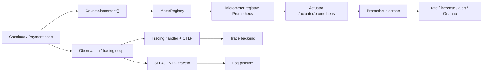

# Counter in Micrometer Metrics and Spring Boot

> **Chapter:** Metrics Foundation  
> **Module:** `SPRING_BOOT_OBSERVABILITY` — setting up observability for Spring Boot with Micrometer Observation, metrics, logs, and distributed tracing; learning context propagation, tags/cardinality, exporters, sampling, and signal correlation to investigate errors, latency, and application behavior in production.  
> **Lesson focus:** Using **Counter** to count an event type or monotonically increasing total; registering meters via `MeterRegistry`, attaching bounded labels, analyzing rate of change with Prometheus, and combining with Observation/traces/logs to verify incidents.

## 1. Learning Objectives

After this lesson, you will be able to:

1. Explain accurately what a Counter measures, why a Counter's value is **monotonically increasing within a process lifecycle**, and why you must calculate the rate of change instead of looking at a single cumulative value.
2. Distinguish Counter from Gauge, Timer, DistributionSummary, and LongTaskTimer; avoid double-counting events that already have standard meters.
3. Declare and inject `MeterRegistry` into Spring Boot, create a `Counter` using a builder or convenience API, and increment it with `increment()` / `increment(double)`.
4. Define the **boundary where an event is counted exactly once**, even when exceptions, retries, fallbacks, or concurrent requests occur.
5. Design low-cardinality tags such as `channel`, `outcome`, and `provider`, and protect the backend from time-series explosion.
6. Read a Counter via Actuator/Prometheus, use `rate()`, `increase()`, and error ratio expressions, and understand resets on process restarts.
7. Test a Counter with `SimpleMeterRegistry` and correlate counts with logs/traces without attaching trace IDs to metric labels.

## 2. What Questions Does a Counter Answer?

A **Counter** is a meter used to accumulate counts of occurrences. In Micrometer, a standard Counter can only increase by a **non-negative** amount; applications do not use it to decrement or reset to an arbitrary value.

Appropriate questions:

- "How many notifications were sent to the provider during the process lifetime?"
- "How many payments were **business-declined** versus **technical errors**?"
- "How many `checkout.payment` events with `outcome=error` occur per second?"
- "Is the total number of messages successfully processed by consumers rising quickly or slowly?"

Example:

```text
checkout.payment.attempts{outcome="approved"}  120
checkout.payment.attempts{outcome="declined"}    8
checkout.payment.attempts{outcome="error"}       3
```

These numbers are examples of **cumulative values within a process**. Looking only at `error=3` is not enough to conclude the system is severely broken: three errors might have happened in one minute or over an entire month. To determine if there is an active problem, you need the rate of increase over a time window.

### 2.1. Core Characteristics

| Characteristic | Meaning for Counter |
|---|---|
| Cumulative value | Each recorded event increases the total |
| Not for current levels that can go down | In-flight requests or current items in a queue should use a Gauge |
| Unit | Can be occurrences, messages, bytes, or cumulative amounts; must be clearly defined |
| Timing | A Counter does not store timing distribution between events |
| Reset | Value typically resets to 0 when a new process/registry starts or a new series is created |
| Labels | Each distinct set of tags creates a separate meter/time series in the backend |
| Trend observation | With Prometheus, `rate()` / `increase()` are typically used to analyze growth rate |

Micrometer Counter provides a `count()` API to read the current in-process value of the meter. For some registry types that publish on a step interval, how values are represented/pushed depends on the implementation. Therefore, **do not design business logic around reading a counter value and computing state from it**.

### 2.2. Rate Example

Suppose a counter series grows from 1,000 to 1,300 over 5 minutes with **no reset**:

- Observed increase: 300 events.
- Average rate: \(300 / (5 \times 60) = 1\) event/second.

Prometheus can estimate the rate from multiple scrape samples using `rate(metric[5m])`. Results computed from real samples may differ from dividing two endpoints due to scrape timing, regression/extrapolation, and reset handling. Typical dashboards should display rates, not raw cumulative sums across multiple processes assuming totals always increase across restarts.

## 3. How Does Counter Differ from Other Meter Types?

| Meter | Use When | Example | Notes |
|---|---|---|---|
| **Counter** | Event or monotonically increasing total | `payment.attempts`, `email.sent` | Count clearly once per event |
| **Gauge** | Current value that can go up/down | Active jobs, connections in use | Do not use Counter to count "currently remaining" |
| **Timer** | Measure **duration** and count of an operation | `checkout.payment.duration` | Timer already provides count and total duration |
| **DistributionSummary** | Measure distribution of non-time values | Message size, payload bytes | Provides count, total amount, and optionally histograms |
| **LongTaskTimer** | Track long-running active tasks | Data import job taking minutes | Suitable for tracking unfinished tasks |

**Important Micrometer rule:** Do not add a Counter just to "count how many times a method ran" if a Timer or DistributionSummary already records **that exact event** and provides the count. A separate Counter still makes sense when it represents different semantics, such as payments **approved**, **declined**, or **retries**.

A Counter cannot measure p95/p99 latency. To analyze latency, use a Timer with appropriate histograms; to find when a specific error occurred, use correlated traces/logs. The three signals complement one another.

### 3.1. Distinguishing General Requests from Business Events

Spring Boot Actuator typically provides the HTTP server timer `http.server.requests`. That timer already has a count and tags for status, method, and URI template. If you only want HTTP request throughput, the standard meter is sufficient.

A business Counter can capture distinct semantics:

- `checkout.payment.attempts`: each **call to the payment gateway**.
- `checkout.payment.declined`: each valid business decline decision.
- `checkout.payment.retries`: each **retry** call after the initial attempt.
- `checkout.order.created`: number of orders successfully persisted.

Different event sets can have different counts: one HTTP request might trigger multiple gateway attempts due to retries; an order might not be created even if the HTTP server returns 200 with a "declined" result.

## 4. Where Does Counter Sit in the Observability Pipeline?



For a Counter incremented directly via `MeterRegistry`:

1. Business code identifies the exact event to count.
2. The corresponding Counter is registered by **metric name and tag set**.
3. Each event calls `increment()` once.
4. The registry exposes the cumulative value in the backend format; Prometheus pulls samples via the endpoint.
5. Dashboards/alerts query the rate of increase and group data by tags.

Counter is a **Micrometer Metrics meter**. `ObservationRegistry` belongs to the Micrometer Observation layer and can automatically generate metrics via observation handlers. The two registries have different responsibilities: you can inject both `MeterRegistry` to record business Counters and `ObservationRegistry` to observe the duration/span of a processing step.

**There is no default mechanism guaranteeing that each Counter maps to a trace span.** Correlating specific errors requires observation/tracing instrumentation, logs with trace IDs, and stable semantic attributes.

## 5. Setting Up Counter in Spring Boot

The examples below target **Spring Boot 3.x, Java 17+**, using Maven with the Spring Boot parent/BOM to manage compatible versions.

### 5.1. Dependencies

```xml
<dependencies>
    <dependency>
        <groupId>org.springframework.boot</groupId>
        <artifactId>spring-boot-starter-actuator</artifactId>
    </dependency>

    <dependency>
        <groupId>io.micrometer</groupId>
        <artifactId>micrometer-registry-prometheus</artifactId>
    </dependency>
</dependencies>
```

Gradle uses the corresponding artifacts:

```groovy
implementation 'org.springframework.boot:spring-boot-starter-actuator'
runtimeOnly 'io.micrometer:micrometer-registry-prometheus'
```

To implement a **Counter in code**, you only need Micrometer core and an appropriate `MeterRegistry`. Spring Boot Actuator/auto-configuration provides the registry in the application context; the Prometheus registry is a specific choice when you want to scrape metrics. You do not need an OTLP tracing exporter for a Counter to exist.

### 5.2. Local Testing Configuration

Example `application.yml`:

```yaml
spring:
  application:
    name: checkout-service

management:
  endpoints:
    web:
      exposure:
        include: health,info,metrics,prometheus
  metrics:
    tags:
      application: ${spring.application.name}
      environment: ${APP_ENVIRONMENT:local}
```

`management.metrics.tags.*` are **common tags** for meters, not business tags specific to each payment attempt. `environment` comes from deployment configuration with a controlled set of values (`local`, `staging`, `prod`). Do not use request IDs or user IDs as common tags.

Once the application starts on `localhost:8080`, you can check:

```bash
curl -i http://localhost:8080/actuator/health
curl -s http://localhost:8080/actuator/metrics
curl -s http://localhost:8080/actuator/prometheus
```

If the Counter has not been created and incremented yet, the business meter may not appear yet. `/actuator/prometheus` only appears if the Prometheus registry and endpoint are enabled. In production, restrict management endpoints to the scraping network/port and apply appropriate access controls; exposing an endpoint is not the same as securing it.

## 6. Counter API in Micrometer

### 6.1. Creating a Counter with the Builder

```java
import io.micrometer.core.instrument.Counter;
import io.micrometer.core.instrument.MeterRegistry;

public final class ExamplePaymentCounter {

    private final Counter approvedPayments;

    public ExamplePaymentCounter(MeterRegistry registry) {
        this.approvedPayments = Counter
                .builder("checkout.payment.attempts")
                .description("Total number of payment gateway attempts")
                .tag("outcome", "approved")
                .register(registry);
    }

    public void paymentApproved() {
        approvedPayments.increment();
    }
}
```

Explanation:

- `"checkout.payment.attempts"` is the technical metric name, stable across deployments.
- `description(...)` helps readers understand that the Counter counts **attempts**, not orders.
- `tag("outcome", "approved")` creates a dimension to group outcomes. Its value set must be bounded.
- `register(registry)` registers or retrieves the matching meter with the same name and tags in the registry.
- `increment()` increases the value by 1.

`MeterRegistry` is usually created by Spring Boot as a bean. Inject it via constructor; do not call `new SimpleMeterRegistry()` inside a production service, as a standalone self-created registry will not be scraped by exporters/Actuator.

### 6.2. Convenience API

When you have a single fixed counter, you can also use:

```java
Counter counter = registry.counter(
        "checkout.payment.attempts",
        "outcome", "approved");

counter.increment();
counter.increment(2.0);
double localTotal = counter.count();
```

`increment(2.0)` adds an amount of 2.0; this is appropriate if a single update represents **exactly two units of the same quantity**. For counters tracking individual event calls, `increment()` is usually clearer.

Counters are designed for **non-negative** increments. Never call `increment(-1)` to "undo" an attempt; if there is a reversal business flow, define a separate event such as `payment.refunded`. In particular, do not subtract failed results from a processed total to make a Counter go down.

### 6.3. Counter Is Not a Source of Business Truth

Do not use `counter.count()` to determine:

- wallet balances,
- number of orders in the database,
- payment limits,
- inventory stock levels,
- retry policies requiring strict correctness.

Metrics can reset on process restarts, series can be dropped due to retention, and exporters can fail. Business state must be stored in an appropriate transactional system; Counters exist for **observability**.

## 7. Practical Example: Counting Payment Attempts by Channel and Outcome

Suppose we want to count every call to the payment gateway and distinguish three outcomes:

- `approved`: the gateway confirms the payment is approved;
- `declined`: the gateway validly declines per business rules, not necessarily an infrastructure failure;
- `error`: a technical exception occurs during the gateway call.

Allowed channels are bounded: `web`, `mobile`, `partner`, `other`.

### 7.1. Defining the Value Sets

```java
package com.example.checkout.metrics;

public enum PaymentChannel {
    WEB, MOBILE, PARTNER, OTHER
}
```

```java
package com.example.checkout.metrics;

public enum PaymentOutcome {
    APPROVED, DECLINED, ERROR
}
```

If an HTTP request passes `channel` as a string, **normalize it to an enum before recording the metric**. For example:

```java
import java.util.Locale;

static PaymentChannel parseChannel(String raw) {
    if (raw == null) {
        return PaymentChannel.OTHER;
    }
    return switch (raw.trim().toUpperCase(Locale.ROOT)) {
        case "WEB" -> PaymentChannel.WEB;
        case "MOBILE" -> PaymentChannel.MOBILE;
        case "PARTNER" -> PaymentChannel.PARTNER;
        default -> PaymentChannel.OTHER;
    };
}
```

Normalization must run on every input; merely calling `trim` or truncating to 50 characters **does not bound** the number of distinct values.

### 7.2. Creating Counters Once per Tag Combination

A `@Component` pre-registers 4 × 3 = **12 Counters**. They are registered during bean construction, avoiding arbitrary names and labels derived from requests.

```java
package com.example.checkout.metrics;

import io.micrometer.core.instrument.Counter;
import io.micrometer.core.instrument.MeterRegistry;
import java.util.EnumMap;
import java.util.Locale;
import java.util.Map;
import java.util.Objects;
import org.springframework.stereotype.Component;

@Component
public final class PaymentAttemptCounters {

    private final Map<PaymentChannel, Map<PaymentOutcome, Counter>>
            byChannelAndOutcome;

    public PaymentAttemptCounters(MeterRegistry registry) {
        Map<PaymentChannel, Map<PaymentOutcome, Counter>> all =
                new EnumMap<>(PaymentChannel.class);

        for (PaymentChannel channel : PaymentChannel.values()) {
            Map<PaymentOutcome, Counter> outcomes =
                    new EnumMap<>(PaymentOutcome.class);

            for (PaymentOutcome outcome : PaymentOutcome.values()) {
                Counter counter = Counter
                        .builder("checkout.payment.attempts")
                        .description("Total payment gateway attempts")
                        .tag("channel",
                                channel.name().toLowerCase(Locale.ROOT))
                        .tag("outcome",
                                outcome.name().toLowerCase(Locale.ROOT))
                        .register(registry);

                outcomes.put(outcome, counter);
            }

            all.put(channel, Map.copyOf(outcomes));
        }

        this.byChannelAndOutcome = Map.copyOf(all);
    }

    public void record(PaymentChannel channel, PaymentOutcome outcome) {
        PaymentChannel validChannel = Objects.requireNonNull(channel);
        PaymentOutcome validOutcome = Objects.requireNonNull(outcome);

        byChannelAndOutcome.get(validChannel)
                .get(validOutcome)
                .increment();
    }
}
```

Design notes:

1. Every meter shares the **same metric name** and tag structure.
2. `channel` and `outcome` come strictly from enums, never from request IDs or raw user-supplied strings.
3. `Counter` instances are stored in the map and can be used safely across concurrent requests thanks to Micrometer's instrumentation implementation.
4. `record(...)` calls `increment()` exactly once for each explicitly defined event.
5. By pre-initializing all combinations, local environments can see series that have had no events yet; they report 0 depending on the registry/exporter. This is convenient when authoring dashboards, though it uses series slots for combinations that may never occur. Large systems may register lazily **with a bounded value set**, depending on needs.

**Note:** A meter's identity key is its name plus tag set (and associated registration attributes). Two places registering the same meter ID against the same registry typically receive the same existing meter; do not rely on repeated registrations to create independent counters. Use clear, distinct names for distinct meanings.

### 7.3. Counting at the Exact Business Boundary

Example of a service that validates a request and then calls the gateway:

```java
package com.example.checkout.service;

import com.example.checkout.metrics.PaymentAttemptCounters;
import com.example.checkout.metrics.PaymentChannel;
import com.example.checkout.metrics.PaymentOutcome;
import org.springframework.stereotype.Service;

@Service
public class PaymentService {

    private final PaymentGateway gateway;
    private final PaymentAttemptCounters counters;

    public PaymentService(PaymentGateway gateway,
                          PaymentAttemptCounters counters) {
        this.gateway = gateway;
        this.counters = counters;
    }

    public PaymentDecision authorize(PaymentRequest request) {
        validate(request); // Outside the gateway attempt boundary.

        PaymentOutcome outcome = PaymentOutcome.ERROR;

        try {
            PaymentDecision decision = gateway.authorize(request);
            outcome = decision.approved()
                    ? PaymentOutcome.APPROVED
                    : PaymentOutcome.DECLINED;
            return decision;
        } finally {
            counters.record(request.channel(), outcome);
        }
    }

    private void validate(PaymentRequest request) {
        if (request == null || request.channel() == null) {
            throw new IllegalArgumentException("Invalid payment request");
        }
    }
}
```

`PaymentGateway`, `PaymentRequest`, and `PaymentDecision` are illustrative domain types. `PaymentRequest.channel()` returns a normalized `PaymentChannel`; `PaymentDecision.approved()` returns a boolean. A complete application must define these types and an appropriate error-handling policy.

**Why `finally`?** When the gateway throws a technical exception, `outcome` remains `ERROR` and the event is still counted. When the gateway returns a result, we set `APPROVED` or `DECLINED` before recording the Counter.

**Why validate outside?** Because the Counter means "calls to the gateway." A request rejected during validation **before reaching the gateway** must not count as an attempt. If you want to count validation failures, design a separate Counter with clear semantics.

If the gateway has internal **retry logic**, define the boundary clearly:

- To count **calls to the `authorize` method**, place the Counter in the service as shown.
- To count **each individual HTTP attempt** during retries, place the Counter close to the actual request-sending layer.
- To count **one logical payment request**, increment once at the request boundary even if multiple retries happen.

Do not use two counters with the same name and tags at both the request layer and retry layer and mix their values; dashboards will become hard to interpret.

### 7.4. If You Need to Distinguish Retries

Do not put `attemptId` or a unique ID in a tag. Use a small value set such as:

```text
attempt.phase = initial | retry
```

When you want to count retries, you can have a `checkout.payment.retries` Counter recorded strictly on **each retry**. Only add an extra dimension if a dashboard or alert actually uses it.

## 8. Tags and Cardinality: Controlling at the Source

A Counter with a name and tags is identified as distinct time series:

```text
checkout.payment.attempts{channel="web",outcome="approved"}
checkout.payment.attempts{channel="web",outcome="declined"}
checkout.payment.attempts{channel="mobile",outcome="error"}
```

Good and bad choices:

| Tag | Example | Include in Counter? | Reason |
|---|---|---|---|
| `channel` | `web`, `mobile`, `partner`, `other` | Yes | Small set, helps compare traffic |
| `outcome` | `approved`, `declined`, `error` | Yes | Every value has business meaning |
| `provider` | `primary`, `backup`, `other` | Maybe | Needs a whitelist and an analysis goal |
| `environment` | `local`, `staging`, `prod` | Yes | Derived from deployment config |
| `order.id` | `ORD-202611-...` | No | Virtually unique per request |
| `user.id` | User ID | No | Very high cardinality, privacy risk |
| `raw.url` | `/orders/123456?token=...` | No | Dynamic IDs, query may contain secrets |
| `exception.message` | Full error string | No | Too many values, may contain sensitive data |
| `trace.id` | 32 hex digits | No | Used in traces/logs, not as a metric label |

**Estimate:** 4 channels × 3 outcomes × 3 providers × 2 environments × 8 instances = up to **576 label combinations** for one metric, not counting exporter labels or histograms on other meters. Adding a `customerId` with 100,000 values scales combinations by the number of customers.

An effective policy includes:

1. Defining the key and meaning of every tag.
2. Using enums, whitelists, or controlled bucketing of values.
3. Providing an `other`/`unknown` fallback.
4. Reviewing distinct values and series counts after every change.
5. Never using any per-request identifier as a metric label.

### 8.1. Anti-Pattern: Creating a Meter per User

**Wrong:**

```java
registry.counter(
        "checkout.payment.attempts",
        "user.id", userId
).increment();
```

Each distinct `userId` can create another meter retained in the registry, increasing JVM memory usage and backend time series. Switch to a bounded value set such as `channel` and `outcome`. When you need to look up a specific request, use trace ID/span ID in tracing and logs under your data policy.

### 8.2. MeterFilter as an Additional Guardrail

Spring Boot can pick up `MeterFilter` beans to enforce policies on `MeterRegistry`. For example, capping the number of `outcome` values on the payment meter:

```java
import io.micrometer.core.instrument.config.MeterFilter;
import org.springframework.context.annotation.Bean;
import org.springframework.context.annotation.Configuration;

@Configuration(proxyBeanMethods = false)
class PaymentMetricsGuardConfiguration {

    @Bean
    MeterFilter boundPaymentOutcomes() {
        return MeterFilter.maximumAllowableTags(
                "checkout.payment.attempts",
                "outcome",
                3,
                MeterFilter.deny());
    }
}
```

This mechanism helps cap series caused by unexpected labels; if a fourth label appears beyond the three expected ones, the new meter can be denied. **Do not treat this as data normalization**: denied measurements cause dashboards to miss events. Control inputs with enums/whitelists upfront and monitor alerts or denied series counts.

## 9. Counter from Prometheus's Perspective

Micrometer typically converts dot-separated names to underscores and applies the Prometheus Counter suffix convention. For example, `checkout.payment.attempts` may be exposed as:

```text
# HELP checkout_payment_attempts_total Total payment gateway attempts
# TYPE checkout_payment_attempts_total counter
checkout_payment_attempts_total{application="checkout-service",channel="web",environment="prod",outcome="approved"} 810
checkout_payment_attempts_total{application="checkout-service",channel="web",environment="prod",outcome="declined"} 34
checkout_payment_attempts_total{application="checkout-service",channel="web",environment="prod",outcome="error"} 11
```

This is a **formatting example**, not live output. Names, suffixes, label names, series counts, and label ordering depend on registry version, naming conventions, and configuration. Inspect `/actuator/prometheus` on your running app to confirm metric names before writing PromQL.

### 9.1. Why Not Use the Current Counter Value as a Rate?

A steadily increasing Counter produces an upward-sloping line over the process lifetime. When the process restarts, the value drops back to 0, causing a sharp drop on the chart. The cumulative total at one moment does not clearly show how many events happened **in the last minute**.

Prometheus stores samples over time and provides specialized functions:

- `rate(counter[5m])`: estimates the average increase **per second** over a 5-minute range.
- `increase(counter[5m])`: estimates the total increase of the Counter over 5 minutes.
- `irate(counter[5m])`: estimates instantaneous rate from the last two samples; reacts quickly but is very noisy—use only when you understand the chart's purpose.
- `resets(counter[1h])`: estimates the number of counter resets in one hour; useful for distinguishing process restarts from traffic changes.

`rate` and `increase` account for resets based on scraped data. `increase` can return non-integer values due to estimation and extrapolation over the sampling window; do not treat it as an exact transactional ledger.

### 9.2. PromQL for the Payment Counter

Assuming the actual series is `checkout_payment_attempts_total`.

**Total attempts/second across all instances:**

```promql
sum(
  rate(checkout_payment_attempts_total[5m])
)
```

**Attempts/second by outcome:**

```promql
sum by (outcome) (
  rate(checkout_payment_attempts_total[5m])
)
```

**Attempts/second by channel and outcome:**

```promql
sum by (channel, outcome) (
  rate(checkout_payment_attempts_total[5m])
)
```

**Estimated increase in attempts over 15 minutes:**

```promql
sum(
  increase(checkout_payment_attempts_total[15m])
)
```

**Technical error ratio over 5 minutes (value 0–1):**

```promql
sum(
  rate(checkout_payment_attempts_total{
    outcome="error"
  }[5m])
)
/
clamp_min(
  sum(rate(checkout_payment_attempts_total[5m])),
  1e-9
)
```

Here `outcome=declined` is a business rejection and must not be folded into `error` if the team only wants to track technical failures. For alerts on bank decline rates, compute `declined / total` separately and give it a clear SLI name.

**Technical error ratio by channel:**

```promql
sum by (channel) (
  rate(checkout_payment_attempts_total{
    outcome="error"
  }[5m])
)
/
clamp_min(
  sum by (channel) (
    rate(checkout_payment_attempts_total[5m])
  ),
  1e-9
)
```

If traffic is 0, expressions using `clamp_min` typically evaluate to 0, but **0 does not prove the system is healthy**. Dashboards should show both throughput and scrape status; alerts should include a minimum sample/traffic condition to reduce false positives.

### 9.3. Rate Must Be Computed Before Summing Across Instances

With Prometheus and multiple instances that can restart independently, the usual correct pattern is:

```promql
sum(rate(checkout_payment_attempts_total[5m]))
```

Do not sum raw counters across instances into a single vector/record and then take the rate of that sum without reset handling: when one instance restarts, the sum drops and skews the result. Applying `rate` per series before `sum` allows Prometheus to handle each instance's resets independently.

### 9.4. What Time Window Is Reasonable?

| Window | Best For | Risk |
|---|---|---|
| `[1m]` | High traffic, fast detection needed | Noisy with few events or long scrape intervals |
| `[5m]` | General operational dashboards | Slight detection lag shorter than the window |
| `[15m]` | Medium/low traffic | Smooths out short spikes |
| `[1h]` | Sparse data trends/SLIs | Slow to react to new incidents |

With a 15-second scrape interval, a 5-minute window usually contains enough samples if the target is stable. For low traffic, consider `increase` over a longer window and display total event counts so viewers understand confidence levels.

## 10. Restarts, Multiple Replicas, and Missing Data

In production, applications commonly run multiple replicas behind a load balancer. Each process holds its own Counter:

```text
checkout-7f4c (instance A): approved = 1000
checkout-8a12 (instance B): approved =  820
checkout-93db (instance C): approved =  650
```

These totals mean **since the respective process started**. During a rolling update, instance A may restart and its Counter resets to 0 while B and C continue incrementing. This is normal behavior.

When graphing cluster-wide throughput, use `sum(rate(...[5m]))` or `sum(increase(...[5m]))` as appropriate. Do not sum raw counters across replica changes to deduce the exact number of transactions since the start of the day.

### 10.1. When a Scrape Target Disappears

If Prometheus fails to scrape for a period, the Counter still increments inside the process, but the backend lacks observations. `rate`/`increase` after the target returns will rely on remaining samples and may miss resets that happened during the outage. If a process terminates permanently before the next scrape, unscraped events may never reach the backend.

**For this reason, metrics do not replace audit logs or transactional records requiring exactness.** When investigating an incident, check `up`, scrape duration, exporter errors, and data gaps.

### 10.2. Step Registries and Other Telemetry Export Models

Not every `MeterRegistry` exports Counters using the Prometheus pull model. For some push/step backends, the registry converts values into rates/deltas per export interval. When switching exporters, check units, cumulative vs. delta semantics, and how the backend queries data.

Avoid copying a Prometheus dashboard to another backend and assuming metric names, suffixes, and aggregation functions work identically.

## 11. How Do Counter and Micrometer Observation Differ?

Because this module covers both `Micrometer Observation` and metrics, it is important to understand how they relate.

An `Observation` has a lifecycle:

```text
createNotStarted -> start -> openScope -> work -> closeScope -> stop
```

When a meter observation handler is configured, an observation typically contributes a **timer** with count/duration based on conventions and key-values. By contrast, a Counter created directly via `MeterRegistry` increments only when code calls `increment()`.

Two examples measuring **two different concepts**:

```java
Observation.createNotStarted(
        "checkout.payment.duration", observationRegistry)
    .observe(() -> {
        paymentAttemptCounters.record(
                PaymentChannel.WEB, PaymentOutcome.APPROVED);
        return "APPROVED";
    });
```

This snippet illustrates the mechanism: the observation measures the operation; the business Counter counts a chosen event. **In real business code**, call the Counter after determining the actual outcome rather than hardcoding `APPROVED` as in this short snippet.

If you only want to count how many times an operation completed, the `checkout.payment.duration` timer already has a count; an extra Counter with identical semantics may be unnecessary. However, if you want to distinguish **approved refunds**, **triggered fraud rules**, or **events sent to a queue**, a dedicated Counter is appropriate.

### 11.1. Correlating from Metrics to Traces and Logs

During a production investigation:

1. Prometheus shows `checkout_payment_attempts_total{outcome="error"}` spiking on the `partner` channel.
2. Use service, time range, and channel to search for traces of the payment operation if tracing is instrumented and sampled.
3. Inspect spans across the HTTP client to the gateway, checking latency and status/error attributes.
4. Grab the `traceId` from an anomalous trace and query related logs for the concrete root cause.
5. After deploying a fix, use the Counter rate/error ratio to confirm the error frequency dropped.

Do not attach `traceId` to Counter tags; trace IDs have near-unique cardinality per request. Logs only carry trace IDs when tracing context, scope, and logging correlation are configured; a Counter by itself does not create MDC entries or propagate context.

### 11.2. Sampling Reduces Stored Traces, Not Counter Rates

If head sampling is 10%, the trace backend only receives a fraction of spans per the sampling policy, while a Counter directly on `MeterRegistry` can still count 100% of recorded attempts. Therefore, do not divide the number of stored traces to reliably estimate payment attempt volume; use Counters for event volume statistics and traces to analyze individual execution flows.

Some backends support **exemplars** to link a metric sample to a specific trace, though this depends on the registry, tracing context, and exporter/frontend. Do not assume every Counter automatically has exemplars or trace links just by adding Actuator.

## 12. Counting Exactly Once: Subtle Bugs in Production

### 12.1. Incrementing in Both `try` and `finally`

**Wrong:**

```java
try {
    gateway.authorize(request);
    attempts.increment(); // Once on the success branch.
} finally {
    attempts.increment(); // Success is counted twice.
}
```

**Right:** designate one place to record the event, typically a single `finally` block after determining the outcome or at an official confirmed domain event.

### 12.2. Counting API Requests and Retries Under One Name

**Semantically wrong:** the same Counter `payment.requests` is incremented in the controller when the request arrives and incremented again on each attempt in the retry loop.

**Right:** choose distinct names, such as `payment.logical.requests` and `payment.gateway.attempts`. Dashboards can then compute average retries per request and clearly distinguish what is being counted.

### 12.3. Counting Validation-Rejected Requests as Gateway Attempts

If you increment at the start of the controller, a request rejected with 400 before calling the gateway still increments the attempts counter. Place the counter at the **actual event boundary** promised by the metric name; if you also want to count rejected requests, define a separate meter or use existing HTTP request metrics.

### 12.4. Negative Increment to Reduce a Total

**Wrong:**

```java
counter.increment(-1); // Violates the Counter contract.
```

Do not use a Counter as a variable tracking currently active jobs or unprocessed items. Use a Gauge or appropriate business state; Counters fit separate totals for jobs started and jobs completed when rates are needed.

### 12.5. Reading Raw Count and Concluding Traffic Dropped

A newly restarted instance shows `count=12` while an older instance shows `count=50000`. That does not prove traffic dropped. Check `rate`, deployment changes, `up`, instance counts, and scrape gaps.

### 12.6. Attaching Dynamic Values to Meter Tags

`outcome=error: Card declined for user 123` has huge cardinality and may expose sensitive data. Use `outcome=declined` along with a whitelisted `error.category` if needed. Detailed exception messages belong only in logs/traces under appropriate security policies.

## 13. Testing Counter with SimpleMeterRegistry

A pure Micrometer unit test requires no Spring context, Prometheus, or Collector.

```java
package com.example.checkout.metrics;

import io.micrometer.core.instrument.Counter;
import io.micrometer.core.instrument.simple.SimpleMeterRegistry;
import org.junit.jupiter.api.Test;

import static org.junit.jupiter.api.Assertions.assertEquals;

class PaymentAttemptCountersTest {

    @Test
    void countsExactlyOnceForEachBoundedOutcome() {
        SimpleMeterRegistry registry = new SimpleMeterRegistry();

        try {
            PaymentAttemptCounters counters =
                    new PaymentAttemptCounters(registry);

            counters.record(PaymentChannel.WEB, PaymentOutcome.APPROVED);
            counters.record(PaymentChannel.WEB, PaymentOutcome.APPROVED);
            counters.record(PaymentChannel.WEB, PaymentOutcome.ERROR);

            Counter approved = registry
                    .get("checkout.payment.attempts")
                    .tag("channel", "web")
                    .tag("outcome", "approved")
                    .counter();

            Counter failed = registry
                    .get("checkout.payment.attempts")
                    .tag("channel", "web")
                    .tag("outcome", "error")
                    .counter();

            assertEquals(2.0, approved.count(), 0.000001);
            assertEquals(1.0, failed.count(), 0.000001);
        } finally {
            registry.close();
        }
    }
}
```

This test verifies **counting logic and tags**, not that Prometheus scraped the app or that a tracing backend received spans. To verify exact once-per-attempt counting when the gateway throws an exception, add a test for `PaymentService` with a failing fake gateway and assert `outcome=error` increments once.

### 13.1. Testing Errors, Retries, and Validation

A meaningful test suite should cover:

| Scenario | Expectation |
|---|---|
| Gateway returns approved | Counter `outcome=approved` increments by exactly 1 |
| Gateway returns declined | `outcome=declined` increments by exactly 1; error does not increment |
| Gateway throws exception | `outcome=error` increments by exactly 1; exception still propagates |
| Validation fails before gateway | Gateway attempt Counter **does not increment** |
| Gateway retries twice after initial attempt | Gateway attempts increment by 3 actual calls if Counter sits in the retry layer |
| Invalid channel input | Value maps to `other`; no arbitrary tag created |
| Concurrent requests | Total count equals recorded events, no lost updates in counter-recording code |

An overly trivial test asserting only that `counter.increment()` sets `count=1` does not prove metrics reflect business logic. Prioritize verifying **which events are counted** and when.

## 14. Reading Counter in Spring Boot Actuator

After running the app with `PaymentAttemptCounters`, call the real business endpoint to generate events. Then:

```bash
curl -s http://localhost:8080/actuator/metrics
curl -s http://localhost:8080/actuator/metrics/checkout.payment.attempts
curl -s http://localhost:8080/actuator/prometheus
```

`/actuator/metrics/checkout.payment.attempts` typically provides a `COUNT` measurement and the list of tags seen in the registry. JSON structure varies by version, but can look like:

```json
{
  "name": "checkout.payment.attempts",
  "measurements": [
    { "statistic": "COUNT", "value": 3.0 }
  ],
  "availableTags": [
    { "tag": "channel", "values": ["web", "mobile", "partner", "other"] },
    { "tag": "outcome", "values": ["approved", "declined", "error"] }
  ]
}
```

This is only a structural example; when querying **without a tag filter**, Actuator may aggregate values across meters sharing the name with different tags. Do not treat an aggregated `COUNT` as the count solely for `outcome=error`.

You can filter by tags via query parameters:

```bash
curl -G http://localhost:8080/actuator/metrics/checkout.payment.attempts --data-urlencode 'tag=channel:web' --data-urlencode 'tag=outcome:error'
```

Note that PowerShell has a `curl` alias distinct from the `curl` executable: in traditional PowerShell, use `curl.exe` or `Invoke-WebRequest`/`Invoke-RestMethod`. The commands above show standard shell curl syntax.

To verify a full production pipeline, beyond the app endpoints you must also check Prometheus target **UP** status, labels after scrape/relabel, remote-write, and retention.

## 15. Alerting: Choosing Informative Signals

Counters are useful for alerting on error rates, but **do not alert merely because a raw count increased**: a busy system always has increasing events.

Illustrative alert condition idea: "Gateway error ratio above 5% for 10 minutes, **and** traffic is at least 1 request/second":

```promql
(
  sum(rate(checkout_payment_attempts_total{
    outcome="error"
  }[10m]))
  /
  clamp_min(
    sum(rate(checkout_payment_attempts_total[10m])),
    1e-9
  )
) > 0.05
and
(
  sum(rate(checkout_payment_attempts_total[10m])) > 1
)
```

This is an example **for learning query structure**, not an approved production threshold. Real thresholds depend on SLOs, traffic, baseline error rate, incident response time, historical data, and backend health. One error in a very low-traffic service requires a different alerting strategy than 10,000 requests/second.

Signals to watch alongside it:

- **Request/attempt rate:** is traffic still arriving or has traffic dropped off?
- **Error ratio:** do technical errors and business declines diverge?
- **Latency:** obtained from Timer/histograms; Counters do not provide latency.
- **Saturation:** connection pools, threads, queues, CPU, DB.
- **Pipeline health:** Prometheus scrape `up`, exporter errors, missing data.

If error count spikes while latency stays flat, it may indicate bad data or rejection rules. If error ratio and p95 latency rise together, inspect traces and logs for outbound gateways or databases.

## 16. Counter in Local vs. Production Environments

| Aspect | Local | Production |
|---|---|---|
| Data source | `SimpleMeterRegistry` in tests or local Prometheus registry | Centralized scrape/remote-write or managed metrics backend |
| Series count | Low traffic, easy to inspect every tag | Requires cardinality budget and retention planning |
| Purpose | Verify counting and tag contracts | Traffic/error rates, SLIs/SLOs, alerts, trends |
| Restarts | Counter resets to 0 on app restart | Multiple replicas restart independently; use `rate` before `sum` |
| Security | Endpoints may be open on dev machine | Management endpoints protected by network, auth/TLS |
| Correlation | Trace sampling can be 100% during testing | Controlled sampling, correlated logs, reliable exporters |
| Risks | Easy to confuse Counter with an in-code variable | Easy to double-count retries, explode series, miss scrapes, misread dashboards |

During rolling restarts, Prometheus sees the target list change. Dashboards should group by `application`/`environment`/`channel`/`outcome` at an appropriate level rather than hardcoding a pod ID.

## 17. Common Issues and How to Investigate

| Symptom | What to Check |
|---|---|
| Injecting `MeterRegistry` fails | Are Micrometer/Actuator auto-configurations present? Is a registry excluded or a test slice too narrow? |
| `/actuator/prometheus` returns 404 | Is `micrometer-registry-prometheus` added and the endpoint exposed? Is the management port/base path different? |
| Counter not visible | Did the code path call `record`? Was the meter registered in the right registry? Did predicates/meter filters deny it? |
| `COUNT` doubles compared to expected | Incremented in both controller and service? In both `try` and `finally`? Do retries/batches create multiple attempts? |
| Counter stops increasing after deploy | New instance receives no traffic, another code path runs, tags changed, or meter was denied |
| Counter drops to 0 | Process restarted or series replaced; check `up` and deployment events |
| Rate is 0 when requests are rare | Query window too short, missed scrapes, rare events, or mismatched label filter |
| `channel` tag has thousands of values | Raw input passed to tags; missing enum/whitelist |
| Metrics exist but no traces | Sampling/bridge/exporter/Collector or propagation issue; Counters do not create traces |
| Counter has values but backend has no series | Scrape target DOWN, metric name changed, relabel/remote-write, retention, or exporter error |
| Dashboard "under-counts" declined | Query filters only `outcome=error`; inconsistent outcome mapping |

An effective diagnostic flow:

1. **Business logic:** verify a real event executed and only one place records the Counter.
2. **In-process:** check `MeterRegistry`, `Counter.count()` in tests, or `/actuator/metrics`.
3. **Export:** inspect `/actuator/prometheus`, actual metric names, and labels.
4. **Collection:** check `up` and Prometheus scrape errors.
5. **Querying:** verify label filters, `rate` window, and reset handling before aggregation.
6. **Root-cause debugging:** use tracing/logs to find the cause per request/time window.

## 18. Frequently Confused Questions

**Should a Counter increment when a request starts or finishes?**

It depends on what the metric represents. If named `requests.started`, increment when the request actually begins. If named `payments.approved`, increment only after confirming the payment was approved. Avoid names that mismatch the recording point.

**Can a Counter increment by more than 1?**

Yes, via `increment(double)` with a non-negative amount. Ensure the amount accurately represents a cumulative quantity. If you want the size distribution of individual messages, a `DistributionSummary` is usually more informative than a Counter storing only total bytes.

**Can a Counter decrease?**

Not under its normal contract; a drop indicates a reset/restart or the wrong meter type. Tracking "currently running jobs" needs an appropriate Gauge or LongTaskTimer.

**Is counting errors via HTTP 5xx the same as payment errors?**

No. A gateway timeout might be handled via a fallback that returns HTTP 200; a declined payment can also be an expected business outcome. Metrics should define outcomes explicitly rather than inferring business errors solely from HTTP status codes.

**Does `@Counted` automatically work on every Spring method?**

Do not assume so. Micrometer's `@Counted` requires an appropriate instrumentation/aspect mechanism, such as `CountedAspect` when using AOP in a suitable configuration. Furthermore, if a Timer/Observation already counts the method, adding `@Counted` may duplicate metrics. For specialized event metrics, an explicit Counter is usually easier to control.

**Should I put order IDs into a Counter to find failing requests?**

No. Use low-cardinality tags to identify failing groups, then use trace/span IDs and correlated logs when instrumented and permitted by policy.

## 19. Comprehensive Exercise

**Scenario:** A checkout API calls a payment gateway. Over 10 minutes, the system makes 4,000 gateway calls: 3,700 approved, 220 declined, and 80 technical errors. Some payments retry; production runs 5 instances.

### Requirements

1. Define Counter `checkout.payment.attempts` with tags `channel` and `outcome`, clearly specifying what an **attempt** means.
2. Create enums and a `PaymentAttemptCounters` component using one Counter per bounded tag combination.
3. Add logic recording exactly one event when the gateway finishes, including on exceptions. Do not count requests rejected by validation before calling the gateway.
4. Use `SimpleMeterRegistry` to test 2 approved and 1 error, verifying `count()`.
5. Calculate error ratio: \(80 / 4,000 = 0.02\), or **2%**. The decline ratio is \(220 / 4,000 = 5.5\%\); do not add it to the technical error ratio if the alert targets gateway failures.
6. Write PromQL to measure attempts/second by `channel`, estimate errors over 15 minutes, and calculate error ratio over 5 minutes.
7. Simulate an instance restart: explain why the raw count drops while aggregated `rate` can still accurately reflect throughput if enough scrape samples exist.
8. Generate a test error trace (if tracing is enabled) and use the trace ID to find matching logs; do not add trace ID as a Counter tag.
9. Check cardinality before/after adding `provider`, include an `other` fallback strategy, and describe how to manage series when scaling replicas.

### Extension Exercise: Evaluating Counts

If one logical payment is retried twice after the initial attempt, the table below represents:

| Metric | Meaning | Value for Example |
|---|---|---|
| `payment.logical.requests` | Logical requests received | 1 |
| `payment.gateway.attempts` | Actual calls to the gateway | 3 |
| `payment.gateway.retries` | Attempts after the first | 2 |
| `payment.approved` | Payments finally approved | 0 or 1 depending on result |

**Question:** In what scenario could you use the HTTP server Timer's count instead of `payment.logical.requests`? Why are the two not always equal?

### Completion Criteria

You meet the objective when you can explain **what event is being counted**, pinpoint the exact increment site, write a Counter with a bounded tag set, know how to use `rate`/`increase`, handle resets, and avoid confusing Counter with Gauge/Timer. During production incidents, you know how to use Counters to determine frequency and affected groups, then pivot to traces/logs to pinpoint root cause.

---

## Takeaway

**A Counter is a cumulative count of a monotonically increasing quantity; its value lies in the event it counts and its rate of increase over time.** In Spring Boot, inject `MeterRegistry`, create a `Counter` with a stable name and low-cardinality tags, and call `increment()` at a single well-defined business boundary. Timers and DistributionSummaries already maintain their own counts, so avoid redundant Counters.

With Prometheus, use `rate` or `increase` over time windows, especially when multiple replicas can restart independently. Never put per-request IDs into metric labels. Metrics reveal which event groups are growing; Micrometer Observation, distributed tracing, and trace-correlated logs uncover the specific causes a Counter alone cannot express.
