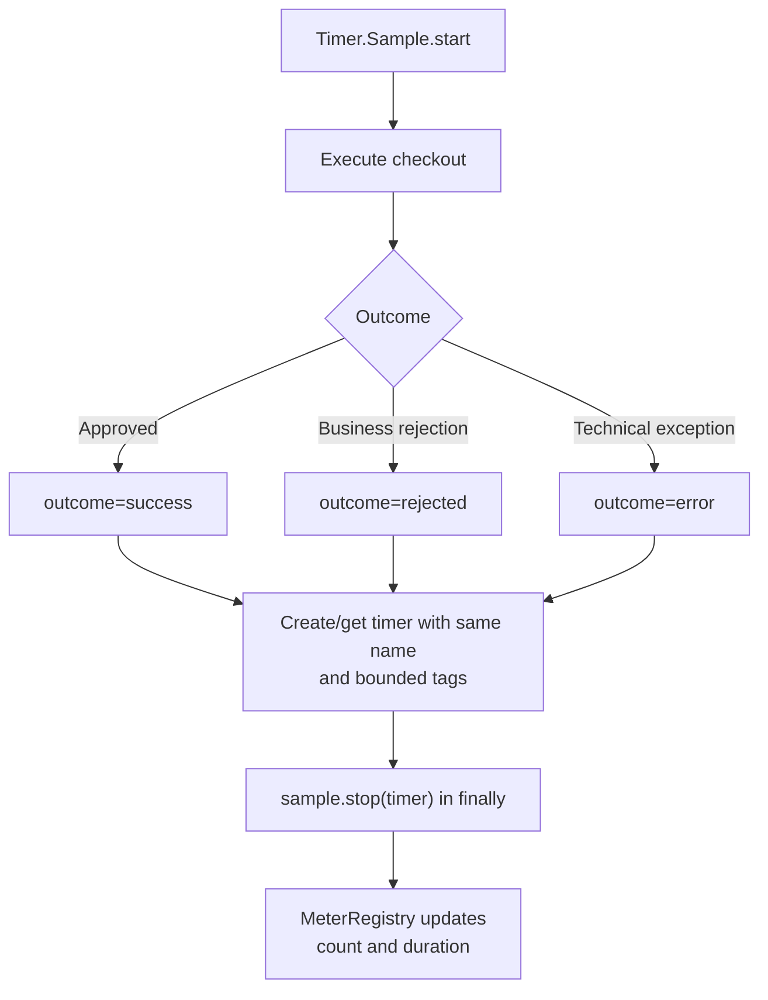
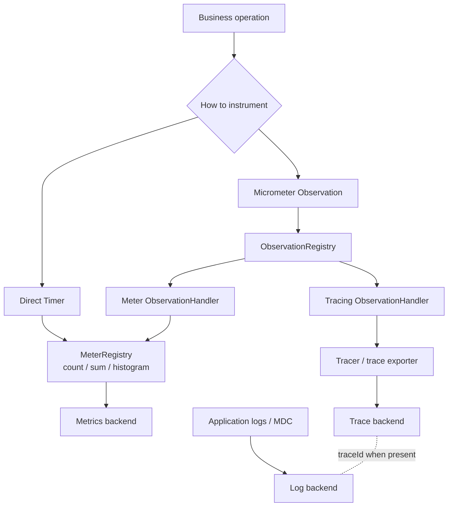
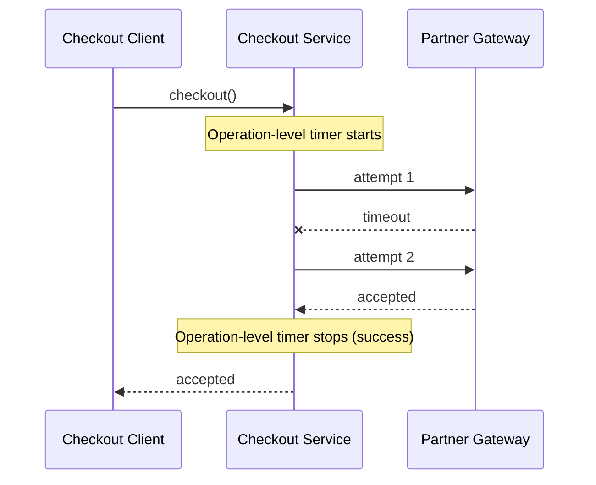

# Timer in Micrometer Metrics and Spring Boot

When a checkout API starts slowing down, looking at the HTTP error rate is not enough to answer: **which step increased latency, how many operations are affected, and does p95 exceed the committed threshold?** In Micrometer, **`Timer`** is the foundational tool for measuring **counts** and **durations** of tasks with clear start and end boundaries: handling requests, calling external services, querying data, validating transactions, or executing an integration step.

The **Timer** lesson belongs to the **Metrics Foundation** chapter of the **SPRING_BOOT_OBSERVABILITY** module. The module's goal is to set up observability for Spring Boot using Micrometer Observation, metrics, logs, and distributed tracing; explore context propagation, tags/cardinality, exporters, sampling, and signal correlation to investigate errors, latency, and application behavior in real environments. This lesson dives into duration measurement with Micrometer Timer, how metrics are published and read, and their role in incident investigation workflows.

## 1. Learning Objectives

After completing this lesson, you will be able to:

- Distinguish `Timer` from `Counter`, `Gauge`, and `LongTaskTimer`.
- Explain the meaning of `count`, `totalTime`, and `max`; calculate throughput, mean duration, and percentiles properly.
- Use `Timer.record(...)`, `Timer.Sample`, and `MeterRegistry` to measure synchronous work, including when exceptions occur.
- Design low-cardinality tag sets (`operation`, `outcome`, `channel`) and record durations at the right business boundary.
- Intentionally configure histograms or percentiles, read Prometheus data, and avoid wrong inferences about p95/p99.
- Understand when to use Micrometer Observation to combine metrics with distributed tracing and logs, along with sampling/exporter limitations.
- Detect operational issues such as timers with no data, label explosion, under-measuring async execution, or duplicating auto-instrumentation.

## 2. What Is a Timer and What Information Does It Measure?

A `Timer` is a type of *meter* in the **Micrometer Metrics** library dedicated to recording **durations**. Each time a task completes, the timer is updated with the elapsed time. Do not think of it as "a continuously ticking clock on a dashboard"; a timer accumulates statistics across many recordings.

| Quantity | Micrometer API | Meaning |
| --- | --- | --- |
| `count` | `timer.count()` | Number of valid duration recordings on the timer |
| `totalTime` | `timer.totalTime(TimeUnit.MILLISECONDS)` | Total duration across recordings, converted to the requested unit |
| `max` | `timer.max(TimeUnit.MILLISECONDS)` | Maximum value within the statistical window tracked by the timer implementation; not by default an all-time maximum since app startup |
| Histogram / percentiles | Depends on `DistributionStatisticConfig` and exporter | Latency distribution to evaluate p50, p95, p99, or SLOs |

For example, suppose a timer records 4 operations with latencies **50 ms, 80 ms, 120 ms, 150 ms**:

- `count = 4`.
- `totalTime = 400 ms`.
- **Mean duration = 400 / 4 = 100 ms**.
- The max of these samples is `150 ms`, while they remain within the corresponding statistical window.

**Average** and **percentile** are two different concepts. Mean duration can stay low even when a small group of requests is very slow. p95 describes the threshold at or below which roughly 95% of observations fall according to how distribution data is recorded and aggregated; it cannot be derived accurately from `count` and `totalTime` alone.

### Why Can `max` Drop or Return to 0?

In common Micrometer implementations, `max` is a **time-window maximum**. Values can expire over a configured interval depending on `expiry`, buffer counts, and update cadence. If no new samples arrive in those windows, `max` can decay back to 0. Therefore, `max` is not a permanent high-water mark, and a brief spike can be missed if read at the wrong time.

To track long-term latency, store metrics in a backend capable of time-based aggregation, configure histograms when needed, and read count, rate, and percentiles alongside max.

## 3. How Does Timer Differ from Counter, Gauge, and LongTaskTimer?

| Meter | Appropriate Question | Example | Difference from Timer |
| --- | --- | --- | --- |
| **`Counter`** | How many times did an event occur? | Retries, rejected messages | Counts only; does not measure duration |
| **`Gauge`** | What is the current value? | Active connections, queue depth | Reads instantaneous state; does not accumulate durations |
| **`Timer`** | How many times did work complete and how long did it take? | Payment or HTTP call latency | Records duration of completed runs |
| **`LongTaskTimer`** | How many long tasks are currently running and for how long? | Batch import taking minutes | Tracks **tasks still in progress**, instead of waiting until completion to record duration |

If you only need to know how many times a completed task ran, `Timer.count()` already carries that count. You do not need to add a separate `Counter` for the exact same purpose, as dashboards could accidentally double-count or create two sources of truth.

For batch jobs running for hours, a normal timer mainly records when the task finishes. If you need visibility into **how many tasks are still running right now**, `LongTaskTimer` fits better. A system can use both if it needs both completion duration and in-flight status, provided names and measurement scopes are distinct.

## 4. Time Units and Recording Measurements

In Micrometer, durations are represented with time units such as `TimeUnit.NANOSECONDS`, `MILLISECONDS`, `SECONDS`, or `Duration`. Different libraries and backends may use different internal or base units. For instance, when exported to Prometheus, durations are typically normalized to **seconds**, with series names commonly ending in `_seconds`.

### 4.1. Recording a `Duration`

```java
import io.micrometer.core.instrument.MeterRegistry;
import io.micrometer.core.instrument.Timer;
import java.time.Duration;

Timer timer = Timer.builder("integration.partner.duration")
    .description("Time spent calling the partner service")
    .tag("partner", "shipping")
    .register(meterRegistry);

timer.record(Duration.ofMillis(180));
```

Here `meterRegistry` is a `MeterRegistry` variable already present in the service or configuration. This snippet records **one 180 ms sample** into the timer. In a real application, durations should come from actual executed work, not guessed or hardcoded numbers.

### 4.2. Recording Duration with a Number and `TimeUnit`

```java
timer.record(250, java.util.concurrent.TimeUnit.MILLISECONDS);
```

Make sure the number and unit match. Mistakenly calling `record(250, TimeUnit.SECONDS)` when the true value is 250 ms skews latency charts by a factor of a thousand.

Micrometer Timers do not record negative durations. A duration of 0 can be recorded but provides little useful latency insight; verify that the timer starts and stops at the true boundaries of the work.

### 4.3. Timing a Block Directly with `record`

```java
Timer timer = Timer.builder("integration.transform.duration")
    .tag("stage", "normalize")
    .register(meterRegistry);

timer.record(() -> {
    normalizePayload();
});
```

`record(Runnable)` times the lambda and records the duration after the work completes. For synchronous work, this reduces the risk of forgetting to record duration when the lambda throws an exception. `normalizePayload()` is a hypothetical business method in the application.

When you need tags that depend on the **outcome after processing**, `Timer.Sample` is usually more convenient: start before calling business logic and choose the timer with the appropriate tags **at completion**.

## 5. `Timer.Sample`: Choosing Tags After Knowing the Outcome

`Timer.Sample` captures the start timestamp using the `MeterRegistry`'s `Clock`. When finished, calling `sample.stop(timer)` records the elapsed duration into the chosen timer. This lets you record **outcome=success**, **outcome=rejected**, or **outcome=error** for the same business operation without creating a new ID/tag per request.



### 5.1. Complete Spring Boot Example

An application has a payment gateway that receives checkout requests and returns an approved or business-rejected result. If the gateway times out, it throws an exception. We want to measure **the duration to complete a checkout**, including failure cases.

```java
public enum CheckoutChannel {
    WEB("web"),
    MOBILE("mobile"),
    PARTNER("partner");

    private final String metricValue;

    CheckoutChannel(String metricValue) {
        this.metricValue = metricValue;
    }

    public String metricValue() {
        return metricValue;
    }
}

public record CheckoutCommand(
        String orderId,
        CheckoutChannel channel,
        int itemCount) { }

public record CheckoutResult(boolean accepted) { }

public interface CheckoutGateway {
    CheckoutResult authorize(CheckoutCommand command);
}
```

These types are illustrative data models and dependencies using Java 17+. The example assumes `CheckoutCommand` has passed validation so `channel` is non-null. For real-world external inputs, normalize the channel value into an enum and reject or categorize invalid inputs before recording metrics.

```java
import io.micrometer.core.instrument.MeterRegistry;
import io.micrometer.core.instrument.Timer;
import org.springframework.stereotype.Service;

@Service
public class CheckoutService {

    private final MeterRegistry meterRegistry;
    private final CheckoutGateway gateway;

    public CheckoutService(MeterRegistry meterRegistry,
                           CheckoutGateway gateway) {
        this.meterRegistry = meterRegistry;
        this.gateway = gateway;
    }

    public CheckoutResult checkout(CheckoutCommand command) {
        // Channel has been validated: only three bounded values.
        String channel = command.channel().metricValue();
        Timer.Sample sample = Timer.start(meterRegistry);
        String outcome = "error";

        try {
            CheckoutResult result = gateway.authorize(command);
            outcome = result.accepted() ? "success" : "rejected";
            return result;
        } finally {
            Timer timer = Timer.builder("business.checkout.duration")
                .description("Checkout authorization duration")
                .tag("operation", "authorize")
                .tag("channel", channel)
                .tag("outcome", outcome)
                .register(meterRegistry);

            sample.stop(timer);
        }
    }
}
```

**Key points in this code:**

1. `Timer.start(meterRegistry)` creates a sample before the gateway runs; the sample itself does not update any specific timer yet.
2. `outcome` defaults to `error` so the exception path carries the error label when entering `finally`.
3. Normal return values are classified as `success` or `rejected`. A transaction declined per contract is not necessarily a technical error.
4. `finally` always runs after `return` or an exception, so `sample.stop(timer)` records the duration of every execution that reached the sample.
5. `Timer.builder(...).register(meterRegistry)` with the **same name and tag set** reuses the existing meter registered in the registry; it does not create a new series per request as long as tag values remain bounded.
6. `orderId` does not appear in tags. When you need to trace a specific checkout, use logs or trace context according to security policies.

This approach records duration metrics, but **does not automatically record exceptions in a tracing span**. If you need to link metrics and tracing around one shared operation, consider **Micrometer Observation** with a configured `ObservationRegistry`; do not wrap the same boundary in both a manual Timer and an Observation timer simultaneously.

### 5.2. When Do You Need Separate Exception Catches?

The example above does not need `catch` because `finally` still records duration when the gateway throws. If you want to distinguish error types using a small set of values, you can catch **specific exceptions**, classify them, and rethrow:

```java
try {
    CheckoutResult result = gateway.authorize(command);
    outcome = result.accepted() ? "success" : "rejected";
    return result;
} catch (PartnerTimeoutException ex) {
    outcome = "timeout";
    throw ex;
} catch (RuntimeException ex) {
    outcome = "error";
    throw ex;
} finally {
    sample.stop(Timer.builder("business.checkout.duration")
        .tag("channel", channel)
        .tag("outcome", outcome)
        .register(meterRegistry));
}
```

This is an **alternative variant** replacing the `try/finally` block in the service; `PartnerTimeoutException` is a hypothetical application-defined exception. Do not append this variant after the existing `try/finally`. If you use `outcome=timeout`, define clearly whether it belongs to the same taxonomy as `success`, `rejected`, and `error`; usually keeping `outcome=error` and adding `error.category=timeout` makes aggregating total errors easier.

Exception messages or URLs with dynamic parameters **must not** become values of `outcome` or `error.category`. For errors thrown before the sample starts (e.g., during channel validation), the timer above will not measure them; decide whether that boundary should be measured or tracked via a separate validation metric.

## 6. Exposing Timer to Spring Boot Actuator and Prometheus

In Spring Boot 3.x, you can use **Actuator** to manage metrics and a registry exporter such as Prometheus. Example Gradle Kotlin DSL:

```kotlin
dependencies {
    implementation("org.springframework.boot:spring-boot-starter-actuator")
    runtimeOnly("io.micrometer:micrometer-registry-prometheus")
}
```

The Spring Boot BOM should manage compatible library versions. For a web application, an example configuration:

```yaml
management:
  endpoints:
    web:
      exposure:
        include: health,info,metrics,prometheus
```

When dependencies, auto-configuration, and endpoint access allow, the app can expose:

- `/actuator/metrics`: known meter information and names; you can use `/actuator/metrics/business.checkout.duration` to inspect the meter by its Micrometer name along with available tags and measurements.
- `/actuator/prometheus`: scrape format for Prometheus to collect on schedule.

**Exposing metrics/prometheus endpoints requires an access policy appropriate** for the deployment environment. Do not expose all metrics or sensitive attributes publicly to the Internet. Actuator only provides a read endpoint; you need to configure Prometheus scraping and a visualization backend for charts, alerts, and long-term storage.

If `business.checkout.duration` does not appear, confirm the service was actually invoked and `sample.stop(timer)` ran. Some meters only appear after receiving data; Prometheus series names may also be normalized differently from the builder name due to naming conventions and unit rules.

### 6.1. Example Series Exported to Prometheus

This is **illustrative**; actual label names and suffixes depend on exporter/version:

```text
business_checkout_duration_seconds_count{channel="web",operation="authorize",outcome="success"} 42
business_checkout_duration_seconds_sum{channel="web",operation="authorize",outcome="success"} 5.46
business_checkout_duration_seconds_max{channel="web",operation="authorize",outcome="success"} 0.82
```

In this example, 42 approved web checkouts took a total of 5.46 seconds, corresponding to a mean duration of about 0.13 seconds, assuming `count` and `sum` share the same label scope and accumulation window. `max` represents the maximum per Micrometer and exporter configuration, not a permanent all-time peak.

## 7. Histograms, Percentiles, and SLOs

A timer with count and total duration tells you throughput and mean latency, but **is not enough to calculate a reliable p95**. To inspect latency distribution, you must configure distribution statistics.

### 7.1. Histograms for Backend Aggregation

```java
Timer timer = Timer.builder("integration.partner.duration")
    .description("Partner request duration")
    .tag("partner", "shipping")
    .publishPercentileHistogram()
    .register(meterRegistry);
```

`publishPercentileHistogram()` enables percentile histograms according to registry/backend capabilities. In classic Prometheus histograms, series may include `_seconds_bucket{le="..."}`, `_seconds_sum`, and `_seconds_count`. The backend can aggregate histograms across multiple instances to estimate quantiles over the combined dataset.

Histograms consume additional series and memory proportional to number of buckets × number of label combinations. Enable them only for critical timers, pick realistic duration ranges, and consider distribution statistics configuration to control cost.

### 7.2. SLO Buckets

If the operations team commits to 95% of partner calls completing under 500 ms, you can define key duration boundaries:

```java
Timer timer = Timer.builder("integration.partner.duration")
    .tag("partner", "shipping")
    .serviceLevelObjectives(
        java.time.Duration.ofMillis(100),
        java.time.Duration.ofMillis(500),
        java.time.Duration.ofSeconds(1)
    )
    .register(meterRegistry);
```

Bucket boundaries help analyze the proportion of requests under specific thresholds if the exporter supports them. They are **bucket boundaries**, not something that automatically defines or enforces a Service Level Objective. A real SLO also requires defining a time window, valid request set, error inclusion/exclusion rules, and alerting policies.

### 7.3. Client-Side Percentiles

```java
Timer timer = Timer.builder("integration.partner.duration")
    .tag("partner", "shipping")
    .publishPercentiles(0.50, 0.95, 0.99)
    .register(meterRegistry);
```

`publishPercentiles(...)` configures exporting percentiles computed on the client side for supported registries. **Do not average p95 values across multiple instances** to infer system-wide p95: percentiles do not add or aggregate linearly. Histograms with summable buckets are usually better when computing multi-instance p95 in the backend.

The examples in `7.1`, `7.2`, and `7.3` are **configuration options**, not three different timers to register with the same name and tags just to try all three. Once a meter is registered by ID, it can be reused; changing distribution config requires a consistent configuration at meter creation time.

## 8. Reading and Reasoning with PromQL

Suppose the timer is exported as `business_checkout_duration_seconds` with an `outcome` label. The queries below illustrate **classic Prometheus histogram/counter series**; confirm actual series names on your scrape endpoint.

### 8.1. Throughput: Checkouts per Second

```promql
sum(rate(business_checkout_duration_seconds_count[5m]))
```

`rate(...[5m])` measures the counter's increase rate over a 5-minute window; `sum` aggregates across label sets. With multiple instances, labels are summed away so overall charts do not count each instance separately.

### 8.2. Mean Latency Over a 5-Minute Window

```promql
sum(rate(business_checkout_duration_seconds_sum[5m]))
/
sum(rate(business_checkout_duration_seconds_count[5m]))
```

The numerator is total seconds accumulated per second, and the denominator is completions per second, so the quotient is **seconds per completion**. If count is 0 in the window, division may not produce a useful number; dashboards should handle no-traffic states gracefully.

### 8.3. Error Rate by Business Outcome

```promql
sum(rate(business_checkout_duration_seconds_count{outcome="error"}[5m]))
/
sum(rate(business_checkout_duration_seconds_count[5m]))
```

This is the ratio of `outcome=error` over **completed checkouts**. If `rejected` is an expected business outcome, this query intentionally excludes `rejected` from technical errors. If the goal is the **non-accepted checkout** ratio, sum `error` and `rejected` according to your business definition.

### 8.4. p95 When Histogram Buckets Are Exported

```promql
histogram_quantile(
  0.95,
  sum by (le) (
    rate(business_checkout_duration_seconds_bucket[5m])
  )
)
```

`histogram_quantile` estimates p95 from the rate of bucket increases. The result depends on sample distribution and bucket placement; it is an **estimate**, not an exact reconstruction of every request. This query only works when histogram buckets are exported; a default Timer is not guaranteed to emit `_bucket`.

To view p95 per channel, preserve that label during aggregation:

```promql
histogram_quantile(
  0.95,
  sum by (le, channel) (
    rate(business_checkout_duration_seconds_bucket[5m])
  )
)
```

If using Prometheus native histograms or another backend, query syntax and metric structure may differ; verify against the actual data format.

## 9. Tags/Cardinality: Protecting Timer Quality

A Timer is uniquely identified by **meter name and tag set**. A timer with three channels and three outcomes can produce at most 9 tag combinations at the application level if all combinations occur. Adding 10 regions raises potential combinations to 90 before counting instance, pod, or other backend labels.

Adding `orderId` for 100,000 orders can push theoretical combinations very high; actual series depend on observed samples. Histograms multiply that further by adding bucket series per label combination. Therefore, **never** attach `orderId`, `traceId`, `userId`, raw URLs, or exception messages to Timer tags.

| Tag | Safe Example | Dangerous Example |
| --- | --- | --- |
| `operation` | `authorize`, `reserve` | Arbitrary client-supplied value |
| `outcome` | `success`, `rejected`, `error` | Full exception message |
| `channel` | `web`, `mobile`, `partner`, `unknown` | Unnormalized header |
| `http.route` | `/orders/{id}` | `/orders/891402` |
| `error.category` | `timeout`, `dependency`, `validation` | Full target URL, transaction ID |

There is no universal "low cardinality" threshold for all systems. Calculate your series budget as the product of tag dimensions, include histogram buckets and backend-added labels, and set limits suited to your load and storage system.

**Note on sensitive data:** Even a low-cardinality tag can leak information if it holds data that should not be exposed. Never put secrets, tokens, emails, or personal values into metrics. IDs needed for per-transaction investigation belong in logs or trace attributes **when permitted**, with appropriate masking, access control, and retention.

## 10. Timer, Micrometer Observation, and Distributed Tracing

Micrometer Metrics `Timer` measures operation durations. **Micrometer Observation** provides a higher-level API to describe an operation and notify `ObservationHandler` instances of its lifecycle. If the registry has a meter observation handler, an observation can produce a Timer; if it has a tracing handler, it can produce a span.



### When to Use a Direct Timer?

- You only need to measure a clear duration, such as an algorithm runtime or a simple internal step.
- You want fine-grained control over meter name and distribution configuration.
- You do not need to automatically create a span from that boundary.

### When to Use Observation?

- You want one shared API so both metrics and tracing handlers observe the same operation.
- You need to propagate scope/context to child operations or correlate logs via tracing integration.
- You are instrumenting a business boundary with errors, events, and metadata needed across multiple signals.

If Spring Boot, Spring MVC, HTTP clients, or messaging already auto-create metrics/observations at the boundary you want to measure, inspect existing telemetry before adding a manual Timer with the same meaning. Two Timers wrapping the same operation under different names may not crash the app, but can make dashboards double-count and waste resources.

### Timer Does Not Automatically Create Traces or Logs

`Timer.Sample` measures duration; it does not set `traceId`, create parent-child spans, or write logs. If a service has tracing and logging configured, you can use the trace ID in **logs** to jump from a slow request group on a metrics chart to a specific sampled trace. Never put trace IDs into Timer tags just to join signals.

**Sampling** in tracing may prevent a request's trace from reaching the backend; metrics can still reflect 100% of measured calls independently of that sampling. Exporters/collectors can also fail. Real investigations use metrics for the big picture, logs as event evidence, and traces to isolate execution paths when available.

## 11. Measuring the Right Boundary: Synchronous, Retry, and Asynchronous

### 11.1. Retries Change Measurement Counts

Suppose an order request calls a partner:



If measured at the **operation level**, one request is recorded once, with a duration covering all attempts and retry backoff inside the block. If measured at the **attempt level**, this request is recorded twice—the first attempt fails and the second succeeds. Both measurements are useful, but must have **different names**, such as `business.checkout.duration` and `partner.attempt.duration`.

Do not sum attempt-level failures to deduce the user-facing failure rate. A retry that eventually succeeds still increases checkout latency and is captured by the operation Timer even when the final outcome is `success`.

### 11.2. Async Work: Do Not Measure Future Creation Time

The snippet below only measures the time to **return a Future object**, not necessarily the actual work:

```java
timer.record(() -> {
    asyncGateway.submit(command); // Returns CompletableFuture very quickly.
});
```

To measure until the work truly finishes, start the sample before calling and stop it in the completion callback, including exception cases:

```java
Timer.Sample sample = Timer.start(meterRegistry);

java.util.concurrent.CompletableFuture<CheckoutResult> future =
    asyncGateway.submit(command);

return future.whenComplete((result, failure) -> {
    String outcome = (failure == null) ? "success" : "error";
    Timer duration = Timer.builder("checkout.async.duration")
        .tag("outcome", outcome)
        .register(meterRegistry);
    sample.stop(duration);
});
```

This is an illustrative pattern inside a method returning `CompletableFuture<CheckoutResult>`; `asyncGateway` is an application dependency. In production code, also handle the case where **`submit(command)` throws an exception before returning a Future** so the sample is still stopped, and define handling for cancellations or business rejections. The callback may execute on a different thread: if you also want tracing/log context, configure context propagation appropriate to your executor and runtime.

With Reactor `Mono`/`Flux`, constructing a publisher does not equal executing it; timers must start and stop according to the **subscription/completion/error/cancel** lifecycle, accounting for multiple subscriptions and retries. Prefer Reactor-compatible integrations/instrumentations to avoid sharing scopes or samples incorrectly across subscribers.

### 11.3. Measuring Queueing Time and Processing Time Separately

A message passing through a queue might wait 5 seconds while the handler runs for only 20 ms. If a Timer only wraps the handler, dashboards will show a fast handler and fail to explain end-to-end latency. To investigate, add queue depth/consumer lag or measure an appropriate end-to-end milestone rather than equating handler Timer duration with total message residence time.

## 12. Common Design Mistakes and Fixes

| Issue | Consequence | Solution |
| --- | --- | --- |
| Using a separate Counter to count the exact operations a Timer already counts | Two count sources easily drift | Use `Timer.count` if semantics match |
| Recording duration with wrong unit | p95/mean off by 1,000x | Use `Duration` or explicit `TimeUnit` |
| Recording Timer only after a line that can throw | Missing durations on error paths | Use `record`, `finally`, or `Timer.Sample` |
| Treating `max` as an all-time maximum since startup | Misinterpreting spikes and windows | Check time windows and backend time series |
| Calculating p95 from count + sum | Unfounded conclusions | Enable histograms/percentiles as needed |
| Averaging p95 across instances | Combined p95 is wrong | Aggregate histogram buckets if backend supports it |
| Attaching `userId`, `orderId` to Timer tags | Unbounded cardinality growth | Use only bounded value categories |
| One Timer measuring both requests and retries | Mixed boundaries | Use separate meters for operation vs. attempt |
| Calling `stop` right after creating a Future/Mono | Measures scheduling time only | Stop at completion/error/cancellation |
| Enabling histograms on all Timers | Excessive buckets/series and high cost | Select critical timers and suitable SLO ranges |
| Manual Timer duplicates observation/framework metric | Duplicate numbers, cluttered dashboards | Inspect existing instrumentation first |
| Assuming Timer creates logs/traces | Cannot find trace IDs or spans | Use Observation/tracing instrumentation if needed |

## 13. Verification Practice

**Problem:** A `CheckoutGateway` has three modes: return accepted, return rejected, or throw a timeout. You need to measure counts and durations by channel/outcome, inspect the mean, and enable a histogram on a key meter.

### Cases to Run

| Case | Simulated Behavior | Expectation |
| --- | --- | --- |
| A — Success | `WEB`, gateway returns `accepted=true` | `outcome=success`, count increments by one |
| B — Business rejection | `MOBILE`, gateway returns `accepted=false` | `outcome=rejected`, duration still recorded |
| C — Timeout | `PARTNER`, gateway throws exception | `outcome=error`, exception propagates, duration still recorded |
| D — Many order IDs | 100 requests from `WEB` | No new tag created per order ID |
| E — Retry two attempts | First attempt times out, second succeeds | Operation Timer counts once; attempt Timer (if present) counts twice |
| F — Async | Future completes after 500 ms | Timer measures through completion, not just Future creation |

### Result Verification Checklist

1. **Check in the application:** Was `MeterRegistry` injected properly, did `sample.stop(timer)` execute in all three branches, and do names/tags match expectations?
2. **Check Actuator:** Does `/actuator/metrics/business.checkout.duration` have data after running the cases? Filter by `channel` or `outcome` if the endpoint/version supports it.
3. **Check the exporter:** Does `/actuator/prometheus` have `count` and `sum` with the same label set? Inspect the actual exported names instead of guessing naming conversion rules.
4. **Check PromQL:** Compute throughput and mean from `rate(count)` and `rate(sum)`; compare against simulated counts and times.
5. **Check p95:** Only run `histogram_quantile` when buckets are exported and enough samples exist for the range; do not confuse `max` or mean with p95.
6. **Check cardinality:** Confirm tags only contain bounded enum/channel/outcome values even when order IDs or exception messages vary continuously.
7. **Check trace/log correlation:** If using Micrometer Observation/tracing, inspect a trace and logs for a slow operation; if traces are missing, check sampling/exporter and context propagation.

### Calculation Exercise

A Timer has duration samples (ms): **40, 60, 80, 120, 200**. Calculate for yourself:

- `count` = 5, `totalTime` = 500 ms, **mean** = 100 ms.
- Why cannot a 200 ms request be detected from the 100 ms mean alone?
- With 4 channels, 3 outcomes, 5 regions, and 6 instances, what is the maximum number of label combinations assuming every combination occurs? The result is `4 × 3 × 5 × 6 = 360`, not counting histogram buckets.
- If you add `orderId` with 20,000 values, what risks arise for timer charts and cost?

### Self-Assessment Questions

1. A Timer counts invocations; when do you still need a separate Counter?
2. Contrast `Timer.Sample` with `Timer.record(Runnable)` when selecting tags after knowing the outcome.
3. Why can `timer.max(...)` drop to 0 after a period with no traffic?
4. Why must you not sum or average per-instance p95 values to get system-wide p95?
5. When is `LongTaskTimer` more appropriate than a regular Timer?
6. How is an operation that retries twice and finally succeeds measured at the operation level vs. attempt level?
7. When no trace is found even though a Timer's count increases, can you conclude the metric is wrong? What should you check?

## 14. Takeaway

**Timer** is the core meter for measuring the duration of completed work in Micrometer. It provides measurement counts (`count`), total duration (`totalTime`), windowed peak (`max`), and latency distributions when configured with histograms/percentiles. `Timer.Sample` lets you start timing before knowing the outcome and record to the right timer upon completion, even when exceptions are thrown.

In Spring Boot, place timers at **clear business boundaries**, use consistent units, keep tags low-cardinality, and understand the difference between operations, retry attempts, and async execution time. When combining metrics with distributed tracing, logs, and context propagation, Micrometer Observation provides a unified lifecycle so handlers produce matching signals. Metrics detect throughput and latency anomalies; traces pinpoint slow paths; logs supply investigation details. Using each signal properly keeps errors and latency observable while controlling operational cost.
