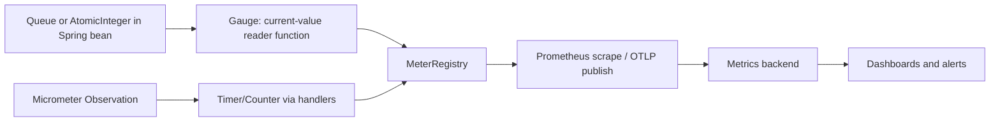
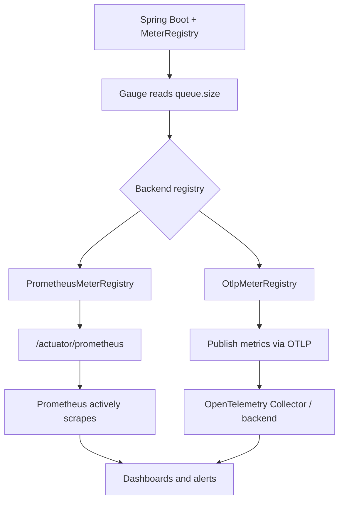
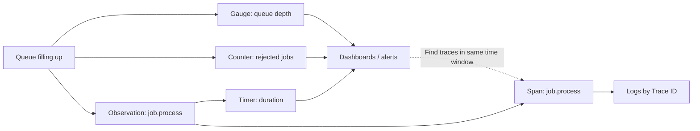

# Gauge in Micrometer and Spring Boot Observability

A **Gauge** is a metric type that represents the **current value of a state** at the moment the system measures it: in-flight requests, tasks waiting in a queue, remaining pool capacity, memory in use, or resource utilization ratio. In the **SPRING_BOOT_OBSERVABILITY** module, Gauge is part of the metrics foundation used alongside Micrometer Observation, logs, and distributed tracing to detect errors, latency, and abnormal behavior in Spring Boot applications.

The core takeaway: **a Gauge is read when the backend or registry collects metrics**. It does not record a history of every change to the observed object. A properly registered Gauge with stable labels helps operators monitor resource usage, spot overload signals, and correlate with Counters, Timers, traces, and logs to investigate root causes.

## 1. What Questions Does a Gauge Answer?

Imagine a Spring Boot service processing orders through a queue with a capacity of 100 tasks. Over one minute:

- At 10:00:00, the queue has 12 tasks.
- At 10:00:10, the queue grows to 85 tasks.
- At 10:00:15, after workers process some items, the queue drops to 30 tasks.
- At 10:00:30, the queue drops to 8 tasks.

A Gauge `orders.queue.depth` answers: **At the time of measurement, how many tasks are waiting?** It fits questions about saturation, backpressure, and queue responsiveness.

Other questions require other meter types:

- *How many total orders have been received?* Use a **Counter**.
- *How long does processing an order take, and what is the p95?* Use a **Timer**.
- *How is payload size distributed?* Consider a **DistributionSummary**.
- *How long has a currently running task been executing, and how many long tasks are in progress?* Consider a **LongTaskTimer**.
- *Which services did a specific slow request traverse?* Use a **distributed trace**.

### Quick Comparison

| Meter Type | Meaning | Movement Pattern | Example |
| --- | --- | --- | --- |
| **Gauge** | State at read time | Can rise, fall, or stay flat | Connections currently in use |
| **Counter** | Cumulative event total | Increases during process lifetime; may reset on restart | Total orders received |
| **Timer** | Operation count and durations | Cumulative count/total time; optionally histograms | HTTP processing time |
| **DistributionSummary** | Distribution of a quantity | Records multiple measurements over time | Request payload sizes |
| **LongTaskTimer** | Currently running tasks and their durations | Active task count rises/falls; duration changes | Long-running batch import |

Do not try to force one meter type to answer every question. For example, **a Gauge of current active requests does not replace a Counter of total traffic**.

## 2. Gauge Is a State Measurement, Not an Event Log

A Gauge can be viewed as a function of time:

\[
g(t) = \text{state of the object at time } t
\]

For a queue, that function can be the current size of the queue. Unlike a Counter, a Gauge **does not automatically accumulate** events occurring between two reads.

```text
Actual queue values:
  0       5       20      5       40      10
  |-------|-------|-------|-------|-------|-------> time
       spike A          spike B

Scrapes:
  ^               ^               ^
  t0              t15s            t30s

The backend only stores samples taken at scrape times,
not automatically knowing every peak between two samples.
```

If 100 tasks enter and drain from the queue very quickly between two scrapes, every recorded sample might report a queue depth of 0. That **does not prove the queue never backed up**. This is the snapshot nature of a Gauge, not necessarily a Micrometer bug.

Important implications:

1. Gauges suit states that persist long enough or are meaningful at sampling time.
2. Do not use a Gauge to record rapidly rising/falling event counts expecting the backend to reconstruct every event.
3. If you need **total counts** of requests, rejected jobs, or retries, record a dedicated Counter.
4. If you need **processing duration**, use a Timer; for elapsed runtime of in-progress tasks, consider a LongTaskTimer.
5. If you need the true peak queue size within an interval, use specialized instrumentation that records peaks, higher sampling frequency, or another aggregation mechanism. `max_over_time` on samples cannot recover unsampled spikes.

### A Gauge Can Decrease

A decreasing counter usually signals the wrong meter choice. With a Gauge, decreasing is completely normal:

```text
queue depth:       12 -> 87 -> 45 -> 5
active requests:    2 -> 14 ->  8 -> 1
free connections:  20 ->  4 -> 12 -> 20
```

Whether higher or lower is good or bad depends on the state measured. High queue depth can indicate overload, while high free connections is usually healthy. To configure alerts, understand the direction of change and its relationship to throughput, error rate, and latency.

## 3. How Does Gauge Work in Micrometer?

Micrometer typically registers a Gauge as a **reference to an object and a value-reading function**. When the registry is scraped or publishes metrics, it invokes the reader function to capture the current state.



In Spring Boot, the main components are:

| Component | Responsibility |
| --- | --- |
| State object | Holds current value, e.g., `BlockingQueue`, `AtomicInteger` |
| Gauge | Defines name, tags, description, and reader function |
| `MeterRegistry` | Registers meters and supplies data to backends |
| Backend registry | Prometheus, OTLP, or another registry type |
| `ObservationRegistry` | Coordinates operations and handlers; not where Gauges are stored |
| Metrics backend | Stores time-series samples for querying and alerting |

**A Gauge usually only needs to be registered once per name and tag set.** Afterward, mutate the source object; the reader function returns the updated value. Never re-register a Gauge on every HTTP request or state transition.

## 4. First Example: Gauge for In-Flight Requests

Use `AtomicInteger` as thread-safe state that increments and decrements. The service below tracks how many synchronous tasks are currently executing.

```java
import io.micrometer.core.instrument.Gauge;
import io.micrometer.core.instrument.MeterRegistry;
import java.util.concurrent.atomic.AtomicInteger;
import org.springframework.stereotype.Service;

@Service
public class CheckoutLoadService {

    private final AtomicInteger activeRequests = new AtomicInteger();

    public CheckoutLoadService(MeterRegistry registry) {
        Gauge.builder(
                "checkout.requests.in.flight",
                activeRequests,
                AtomicInteger::get
        )
        .description("Number of checkout operations currently running")
        .baseUnit("requests")
        .tag("operation", "checkout")
        .register(registry);
    }

    public void execute(Runnable work) {
        activeRequests.incrementAndGet();
        try {
            work.run();
        } finally {
            activeRequests.decrementAndGet();
        }
    }
}
```

Usage:

```java
// Assuming the service is Spring-injected.
checkoutLoadService.execute(() -> {
    // Invoke synchronous checkout business steps.
    performCheckout();
});
```

*`performCheckout()` simply represents business work, not a built-in Micrometer function.*

Things to observe:

- The constructor creates the Gauge **once** when Spring initializes the singleton bean.
- `AtomicInteger` holds the state; the Gauge reads directly from it.
- `incrementAndGet()` and `decrementAndGet()` wrap the exact boundary of the work.
- `finally` guarantees the count decrements even if `work.run()` throws an exception.
- `operation=checkout` is a tag with a bounded set of values.
- `baseUnit("requests")` expresses the unit; registries may alter how the metric name is rendered per backend conventions.

**Scope limitation:** this example fits **synchronous** work where `Runnable.run()` returns only after the operation truly finishes. If `work.run()` merely starts a `CompletableFuture` and returns immediately, the Gauge will decrement too early. For async work, decrement the active count when the future/publisher actually completes or cancels, such as in a completion callback or Reactor `doFinally`.

### Why Not Register a Gauge on a Primitive Integer?

Conceptually wrong:

```java
int inFlight = 0;
// There is no stable stateful object to read this local variable
// from a registered Gauge.
```

A primitive `int` has no mutable object reference that a Gauge can hold and observe. Use `AtomicInteger`, a state-holding object, or a function querying a long-lived stateful component.

### Why Avoid Mutating a Gauge Through Its Read Value?

Do not treat a Gauge like a Counter with `increment()` at the `MeterRegistry` level. Normally, business code **mutates the source state**; the Gauge merely observes that state:

```java
activeRequests.incrementAndGet(); // Mutates source state
// Gauge reads activeRequests.get() when the backend collects metrics.
```

If the goal is counting successful/failed `execute` calls, record a dedicated Counter or Timer.

## 5. Practical Example: Gauge Measuring Queue Size

An application accepts jobs into a bounded-capacity queue. We want to measure:

- Number of jobs waiting to be processed.
- Number of free slots remaining in the queue.
- Queue utilization to alert on backpressure.

Spring Boot configuration example:

```java
import io.micrometer.core.instrument.Gauge;
import io.micrometer.core.instrument.MeterRegistry;
import java.util.concurrent.ArrayBlockingQueue;
import java.util.concurrent.BlockingQueue;
import org.springframework.context.annotation.Bean;
import org.springframework.context.annotation.Configuration;

@Configuration
public class OrderQueueMetricsConfiguration {

    @Bean
    BlockingQueue<String> orderQueue(MeterRegistry registry) {
        BlockingQueue<String> queue = new ArrayBlockingQueue<>(100);

        Gauge.builder(
                "orders.queue.depth",
                queue,
                BlockingQueue::size
        )
        .description("Number of jobs waiting in the order queue")
        .baseUnit("tasks")
        .tag("queue", "orders")
        .register(registry);

        Gauge.builder(
                "orders.queue.remaining.capacity",
                queue,
                BlockingQueue::remainingCapacity
        )
        .description("Available slots in the order queue")
        .baseUnit("tasks")
        .tag("queue", "orders")
        .register(registry);

        return queue;
    }
}
```

The queue is a **Spring bean** managed for the lifetime of the application, ensuring the source object stays alive. Measuring both `size()` and `remainingCapacity()` provides two complementary views.

With a fixed 100-element `ArrayBlockingQueue`:

\[
\text{utilization} = \frac{\text{queue depth}}{\text{queue capacity}}
\]

If depth is 80, utilization is 80%. Max capacity can be exposed via an explicit Gauge, a known dashboard constant, or calculated from depth + remaining capacity, depending on your setup.

**Do not assume every queue implementation has an O(1) or strictly linearizable `size()` under concurrency.** Some queues traverse elements to count, costing CPU; a snapshot taken while multiple threads mutate the queue reflects an approximate instant. Pick appropriate data structures and reader functions so scraping does not overload the application itself.

### Which States Should You Measure in a Queue?

| Meter | Type | Meaning |
| --- | --- | --- |
| `orders.queue.depth` | Gauge | Current waiting jobs |
| `orders.queue.remaining.capacity` | Gauge | Remaining free slots |
| `orders.jobs.accepted` | Counter | Total jobs accepted into queue |
| `orders.jobs.rejected` | Counter | Total jobs rejected |
| `orders.job.process.duration` | Timer | Time to complete one job |
| `orders.jobs.active` | Gauge or LongTaskTimer as needed | Jobs currently being executed by workers |

Rising queue depth alone does not prove the root cause. Compare accepted rate, rejected count, job processing duration, thread pool saturation, downstream errors, and traces of slow jobs.

## 6. Object Lifecycle and Weak References

This is a critical technical pitfall when using Gauges in Micrometer: **Gauges typically hold a weak reference to the source object**. This prevents the metrics system from inadvertently keeping alive an object the application no longer uses.

If no strong reference to the source object remains elsewhere, the Java garbage collector can reclaim it. The Gauge can then no longer read the expected value; depending on the registry/implementation, it may report `NaN` or stop producing useful data.

### Common Buggy Example

```java
void registerGauge(MeterRegistry registry) {
    AtomicInteger temporaryValue = new AtomicInteger(5);

    Gauge.builder(
            "orders.temporary.depth",
            temporaryValue,
            AtomicInteger::get
    ).register(registry);
}

// After the method returns, if no strong reference holds
// temporaryValue, the object can be garbage collected.
```

Keeping a reference to the `Gauge` object itself while discarding `AtomicInteger` **does not automatically keep the observed state alive** either. A standard Gauge does not own the underlying data.

### Safe Approach

**Preferred approach:** hold the source object in a Spring singleton or a component whose lifetime matches what you want to observe:

```java
private final AtomicInteger activeWorkers = new AtomicInteger();

// Register the Gauge reading activeWorkers in the constructor.
// The field holds a strong reference to the source data.
```

When genuinely needed, the builder in supported Micrometer versions offers an option to keep a strong reference:

```java
Gauge.builder("workers.active", sourceObject, source -> source.current())
        .strongReference(true)
        .register(registry);
```

This is an **illustrative API snippet**: `sourceObject` must be an appropriate object and `current()` must return a numeric value. Only use `strongReference(true)` when you clearly understand its lifecycle and memory impact; a Gauge pinning a large object or an entire object graph can cause unintended memory retention.

### Symptoms and Checks

| Symptom | Question to Check |
| --- | --- |
| Gauge returns `NaN` | Was the source object garbage collected due to missing strong references? |
| Gauge stays on an old value | Does the reader function point to the exact object being updated? |
| Gauge is always 0 | Is the source object actually changing? Do scrape intervals miss brief spikes? |
| Gauge disappears after deploy/restart | Did the registry/backend drop the series or did bean creation conditions change? |

**Never fix `NaN` values by repeatedly registering a new Gauge with the same name/tags.** Fix the lifecycle and the observed object instead.

## 7. One Name and Tag Set Should Map to One Meter

Micrometer identifies a meter by **name and tag set**, along with meter type constraints. When registering a Gauge again with the same identity, the application **should not assume the registry will swap out the reader function or source object**.

Design mistake example:

```java
void updateQueueGauge(MeterRegistry registry, int count) {
    AtomicInteger newState = new AtomicInteger(count);
    Gauge.builder("orders.queue.depth", newState, AtomicInteger::get)
            .tag("queue", "orders")
            .register(registry);
}

// Calling this multiple times with the same name + tags does not guarantee
// the active Gauge switches to newState on every call.
```

The right pattern:

1. Create one stateful object with an appropriate lifecycle.
2. Register the Gauge once.
3. Update that object when business state changes.
4. Let the registry read the current value during collection.

### Avoid Creating Tags per Request

Do not write:

```java
Gauge.builder(
        "orders.queue.depth",
        queue,
        BlockingQueue::size
).tag("request.id", requestId).register(registry);
```

If `requestId` varies with every request, every new tag set can create a new meter/time series. That is a **high-cardinality** bug, even though the metric name stays constant. Request-specific data should be traced via **logs and traces**, not metric labels.

## 8. Gauge in Spring Boot Actuator and Registries

To run the Java examples above in **Spring Boot 3.x**, add Actuator. To export via Prometheus, add the Prometheus registry:

```xml
<dependencies>
    <dependency>
        <groupId>org.springframework.boot</groupId>
        <artifactId>spring-boot-starter-actuator</artifactId>
    </dependency>
    <dependency>
        <groupId>io.micrometer</groupId>
        <artifactId>micrometer-registry-prometheus</artifactId>
    </dependency>
</dependencies>
```

The Spring Boot BOM/parent should manage compatible versions. Do not manually instantiate `SimpleMeterRegistry` inside business services when Spring Boot already manages the registry bean.

Configuration for lab testing:

```yaml
spring:
  application:
    name: order-service

management:
  endpoints:
    web:
      exposure:
        include: health,info,metrics,prometheus
  metrics:
    tags:
      application: order-service
```

Verification commands:

```bash
curl -s http://localhost:8080/actuator/metrics
curl -s http://localhost:8080/actuator/metrics/orders.queue.depth
curl -s http://localhost:8080/actuator/prometheus
```

Once the Micrometer Gauge is registered with a live source object, `/actuator/metrics/orders.queue.depth` should show a measurement with `statistic=VALUE`. In Prometheus, the metric name may be normalized with underscores, suffixes, and units. For instance, `orders.queue.depth` with `baseUnit("tasks")` may expose a unit-suffixed name; **always check the actual output instead of guessing PromQL series names**.

### Prometheus and OTLP Differ in How They Export



**Prometheus** typically uses a scrape (pull) model. **OTLP metrics** push periodically via `micrometer-registry-otlp` using version-appropriate properties, e.g. in Spring Boot 3.x:

```yaml
management:
  otlp:
    metrics:
      export:
        url: http://collector:4318/v1/metrics
        step: 30s
```

This is an illustrative OTLP/HTTP endpoint. When running in containers, `collector` must resolve to the collector hostname/service; `localhost` refers only to the current container. Port 4318 is commonly used for OTLP/HTTP and 4317 for OTLP/gRPC, though receiver setups can vary. Metrics exporters and tracing exporters use separate pipelines.

### Gauge Missing from the Dashboard?

Check step by step:

1. Did Spring instantiate the bean holding the Gauge and the appropriate `MeterRegistry`?
2. Was the Gauge registered with the expected name and tags?
3. Is the source object still alive and does the reader return a valid number?
4. Does Actuator `/metrics` list the meter?
5. Is the Prometheus endpoint or OTLP exporter emitting data?
6. Are the scrape target/Collector/backend receiving it?
7. Does the dashboard query match the exact exported series name and labels?

Seeing a Gauge in `/actuator/metrics` only confirms its presence inside the application; it does not guarantee an external backend has received samples.

## 9. Units, Tags, and Cardinality

Adding units makes metrics easier to interpret. Examples:

- Queue depth: tasks, items, or messages.
- In-flight operations: requests or tasks.
- Memory: bytes.
- Utilization: ratio in 0–1 or percentage 0–100; document the convention clearly to avoid confusion.
- Connection pool: connections.

Micrometer's `Gauge.builder(...)` supports descriptions and `baseUnit(...)` for appropriate values. Metric names and units must not change per request.

### Choosing Tags

| Tag | Suitable? | Explanation |
| --- | --- | --- |
| `queue=orders/payments` | Yes, if queue count is bounded | Distinguishes operational queues |
| `region=apac/eu` | Yes | Compares utilization across regions |
| `pool=main/reporting` | Yes | Observes a fixed list of pools |
| `application=order-service` | Yes | Identifies the service |
| `order.id` | No | Nearly one value per order |
| `user.id` | No | Inflates time series and may be sensitive |
| `request.id` / `trace.id` | No | Unique per-request identifiers |
| Raw URLs, session tokens | No | Dynamic values or secrets |

Tag combinations can grow up to the product of distinct values across dimensions:

\[
N_{\text{series}} \leq \prod_{i=1}^{k} |V_i|
\]

For example, 3 queues, 2 regions, and 20 instances can create up to 120 label combinations for **one** metric across these dimensions, before backend-added labels. This is a theoretical upper bound; combinations that never occur do not create series. One dynamic ID can push series counts beyond operational budgets.

### Should You Tag a Gauge per Tenant?

Decide based on tenant count and purpose. With a handful of fixed tenants requiring dedicated monitoring, an approved tenant label may sometimes be acceptable. With thousands or millions of tenants, such a label causes extreme cardinality. Prefer aggregated metrics, grouping tenants by tier or region, or using an authorized business data store for per-tenant lookups.

## 10. Gauge and Correctness in Multithreaded Code

Gauges often read state updated by multiple threads. Consider three concerns:

**Data visibility.** For a variable updated across threads, choose a thread-safe structure such as `AtomicInteger`/`AtomicLong`, a concurrent collection, or proper synchronization. Never rely on a plain `int` written by other threads without synchronization.

**Snapshot consistency.** If a dashboard compares queue depth with capacity, the two reads happen sequentially at slightly different instants while the queue keeps changing. Measurements are approximate snapshots, not necessarily an atomic global state.

**Read cost.** A Gauge reader function must never execute heavy SQL queries, outbound HTTP calls, or long locks. With periodic scrapes and many series, an expensive reader turns monitoring into a latency bottleneck for the app itself. If the state lives in an external system, use a proper collector/binder or maintain a safely refreshed cached value on its own schedule.

### Avoid "Busy Gauges"

There is no reason to update a Gauge 10,000 times a second if the value only matters when read every 15 seconds. The standard approach is maintaining real state—never spin a loop just to call `Gauge.builder(...).register(registry)` repeatedly.

### When Work Is Asynchronous

Suppose a worker returns a `CompletableFuture`:

```java
import java.util.concurrent.CompletableFuture;
import java.util.concurrent.atomic.AtomicInteger;

public <T> CompletableFuture<T> track(
        CompletableFuture<T> future,
        AtomicInteger active) {

    active.incrementAndGet();
    return future.whenComplete((result, error) ->
            active.decrementAndGet());
}
```

This is an **illustrative lifecycle example**, assuming `track` is called right when "in-progress" begins and returns the wrapped future. In production design, define the exact start and end points, already-completed futures, cancellations, and callback execution guarantees to prevent undercounting or double-decrementing. With Reactor, use an appropriate lifecycle hook like `doFinally`, while avoiding duplicate tracking across multiple subscriptions unless intended.

## 11. Analyzing and Alerting with Gauges

Suppose `orders.queue.depth` normally stays below 10 but occasionally hits 90 on a 100-capacity queue. A dashboard might display:

- Queue depth over time.
- Remaining capacity.
- Accepted jobs over time (Counter rate).
- Rejected jobs over time.
- Job processing duration (Timer).
- Active workers or active requests.

If using Prometheus, adjust queries to the actual exported metric names. **Assuming** a metric named `orders_queue_depth_tasks`:

```promql
orders_queue_depth_tasks{queue="orders"}

max_over_time(orders_queue_depth_tasks{queue="orders"}[10m])

avg_over_time(orders_queue_depth_tasks{queue="orders"}[10m])
```

`max_over_time` and `avg_over_time` operate on **scraped samples**; they cannot reconstruct fluctuations between scrapes.

If the queue has a max capacity of 100, an alert such as "queue depth stays above 80 for 5 minutes" is usually far more meaningful than alerting on a single sample exceeding 80. Base thresholds and hold durations on SLOs, capacity, and real traffic.

### Diagnostic Example

| Signal | Observation | Next Hypothesis |
| --- | --- | --- |
| Queue depth Gauge | Rises from 15 to 92 and stays high | Slow consumers or lost workers |
| Jobs accepted Counter | Rising rapidly | Inbound load exceeds processing capacity |
| Jobs rejected Counter | Starts climbing | Queue is nearly or completely full |
| Job processing Timer p95 | Jumps from 300 ms to 3 s | Downstream slowdown, errors, retries, or locks |
| Traces of slow jobs | Payment provider span dominates duration | Check provider/network and timeouts |
| Logs with same Trace ID | Repeated timeouts and retries | Supports hypothesis; inspect infrastructure |

**A Gauge localizes saturation symptoms; it does not prove root cause on its own.** Combine Counters, Timers, logs, traces, and dependency health to understand why a queue is backing up.

## 12. Connecting Gauge with Micrometer Observation, Logs, and Traces

Gauge and Observation live in the same Spring Boot observability ecosystem, yet serve different roles:

- **Gauge** reads the current state of an object.
- **Observation** wraps an operation with a start/end, enabling handlers to produce metrics (typically Timers) and tracing spans.
- **Logs** record events and error details, carrying Trace ID/Span ID when logging correlation is configured.
- **Distributed tracing** shows the path of a specific request/job across spans, subject to context propagation and sampling.



**Never attach Trace ID as a Gauge label.** Creating a separate Gauge per Trace ID floods the metrics backend with ultra-high-cardinality time series without helping measure overall state.

When you need to examine a slow request, search traces by service, operation, time window, and safe attributes, then query logs by Trace ID. Some backends support **exemplars** to link a metric sample to a trace, though that depends on instrumentation, registry, backend, and sampling; never assume every Gauge has exemplars.

### Context Propagation and Sampling

W3C Trace Context (e.g., the `traceparent` header) propagates tracing context across services. Gauges do not participate in propagation. For async tasks or queue consumers, you need instrumentation to link traces across threads/messages; sharing a meter name does not give spans the same Trace ID.

Sampling reduces exported traces, **not directly how often Gauges are read**, nor does it delete registered meters from `MeterRegistry`. A queue depth Gauge may look completely normal while a specific request lacks a trace because sampling dropped it. Diagnostics must distinguish metric export issues from trace sampling/export behavior.

## 13. Common Gauge Pitfalls

| Symptom | Possible Cause | How to Check and Fix |
| --- | --- | --- |
| Gauge does not appear | Not registered, bean not initialized, missing endpoint/exporter | Check Spring beans, `/actuator/metrics`, and registry |
| Gauge returns `NaN` | Source object was GC'd due to weak reference | Keep a strong reference with clear lifetime |
| Gauge is always 0 | State unchanged at scrape time or spikes too brief | Check source state and scrape interval; use Counter/Timer if needed |
| Gauge stays on stale value | Updating a different object than the registered one | Hold and mutate the exact registered object |
| Re-registering does not replace old object | Same name and tags as existing meter | Register once; mutate source object |
| Unexpected negative values | Unbalanced `increment/decrement` or callback ran twice | Check `try/finally`, async lifecycle, and concurrency |
| Reading `queue.size()` slows scrapes | Reader is too expensive or holds a lock | Choose cheap, thread-safe measurements; avoid I/O |
| Need total job count but used Gauge | Gauge misses changes between reads | Use a Counter for total events |
| Metric exists in Prometheus, dashboard empty | Mismatched suffix/labels/query | Check exposition output and PromQL |
| Gauge in Actuator, missing in backend | Scrape target, OTLP URL, or Collector error | Inspect export path and backend health |
| Unusually high series count | Dynamic IDs in tags or exploding queue/tenant count | Use bounded label names and value sets |
| Gauge spikes but no traces found | Independent tracing sampling or exporter | Check the tracing pipeline; do not modify Gauge |

Some bugs only surface in production because traffic, GC, concurrency, or scrape intervals differ from dev environments. Test changing data, exceptions, and concurrent load before relying on a Gauge for alerts.

## 14. Hands-On Exercise: Monitoring a Spring Boot Service Backlog

The goal is to build a Gauge with a proper lifecycle, read metrics on Actuator/Prometheus, and correlate with other signals.

### Setup

Use Spring Boot 3.x with `spring-boot-starter-actuator` and `micrometer-registry-prometheus` as in Section 8. Create a 100-capacity `BlockingQueue<String>` bean per Section 5 and a test endpoint/worker manipulating the queue.

### Steps

1. **Start the application.** Verify `/actuator/metrics` and `/actuator/prometheus` are accessible in the lab environment.
2. **Register Gauges once.** Verify `orders.queue.depth` and `orders.queue.remaining.capacity` appear in `/actuator/metrics`.
3. **Mutate the queue controllably.** Add 10–20 test items and verify `depth` rises while `remaining.capacity` drops. Read multiple times to see current state reflected.
4. **Test concurrency.** Run producer and consumer, watching fluctuations across several scrape intervals. Explain why a brief spike may not show up.
5. **Add Counter and Timer.** Add accepted/rejected counters and a job-processing timer. Reconcile inbound/outbound counts with current backlog.
6. **Test business errors.** Throw an exception inside the measured processing step. Verify the in-flight Gauge uses `finally` to decrement accurately.
7. **Experiment carefully with weak references.** In an isolated demo, register a Gauge against a temporary object and observe behavior after GC *may* reclaim it. Behavior depends on the JVM, so do not rely on `System.gc()` as deterministic proof.
8. **Verify in the backend.** Inspect actual metric names and tags in the exposition endpoint and chart depth/remaining capacity over time.
9. **Test an alert.** Pick a meaningful queue depth threshold requiring a multi-minute hold duration; test backlog recovery.
10. **Correlate with traces/logs.** If a tracing bridge and exporter are present, instrument `job.process` with Observation and inspect slow spans and correlated logs while the queue builds up. Never use Trace ID as a metric label.

### Completion Criteria

| Verification Item | Sign of Success |
| --- | --- |
| Gauge registered | Meter name appears in Actuator |
| Accurate state | Depth rises on enqueue, drops on dequeue |
| Proper source lifecycle | No missing data from unintended garbage collection |
| No duplicate meters | Single name/tag set per queue state |
| Safe tags | Queue/application value sets are bounded |
| Exporter working | Metrics backend receives samples |
| Snapshot limits understood | Can explain spikes missed between scrapes |
| Complementary signals | Counters/Timers for throughput and latency; traces/logs for specific requests |
| Useful alerts | Thresholds reflect saturation with sensible hold durations |

## 15. Principles to Remember

1. **A Gauge describes current state**, which can rise or fall; it does not count total events that occurred.
2. **Register once, read via a function**, and update the source object in business code.
3. **Keep the source object alive** because Gauges typically hold weak references; avoid creating temporary objects and losing strong references.
4. **Respect the sampling interval**: the backend cannot see every fluctuation between two scrapes or publishes.
5. **Keep names, units, and tags stable**, avoiding dynamic IDs, URLs with resource IDs, or sensitive data.
6. **Use the right meter for the question**: Gauge for current state; Counter for event totals; Timer for duration; LongTaskTimer for long in-progress work.
7. **Keep Gauge reader functions cheap and concurrency-safe**, because monitoring must not add heavy load.
8. **Verify the entire data path**: object → Gauge → `MeterRegistry` → exporter/scrape → backend → dashboard.
9. **Correlate Gauges with metrics, logs, and distributed traces** to distinguish saturation symptoms from the root cause of errors or latency.

A well-designed Gauge tells operators **what state the application is in right at observation time**. Combined with throughput, latency, and traces of specific requests, Gauges become a critical signal for detecting queue backlogs, pool saturation, and performance issues in real Spring Boot applications.
