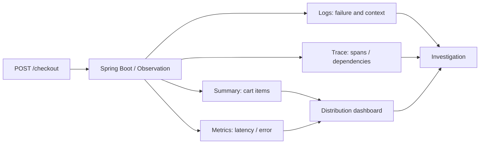

# DistributionSummary in Micrometer Metrics

A Spring Boot API receives shopping carts of varying sizes. The operations team wants to know: **how many items are in each request**, what percentage of carts exceed 10 items, and whether the cart-size distribution changed after a new release. A Counter of total items is not enough: it does not show how many items each checkout receives. A Gauge only reflects a single value at observation time and likewise cannot describe the distribution of processed carts.

Micrometer's **`DistributionSummary`** is the meter type used to **record the distribution of non-negative measurements per event**, such as items in a cart, payload size in bytes, records in a batch, or elements processed in an operation. It tracks sample count and total amount; depending on configuration/registry, it can also provide max, histogram buckets, and percentile estimates.

This lesson belongs to the **Metrics Foundation** chapter of the **SPRING_BOOT_OBSERVABILITY** module. The module focuses on setting up observability for Spring Boot with Micrometer Observation, metrics, logs, and distributed tracing, along with context propagation, tags/cardinality, exporters, sampling, and signal correlation to investigate errors, latency, and application behavior. Understanding `DistributionSummary` helps you choose the right measurement and recognize the limits of metric data before combining it with logs and traces.

## Learning Objectives

After this lesson, you will be able to:

1. Explain what `DistributionSummary` records and how it differs from `Counter`, `Gauge`, and `Timer`.
2. Use `DistributionSummary.builder(...)`, `register(...)`, and `record(...)` in a Spring Boot application.
3. Interpret **count**, **total amount**, **mean**, **max**, histograms, and percentiles without over-inferring from a single data point.
4. Configure measurement units, `serviceLevelObjectives(...)` thresholds, and percentile histograms to fit your needs.
5. Bound tag cardinality, control time-series cost, and understand exporter/backend limitations.
6. Combine `DistributionSummary` with logs, traces, and application context to investigate anomalies.
7. Avoid common mistakes such as recording multiple times for the same event, mixing units, or aggregating percentiles incorrectly.

## 1. What Is DistributionSummary?

`DistributionSummary` is a meter in **Micrometer Metrics**. Each call to `record(amount)` reports that **a new observation with value `amount` occurred**. For instance:

```text
Number of items in checked-out carts:
request A -> 2
request B -> 5
request C -> 3
request D -> 10
request E -> 5
```

If all five values are recorded, `DistributionSummary` tracks:

- **Count:** 5 samples.
- **Total amount:** 2 + 5 + 3 + 10 + 5 = 25 items.
- **Mean:** 25 / 5 = 5 items/sample.
- **Max:** maximum value observed within the relevant statistical window, which would be 10 right after recording the samples above.

These measurements answer two groups of questions:

- **Volume:** how many samples occurred recently and what was the total recorded amount?
- **Distribution:** are samples mostly small or large, how many exceed a threshold, and what are the estimated p95/p99 values if histograms/percentiles are configured?

`DistributionSummary` is especially well suited for **sizes and per-event quantities**. It does not measure method execution time in duration semantics; that belongs to `Timer`.

### Defining "One Sample" Precisely

A design question more important than the metric name is: **what does each `record()` call represent?**

For cart item counts:

- Record **once per valid checkout request**, right after validating the request: the metric captures the size distribution of accepted carts.
- Record **once after successful payment**: the metric captures the size distribution of carts in successful transactions.
- Record **once per retry attempt**: the metric captures the per-attempt distribution, potentially double-counting one cart across multiple requests.

All three policies can be useful, yet they answer **different questions**. You must clearly define the sample unit, instrumentation site, and when failed requests are excluded. Otherwise, pre/post-deployment comparisons will mislead.

## 2. What Quantities Does DistributionSummary Store?

| Quantity | Meaning | Analysis Notes |
|---|---|---|
| `count()` | Number of valid recorded samples per implementation | Does not automatically equal HTTP requests if one request records multiple samples |
| `totalAmount()` | Sum of recorded values | Does not replace sample count; units must stay consistent |
| `mean()` or total / count | Average value per sample | Skewed by outliers; does not reveal the distribution tail |
| `max()` | Maximum value within the statistical window maintained by the meter | May be a **time-window max**, not necessarily the all-time max since startup |
| **Histogram buckets** | Sample counts falling into thresholds when configured and supported by backend | Used to estimate distributions and threshold exceedance rates |
| **Percentiles** | p50, p95, p99 per meter method/configuration | Should not be summed or averaged across instances |

In some registries, `count` and `totalAmount` are cumulative quantities; time-based queries must handle application restarts or meter resets. Max and percentiles are often computed over a **time window** that can expire if no new samples arrive. When new data stops, a max value can drop to 0 or disappear depending on configuration/registry. Do not treat `max()` as an "all-time record" unless your retention policy guarantees it.

Suppose 100 requests have an average payload size of 8 KB. Total payload across samples is roughly 800 KB, yet from the average alone you cannot tell how many 100 KB payloads occurred. Analyzing the tail requires histograms or percentiles, or looking up detailed traces/logs when needed.

### Zero and Negative Values

Payload sizes, item counts, and byte counts have **non-negative** semantics. `record(0)` can represent a zero-sized event if the metric definition allows it. Negative values make no sense for `DistributionSummary`; **do not use it to express reductions or refunds**. Validate data before recording and pick another meter type if signed measurements are truly required.

`NaN`, infinity, or negative numbers must never pass from untrusted inputs. Meter/registry implementations may ignore invalid values; applications should validate explicitly rather than depending on how a particular implementation handles them.

## 3. Comparing DistributionSummary, Counter, Gauge, and Timer

| Meter | Use When You Want to Know | Spring Boot Example | Why Different from DistributionSummary? |
|---|---|---|---|
| **Counter** | How many times an event or cumulative total increased | Declined payments count | No per-event value distribution needed |
| **Gauge** | Current instantaneous value | Messages currently in a queue | Does not aggregate a distribution of past events |
| **Timer** | Execution time and duration distribution | Payment provider call duration | Has time semantics and dedicated duration tools |
| **DistributionSummary** | Distribution of a non-negative quantity per record call | Payload bytes, items/cart, batch size | Values are counts/sizes, not durations |

Cases to distinguish:

- **"Total checkout requests"** → `Counter`, or use the count from an existing HTTP `Timer`/metric if the measurement policy matches.
- **"In-flight requests"** → `Gauge`, or long-task instrumentation matching the semantics.
- **"p95 of checkout duration"** → `Timer`.
- **"p95 of items per cart"** → `DistributionSummary`.
- **"How many payloads are larger than 1 MiB?"** → `DistributionSummary` with properly configured histogram buckets/SLO boundaries, or a dedicated counter for tracking a specific business condition.

Do not use `DistributionSummary` to measure durations just because you can call `record(milliseconds)`. `Timer` provides duration semantics and handles time-unit conversion per registry; using the wrong meter breaks dashboards and unit conversions.

## 4. Recording DistributionSummary in Spring Boot

A Spring Boot 3.x application with **Actuator** and an appropriate `MeterRegistry` can use Micrometer Metrics to register summaries. With Gradle, basic illustrative dependencies are:

```groovy
dependencies {
    implementation 'org.springframework.boot:spring-boot-starter-actuator'
    runtimeOnly 'io.micrometer:micrometer-registry-prometheus'
}
```

`spring-boot-starter-actuator` provides integration and operational endpoints; the Prometheus registry is added when you want a scrape endpoint in Prometheus format. Exact availability, dependencies, and exporter behavior should be checked against your Spring Boot/Micrometer version.

### 4.1. Register the Meter Once and Reuse It

Create a metrics component for carts:

```java
import io.micrometer.core.instrument.DistributionSummary;
import io.micrometer.core.instrument.MeterRegistry;
import org.springframework.stereotype.Component;

@Component
public class CheckoutCartMetrics {
    private final DistributionSummary lineItems;

    public CheckoutCartMetrics(MeterRegistry meterRegistry) {
        this.lineItems = DistributionSummary.builder("checkout.cart.line.count")
                .description("Number of line items per accepted checkout")
                .baseUnit("items")
                .tag("operation", "checkout")
                .serviceLevelObjectives(1, 3, 5, 10, 20)
                .register(meterRegistry);
    }

    public void recordAcceptedCart(int numberOfItems) {
        if (numberOfItems < 0) {
            throw new IllegalArgumentException(
                    "numberOfItems must not be negative");
        }
        lineItems.record(numberOfItems);
    }
}
```

A service can call it:

```java
import org.springframework.stereotype.Service;

@Service
class CheckoutService {
    private final CheckoutCartMetrics cartMetrics;

    CheckoutService(CheckoutCartMetrics cartMetrics) {
        this.cartMetrics = cartMetrics;
    }

    void acceptCart(Cart cart) {
        // Cart is an illustrative domain type; validateCart may throw.
        validateCart(cart);

        // Record exactly one sample for an accepted cart.
        cartMetrics.recordAcceptedCart(cart.lineItems().size());

        // Continue processing checkout...
    }

    private void validateCart(Cart cart) {
        // Illustrative: validate data and cart acceptance policy.
    }
}
```

`Cart` and `lineItems()` are domain model examples, not built-in Spring Boot classes. `validateCart(...)` is an illustrative placeholder; a real application needs validation logic. Here `count` reflects **the number of accepted carts sampled**, not automatically the number of successfully paid orders.

**Why create the meter in the constructor?** Registries identify meters by name and tag set. Reusing one summary instance avoids repeated meter creation or lookup on the request path; more importantly, fixed names/tags keep data aggregatable. Never create dynamic names/tags per order or user.

### 4.2. When to Use `DistributionSummary.builder(...)`?

The builder lets you configure:

- `description(...)`: describes the sample unit and measurement meaning.
- `baseUnit(...)`: base unit, such as `bytes` or `items`, so backends and readers do not misinterpret values.
- `tag(...)` or `tags(...)`: grouping across a small, stable set of dimensions.
- `serviceLevelObjectives(...)`: thresholds to track, matching alerting/analytical needs.
- `publishPercentileHistogram()`: requests publishing a suitable histogram when supported by the registry.
- `publishPercentiles(...)`: requests client-side estimates for specific percentiles, with aggregation caveats.
- `minimumExpectedValue(...)`, `maximumExpectedValue(...)`: helps bound the expected value range for histogram configuration.
- `register(meterRegistry)`: registers the meter with the registry.

Enable distribution features **deliberately**, because histograms and percentiles cost memory and time series. A summary tracking only count/sum is lighter than one enabling many buckets, percentiles, and tags.

## 5. Measurement Units, Scaling, and Metric Names

### 5.1. Record Values in a Single Unit

`DistributionSummary` does not automatically know whether `record(2048)` means 2048 **bytes**, 2048 **KB**, or 2048 **items**. If two code paths record different units into the same meter, sums and histograms become meaningless.

For payloads:

```java
DistributionSummary payloadBytes = DistributionSummary.builder(
                "checkout.request.payload.size")
        .description("Checkout request payload size")
        .baseUnit("bytes")
        .register(meterRegistry);

payloadBytes.record(requestBodyBytes.length);
```

`requestBodyBytes` is an existing byte array in this example; do not buffer the entire request body just to record a metric if the framework already exposes a reliable size. Nor should you log sensitive body contents. If the system compares payload sizes across multiple services, agree on how size is defined: uncompressed vs. compressed body, headers included or excluded, before or after decompression.

If dashboards need MiB, **keep the underlying unit as bytes** and convert at the query/display layer. 1 MiB = 1,048,576 bytes; 1 decimal MB = 1,000,000 bytes. Mixing the two leads to inconsistent size thresholds.

### 5.2. `baseUnit(...)` Is Not Automatic Value Conversion

`baseUnit("bytes")` is unit metadata—it does not divide values into KB or multiply MiB into bytes. The application must pass values to `record(...)` in the exact unit declared.

Exporters may transform, normalize, or suffix metric names according to naming conventions and base units. Always **check the actual name on the endpoint/backend** before writing PromQL. Do not assume `checkout.request.payload.size` appears verbatim in Prometheus.

### 5.3. Scaling and Histograms for Wide Value Ranges

Size data sometimes spans from a few bytes to many megabytes. Histograms typically use threshold buckets; if the range is overly wide or unbounded, configurations can consume many buckets or produce inaccurate tail estimates.

Micrometer provides settings like `minimumExpectedValue(...)`, `maximumExpectedValue(...)`, and for certain distribution measurements, value **scaling**. Whichever technique you apply, ensure:

1. All recorded samples and SLO thresholds use the same post-scaling unit.
2. Dashboards clearly know the meter's true unit.
3. Value ranges and bucket boundaries reflect real data rather than arbitrary guesses.
4. Bucket/time-series cost fits your traffic volume and tag combinations.

Never use scaling to mask producers sending values in inconsistent units.

## 6. Histogram Buckets and `serviceLevelObjectives(...)`

A basic `DistributionSummary` provides count and total amount. To answer "what percentage of carts have more than 10 items," we need **threshold-based distribution data**.

Suppose we record:

```text
1, 2, 2, 4, 5, 8, 12, 21 items
```

With thresholds 1, 5, 10, 20, the counts **at or below each threshold** are:

| Bucket Boundary | Samples ≤ Threshold | Meaning |
|---|---:|---|
| ≤ 1 | 1 | 1 cart has at most 1 item |
| ≤ 5 | 5 | 5 carts have at most 5 items |
| ≤ 10 | 6 | 6 carts have at most 10 items |
| ≤ 20 | 7 | 7 carts have at most 20 items |
| +Inf | 8 | Total number of samples |

Prometheus-style histogram buckets are **cumulative**: the `≤ 10` bucket includes all samples from the `≤ 5` bucket. Therefore, never add these buckets together to calculate request counts.

In this example, out of 8 samples, 6 are `≤ 10`; carts **greater than 10** equal 8 − 6 = 2, or 25%.

In the builder:

```java
DistributionSummary cartSizes = DistributionSummary
        .builder("checkout.cart.line.count")
        .baseUnit("items")
        .serviceLevelObjectives(1, 5, 10, 20)
        .register(meterRegistry);
```

`serviceLevelObjectives(...)` tells supporting registries to emit histogram statistics at those boundaries. It does not automatically create alerts or guarantee the service "meets its SLO." It merely defines **measurement thresholds**; alerts and business targets must be configured separately.

### Default Histograms vs. Percentile Histograms

Two related but distinct ideas:

- **SLO boundaries:** explicitly specify business thresholds of interest, e.g., 10 or 20 items. Use when you need the fraction exceeding a known threshold.
- **Percentile histogram:** exports buckets designed for backend percentile estimation when supported. Use when you need overall distribution or p95/p99 across multiple instances or time ranges.

`publishPercentileHistogram()` should not be turned on indiscriminately for every meter. Bucket counts, value ranges, and tag combinations can substantially raise data costs. `serviceLevelObjectives(...)` can also create extra bucket series; inspect actual exporter output.

## 7. Percentiles: What Can You Read and What Must You Not Infer?

Suppose a summary is configured:

```java
DistributionSummary sizes = DistributionSummary.builder(
                "checkout.cart.line.count")
        .baseUnit("items")
        .publishPercentiles(0.50, 0.95, 0.99)
        .register(meterRegistry);
```

The p95 percentile approximates the value below which 95% of samples fall in the distribution and window tracked by the meter. However, distinguish carefully:

- **Client-side percentiles (`publishPercentiles`):** estimated inside the instance and exported. You generally **cannot average or sum p95 across instances** to obtain a system-wide p95.
- **Histogram buckets (`publishPercentileHistogram` or suitable SLO buckets):** if buckets are exported with compatible boundaries and units, the backend can sum bucket counts across instances and then estimate percentiles over the combined dataset.
- **Percentile estimation:** histogram-derived p95 is an estimate dependent on bucket resolution; it need not match an exact observed sample value.
- **Statistical window:** client-side percentiles can rely on a rolling time window that resets/expires per configuration; they do not represent all-time statistics since app startup.

For example, instance A has 10 requests with p95 = 9 items, while instance B has 10,000 requests with p95 = 2 items. The average (9 + 2) / 2 = 5.5 items is **not** the p95 across all 10,010 requests.

If the goal is an SLO like "at least 99% of carts have at most 20 items," measuring the `≤ 20` bucket over total count is usually more direct and interpretable than inferring from a single p99 estimate.

## 8. Reading Data via Actuator and Prometheus

In Spring Boot, you can enable the Prometheus endpoint for scraping once the registry dependency and configuration are in place:

```yaml
management:
  endpoints:
    web:
      exposure:
        include: health,info,prometheus
```

The endpoint is typically at `/actuator/prometheus` under the default Actuator path. Restrict access appropriately for your runtime environment; never expose metrics or management endpoints publicly without controls.

Exported formats depend on **registry type, meter name and unit, and Micrometer/Prometheus client version**. A `DistributionSummary` may emit count, sum, max, or histogram buckets, so check exact suffixes directly at the endpoint.

### Illustrative PromQL Examples

Suppose the project's exporter emits these series for the cart distribution metric:

```text
checkout_cart_line_count_items_count
checkout_cart_line_count_items_sum
checkout_cart_line_count_items_bucket{le="5"}
checkout_cart_line_count_items_bucket{le="10"}
...
```

These are **example names** following naming conventions; verify against your live endpoint before using. If the registry only exports count/sum without buckets, `_bucket`-based queries will not work.

Sample arrival rate (carts/second), assuming the counter is exported in standard form:

```promql
sum(rate(checkout_cart_line_count_items_count[5m]))
```

Mean value per cart over 5 minutes:

```promql
sum(rate(checkout_cart_line_count_items_sum[5m]))
/
sum(rate(checkout_cart_line_count_items_count[5m]))
```

Ratio of carts with **more than 10 items**, when bucket `le="10"` exists:

```promql
1 -
(
  sum(rate(checkout_cart_line_count_items_bucket{le="10"}[5m]))
  /
  sum(rate(checkout_cart_line_count_items_count[5m]))
)
```

To estimate p95 from histograms across all instances when buckets are compatible and sufficient data exists:

```promql
histogram_quantile(
  0.95,
  sum by (le) (
    rate(checkout_cart_line_count_items_bucket[5m])
  )
)
```

These queries require that samples share the same definition, unit, and compatible bucket boundaries; all series are scraped consistently; and `rate` has enough samples in the window and handles counter resets properly. To compute p95 **by provider**, add `by (le, provider)` in the aggregation; if `provider` was not declared as a tag or its values are unstable, the query cannot recover missing dimensions.

**Never compute p95 by averaging individual p95 values** and never use raw `sum(count)` over a long range containing restarts. Use proper counter functions and verify charts before turning them into alerts.

## 9. Tags, Cardinality, and Operational Cost

Micrometer registers meters by **name and tag set**. For a `DistributionSummary`, each tag combination generates a separate logical meter; when histograms are enabled, each meter emits additional bucket series.

| Tag | Assessment | Reason |
|---|---|---|
| `operation=checkout` | Suitable | Small set of operation types |
| `channel=web\|mobile\|batch` | Usually suitable | Small, clear grouping |
| `cart.type=retail\|wholesale` | Potentially suitable | Check value set and query usefulness |
| `service=checkout-service` | Suitable if configured consistently | Consider existing resource/application metadata |
| `orderId=...` | Unsuitable | Virtually distinct per transaction |
| `userId=...` | Unsuitable | Huge cardinality, sensitive data risk |
| `traceId=...` | Unsuitable | Trace IDs are unique, exploding time series |
| `rawUrl=/orders/123` | Unsuitable | Dynamic URLs with IDs/queries cannot group stably |

Example: a summary with 3 channels, 4 operations, 5 service instances, and 12 buckets can produce up to 3 × 4 × 5 × 12 = **720 bucket series**, excluding count/sum, other tags, and other meters. Adding a unique `orderId` per cart scales combinations to levels the backend cannot sustain.

This explains why you should never create a new `DistributionSummary` per request with dynamic tags. If you truly need to see how many items a specific order had, emit a controlled **structured log** or **span attribute** for that request; metrics are for overall distributions.

### Do Not Use Histograms to Replace Business Data

A histogram shows how many carts fall into a size range, not a list of order IDs for each cart. To investigate a specific transaction, use trace IDs, log correlation, or transactional records under appropriate security policies.

## 10. Combining DistributionSummary with Observation, Logs, and Traces

`DistributionSummary` belongs to **Micrometer Metrics**, while `Observation` is an API wrapping an operation's lifecycle so handlers can emit metrics/tracing per configuration. They coexist, yet **are not the same mechanism**:

- `Observation.createNotStarted(...).observe(...)` can trigger timers/spans and lifecycle events through handlers.
- `DistributionSummary.record(amount)` records a **value** for a dedicated distribution measurement.
- Simply creating an observation for an operation does not automatically generate a summary for payload size or cart item count. To get that measurement, instrument it explicitly or use instrumentation that provides it.
- Simply recording a summary likewise does not create a trace/span/log for the request.

Within a single request:



If a dashboard shows an abnormal jump in p99 items/cart, you can proceed as follows:

1. Narrow down the time window and traffic group using summary/histogram data.
2. Check HTTP latency, error rate, and business outcome metrics to see if cart-size shifts coincide with other issues.
3. Pick several slow traces from that window (if retained by sampling) to inspect inventory, promotion, and payment spans.
4. Cross-check logs sharing the same `traceId` for timeouts, validation errors, or retries.
5. Verify hypotheses with business records or controlled tests; two charts rising together **do not prove** causality.

### Trace Sampling Is Not Metrics Sampling

Sampling may retain traces for only a fraction of requests. Meanwhile, a `DistributionSummary` instrumented on the request path can still record every eligible sample to metrics via its own registry and pipeline. Thus **stored traces do not fully represent all summary samples** when sampling, dropped spans, or exporter errors occur.

If no trace matches a metric spike, inspect sampling, context propagation, exporters, collectors, and retention. Do not attach `traceId` to a summary tag to "join" the two systems. Some backends support **exemplars** to link a metric sample to a trace without inflating label cardinality; that feature depends on your stack and configuration.

## 11. A Real-World Investigation Scenario

Suppose after a new Spring Boot release, `POST /checkout` latency rises while CPU stays normal. Hypothetical signals:

- Summary `checkout.cart.line.count` shows total carts barely changed, yet the share of carts above 20 items jumped from 1% to 8%.
- The HTTP server timer shows p95 latency climbed from 320 ms to 1.6 seconds.
- Logs report repeated inventory reservation timeouts.
- Several slow traces show the `inventory.reserve` span dominating request time.

### Investigation Path

**Step 1 — Verify the summary's meaning.** Were carts recorded before or after validation? Are retried carts recorded multiple times? Does item count mean line items or total unit quantity across line items? If the definition changed from the previous release, the distribution shift could come from instrumentation rather than users.

**Step 2 — Verify histograms and units.** Confirm an appropriate bucket > 20 exists, all thresholds are in items, and all instances share the same config. Do not infer a change from a client-side p95 computed on only a couple of instances.

**Step 3 — Check additional HTTP metrics.** Traffic, error rate, and latency by version and route. Large carts and rising latency occurring together is still only a correlation, not a conclusion.

**Step 4 — Inspect slow traces.** Check inventory, DB, and payment spans; compare traces of small vs. large carts if representative samples exist. Remember samples can be biased by tracing policies.

**Step 5 — Read logs with the same trace ID.** Look for timeout messages, retry counts, connection pools, and inventory state. If logs lack trace IDs or traces break across services, inspect context propagation.

**Step 6 — Verify and measure recovery.** Simulate large carts in an appropriate environment, inspect inventory queries or batching behavior, and re-measure latency, error rate, and summary buckets after the fix.

**Valid conclusion:** data indicates the cart distribution shifted alongside rising latency and signs of inventory contention. **Invalid conclusion:** "DistributionSummary proves inventory is slow because there are many large carts." Additional evidence and verification are required.

## 12. Common Pitfalls

| Anti-Pattern | Consequence | Fix |
|---|---|---|
| Recording one sample per retry when intending per-checkout | Inflated counts and total amount | Define the sample unit and instrument at the right boundary |
| Using `DistributionSummary` to record milliseconds for duration | Wrong unit semantics, hard to compare timing | Use `Timer` |
| Recording bytes in one service and KiB in another under one metric | Corrupted sum/mean/histogram | Pick one base unit and convert explicitly |
| Attaching `userId` or `orderId` as tags | Time-series explosion, data exposure risk | Use bounded categorical tags; put details in controlled logs/traces |
| Averaging p95 across instances | Wrong system-wide distribution | Aggregate compatible buckets then estimate, or use proper aggregated stats |
| Enabling `publishPercentileHistogram()` on every summary | High bucket/time-series cost | Enable only where distribution analysis is genuinely needed |
| Summing cumulative histogram buckets | Double-counts samples | Query buckets per their "≤ threshold" semantics |
| Treating `max()` as all-time max since startup | Misreads time-window max and idle decay | Check window/registry config; use appropriate backend data |
| Treating `baseUnit(...)` as an automatic converter | Wrong dimensions, broken SLO thresholds | Normalize input values before calling `record()` |
| Using a summary to look up a specific order | Histograms do not store transaction IDs | Use traces/logs or business records |
| Seeing no `_bucket` and assuming the summary is broken | Histogram not enabled, unsupported exporter, or different name | Check registry, histogram config, and actual exported names |
| Missing trace for a metric → assuming request never happened | Could be sampling/propagation/export | Cross-check logs, HTTP metrics, and the telemetry pipeline |

## 13. Pre-Production Checklist for DistributionSummary

Answer these questions before shipping:

1. **Quantity:** are you measuring size, per-event count, or duration? If duration, why not use `Timer`?
2. **Sample unit:** does one sample correspond to a valid request, a successful transaction, or a single attempt? Are retries/duplicates possible?
3. **Value unit:** bytes, items, records, or another unit? Is it consistent across all producers?
4. **Valid values:** should zeros be recorded? At which validation layer are negative/`NaN`/infinite inputs handled?
5. **Tags:** are tag keys and values stable, low-cardinality, and free of IDs/PII?
6. **Histogram:** which exceedance thresholds matter? Do you need SLO buckets or a percentile histogram? Are value bounds configured?
7. **Percentiles:** are you comparing/aggregating across instances properly?
8. **Registry/exporter:** does Spring Boot's `MeterRegistry` receive the meter? Do the endpoint/backend show expected series?
9. **Cost:** how many meters, buckets, and time series are generated across services/instances/versions?
10. **Dashboards/SLOs:** are count, sum, rate, mean, and buckets queried over time windows with proper reset handling?
11. **Correlation:** when an anomalous distribution appears, can you locate matching traces/logs to see actual behavior?
12. **Schema changes:** if renaming metrics/tags/units, is there a migration plan for dashboards, alerts, and historical data?

## 14. Self-Assessment

**Question 1.** An API receives 1,000 checkout requests, yet `DistributionSummary` count = 1,150. Did Micrometer definitely miscount?

**Hint:** Not necessarily. One request may be recorded multiple times due to retries or duplicate instrumentation. Or the summary measures attempts rather than requests. Check the "one sample" policy and query window.

**Question 2.** Metric `cart.items` has count = 5 and total amount = 25. What is the mean?

**Hint:** 25 / 5 = 5 items/sample. Exact p95 or max cannot be deduced from count and total alone.

**Question 3.** To measure p95 duration of payment provider calls, should you use `DistributionSummary` recording milliseconds?

**Hint:** Use `Timer` because it is a duration. `Timer` understands time units and supports operation timing and distributions.

**Question 4.** Given samples `1, 2, 2, 4, 5, 8, 12, 21`, bucket `≤ 10` has 6 samples. What percentage of samples are `> 10`?

**Hint:** (8 − 6) / 8 = 25%. Do not sum cumulative buckets.

**Question 5.** Two instances report p95 of 2 items and 20 items respectively. Is the average 11 items the true service-wide p95?

**Hint:** No. Percentiles cannot be combined via a simple average; you need compatible histogram buckets or the properly weighted underlying distribution.

**Question 6.** Does adding an `orderId` tag to a summary let you track specific carts without operational impact?

**Hint:** No. That is a high-cardinality ID causing massive time-series growth. Use logs, traces, or transactional data under proper policies.

**Question 7.** You called `publishPercentileHistogram()` but see no `_bucket` in Prometheus. What should you check?

**Hint:** The `MeterRegistry` in use, exporter, actual metric name, histogram configuration, when the meter was registered, whether samples have been recorded, and scrape status.

## Conclusion

`DistributionSummary` measures distributions for **non-negative per-event values**, making it ideal for items per cart, payload sizes, and batch sizes. Knowing **what each sample represents**, keeping **units and tags stable**, and enabling histograms/percentiles only when needed are the foundations for trustworthy data and controllable cost. In Spring Boot, summaries complement HTTP metrics and Micrometer Observation; they do not automatically generate logs, spans, or root causes. When an anomalous distribution appears, correlate dashboards with structured logs, trace context, sampling behavior, and business data to verify causes rather than guessing from a single number.
