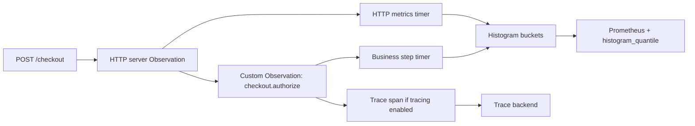

# Percentiles

A Spring Boot API has an average latency of **236.5 ms**. Dashboards show this number looking fairly steady, yet some customers still wait over a second during checkout. Looking only at the average makes it hard for operations teams to tell where slow experiences are concentrated. **Percentiles** let you inspect the *distribution* of response times: what percentage of requests finish within a threshold, how slow the "tail" is, and how that changes over time.

In the **Metrics Foundation** chapter of the **SPRING_BOOT_OBSERVABILITY** module, percentiles are essential when building metrics with Micrometer and Spring Boot Actuator, alongside logs and distributed tracing to investigate errors, latency, and application behavior. Mastering percentiles also helps you choose histogram buckets, design SLIs/SLOs, avoid high-cardinality tags, configure exporters, and understand why sampled traces cannot replace full-traffic distribution metrics.

After this lesson, you will be able to:

1. Explain p50, p90, p95, and p99, and distinguish percentiles from averages, maximums, and error rates.
2. Understand how percentiles depend on the request set, time window, and calculation algorithm.
3. Distinguish per-instance client-side percentiles from percentiles estimated from aggregatable histograms.
4. Configure Micrometer Timers and Spring Boot Actuator to generate histograms for HTTP latency and business operations.
5. Write and read PromQL `histogram_quantile()` queries while avoiding the mistake of averaging p95 values.
6. Choose percentiles and latency thresholds aligned with user-experience goals, and know when to cross-check logs/traces.
7. Recognize bucket, low-traffic, cardinality, sampling, and export-pipeline issues that distort percentile interpretation.

## 1. What Is a Percentile?

The **p-th percentile** of a set of observations is a point on the value distribution describing roughly **p% of observations having values at or below that mark**, according to the quantile calculation method used. For request latency:

- **p50**: roughly half of requests respond at or below this value; often called the median.
- **p90**: roughly 90% of requests are at or below this value; highlights the slowest 10% tail.
- **p95**: roughly 95% of requests are at or below this value; highlights the slowest 5% tail.
- **p99**: roughly 99% of requests are at or below this value; focuses on the slowest 1% tail.

For example, **p95 = 750 ms** over a 5-minute window means roughly 95% of measured requests completed in at most 750 ms. It does **not** mean 95% of requests each took exactly 750 ms, nor does it mean 5% of requests violated an arbitrary SLA unless that SLA is defined.

> Percentiles must always carry context: **of which metric, at which measurement layer, for which routes/statuses, over which time window, and from which instances?** A p95 number detached from this context is easily misinterpreted.

### 1.1. Example of 20 Sorted Requests

Suppose response times for 20 requests, in **ms**, sorted ascending:

```text
 50   60   70   80   90
100  100  110  120  130
150  160  180  200  220
260  300  400  750 1200
```

A simple illustrative method is **nearest-rank**: pick the element at position `ceil(p × N)` indexed from 1 to N. With N = 20:

| Metric | Position (nearest-rank) | Value |
| --- | ---: | ---: |
| p50 | `ceil(0.50 × 20) = 10` | 130 ms |
| p90 | `ceil(0.90 × 20) = 18` | 400 ms |
| p95 | `ceil(0.95 × 20) = 19` | 750 ms |
| p99 | `ceil(0.99 × 20) = 20` | 1,200 ms |
| Average | Sum of values / 20 | 236.5 ms |
| Maximum | Largest value | 1,200 ms |

**Note:** nearest-rank is just an easy-to-learn formula. Statistical libraries use different quantile interpolation conventions; Micrometer, histograms, and Prometheus each have their own representations and calculations. For instance, the median of 20 numbers by averaging the two middle elements is (130 + 150)/2 = **140 ms**, differing from the nearest-rank p50 of 130 ms. When comparing tools, understand their algorithms and error bounds; never assume every p50/p95 matches to the exact millisecond.

The notable point in this example: **average = 236.5 ms**, yet p95 = 750 ms and the slowest request took 1,200 ms. The average hid a substantial portion of the "tail" experience.

### 1.2. These Metrics Answer Different Questions

| Metric | Appropriate Question | What It Cannot Conclude Alone |
| --- | --- | --- |
| Average | What is the mean processing time across measured requests? | Does not reveal tail latency |
| p50 | How fast/slow is a typical request? | Does not reveal users in the tail |
| p95/p99 | How slow is a small fraction of requests? | Does not itself identify the cause of latency |
| Maximum | What was the slowest request in the set? | Whether a single outlier represents a trend |
| Request count/rate | How many requests/second? Is the sample large enough? | Throughput alone does not reflect latency quality |
| Error rate | How many requests failed per the SLI definition? | Does not replace latency distribution |

A system with good p99 but a high error rate still fails expectations. Conversely, HTTP `200` taking 10 seconds can feel like a failure to users. Therefore, in real investigations, percentiles usually travel alongside **traffic, errors, and saturation**.

## 2. Percentiles Depend on Sample Set and Time Window

There is no permanent "forever p95" for a service. It shifts with which requests are included and the observation window.

### 2.1. Choosing the Right Request Set

Suppose `POST /checkout` has two groups:

- 9,000 successful requests, processed quickly.
- 1,000 requests timing out after many seconds.

If a dashboard only reads the timer for the success branch, p95 stays low even though 10% of users time out. Even if all statuses are included inside the app, it can still miss requests rejected by the gateway before reaching Spring Boot.

Define clearly:

- Measurement point: browser, gateway, HTTP server, or business step.
- Route set: one normalized route or the entire API.
- Status/outcome: to what extent `2xx`, `4xx`, `5xx`, timeouts, and cancellations are included.
- Which instances/service versions/environments are included.
- Time window: 1 minute, 5 minutes, 1 hour, or a longer SLO window.

**Do not merge all routes just because they share a metric name** when the real question is checkout latency. A very fast health endpoint can make the overall percentile look good while checkout is slow.

### 2.2. Short and Long Windows Provide Different Perspectives

| Window | Advantage | Limitation |
| --- | --- | --- |
| 1 minute | Sensitive to rapid changes | Fewer samples, prone to high jitter |
| 5 minutes | Useful when investigating an ongoing incident | Still needs traffic and bucket checks |
| 30 minutes / 1 hour | Smoother, shows longer trends | Can mask brief spikes |
| 7 days / 30 days | Useful for evaluating long-term targets when data fits | Not useful for pinpointing exact timing of a small incident |

Time ranges and aggregation methods also differ: a percentile computed over *all samples in a window* generally does not equal the average of percentiles from smaller sub-windows. Per-minute p95 values **cannot be summed or averaged** to produce a 1-hour p95.

### 2.3. How Many Requests Make p99 Reliable?

With 20 requests, nearest-rank p99 lands on the single slowest request. With 100 requests, 1% is roughly one request; minor fluctuations can make p99 swing wildly. Low-traffic routes often need longer windows or meaningful static business thresholds.

If a metric bucket lacks enough observations in the window, a p99 estimate can oscillate, become unavailable, or reflect very few requests. **Always read request count alongside percentiles.**

## 3. Directly Computed Percentiles vs. Histogram Percentiles

Micrometer supports multiple ways to describe distributions, with one difference that is critical in multi-instance deployments.

### 3.1. Client-Side Percentiles

Some registries and configs export **percentiles computed locally on each meter/instance**. For example, each instance publishes its own windowed p95.

Advantages:

- Ready-to-read p50/p95/p99 per instance.
- Convenient when diagnosing a specific process.

Limitations:

- Percentiles are **not linearly aggregatable**.
- You cannot average pod p95 values to get the cluster-wide p95.
- Request volumes and distributions across instances can vary greatly.

Suppose:

| Instance | Requests in Window | Own p95 |
| --- | ---: | ---: |
| A | 100 | 100 ms |
| B | 9,900 | 800 ms |

Averaging the two p95s = (100 + 800) / 2 = **450 ms**. That number is **not** the true p95 of the 10,000 requests. Even a "request-weighted average" of two p95s still fails to yield the exact percentile because information about distribution shape was discarded.

### 3.2. Histograms and Bucket Counts

A **histogram** groups observed values into bounded intervals (buckets). In Prometheus classic histograms, bucket counters carry an `le` (*less than or equal*) label and are **cumulative**.

Example normalized buckets over a measurement window:

| `le` (seconds) | Requests with Duration ≤ Threshold |
| --- | ---: |
| 0.1 | 120 |
| 0.3 | 620 |
| 0.5 | 840 |
| 1.0 | 970 |
| `+Inf` | 1,000 |

Here, **840/1,000 = 84%** of recorded requests finished within **500 ms**, and **970/1,000 = 97%** within 1 second.

Histogram bucket counts **can be summed across series** from multiple instances if the metric and bucket boundaries match. After summing, the backend estimates percentiles from the cumulative distribution using `histogram_quantile()`.

**Trade-off:** histogram-derived percentiles are **estimates**. If p95 falls inside the 500 ms to 1 s bucket, the backend does not know the exact positions of individual requests inside that interval; linear interpolation produces an approximation. Adding finer bucket boundaries around critical thresholds improves resolution at the cost of more series and higher observability overhead.

### 3.3. Comparison

| Property | Client-Side Percentiles | Histogram Buckets |
| --- | --- | --- |
| Typical output | Per-meter p50/p95/p99 | Bucket counts; quantiles queried in backend |
| Multi-instance aggregation | **Cannot** aggregate percentiles directly | Can sum compatible bucket counts before computing quantiles |
| Accuracy | Depends on client algorithm/window | Depends on bucket boundaries and interpolation |
| Cost | Depends on implementation and quantile count | More time series when adding buckets/tags |
| Cluster-wide Prometheus usage | Never average quantiles | Typically `histogram_quantile()` over summed bucket rates |

In Micrometer, `publishPercentiles(...)` and `publishPercentileHistogram()` are two different settings. Do not treat per-pod published percentiles as something you can `sum` or `avg` like a request counter.

## 4. How Does Prometheus Compute p95 from a Histogram?

For Micrometer Timer `http.server.requests`, when Prometheus histograms are configured, classic histogram series typically use seconds-based names such as:

```text
http_server_requests_seconds_bucket{method="POST",uri="/checkout",le="0.3",...}
http_server_requests_seconds_count{method="POST",uri="/checkout",...}
http_server_requests_seconds_sum{method="POST",uri="/checkout",...}
```

Exact names depend on registry, version, conventions, and export settings; verify actual output from `/actuator/prometheus`.

### 4.1. p95 Across All Instances for One Route

```promql
histogram_quantile(
  0.95,
  sum by (le) (
    rate(
      http_server_requests_seconds_bucket{
        method="POST",
        uri="/checkout"
      }[5m]
    )
  )
)
```

Step-by-step explanation:

1. The selector filters `POST /checkout` requests.
2. `rate(...[5m])` computes the per-second growth rate of each bucket counter over 5 minutes, handling counter resets within data limits.
3. `sum by (le)` sums matching buckets across instances/pods, aggregating away deployment dimensions you do not need split.
4. `histogram_quantile(0.95, ...)` estimates p95 over the combined histogram distribution.

The result is expressed in **seconds**, not milliseconds. For example, `0.75` means roughly **750 ms**.

To compare routes individually:

```promql
histogram_quantile(
  0.95,
  sum by (le, uri) (
    rate(http_server_requests_seconds_bucket[5m])
  )
)
```

This computes p95 separately per `uri` after summing across instances. In practice, include filters such as `job`, `service`, `environment`, and `method` so you do not mix data from multiple apps or environments sharing the same metric name.

**Major trap:** never replace `sum by (le)` with `avg` over precomputed p95 numbers. The right operation is **summing bucket counts first**, then applying the quantile function. Bucket boundaries and units must match; when different versions emit different buckets, aggregating them can produce misleading results.

### 4.2. Endpoint p99 Alongside p50

```promql
histogram_quantile(
  0.99,
  sum by (le) (
    rate(http_server_requests_seconds_bucket{uri="/checkout"}[10m])
  )
)
```

```promql
histogram_quantile(
  0.50,
  sum by (le) (
    rate(http_server_requests_seconds_bucket{uri="/checkout"}[10m])
  )
)
```

Placing p50 and p99 side by side reveals whether **the entire distribution slowed down** or only **the slow tail stretched out**. If p50 stays flat while p99 spikes, investigation hypotheses might involve locks, retries, queueing, a dependency slow for a subset of requests, or GC pauses. Percentiles **do not themselves prove** a specific cause.

### 4.3. Do Not Ignore Request Volume

```promql
sum(
  rate(
    http_server_requests_seconds_count{
      method="POST",
      uri="/checkout"
    }[5m]
  )
)
```

This query gives average requests/second over the window. A p99 spike with almost zero traffic means something very different from a p99 spike while handling thousands of requests/second.

## 5. Percentiles Do Not Replace SLO Thresholds

A common target: "**At least 99% of checkout requests complete within 500 ms.**" This is a requirement on the **proportion of requests meeting a threshold**, not merely "p99 below 500 ms."

With a classic histogram containing bucket `le="0.5"` (in seconds), you can compute the proportion completing in ≤ 500 ms as:

```promql
sum(
  rate(
    http_server_requests_seconds_bucket{
      uri="/checkout",
      le="0.5"
    }[5m]
  )
)
/
sum(
  rate(
    http_server_requests_seconds_count{
      uri="/checkout"
    }[5m]
  )
)
```

A result of `0.98` means roughly 98% of requests **in the measured set** met the threshold. To display as a percentage, multiply by 100 in the dashboard. **Conditions:** the histogram actually has a 0.5-second boundary bucket, and numerator/denominator share the exact same labels, statuses, environment, and request scope.

SLOs and percentiles are related: if at least 99% of requests are ≤ 500 ms, then a compatibly defined 99th percentile also will not exceed roughly 500 ms. Yet **reading the proportion directly from the exact threshold bucket** is usually clearer for an SLI; estimating p99 via interpolation can fluctuate depending on bucket placement.

Additionally:

- An application-side HTTP bucket does not see requests rejected by the gateway before reaching the app.
- If customers need confirmed payment success, HTTP `200` from the endpoint does not necessarily mean the transaction succeeded.
- You may need separate SLIs for **availability**, **business success**, and **latency**, each with a well-defined denominator.

**Be cautious with errors and timeouts:** If a timeout terminates at the gateway without Spring Boot's HTTP server timer capturing the same boundary, a "user experience" SLO should rely on external measurements or combined data rather than treating server percentiles as the entire user experience.

## 6. Configuring Percentiles/Histograms in Spring Boot

### 6.1. Foundational Dependencies

Example using **Spring Boot 3.x**, Maven with Spring Boot dependency management, and a web application (already including `spring-boot-starter-web` or equivalent starter).

```xml
<!-- Actuator and Micrometer Metrics/Observation infrastructure -->
<dependency>
    <groupId>org.springframework.boot</groupId>
    <artifactId>spring-boot-starter-actuator</artifactId>
</dependency>

<!-- Prometheus exporter/scrape endpoint -->
<dependency>
    <groupId>io.micrometer</groupId>
    <artifactId>micrometer-registry-prometheus</artifactId>
</dependency>
```

The Prometheus registry enables exposing metrics at an endpoint when configured. You still need a Prometheus server or compatible backend to scrape/ingest data and build dashboards.

### 6.2. Histograms for `http.server.requests`

An illustrative `application.yml` configuration:

```yaml
management:
  endpoints:
    web:
      exposure:
        include: health,metrics,prometheus

  metrics:
    distribution:
      percentiles-histogram:
        http.server.requests: true

      minimum-expected-value:
        http.server.requests: 1ms

      maximum-expected-value:
        http.server.requests: 10s

      slo:
        http.server.requests: 300ms,500ms,1s
```

Meaning:

- `percentiles-histogram: true` asks Micrometer to publish histograms suitable for quantile estimation in compatible backends.
- `minimum-expected-value` and `maximum-expected-value` bound the generated histogram range, avoiding unnecessary bucket spans. **They do not automatically discard requests**; check how your registry handles values outside the expected range.
- `slo` adds meaningful time boundaries, such as 300 ms, 500 ms, and 1 second. The **500 ms** boundary is useful for computing the proportion of requests meeting a latency objective.
- Enabling histograms increases exported series counts, especially with many tag/instance combinations.

`http.server.requests` is the **Micrometer internal meter name**. In Prometheus, name and unit can become `http_server_requests_seconds_*`. The same config also does not guarantee your backend supports the exact histogram/quantile style expected; verify real output.

To view quantiles directly from each instance's meter, Micrometer also offers `percentiles`, for example:

```yaml
management:
  metrics:
    distribution:
      percentiles:
        http.server.requests: 0.5,0.95,0.99
```

This is a **different option** for client-side quantiles; do not average this p95 across pods. For Prometheus and service-wide percentiles, bucket histograms plus `histogram_quantile()` after summing are generally preferred.

**Configuration note:** enabling both `percentiles` and `percentiles-histogram` simultaneously generates extra series and cost. Enable only the modes truly needed for dashboards/SLOs.

**Version note:** Spring Boot 4.x changes certain starters and properties related to tracing/metrics. Consult the Spring Boot Actuator reference for the version you are deploying. Percentile interpretation and histogram aggregation principles do not depend exclusively on Spring Boot 3.x.

### 6.3. Viewing Metrics in Actuator

After starting the app and sending a few requests:

```bash
curl -fsS http://localhost:8080/actuator/metrics/http.server.requests
curl -fsS http://localhost:8080/actuator/prometheus
```

These URLs assume Actuator runs on port 8080 and endpoints are exposed for the lab environment.

- `/actuator/metrics/http.server.requests` confirms the meter exists and lists available tags/measurements; it is not an endpoint that dumps all Prometheus buckets in the same format.
- `/actuator/prometheus` shows the series actually exported by the registry, including buckets when configured appropriately.
- Not seeing the timer before any instrumented request arrives is normal.
- In production, restrict Actuator access via management networking and proper authentication/authorization; never expose all metrics openly to the Internet.

## 7. Histograms for Business Steps Using Micrometer Timer

HTTP server metrics are useful, yet only describe the whole request. If checkout includes validation, inventory check, and payment call, you may want percentiles for the **payment step**.

Micrometer `Timer` measures duration and can publish count, total time, histograms, and percentiles per configuration.

Example using `Timer.Sample` to select outcome after learning the result:

```java
import io.micrometer.core.instrument.MeterRegistry;
import io.micrometer.core.instrument.Timer;
import org.springframework.stereotype.Service;

import java.time.Duration;

@Service
public class PaymentTimingService {
    private final MeterRegistry meterRegistry;
    private final PaymentGateway gateway;

    public PaymentTimingService(MeterRegistry meterRegistry,
                                PaymentGateway gateway) {
        this.meterRegistry = meterRegistry;
        this.gateway = gateway;
    }

    public boolean authorize(String provider, String token) {
        String providerTag = switch (provider == null ? "" : provider) {
            case "primary" -> "primary";
            case "backup" -> "backup";
            default -> "other";
        };

        Timer.Sample sample = Timer.start(meterRegistry);
        String outcome = "error";

        try {
            boolean approved = gateway.authorize(token);
            outcome = approved ? "approved" : "declined";
            return approved;
        } finally {
            Timer timer = Timer.builder("checkout.payment.duration")
                    .description("Duration of payment authorization")
                    .tag("provider", providerTag)
                    .tag("outcome", outcome)
                    .publishPercentileHistogram()
                    .minimumExpectedValue(Duration.ofMillis(1))
                    .maximumExpectedValue(Duration.ofSeconds(10))
                    .serviceLevelObjectives(
                            Duration.ofMillis(300),
                            Duration.ofMillis(500),
                            Duration.ofSeconds(1))
                    .register(meterRegistry);
            sample.stop(timer);
        }
    }
}

interface PaymentGateway {
    boolean authorize(String paymentToken);
}
```

Here:

1. `Timer.Sample` begins timing before calling the gateway.
2. `provider` is normalized to a bounded set; never use dynamic hostnames or merchant IDs.
3. `outcome` takes one of `approved`, `declined`, `error`, never a raw exception message.
4. `finally` records duration even when the operation throws an exception.
5. Histograms are configured on the business timer; via the Prometheus registry, buckets can be exported for `histogram_quantile()`.

**Important distinction:** This code uses Micrometer `Timer` directly. In an app using custom **Micrometer Observation** at the same boundary, the metrics handler can also create a timer. Do not create a second timer for the same purpose if Observation already covers it, as that produces duplicate or confusing measurements. Alternatively, use `Observation.createNotStarted(...).observe(...)` or a manual observation with `stop()` in `finally`, then configure histograms on that meter name.

The example keeps `token` strictly inside the business call. Never put payment tokens, user IDs, order IDs, or PII into tags, trace attributes, or logs.

## 8. Combining with Micrometer Observation

**Observation** instruments an execution with lifecycle and context; **Timer** is a duration statistics meter. In Spring Boot, one observation can flow through a metrics handler to update a timer and through a tracing handler to create a span (if those integrations are configured).



Example custom observation:

```java
import io.micrometer.observation.Observation;
import io.micrometer.observation.ObservationRegistry;
import org.springframework.stereotype.Service;

@Service
public class CheckoutObservationService {
    private final ObservationRegistry registry;
    private final PaymentGateway gateway;

    public CheckoutObservationService(ObservationRegistry registry,
                                      PaymentGateway gateway) {
        this.registry = registry;
        this.gateway = gateway;
    }

    public boolean authorize(String token) {
        return Observation.createNotStarted("checkout.authorize", registry)
                .lowCardinalityKeyValue("operation", "authorize")
                .lowCardinalityKeyValue("dependency", "payment")
                .observe(() -> gateway.authorize(token));
    }
}
```

In an app with a metrics handler, you can configure histograms for `checkout.authorize` just like `http.server.requests` via your version's properties. With a tracing handler, the observation creates a span showing how long the payment call took within a specific request.

**Lifecycle caution:** an observation not stopped at the right spot can corrupt both timers and traces. `observe(...)` fits synchronous work; for `CompletableFuture` or Reactor `Mono`, do not call `observe(() -> futureOrMono)` assuming it measures until async completion. Bind completion to the async task's actual completion/cancellation per the defined boundary.

### 8.1. Percentiles and Tracing Answer Different Questions

- **Percentiles from metrics**: How many requests are slow? How are p95/p99 trends shifting across thousands of requests?
- **Traces**: Which steps did a sample request pass through, and which step took the most time?
- **Logs**: What exceptions, retries, timeouts, fallbacks, or business errors happened in that same context?

For instance, `checkout.authorize` p99 jumps from 400 ms to 1.8 seconds. A sampled trace shows the payment client span taking 1.5 seconds. Cross-check connection pool metrics, retry counts, error logs, and dependency latency before concluding the root cause.

**Trace sampling is not the same as histogram sampling.** If tracing only retains 10% of traces, you cannot default to using the duration distribution of *saved traces* in place of the full-request metric histogram—especially when samplers prioritize slow or error traces. Metric histograms can continue measuring 100% of instrumented traffic even when traces are sampled out.

## 9. Designing Buckets Around Business Thresholds

More buckets yield finer percentile resolution within covered intervals, yet increase time series, memory, and export/query costs.

Suppose the business cares about three thresholds:

- **300 ms**: expected fast operation.
- **500 ms**: latency threshold for checkout UX.
- **1 second**: clearly degraded performance threshold.

Ensuring histograms include buckets at those exact boundaries lets you calculate **threshold compliance rates** directly, which is often more valuable than chasing false precision in p99.

Example:

| Bucket `le` | Total Requests ≤ Threshold | Cumulative Share |
| --- | ---: | ---: |
| 0.3 s | 6,000 | 60% |
| 0.5 s | 8,500 | 85% |
| 1.0 s | 9,700 | 97% |
| +Inf | 10,000 | 100% |

From this data we can state that **85%** of requests finished within 500 ms. p95 lies between the 0.5 s and 1 s boundaries, though we **cannot pinpoint the exact latency of the 9,500th request** from these four buckets alone. `histogram_quantile()` uses interpolation to estimate p95 inside that bucket.

### 9.1. Errors from Sparse Buckets

If a histogram only has boundaries at 100 ms, 1 second, and 10 seconds, a true p95 of 600 ms can be estimated quite inaccurately depending on distribution inside the bucket. A `histogram_quantile()` result showing many decimal places **does not mean millisecond-accurate measurement**.

Therefore:

1. Pick buckets around SLO thresholds and operational decision points.
2. Keep bucket schemas consistent across instances if aggregating.
3. Bound tags that multiply time-series dimensions.
4. Monitor resource usage of your metrics pipeline.
5. Verify actual buckets emitted in Prometheus; nominal configuration does not guarantee every registry/backend exports identically.

### 9.2. Enabling Histograms Does Not Mean Every Alert Should Use p99

A service receiving 2 requests/minute and one receiving 20,000 requests/minute need different monitoring strategies. At low traffic, 5-minute percentiles fluctuate wildly. Clear error thresholds, SLO-breach counts, longer histograms, or synthetic checks may serve better.

## 10. Cardinality: Every Tag Multiplies Histogram Cost

Suppose a timer has 12 routes, 5 statuses, 3 channels, and 10 instances:

```text
12 × 5 × 3 × 10 = 1,800 label sets
```

If each label set emits 40 bucket series, theoretical bucket series reach **72,000**, before counting `_sum` and `_count`. Adding a `userId` with hundreds of thousands of values makes the metrics system unsustainable.

Tags should have small, stable value sets:

| Tag | Suitable? | Reason |
| --- | --- | --- |
| `uri=/orders/{id}` | Yes | Normalized route template |
| `method=GET\|POST` | Yes | Bounded value set |
| `status=200\|400\|500` | Usually yes | Controlled value set |
| `outcome=success\|error\|rejected` | Yes | Useful for business slicing |
| `region=ap-southeast-1` | Depends on region count | Helpful if boundaries are clear |
| `orderId=...` | No | Nearly unique per request |
| `traceId=...` | No | Every trace creates a new label, breaking aggregation |
| `userId`, email, token | No | High cardinality and privacy risk |
| Raw URL or raw header | No | Potentially unbounded values |

When using `Observation.lowCardinalityKeyValue(...)`, these key-values can become metric dimensions. `highCardinalityKeyValue(...)` fits trace context when supported by handlers, **though sensitive data must still be restricted**. Anything sent to a trace exporter may be stored long-term in the backend; never treat traces as a dumping ground for tokens or secret payloads.

## 11. Investigation Workflow When p95/p99 Rises

**Hypothetical scenario:** After releasing a new version, `POST /checkout` p50 stays around 120 ms, while p99 jumps from 450 ms to 2 seconds. Request rate and CPU barely change.

Proceed systematically:

| Step | What to Check | Interpretation |
| --- | --- | --- |
| 1. Verify measurement | Metric, tags, window, histogram buckets, version, timestamp | Avoid comparing two mismatched request sets |
| 2. Confirm impact | Traffic, count of requests > 500 ms and 1 s, gateway error/timeout rate | Assess real user impact |
| 3. Segment by bounded dimensions | Route, method, outcome, instance, region, or version | Locate which slice suffers tail latency |
| 4. Open sample traces | Several saved slow traces; inspect span timelines and downstreams | Narrow down where time is spent |
| 5. Cross-check logs and saturation | Retries, pending connections in pools, locks, GC, DB queries, dependency timeouts | Validate likely root causes |
| 6. Compare before/after changes | Deployments, pool configs, timeouts, resource limits | Find changes coinciding with the inflection point |
| 7. Confirm recovery | p95/p99, SLO violation ratio, error rate, and synthetic/client metrics | Confirm customer experience actually recovered |

For example, p99 rising only on `outcome=error` may point to retries/timeouts, or misclassified status/errors. If p99 rises on only one pod, inspect node health, CPU throttling, GC, warmup, or uneven load balancing. If the gateway logs many `504`s while the HTTP server histogram looks unchanged, requests may be timing out upstream or the denominators across layers differ.

### 11.1. Using the Right Query to Compare Instances

You can view instances separately to locate an outlier pod:

```promql
histogram_quantile(
  0.99,
  sum by (le, instance) (
    rate(
      http_server_requests_seconds_bucket{
        uri="/checkout"
      }[5m]
    )
  )
)
```

Whereas service-wide p99 requires **summing buckets across instances** before taking the quantile:

```promql
histogram_quantile(
  0.99,
  sum by (le) (
    rate(
      http_server_requests_seconds_bucket{
        uri="/checkout"
      }[5m]
    )
  )
)
```

These two queries answer two different questions. Never average the per-instance p99 values from the first chart as a substitute for the second.

### 11.2. Relationship with Exporters and Sampling

- Metrics can go missing due to failed scrapes, exporter errors, dropped series, or label changes. A "vanished" p99 line can be a pipeline issue, not zero traffic.
- Histograms also have window/query-range limits and interpolation error. Do not claim a 1 ms shift in p99 is a real improvement when buckets are coarse.
- Trace sampling may leave rare error requests without saved traces. Use histograms/metrics for frequency, and traces/logs to explain sample requests.
- Keep clocks synchronized across layers, and compare client/gateway/server latencies at matching boundaries.

## 12. Hands-On Exercise: Did Checkout p95 Really Improve?

Create a lab Spring Boot app with a `GET /checkout` or `POST /checkout` endpoint, Actuator, and the Prometheus registry. Execute step by step:

1. **Measure baseline:** Call the endpoint repeatedly with ~100–200 ms latency; inspect `http.server.requests` in Actuator and raw histogram buckets at `/actuator/prometheus`.
2. **Inject tail latency:** In the lab, make a small fraction of requests sleep 1–2 seconds. Compare average, p50, p95, and p99 over the same window.
3. **Vary sample size:** Repeat with 20 requests vs. several thousand requests. Observe p99 volatility; record request count alongside percentiles.
4. **Run two instances:** Send uneven traffic to two instances; compare each instance's p95 against cluster p95 computed via `histogram_quantile()` on summed buckets. Explain why averaging the two p95s is wrong.
5. **Test a latency SLO:** Configure a 500 ms bucket, compute the ratio of requests ≤ 500 ms from `_bucket{le="0.5"}` and `_count`. Compare against p95/p99 to understand the difference between quantiles and SLO thresholds.
6. **Verify tags:** Use templated `uri`, `method`, `status`, and bounded outcome; never attach order IDs or trace IDs to metrics.
7. **Correlate traces:** Enable tracing/OTLP in the lab, inspect a slow request trace, and explain it using spans/downstream logs. Do not assume sampled traces represent the entire duration histogram.
8. **Simulate telemetry failure:** Stop scraping in the lab; observe missing dashboard data. Distinguish a broken metrics pipeline from an actual latency change.

### Self-Check Quiz

**Question 1.** `/checkout` p95 is 800 ms. What does that say?

Roughly 95% of requests in the measured set over that window had durations not exceeding approximately 800 ms per the estimation algorithm. It does not specify request count, root cause, or the experience of requests rejected by the gateway before reaching the app.

**Question 2.** Pod A has p95 = 200 ms and Pod B has p95 = 900 ms. Is cluster-wide p95 equal to 550 ms?

**No.** Per-pod percentiles cannot be averaged. With classic histograms using compatible buckets, sum bucket counts/rates across pods first and then compute `histogram_quantile()`.

**Question 3.** Why can p99 on a low-traffic route fluctuate sharply?

Because one or two slow observations carry heavy weight in the tail. Moreover, histogram interpolation and sparse windows make estimates unstable.

**Question 4.** Must "99% of requests under 500 ms" always be checked solely via p99?

No. The ratio of requests in the `≤ 500 ms` bucket expresses the target directly. Ensure a 500 ms bucket exists and the denominator accurately defines user scope.

**Question 5.** If trace sampling = 0.1, do percentiles from histogram metrics measure only 10% of requests?

Not by default. Tracing sampling and metrics instrumentation/export are independent mechanisms. Verify how each is configured rather than inferring metrics sample coverage from trace sampling settings.

**Question 6.** Why should `orderId` not be a tag on a latency histogram?

Because order IDs grow with every request, exploding time series and risking data exposure. Use routes/outcomes/bounded tags for statistics, and controlled trace/log correlation for investigating specific transactions.

## 13. Takeaways for Using Percentiles in Production

- **Percentiles describe distributions, not just averages.** p50 shows typical experience; p95/p99 expose tail latency without directly naming the root cause.
- **Read together with scope and traffic.** Align routes, statuses, measurement layer, time window, and request counts before comparing.
- **Never average p95/p99 across instances.** For Prometheus classic histograms, sum compatible bucket counts/rates before calling `histogram_quantile()`.
- **Understand histogram accuracy.** Wide buckets give coarse estimates; pick boundaries aligned with SLOs and watch series cost.
- **Latency SLOs often need threshold compliance ratios.** Compute directly from the exact threshold bucket when possible, using a denominator that reflects real user experience.
- **Keep tags low-cardinality.** Avoid per-request IDs, trace IDs, raw URLs, tokens, or sensitive information.
- **Correlate metrics, logs, and traces.** Metrics show incident scope and trends; traces and logs verify hypotheses at the individual request level.
- **Monitor the collection pipeline.** Trace sampling, metric exporters, scraping, and collectors can create observability blind spots independently of app health.

### References

- [Micrometer — Timers](https://docs.micrometer.io/micrometer/reference/concepts/timers.html)
- [Micrometer — Histograms and Percentiles](https://docs.micrometer.io/micrometer/reference/concepts/histogram-quantiles.html)
- [Spring Boot 3.5 — Metrics](https://docs.spring.io/spring-boot/3.5/reference/actuator/metrics.html)
- [Spring Boot 3.5 — Observability](https://docs.spring.io/spring-boot/3.5/reference/actuator/observability.html)
- [Prometheus — Histogram and Summary Best Practices](https://prometheus.io/docs/practices/histograms/)
- [Prometheus — Querying Functions: histogram_quantile](https://prometheus.io/docs/prometheus/latest/querying/functions/#histogram_quantile)
