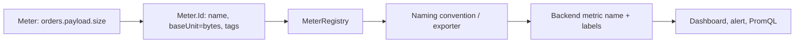

# Base Units in Micrometer Metrics

A dashboard displays the average payload size of an order API as **512**. That number is not enough to interpret: 512 *bytes*, 512 *KiB*, or 512 *MB*? If service A records sizes in bytes while service B records in kilobytes under the same metric name, the aggregated chart can be off by a factor of a thousand. Likewise, a latency of 250 could be 250 milliseconds or 250 seconds.

In Micrometer, a **base unit** is metadata describing the underlying measurement unit of a meter. Designing units properly helps readers interpret measurements, lets exporters name series appropriately for the backend, and aligns development teams on how numbers are recorded. However, declaring a base unit **is not an automatic arithmetic conversion**: data passed into the meter must already be in the right unit in application code.

This lesson belongs to the **Metrics Foundation** chapter of the `SPRING_BOOT_OBSERVABILITY` module. The module focuses on setting up observability for Spring Boot using Micrometer Observation, metrics, logs, and distributed tracing, while mastering context propagation, tags/cardinality, exporters, sampling, and signal correlation to investigate errors, latency, and application behavior in production. The focus here is **Base unit**: its meaning, how to declare it, how to verify it on export, and how to avoid unit errors when correlating signals.

## 1. What Is a Base Unit?

A **Base unit** is the unit name used to interpret the values recorded by a meter. Examples:

| Measurement | Example Value | Sensible Base Unit | Interpretation |
| --- | ---: | --- | --- |
| Payload size | 4,096 | `bytes` | 4,096 bytes |
| Total completed orders | 120 | `orders` | 120 orders |
| Waiting messages | 18 | `messages` | 18 messages |
| Memory used | 268,435,456 | `bytes` | 256 MiB |
| Resource utilization ratio | 0.82 | None or ratio unit by convention | 82% if defined on a 0–1 scale |
| Processing duration | 0.25 | Time managed by `Timer` | Can mean 250 ms or 0.25 s depending on output unit |

Strings like `bytes`, `orders`, and `messages` here are **unit names in the telemetry contract**. `orders` is a business unit rather than a standard SI unit. A unit name must be meaningful and applied consistently across the entire application.

Distinguish three concepts:

1. **Measurement value:** the number recorded into a counter, gauge, timer, or summary.
2. **Base unit:** metadata stating what kind of unit that number represents.
3. **Tags/key-values:** grouping dimensions for filtering and comparison, such as `region=ap-southeast`, `channel=web`.

For example: metric `orders.payload.size` has base unit `bytes` and tag `channel=web`. "Bytes" answers *what is it measured in*, while "web" answers *which group does it belong to*. Do not use `unit=bytes` as a universal substitute for base-unit metadata; keeping units at the metric metadata layer avoids fragmenting one measurement across multiple representations.

## 2. Base Unit Is Metadata, Not a Converter

Suppose a payload is 2 KiB, which is **2 × 1,024 = 2,048 bytes**. Two different ways of recording it:

```java
// Correct: summary declares bytes and records bytes.
DistributionSummary payloadBytes = DistributionSummary.builder("order.payload.size")
    .baseUnit("bytes")
    .register(meterRegistry);
payloadBytes.record(2048);

// Semantically wrong: 2 is in KiB, yet the meter declares bytes.
payloadBytes.record(2);
```

Micrometer cannot tell that `2` in the second call was meant in KiB and convert it to 2,048 bytes. Both calls compile and run as numbers, yet the second **corrupts the data**.

If input arrives in kilobytes or kibibytes, convert it to the unified unit **before calling `record(...)`**:

```java
long bytesFromKiB = 2L * 1024;
payloadBytes.record(bytesFromKiB);
```

In documentation and UIs, distinguish clearly:

- **kB:** decimal kilobyte, 1 kB = 1,000 bytes.
- **KiB:** binary kibibyte, 1 KiB = 1,024 bytes.
- **MB:** decimal megabyte, 1 MB = 1,000,000 bytes.
- **MiB:** binary mebibyte, 1 MiB = 1,048,576 bytes.

If a metric stores bytes, dashboards can convert to KiB or MiB **at display time**. Do not create a second metric for the same size just because one dashboard prefers MiB.

## 3. Base Units Across Micrometer Meter Types

Not every meter records values the same way, so choose the meter type before declaring units.

| Meter | Data Type | Unit Declaration / Interpretation | Example |
| --- | --- | --- | --- |
| `Counter` | Monotonic total of events or cumulative amounts | `Counter.builder(...).baseUnit("orders")` | Successfully confirmed orders |
| `Gauge` | Value at collection time | `Gauge.builder(...).baseUnit("bytes")` | Current cache memory used |
| `DistributionSummary` | Distribution of values and recording count | `DistributionSummary.builder(...).baseUnit("bytes")` | Payload size distribution |
| `Timer` | Operation duration and completion frequency | Recorded with `Duration` or `TimeUnit`; backend chooses time unit representation | API or business step latency |
| `LongTaskTimer` | Long-running still-active tasks | Meter timing mechanism; check backend export unit | Active long task count and running duration |

For **Counter, Gauge, and DistributionSummary**, builders provide `baseUnit(...)`. `Timer` has dedicated APIs for time, such as `record(Duration)` or `record(long, TimeUnit)`; with Timer, let Micrometer convert according to the target registry's time conventions rather than stripping time down into an untyped number.

### 3.1. Counter: Unit of Cumulative Quantity

```java
Counter completedOrders = Counter.builder("orders.completed")
    .description("Number of successfully completed orders")
    .baseUnit("orders")
    .register(meterRegistry);

completedOrders.increment();  // One more order completed.
completedOrders.increment(3); // Three more orders completed.
```

The counter increases from 0 to 4 in units of **orders**. Counters fit completed totals, error totals, or strictly increasing event counts. Do not use a Counter for orders *currently in progress*, because that count can decrease; a Gauge reflects current state accurately.

For a counter tracking *event occurrences* without a specialized unit, declaring a base unit may be omitted. Choose `orders` when you want to make clear that each increment corresponds to one order.

### 3.2. Gauge: Unit of Instantaneous Value

```java
AtomicLong cachedBytes = new AtomicLong();

Gauge.builder("cache.memory.used", cachedBytes, AtomicLong::get)
    .description("Current cache size")
    .baseUnit("bytes")
    .register(meterRegistry);

cachedBytes.set(32L * 1024 * 1024); // 32 MiB, recorded in bytes.
```

A Gauge is read when the metrics system collects metrics. In this API, `cachedBytes` must remain strongly referenced throughout the application lifetime; many Micrometer Gauges hold a weak reference to the observed object by default. In a real Spring bean, store it as a field rather than a local variable that goes out of scope after initialization.

### 3.3. DistributionSummary: Unit of Sample Values

```java
DistributionSummary payloadSize = DistributionSummary.builder("orders.payload.size")
    .description("Payload size of submitted orders")
    .baseUnit("bytes")
    .register(meterRegistry);

payloadSize.record(1024);
payloadSize.record(4096);
```

A Summary tracks sample count, total amount, and optionally distributions/histograms. The name `orders.payload.size` and base unit `bytes` tell readers that totals and distribution thresholds refer to bytes, not request counts.

### 3.4. Timer: Time Must Be Recorded with Explicit Units

```java
Timer processing = Timer.builder("orders.processing")
    .description("Duration of synchronous order processing")
    .register(meterRegistry);

processing.record(Duration.ofMillis(250));
processing.record(500, TimeUnit.MILLISECONDS);
processing.record(() -> doSynchronousWork());
```

`Duration.ofMillis(250)` and `record(500, TimeUnit.MILLISECONDS)` preserve input unit information. **Do not pass a bare `record(250)`** assuming Micrometer treats it as milliseconds. Timer's API expects a `Duration`, a `TimeUnit`, or a timed block.

When exported to Prometheus, durations are commonly represented in **seconds**, such as series names containing `_seconds`. Another registry might pick a different base time unit. Always check the exporter's unit or Actuator output rather than assuming `250` means 250 ms.

## 4. Spring Boot Example: Four Measurements, Three Unit Types

The example below builds a service measuring completed orders, in-flight orders, payload size, and processing time. It targets Spring Boot 3.x, Java 17+, and Maven with Micrometer versions managed by the Spring Boot parent/BOM.

### 4.1. Required Dependencies

```xml
<dependencies>
    <dependency>
        <groupId>org.springframework.boot</groupId>
        <artifactId>spring-boot-starter-actuator</artifactId>
    </dependency>
    <dependency>
        <groupId>io.micrometer</groupId>
        <artifactId>micrometer-registry-prometheus</artifactId>
    </dependency>
</dependencies>
```

Actuator provides built-in meters and metrics endpoints. The Prometheus registry is needed only if the app exposes Prometheus format for scraping.

### 4.2. Business-Instrumented Service

```java
import io.micrometer.core.instrument.Counter;
import io.micrometer.core.instrument.DistributionSummary;
import io.micrometer.core.instrument.Gauge;
import io.micrometer.core.instrument.MeterRegistry;
import io.micrometer.core.instrument.Timer;
import java.util.concurrent.atomic.AtomicInteger;
import org.springframework.stereotype.Service;

@Service
public class OrderMetricService {
    private final AtomicInteger inflightOrders = new AtomicInteger();
    private final Counter completedOrders;
    private final DistributionSummary payloadBytes;
    private final Timer processingTime;

    public OrderMetricService(MeterRegistry registry) {
        this.completedOrders = Counter.builder("orders.completed")
            .description("Orders completed successfully")
            .baseUnit("orders")
            .register(registry);

        Gauge.builder("orders.inflight", inflightOrders, AtomicInteger::get)
            .description("Current orders being processed")
            .baseUnit("orders")
            .register(registry);

        this.payloadBytes = DistributionSummary.builder("orders.payload.size")
            .description("Size of incoming order payload")
            .baseUnit("bytes")
            .register(registry);

        this.processingTime = Timer.builder("orders.processing")
            .description("Synchronous order processing duration")
            .register(registry);
    }

    public void handle(byte[] payload, Runnable businessOperation) {
        inflightOrders.incrementAndGet();
        try {
            // byte[]#length is already in bytes.
            payloadBytes.record(payload.length);

            // Timer measures duration of the synchronous operation.
            processingTime.record(businessOperation);

            // Count completion only when businessOperation returns successfully.
            completedOrders.increment();
        } finally {
            inflightOrders.decrementAndGet();
        }
    }
}
```

In this example:

| Meter Name | Meter Type | Unit | Recording Path |
| --- | --- | --- | --- |
| `orders.completed` | Counter | `orders` | `increment()` on completion |
| `orders.inflight` | Gauge | `orders` | Reads current `AtomicInteger` |
| `orders.payload.size` | DistributionSummary | `bytes` | `record(payload.length)` |
| `orders.processing` | Timer | Time | `record(businessOperation)` |

`handle(...)` assumes `payload` is non-null and `businessOperation` runs **synchronously**. If an async task returns a `CompletableFuture`, `Timer.record(Runnable)` stops when the lambda returns rather than waiting for the future to complete. With async work, record completion in the actual completion callback.

**A subtle detail to notice:** when `businessOperation` throws an exception, the completed counter does not increment, yet elapsed time is still recorded by the Timer and the Gauge still decrements in `finally`. To count errors, create a dedicated Counter or use a bounded `outcome` tag on an appropriate Observation/meter.

## 5. Timer Units and Time Unit Conversion

Time is a special case: `Timer` accepts a measurement with a `TimeUnit` or `Duration`; Micrometer and the target registry handle storing/exporting time units compatible with the backend.

Example for an operation taking 1.5 seconds:

```java
timer.record(1500, TimeUnit.MILLISECONDS);
timer.record(Duration.ofMillis(1500));
timer.record(1_500_000_000L, TimeUnit.NANOSECONDS);
```

All three calls record three **equal-length duration samples** (1.5 seconds each). They do not mean all three refer to the same invocation, but demonstrate how Timer accepts explicit input units.

In Prometheus, Timer total time is commonly exported as `_seconds_sum`, recording count as `_seconds_count`, and histograms (if enabled) as `_seconds_bucket`. **Seconds** is the standard Prometheus Timer unit; never replace a timer with a `DistributionSummary` named `latency.millis` when measuring durations, as you lose Timer semantics and built-in conveniences.

### 5.1. Distinguishing Duration and Throughput

- Duration: "How many seconds does one order confirmation take?" → `Timer`.
- Throughput: "How many orders complete per second on average?" → time-based rate of change of a Counter, e.g., PromQL `rate(...[5m])`.
- Concurrent work: "How many orders are being processed right now?" → `Gauge`.
- Batch size: "How many payload bytes per request?" → `DistributionSummary`.

Never put base unit `orders/second` on a Counter that counts orders, because **orders/second is the unit of a backend rate calculation**, not the unit of the cumulative count. Likewise, `bytes/second` is usually the result of applying `rate` to a byte Counter.

## 6. Does Base Unit Change Exported Metric Names?

In Micrometer, a logical name like `orders.payload.size` differs from the final name shown in a backend. Registries use naming conventions to convert dots and apply unit or meter-type suffixes. **Some registries incorporate base-unit metadata when building exported names**, though details vary by backend and library version.



For instance, a summary with logical name `orders.payload.size` and base unit `bytes` may export in Prometheus with a base name like `orders_payload_size_bytes` plus `_count` and `_sum` suffixes. This is an **illustrative example of common conventions**, not a guarantee of identical names across every version.

Key takeaways:

1. Base unit does not automatically scale or alter recorded numeric values.
2. Backends may reflect the unit through metric names, metadata, or display formatting.
3. Changing base unit after dashboards already query a metric can change exported series names and break existing queries.
4. Do not bake a unit suffix into the logical name arbitrarily if the registry is expected to append it, or you risk duplicate suffixes like `..._bytes_bytes`.

When multiple app versions emit the same metric name in different units, the backend cannot automatically resolve the semantic clash. Names and base units are part of your **telemetry contract** and must be managed across deployments.

## 7. Inspecting Base Units with Actuator

In Spring Boot 3.x, you can configure web exposure:

```yaml
spring:
  application:
    name: order-service

management:
  endpoints:
    web:
      exposure:
        include: health,metrics,prometheus
  metrics:
    tags:
      application: order-service
```

To generate sample data, invoke `OrderMetricService.handle(...)` at least once from an existing controller or service (e.g., `handle(new byte[2048], () -> processOrder())`). Then run:

```bash
curl -s http://localhost:8080/actuator/metrics
curl -s http://localhost:8080/actuator/metrics/orders.payload.size
curl -s http://localhost:8080/actuator/metrics/orders.completed
curl -s http://localhost:8080/actuator/metrics/orders.processing
curl -s http://localhost:8080/actuator/prometheus
```

`/actuator/metrics/{name}` typically returns meter name, description, `baseUnit` (when present), measurements, and filterable tags. An **illustrative** JSON structure (not live captured output):

```json
{
  "name": "orders.payload.size",
  "description": "Size of incoming order payload",
  "baseUnit": "bytes",
  "measurements": [
    {"statistic": "COUNT", "value": 2.0},
    {"statistic": "TOTAL", "value": 6144.0}
  ],
  "availableTags": []
}
```

In this example, two payloads of 2,048 bytes and 4,096 bytes were recorded, yielding `COUNT=2` and `TOTAL=6144`. `TOTAL` is interpreted in bytes thanks to `baseUnit=bytes`; exact structure and available statistics vary by version and meter configuration.

### 7.1. Checking Metadata Directly via the Java API

When you hold a reference to a meter, you can inspect its unit via `Meter.Id`:

```java
DistributionSummary summary = meterRegistry
    .find("orders.payload.size")
    .summary();

if (summary != null) {
    System.out.println(summary.getId().getBaseUnit()); // "bytes"
}
```

Note: an unregistered meter or a mismatched name returns `null`. Base unit is metadata on the meter ID, not a separate numeric observation to sum or average.

## 8. Reading Measurements in Prometheus Without Mixing Up Units

After Prometheus scrapes the app, use the **actual series names** from `/actuator/prometheus` or the Prometheus UI. The names below are examples assuming the exporter applies matching suffix conventions.

### 8.1. Average Payload Size in Bytes

Assuming the summary exports `orders_payload_size_bytes_sum` and `orders_payload_size_bytes_count`:

```promql
sum(rate(orders_payload_size_bytes_sum{application="order-service"}[5m]))
/
sum(rate(orders_payload_size_bytes_count{application="order-service"}[5m]))
```

The numerator is in **bytes/second**, and the denominator is in **samples/second**. The quotient is in **bytes/sample**—the average size over the 5-minute window. To display MiB, divide the result by `1024 * 1024`; do not change the application's base unit for display formatting.

Handle zero denominators or missing data properly. Never conclude the average payload size is 0 when zero requests arrived during that interval.

### 8.2. Order Completion Rate in Orders/Second

If the counter exports as a hypothetical `orders_completed_orders_total`:

```promql
sum(rate(orders_completed_orders_total{application="order-service"}[5m]))
```

The Counter stores **cumulative orders**; `rate(...[5m])` turns it into **orders/second**. To report orders/minute, multiply by 60 at the query or display layer. Never call `increment(60)` to fake an "orders/minute" unit.

### 8.3. Average Latency in Seconds

Assuming the Timer exports `orders_processing_seconds_sum` and `orders_processing_seconds_count`:

```promql
sum(rate(orders_processing_seconds_sum{application="order-service"}[5m]))
/
sum(rate(orders_processing_seconds_count{application="order-service"}[5m]))
```

The numerator is **seconds/second** (total duration added per second) and the denominator is **requests/second**, so the quotient is **seconds/request**. Multiply by 1,000 in the UI to convert this mean into milliseconds.

If you need p95/p99 instead of the mean, configure histograms/distributions compatible with your registry and use the matching query; **having a Timer does not automatically imply full percentile histograms are enabled**.

## 9. Base Units with Observation and Tracing

Micrometer Observation lets business code describe an operation so compatible `ObservationHandler`s can produce Timers or spans from the same lifecycle:

```java
Observation.createNotStarted("payment.authorize", observationRegistry)
    .lowCardinalityKeyValue("payment.channel", "card")
    .observe(() -> authorizeSynchronously());
```

In a properly instrumented application:

- The **metrics handler** can create a Timer for `payment.authorize`; durations are recorded using time units managed by Timer/registry.
- The **tracing handler** can create a span for the operation and record start/end timestamps, attributes, status, or exceptions per configuration.
- **Logs** can include `traceId` and `spanId` when a tracing bridge and log correlation are configured.

These systems use different data conventions: **a meter's base unit does not automatically change span timestamp/duration units**, nor does it alter log timestamp formats. When comparing metrics dashboards against a trace UI, check which unit each screen displays.

For instance, a dashboard reports `payment.authorize p95 = 0.8 s` while the trace UI shows a span duration of `800 ms`. Both represent the same time scale, yet you cannot conclude they describe the exact same request from numbers alone. Metrics are time-aggregated data; traces detail a single sampled and stored request.

Context propagation determines whether `traceId` continues across HTTP, messaging, or other threads. Sampling affects which traces are kept; exporters/collectors affect data delivery to backends. **Missing traces do not mean the Timer recorded the wrong unit**. Diagnose metric pipelines and trace pipelines independently.

## 10. Base Units and Tag Cardinality Must Be Managed Together

A meter is identified by name, type, and tag set per registry rules; metadata such as description and base unit are part of that definition and must stay consistent. Registering the same name and tag set with conflicting unit descriptions risks definition clashes or misleading numbers. Never try to distinguish two units by reusing one meter name with `unit=bytes` in one place and `unit=KiB` in another.

Example summary definition:

```text
metric: orders.payload.size
base unit: bytes
tags:
  channel: web | mobile | partner
  outcome: accepted | rejected
```

With 3 channels and 2 outcomes, there are at most **6 tag combinations** (excluding instance and infrastructure tags). Adding `orderId` with hundreds of thousands of values causes series to explode. Choosing the right base unit **does not solve cardinality**; these are two separate design concerns that both affect operability.

Rules:

1. Use consistent names and base units for the same measurement.
2. Use low-cardinality tags for aggregation dimensions with bounded value sets like `channel`, `outcome`, and `region`.
3. Never use raw URLs, user IDs, order IDs, trace IDs, or exception messages as metric tags.
4. When you need to identify a specific request, use trace/log correlation under data protection policies.
5. Evaluate extra series generated when enabling histograms and adding tags.

## 11. Common Unit Mistakes

| Error-Prone Practice | Consequence | Right Practice |
| --- | --- | --- |
| Recording `2048` and `2` into the same `bytes` summary from mismatched sources | Corrupted totals and means | Normalize all sources to bytes before calling `record` |
| Calling `baseUnit("bytes")` assuming Micrometer converts KiB to bytes | Silent scale errors | Convert values before recording |
| Naming a metric `payload.size.bytes` and also declaring base unit `bytes` | Some registries may append duplicate suffixes | Pick a clean logical name and verify exported output |
| Putting `orders/second` rate units on a Counter storing order counts | Confuses cumulative count with rate | Counter stores orders; PromQL computes orders/second |
| Using Gauge for total completed requests | Values can drop/lose history between scrapes | Use Counter for monotonically increasing events |
| Using Counter for open connections | Cannot decrease when connections close | Use Gauge for instantaneous state |
| Measuring latency via a summary recording raw milliseconds without conventions | Easy unit confusion and loss of Timer features | Use `Timer` with `Duration` or `TimeUnit` |
| Assuming every backend uses seconds for every metric | Misconfigured queries or dashboards | Inspect actual registry/exporter and base unit |
| Changing base unit without updating dashboards/alerts | Broken series continuity or wrong semantics | Treat units as part of the telemetry schema |
| Attaching per-request `unit` tags to mirror source data | Mixes multiple unit systems in one measurement | Normalize in code and use one base unit |

## 12. Workflow for Investigating Unit-Related Metric Bugs

Suppose after a deployment, a payload-size chart jumps by 1,024× while API latency and request traffic stay nearly flat. Do not assume payloads actually grew. Investigate in order:

| Step | Inspect | Question |
| --- | --- | --- |
| 1 | Logical meter in code | Did metric name, meter type, or `baseUnit` change? |
| 2 | Input before `record(...)` | Is the source value in bytes, KiB, kB, or another unit? |
| 3 | Actuator `/metrics/{name}` | Do values and `baseUnit` look sensible inside the app? |
| 4 | Prometheus exposition | Did the exporter rename or convert any unit? |
| 5 | PromQL/dashboard | Was a 1,000 or 1,024 multiplier/divisor applied twice? |
| 6 | Other signals | Do traces/logs of real requests show larger payloads or just a display mismatch? |
| 7 | Fix and verify | After fixing, do new metrics have the right unit and are alerts updated? |

A classic scenario: a file reader returns KiB while an HTTP receiver measures `byte[].length` in bytes. Both services emit metric `file.payload.size` with metadata `bytes`, yet the file reader records KiB numbers directly. When aggregated, data across services becomes incomparable. The fix belongs at the **recording site** in the file-reading service by converting KiB to bytes; afterward, evaluate how long bad historical data remains in the backend.

Another case: trace UI shows 250 ms while the latency chart shows 250 s. Check the dashboard expression first: one component is very likely treating seconds as milliseconds or vice versa, rather than the app suddenly running 1,000× slower.

## 13. Hands-On Practice: Tracing Base Units from Code to Backend

Build a Spring Boot app using the `OrderMetricService` example and perform these steps:

1. **Register meters:** create Counter `orders.completed` with `baseUnit("orders")`, Gauge `orders.inflight` with `orders`, DistributionSummary `orders.payload.size` with `bytes`, and Timer `orders.processing`.
2. **Record controlled data:** call `handle(new byte[2048], runnable)` with a synchronous operation. Send another 4,096-byte payload and confirm `COUNT=2` and total 6,144 bytes when no other traffic runs.
3. **Actuator readback:** query `/actuator/metrics/orders.payload.size`, inspect the `baseUnit` field and measurements. Query the other meter names too.
4. **Check exporter:** view `/actuator/prometheus`, identify series names for the summary, counter, and timer, and note differences between logical and exported names.
5. **Compute units in PromQL:** calculate windowed average payload size; convert bytes to KiB in the chart. Use Counter rate for orders/second and Timer rate for average latency in seconds.
6. **Inject a controlled bug:** in a test environment, record a "2 KiB" sample as `2` into the bytes summary; compare before/after to explain the error, then fix by converting to 2,048 bytes.
7. **Correlate signals:** if tracing is integrated, compare span duration in the trace UI with Timer units on the dashboard; trace `traceId` flow and distinguish unit bugs from sampling/exporter issues.
8. **Operational review:** check Actuator exposure and access controls, tag cardinality, histograms, retention, dashboards, and alerts before production rollout.

### Self-Check Questions

1. Does declaring `baseUnit("bytes")` automatically convert recorded KiB numbers to bytes? Why or why not?
2. Why is `Timer.record(250, TimeUnit.MILLISECONDS)` safer than passing `250` to a metric lacking time-unit semantics?
3. Do a Counter accumulating orders and a query returning orders/second share the same base unit?
4. When an exporter converts logical name `orders.payload.size` into a unit-suffixed name, where should you verify it?
5. Why is having two services emit the same metric name and tags in different units a serious bug?
6. If a metric looks wrong while traces are missing, how do you separate checking units from checking sampling, exporters, and propagation?

## 14. Pre-Production Metric Design Checklist

- Every measurement has a clear name, right meter type, and one consistent base unit.
- Code records values in the exact declared unit; any conversions are explicit.
- Timers record via `Duration` or `TimeUnit`, never raw assumed numbers.
- Units are verified via `Meter.Id`, Actuator, and the target exporter's exposition output.
- Naming conventions and unit suffixes do not produce duplicate names or break existing queries.
- Analytical tags have bounded cardinality; per-request details go to traces/logs where appropriate.
- Histograms, percentiles, and rate calculations are interpreted in the exact unit of the exported series.
- Dashboards, alerts, and runbooks agree on one unit schema.
- Metrics endpoints are secured; exporters and collectors run with proper network configuration.
- During incident investigation, combine aggregated metrics with detailed traces/logs, checking sampling and context propagation independently of unit metadata.

## Conclusion

**Base unit** is metadata that interprets metric values, helping developers and observability systems understand what a number measures. In Spring Boot, pick Counter/Gauge/DistributionSummary/Timer according to semantics, declare base units when appropriate, and normalize values at the recording site. Use Actuator to inspect metadata, use exporter exposition to verify live names and units, and calculate rates, means, or percentiles properly in the backend. When units stay consistent alongside naming, cardinality, propagation, sampling, and log/trace correlation, metrics become dependable evidence for investigating latency, errors, and application behavior in production.
