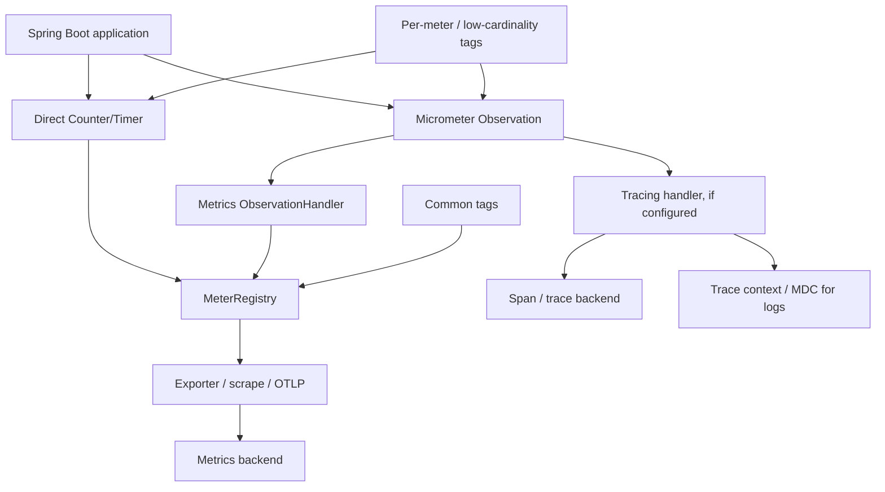
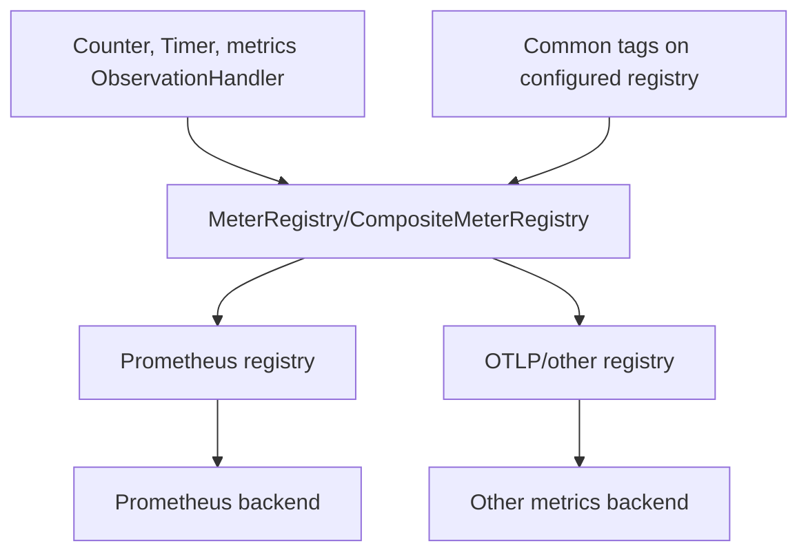
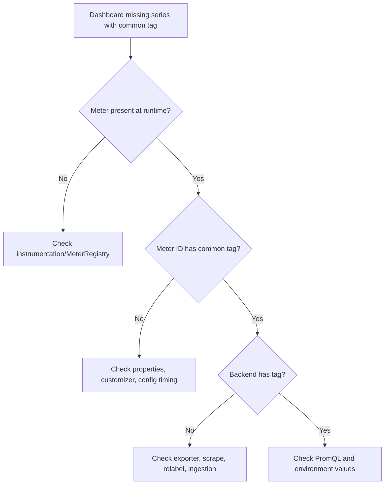

# Tags and Common Tags in Spring Boot Metrics

An operations team needs to answer: "Over the past 5 minutes, which service saw an HTTP 5xx spike, in which environment, and which endpoint was slowest?" A raw metric value only tells you **how much**; **tags** (also called *labels*) distinguish **where, which kind, and in what context**. However, attaching user IDs or request IDs to tags can make time-series counts grow with traffic and overload the metrics system.

The **"Tags and Common Tags"** lesson belongs to the **Metrics Foundation** chapter of the **SPRING_BOOT_OBSERVABILITY** module. The goal is to use Micrometer Metrics tags and Spring Boot common tags consistently; understand cardinality, `MeterRegistry`, Observation, exporters, and how metrics connect with logs and distributed tracing when investigating errors, latency, and application behavior in production.

## 1. What Is a Metric Tag?

A Micrometer meter describes a numerical measurement with a name, meter type, unit, description, and tags. Each tag has a **key** and a **value**:

```text
Meter: checkout.attempts
Type: Counter
Tags:
  result=success
  payment.method=card
  application=checkout-service
  environment=prod
Value: 128
```

The tags here mean:

| Tag | Meaning | Grouping Kind |
| --- | --- | --- |
| `result=success` | Business outcome of the operation | Per-operation |
| `payment.method=card` | Payment method category | Per-operation |
| `application=checkout-service` | Emitting application | Common to the application |
| `environment=prod` | Deployment environment | Common to the environment |
| `region=ap-southeast-1` | Deployment region | Common when values are stable |

**The metric name combined with the tag-value set identifies a distinct measurement** in many time-series backends. For example, sharing `checkout.attempts` with `result=success` and `result=timeout` creates two separate series whenever both combinations occur.

A tag should have a clear key name and a **bounded, managed set of values**. Tags exist for aggregating, filtering, and comparing; they are not meant to store entire request payloads, stack traces, or specific user identifiers.

### Names in Java May Differ from Backend Names

Micrometer typically uses dot-separated meter names like `checkout.attempts`. Prometheus or other exporters may normalize names and add meter-type suffixes, such as `checkout_attempts_total` for a Counter in standard exposition. Therefore, PromQL examples only apply when actual series names and labels match your exporter and version.

## 2. How Do Per-Meter Tags and Common Tags Differ?

A **Per-meter tag** is attached directly when code registers or updates a meter:

```java
Counter.builder("checkout.attempts")
        .tag("result", "success")
        .tag("payment.method", "card")
        .register(registry)
        .increment();
```

A **Common tag** is configured on `MeterRegistry` to add shared tags to meters going through that registry:

```java
registry.config().commonTags(
        "application", "checkout-service",
        "environment", "prod"
);
```

Conceptual result:

```text
Per-meter:
  checkout.attempts{result="success",payment.method="card"}

After applying common tags:
  checkout.attempts{
    result="success",
    payment.method="card",
    application="checkout-service",
    environment="prod"
  }
```

| Criterion | Per-Meter Tag | Common Tag |
| --- | --- | --- |
| Scope | A specific meter or business operation | Meters registered through the configured registry |
| Source | `Meter.Builder.tag(...)` or Observation metrics handler | `MeterRegistry.Config.commonTags(...)`, Spring Boot properties/customizer |
| Examples | `result`, `http.route`, `payment.method` | `application`, `environment`, `region` |
| Varies per request | Yes, within a bounded value set | Usually no; fixed per application or process |
| Blast radius if misused | One group of meters creates many series | Can affect most metrics across the entire application |
| Role | Classifies events/code paths | Identifies source and deployment context |

"Common" does not mean affecting every metric in every registry or backend. It applies to the configured **`MeterRegistry`**. If code uses another registry, another exporter, or manual registration, verify separately.

## 3. Data Flow from Instrumentation to Metrics Backend



There are two common measurement paths in Spring Boot:

1. **Direct Micrometer Metrics:** code uses `Counter`, `Timer`, `Gauge`, `DistributionSummary`, and `MeterRegistry`.
2. **Micrometer Observation:** code creates an `Observation`, attaches **low-cardinality key values**, and a metrics `ObservationHandler` creates corresponding meters.

Both paths can receive common tags when meters register through a registry configured with them. Tracing and logging use different components: **common tags do not automatically create spans, trace IDs, log MDC entries, or context propagation**.

## 4. Writing Metrics with Per-Meter Tags

Suppose `payment-service` needs to count authorization attempts by outcome and method group. This code avoids passing arbitrary input directly into tags:

```java
import io.micrometer.core.instrument.Counter;
import io.micrometer.core.instrument.MeterRegistry;
import org.springframework.stereotype.Service;

@Service
public class PaymentAttemptMetrics {
    private final MeterRegistry registry;

    public PaymentAttemptMetrics(MeterRegistry registry) {
        this.registry = registry;
    }

    public void record(String outcome, String method) {
        Counter.builder("payment.attempts")
                .description("Number of payment authorization attempts")
                .tag("outcome", safeOutcome(outcome))
                .tag("payment.method", safeMethod(method))
                .register(registry)
                .increment();
    }

    private String safeOutcome(String value) {
        if ("success".equals(value)) return "success";
        if ("rejected".equals(value)) return "rejected";
        if ("timeout".equals(value)) return "timeout";
        return "error";
    }

    private String safeMethod(String value) {
        if ("card".equals(value)) return "card";
        if ("wallet".equals(value)) return "wallet";
        if ("bank_transfer".equals(value)) return "bank_transfer";
        return "other";
    }
}
```

Notes:

- Meter name `payment.attempts` stays stable across calls.
- `outcome` and `payment.method` values are bounded by normalization helpers.
- When the same name/tags recur, the registry usually reuses the already-registered meter; it does not create a brand-new meter on every `increment()` for the same tag set.
- Business counting rules must still be clearly defined: a retry is another attempt, not necessarily another logical request.
- If the registry has common tags, `application` and `environment` are added to this meter.

### Measuring Latency with Timer

```java
import io.micrometer.core.instrument.MeterRegistry;
import io.micrometer.core.instrument.Timer;
import java.util.concurrent.TimeUnit;

public final class GatewayLatency {
    private final MeterRegistry registry;

    public GatewayLatency(MeterRegistry registry) {
        this.registry = registry;
    }

    public void record(long durationMillis, String kind) {
        String safeKind = "primary".equals(kind)
                ? "primary" : "fallback";

        Timer.builder("payment.gateway.duration")
                .tag("gateway.kind", safeKind)
                .description("Payment gateway operation duration")
                .register(registry)
                .record(durationMillis, TimeUnit.MILLISECONDS);
    }
}
```

Timers record observation count and total duration; histograms/percentiles require appropriate configuration. When each tag combination spawns many histogram bucket series, cardinality cost can be far higher than for a counter.

## 5. Configuring Common Tags via Spring Boot

With Spring Boot Actuator and Micrometer integrated, the usual approach is setting `management.metrics.tags` in `application.yml`:

```yaml
spring:
  application:
    name: checkout-service

management:
  metrics:
    tags:
      application: checkout-service
      environment: prod
      region: ap-southeast-1
```

This is a hypothetical production configuration example. In real systems, supply environment/region values through a reliable deployment mechanism so you never accidentally stamp `environment=prod` onto a dev environment.

For meters managed by Spring Boot, the config above can produce:

```text
jvm.memory.used{
  application=checkout-service,
  environment=prod,
  region=ap-southeast-1,
  ...
}

payment.attempts{
  application=checkout-service,
  environment=prod,
  region=ap-southeast-1,
  outcome=success,
  payment.method=card
}
```

This is a conceptual representation prior to/independent of exporter renaming. In a real application, JVM, HTTP, or connection pool meters will include additional keys.

You can use environment variables or configuration management tools to supply those properties. Verify the values actually loaded by Spring Boot, especially when using profiles and ConfigMaps.

### Why Use Common Tags Instead of Repeating Them?

Without common tags, individual code paths may omit `application` or inconsistently write `app`, `service`, and `serviceName`. Common tags centralize source-identification conventions in one place. When a dashboard compares three services, a shared `application` key makes queries simpler and more reliable.

**Common tags must remain stable for the lifetime of the registry.** Never vary them per request or per user, because registries are shared across threads and meters are identified by ID/tags at registration time.

## 6. Configuring in Java with MeterRegistryCustomizer

In Spring Boot, you can provide a `MeterRegistryCustomizer<MeterRegistry>`:

```java
import io.micrometer.core.instrument.MeterRegistry;
import org.springframework.boot.actuate.autoconfigure.metrics.MeterRegistryCustomizer;
import org.springframework.context.annotation.Bean;
import org.springframework.context.annotation.Configuration;
import org.springframework.core.env.Environment;

@Configuration
public class MetricsConfiguration {

    @Bean
    MeterRegistryCustomizer<MeterRegistry> metricCommonTags(
            Environment environment) {

        String appName = environment.getProperty(
                "spring.application.name", "unknown");
        String deployEnv = environment.getProperty(
                "deployment.environment", "local");

        return registry -> registry.config().commonTags(
                "application", appName,
                "environment", deployEnv
        );
    }
}
```

`MeterRegistryCustomizer` lets you customize the registry auto-configured by Spring Boot. In this example, `deployment.environment` is an application-defined property, not a mandatory Spring Boot property.

**Use either YAML or a customizer as the primary source for the same tag.** Declaring `application`/`environment` in both can create duplicate or conflicting rules. Never assume one override order always wins; verify actual Meter IDs and labels at runtime.

### Plain Java: `commonTags` on `SimpleMeterRegistry`

```java
import io.micrometer.core.instrument.Counter;
import io.micrometer.core.instrument.simple.SimpleMeterRegistry;

SimpleMeterRegistry registry = new SimpleMeterRegistry();

registry.config().commonTags(
        "application", "checkout-service",
        "environment", "test"
);

Counter.builder("checkout.attempts")
        .tag("result", "success")
        .register(registry)
        .increment();

double count = registry.find("checkout.attempts")
        .tags("application", "checkout-service",
              "environment", "test",
              "result", "success")
        .counter()
        .count(); // 1.0

registry.close();
```

`SimpleMeterRegistry` only keeps measurements in memory; it does not send data to Prometheus or an OTLP backend. This snippet demonstrates the API and tag combinations.

**Configure common tags before meters are registered.** Existing meters with established IDs/tags are not automatically rewritten en masse if registry config is added late. In Spring Boot, properties and customizer hooks reduce the risk of late configuration.

## 7. Common Tags and MeterFilter

Micrometer also supports `MeterFilter` to transform or block meter IDs. Another way to add common tags is `MeterFilter.commonTags(...)`:

```java
import io.micrometer.common.Tags;
import io.micrometer.core.instrument.config.MeterFilter;

registry.config().meterFilter(
        MeterFilter.commonTags(
                Tags.of("application", "checkout-service",
                        "environment", "test")
        )
);
```

This is an **alternative approach**, not a third tag layer to repeat on the same registry. If you call both `registry.config().commonTags(...)` and `MeterFilter.commonTags(...)` with the same keys, inspect the result to avoid conflicts or confusion.

Other `MeterFilter`s can deny meters by name or cap cardinality. Filter order can affect resulting IDs after mapping; when chaining multiple filters, verify actual Meter IDs instead of guessing from config file order.

**`MeterFilter` only affects the metrics path.** It does not alter tracing sampling, context propagation, or logger configuration.

## 8. Distinguishing Common Tags from Observation Key-Values

Micrometer Observation has two main key-value groups:

```java
Observation.createNotStarted("checkout.process", observations)
        .lowCardinalityKeyValue("payment.method", "card")
        .highCardinalityKeyValue("checkout.operation_ref", safeRef)
        .observe(() -> processPayment());
```

In this example, `observations` is an `ObservationRegistry`; `safeRef` and `processPayment()` are application-provided data/logic. `safeRef` should only be a reference code approved for telemetry.

| Mechanism | Attached Where? | Purpose |
| --- | --- | --- |
| `Meter.Builder.tag(...)` | Specific meter | Slices that metric |
| `MeterRegistry.config().commonTags(...)` | Registry | Adds shared metadata across meters |
| `Observation.lowCardinalityKeyValue(...)` | Observation context | Metrics handler can turn into metric tags; tracing handler can put on spans |
| `Observation.highCardinalityKeyValue(...)` | Observation context | Details for traces/spans if handlers/exporters permit |
| `ObservationFilter`/`ObservationConvention` | Observation lifecycle/context | Modifies or normalizes Observation names and attributes |
| Trace context / W3C baggage | Distributed context | Correlates traces or propagates controlled contextual data |

**`MeterRegistry`'s `application=checkout-service` tag does not automatically become a span attribute.** Trace backends normally identify services via tracer/SDK resource attributes such as `service.name`. Both pipelines can use matching conventions, yet each must be configured properly; never assume they automatically mirror each other.

Conversely, `traceId`/`spanId` are essential for log correlation, yet because of their high cardinality they must never become metric tags. Adding `traceId` to `MeterRegistry` does not implement distributed tracing.

## 9. Cardinality: Cost Scales with Tag Combinations

Suppose a metric has these dimensions:

| Dimension | Hypothetical Value Count |
| --- | ---: |
| `application` | 3 |
| `environment` | 2 |
| `region` | 2 |
| `route` | 10 |
| `method` | 3 |
| `status_group` | 5 |

Number of **possible combinations**:

\[
3 \times 2 \times 2 \times 10 \times 3 \times 5 = 900
\]

That is the combinatorial bound when dimensions are independent; only combinations that actually occur create series. Now suppose you add `user.id` with 50,000 values:

\[
900 \times 50\,000 = 45\,000\,000
\]

One unbounded tag can multiply combinations dramatically. With histograms, every combination spawns multiple additional bucket series. Costs hit `MeterRegistry` memory, scrape/payload size, collector memory, backend indexing, storage, and query performance.

### Which Tags Should Be Preferred?

| Tag | Common Tag? | Reason |
| --- | --- | --- |
| `application` | Usually yes | Stable per application |
| `environment` | Usually yes | Bounded values like `dev`, `staging`, `prod` |
| `region` | When needed | Managed set of regions |
| `team` | Consider carefully | Suitable only when team taxonomy is stable |
| `build.version` | Consider carefully | Every deploy creates a new value, growing series over time |
| `pod`/`instance` | Consider carefully | Changes on scaling/restarts; backends often add target labels already |
| `http.route` | Per-meter | Set by HTTP instrumentation; use route templates |
| `payment.method` | Per-meter | Set per operation, bounded values |
| `user.id`, `order.id` | **No** | High cardinality; may contain or link personal data |
| `traceId`/`spanId` | **No** | Correlation keys for traces/spans, not for metric grouping |

Even a "technical-looking" tag like `build.version` or `pod.name` needs cost evaluation: active value count might be small, while cumulative values across retention windows grow large.

### Consistent Tag Keys Matter More Than Casual Shorthand

A dashboard cannot easily combine `app=checkout`, `service=payment`, and `application=inventory`. Pick one consistent key like `application`, one stable value set, and apply it uniformly across services. Likewise, `prod`, `production`, and `prd` will split into separate groups.

Never put sensitive info such as tokens, emails, street addresses, or exception text into tags. Hashing a user ID does not magically lower cardinality; if every user still produces a distinct hash, the distinct value count remains huge.

## 10. PromQL with Common Tags

Suppose Spring Boot HTTP server metrics export to Prometheus as `http_server_requests_seconds_count`, carrying labels `application`, `environment`, `uri`, and `status`.

Request rate by application in production:

```promql
sum by (application) (
  rate(http_server_requests_seconds_count{
    environment="prod"
  }[5m])
)
```

5xx request rate by application and URI template:

```promql
sum by (application, uri) (
  rate(http_server_requests_seconds_count{
    environment="prod",
    status=~"5.."
  }[5m])
)
```

5xx ratio:

```promql
sum by (application, uri) (
  rate(http_server_requests_seconds_count{
    environment="prod",
    status=~"5.."
  }[5m])
)
/
sum by (application, uri) (
  rate(http_server_requests_seconds_count{
    environment="prod"
  }[5m])
)
```

These are **illustrative queries**, not guarantees of exact series/tag names across all Spring Boot versions, meter configs, or exporters. Verify live data and adjust accordingly. Handle zero denominators and missing series before turning error ratios into alerts.

`rate(...)` turns cumulative counters into per-second rates over a window; never treat raw cumulative `_count` as instantaneous request rate.

### p95 and Histograms

If the HTTP timer emits histogram buckets, you can compute p95 per application:

```promql
histogram_quantile(
  0.95,
  sum by (application, le) (
    rate(http_server_requests_seconds_bucket{
      environment="prod"
    }[5m])
  )
)
```

Bucket series must actually be emitted. `_sum / _count` is the mean, **not** p95. When slicing by URI or status, keep those labels in `sum by (...)`. Never take a simple average of per-instance p95 values and treat it as cluster-wide p95.

## 11. When an Application Has Multiple MeterRegistries

A Spring Boot service can send metrics to multiple destinations, such as a Prometheus registry and an OTLP registry, via Spring Boot auto-configuration or `CompositeMeterRegistry`.



Ensure common tags are configured on the **exact registration path**. A custom registry constructed manually by a library outside Spring Boot may miss Boot's customizers/properties. One child registry may also emit differently from another due to differing filters, exporters, or backend rules.

When exporting the same metric to two targets, distinguish **replicating to two separate backends** from **double-sending into the same backend**. Duplicate pipelines distort queries and inflate costs.

### Key Collisions Between Common and Per-Meter Tags

If common tags declare `environment=prod` while a meter adds `environment=staging`, the data contradicts itself. How Micrometer/filters/exporters resolve it depends on implementation and setup. Establish a single authoritative source for each shared tag instead of relying on implicit override precedence.

## 12. Relating Metrics, Logs, and Traces During Investigation

A slow-payment incident can produce three kinds of telemetry:

```text
Metric:
  application=checkout-service
  environment=prod
  uri=/checkout
  status=502

Trace:
  service.name=checkout-service
  traceId=4bf92f3577b34da6a3ce929d0e0e4736
  span=POST /checkout

Log:
  service=checkout-service
  traceId=4bf92f3577b34da6a3ce929d0e0e4736
  level=ERROR
  message="Gateway timeout"
```

Analysis workflow:

1. **Metrics:** filter by common tags `application`/`environment` to locate when 5xx or p95 spiked.
2. **Traces:** select a matching error/slow trace if tracing is instrumented and sampled; locate the slow span.
3. **Logs:** query MDC-correlated logs by trace ID to inspect exceptions, retries, and fallbacks.
4. **Back to metrics:** check aggregate error ratio and duration to confirm whether the issue is widespread or isolated to one request.

Common tags only identify the **metrics source**. They do not create spans, inject `traceId` into logs, or propagate context across HTTP/messaging. Log correlation and distributed tracing require proper tracers, instrumentation, samplers, exporters, MDC integration, and propagation.

Some backends support *exemplars* to jump from a metric sample to a trace; this is configuration-dependent, not an automatic consequence of common tags. Missing traces can also stem from sampling or pipeline drops, rather than proving a request never ran.

## 13. Troubleshooting Missing Common Tags

Scenario: a dashboard filtering `application=checkout-service` shows no data, yet the service still emits `http.server.requests`.

Check in order:

1. **Runtime registry:** which `MeterRegistry` received the meter? Was it registered on a separate manual registry?
2. **Boot configuration:** was `management.metrics.tags.application` loaded under the active profile? Are environment values accurate?
3. **Timing of configuration:** were common tags applied before meters were registered?
4. **Actual Meter ID:** are the final meter name and tag keys/values in the application what you expect?
5. **Exporter/scrape:** did the backend receive the right meter? Did a filter, relabel rule, or processor alter/drop tags?
6. **Query:** is the dashboard filtering `application` or a different key? Did it accidentally filter `environment=prod` while the service emits `environment=local`?
7. **Other signals:** if investigating a specific request, inspect tracing and logs independently; having common tags on metrics does not guarantee spans/logs carry identical metadata.



With Spring Boot Actuator, the metrics endpoint helps inspect meter names and tags when enabled and secured; never open management endpoints publicly just to debug. Checking at the source and at the backend are two separate checks that pinpoint where data dropped.

## 14. Hands-On Exercise with SimpleMeterRegistry

You can verify the difference between common tags and per-meter tags without deploying an exporter.

```java
import io.micrometer.core.instrument.Counter;
import io.micrometer.core.instrument.Meter;
import io.micrometer.core.instrument.simple.SimpleMeterRegistry;

SimpleMeterRegistry registry = new SimpleMeterRegistry();

registry.config().commonTags(
        "application", "checkout-service",
        "environment", "test"
);

Counter success = Counter.builder("checkout.attempts")
        .tag("result", "success")
        .register(registry);

Counter timeout = Counter.builder("checkout.attempts")
        .tag("result", "timeout")
        .register(registry);

success.increment();
success.increment();
timeout.increment();

for (Meter meter : registry.getMeters()) {
    System.out.println(meter.getId().getName()
            + " -> " + meter.getId().getTags());
}

registry.close();
```

Expected output: **two meters** named `checkout.attempts` with different `result` tags; both carry `application=checkout-service` and `environment=test`. The success counter has count `2` and timeout has `1`.

Next steps to try:

1. Add `payment.method=card` to one meter and check how the Meter ID changes.
2. Change common tag `application` **before registering meters** and inspect the output.
3. Try adding `user.id` with 20–50 simulated values in a local test environment; watch meter count grow, learn from it, and remove that tag.
4. Create a second registry without common tags; confirm meters in the new registry **do not automatically inherit** config from the first registry.
5. In Spring Boot, configure YAML and inspect one custom meter alongside one JVM/HTTP meter at runtime and in the backend.

You do not need millions of user IDs to demonstrate cardinality impact; avoid pushing excessive series into shared backends.

## 15. Common Mistakes

| Mistake | Consequence | Fix |
| --- | --- | --- |
| Using `user.id`, `order.id`, or `traceId` as common tags | Cardinality explosion, sensitive data leakage | Use stable application/deployment metadata |
| Using dynamic IDs as per-meter tags | Every ID spawns a separate series | Normalize groups; use controlled trace/audit logs when needed |
| Configuring common tags after meters are created | Some meters miss expected tags | Configure at startup |
| Declaring the same tag in both YAML and a customizer | Conflicting/duplicate definitions | Pick one clear source of truth |
| Mixing `app`, `service`, and `application` | Hard-to-aggregate dashboards | Standardize tag taxonomy |
| Adding `pod`/`instance` when backend already provides it | Duplicate metadata and extra series | Check target labels/resource attributes |
| Expecting `commonTags` to add span attributes/log MDC | Cannot correlate traces/logs | Configure tracing and logging independently |
| Using a self-created registry separate from Boot's | Meters lack common tags/handlers/exports | Inject the managed registry or wire custom registries deliberately |
| Assuming Java name equals Prometheus name | PromQL returns empty results | Verify exported names/labels on the exporter |
| Treating cumulative `_count` as throughput | Misreads application load | Use `rate(...)`/`increase(...)` |
| Computing p95 via `_sum / _count` | Confuses average with quantile | Use histograms/summaries properly |
| Renaming tags without updating alerts | Silent alert failures despite live traffic | Manage dashboard/PromQL/SLO changes together |

## 16. Self-Check Questions

1. What is the difference in scope between `Counter.builder(...).tag(...)` and `registry.config().commonTags(...)`?
2. Why does `application` usually fit as a common tag while `payment.method` belongs per-meter?
3. Why is `user.id` unsuitable for both common tags and per-meter metric tags?
4. Do common tags automatically appear in logs, spans, and W3C `traceparent` headers?
5. If an app creates two separate `MeterRegistry` instances, does setting common tags on registry A apply to B?
6. Does adding `environment` after meters are registered guarantee updating previously registered Meter IDs?
7. With `application` and `environment` tags, how do you query error rate per application in PromQL?
8. What else is needed besides count and sum to compute p95 latency?
9. If the backend displays `service` instead of `application`, which layers should you inspect?
10. Why can a `build.version` tag grow cardinality over time?
11. What is the risk of using `MeterFilter.commonTags` alongside `management.metrics.tags` for the same keys?
12. When metrics lack data while traces/logs still appear, which pipeline should you check first?

## Conclusion

**Per-meter tags** classify individual measurements; **common tags** attach stable metadata across meters in a `MeterRegistry`. In Spring Boot, configuration typically lives in `management.metrics.tags` or `MeterRegistryCustomizer` and should be applied before meters are registered. Tags like `application`, `environment`, or `region` group metrics by source, while `result`, route templates, or payment methods work well as per-meter tags when values stay bounded.

Good tag design keeps cardinality under control and builds trustworthy dashboards. During incident investigation, metrics show trends and scope, traces reveal paths of collected requests, and logs provide details; exporters, sampling, propagation, and correlation must all be wired properly to connect these signals.
