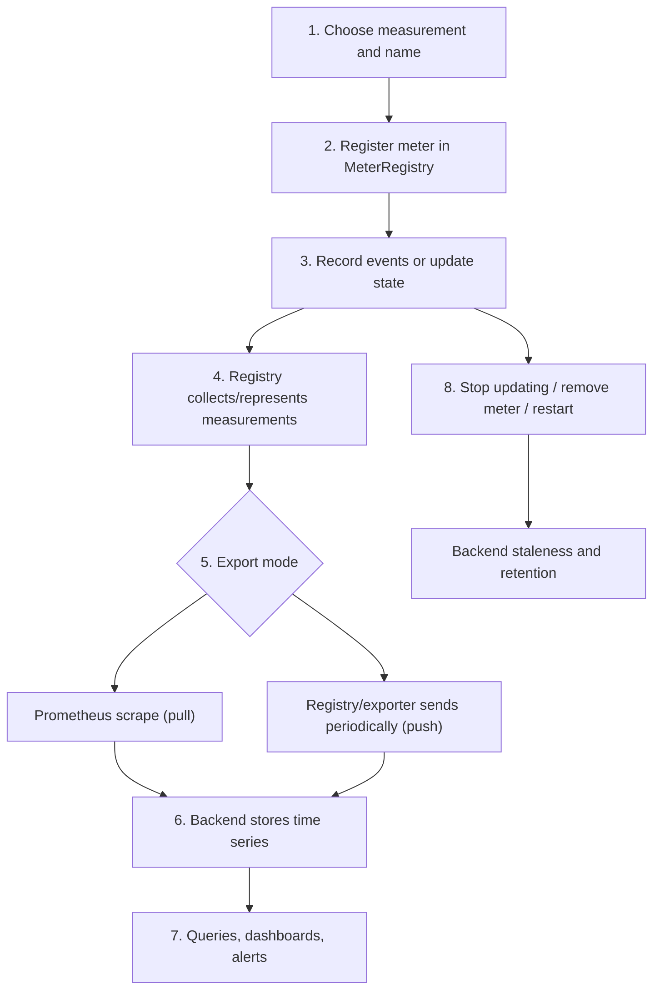
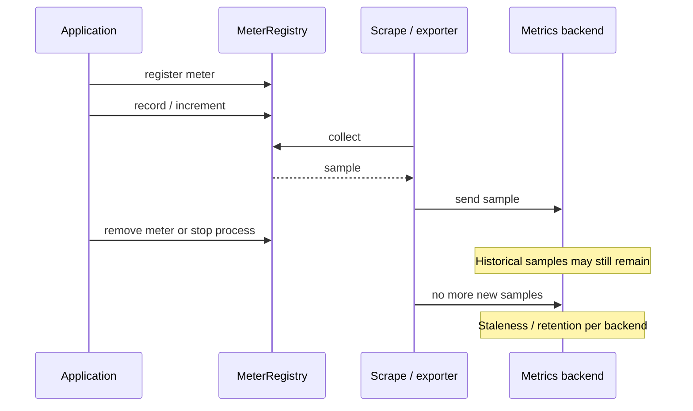
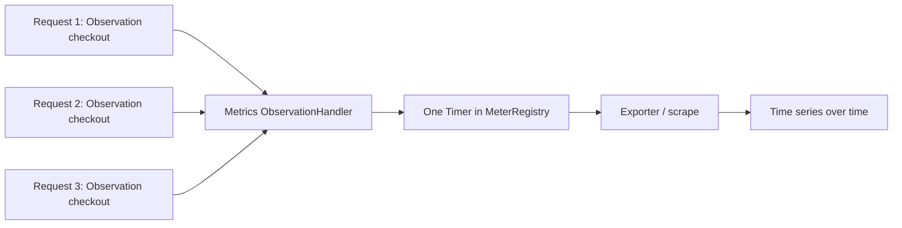

# Metric Lifecycle in Spring Boot and Micrometer

When a Spring Boot API starts responding slowly, dashboards may show rising request counts, HTTP 5xx error rates, and p95 latency. Yet where do those numbers come from? When does a metric appear, when is it updated, why does a counter drop back to 0 after an application restart, and why does a time series remain visible after code stops recording?

These questions belong to the **metric lifecycle**: the full journey from **designing a measurement → registering a meter → recording values → exporting data → processing and querying in the backend → retiring or expiring**. In the **SPRING_BOOT_OBSERVABILITY** module, this lesson belongs to the **Metrics Foundation** chapter and situates Micrometer Metrics inside a Spring Boot system with **Micrometer Observation, metrics, logs, and distributed tracing**. Understanding the lifecycle helps measure latency, detect errors, bound cardinality, and correlate signals when investigating real application behavior.

> **Distinguish from the start:** A *Meter* is an instrumentation object registered inside the application's `MeterRegistry`. A *Time series* is a chronological sequence of values stored by the monitoring backend for a metric name and label set. The lifecycle of a meter in the JVM and the lifecycle of a time series in the backend **are related, yet do not match 1:1**.

## 1. The Overall Lifecycle Picture

For a checkout service, the metric lifecycle typically unfolds like this:



This is a **generalized model**; not every registry behaves identically. Some registries retain cumulative counters while others roll up values over fixed intervals (*step*). Some backends pull by scraping an endpoint while others receive periodic pushes. Some meters may be registered before any measurement occurs, or the backend may not see them until the first scrape/export completes.

Stages to distinguish:

| Stage | What Happens | What Can Usually Be Checked |
| --- | --- | --- |
| **Design** | Decide metric name, type, unit, tags, and intended use | Instrumentation contract, description, and cardinality |
| **Registration** | Registry accepts meter and assigns its identity | `registry.find(...)` finds the meter |
| **Recording** | Code calls `increment()`, `record(...)`, or mutates gauge-observed state | Count, total time, value inside registry |
| **Collection/Export** | Registry/endpoint formats data; exporter/collector ships it | `/actuator/prometheus` or telemetry pipeline |
| **Query** | Backend groups, computes rates, quantiles, and alerts | PromQL dashboards or backend tools |
| **Retirement** | Updates stop, meter is removed, or process exits | Series disappears per system staleness/retention rules |

**There is no generic "create metric in backend" command when Java executes `Counter.builder(...).register(...)`.** Registering a meter in the JVM is only part of the lifecycle; the backend must still receive data via a successful export or scrape.

## 2. MeterRegistry and Meter Identity

`MeterRegistry` is where Micrometer stores and manages meters. In Spring Boot with Actuator, the registry is usually configured by Spring and injected via constructor.

A meter is described by **`Meter.Id`**, containing fields such as name, tags, base unit, description, and type. In practice, **name and tag combination** are the core keys for looking up and distinguishing meters inside a registry. The same name with two different tag sets produces two independent time series when exported to a backend.

Example:

```text
checkout.payment.operations{outcome="accepted"}
checkout.payment.operations{outcome="declined"}
checkout.payment.operations{outcome="error"}
```

All three series measure **payment attempts**, sliced by outcome. Here the name is the **Micrometer logical name**; when exporting to Prometheus, the registry converts dots to underscores and appends unit/meter-type suffixes.

Counter registration example:

```java
import io.micrometer.core.instrument.Counter;
import io.micrometer.core.instrument.MeterRegistry;

Counter accepted = Counter.builder("checkout.payment.operations")
    .description("Number of payment authorization attempts by outcome")
    .baseUnit("requests")
    .tag("outcome", "accepted")
    .register(meterRegistry);
```

Here `meterRegistry` is the provided `MeterRegistry` instance. When registering an already-existing identity, registries normally **reuse the matching meter** rather than allocating a brand-new object endlessly. Still, do not rely on re-registration to alter the description, base unit, or type of an existing meter. Metadata conflicts or name/tag mutations can trigger warnings, rejected meters, or unexpected behavior depending on the registry.

### Tags Are Part of the Metric Contract

When adding another outcome, you normally use **a separate meter with a different tag**. You cannot mutate an `outcome` field on an existing counter to change the label "for the next increment." Meter identity and tag sets are fixed at registration time.

**Never register metrics per request ID:** code like `registry.counter("checkout.operations", "orderId", orderId).increment()` creates a new meter per order, rapidly inflating time series. Define bounded tag sets and reuse meters, or maintain a bounded cache when tag values vary within a controlled set.

## 3. Different Meter Types Record Data Differently

Not every meter works by "incrementing a counter":

| Meter Type | How Recorded | Typical Value | Use Case |
| --- | --- | --- | --- |
| **Counter** | Call `increment()` or `increment(amount)` with non-negative amount | Cumulative count within process; backend usually computes rate | Accepted checkout attempts |
| **Timer** | Call `record(Duration)`, `record(Runnable)`, or `Timer.Sample.stop(timer)` | Count, total time, and distribution if configured | Payment authorization duration |
| **DistributionSummary** | Call `record(amount)` | Count, total amount, histograms/percentiles if enabled | Payload size or processed lines per batch |
| **Gauge** | Registry reads a current value from an object/function | Value at collection time; can rise or fall | Jobs currently waiting in a queue |
| **LongTaskTimer** | Tracks long-running tasks still in progress | Active task count and current elapsed duration | Running batch import |

A `Counter` has no decrement method; to measure **currently open** connections, use a gauge or state-tracking meter. Conversely, to know the **total requests that occurred**, use a counter rather than a gauge.

`Timer` already tracks the **count** of duration recordings, so you do not need to create an extra counter for the exact same step just to measure frequency. Add a separate counter only when business definitions or slicing differ, avoiding duplicate counting.

A key point for `Gauge`: registration does not involve calling `gauge.increment()`. The registry **reads current state** from the observed object at collection time. A gauge may return 0, the real value, `NaN`, or stop reporting if the observed object is garbage collected or invalid, depending on how it was registered.

## 4. Spring Boot Example: From Registration to Recording

The example below illustrates a service recording payment processing counts and durations. The `outcome` tag set is bounded; meters are registered **once in the constructor** and reused on every request.

```java
import io.micrometer.core.instrument.Counter;
import io.micrometer.core.instrument.MeterRegistry;
import io.micrometer.core.instrument.Timer;
import org.springframework.stereotype.Service;

interface PaymentGateway {
    PaymentResult authorize(String orderReference);
}

enum PaymentResult {
    ACCEPTED, DECLINED
}

@Service
public final class PaymentMetricsService {
    private final PaymentGateway gateway;
    private final MeterRegistry registry;

    private final Counter acceptedCount;
    private final Counter declinedCount;
    private final Counter errorCount;
    private final Timer acceptedDuration;
    private final Timer declinedDuration;
    private final Timer errorDuration;

    public PaymentMetricsService(PaymentGateway gateway,
                                 MeterRegistry registry) {
        this.gateway = gateway;
        this.registry = registry;
        this.acceptedCount = counter("accepted");
        this.declinedCount = counter("declined");
        this.errorCount = counter("error");
        this.acceptedDuration = timer("accepted");
        this.declinedDuration = timer("declined");
        this.errorDuration = timer("error");
    }

    private Counter counter(String outcome) {
        return Counter.builder("checkout.payment.operations")
            .tag("outcome", outcome)
            .description("Payment authorization attempts")
            .register(registry);
    }

    private Timer timer(String outcome) {
        return Timer.builder("checkout.payment.duration")
            .tag("outcome", outcome)
            .description("Payment authorization duration")
            .publishPercentileHistogram()
            .register(registry);
    }

    public PaymentResult authorize(String orderReference) {
        Timer.Sample sample = Timer.start(registry);
        try {
            PaymentResult result = gateway.authorize(orderReference);
            if (result == PaymentResult.ACCEPTED) {
                acceptedCount.increment();
                sample.stop(acceptedDuration);
            } else {
                declinedCount.increment();
                sample.stop(declinedDuration);
            }
            return result;
        } catch (RuntimeException ex) {
            errorCount.increment();
            sample.stop(errorDuration);
            throw ex;
        }
    }
}
```

This is a minimal example: `PaymentGateway` requires a real implementation and exception/result mapping must follow real business rules. `orderReference` is passed only to the gateway; **it must never be attached as a metric tag**.

Observe the lifecycle:

1. **Application startup:** Spring constructs the service, and the constructor registers 3 counters and 3 timers. The registry holds references to these meters.
2. **Each call to `authorize(...)`:** `Timer.Sample` captures the start timestamp. Once the outcome is known, code increments the matching counter and records one duration into the matching timer.
3. **Registry:** each meter updates its own measurement state. Timers maintain count/total time and histogram data per configuration.
4. **Export:** the next scrape or push cycle pulls data out of the registry.
5. **Backend:** represents series by metric name and tags, ready for rate, ratio, and quantile queries.

Here `publishPercentileHistogram()` illustrates requesting latency histogram analysis, though it increases storage/bucket costs. In production, choose buckets/SLOs, resources, and backends deliberately. You do not need histograms on every Timer.

### When You Do Not Need Another Redundant Counter

A Timer already tracks `count()`; therefore, if dashboards only need "number of payment authorizations," `checkout.payment.duration` can supply that count. Separate counters in this example provide an explicitly named business measurement useful for slicing accepted/declined/error outcomes. Real designs must avoid **two conflicting definitions for the same ratio**, such as a counter counting retries while a timer counts logical requests.

## 5. Recording: Updating Metrics Is Not Exporting Data

Calling `acceptedCount.increment()` or `sample.stop(acceptedDuration)` updates **in-memory state inside the registry**. It does not block waiting for an HTTP request to Prometheus or a collector before the business method returns.

For Counters, computing rates over time requires care:

- In-process cumulative values **reset when the process restarts** or if a meter is replaced.
- Query engines typically compute `rate` or `increase` over a time window, handling counter resets appropriately.
- A Counter value of `1000` by itself does not reveal **current** throughput; compare growth over time.
- Never subtract two raw samples without checking for restarts/resets or missing scrapes.

For Timers, `count` increases on each duration recording; `totalTime` increases by total duration; if histograms are enabled, buckets update accordingly. **p95 is not automatically available on every Timer.** Querying p95 across multiple instances requires compatible histograms and a backend supporting quantile calculation from summed buckets.

For Gauges, the registry reads values at export time; changes occurring strictly between scrapes are not preserved. For example, a queue spiking 0 → 100 → 0 between two 15-second scrapes may show no peak at all. If peaks/fluctuations matter, add counters or distribution metrics rather than relying solely on a gauge.

## 6. Two Collection Models: Pull and Push

**Pull** means an external system actively calls an application endpoint to fetch metrics. For example, Prometheus scrapes text exposition from `/actuator/prometheus` when Spring Boot is configured accordingly.

**Push** means the registry/exporter formats and transmits measurements to a receiver on a schedule or policy, such as OTLP metrics or other push backends.

| Property | Pull: Prometheus Scrape | Push: Periodic Registry/Exporter |
| --- | --- | --- |
| Who initiates exchange? | Prometheus or scraper | Application/exporter |
| Main operational config | Scrape interval, target discovery, endpoint access control | Target endpoint, step interval, batching, queue/retry, credentials |
| Behavior when export fails | Scrape fails; backend misses new samples | May buffer, retry, or drop depending on exporter |
| Counter output | Typically cumulative values suitable for `rate` | Can be step-delta or cumulative depending on registry/backend |
| When app dies | Target marked down; old series follow staleness | Data stops arriving; backend handles expiration policy |

**Step registries and cumulative registries** must not be conflated. Some registries aggregate measurements over a fixed `step` interval and emit delta/rate values; others emit cumulative totals since process startup. Units, temporality, and backend rate functions must match the actual signal type. Never apply PromQL formulas written for cumulative counters blindly to every push system.

A short delay between `increment()` and dashboard updates is normal: data waits for scrape intervals, export intervals, collector queues, and dashboard query refreshes.

## 7. Spring Boot Registry and Observability Endpoint Configuration

In Spring Boot 3.x with Micrometer/Actuator, a common path for Prometheus observability adds Actuator and the Prometheus registry:

```groovy
dependencies {
    implementation 'org.springframework.boot:spring-boot-starter-actuator'
    runtimeOnly 'io.micrometer:micrometer-registry-prometheus'
}
```

Example metric-exposure configuration:

```yaml
management:
  endpoints:
    web:
      exposure:
        include: health,info,metrics,prometheus
  metrics:
    tags:
      application: checkout-service
    distribution:
      percentiles-histogram:
        http.server.requests: true
```

This configuration **illustrates the Spring Boot 3.x ecosystem**; exact dependencies, property names, auto-configuration behavior, and histogram settings should be verified against your actual Spring Boot/Micrometer versions. `/actuator/prometheus` exists only when the Prometheus registry is installed and the endpoint is enabled and exposed; `/actuator/metrics` is a separate diagnostic endpoint, not Prometheus scrape format.

In production, expose only required endpoints and protect them via networking and authentication. Never open management endpoints arbitrarily to the public Internet.

Beyond custom code metrics, Spring Boot can register meters for the HTTP server, JVM, thread pools, caches, or database pools depending on instrumentation and dependencies. Those meters follow the same registration/recording/export lifecycle, managed by the framework or binders.

## 8. Registry, Meter Identity, and MeterFilter

At meter registration time, the registry can apply configuration rules such as **common tags** and **`MeterFilter`**. A `MeterFilter` can accept/deny meters, remap names/tags, or enforce limits depending on backend and registry.

Example guardrail rejecting any meter carrying an `orderId` label:

```java
import io.micrometer.core.instrument.config.MeterFilter;
import org.springframework.context.annotation.Bean;
import org.springframework.context.annotation.Configuration;

@Configuration(proxyBeanMethods = false)
class MetricRegistryPolicy {
    @Bean
    MeterFilter denyOrderIdLabel() {
        return MeterFilter.deny(id ->
            id.getTags().stream()
                .anyMatch(tag -> "orderId".equals(tag.getKey())));
    }
}
```

This example **denies the entire meter** when a forbidden tag key is present, rather than stripping that single key and keeping the rest. Nor does it automatically catch variants like `order.id` or sensitive values stuffed into an allowed key. The durable fix is designing safe tags at the source, paired with guardrails and contract tests.

Key points to remember:

- Names, tags, units, and types should be settled **before registration**. Do not rely on late filters to patch metadata of existing meters.
- Two measurements with different definitions must not share a name with conflicting types or units; doing so creates conflicts and confusing data.
- Common tags must have **bounded cardinality**. Injecting `userId` via a global `MeterFilter` is dangerous.
- Configuration and registration order matters: once a meter exists, adding filters later may not take effect as expected. Configure the registry at application startup.

## 9. Gauge: Special Lifecycle of Observed Values

Gauges cause many "registered it, yet no data shows up" bugs because they behave differently from Counters and Timers.

Example registering a gauge watching a job queue:

```java
import io.micrometer.core.instrument.Gauge;
import io.micrometer.core.instrument.MeterRegistry;
import java.util.concurrent.BlockingQueue;

public final class JobQueueMetrics {
    private final BlockingQueue<String> jobs;

    public JobQueueMetrics(BlockingQueue<String> jobs,
                           MeterRegistry registry) {
        this.jobs = jobs;  // Keep a strong reference to the observed object.
        Gauge.builder("jobs.queue.depth", jobs, BlockingQueue::size)
            .description("Number of jobs waiting to be processed")
            .register(registry);
    }
}
```

In standard Micrometer gauge registration, the registry holds a **weak reference** to the observed object to prevent memory leaks. If no strong reference remains elsewhere, the garbage collector can reclaim the object; the gauge may then return `NaN` or stop producing useful values.

`JobQueueMetrics.jobs` retains the object in this example, and in real applications the bean and queue lifetimes must stay alive long enough. Never create a temporary object just for a gauge and drop all references. Likewise, never try to "update a gauge's value" by re-registering the same name/tags with a new object; mutate the state of the **currently observed object** instead.

If you want to count enqueue/dequeue operations, add counters for those events. A current-depth Gauge does not replace a processed-jobs Counter.

## 10. Cardinality: When Registration Becomes a Resource Problem

In a time-series backend, every combination of metric name and labels can become an independent series. Suppose `checkout.payment.operations` has:

- `outcome`: 3 values;
- `channel`: 4 values;
- `region`: 5 values.

Maximum combinations from these three labels alone equal **3 × 4 × 5 = 60**. Adding `orderId` with 100,000 values raises potential combinations to **6 million**, before accounting for `instance` and other backend labels. This illustrates the combinatorial upper bound, not a guarantee that every combination will occur.

Every meter with a new identity consumes registry memory and can allocate new series in the backend. When combinations scale with request volume, both the application and the monitoring system suffer. Therefore:

1. Use operation names, route templates, and labels with **controlled value sets**.
2. Never put request IDs, order IDs, emails, access tokens, raw URLs with IDs, or exception messages into metric labels.
3. Use `http.route=/orders/{id}` instead of `http.route=/orders/482719`.
4. Add a dimension only when it serves a specific measurement or alerting question.
5. Track meter/time-series counts and alert on abnormal cardinality spikes.

**Low cardinality does not guarantee data safety:** even a single constant value can still be a secret. Conversely, hashing `userId` instead of using the raw value does not solve high cardinality if each user still produces a unique hash and a separate series. Metadata policies must govern **meaning, sensitivity, and value count** together.

## 11. When a Meter Stops, Restarts, or Is Removed

There are three distinct situations:

**Recording stops while the app keeps running.** Counters hold their last value; Timers retain prior count/total; Gauges continue tracking whatever state their observed object holds. The backend may keep scraping the same flat counter sample on every cycle. A flat series does not necessarily mean the app crashed.

**Application restarts or meter is recreated.** Cumulative counters start fresh in the new process, usually from 0. `rate`/`increase` queries must account for counter resets. Never compute "all-time revenue" from an in-memory Micrometer counter because restarts wipe it.

**Meter is removed from the registry.** Micrometer supports operations like `registry.remove(meter)` for managing dynamic meters. That stops the registry from publishing the meter going forward, yet **does not immediately delete historical time series in the backend**. Backends enforce their own staleness, retention, and deletion lifecycles.



Never rely on `remove(...)` to excuse a tag design carrying millions of IDs. Dynamic meters still spike cardinality, and series persist in the backend until retention expires. Constrain series count upfront through name and label design.

In Prometheus, a series that stops being scraped enters **staleness** handling; historical points remain queryable throughout the system's retention window. Other backends use different expiration rules. Removing a meter does not make every series vanish instantaneously on the next scrape.

## 12. Reading Data Properly: Count, Rate, and Latency

Suppose a Prometheus registry exports logical metric `checkout.payment.duration` as time series shaped like:

```text
checkout_payment_duration_seconds_count{outcome="accepted"} 12000
checkout_payment_duration_seconds_sum{outcome="accepted"} 840
checkout_payment_duration_seconds_bucket{outcome="accepted",le="0.5"} ...
```

**This is an illustrative pattern**, not live data. Exact names vary by version, histogram config, base unit, and registry naming rules. The PromQL examples below apply only when matching series actually exist.

Rate of recorded operations over 5 minutes:

```promql
sum by (outcome) (
  rate(checkout_payment_duration_seconds_count[5m])
)
```

**Mean** duration of measured operations (seconds), computed from `sum/count`:

```promql
sum(rate(checkout_payment_duration_seconds_sum[5m]))
/
sum(rate(checkout_payment_duration_seconds_count[5m]))
```

p95 quantile **from classic histogram buckets**, when histograms are enabled and exported:

```promql
histogram_quantile(
  0.95,
  sum by (le) (
    rate(checkout_payment_duration_seconds_bucket[5m])
  )
)
```

Adjust queries to match actual tags/services/instances. Dividing by 0 yields meaningless results when no samples exist, and low-traffic windows make quantiles noisy. Never **average per-instance p95s** to represent system-wide p95. When aggregating across multiple instances, sum compatible histogram buckets properly before estimating quantiles.

**A common mistake:** seeing `_count` climb slowly and concluding something is broken because you expected it to match total HTTP requests. Check which exact operation the meter measures, whether instrumentation sampling applies, which tag filters are active, and whether the timer records only specific branches.

## 13. How Do Metric Lifecycle and Observation Lifecycle Relate?

**Micrometer Observation** describes the lifecycle of a single operation, typically `start → scope → stop`. **`MeterRegistry`** holds meters and values accumulated across many operations. The two lifecycles are distinct:

- **Observation:** starts when an operation begins and stops when the operation completes.
- **Meter:** can live in the registry for the entire application lifetime and be updated by thousands of observations.
- **Time series:** appears and persists in the backend according to export rules, tags, staleness, and retention.



When configured with a metrics handler such as `DefaultMeterObservationHandler`, each completed observation records a duration into the corresponding Timer (per convention, name, and tags). **One observation does not create a new meter**; thousands of observations can update one registered Timer.

With a tracing handler, observations can also emit spans for investigating specific requests. Sampling may **omit spans** for a given request while metrics still record all executions via the metrics pipeline. Logs are emitted by loggers and do not appear automatically just from registering meters.

Therefore, in incident investigations, we use **metrics to measure scale**, **traces to inspect paths**, and **logs to read events and errors**. When log/trace correlation via `traceId` is active, operators can look up the exact request; standard metric labels **do not carry `traceId`** due to excessive cardinality. Some backends support exemplars to link a metric point to a trace, though that requires explicit configuration and end-to-end verification.

## 14. Metadata, Timing, and Access Control

Metric names and tags are not just for queries: they form part of the data contract connecting code, registries, exporters, and dashboards.

A minimal policy should define:

| Component | Recommended Rule | Reason |
| --- | --- | --- |
| **Name** | `checkout.payment.duration`, stable and domain-aligned | Prevents multiple names for the same measurement |
| **Type** | Timer for duration; Counter for counts; Gauge for current level | Ensures backend interprets values accurately |
| **Unit** | Explicit in metadata; verify unit post-export | Prevents seconds vs. milliseconds confusion |
| **Tags** | `outcome=accepted/declined/error` | Bounded labels, easy grouping |
| **Description** | Explains the measurement; avoid per-request content | Keeps instrumentation maintainable |
| **Sampling/export** | Document registry and collection method | Explains why backend may lack data |
| **Access/retention** | Define who can view and how long data is kept | Data governance, security, and cost control |

If logs contain tokens or traces contain emails, keeping them out of metrics does not make the system safe. Metadata hygiene must cover **all three signals** and every exporter. Tracing baggage propagates across HTTP/messaging boundaries; never put secrets or personal user info into baggage.

## 15. Testing Metric Lifecycle with SimpleMeterRegistry

`SimpleMeterRegistry` lets you verify registration and recording completely in memory without Prometheus or a collector:

```java
import io.micrometer.core.instrument.Counter;
import io.micrometer.core.instrument.Timer;
import io.micrometer.core.instrument.simple.SimpleMeterRegistry;
import java.time.Duration;
import java.util.concurrent.TimeUnit;
import org.junit.jupiter.api.Test;
import static org.junit.jupiter.api.Assertions.*;

class MetricLifecycleTest {
    @Test
    void registersAndRecordsMeasurements() {
        try (SimpleMeterRegistry registry = new SimpleMeterRegistry()) {
            Counter counter = registry.counter(
                "checkout.payment.operations", "outcome", "accepted");
            Timer timer = registry.timer(
                "checkout.payment.duration", "outcome", "accepted");

            counter.increment();
            counter.increment();
            timer.record(Duration.ofMillis(120));
            timer.record(Duration.ofMillis(80));

            assertEquals(2.0, counter.count());
            assertEquals(2L, timer.count());
            assertEquals(200.0,
                timer.totalTime(TimeUnit.MILLISECONDS), 0.001);
            assertNotNull(registry.find("checkout.payment.duration")
                .tag("outcome", "accepted").timer());
        }
    }
}
```

This test proves:

1. Meters register with the expected names and tags.
2. `Counter.increment()` updates count; `Timer.record(...)` updates count and total duration.
3. The registry finds meters by identity.
4. Results do not depend on scrape intervals, exporters, networking, or wall-clock timing.

**Limitation:** this test does not verify converted Prometheus series names, exported histograms, collector ingestion, or dashboard p95 queries. Those require integration tests with the actual registry/exporter.

To test the link between Observation and Metrics, use `ObservationRegistry.create()`, register a `DefaultMeterObservationHandler` backed by `SimpleMeterRegistry`, run an observation via `observe(...)`, and assert the Timer count increased. This verifies handler lifecycle as well without needing a real backend.

In Spring Test contexts, keep in mind registries and beans may be cached across test classes. Create fresh registries per unit test or isolate state so test results never depend on execution order.

## 16. Debugging When a Metric "Does Not Appear"

Missing metrics on a dashboard can happen at many stages. Pinpointing the earliest layer lacking data shortens debugging time:

| Symptom | Likely Cause | How to Check |
| --- | --- | --- |
| `registry.find(name)` returns nothing | Not registered, different name, denied by `MeterFilter` | Check registration code and injected registry |
| Meter exists in registry but value stays 0 | `record`/`increment` never called, wrong branch | Inspect execution path and outcome logic |
| Gauge shows `NaN` or empty | Observed object GC'd or invalid reader function | Keep strong reference and check object lifecycle |
| App has meter but `/actuator/prometheus` lacks it | Missing Prometheus registry, unexposed endpoint, or filtered out | Check dependencies, Actuator config, and live endpoint |
| Endpoint has samples but Prometheus misses them | Scrape target/network/auth/relabeling error | Check target health, scrape errors, and labels |
| Metric exists but rate near 0 after restart | Counter reset, low traffic, or wrong query window | Check count, timestamps, restarts, and `rate(...)` |
| p95 missing or wrong | Histograms not enabled, missing/mismatched buckets | Inspect `_bucket` series and distribution config |
| Time series exploding | Dynamic tags, raw URLs, IDs in labels | Inspect cardinality and meter registrations |
| Meter removed yet dashboard shows old history | Backend retains samples per retention policy | Distinguish internal meter from backend history |
| Traces missing while metric climbs | Tracing bridge/sampler/exporter uses separate pipeline | Inspect tracing independently; do not infer spans from metrics |

A good habit is inspecting **closest to the source first**: check the meter inside the registry, then the endpoint/exporter, collector, backend, and finally dashboard/query. Looking only at the dashboard makes it easy to confuse an export failure with an application outage.

## 17. Investigation Example: p95 Spikes After Scaling Deployment

**Hypothetical context:** `checkout-service` scales from 2 to 5 instances. Dashboards show total throughput rising, `checkout.payment.duration` p95 latency climbing from 200 ms to 1.2 seconds, while some per-instance counters look surprisingly smaller than before.

Apply metric-lifecycle knowledge to analyze:

1. **Check registration:** do all instances share the exact `checkout.payment.duration` name, tags, and units? Are the new instances exporting metrics?
2. **Check recording:** does each payment operation record the Timer once? Do retries cause extra recordings?
3. **Check counter resets:** newly started instances have cumulative counters starting at 0. Do not sum arbitrary raw snapshots and conclude total requests dropped.
4. **Check export:** are scrape targets or OTLP exporters healthy across all 5 instances? Are samples dropped or delayed?
5. **Check p95 calculation:** are histogram buckets complete and summed by `le`? Never average per-instance p95 across 5 instances.
6. **Cross-check logs/traces:** open sampled slow traces; inspect payment/inventory call durations, timeout logs, or retries using matching trace IDs.
7. **Verify post-fix:** re-check rate, error ratio, p95, and series counts to confirm no data loss or cardinality spike.

New instances resetting counters to 0 is normal behavior for per-process cumulative data; meanwhile, rising p95 may indicate a real dependency or load issue. Analyze both phenomena independently and verify with evidence.

## 18. Self-Check Exercises

**Scenario A.** A developer calls `registry.counter("checkout.count", "orderId", orderId).increment()` across 500,000 orders. What is wrong?

*Hint:* `orderId` has huge cardinality; each value creates a distinct meter/time series. Replace with bounded labels and look up orders via business stores or controlled logs/traces.

**Scenario B.** After an app restart, `checkout.count` drops from 100,000 to 0. Is the metric broken?

*Hint:* Not necessarily. Cumulative counters normally reset per process. `rate`/`increase` queries handle resets; lifetime business totals belong in durable storage.

**Scenario C.** A gauge always reports 0, even though thousands of jobs briefly enter the queue for a few milliseconds. Why?

*Hint:* Gauges read values **at collection time**, missing short bursts; add enqueue/dequeue counters or distribution metrics when transient spikes matter.

**Scenario D.** `SimpleMeterRegistry` shows Timer count = 10, yet Prometheus has no metric. What next?

*Hint:* Check the Prometheus registry/exporter, Actuator endpoint, scrape target, auth/network, and converted metric name. Unit tests only confirm recording inside the registry.

**Scenario E.** After calling `registry.remove(meter)`, the dashboard still displays historical lines. Is that a contradiction?

*Hint:* No. In-app registries and backend time series have separate lifecycles; backends retain historical points until retention expires and handle staleness per their own rules.

**Scenario F.** To get p95 across 10 instances, should you average each instance's p95?

*Hint:* No. Configure compatible histograms, sum buckets across instances first, and then compute approximate quantiles, checking windows, units, and sample sufficiency.

**Scenario G.** A trace is dropped by sampling while the Timer count still increments. Does that mean the system is broken?

*Hint:* No. Trace sampling and metric recording are usually independent pipelines. Use metrics for aggregate analysis, and correlated traces/logs when retained.

## 19. Takeaways

- **Metric lifecycle** covers design, registration, measurement recording, collection/export, storage/querying, and handling when meters stop or disappear.
- **Meters in `MeterRegistry`** and **time series in a backend** have different lifecycles. `register(...)` does not guarantee visibility on a dashboard; `remove(...)` does not erase backend history.
- **Counters** accumulate and reset on restarts; **Timers** record count and duration; **Gauges** read current state and require strong references to observed objects; histograms require proper configuration and queries.
- **Names, tags, types, and units** must remain stable. High-cardinality tags rapidly multiply meters, time series, and cost.
- **Micrometer Observation** describes a single operation, while a metrics handler can record many observations into one Timer; tracing and logging use separate pipelines.
- When incidents occur, inspect **instrumentation → registry → scrape/exporter → collector/backend → dashboard** in order, correlating metrics, logs, and distributed traces to explain errors and latency.
