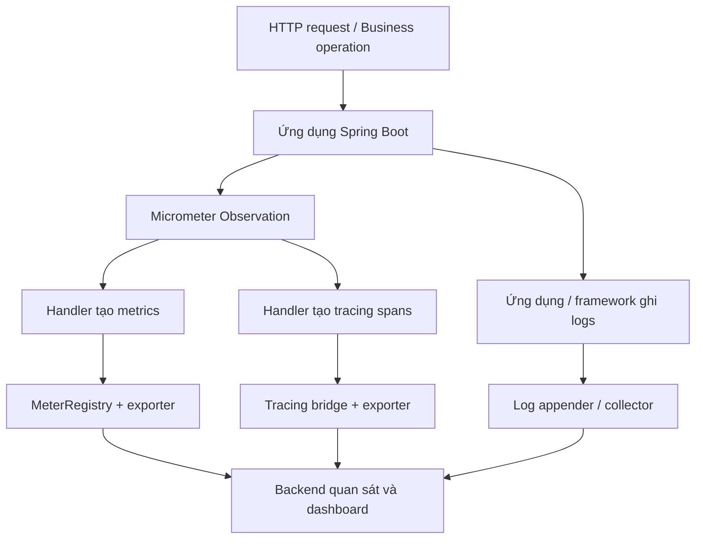

# Observability là gì?

> **Chương:** Nền tảng Observability  
> **Phạm vi:** Spring Boot Observability — quan sát ứng dụng Spring Boot bằng Micrometer Observation, metrics, logs và distributed tracing.

## Mục tiêu bài học

Sau bài này, bạn có thể:

- Giải thích **observability (khả năng quan sát)** và phân biệt nó với monitoring, logging hay việc có sẵn dashboard.
- Hiểu metrics, logs và traces trả lời những câu hỏi khác nhau như thế nào, và vì sao cần liên kết chúng.
- Nhận ra vai trò của **Micrometer Observation**, context propagation, tags/cardinality, exporter và sampling trong một ứng dụng Spring Boot.
- Dùng tín hiệu quan sát để đặt giả thuyết, khoanh vùng và xác minh nguyên nhân lỗi hoặc độ trễ trong một luồng xử lý thực tế.

## 1. Vấn đề mà observability giải quyết

Giả sử hệ thống bán hàng có luồng:

1. Client gửi yêu cầu tạo đơn hàng tới Spring Boot API.
2. Dịch vụ đơn hàng kiểm tra tồn kho.
3. Dịch vụ thanh toán gọi nhà cung cấp bên ngoài.
4. Kết quả được ghi xuống cơ sở dữ liệu rồi trả về client.

Một buổi tối, khách hàng phản ánh nút “Đặt hàng” quay rất lâu. API vẫn chạy, máy chủ chưa hết RAM, và một số yêu cầu vẫn thành công. Bạn cần biết: **chậm ở đâu, ảnh hưởng tới ai, bắt đầu từ lúc nào và điều gì đã thay đổi?**

Chỉ nhìn CPU hay một dòng thông báo “request failed” thường không đủ. Một yêu cầu có thể đi qua nhiều dịch vụ, cơ sở dữ liệu, hàng đợi và nhà cung cấp; lỗi ở một khâu có thể biểu hiện thành độ trễ ở khâu khác.

**Observability** là khả năng suy ra trạng thái và hành vi bên trong hệ thống từ những tín hiệu hệ thống tạo ra ở bên ngoài. Trong phần mềm, các tín hiệu điển hình là **metrics (số đo)**, **logs (nhật ký sự kiện)** và **traces (dấu vết thực thi)**, đi kèm ngữ cảnh đủ để liên hệ chúng với nhau.

Một hệ thống có observability tốt giúp người vận hành trả lời được những câu hỏi mới phát sinh, kể cả câu hỏi chưa được dự đoán trước khi viết dashboard. Điều đó đòi hỏi thu thập **đúng dữ liệu, đúng ngữ cảnh, ở đúng ranh giới xử lý**; cài thêm một công cụ giám sát chưa tự động tạo ra khả năng này.

## 2. Observability, monitoring và telemetry khác nhau thế nào?

| Khái niệm | Vai trò | Ví dụ |
| --- | --- | --- |
| **Telemetry** | Dữ liệu hệ thống phát ra để có thể quan sát từ bên ngoài. | Số request, thời gian xử lý, log lỗi, span HTTP. |
| **Instrumentation** | Đo và gắn ngữ cảnh vào code hoặc framework để tạo telemetry. | Đo một thao tác thanh toán, gắn nhãn route và trạng thái kết quả. |
| **Monitoring** | Theo dõi chỉ số/trạng thái và cảnh báo theo các điều kiện cần kiểm soát. | Cảnh báo tỉ lệ lỗi HTTP 5xx vượt ngưỡng trong 5 phút. |
| **Observability** | Năng lực dùng telemetry có ngữ cảnh để lý giải hành vi và điều tra vấn đề của hệ thống. | Từ cảnh báo 5xx, xác định nhóm request, truy ra lời gọi phụ thuộc bị timeout và kiểm chứng bằng log. |

Monitoring là một phần quan trọng của observability: nó giúp phát hiện bất thường. Observability còn hỗ trợ **điều tra nguyên nhân** khi chưa biết chính xác cần tìm gì. Hai khái niệm bổ trợ nhau chứ không phải hai lựa chọn loại trừ.

Ví dụ, biểu đồ CPU thấp **không chứng minh** API đang nhanh; một lời gọi tới dịch vụ bên ngoài có thể chờ 8 giây dù CPU gần như rảnh. Ngược lại, biểu đồ độ trễ tăng cũng chưa chỉ ra được thao tác nào đang chậm nếu thiếu traces hoặc ngữ cảnh trong logs.

## 3. Ba tín hiệu cốt lõi

| Tín hiệu | Cách biểu diễn | Câu hỏi trả lời tốt | Giới hạn nếu đứng riêng |
| --- | --- | --- | --- |
| **Metrics** | Chuỗi thời gian gồm giá trị số và nhãn: counter, gauge, timer, histogram... | Tần suất lỗi có tăng không? p95 latency thay đổi ra sao? Có bao nhiêu request mỗi giây? | Dữ liệu thường được tổng hợp, khó cho biết chính xác một request đã đi qua bước nào. |
| **Logs** | Các bản ghi sự kiện có thời điểm, mức độ và trường ngữ cảnh. | Lỗi cụ thể là gì? Điều kiện nào làm thao tác bị từ chối? | Log rời rạc khó khôi phục thứ tự và quan hệ giữa nhiều dịch vụ nếu thiếu correlation. |
| **Traces** | Cấu trúc các **spans** liên quan trong một luồng xử lý, thường có thời lượng, thuộc tính và lỗi. | Request bị chậm ở dịch vụ hoặc thao tác nào? Các lời gọi nối tiếp hay song song ra sao? | Traces có thể bị sampling; span thiếu instrumentation sẽ tạo khoảng trống trong luồng. |

### 3.1. Metrics — nhìn xu hướng và mức độ ảnh hưởng

Một số nhóm số đo nền tảng nên có cho HTTP/API:

- **Traffic:** lượng request mỗi giây, số tác vụ được xử lý.
- **Errors:** tỉ lệ lỗi theo endpoint, loại lỗi hoặc dependency.
- **Latency:** phân bố thời gian xử lý, chẳng hạn p50/p95/p99 thay vì chỉ trung bình.
- **Saturation:** mức sử dụng tài nguyên hữu hạn như thread pool, connection pool, CPU hoặc hàng đợi.

Giả sử lưu lượng không đổi nhưng p95 của `POST /orders` tăng từ 300 ms lên 4 giây; điều này báo hiệu một phần đáng kể request đang chậm, dù giá trị trung bình có thể chưa tăng nhiều. Muốn tính percentiles đáng tin cậy trên dữ liệu tổng hợp, hệ thống metric cần cấu hình cách xuất histogram/phân phối phù hợp.

Metrics thường được gắn **labels/tags** như `method=POST`, `uri=/orders`, `status=500`. Các nhãn phải có tập giá trị hữu hạn để tránh tạo quá nhiều time series. Từng `orderId` hay `userId` là giá trị biến thiên lớn và **không nên** trở thành nhãn metric.

### 3.2. Logs — giữ bằng chứng sự kiện

Một dòng log có cấu trúc có thể mang thông tin:

```text
2026-11-22T10:15:04Z level=ERROR service=checkout
traceId=4f8a... spanId=6b12...
event=payment_timeout provider=partner_a duration_ms=3000
message="Payment provider did not respond before timeout"
```

Khi tìm lỗi, cấu trúc này hữu ích hơn log tự do kiểu `Có lỗi xảy ra` vì có dịch vụ, loại sự kiện, nhà cung cấp, thời gian chờ và dấu vết liên kết. Giá trị `traceId`/`spanId` trong ví dụ mang tính minh họa; chúng chỉ có khi ứng dụng ghi nhận và đưa ngữ cảnh tracing vào logs.

Logs cần mô tả **sự kiện quan trọng**, không phải ghi lại mọi biến nội bộ. Không đưa mật khẩu, token, số thẻ, thông tin cá nhân hoặc toàn bộ request body vào logs. Tần suất và mức độ log phải tương xứng với giá trị điều tra và chi phí lưu trữ.

### 3.3. Traces — theo đường đi của một request

Một **trace** mô tả toàn bộ hành trình xử lý được theo dõi; mỗi **span** biểu thị một đơn vị công việc, ví dụ xử lý HTTP, truy vấn DB hoặc gọi API. Các span có quan hệ cha–con, thời điểm bắt đầu/kết thúc, thuộc tính và trạng thái lỗi.

```text
Trace: POST /orders                                 4.2 s
├── HTTP server: checkout                           4.2 s
│   ├── inventory.reserve                            0.1 s
│   ├── payment.charge                               3.9 s
│   │   └── HTTP client: payment-provider            3.8 s (timeout)
│   └── database.insert-order                        0.1 s
```

Trace cho thấy khoảng trễ tập trung ở lời gọi thanh toán, nhưng chưa chứng minh nguyên nhân sâu xa ở nhà cung cấp, mạng hay cơ chế retry. Ta cần đối chiếu thêm logs, metrics của dependency và sự kiện triển khai.

**Trace ID** định danh một luồng liên kết; **span ID** định danh một thao tác trong luồng đó. Trong hệ thống phân tán, HTTP headers hoặc message metadata mang tracing context qua ranh giới dịch vụ để các span được nối vào cùng trace.

### 3.4. Liên kết tín hiệu mới tạo nên bức tranh hữu ích

Một quy trình điều tra có thể đi theo hướng:

**Metric báo động** (tỉ lệ lỗi tăng) → **lọc theo route/dependency** → **mở một trace đại diện** (span gọi thanh toán chậm) → **tìm logs cùng trace ID** (timeout, retry) → **đối chiếu metrics và thay đổi gần đây** (xác nhận phạm vi, kiểm chứng giả thuyết).

Không phải hệ thống nào cũng có liên kết trực tiếp từ biểu đồ metric tới trace. Một số nền tảng dùng *exemplars* hoặc metadata tương quan; khi không có, ta cần lọc theo thời gian, dịch vụ và thuộc tính phù hợp.

## 4. Observability hoạt động như thế nào trong Spring Boot?

Trong hệ sinh thái Spring Boot, **Micrometer Observation** cung cấp một cách thống nhất để mô tả và đo một thao tác. Một observation có vòng đời bắt đầu–kết thúc, tên và các thuộc tính ngữ cảnh. Các `ObservationHandler` tương ứng có thể biến observation thành **metric** hoặc **tracing span** khi đã cấu hình tích hợp.



Sơ đồ thể hiện **các đường dữ liệu** chứ không có nghĩa một observation tự động sinh đủ cả ba tín hiệu. Logs vẫn được ghi thông qua framework logging (ví dụ SLF4J/Logback); muốn liên kết logs với spans cần cấu hình và truyền ngữ cảnh tương quan. Handler, registry, exporter và backend quyết định dữ liệu nào thực sự xuất hiện.

Các thành phần thường gặp:

| Thành phần | Chức năng |
| --- | --- |
| **Spring Boot Actuator** | Cung cấp quan sát và endpoint vận hành, cùng khả năng tự động instrument nhiều thành phần framework. |
| **Micrometer Metrics / MeterRegistry** | Thu thập, quản lý và xuất metrics tới hệ thống như Prometheus. |
| **Micrometer Observation / ObservationRegistry** | API chung cho việc tạo và quản lý một observation có ngữ cảnh. |
| **Micrometer Tracing** | Tích hợp tracing, nối observation với span và quản lý trace context thông qua bridge phù hợp. |
| **Exporter / Collector / Backend** | Chuyển, tiếp nhận, lưu trữ, truy vấn và trực quan hóa telemetry; mỗi tín hiệu có thể dùng pipeline khác nhau. |

Chẳng hạn, cấu hình Spring Boot sử dụng Actuator và registry Prometheus có thể công bố metric tại `/actuator/prometheus` khi đã thêm dependency tương ứng và cho phép endpoint. Tracing cần bridge và exporter phù hợp; chỉ thêm Actuator **chưa đủ** để có distributed tracing xuyên dịch vụ.

### 4.1. Ví dụ tạo observation cho nghiệp vụ

Đoạn code sau minh họa cách bọc một thao tác tạo đơn hàng trong observation. `channel` được chuẩn hóa thành tập giá trị nhỏ để có thể dùng làm nhãn metric.

```java
import java.util.function.Supplier;

import io.micrometer.observation.Observation;
import io.micrometer.observation.ObservationRegistry;
import org.springframework.stereotype.Service;

@Service
public class OrderObservationService {
    private final ObservationRegistry registry;

    public OrderObservationService(ObservationRegistry registry) {
        this.registry = registry;
    }

    public <T> T observeOrderCreation(String channel, Supplier<T> action) {
        String safeChannel = switch (channel) {
            case "web", "mobile" -> channel;
            default -> "other";
        };

        return Observation.createNotStarted("order.create", registry)
                .lowCardinalityKeyValue("channel", safeChannel)
                .observe(action);
    }
}
```

`observe(action)` quản lý vòng đời observation quanh thao tác được truyền vào và có thể ghi nhận lỗi khi thao tác ném exception. Khi đã cấu hình các handler cần thiết, tên `order.create` và ngữ cảnh liên quan có thể được sử dụng để sinh metrics/spans. Đoạn code không tự bảo đảm rằng telemetry sẽ được xuất ra một backend.

Trong dự án thực tế, đặt observation quanh **ranh giới có ý nghĩa nghiệp vụ** (đặt hàng, kiểm tra tồn kho, tính cước) thay vì bọc mọi hàm. Đồng thời, dùng instrumentation có sẵn của framework cho các ranh giới HTTP, DB và messaging; việc tự tạo observation trùng với instrumentation tự động có thể dẫn tới đo đạc lặp.

### 4.2. Một cấu hình khởi đầu để quan sát

Ví dụ cho các bản Spring Boot dùng cấu hình Actuator/Micrometer phổ biến:

```yaml
management:
  endpoints:
    web:
      exposure:
        include: health,info,prometheus
  tracing:
    sampling:
      probability: 0.1
```

Cấu hình này chỉ có hiệu lực cho tín hiệu tương ứng **khi dependency và exporter đã được cài đúng**. `prometheus` cần registry Prometheus; `tracing.sampling.probability` điều chỉnh tỉ lệ lấy mẫu trace trong cấu hình tracing tương thích (ở đây là 10%). Các tên dependency và thuộc tính exporter có thể khác theo phiên bản Spring Boot, vì vậy phải kiểm tra tài liệu đúng phiên bản đang sử dụng.

Endpoint Actuator cần được giới hạn quyền truy cập theo môi trường. Không nên để metrics, health details hoặc dữ liệu vận hành nhạy cảm lộ công khai qua Internet.

## 5. Ngữ cảnh, tags và cardinality

### 5.1. Ngữ cảnh phải đi cùng công việc

Giả sử `checkout-service` gọi `payment-service` qua HTTP. Nếu truyền được tracing context, server span của dịch vụ thanh toán có thể nối với client span của dịch vụ gọi, dù mỗi dịch vụ chạy ở một máy khác nhau.

Ngữ cảnh thường gồm trace ID, span ID và thông tin quyết định lấy mẫu. Chuẩn như W3C Trace Context hỗ trợ truyền ngữ cảnh giữa các thành phần có công nghệ khác nhau. Khi xử lý bất đồng bộ, executor, thread mới, queue hoặc message broker, cần bảo đảm framework/instrumentation thực sự **inject/extract** và khôi phục ngữ cảnh. Nếu đứt mạch, các spans có thể bị tách thành những traces khác nhau và logs mất trường tương quan.

Không nên tự tạo trace ID mới tại mọi dịch vụ cho cùng một request, cũng không dùng một định danh nghiệp vụ làm thay thế cho trace context. Định danh nghiệp vụ và trace ID có mục đích, phạm vi và chính sách bảo mật khác nhau.

### 5.2. Cardinality quyết định chi phí và tính khả dụng

**Cardinality** là số lượng giá trị khác nhau mà một thuộc tính hoặc tập nhãn có thể nhận. Đối với time-series metrics, số tổ hợp nhãn càng lớn thì số series cần lưu và truy vấn càng nhiều.

| Dữ liệu/thuộc tính | Nên dùng cho metric tag? | Giải thích |
| --- | --- | --- |
| `http.method=POST` | Có | Tập giá trị nhỏ, ổn định. |
| `uri=/orders/{id}` | Có | Route đã chuẩn hóa, không chứa ID cụ thể. |
| `result=success/failed` | Có | Nhóm kết quả hữu hạn. |
| `userId=938472...` | Không | Tập giá trị tăng theo người dùng; có rủi ro riêng tư. |
| `orderId=<giá trị khác nhau mỗi request>` | Không | Dễ bùng nổ số series, không phục vụ đo xu hướng. |

Với Micrometer Observation, **low-cardinality key values** thích hợp cho nhãn metrics; **high-cardinality key values** có thể hữu ích cho ngữ cảnh trace nhưng cần cân nhắc chi phí, tính nhạy cảm của dữ liệu và chính sách thu thập. Không có nghĩa mọi thuộc tính high-cardinality đều nên được ghi lại.

Quy tắc đơn giản: muốn lọc **nhóm request**, dùng metric tags hữu hạn; muốn điều tra **một lần xử lý cụ thể**, dùng trace/log có ngữ cảnh phù hợp và tuân thủ chính sách dữ liệu.

## 6. Exporter, sampling và độ tin cậy của dữ liệu

- **Exporter** gửi telemetry từ ứng dụng/agent tới một collector hoặc backend. Ví dụ: metrics theo định dạng Prometheus; traces thông qua exporter tương thích OTLP; logs qua appender hoặc log collector. Mỗi đường truyền cần được cấu hình và giám sát lỗi.
- **Collector** (nếu có) có thể nhận, biến đổi, lọc, lấy mẫu hoặc chuyển tiếp telemetry. Nó tạo một lớp trung gian hữu ích khi nhiều ứng dụng cùng xuất dữ liệu.
- **Sampling** chọn giữ lại một phần traces để kiểm soát tải và chi phí. Với xác suất 10%, không thể kỳ vọng tìm thấy span của **mọi** request trong backend. Cần chiến lược phù hợp khi điều tra lỗi hiếm hoặc luồng quan trọng.
- **Metrics** thường được tổng hợp từ số lần quan sát ở ứng dụng và không đồng nghĩa bị lấy mẫu theo tỉ lệ trace. Tuy nhiên tính đầy đủ vẫn tùy thuộc instrumentation, pipeline và mất mát dữ liệu thực tế.

Thiếu trace không đủ để kết luận thao tác chưa xảy ra. Ngược lại, một trace có duration bất thường cũng chưa đủ chứng minh nó là hiện tượng phổ biến: hãy kiểm tra mức độ ảnh hưởng qua metrics. Đặc biệt cần quan sát chính pipeline telemetry: queue đầy, exporter lỗi, collector quá tải hoặc timestamp lệch đều có thể làm điều tra sai hướng.

## 7. Thực hành suy luận: API tạo đơn hàng chậm

**Tình huống:** Sau một lần cập nhật ứng dụng, p95 latency của endpoint tạo đơn tăng rõ rệt; tỉ lệ lỗi timeout cũng tăng. Quy trình điều tra điển hình:

1. **Xác nhận triệu chứng và phạm vi.** Xem throughput, error rate và latency theo thời gian; so sánh trước/sau cập nhật. Kiểm tra nhiều instance và route để biết lỗi xảy ra rộng hay chỉ trên một nhánh.
2. **Khoanh vùng từ metrics.** Nhóm theo route, kết quả, dependency hoặc nhãn hữu hạn đã có. Nếu lỗi tập trung vào `POST /orders`, ưu tiên luồng đó thay vì suy luận từ CPU toàn máy.
3. **Đọc các traces phù hợp.** Tìm traces chậm hoặc lỗi từ khoảng thời gian bất thường. Đối chiếu durations giữa các spans để biết phần lớn thời gian nằm tại HTTP server, DB, inventory hay payment.
4. **Đối chiếu logs theo trace ID và thời điểm.** Tìm timeout, retry, exception hoặc kết quả từ nhà cung cấp. Nếu traces bị sampling và không có trace tương ứng, lọc logs theo thời gian, dịch vụ và sự kiện liên quan.
5. **Kiểm chứng nguyên nhân.** So sánh metrics của dependency, thay đổi cấu hình timeout/retry, lượng kết nối, mức bão hòa và các lần triển khai gần nhất. Phân biệt **triệu chứng** “payment span 3.8 giây” với **nguyên nhân** có thể là kết nối cạn hoặc nhà cung cấp phản hồi chậm.
6. **Đánh giá sau khi sửa.** Theo dõi lại error rate, p95/p99 latency, throughput và mức tải. Đảm bảo thay đổi thực sự cải thiện hành vi người dùng, đồng thời không tạo thêm retry hoặc lỗi ở dịch vụ khác.

Một phép đo có **giá trị hành động** khi nó giúp bạn quyết định kiểm tra bước nào tiếp theo. Dashboard quá nhiều biểu đồ nhưng không thể khoanh vùng request hay phụ thuộc thường ít hữu ích hơn một số ít tín hiệu được đặt tên và liên kết nhất quán.

## 8. Thiết kế observability theo từng bước

Với một ứng dụng Spring Boot mới, có thể bắt đầu theo thứ tự:

1. Xác định hành vi quan trọng với người dùng: đặt hàng thành công, phản hồi nhanh, thanh toán không bị nhân đôi.
2. Gắn các **chỉ số mức dịch vụ** (SLI) phù hợp, ví dụ tỉ lệ request thành công và độ trễ của thao tác tạo đơn; đặt mục tiêu (SLO) khi đã thống nhất kỳ vọng vận hành.
3. Bật instrumentation có sẵn của Spring Boot/Actuator cho HTTP và các thành phần được hỗ trợ; thêm observation cho các bước nghiệp vụ còn thiếu.
4. Chuẩn hóa tên observation, metric tags và log fields giữa các đội; truyền trace context qua những ranh giới đồng bộ và bất đồng bộ.
5. Cấu hình exporter/backend và kiểm tra một request mẫu có thể được theo dõi từ metrics tới logs/traces (nếu được lấy mẫu).
6. Dùng lỗi giả lập có kiểm soát trong môi trường thử nghiệm, chẳng hạn timeout ở dependency, để xác nhận dữ liệu đủ trả lời “ở đâu, vì sao, ảnh hưởng thế nào”.
7. Duy trì chi phí và an toàn dữ liệu: giới hạn cardinality, chọn sampling phù hợp, loại bỏ thông tin nhạy cảm, kiểm tra hiệu năng pipeline và quyền truy cập.

**Các sai lầm thường gặp:** chỉ đếm tổng lỗi nhưng không phân loại, dùng ID biến thiên làm metric label, ghi exception mà không có trace context, coi một trace được lấy mẫu là đại diện cho toàn hệ thống, tạo span quá chi tiết đến mức không còn ý nghĩa, hoặc đặt dashboard mà không có câu hỏi vận hành cụ thể.

## 9. Tự kiểm tra hiểu biết

**Câu 1.** API có CPU thấp nhưng p95 latency cao. Điều này có mâu thuẫn không?  
**Gợi ý:** Không. Request có thể đang chờ DB, lock, queue hoặc một HTTP dependency; cần xem spans và metrics thích hợp.

**Câu 2.** Vì sao `orderId` không nên là metric label?  
**Gợi ý:** Mỗi đơn mới tạo giá trị khác nhau, làm tăng cardinality và chi phí time series; dùng labels hữu hạn để quan sát xu hướng.

**Câu 3.** Có thể kết luận request không xảy ra khi không tìm thấy trace của nó không?  
**Gợi ý:** Không. Trace có thể bị sampling, mất ngữ cảnh, thiếu instrumentation hoặc lỗi xuất dữ liệu.

**Câu 4.** Micrometer Observation có tự động tạo cả metrics, logs và distributed traces không?  
**Gợi ý:** Không. Observation cung cấp vòng đời và ngữ cảnh chung; handlers/integrations và exporters quyết định metrics, spans nào được tạo, trong khi logs đi qua hệ thống logging.

**Điểm cần nhớ:** Observability là năng lực **giải thích hành vi hệ thống dựa trên tín hiệu có liên kết**. Với Spring Boot, Micrometer Observation giúp instrument nhất quán; metrics cho biết mức độ và xu hướng, traces cho biết đường đi và thời gian, logs cung cấp bằng chứng sự kiện. Context propagation, cardinality, sampling và exporter quyết định chất lượng cũng như chi phí của bức tranh đó.
