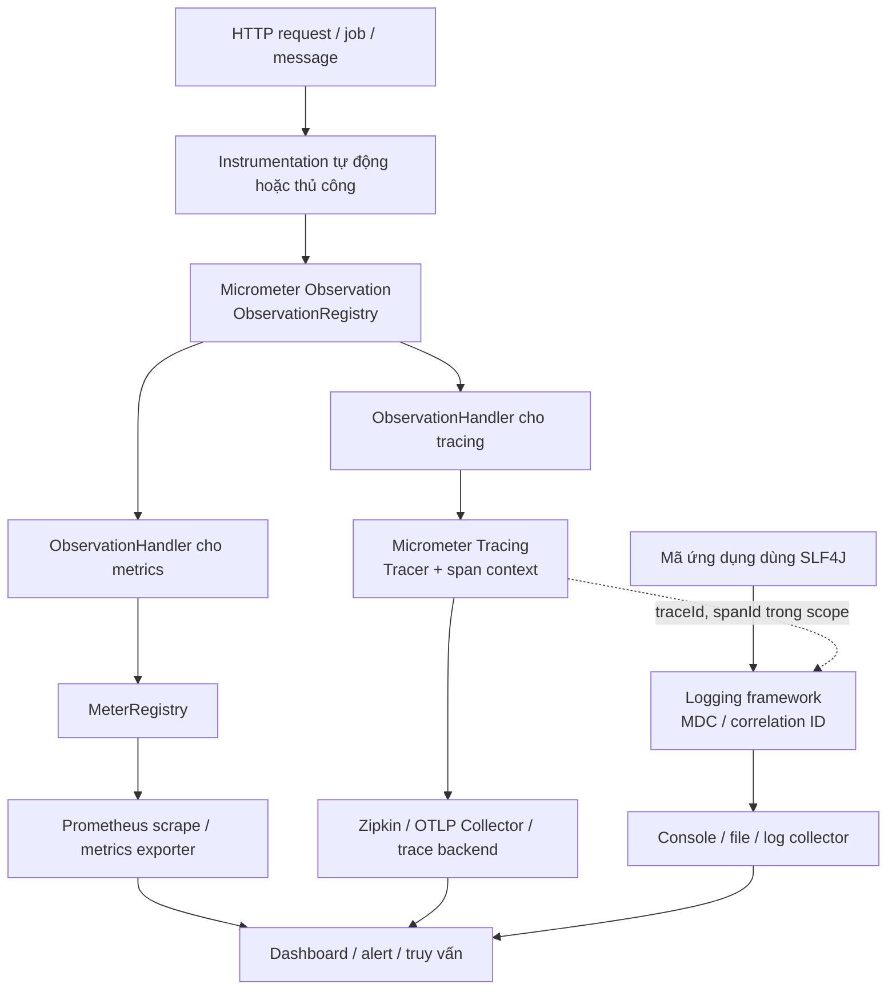
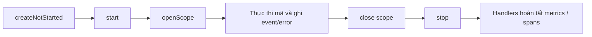

# Spring Boot quan sát hệ thống như thế nào

Khi một API Spring Boot trả về HTTP 500 hoặc chậm bất thường, biết rằng “có lỗi” chưa đủ. Người vận hành còn cần trả lời: lỗi xuất hiện ở dịch vụ nào, bắt đầu từ lúc nào, ảnh hưởng bao nhiêu yêu cầu, phần nào của luồng xử lý tốn thời gian, và có dữ kiện nào giải thích nguyên nhân? **Observability** là khả năng suy ra trạng thái bên trong hệ thống từ các tín hiệu mà hệ thống phát ra khi chạy.

Trong module **SPRING_BOOT_OBSERVABILITY**, ta xây dựng khả năng đó bằng **Micrometer Observation, metrics, logs và distributed tracing**. Spring Boot cung cấp điểm tích hợp và tự cấu hình; ứng dụng bổ sung ngữ cảnh nghiệp vụ; các hệ thống thu thập và phân tích biến tín hiệu thành dữ kiện để điều tra lỗi, độ trễ và hành vi ứng dụng trong môi trường thực.

## 1. Kết quả cần đạt

Sau bài này, bạn có thể:

- Mô tả đường đi từ một HTTP request đến log, metric và trace trên Spring Boot.
- Phân biệt vai trò của Actuator, `ObservationRegistry`, `MeterRegistry`, Micrometer Tracing, exporter và backend.
- Giải thích vì sao một `Observation` có thể tạo ra metric và span, nhưng bản thân nó không phải là log, metric hay span.
- Chọn tag có cardinality phù hợp, giải thích trace/span ID và sự lan truyền ngữ cảnh giữa các dịch vụ.
- Thiết lập một ví dụ quan sát được, kiểm tra tín hiệu và điều tra một sự cố theo dữ kiện.

## 2. Spring Boot “nhìn thấy” điều gì?

Giả sử yêu cầu `GET /api/orders/42` đi qua API Gateway → Order Service → Inventory Service → cơ sở dữ liệu. Đôi khi người dùng gặp độ trễ 3 giây thay vì 150 ms.

Ba loại tín hiệu trả lời những câu hỏi khác nhau:

| Tín hiệu | Mẫu dữ kiện | Câu hỏi mạnh nhất | Giới hạn cần nhớ |
|---|---|---|---|
| **Metrics** | Số request/giây, tỷ lệ 5xx, phân phối thời gian xử lý, heap, CPU | “Sự cố có phổ biến không, bắt đầu khi nào, mức độ thế nào?” | Dữ liệu tổng hợp; thường không chỉ ra chính xác một request. |
| **Logs** | `ERROR Inventory timeout after 2000 ms` kèm `traceId` | “Ứng dụng ghi nhận sự kiện và nguyên nhân cụ thể gì?” | Dễ phân mảnh giữa dịch vụ; log thiếu ngữ cảnh rất khó ghép. |
| **Traces** | Trace gồm span HTTP server, HTTP client, truy vấn DB | “Một yêu cầu đi qua đâu và tốn thời gian tại bước nào?” | Có thể bị sampling; một trace không đại diện cho mọi request. |

**Metrics cho bức tranh tổng thể, traces cho đường đi của yêu cầu, logs cho chi tiết sự kiện.** Kết hợp ba tín hiệu giúp chuyển từ dấu hiệu (“p95 tăng”) sang phạm vi (“chủ yếu ở API đặt hàng”), rồi đến nguyên nhân có khả năng nhất (“Inventory Service chờ kết nối DB”).

Observability không đồng nhất với health check. Endpoint `/actuator/health` trả lời ứng dụng có đang đáp ứng một tập điều kiện sức khỏe hay không; nó không tự giải thích vì sao p95 của API tăng.

## 3. Kiến trúc quan sát trong Spring Boot



Sơ đồ có ba lớp cần tách bạch:

1. **Instrumentation** xác định hoạt động nào được theo dõi: HTTP server/client, tác vụ tùy chỉnh, công việc bất đồng bộ, v.v.
2. **Ghi nhận tín hiệu**: Micrometer biến vòng đời hoạt động thành đo đạc; tracing tạo/cập nhật span; logging ghi các thông điệp do ứng dụng và framework phát ra.
3. **Thu thập và phân tích**: Prometheus thường *scrape* metrics; trace exporter thường *push* spans đến hệ thống nhận; logs đi qua stdout, file hoặc agent. Grafana, Zipkin hay backend tương đương cung cấp truy vấn và trực quan hóa.

Spring Boot không tự có một kho lưu trữ toàn bộ metrics, logs và traces. Có Actuator và các thư viện quan sát mới là **khả năng tạo/đưa ra tín hiệu**; cần exporter, hệ thống thu thập và lưu trữ thích hợp để quan sát ở quy mô vận hành.

### Những thành phần nằm ở đâu?

| Thành phần | Trách nhiệm |
|---|---|
| **Spring Boot Actuator** | Kích hoạt auto-configuration đo đạc và cung cấp endpoint quản trị như `health`, `metrics`, `prometheus` khi có dependency/cấu hình tương ứng. |
| **`ObservationRegistry`** | Giữ cấu hình và các handler xử lý vòng đời `Observation`; là điểm tích hợp chung cho instrumentation. |
| **`Observation`** | Mô tả một hoạt động có điểm bắt đầu/kết thúc, lỗi, sự kiện và key-value ngữ cảnh. |
| **`ObservationHandler`** | Nhận callback khi Observation bắt đầu, mở scope, gặp lỗi, dừng; có thể tạo meter hoặc span. |
| **`MeterRegistry`** | Quản lý các meter như counter, timer, gauge và các bộ chuyển đổi sang định dạng/backend metrics. |
| **Micrometer Tracing + tracer implementation** | Quản lý trace, span, parent-child, sampling và propagation; dùng Brave hoặc OpenTelemetry tùy cách cấu hình. |
| **SLF4J + Logback/Log4j2 + MDC** | Ghi log, đưa correlation ID vào ngữ cảnh log khi tracing được cấu hình và scope được giữ đúng. |
| **Exporter/collector/backend** | Vận chuyển, tiếp nhận, lưu, tìm kiếm và hiển thị tín hiệu; là các vai trò tách biệt. |

Micrometer Observation là **lớp trung gian** giúp instrument một hoạt động mà không buộc mã nghiệp vụ phải viết logic xuất Prometheus và Zipkin riêng rẽ. Nếu chỉ có registry/handler cho metrics, ta nhận metrics; khi bổ sung tracing và exporter, cùng một hoạt động có thể đồng thời sinh span. **Log vẫn phải được ứng dụng hoặc framework chủ động ghi**; Observation không tự biến mọi bước xử lý thành log.

## 4. Một HTTP request được quan sát từ đầu đến cuối

Ví dụ `GET /api/orders/42` được Spring MVC xử lý:

1. **Request đi vào**. Instrumentation của Spring tạo HTTP server Observation (thường có tên `http.server.requests`) và bắt đầu đo thời gian.
2. **Lấy hoặc tạo trace context**. Nếu request có header chuẩn W3C `traceparent`, tracer có thể tiếp tục một trace có sẵn; nếu không, nó có thể tạo root trace mới.
3. **Mở scope xử lý**. Trace/span hiện tại được gắn vào ngữ cảnh thực thi; logging có thể truy cập `traceId`, `spanId` thông qua MDC.
4. **Controller gọi service**. Một Observation nghiệp vụ được tạo có thể trở thành span con của HTTP server span. Với HTTP client được Spring Boot cấu hình, context hiện tại được truyền sang dịch vụ kế tiếp.
5. **Kết thúc hoặc phát sinh ngoại lệ**. Observation nhận trạng thái, thời lượng và thông tin lỗi theo cách instrumentation triển khai; những lỗi được framework xử lý có thể cần cấu hình thêm để thể hiện đúng trên metric.
6. **Handler xử lý dữ kiện**. Handler cho metrics ghi thời lượng/số lần; handler cho tracing hoàn tất span. Tín hiệu tracing có được xuất đi hay không còn phụ thuộc sampling và exporter.
7. **Backend tiếp nhận**. Người vận hành có thể lọc metric theo `method`/`uri`/`status`, mở trace liên quan và tìm log cùng `traceId`.

Một trace có cùng **trace ID** xuyên nhiều dịch vụ; mỗi hoạt động được theo dõi có **span ID** riêng và quan hệ cha-con khi propagation thành công. Span ID trong log của service A không bắt buộc bằng span ID của service B, dù cả hai cùng trace ID.

Đường đi trực quan:

```text
Client
  └─ trace T (traceparent)
       ├─ span A: Order Service / HTTP server
       │    ├─ span B: pricing.quote (nghiệp vụ)
       │    └─ span C: HTTP client → Inventory Service
       └─ span D: Inventory Service / HTTP server (con của C)
            └─ span E: truy vấn hoặc xử lý DB (nếu có instrumentation)
```

Không phải mọi phép gọi DB hoặc tác vụ thư viện đều tự động có span. Phạm vi tự động instrument phụ thuộc stack, thư viện và cấu hình. Với JDBC, chẳng hạn, muốn observation chi tiết từng truy vấn thường cần tích hợp bổ sung; chỉ bật Actuator chưa đủ.

## 5. Observation: đơn vị cơ bản của phép đo

`Observation` có vòng đời khái niệm:



Gọi `observe(...)` là cách thuận tiện để bắt đầu, mở scope, chạy callback, ghi nhận lỗi do callback ném ra, đóng scope và dừng Observation. Nhờ đó thời gian được đo cả khi tác vụ ném exception.

Hai khái niệm rất dễ nhầm:

- **Observation**: mô hình hóa việc đang xảy ra, ví dụ “tính giá”.
- **Scope**: làm Observation/span hiện tại khả dụng cho mã chạy trong ngữ cảnh thực thi tương ứng; không có nghĩa là context tự động đi theo mọi thread.

Tên `Observation` như `pricing.quote` thường được dùng để tạo meter/timer, đồng thời là tên/nguồn tên span theo convention. `contextualName` có thể cung cấp tên dễ đọc cho tracing. `ObservationConvention` cho phép thống nhất tên và metadata mà không phải chỉnh từng điểm instrumentation.

### Low cardinality và high cardinality

*Cardinality* là số lượng giá trị khác nhau mà một key có thể nhận.

| Thuộc tính | Ví dụ | Cách sử dụng |
|---|---|---|
| **Low cardinality** | `method=GET`, `status=200`, `uri=/api/orders/{id}`, `tier=vip` | Thích hợp làm tag của metrics và thuộc tính của traces. |
| **High cardinality** | `order.id=7f8...`, `request.id=...`, đường dẫn chứa ID cụ thể | Có thể dùng làm thuộc tính trace khi thật sự cần, sau khi kiểm tra bảo mật và dung lượng; tránh đưa vào metrics. |

Nếu thêm `userId` làm tag metrics với hàng triệu giá trị, mỗi tổ hợp các tag có thể tạo series mới: tăng bộ nhớ, chi phí lưu trữ và độ nặng của truy vấn. Vì thế Micrometer đưa **low-cardinality key-values** vào metrics và traces; **high-cardinality key-values** chỉ đi vào traces khi có tracing handler tương ứng.

**Quy tắc thực hành:** dùng route mẫu `/api/orders/{id}` cho metrics, không dùng `/api/orders/42`; không gắn token, mật khẩu, email, dữ liệu cá nhân hoặc body nhạy cảm vào tag, span hay log.

## 6. Ví dụ thực hành với Spring Boot 4.x

Ví dụ sử dụng Spring MVC, Actuator, Prometheus và Zipkin để nhìn thấy cả ba tín hiệu. Các dependency dưới đây dành cho **Spring Boot 4.x**; Spring Boot 3.x có cách đóng gói tracing khác (thường dùng `micrometer-tracing-bridge-*` và exporter thay vì các starter Zipkin/OpenTelemetry mới), vì thế cần đối chiếu tài liệu đúng phiên bản dự án.

### Bước 1: Thêm dependency

Nếu dự án đã dùng Spring Boot Gradle plugin và dependency management thích hợp:

```groovy
dependencies {
    implementation 'org.springframework.boot:spring-boot-starter-webmvc'
    implementation 'org.springframework.boot:spring-boot-starter-actuator'
    implementation 'org.springframework.boot:spring-boot-starter-zipkin'
    runtimeOnly 'io.micrometer:micrometer-registry-prometheus'
}
```

- `spring-boot-starter-webmvc` phục vụ API HTTP.
- `spring-boot-starter-actuator` cung cấp nền tảng quan sát và endpoint quản trị.
- `micrometer-registry-prometheus` tạo endpoint dữ liệu cho Prometheus khi bật exposure.
- `spring-boot-starter-zipkin` cung cấp cấu hình tracing Brave → Zipkin cho ví dụ. Có thể thay bằng starter OpenTelemetry/OTLP phù hợp khi dùng Collector.

Để học **metrics mà chưa có backend tracing**, có thể bắt đầu với web + actuator + registry Prometheus. Việc xem `/actuator/metrics` không đòi hỏi Zipkin.

### Bước 2: Cấu hình cho môi trường local

```yaml
spring:
  application:
    name: pricing-service

management:
  endpoints:
    web:
      exposure:
        include: "health,info,metrics,prometheus"
  tracing:
    sampling:
      probability: 1.0
    export:
      zipkin:
        endpoint: "http://localhost:9411/api/v2/spans"
  observations:
    key-values:
      environment: local
      region: dev
```

Ở đây `probability: 1.0` là **100% sampling để thực hành**. Không mặc định áp dụng cho production: lưu lượng lớn có thể khiến chi phí tracing tăng nhanh. Phiên bản Spring Boot hiện hành dùng mức sampling mặc định 10%, nhưng khi vận hành hãy kiểm tra chính phiên bản và cấu hình thực tế.

Chỉ expose các endpoint cần thiết. `metrics` và `prometheus` **không được mặc định mở qua HTTP**; dòng `include` ở trên cho phép truy cập chúng trên ứng dụng local. Môi trường production cần bảo vệ đường quản trị bằng mạng nội bộ, xác thực/phân quyền và giới hạn những thông tin hiển thị.

### Bước 3: Instrument một thao tác nghiệp vụ

```java
import java.util.Locale;

import io.micrometer.observation.Observation;
import io.micrometer.observation.ObservationRegistry;
import org.slf4j.Logger;
import org.slf4j.LoggerFactory;
import org.springframework.stereotype.Service;

@Service
public class PricingService {
    private static final Logger log = LoggerFactory.getLogger(PricingService.class);
    private final ObservationRegistry observations;

    public PricingService(ObservationRegistry observations) {
        this.observations = observations;
    }

    public String quote(String rawTier) {
        // Chuẩn hóa thành tập giá trị hữu hạn cho metrics.
        String tier = "vip".equals(rawTier.toLowerCase(Locale.ROOT))
                ? "vip" : "standard";

        return Observation.createNotStarted("pricing.quote", observations)
                .contextualName("calculate-price")
                .lowCardinalityKeyValue("tier", tier)
                .observe(() -> {
                    log.info("Calculating price, tier={}", tier);
                    if ("fail".equalsIgnoreCase(rawTier)) {
                        throw new IllegalStateException("Simulated pricing failure");
                    }
                    return "vip".equals(tier) ? "90.00" : "100.00";
                });
    }
}
```

Expose service đó qua controller:

```java
import org.springframework.web.bind.annotation.GetMapping;
import org.springframework.web.bind.annotation.PathVariable;
import org.springframework.web.bind.annotation.RequestMapping;
import org.springframework.web.bind.annotation.RestController;

@RestController
@RequestMapping("/api/prices")
public class PricingController {
    private final PricingService service;

    public PricingController(PricingService service) {
        this.service = service;
    }

    @GetMapping("/{tier}")
    public String quote(@PathVariable String tier) {
        return service.quote(tier);
    }
}
```

Trong ví dụ này:

- **HTTP server observation** được tạo bởi instrumentation của Spring MVC cho request đến `/api/prices/{tier}`.
- **`pricing.quote`** được tạo thủ công để đo phần nghiệp vụ; nó có thể cho ra timer riêng và span con khi tracing đã được cấu hình.
- **`tier`** chỉ nhận `vip` hoặc `standard`, giữ số series hữu hạn.
- **`log.info(...)`** tạo log nghiệp vụ; khi có trace context trong scope, log có thể mang correlation ID.
- **`/api/prices/fail`** cố ý ném exception để quan sát đường xử lý lỗi. Đây là mã học tập, không đưa nhánh mô phỏng lỗi vào API production.

Cách này không cần bật annotation scan cho `@Observed`. Nếu chọn `@Observed` thì phải bật hỗ trợ annotation và AspectJ theo phiên bản Spring Boot; tránh đánh dấu trùng trên controller vốn đã được tự instrument.

### Bước 4: Gửi request và kiểm tra

Khởi chạy Zipkin local trên cổng 9411 theo cách cài đặt phù hợp, sau đó chạy ứng dụng và gọi:

```bash
curl -i http://localhost:8080/api/prices/vip
curl -i http://localhost:8080/api/prices/standard
curl -i http://localhost:8080/api/prices/fail

curl http://localhost:8080/actuator/health
curl http://localhost:8080/actuator/metrics
curl "http://localhost:8080/actuator/metrics/pricing.quote?tag=tier:vip"
curl http://localhost:8080/actuator/prometheus
```

Kỳ vọng, tùy thư viện và cấu hình:

1. `/api/prices/vip` trả kết quả; `/api/prices/fail` trả lỗi HTTP 5xx.
2. Log server ghi “Calculating price”, và khi tracing hoạt động, dòng log có thể chứa cặp `traceId-spanId`.
3. `/actuator/metrics` liệt kê `http.server.requests` và `pricing.quote` sau khi chúng đã được ghi nhận.
4. Endpoint `/actuator/metrics/pricing.quote` trả thống kê như `COUNT` và `TOTAL_TIME`; dữ liệu chỉ có sau khi đã phát sinh observation.
5. `/actuator/prometheus` xuất chuỗi thời gian theo tên quy đổi cho Prometheus, ví dụ một timer có thể thành các series dạng `pricing_quote_seconds_count`, `pricing_quote_seconds_sum`.
6. Giao diện Zipkin tại `http://localhost:9411` cho phép tìm trace đã sample, mở các span và xem thời lượng. Trace có thể chưa xuất hiện ngay vì exporter gửi theo đợt.

`/actuator/metrics` là giao diện chẩn đoán trực tiếp trên ứng dụng; `/actuator/prometheus` là định dạng dành cho Prometheus scrape định kỳ. Không lấy output JSON của `metrics` làm định dạng đầu vào Prometheus.

Nếu metric có nhưng trace không thấy, kiểm tra lần lượt dependency tracing, sampling, địa chỉ và tình trạng Zipkin, log lỗi exporter, rồi đến propagation. Nếu log không có trace ID, kiểm tra tracing có hoạt động và ngữ cảnh có còn trong scope tại thời điểm log hay không.

## 7. Metrics: tín hiệu định lượng cho toàn bộ hệ thống

Spring Boot Actuator và Micrometer có thể tự thu thập nhiều loại meter khi đủ điều kiện:

| Nhóm | Ví dụ | Dùng để phát hiện |
|---|---|---|
| HTTP server | `http.server.requests`, thời lượng, số lượng, trạng thái | Tỷ lệ lỗi, API chậm, phân bổ theo route. |
| HTTP client | `http.client.requests` | Phụ thuộc bên ngoài chậm hoặc lỗi. |
| JVM | `jvm.memory.*`, `jvm.gc.*`, `jvm.threads.*` | Áp lực heap, GC, thread. |
| Process/system | CPU, uptime, file descriptors khi nền tảng hỗ trợ | Bão hòa tài nguyên hoặc khởi động lại. |
| Nghiệp vụ tùy chỉnh | `pricing.quote`, số bản ghi trong hàng đợi, số đơn thất bại | Điều gì thực sự quan trọng với người dùng. |

Tên và label cụ thể còn tùy framework, convention và cấu hình. Trong Spring MVC, `http.server.requests` thường là timer; số lượng request có thể lấy từ count của timer, không nhất thiết cần tạo một counter mới cho mọi request.

Ví dụ PromQL trong hệ Prometheus:

```promql
# Lưu lượng request theo giây trong 5 phút
sum(rate(http_server_requests_seconds_count[5m]))

# Tỷ lệ response 5xx trong 5 phút
sum(rate(http_server_requests_seconds_count{status=~"5.."}[5m]))
/
sum(rate(http_server_requests_seconds_count[5m]))
```

Không phải mọi timer đều xuất các bucket histogram để tính **p95**. Nếu cần p95 theo phân phối trên Prometheus, cần chủ động bật histogram cho những meter mong muốn, ví dụ:

```yaml
management:
  metrics:
    distribution:
      percentiles-histogram:
        http.server.requests: true
```

Khi `_bucket` đã xuất hiện và có dữ liệu, có thể truy vấn:

```promql
histogram_quantile(
  0.95,
  sum by (le, uri) (
    rate(http_server_requests_seconds_bucket[5m])
  )
)
```

Số liệu p95 chỉ có ý nghĩa khi chọn khoảng thời gian, tập route và lượng mẫu đủ hợp lý. Chẳng hạn một endpoint có hai request mỗi giờ sẽ không mang ý nghĩa phân phối giống endpoint có hàng nghìn request mỗi phút.

## 8. Traces, propagation và liên kết với logs

### Trace khác span thế nào?

Một **trace** biểu diễn đường đi của một yêu cầu hoặc công việc xuyên nhiều bước. **Span** đại diện một phần công việc trong trace, có tên, thời điểm bắt đầu/kết thúc, thuộc tính và thông tin lỗi/sự kiện. Một trace thường chứa nhiều span có quan hệ cha-con, nhưng instrumentation thiếu hoặc bị sampling sẽ tạo ra khoảng trống.

W3C Trace Context sử dụng header `traceparent` chứa version, trace ID, parent span ID và trace flags. Ví dụ hình thức (các ID chỉ để minh họa):

```http
traceparent: 00-4bf92f3577b34da6a3ce929d0e0e4736-00f067aa0ba902b7-01
```

Khi Order Service gọi Inventory Service, HTTP client phải chèn/tiếp tục trace context để service nhận có thể tạo span trong cùng trace. Trong Spring Boot, dùng **`RestClient.Builder` hoặc `WebClient.Builder` do Spring quản lý** để hưởng các customizer và instrumentation mặc định. Tự khởi tạo client bên ngoài cấu hình của Spring có thể làm mất tự động propagation.

Ví dụ kiểu sử dụng với `RestClient`:

```java
import org.springframework.stereotype.Component;
import org.springframework.web.client.RestClient;

@Component
class InventoryClient {
    private final RestClient restClient;

    InventoryClient(RestClient.Builder builder) {
        this.restClient = builder.baseUrl("http://inventory:8081").build();
    }

    String getAvailability(String sku) {
        return restClient.get()
                .uri("/api/stock/{sku}", sku)
                .retrieve()
                .body(String.class);
    }
}
```

Đoạn client minh họa propagation qua HTTP; cần endpoint Inventory thực tế và cấu hình tracing ở cả hai dịch vụ để xem trace liên dịch vụ.

### Thread, `@Async` và Reactor

Context propagation là phần dễ bỏ sót:

- Trong luồng đồng bộ, scope hiện tại thường có sẵn cho mã gọi tiếp.
- Khi chuyển sang thread khác, `ThreadLocal` không tự đi theo. Với Spring Boot 4.x và executor tự cấu hình, có thể bật `spring.task.execution.propagate-context=true`. Nếu tự cấu hình executor, đăng ký `ContextPropagatingTaskDecorator` phù hợp.
- Trong ứng dụng Reactor/WebFlux, context thuộc reactive pipeline; có thể dùng `spring.reactor.context-propagation=auto` để hỗ trợ tự động phục hồi ngữ cảnh.
- Nếu tự dùng `new Thread(...)`, custom executor hay thư viện async ngoài, phải xem kỹ cách capture/restore context, scope và thời điểm đóng chúng. Không giả định mọi tác vụ đều tự giữ trace.

Mất context thường biểu hiện thành trace đứt đoạn, outbound request xuất hiện dưới root trace mới, hoặc log không có correlation ID dù request gốc vẫn có.

### Logs liên kết với traces ra sao?

Khi Micrometer Tracing đã cấu hình, Spring Boot có thể thêm correlation ID vào log từ MDC theo trace/span hiện tại. Ví dụ dạng minh họa:

```text
2026-11-22 INFO [pricing-service,4bf92f3577b34da6a3ce929d0e0e4736,00f067aa0ba902b7] Calculating price, tier=vip
```

Log backend phải **thu thập và lập chỉ mục** trường `traceId` để người vận hành có thể tìm “toàn bộ log cho trace T”. Chỉ cấu hình format console chưa tự biến log thành dữ liệu tìm kiếm trong Grafana/Loki, Elasticsearch hay dịch vụ khác.

Correlation ID là đầu mối để ghép tín hiệu, **không phải bằng chứng rằng trace đã được backend lưu**: một yêu cầu có thể mang trace ID trong log nhưng trace tương ứng bị bỏ qua do sampling.

## 9. Sampling và exporter ảnh hưởng đến dữ liệu như thế nào?

Không nên suy diễn “không thấy trace” thành “không có request”. Với sampling xác suất, chỉ một phần trace được ghi nhận/xuất đi. Ví dụ `management.tracing.sampling.probability=0.1` chọn xấp xỉ 10% các trace đầu vào theo cơ chế sampler đang áp dụng. Parent-based sampling cũng chịu ảnh hưởng từ quyết định sampling của hệ thống upstream.

Cần phân biệt:

- **Metrics** thường tiếp tục tổng hợp các lần gọi đã instrument, kể cả khi trace của lần gọi đó không được sample.
- **Logs** vẫn được ghi theo mức log và chính sách logging, không mặc nhiên giảm xuống theo tỷ lệ trace sampling.
- **Traces** chỉ hiện trong backend khi có instrumentation, tracer, sampling cho phép, exporter hoạt động và backend tiếp nhận thành công.

Exporter cũng có khả năng đệm hoặc xuất theo batch, nên độ trễ hiển thị là bình thường. Mất kết nối Collector/Zipkin có thể làm trace không đến nơi trong khi API vẫn trả kết quả. Cần giám sát chính pipeline telemetry và tránh để việc xuất dữ liệu khiến đường phục vụ request bị quá tải.

Một tổ chức có thể chọn **Prometheus → Grafana** cho metrics, **OpenTelemetry Collector → Tempo/Jaeger** cho traces, và **stdout → agent → Loki/Elasticsearch** cho logs. Đây là một ví dụ kiến trúc; lựa chọn chính xác phụ thuộc nền tảng và yêu cầu vận hành. **OTLP** là giao thức truyền telemetry, không phải tên một hệ thống lưu trữ.

## 10. Điều tra một sự cố dựa trên ba tín hiệu

**Tình huống:** Sau khi triển khai, người dùng phản ánh API đặt hàng chậm và đôi khi trả 500.

| Bước điều tra | Dữ kiện cần xem | Quyết định tiếp theo |
|---|---|---|
| 1. Xác nhận ảnh hưởng | Request rate, tỷ lệ 5xx, p95/p99 theo `uri`, phiên bản/instance | Phân biệt tăng tải, hồi quy sau deploy hay lỗi cục bộ. |
| 2. Khoanh vùng | Metric HTTP client theo dịch vụ đích, CPU/GC, connection pool, database | Tìm thành phần có dấu hiệu tương quan với độ trễ/lỗi. |
| 3. Mở trace phù hợp | Span nào chiếm phần lớn tổng thời gian; khoảng trống giữa span; trạng thái lỗi | Xác định tuyến gọi cụ thể, tránh đoán theo triệu chứng. |
| 4. Xem logs cùng trace ID | Timeout, exception, retry, thông tin nghiệp vụ đã được làm sạch | Tìm thông báo lỗi giúp đặt giả thuyết về nguyên nhân. |
| 5. Kiểm chứng | Đối chiếu nhiều trace, metrics trước/sau, phiên bản deploy, tỷ lệ tái diễn | Chỉ kết luận khi tín hiệu đủ đại diện; không dựa vào một trace đơn lẻ. |
| 6. Theo dõi sau xử lý | Error rate, latency, saturation, alert và tín hiệu exporter | Xác nhận biện pháp khắc phục cải thiện hành vi người dùng. |

Ví dụ metrics cho thấy `http.server.requests` của Order Service tăng p95 nhưng CPU và GC ổn định. Traces có mẫu cho thấy span HTTP client đến Inventory Service tốn 1,8 giây. Logs cùng trace ID của Inventory ghi timeout khi truy cập DB. Giả thuyết tốt hơn là sự cố kết nối hoặc truy vấn DB phía Inventory; vẫn cần kiểm tra pool, database và các yêu cầu khác trước khi khẳng định nguyên nhân.

Observability hỗ trợ **kiểm chứng giả thuyết**, không tự động chứng minh quan hệ nhân quả chỉ vì hai biểu đồ cùng tăng.

## 11. Những ngộ nhận và lỗi triển khai thường gặp

| Hiện tượng | Nguyên nhân cần kiểm tra | Cách xử lý |
|---|---|---|
| `/actuator/metrics` trả 404 | Thiếu Actuator hoặc chưa expose endpoint | Kiểm tra starter, endpoint exposure, base path, quyền truy cập. |
| Có `/actuator/metrics` nhưng không có `/actuator/prometheus` | Thiếu Prometheus registry hoặc chưa expose | Bổ sung `micrometer-registry-prometheus` và exposure. |
| Có metric HTTP nhưng thiếu metric nghiệp vụ | Chưa tạo Observation hoặc hàm chưa chạy | Instrument đúng ranh giới nghiệp vụ, gọi endpoint rồi xem lại. |
| Traces không có trong Zipkin | Thiếu tracer/exporter, sai endpoint, sampling, lỗi mạng | Kiểm tra dependency, property đúng phiên bản, log exporter và backend. |
| Trace ở service kế tiếp có trace ID khác | Outbound client không được instrument hoặc context bị mất | Dùng Spring-managed builder; kiểm tra header và thread/reactive context. |
| Log của tác vụ `@Async` thiếu trace ID | Context không được propagate sang executor | Bật propagation hoặc task decorator thích hợp. |
| Số series metrics tăng cực nhanh | Dùng ID/URL cụ thể làm tag | Giới hạn tập giá trị và dùng URI template. |
| Đánh dấu `@Observed` rồi số đo tăng/nhân đôi | Cùng đoạn mã đã có auto-instrumentation | Chỉ giữ một lớp instrumentation phù hợp. |
| Không thấy p95 trong Prometheus | Timer chưa xuất histogram bucket | Cấu hình histogram; kiểm tra số mẫu và truy vấn PromQL. |
| Trace có request 200 dù nghiệp vụ có lỗi | Exception đã được xử lý/chuyển thành response thành công | Xác định quy ước lỗi nghiệp vụ; ghi event/metric phù hợp, tránh suy luận chỉ từ HTTP status. |

Một vài quy tắc triển khai bền vững:

1. **Instrument ranh giới có ý nghĩa**: HTTP vào/ra, DB, hàng đợi, job, phần nghiệp vụ tốn chi phí. Không tạo span cho từng getter hoặc vòng lặp rất nhỏ.
2. **Đặt tên và tag ổn định**: chúng là giao diện cho dashboard, alert, truy vấn. Khi đổi convention, kiểm tra ảnh hưởng các biểu đồ hiện có.
3. **Bảo vệ dữ liệu**: ẩn thông tin nhạy cảm trước khi log hoặc gắn thuộc tính; kiểm soát quyền truy cập Actuator và backend.
4. **Kiểm soát overhead**: đánh giá sampling, lượng span, khối lượng log, cardinality và chi phí backend dưới tải thực tế.
5. **Theo dõi cả pipeline quan sát**: application có thể chạy bình thường dù exporter/collector bị lỗi, khiến dashboard thiếu dữ kiện.

## 12. Tự kiểm tra hiểu biết

1. Khi `/actuator/metrics` có `http.server.requests` nhưng Zipkin không có trace, những thành phần nào có thể vẫn đang hoạt động bình thường? Những thành phần nào cần kiểm tra?
2. Tại sao tag `uri=/api/orders/{id}` an toàn hơn `uri=/api/orders/42` cho metrics?
3. Nếu trace ID trong log của Order Service và Inventory Service khác nhau, bạn sẽ kiểm tra gì trước?
4. Sampling 10% có đồng nghĩa metrics và logs chỉ ghi 10% request không? Vì sao?
5. Vì sao một trace đơn lẻ ghi nhận “Inventory mất 2 giây” chưa đủ để kết luận mọi request chậm đều do Inventory?
6. Bật Actuator có tự tạo hệ thống log tập trung và dashboard giám sát không? Phần nào còn cần triển khai?

**Thực hành đề xuất:** chạy ví dụ Pricing Service, so sánh `/api/prices/vip` và `/api/prices/fail` trong ba nơi: `/actuator/metrics`, log console và Zipkin. Sau đó tắt Zipkin tạm thời để tự quan sát loại tín hiệu nào vẫn còn và loại nào ngừng được xuất đi.

## 13. Tài liệu tham khảo chính thức

- [Spring Boot — Observability](https://docs.spring.io/spring-boot/reference/actuator/observability.html): Observation, context propagation, cardinality, annotation và tích hợp OpenTelemetry.
- [Spring Boot — Metrics](https://docs.spring.io/spring-boot/reference/actuator/metrics.html): MeterRegistry, endpoint, instrumentation HTTP và các hệ thống xuất metrics.
- [Spring Boot — Tracing](https://docs.spring.io/spring-boot/reference/actuator/tracing.html): tracer, sampling, log correlation, HTTP propagation và exporter.
- [Spring Boot — Actuator Endpoints](https://docs.spring.io/spring-boot/reference/actuator/endpoints.html): endpoint exposure và bảo mật.
- [Micrometer — Observation Introduction](https://docs.micrometer.io/micrometer/reference/observation/introduction.html): vòng đời Observation, handler, low/high cardinality.
- [W3C Trace Context](https://www.w3.org/TR/trace-context/): cấu trúc `traceparent` và cách các hệ thống chia sẻ trace context.

**Ghi nhớ:** Spring Boot quan sát hệ thống bằng cách instrument các hoạt động, đưa chúng vào Micrometer Observation để tạo dữ liệu metrics/traces khi có handler tương ứng, liên kết logs bằng trace context, rồi chuyển tín hiệu tới backend thích hợp. Chất lượng điều tra phụ thuộc cả ngữ nghĩa phép đo, propagation đúng, tag hữu hạn, chính sách sampling và chất lượng hệ thống thu thập.
