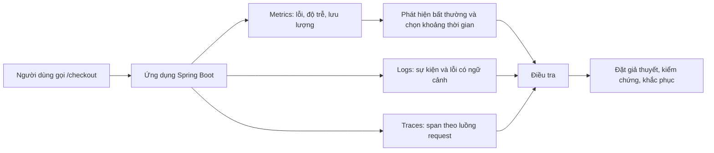

# Khác biệt giữa monitoring và observability

Trong một ứng dụng Spring Boot chạy ở môi trường thực, biết rằng CPU đang ở mức 90% hoặc tỷ lệ lỗi HTTP 5xx vừa tăng là thông tin hữu ích. Nhưng nếu người dùng chỉ gặp lỗi khi thanh toán bằng một phương thức cụ thể, trong một phiên bản triển khai cụ thể, câu hỏi khó hơn là: **Vì sao điều đó xảy ra, yêu cầu bị chậm ở bước nào và những người dùng nào chịu ảnh hưởng?**

**Monitoring (giám sát)** giúp phát hiện và theo dõi tình trạng hệ thống bằng những chỉ số, ngưỡng và điều kiện đã xác định. **Observability (khả năng quan sát và suy luận trạng thái hệ thống)** giúp điều tra hành vi bên trong hệ thống từ các tín hiệu mà nó phát ra, kể cả khi câu hỏi cần trả lời chưa được dự đoán từ trước.

Trong module **SPRING_BOOT_OBSERVABILITY**, hai khái niệm này là nền tảng để hiểu cách Micrometer Observation kết nối metrics, logs và distributed tracing; vì sao cần propagation ngữ cảnh, quản lý tag/cardinality, exporter và sampling; và cách liên kết các tín hiệu khi điều tra lỗi hoặc độ trễ.

## Mục tiêu học tập

Sau bài này, bạn có thể:

1. Giải thích monitoring và observability bằng cùng một tình huống vận hành, đồng thời chỉ ra mối quan hệ giữa chúng.
2. Phân biệt **phát hiện triệu chứng** với **điều tra nguyên nhân**; hiểu vì sao dashboard và cảnh báo hữu ích nhưng không đủ cho mọi sự cố.
3. Chọn đúng vai trò của metrics, logs và traces khi phân tích một yêu cầu đi qua nhiều thành phần Spring Boot.
4. Nhận diện các yêu cầu kỹ thuật để hệ thống thực sự có khả năng quan sát: ngữ cảnh liên kết, dữ liệu có cấu trúc, độ phủ, cardinality, sampling và chi phí.
5. Phác thảo cách bổ sung tín hiệu quan sát cho một luồng nghiệp vụ Spring Boot mà không làm tăng dữ liệu một cách thiếu kiểm soát.

## 1. Monitoring là gì?

Monitoring là quá trình **thu thập, tổng hợp, theo dõi và đối chiếu tín hiệu với trạng thái mong đợi** để biết hệ thống có hoạt động theo mục tiêu hay không. Một hệ thống monitoring thường trả lời các câu hỏi đã biết trước:

- Dịch vụ có đang chạy và sẵn sàng phục vụ yêu cầu không?
- Tỷ lệ HTTP 5xx trong năm phút gần đây có vượt ngưỡng cảnh báo không?
- Độ trễ p95 của API thanh toán có vượt mục tiêu đã cam kết không?
- CPU, bộ nhớ heap, số kết nối cơ sở dữ liệu và độ dài hàng đợi có bất thường không?
- Số giao dịch thành công hôm nay có giảm so với khoảng thời gian tương đương không?

Quy trình điển hình là **xác định mục tiêu → chọn tín hiệu đo → xây dựng dashboard/cảnh báo → phát hiện bất thường → xử lý**. Ví dụ, đội vận hành đặt quy tắc: nếu tỷ lệ lỗi thanh toán vượt 2% trong 10 phút thì gửi cảnh báo. Khi điều kiện xảy ra, monitoring cho biết *có vấn đề đang diễn ra* và *mức độ ảnh hưởng có thể đáng chú ý*.

Monitoring có thể sử dụng metrics, logs, traces, synthetic checks, sự kiện nghiệp vụ hoặc thông tin hạ tầng. Vì vậy, định nghĩa “monitoring chỉ dùng metrics” là quá hẹp. Điểm phân biệt cốt lõi là **cách sử dụng tín hiệu để theo dõi những trạng thái và tình huống đã định nghĩa**.

### Điểm mạnh và giới hạn

Monitoring đặc biệt hiệu quả khi đã biết điều gì quan trọng: tình trạng phục vụ người dùng, chỉ số độ tin cậy, dung lượng, hiệu năng, mức tiêu thụ tài nguyên. Nó giúp phát hiện sớm và xác định ưu tiên phản ứng.

Tuy nhiên, một cảnh báo “p95 vượt 1 giây” chưa thể tự trả lời vì sao API chậm. Mức trung bình hoặc tổng theo phút cũng có thể che khuất một nhóm yêu cầu hiếm gặp: chẳng hạn chỉ các giao dịch có một điều kiện nghiệp vụ đặc biệt mới bị treo. Nếu hệ thống chỉ lưu vài đồ thị tổng hợp, kỹ sư sẽ khó phân tích những chiều dữ liệu chưa được dự kiến.

## 2. Observability là gì?

Trong kỹ thuật hệ thống, observability mô tả **mức độ có thể suy luận về trạng thái và hành vi bên trong từ các tín hiệu quan sát được ở bên ngoài**. Với phần mềm, các tín hiệu đó gồm dữ liệu do ứng dụng, hạ tầng và các thành phần liên quan tạo ra: metrics, structured logs, distributed traces, sự kiện thay đổi cấu hình/triển khai, và đôi khi profiling.

Một hệ thống có observability tốt cho phép kỹ sư đặt các câu hỏi phát sinh **sau khi** gặp sự cố:

- Những request lỗi có chung phiên bản triển khai, route hay dependency nào?
- Độ trễ nằm ở xử lý ứng dụng, truy vấn cơ sở dữ liệu, hàng đợi hay lời gọi dịch vụ ngoài?
- Một request từ API gateway đã đi qua những service nào; ở span nào thời gian tăng mạnh?
- Có lỗi trong log của cùng trace, cùng khoảng thời gian và cùng phiên bản không?
- Dấu hiệu bắt đầu từ lúc nào, trùng với thay đổi hệ thống nào, và giả thuyết nguyên nhân có được nhiều tín hiệu xác nhận không?

Observability **không đồng nghĩa với tự động tìm ra nguyên nhân gốc**. Nó cung cấp dữ liệu và ngữ cảnh để hình thành, kiểm tra và bác bỏ giả thuyết. Đôi khi vẫn cần tái hiện lỗi, xem cấu hình, kiểm tra cơ sở dữ liệu, profiling hoặc đọc mã nguồn.

### Mối quan hệ giữa hai khái niệm

Monitoring và observability **bổ sung cho nhau**. Monitoring là một hoạt động vận hành quan trọng được hỗ trợ bởi năng lực observability; observability cũng hỗ trợ điều tra tự do, phân tích hiệu năng và hiểu hành vi chưa lường trước.

Một hệ thống có thể có nhiều dashboard và cảnh báo nhưng khả năng điều tra rất hạn chế nếu log thiếu ngữ cảnh và trace bị đứt giữa các service. Ngược lại, một hệ thống thu thập nhiều trace nhưng chưa có SLO hay cảnh báo hữu ích vẫn có thể phát hiện sự cố quá muộn.

| Khía cạnh | Monitoring | Observability |
|---|---|---|
| Câu hỏi điển hình | “Hệ thống có khỏe theo mục tiêu đã đặt không?” | “Điều gì đang xảy ra bên trong và vì sao biểu hiện này xuất hiện?” |
| Điểm bắt đầu | Chỉ số, trạng thái, ngưỡng và hành vi quan tâm đã xác định | Một triệu chứng hoặc câu hỏi có thể chưa từng được dự đoán |
| Hoạt động nổi bật | Dashboard, cảnh báo, SLI/SLO, theo dõi xu hướng | Tương quan tín hiệu, phân tích theo ngữ cảnh, truy vấn và khoanh vùng nguyên nhân |
| Dữ liệu có thể dùng | Metrics, logs, traces, checks, events | Cũng các tín hiệu đó, nhưng chú trọng độ phủ, cấu trúc và liên kết |
| Kết quả mong đợi | Phát hiện vấn đề, ước lượng tác động, đánh giá mục tiêu | Hiểu đường đi và điều kiện xảy ra, củng cố hoặc bác bỏ giả thuyết |
| Rủi ro nếu triển khai kém | Chỉ cảnh báo khi điều kiện đã dự liệu; quá nhiều báo động nhiễu | Thiếu ngữ cảnh, dữ liệu đứt đoạn, truy vấn khó, chi phí thu thập cao |

Không nên phân loại một công cụ chỉ qua tên gọi “monitoring platform” hay “observability platform”: sản phẩm thực tế thường làm cả hai việc. Điều quan trọng hơn là **người vận hành có thể trả lời được những câu hỏi nào** từ dữ liệu sẵn có.

## 3. Metrics, logs và traces giải quyết các câu hỏi khác nhau

Ba tín hiệu thường được gọi là ba trụ cột của observability. Chúng hữu ích nhất khi **kết hợp được với nhau**, chứ không phải khi thu thập riêng rẽ.

### Metrics: hệ thống đang thay đổi ở mức độ nào?

Metric biểu diễn một phép đo theo thời gian, ví dụ:

- Số request trong một giây và tỷ lệ lỗi.
- Phân bố thời gian phản hồi, p95/p99.
- Bộ nhớ JVM, hoạt động garbage collector, số connection đang dùng.
- Số giao dịch thành công/thất bại theo loại thao tác.

Metrics phù hợp với tổng hợp, so sánh xu hướng, dashboard và cảnh báo. Chúng thường gắn **label/tag có số giá trị phân biệt thấp** như `method=POST`, `route=/checkout`, `status=500` hoặc `application=checkout-service`.

Một đồ thị tăng độ trễ cho biết *khi nào* và *mức độ* bất thường, nhưng một điểm dữ liệu tổng hợp thường không chứa đầy đủ các bước đã diễn ra trong request.

### Logs: sự kiện cụ thể nào đã xảy ra?

Log ghi lại các sự kiện tại một thời điểm, chẳng hạn “không lấy được kết nối DB”, “gateway thanh toán trả timeout” hoặc “thử lại lần thứ ba”. Structured log dùng các trường có tên thay vì nhét mọi thông tin vào chuỗi văn bản khó tìm kiếm.

Ví dụ minh họa (giá trị giả lập):

```json
{
  "timestamp": "2026-03-12T09:02:15Z",
  "level": "WARN",
  "service": "checkout-service",
  "event": "payment_gateway_timeout",
  "traceId": "4a9f6d84a3b94162b33e847fc9840f15",
  "spanId": "e2b13a4c9d8706f1",
  "gateway": "provider-a",
  "durationMs": 1500
}
```

Log rất hữu ích để đọc thông điệp lỗi, trạng thái điều kiện và bằng chứng cụ thể. Tuy nhiên, nếu log không có `traceId`, tên service, thời điểm chuẩn hóa hoặc trường dễ tìm, việc ghép các sự kiện xuyên dịch vụ sẽ tốn công. Log cũng không tự cho thấy đầy đủ thứ tự, quan hệ cha–con và thời lượng của mọi thao tác.

### Distributed traces: một yêu cầu đã đi qua đâu?

Trace mô tả một luồng xử lý gồm nhiều **span**, trong đó mỗi span đại diện cho một thao tác có thời điểm bắt đầu, kết thúc, ngữ cảnh và thuộc tính. Các span có quan hệ cha–con hoặc quan hệ liên kết phù hợp với cách công việc được thực hiện.

Ví dụ một request đặt hàng:

```text
Trace: POST /checkout                                    1.850 ms
├── checkout-service: validate-cart                       35 ms
├── inventory-service: reserve-stock                     140 ms
├── payment-service: authorize                         1.590 ms
│   └── HTTP request tới payment-provider              1.510 ms
└── checkout-service: persist-order                       60 ms
```

Các thời lượng ở đây chỉ minh họa. Khi xem trace, kỹ sư nhận ra nhánh thanh toán chiếm phần lớn thời gian và có thể đối chiếu với log timeout. Tuy vậy, **một trace chậm không đủ chứng minh mọi request chậm cùng một nguyên nhân**; cần xem phân bố, tập trace liên quan và các số liệu độc lập.

Trace còn có giới hạn: sampling có thể khiến một phần yêu cầu không được lưu; span thiếu instrumentation sẽ tạo khoảng trống; propagation sai có thể làm trace bị đứt giữa HTTP, messaging hoặc tác vụ bất đồng bộ.

### Vì sao cần liên kết tín hiệu?



Metrics giúp **chọn vùng cần điều tra**, traces giúp **định vị đoạn xử lý**, logs giúp **đọc chi tiết sự kiện**. Một pipeline tốt còn gắn các tín hiệu với tên service, môi trường, phiên bản triển khai và ngữ cảnh trace thống nhất. Khi hệ thống hỗ trợ *exemplar*, một mẫu đo trên biểu đồ metric có thể dẫn tới trace tương ứng; không phải backend hay cấu hình nào cũng có tính năng này.

## 4. Cùng một sự cố: chỉ monitoring và kết hợp observability

Giả sử một hệ thống thương mại điện tử gồm Spring Boot API gateway, checkout-service, inventory-service, payment-service và một cơ sở dữ liệu. Lúc 09:00 sau khi triển khai phiên bản mới, p95 của `POST /checkout` tăng từ 300 ms lên 1,8 giây; tỷ lệ 5xx tăng lên 3%. Các con số là tình huống giả định.

### Bước 1 — Monitoring phát hiện và xác định mức độ

Dashboard và cảnh báo trả lời được:

- Sự cố bắt đầu khoảng 09:00.
- Route thanh toán bị ảnh hưởng nhiều hơn các route khác.
- Độ trễ và tỷ lệ lỗi đều tăng; cần ưu tiên xử lý.
- CPU toàn cụm tương đối bình thường, nên “CPU cao” chưa phải giả thuyết có bằng chứng.

Đây là đầu ra vận hành có giá trị. Nhưng với những dữ liệu này, ta chưa thể kết luận lỗi nằm ở database, mạng, provider thanh toán hay bản triển khai.

### Bước 2 — Observability giúp khoanh vùng và kiểm chứng

1. **Đặt câu hỏi theo ngữ cảnh:** request lỗi tập trung vào phiên bản mới, một vùng triển khai hay một phương thức thanh toán? Dùng metric label có cardinality hợp lý và dữ liệu chi tiết từ log/trace.
2. **Chọn nhóm trace liên quan:** tìm các trace chậm hoặc lỗi trong khoảng 09:00–09:15. So sánh nhiều trace để xem bước nào lặp lại triệu chứng.
3. **Định vị khoảng chậm:** các trace chỉ ra span gọi payment provider thường kéo dài khoảng 1,5 giây, trong khi bước inventory giữ thời lượng bình thường.
4. **Liên kết log:** tìm log cùng `traceId`, thấy nhiều sự kiện timeout gọi provider. Đối chiếu mã lỗi, retry, thời điểm và giới hạn kết nối.
5. **Kiểm chứng giả thuyết:** kiểm tra metric kết nối HTTP, cấu hình timeout/retry, sự kiện deployment và số liệu của provider; có thể tái hiện yêu cầu trong môi trường kiểm thử phù hợp.
6. **Đo sau khắc phục:** xác minh độ trễ, tỷ lệ lỗi và hành vi retry trở về ngưỡng mong đợi; theo dõi thêm để chắc rằng thay đổi không gây tác động mới.

Đường điều tra này đi từ “người dùng đang gặp vấn đề” đến “đoạn xử lý nào bất thường và có bằng chứng gì”. Nếu trace cho thấy DB bị chờ khóa thay vì HTTP provider chậm, giả thuyết cần đổi theo bằng chứng. Observability tốt làm cho việc **điều chỉnh giả thuyết** trở nên nhanh và có cơ sở.

## 5. Áp dụng trong Spring Boot với Micrometer

Spring Boot dùng hệ sinh thái **Micrometer** để đưa các quan sát ứng dụng vào quy trình metrics/tracing. Trong Spring Boot 3.x, **Micrometer Observation** cung cấp API biểu diễn một thao tác được quan sát; các `ObservationHandler` được đăng ký có thể biến thao tác đó thành đo lường và/hoặc span tùy cấu hình.

Các thành phần thường gặp:

| Thành phần | Vai trò trong tình huống Spring Boot |
|---|---|
| Spring Boot Actuator | Cung cấp health, metrics và điểm tích hợp instrumentation/observability |
| Micrometer Metrics | Ghi và xuất các phép đo: timer, counter, gauge, phân bố độ trễ |
| Micrometer Observation | API chung để mô tả hoạt động và gắn ngữ cảnh, tag cho một thao tác |
| Micrometer Tracing | Cầu nối giữa observation và trace context/span thông qua tracing implementation |
| OpenTelemetry/Zipkin và exporter tương ứng | Truyền dữ liệu trace tới collector/backend phù hợp |
| Logging framework và log collector | Ghi, tập trung và truy vấn log; có thể kết hợp `traceId`/`spanId` khi ngữ cảnh tracing được tích hợp |
| Backend như Prometheus, Grafana, Tempo, Jaeger hoặc hệ tương đương | Lưu trữ, truy vấn, biểu diễn và liên kết tín hiệu; khả năng cụ thể phụ thuộc cấu hình từng sản phẩm |

### Ví dụ cấu hình tối thiểu

Với **Spring Boot 3.x** và Gradle, các dependency minh họa cho metrics Prometheus và tracing OpenTelemetry có thể là:

```groovy
dependencies {
    implementation 'org.springframework.boot:spring-boot-starter-actuator'
    runtimeOnly 'io.micrometer:micrometer-registry-prometheus'

    implementation 'io.micrometer:micrometer-tracing-bridge-otel'
    runtimeOnly 'io.opentelemetry:opentelemetry-exporter-otlp'
}
```

Một ví dụ `application.yml`:

```yaml
management:
  endpoints:
    web:
      exposure:
        include: health,info,prometheus
  metrics:
    tags:
      application: checkout-service
  tracing:
    sampling:
      probability: 0.10
  otlp:
    tracing:
      endpoint: http://otel-collector:4318/v1/traces
```

Trong ví dụ này, `/actuator/prometheus` là endpoint để hệ thống thu thập metrics khi đã có Prometheus registry; nó cần được giới hạn truy cập phù hợp với môi trường triển khai. Địa chỉ `otel-collector` là địa chỉ minh họa và chỉ dùng được khi có collector tương ứng. Xác suất sampling `0.10` nghĩa là mục tiêu lấy mẫu khoảng 10% trace theo cơ chế sampling đang cấu hình; nó **không** có nghĩa chỉ thu 10% metric. Tên property, dependency và cách exporter tự cấu hình cần đối chiếu với phiên bản Spring Boot thực tế của dự án.

Spring Boot/Actuator có instrumentation sẵn cho nhiều thao tác HTTP và thư viện tích hợp, nhưng **không tự suy ra mọi bước nghiệp vụ**. Nếu muốn biết riêng thời lượng bước xác thực thanh toán, ta có thể tạo observation cho nó:

```java
import io.micrometer.observation.Observation;
import io.micrometer.observation.ObservationRegistry;
import org.springframework.stereotype.Service;

@Service
class CheckoutService {
    private final ObservationRegistry observationRegistry;
    private final PaymentGateway paymentGateway;

    CheckoutService(ObservationRegistry observationRegistry,
                    PaymentGateway paymentGateway) {
        this.observationRegistry = observationRegistry;
        this.paymentGateway = paymentGateway;
    }

    PaymentResult authorize(PaymentRequest request) {
        return Observation.createNotStarted(
                    "checkout.payment.authorize", observationRegistry)
                .contextualName("authorize-payment")
                .lowCardinalityKeyValue("operation", "authorize")
                .observe(() -> paymentGateway.authorize(request));
    }
}
```

`PaymentGateway`, `PaymentRequest` và `PaymentResult` ở đây là các kiểu nghiệp vụ giả định. Observation giúp biểu diễn ranh giới thao tác; tùy các handler đã đăng ký, hệ thống có thể ghi thời lượng vào metrics và tạo span cho trace. Nó không thay thế cơ chế retry, xử lý ngoại lệ, timeout hay ghi log cần thiết của nghiệp vụ.

### Propagation giữ chuỗi nguyên nhân qua nhiều thành phần

Khi request đi từ API gateway sang checkout-service rồi payment-service, tracing cần **truyền trace context** qua HTTP headers, message headers hoặc cơ chế phù hợp. W3C Trace Context thường sử dụng header `traceparent` để duy trì mối liên hệ giữa các span. Nếu context không được truyền hoặc khôi phục đúng, backend có thể hiển thị nhiều trace rời rạc dù chúng xuất phát từ cùng một giao dịch.

Trong Spring Boot, nên dùng các HTTP client và integration đã được instrument; các tác vụ chạy thread khác, queue hoặc xử lý bất đồng bộ cần kiểm tra propagation trong thực tế. Không nên mặc định rằng chỉ thêm một dependency tracing là mọi luồng nghiệp vụ đều được liên kết.

Khi logging được tích hợp tracing, `traceId` và `spanId` có thể xuất hiện trong MDC/log pattern hoặc structured log. Đây là cầu nối hiệu quả giữa lỗi cụ thể và trace đang xem. **Không đưa thông tin cá nhân, token hay nội dung thanh toán nhạy cảm vào log, span attribute hoặc baggage** để đổi lấy khả năng tìm kiếm.

## 6. Tag, cardinality và sampling: thu thập đủ để điều tra

Observability không có nghĩa thu thập vô hạn. Khả năng truy vấn tốt cần dữ liệu có thiết kế và một ngân sách chi phí rõ ràng.

### Low cardinality và high cardinality

**Cardinality** là số lượng giá trị phân biệt có thể xuất hiện trong một chiều dữ liệu. Với metric đa nhãn, mỗi tổ hợp label có thể tạo một time series riêng. Nếu thêm `orderId` vào label của metric thời lượng checkout, hàng triệu đơn hàng có thể tạo hàng triệu chuỗi, làm tăng chi phí lưu trữ, truy vấn và rủi ro quá tải.

| Dữ liệu | Vị trí thường phù hợp | Lý do |
|---|---|---|
| `method=POST`, `route=/checkout` | Metric tag | Tập giá trị nhỏ, hữu ích để tổng hợp và cảnh báo |
| `status=200/500` hoặc nhóm mã trạng thái | Metric tag | Dùng để tính tỷ lệ thành công/lỗi |
| `operation=authorize` | Low-cardinality observation tag | Cố định theo loại thao tác, so sánh được giữa request |
| `traceId`, mã đơn hàng, request ID | Log hoặc thuộc tính trace có kiểm soát | Tìm kiếm một yêu cầu cụ thể; không phù hợp làm metric label |
| Email, số thẻ, access token | Không thu thập như telemetry thông thường | Rủi ro bảo mật và riêng tư; nên loại bỏ/ẩn theo chính sách |

Micrometer Observation phân biệt **low-cardinality key values** và **high-cardinality key values** để các handler có thể sử dụng thích hợp. High-cardinality thường có thể gắn vào trace, nhưng vẫn cần giới hạn độ dài, dữ liệu nhạy cảm và chi phí. Không dùng raw URL chứa ID động làm metric tag; nên dùng route mẫu như `/orders/{id}`.

### Sampling không phải mất toàn bộ khả năng quan sát

Ở hệ thống lưu lượng cao, giữ mọi trace có thể tốn kém. Sampling chọn một phần trace để lưu; tỷ lệ chọn phụ thuộc mục tiêu, tải và khả năng backend. Cần hiểu rằng:

- Một request không được ghi trace vẫn có thể được tính trong metric tổng hợp và có log, tùy pipeline.
- Sampling quá thấp có thể bỏ sót lỗi hiếm; nên kiểm tra chính sách lấy mẫu và khả năng giữ lại trace lỗi/chậm của stack thực tế.
- Trace được giữ lại cần đủ context và span để điều tra; lấy nhiều trace bị đứt đôi khi ít hữu ích hơn lấy ít trace hoàn chỉnh.
- Khi phân tích tỷ lệ lỗi hoặc phân bố toàn bộ lưu lượng, ưu tiên metric được đo phù hợp; **không coi tập trace mẫu là toàn bộ request** nếu chưa biết cách sampling ảnh hưởng kết quả.

Đối với logs cũng cần giới hạn mức độ chi tiết, thời gian lưu và quy tắc loại bỏ thông tin nhạy cảm. Mục tiêu là giữ dữ liệu đủ để giải thích hành vi quan trọng với chi phí và rủi ro có thể kiểm soát.

## 7. Monitoring gắn với SLI/SLO; observability giúp xử lý khi SLO bị đe dọa

Một đội vận hành cần định nghĩa rõ người dùng coi điều gì là “dịch vụ hoạt động tốt”, thay vì chỉ theo dõi tài nguyên máy chủ.

- **SLI (Service Level Indicator):** phép đo chất lượng phục vụ, ví dụ tỷ lệ checkout thành công hoặc tỷ lệ request hoàn tất trong ngưỡng thời gian.
- **SLO (Service Level Objective):** mục tiêu đặt cho SLI trong một khoảng thời gian, ví dụ “ít nhất 99,9% giao dịch checkout hợp lệ thành công trong 30 ngày”.
- **Cảnh báo:** chỉ ra nguy cơ không đạt mục tiêu, thường dựa trên lỗi, độ trễ hoặc tốc độ tiêu thụ error budget.

Metrics và quy tắc cảnh báo là trung tâm của monitoring ở bước này. Khi SLI xấu đi, kỹ sư dùng traces, logs và thông tin thay đổi hệ thống để trả lời *tại sao* và *phải can thiệp ở đâu*.

Ví dụ, dashboard hạ tầng báo CPU ổn không chứng minh người dùng có trải nghiệm tốt. Nếu SLO của checkout bị vi phạm vì một dependency chậm, việc nhìn vào **tín hiệu theo hành trình người dùng** sẽ dẫn nhóm xử lý tới đúng vị trí hơn là chỉ nhìn trạng thái từng máy.

## 8. Thiết kế observability từ câu hỏi vận hành

Trước khi bổ sung hàng trăm metric hay log, hãy chọn một hành trình quan trọng như “đặt hàng → giữ hàng → thanh toán → lưu đơn” và tự hỏi:

1. **Phát hiện:** dấu hiệu nào cho thấy người dùng đang gặp lỗi hoặc chờ quá lâu? Chọn throughput, tỷ lệ lỗi, độ trễ và tín hiệu nghiệp vụ liên quan.
2. **Khoanh vùng:** có thể tách kết quả theo tên service, route mẫu, thao tác, môi trường và phiên bản triển khai không?
3. **Liên kết:** khi chọn một request lỗi, có tìm được trace của nó rồi nhảy tới log cùng ngữ cảnh không?
4. **Độ phủ:** có span/log ở ranh giới HTTP, database, message queue và lời gọi quan trọng không? Có đoạn nào mất trace context?
5. **Kiểm soát:** tag nào có cardinality cao, phần nào cần sampling, dữ liệu nào không được thu thập, ai được truy cập?
6. **Phản hồi:** cảnh báo có dựa trên tác động người dùng và mục tiêu dịch vụ không? Sau sửa lỗi, có số liệu để xác nhận hồi phục không?

Một kế hoạch thực tế có thể triển khai theo thứ tự: instrument các entry point và dependency quan trọng; tạo metric SLI và cảnh báo; chuẩn hóa log với service/trace context; nối trace giữa các dịch vụ; bổ sung observation cho bước nghiệp vụ có giá trị; cuối cùng đánh giá khả năng truy vấn và chi phí dựa trên các sự cố đã gặp.

### Những ngộ nhận cần tránh

| Ngộ nhận | Cách hiểu đúng |
|---|---|
| “Có dashboard là đã có observability.” | Dashboard là một giao diện. Khả năng điều tra phụ thuộc độ phủ, ngữ cảnh và dữ liệu phía sau. |
| “Monitoring đã lỗi thời, nên thay hoàn toàn bằng tracing.” | Monitoring vẫn cần cho phát hiện, cảnh báo và theo dõi SLO; tracing bổ sung ngữ cảnh xử lý. |
| “Càng nhiều dữ liệu càng quan sát tốt.” | Dữ liệu nhiễu, cardinality cao, không thể liên kết hoặc lộ thông tin nhạy cảm có thể khiến hệ thống tệ hơn. |
| “Một trace chậm chứng minh nguyên nhân gốc.” | Trace là bằng chứng về một luồng thực thi; cần kiểm chứng bằng log, metric và các sự kiện liên quan. |
| “Thêm tracing dependency sẽ tự theo dõi mọi nghiệp vụ.” | Instrumentation và propagation có giới hạn; các bước nghiệp vụ cần quan sát riêng khi cần thiết. |
| “Không thấy trace lỗi nghĩa là lỗi không xảy ra.” | Trace có thể không được lấy mẫu, xuất đi hoặc liên kết thành công. Cần kiểm tra pipeline và metric/log khác. |

## 9. Tự đánh giá bằng một tình huống

**Tình huống:** Lúc 15:20, p99 của API `POST /orders` tăng gấp bốn lần nhưng CPU và heap đều bình thường. Một số khách hàng báo bị tạo đơn trùng sau khi nhấn lại nút thanh toán.

**Monitoring nên cho biết:** lưu lượng, tỷ lệ lỗi, phân bố độ trễ, số đơn trùng và thời điểm các tín hiệu thay đổi; cảnh báo dựa trên SLI/SLO phù hợp.

**Observability cần giúp kiểm tra:** request nào bị retry, span nào tăng thời lượng, timeout xuất hiện ở lời gọi nào, có thông điệp lỗi nào cùng `traceId`, cơ chế idempotency đang hoạt động ra sao, và có thay đổi triển khai hoặc cấu hình liên quan không.

**Kết luận điều tra chưa thể đưa ra ngay:** CPU bình thường không loại trừ DB lock, nghẽn pool, chờ network hoặc provider bên ngoài. Việc có đơn trùng cũng chưa chứng minh retry là nguyên nhân duy nhất; cần đối chiếu trace, log và dữ liệu nghiệp vụ.

Đó chính là khác biệt thực hành: **monitoring cho biết hệ thống đang lệch khỏi mục tiêu ở đâu và khi nào; observability cung cấp khả năng lần theo bằng chứng để hiểu hành vi gây ra sự lệch đó**. Với Spring Boot, Micrometer Observation, metrics, logs, tracing và propagation là những cơ chế bổ sung cho nhau để đạt được cả hai mục đích.
