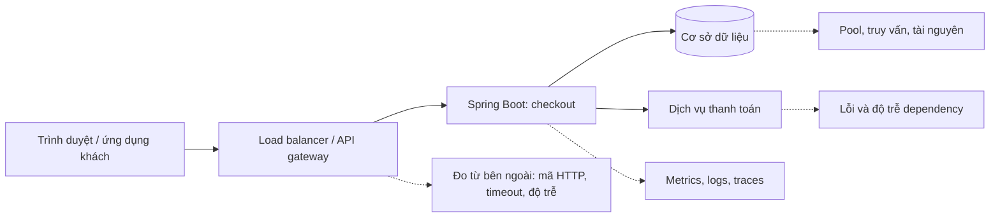

# Tín hiệu từ bên ngoài và trạng thái bên trong

Một ứng dụng Spring Boot trả về `UP` ở `/actuator/health`, CPU chỉ dùng 35%, nhưng người dùng vẫn liên tục gặp lỗi thanh toán. Trạng thái *có vẻ bình thường* của một tiến trình chưa đủ chứng minh trải nghiệm của người dùng đang tốt. Ngược lại, chỉ biết có nhiều yêu cầu HTTP bị timeout cũng chưa cho biết lỗi nằm ở gateway, ứng dụng, cơ sở dữ liệu hay dịch vụ thanh toán.

Đó là bài toán cốt lõi của **observability**: sử dụng những tín hiệu có thể quan sát để đặt giả thuyết, suy luận và kiểm chứng **trạng thái bên trong** của hệ thống đang chạy. Với Spring Boot, Micrometer Observation, metrics, logs và distributed tracing giúp xây dựng chuỗi bằng chứng này.

Sau bài học, bạn có thể:

1. Phân biệt **triệu chứng nhìn từ bên ngoài** với **trạng thái và nguyên nhân ở bên trong** ứng dụng.
2. Giải thích metrics, logs và traces tiết lộ những phần khác nhau của một sự cố, kể cả giới hạn của từng loại tín hiệu.
3. Chọn điểm đo phù hợp ở client, gateway, ứng dụng và các dependency; biết khi nào tín hiệu giữa các lớp có thể mâu thuẫn.
4. Thiết lập quan sát cơ bản trong Spring Boot, tạo custom `Observation` và liên kết dữ liệu bằng trace context.
5. Tránh những kết luận sai do thiếu instrumentation, sampling, mất context hoặc gắn tag có cardinality quá cao.

## 1. Từ đầu ra quan sát được đến trạng thái bên trong

Hãy xem một request `POST /checkout` đi qua các thành phần sau:



**Trạng thái bên trong** có thể bao gồm số request đang xử lý, số kết nối đang chờ trong connection pool, hàng đợi tác vụ, số lần retry, thời gian chờ dependency, lỗi nghiệp vụ hoặc khóa bị tranh chấp. Phần lớn trạng thái đó không hiện trực tiếp trên màn hình người dùng.

**Tín hiệu quan sát được** là những gì hệ thống thể hiện ra: HTTP `504`, thời gian hoàn tất một request, giá trị một bộ đếm, dòng log, span trong trace, trạng thái health check hoặc kết quả một phép thử tổng hợp (synthetic check).

Có thể hình dung quá trình này như sau:

```text
Trạng thái nội bộ + tác động từ môi trường
                 |
                 v
       Hành vi và tín hiệu phát ra
                 |
                 v
    Quan sát -> Đặt giả thuyết -> Kiểm chứng
```

Từ một tín hiệu, **không nhất thiết suy ra duy nhất một nguyên nhân**. Ví dụ p95 latency tăng có thể do lock ở database, dependency chậm, CPU bão hòa, hàng đợi, mạng hoặc retry. Tăng độ quan sát có nghĩa là thu thập *đủ tín hiệu độc lập và liên kết được chúng* để phân biệt các giả thuyết, thay vì cố suy ra nguyên nhân chỉ từ một số liệu.

Trong vận hành, có hai góc nhìn bổ sung cho nhau:

- **Quan sát từ bên ngoài (black-box):** Đo cái mà người dùng hoặc một hệ thống gọi API thực sự nhận được, ví dụ thời gian tải trang, tỷ lệ thanh toán thành công, HTTP `502/504` tại gateway, khả năng kết nối từ một khu vực mạng.
- **Quan sát bằng instrumentation bên trong (white-box):** Đo việc ứng dụng và hạ tầng đang làm, ví dụ `http.server.requests`, mức dùng connection pool, lỗi Java, span gọi HTTP sang dịch vụ khác, thời gian query.

Hai cách gọi này nói về **vị trí đo**. Còn metrics, logs, traces nói về **hình thức tín hiệu**: một metric có thể được đo tại gateway hoặc trong JVM; một log có thể phát ra từ proxy hoặc ứng dụng.

## 2. Cùng một sự cố, mỗi vị trí nhìn thấy điều khác nhau

| Vị trí quan sát | Tín hiệu có thể thấy | Điều chưa chắc kết luận được |
| --- | --- | --- |
| Trình duyệt, mobile app, synthetic probe | Request thất bại, thời gian tải, trải nghiệm từ một địa điểm cụ thể | Lỗi thuộc service nào trong hệ thống |
| CDN, ingress, API gateway | Tổng số request đi vào, `502/503/504`, timeout, upstream latency | Request có đi vào controller hay bị chặn trước đó |
| Spring Boot HTTP server | Request tới ứng dụng, mã phản hồi, timer HTTP, exception đã được ghi nhận | Request chưa từng tới ứng dụng; toàn bộ thời gian mạng phía client |
| Business service và dependency client | Bước xử lý, thời gian gọi API, retry, lỗi nghiệp vụ | Trải nghiệm cuối cùng của client nếu gateway đã timeout |
| Database, JVM, container, host | Kết nối, thread, heap, GC, CPU, I/O, locks, độ bão hòa | Một tài nguyên bận có thực sự là nguyên nhân gây lỗi người dùng hay không |

Ví dụ, gateway đặt timeout 2 giây. Một request mất 3 giây tại ứng dụng có thể dẫn đến **gateway trả `504`**, trong khi ứng dụng vẫn tiếp tục xử lý và sau đó ghi nhận phản hồi HTTP thành công trong log hoặc metric của riêng nó. Vì vậy, tỷ lệ lỗi tính từ gateway và tỷ lệ `5xx` tính ở ứng dụng **có thể khác nhau** mà không có hệ thống đo nào bị hỏng.

Tương tự, endpoint `health` báo `UP` thường chỉ phản ánh các điều kiện được health indicator kiểm tra tại thời điểm gọi. Nó không phải là một phép thử hoàn chỉnh về mọi luồng nghiệp vụ. Một probe `GET /actuator/health` thành công không chứng minh `POST /checkout` có thể hoàn tất.

**Quy tắc thực hành:** dùng phép đo gần trải nghiệm người dùng để nhận diện *mức độ ảnh hưởng*; dùng telemetry bên trong để điều tra *cơ chế gây ảnh hưởng*; sau đó dùng phép đo bên ngoài để xác nhận biện pháp xử lý có hiệu quả.

## 3. Metrics, logs và traces cho biết những gì?

Ba loại tín hiệu phổ biến trong hệ sinh thái Spring Boot là **metrics**, **logs** và **traces**. Chúng bổ sung cho nhau, không có loại nào thay thế hoàn toàn hai loại còn lại.

| Loại tín hiệu | Đơn vị chính | Câu hỏi trả lời tốt | Hạn chế điển hình |
| --- | --- | --- | --- |
| **Metrics** | Số đo tổng hợp theo thời gian và tập tag | Lỗi tăng từ khi nào? Bao nhiêu request/giây? p95 latency là bao nhiêu? Pool có bão hòa không? | Dữ liệu tổng hợp thường không chỉ ra request cụ thể hoặc nguyên nhân duy nhất |
| **Logs** | Bản ghi của một sự kiện có ngữ cảnh | Điều gì đã xảy ra ở bước xử lý này? Exception nào? Chính sách retry có được áp dụng? | Khó nhìn xu hướng nếu chỉ đọc từng dòng; thiếu cấu trúc hoặc liên kết sẽ khó tìm kiếm |
| **Distributed traces** | Trace gồm các span có quan hệ cha–con | Request đi qua service nào? Bước nào tiêu tốn thời gian? Một lời gọi downstream có thất bại không? | Có thể bị sampling; không bao phủ bước chưa được instrument; span chậm chưa tự chứng minh nguyên nhân |

Một trace có thể giống như sau (thời lượng minh họa):

```text
traceId = 7d0a...e41f
POST /checkout                   1 850 ms
  ├─ validate-order                 12 ms
  ├─ inventory.reserve             38 ms
  └─ payment.authorize          1 740 ms
       └─ HTTP POST /authorize  1 720 ms
```

Trace giúp khoanh vùng thời gian chủ yếu nằm ở `payment.authorize`. Để biết vì sao nó chậm, còn cần xem timeout của dependency, retry, network và các log/metric liên quan. Một span ghi thời gian dài chỉ mô tả **nơi thời gian trôi qua**, chưa tự kết luận *nguyên nhân gốc*.

Các hệ thống cũng có thể sử dụng profiling, sự kiện triển khai, audit event và thông tin cấu hình. Chúng là bằng chứng bổ trợ quan trọng; cách gọi “ba trụ cột” không có nghĩa observability chỉ giới hạn trong đúng ba loại dữ liệu.

### Liên kết tín hiệu bằng ngữ cảnh chung

Để nối một request ở gateway, ứng dụng và dependency, nên thống nhất một số chiều ngữ cảnh:

| Trường | Công dụng | Lưu ý |
| --- | --- | --- |
| `service.name`, môi trường, phiên bản triển khai | Phân biệt nơi phát tín hiệu và lần phát hành | Dùng tên ổn định, nhất quán ở các công cụ |
| `traceId` | Tìm logs/spans của cùng một trace | Chỉ có khi tracing/context được thiết lập; trace tương ứng có thể không được export |
| `spanId` | Xác định span đang hoạt động khi phát log | Một request có thể gồm nhiều span |
| HTTP route mẫu như `/orders/{id}` | Gom các request cùng endpoint | Tránh gắn đường dẫn thực có hàng triệu giá trị vào metric |
| Thời gian và trạng thái HTTP | Đối chiếu thứ tự sự kiện và biểu hiện lỗi | Đồng bộ đồng hồ, chú ý múi giờ và tầng đo |

`traceId` là **khóa tra cứu**, không tự biến logs thành traces. Cần có cơ chế gắn correlation ID vào bản ghi log và hệ thống lưu trữ/tìm kiếm hỗ trợ truy vấn theo khóa đó.

## 4. Chọn tín hiệu phù hợp với câu hỏi vận hành

Với một HTTP API, điểm bắt đầu hữu ích là phương pháp **RED**:

- **Rate:** số request hợp lệ mỗi giây theo service/route.
- **Errors:** tỷ lệ request thất bại theo định nghĩa rõ ràng (ví dụ `5xx`, timeout hoặc lỗi nghiệp vụ quan trọng).
- **Duration:** phân phối thời gian xử lý, nhất là p95/p99 và ngưỡng SLO.

Với tài nguyên và các hàng đợi, phương pháp **USE** giúp kiểm tra nguyên nhân:

- **Utilization:** mức độ sử dụng, chẳng hạn số kết nối đang dùng trên tổng kết nối cho phép.
- **Saturation:** công việc phải chờ vì tài nguyên đã gần hoặc vượt năng lực, chẳng hạn pending connections hoặc queue depth.
- **Errors:** lỗi tài nguyên, timeout, allocation failure, rejected task.

“Bốn tín hiệu vàng” (latency, traffic, errors, saturation) là một cách nhìn kết hợp hữu ích. Không nên chỉ xem CPU: hệ thống có thể chịu tải kém do database pool hoặc API bên ngoài dù CPU vẫn thấp.

### Chọn đúng mẫu số khi tính tỷ lệ lỗi

Giả sử API gateway nhận **10.000** request và trả **400** timeout; Spring Boot chỉ xử lý **9.600** request, trong đó báo **50** phản hồi `5xx`. Khi đó:

```text
Tỷ lệ timeout theo gateway = 400 / 10.000 = 4%
Tỷ lệ HTTP 5xx ở ứng dụng = 50 / 9.600 ≈ 0,52%
```

Hai số đo mô tả những tập request khác nhau. Không được coi 0,52% là tỷ lệ thất bại của người dùng nếu yêu cầu ở gateway còn có thể timeout trước hoặc sau khi vào ứng dụng.

Nếu đặt **SLI về tỷ lệ request thành công**, hãy định nghĩa rõ vị trí đo, tập request đủ điều kiện, điều gì được tính là thất bại, và khoảng thời gian đánh giá:

```text
SLI thành công = số yêu cầu đủ điều kiện đạt tiêu chí thành công
                 / tổng số yêu cầu đủ điều kiện
```

Một số HTTP `4xx` là hành vi hợp lệ của ứng dụng (như xác thực đầu vào), trong khi một số phản hồi `200` vẫn là thất bại về mặt nghiệp vụ. Vì vậy, phân loại lỗi phải dựa vào hợp đồng API và kỳ vọng người dùng. Các phép đo histogram/latency percentile cần được cấu hình thích hợp; **trung bình thấp** không loại trừ một nhóm nhỏ request rất chậm.

## 5. Áp dụng trong Spring Boot với Micrometer Observation

Spring Boot Actuator cung cấp nhiều chỉ số và các điểm tích hợp quan sát; **Micrometer Observation** là API thống nhất để ghi nhận một thao tác có tên và ngữ cảnh. Khi có các handler phù hợp, một observation có thể tạo metrics và span, để cùng một thao tác được quan sát qua nhiều tín hiệu.

### 5.1. Cấu hình nền tảng cho Spring Boot 3.x

Ví dụ Maven dưới đây dùng Spring Boot **3.x** với BOM/dependency management của Spring Boot. Một ứng dụng web thực tế còn cần starter web hoặc webflux tương ứng.

```xml
<!-- Sức khỏe ứng dụng, metric endpoint và hỗ trợ Observation -->
<dependency>
    <groupId>org.springframework.boot</groupId>
    <artifactId>spring-boot-starter-actuator</artifactId>
</dependency>

<!-- Xuất metrics ở định dạng Prometheus khi được scrape -->
<dependency>
    <groupId>io.micrometer</groupId>
    <artifactId>micrometer-registry-prometheus</artifactId>
</dependency>

<!-- Kết nối Micrometer Tracing với OpenTelemetry -->
<dependency>
    <groupId>io.micrometer</groupId>
    <artifactId>micrometer-tracing-bridge-otel</artifactId>
</dependency>

<!-- Gửi traces tới collector/backend qua OTLP -->
<dependency>
    <groupId>io.opentelemetry</groupId>
    <artifactId>opentelemetry-exporter-otlp</artifactId>
</dependency>
```

Một cấu hình minh họa trong `application.yml`:

```yaml
management:
  endpoints:
    web:
      exposure:
        include: health,info,metrics,prometheus
  metrics:
    distribution:
      percentiles-histogram:
        http.server.requests: true
  tracing:
    sampling:
      probability: 0.1
  otlp:
    tracing:
      endpoint: http://localhost:4318/v1/traces
```

Trong cấu hình này:

- Prometheus **scrape** `/actuator/prometheus`; chỉ thêm registry không đồng nghĩa đã có Prometheus server hay dashboard.
- Một collector/backend nhận OTLP HTTP cần chạy tại endpoint đã khai báo; nếu không, trace không đến được nơi tra cứu.
- `probability: 0.1` là xác suất sampling 10% cho traces, **không** có nghĩa chỉ đo 10% metrics. Khi làm lab có thể tăng lên `1.0` để quan sát mọi trace, rồi đặt mức sampling phù hợp với tải thực tế.
- Histogram của `http.server.requests` hỗ trợ phân tích phân phối độ trễ và truy vấn percentile ở backend thích hợp; tên metric khi export có thể khác tên meter trong ứng dụng.
- Endpoint Actuator chứa dữ liệu vận hành: đặt trên mạng quản trị, có phân quyền phù hợp; không mặc định công khai toàn bộ endpoint ra Internet.

**Chú ý phiên bản:** Spring Boot **4.x** thay đổi starter và thuộc tính cấu hình tracing. Chẳng hạn tích hợp OpenTelemetry/OTLP phổ biến sử dụng `spring-boot-starter-opentelemetry` và nhóm thuộc tính `management.opentelemetry.tracing.export.otlp.*`. Khi thực hành trên 4.x, đối chiếu tài liệu đúng phiên bản thay vì sao chép nguyên cấu hình 3.x. Nguyên lý Observation → metrics/traces và việc cần xác minh exporter vẫn giữ nguyên.

Sau khi ứng dụng khởi động và có request thực tế, có thể thử:

```bash
curl -fsS http://localhost:8080/actuator/health
curl -fsS http://localhost:8080/actuator/metrics/http.server.requests
curl -fsS http://localhost:8080/actuator/prometheus
```

Một meter có thể chưa xuất hiện trước khi hoạt động đầu tiên được ghi nhận. Địa chỉ và cổng ở trên giả định Actuator chạy cùng cổng HTTP `8080` và chưa được bảo vệ riêng; cần thay bằng địa chỉ quản trị phù hợp ở môi trường thực.

### 5.2. Tạo observation cho một bước nghiệp vụ

Giả sử ứng dụng đã có bean `InventoryClient` gọi hệ thống tồn kho. Thêm một observation bao quanh thao tác đặt hàng:

```java
import io.micrometer.observation.Observation;
import io.micrometer.observation.ObservationRegistry;
import org.slf4j.Logger;
import org.slf4j.LoggerFactory;
import org.springframework.stereotype.Service;

@Service
public class CheckoutService {
    private static final Logger log =
            LoggerFactory.getLogger(CheckoutService.class);

    private final InventoryClient inventoryClient;
    private final ObservationRegistry observationRegistry;

    public CheckoutService(InventoryClient inventoryClient,
                           ObservationRegistry observationRegistry) {
        this.inventoryClient = inventoryClient;
        this.observationRegistry = observationRegistry;
    }

    public boolean reserveItem(String sku) {
        return Observation.createNotStarted("checkout.reserve", observationRegistry)
                .lowCardinalityKeyValue("operation", "reserve")
                .lowCardinalityKeyValue("dependency", "inventory")
                .observe(() -> {
                    boolean reserved = inventoryClient.reserve(sku);
                    log.info("Inventory reservation result={}",
                            reserved ? "reserved" : "rejected");
                    return reserved;
                });
    }
}

// Interface minh họa; ứng dụng phải cung cấp implementation/bean tương ứng.
interface InventoryClient {
    boolean reserve(String sku);
}
```

`checkout.reserve` là tên thao tác ổn định; `operation=reserve` và `dependency=inventory` là các tag có ít giá trị khác nhau. Giá trị `sku` chỉ truyền vào hệ thống tồn kho, **không** được biến thành metric tag. Khi tracing đang hoạt động, observation này có thể xuất hiện dưới dạng span nằm trong trace của HTTP request; với metrics handler tương ứng, nó có thể sinh timer cho thao tác.

Nếu `InventoryClient` ném exception trong thao tác được quan sát, instrumentation có thể ghi lại lỗi. Ngược lại, `reserve()` trả `false` là **kết quả nghiệp vụ**, không tự động tương đương một exception hoặc HTTP `5xx`: hãy định nghĩa và đo riêng tỷ lệ bị từ chối nếu đây là tín hiệu cần theo dõi. Trong ứng dụng thật, cần đo ở các ranh giới có ý nghĩa, tránh tạo span trùng nhau cho cùng một thao tác đã được framework instrument.

### 5.3. Giữ ngữ cảnh xuyên các lời gọi

Một request trong service A gọi service B chỉ tạo được trace xuyên dịch vụ nếu ngữ cảnh tracing được truyền đúng qua ranh giới đó. Với HTTP, cơ chế thường dùng là **W3C Trace Context**, chẳng hạn header `traceparent`; backend dùng trace/span relationship để dựng chuỗi xử lý.

```text
Client -> [Spring Boot A: server span]
                 |
                 | HTTP request có traceparent
                 v
          [Spring Boot B: server span]
                 |
                 v
              Database
```

Trong Spring Boot, nên tạo HTTP client bằng `RestClient.Builder` hoặc `WebClient.Builder` **do Spring Boot tự cấu hình** nếu muốn nhận instrumentation/propagation tự động. Tạo client độc lập rồi tự cấu hình toàn bộ có thể làm mất trace propagation. Tương tự, khi chuyển việc qua thread pool, async task hoặc message broker, phải xác minh context vẫn được truyền qua ranh giới; **không nên giả định mọi đường chạy bất đồng bộ đều tự kế thừa context**.

Nếu không thấy trace của một request, cần kiểm tra từng khả năng: request không đến service, client/server chưa instrument, context bị đứt, trace đã bị sampling loại bỏ, hoặc exporter/backend gặp lỗi. Thiếu trace **không chứng minh** request không tồn tại.

## 6. Tag, cardinality, sampling và chi phí quan sát

### 6.1. Cardinality của tag

Trong metrics, một tập tag khác nhau tạo ra một time series riêng. Nếu một metric có các chiều `route` (20 giá trị), `status` (5 giá trị) và `instance` (10 giá trị), số tổ hợp lý thuyết đã là `20 × 5 × 10 = 1.000` time series, chưa tính các histogram bucket hoặc chiều khác.

| Cách dùng | Ví dụ | Đánh giá |
| --- | --- | --- |
| Low cardinality | `operation=reserve`, `status=success|failure`, route `/orders/{id}` | Hợp lý cho metric tag nếu số giá trị được kiểm soát |
| High cardinality | `userId`, `orderId`, email, URL chứa ID ngẫu nhiên | Không đưa vào metric tag; dễ làm bùng số series và lộ dữ liệu |
| Trace attribute khi cần chẩn đoán | Một mã phân loại lỗi, tên dependency, mã phiên bản | Chỉ thu thập dữ liệu cần thiết và áp dụng chính sách bảo mật/lưu trữ |

Micrometer Observation phân biệt `lowCardinalityKeyValue(...)` và `highCardinalityKeyValue(...)`: low-cardinality keys phù hợp với cả metrics và traces; high-cardinality keys dành cho ngữ cảnh trace khi handler hỗ trợ, **không dùng làm dimensions của metrics**. Tuy nhiên, “chỉ trong traces” **không** cho phép gửi thông tin bí mật hoặc thông tin định danh cá nhân tùy tiện.

### 6.2. Sampling không đồng nghĩa mất hết khả năng đo

Traces thường có chi phí lưu trữ và truyền tải lớn hơn metrics tổng hợp. Khi sampling 10%, một lỗi hiếm gặp có thể không có trace được lưu. Do đó:

- Dựa vào metrics hay phép đo ngoài để biết **tần suất và phạm vi sự cố**, kể cả khi không có trace.
- Dùng traces đã thu thập để xem **luồng xử lý mẫu**; đừng mặc nhiên dùng số trace lỗi chia tổng trace như tỷ lệ lỗi toàn hệ thống nếu sampling có thiên lệch.
- Dùng logs có cấu trúc và trace correlation để tìm request liên quan; đồng thời giám sát tình trạng thu gom và xuất telemetry.
- Cân nhắc chiến lược sampling theo tải, mức độ quan trọng và khả năng giữ lại lỗi; chi tiết phụ thuộc SDK, collector và backend.

Telemetry cũng là một hệ thống có thể hỏng: collector nghẽn, exporter bị từ chối, dashboard thiếu dữ liệu hay đồng hồ lệch. Phải phân biệt **“không có sự kiện”** với **“không ghi nhận được sự kiện”**.

## 7. Điều tra một sự cố từ triệu chứng đến nguyên nhân

**Tình huống giả định:** Sau một đợt tăng lưu lượng, người dùng bắt đầu gặp timeout khi thanh toán. Dashboard JVM vẫn bình thường và `/actuator/health` trả `UP`.

| Bước | Bằng chứng cần tìm | Giả thuyết được kiểm tra |
| --- | --- | --- |
| 1. Xác định mức ảnh hưởng | Tỷ lệ timeout từ gateway, phân phối latency và route bị ảnh hưởng; so sánh với baseline | Người dùng có thật sự bị ảnh hưởng không, phạm vi nào? |
| 2. So sánh hai ranh giới | `504` ở gateway so với HTTP status/timer tại Spring Boot | Timeout xảy ra trước, trong hay sau xử lý của ứng dụng? |
| 3. Tìm request mẫu | `traceId` từ log có correlation, trace xuyên `checkout` → `payment` | Phần thời gian lớn nhất nằm ở bước nào? |
| 4. Kiểm tra tài nguyên và dependency | Pool active/pending, queue depth, timeout, retry, DB latency, logs lỗi | Có bão hòa, retry dây chuyền hoặc downstream chậm không? |
| 5. Đối chiếu thay đổi | Thời điểm deploy, tăng traffic, thay đổi cấu hình/timeout, tình trạng dependency | Tín hiệu nào ủng hộ hoặc bác bỏ từng nguyên nhân? |
| 6. Xác nhận sau xử lý | Timeout, p95/p99, tỷ lệ thành công từ gateway hoặc synthetic check | Trải nghiệm người dùng đã hồi phục chưa? |

Ví dụ bạn thấy **gateway timeout tăng**, trace mẫu cho thấy `payment.authorize` rất chậm, đồng thời số connection đang chờ ở pool tăng mạnh và xuất hiện timeout trong log. Những bằng chứng này cùng gợi ý nghẽn ở đường truy cập dependency; cần xác minh pool nào, giới hạn tài nguyên phía dưới, độ trễ thực và hành vi retry trước khi đổi cấu hình. Chỉ tăng số kết nối vô hạn có thể chuyển nút nghẽn sang database/dịch vụ khác.

Ngược lại, nếu gateway báo `504` nhưng **không có request tương ứng trong telemetry của Spring Boot**, hãy xem ingress, DNS, mạng, upstream routing, sampling và mức bao phủ của instrumentation. Không nên bắt đầu bằng việc tìm exception trong controller rồi kết luận “không có lỗi” chỉ vì log trống.

### Khi các tín hiệu mâu thuẫn

| Hiện tượng | Giải thích có thể xảy ra | Cách kiểm chứng |
| --- | --- | --- |
| Health `UP`, người dùng lỗi | Health check không đi qua luồng nghiệp vụ; endpoint quá đơn giản | Synthetic transaction, kiểm tra dependency/luồng thật |
| Gateway nhiều `504`, ứng dụng ít `5xx` | Hai tầng đo khác mẫu số; timeout xảy ra trước hoặc sau khi ứng dụng xử lý | So sánh request ID, timestamp, upstream latency và timer ứng dụng |
| p95 latency cao, CPU thấp | Chờ I/O, connection pool, lock, retry hoặc queue | Span duration, pool saturation, dependency metrics |
| Có logs lỗi, không có trace | Sampling, mất context, exporter lỗi hoặc cấu hình tracing chưa đủ | Kiểm tra log correlation, span exporter và collector |
| Có metric nhưng chưa thấy trên dashboard | Sai tên metric, filter, nhãn, thời điểm scrape hoặc pipeline export | Kiểm tra `/actuator/metrics`, endpoint exporter và query backend |

## 8. Một bài thực hành nhỏ để tự kiểm chứng

Bạn có thể dùng một API Spring Boot có Actuator và một lời gọi downstream thử nghiệm để thực hiện các bước sau:

1. **Lấy baseline:** Gọi endpoint vài lần, xem metric `http.server.requests` và thống kê thời gian/HTTP status tại client. Ghi rõ đo từ client hay server.
2. **Tạo độ trễ có kiểm soát trong môi trường lab:** Làm dependency giả lập chậm, quan sát p95/p99 hoặc histogram và đối chiếu với trace của một request mẫu.
3. **Ghi log có ngữ cảnh:** Phát log ở trong một observation, tìm cùng `traceId` nếu tracing và correlation đã cấu hình; thử gọi qua hai service để kiểm tra header propagation.
4. **Tạo kết quả nghiệp vụ bị từ chối:** Cho `reserve()` trả `false` và xem metric/error signal có phản ánh đúng định nghĩa “thất bại” không.
5. **Giảm sampling:** So sánh số trace nhìn thấy với tổng request ở metrics. Lý giải vì sao không thể kết luận số request thất bại chỉ từ số trace còn lưu.
6. **Kiểm tra điểm mù:** Tạm ngắt collector trong lab hoặc quan sát lúc exporter không gửi được dữ liệu; phân biệt lỗi ứng dụng với lỗi pipeline observability.

Tự trả lời ba câu hỏi để đánh giá độ hiểu:

**Câu 1.** Tại sao `/actuator/health` trả `UP` nhưng gateway vẫn có `504`?  
**Gợi ý:** Health check và request nghiệp vụ không nhất thiết kiểm tra cùng đường đi; gateway còn có timeout, routing và mạng riêng.

**Câu 2.** Một trace cho thấy `payment.authorize` mất 1,7 giây. Đã đủ kết luận dịch vụ thanh toán là nguyên nhân gốc chưa?  
**Gợi ý:** Chưa. Cần phân biệt thời gian mạng, hàng đợi, retry, chờ connection, xử lý phía dependency và mức bao phủ span.

**Câu 3.** Có nên gắn `customerId` vào metric `http.server.requests` để dễ điều tra từng khách hàng?  
**Gợi ý:** Không. ID làm tăng cardinality mạnh và có rủi ro dữ liệu cá nhân. Dùng route/tag có số giá trị giới hạn; nếu cần truy vết từng request, dùng correlation có kiểm soát và quyền truy cập phù hợp.

## 9. Ghi nhớ khi thiết kế observability

- **Bắt đầu từ câu hỏi cần trả lời:** “Người dùng đang thất bại ở đâu và vì sao?” rồi mới chọn metrics, logs, traces và điểm đo.
- **Đo tại nhiều ranh giới:** client/gateway để biết ảnh hưởng; ứng dụng/dependency để kiểm tra cơ chế; đối chiếu thay vì ép mọi tầng phải có cùng số đếm.
- **Liên kết được các tín hiệu:** thống nhất service identity, timestamp, route, trace context và log correlation; kiểm chứng propagation xuyên dịch vụ và tác vụ bất đồng bộ.
- **Giữ telemetry có thể vận hành lâu dài:** tag có cardinality kiểm soát, sampling có chủ đích, tránh rò rỉ dữ liệu, giới hạn quyền truy cập và giám sát pipeline xuất dữ liệu.
- **Xác nhận bằng trải nghiệm từ bên ngoài:** sửa được một metric nội bộ chưa đủ; tín hiệu mà người dùng nhìn thấy phải được cải thiện.

### Tài liệu tham khảo chính thức

- [Spring Boot 3.5 — Observability](https://docs.spring.io/spring-boot/3.5/reference/actuator/observability.html)
- [Spring Boot 3.5 — Tracing](https://docs.spring.io/spring-boot/3.5/reference/actuator/tracing.html)
- [Spring Boot 4.0 — Observability](https://docs.spring.io/spring-boot/4.0/reference/actuator/observability.html)
- [Spring Boot 4.0 — Tracing](https://docs.spring.io/spring-boot/4.0/reference/actuator/tracing.html)
