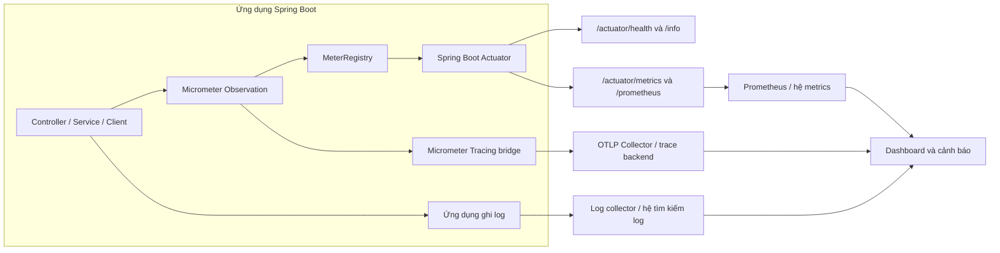

# Vai trò của Spring Boot Actuator trong Observability

Một ứng dụng Spring Boot có thể trả HTTP 200 ở trang chủ nhưng vẫn không phục vụ được đơn hàng: kết nối cơ sở dữ liệu đã cạn, hàng đợi xử lý chậm hoặc dịch vụ thanh toán thường xuyên timeout. Khi sự cố xảy ra, lập trình viên cần biết **ứng dụng còn hoạt động không, đang xử lý ra sao và nguyên nhân nằm ở đâu**.

**Spring Boot Actuator** cung cấp các khả năng quan sát và quản trị ứng dụng ngay trong quá trình chạy: kiểm tra sức khỏe, xem thông tin ứng dụng, công bố chỉ số (metrics), thay đổi mức log có kiểm soát và truy cập một số thông tin chẩn đoán. Trong hệ sinh thái Spring Boot, Actuator còn là điểm khởi đầu quan trọng để tích hợp **Micrometer Metrics**, **Micrometer Observation** và **distributed tracing**. Nó giúp đưa tín hiệu vận hành ra ngoài, nhưng không tự thay thế hệ thống lưu trữ, tìm kiếm, trực quan hóa hoặc cảnh báo.

Bài học thuộc chương **Nền tảng Observability**, tập trung vào vai trò cụ thể của Actuator trong việc kết nối **metrics, logs và traces** để điều tra lỗi, độ trễ và hành vi ứng dụng trong môi trường thực.

## 1. Phân biệt monitoring, observability và Actuator

- **Monitoring** trả lời những câu hỏi đã được dự kiến trước, chẳng hạn số yêu cầu HTTP mỗi giây, tỷ lệ lỗi hoặc dung lượng bộ nhớ.
- **Observability** dùng các tín hiệu từ hệ thống để lý giải trạng thái bên trong, kể cả khi xuất hiện một lỗi chưa từng dự đoán.
- **Actuator** là thành phần của Spring Boot giúp tạo ra và công bố nhiều tín hiệu vận hành, đồng thời cung cấp các endpoint quản trị.

Ví dụ, biểu đồ độ trễ tăng đột biến là một dấu hiệu cần điều tra. Metrics có thể chỉ ra API nào chậm; log cho biết một lần gọi thanh toán bị timeout; trace cho thấy 900 ms của yêu cầu nằm trong lời gọi tới hệ thống thanh toán. Actuator góp phần tạo hoặc công bố một số dữ liệu đầu vào cho quá trình đó.

| Thành phần | Vai trò chính | Có phải toàn bộ hệ thống observability? |
| --- | --- | --- |
| Spring Boot Actuator | Cung cấp endpoint sức khỏe, quản trị, thông tin ứng dụng, metrics và tích hợp quan sát | Không |
| Micrometer Metrics | Định nghĩa và ghi nhận counter, gauge, timer, distribution summary qua `MeterRegistry` | Không |
| Micrometer Observation | Mô hình hóa một hoạt động quan sát được, gắn key-value và thông báo cho các handler | Không |
| Micrometer Tracing + tracer bridge | Chuyển observation phù hợp thành span, quản lý trace/span context và truyền context | Không |
| Prometheus, OTLP Collector, hệ thống log, trace backend | Thu nhận, lưu trữ, truy vấn và hỗ trợ phân tích tín hiệu | Là các thành phần của nền tảng bên ngoài ứng dụng |

Về mặt thiết kế, **Actuator giúp ứng dụng có thể được quan sát**, còn khả năng điều tra một sự cố xuyên nhiều dịch vụ phụ thuộc thêm vào cách instrument code, exporter, context propagation, hệ thống thu thập và công cụ truy vấn.

## 2. Actuator nằm ở đâu trong kiến trúc?



Sơ đồ thể hiện **luồng logic**, không có nghĩa mọi thành phần được kích hoạt chỉ nhờ thêm một dependency. Chẳng hạn, endpoint Prometheus cần registry Prometheus, còn gửi trace qua OTLP cần tracer bridge và exporter tương thích. Log thường đi qua cấu hình logging và agent/collector riêng; Actuator không mặc định vận chuyển toàn bộ log đến một hệ thống tập trung.

Các trách nhiệm quan trọng của Actuator gồm:

1. **Cung cấp giao diện quản trị thống nhất** qua HTTP hoặc JMX để hạ tầng có thể gọi tới.
2. **Tự cấu hình nhiều phép đo tiêu chuẩn** dựa trên Spring Boot, Micrometer và các thư viện có mặt trong ứng dụng.
3. **Tích hợp health và availability** để bộ cân bằng tải hoặc nền tảng triển khai biết instance có sẵn sàng nhận traffic hay không.
4. **Cho phép mở rộng** bằng custom health indicator, meter, observation, endpoint và cấu hình kiểm soát thông tin công bố.

## 3. Những endpoint quan trọng

Đường dẫn HTTP thường có tiền tố `/actuator`. Có thể thay đổi tiền tố hoặc đặt management server ở cổng khác; bảng sau giả định cấu hình mặc định về đường dẫn.

| Endpoint | Dữ liệu/công dụng | Lưu ý sử dụng |
| --- | --- | --- |
| `/actuator/health` | Trạng thái sức khỏe tổng hợp từ các health indicator | Phù hợp cho health check; kiểm soát phần chi tiết được công bố |
| `/actuator/health/liveness` | Trạng thái sống của tiến trình khi có liveness probe | Dùng quyết định khởi động lại instance; tránh buộc vào phụ thuộc ngoài |
| `/actuator/health/readiness` | Trạng thái sẵn sàng nhận yêu cầu khi có readiness probe | Dùng quyết định có định tuyến traffic đến instance không |
| `/actuator/info` | Thông tin ứng dụng, build, git hoặc dữ liệu tự cấu hình | Chỉ công khai thông tin được phép |
| `/actuator/metrics` | Danh sách meter; truy vấn một meter và các tag qua HTTP | Hữu ích để kiểm tra instrument; không phải giải pháp lưu lịch sử |
| `/actuator/prometheus` | Metrics ở định dạng Prometheus scrape | Chỉ có khi đã thêm registry Prometheus và cho phép endpoint |
| `/actuator/loggers` | Xem hoặc điều chỉnh log level lúc chạy | Có tác động đến chi phí/log volume; cần giới hạn truy cập |
| `/actuator/threaddump` | Ảnh chụp các thread giúp phân tích deadlock/blocked thread | Dành cho người vận hành được ủy quyền |
| `/actuator/env`, `/actuator/configprops` | Thông tin cấu hình và nguồn cấu hình | Rất nhạy cảm; không mở công khai |

Danh sách endpoint có thể khác theo phiên bản, thư viện đi kèm và cấu hình. **Một endpoint tồn tại trong ứng dụng không đồng nghĩa đã được phép truy cập qua HTTP.** Trong cấu hình mặc định quen thuộc của Spring Boot 3.x, `health` và `info` thường được công bố qua HTTP (nhưng `info` có thể chưa hiển thị dữ liệu); các endpoint khác phải được cho phép một cách chủ động. Khi tích hợp Spring Security, chính sách bảo vệ endpoint cần được xác định riêng.

### 3.1. Health khác gì metrics?

`/actuator/health` trả lời câu hỏi vận hành **“instance có đáp ứng điều kiện sức khỏe đã định nghĩa không?”**. Ví dụ:

```json
{"status":"UP"}
```

Metrics lại trả lời **“nó đang hoạt động tốt tới mức nào, biến động theo thời gian ra sao?”**. Một instance có thể báo `UP` nhưng p95 latency tăng từ 100 ms lên 2 s. Vì vậy không nên dùng duy nhất HTTP 200 từ health check để kết luận ứng dụng đang khỏe về mặt trải nghiệm người dùng.

### 3.2. Liveness và readiness không thể thay thế nhau

- **Liveness** kiểm tra tiến trình có còn khả năng tiến lên hay đã rơi vào trạng thái không thể tự phục hồi. Nếu liveness thất bại, orchestrator thường khởi động lại container. Không nên đưa một hệ thống bên ngoài như database vào liveness: database lỗi có thể khiến toàn bộ ứng dụng bị khởi động lại liên tục.
- **Readiness** xác định instance có thể nhận traffic mới hay chưa. Nếu readiness thất bại, instance thường bị tạm loại khỏi tập đích nhận request nhưng chưa nhất thiết phải khởi động lại.
- **Startup** là nhu cầu riêng với ứng dụng khởi động chậm. Kubernetes có startup probe để tránh đánh giá liveness quá sớm.

Spring Boot hỗ trợ `ApplicationAvailability`, `LivenessState`, `ReadinessState` và các health group tương ứng. Bật probe khi môi trường không tự kích hoạt, sau đó xác minh đường dẫn thực tế của từng phiên bản. Các dependency ngoài cần kiểm tra phải được thêm vào nhóm readiness có chủ đích, với timeout và chính sách phù hợp; mặc định readiness không có nghĩa đã kiểm tra mọi hệ thống phụ thuộc.

## 4. Tích hợp Actuator vào ứng dụng

Ví dụ dưới đây minh họa cho **Spring Boot 3.x** với Maven và dependency versions được quản lý bởi Spring Boot BOM/parent. Spring Boot và Micrometer thay đổi một số property, exporter hoặc tên metric theo phiên bản; hãy đối chiếu tài liệu của phiên bản đang triển khai trước khi dùng vào production.

### 4.1. Dependencies

```xml
<dependencies>
    <dependency>
        <groupId>org.springframework.boot</groupId>
        <artifactId>spring-boot-starter-actuator</artifactId>
    </dependency>

    <!-- Công bố metrics cho Prometheus -->
    <dependency>
        <groupId>io.micrometer</groupId>
        <artifactId>micrometer-registry-prometheus</artifactId>
    </dependency>

    <!-- Chỉ cần nếu ứng dụng gửi distributed traces bằng OpenTelemetry -->
    <dependency>
        <groupId>io.micrometer</groupId>
        <artifactId>micrometer-tracing-bridge-otel</artifactId>
    </dependency>
    <dependency>
        <groupId>io.opentelemetry</groupId>
        <artifactId>opentelemetry-exporter-otlp</artifactId>
    </dependency>
</dependencies>
```

`spring-boot-starter-actuator` là điểm khởi đầu cho health, endpoint và metrics; `micrometer-registry-prometheus` bổ sung cơ chế xuất metrics; hai dependency tracing minh họa một lựa chọn triển khai trace qua OpenTelemetry. Không cần thêm tracer/exporter nếu bài toán hiện tại chỉ yêu cầu health và metrics.

### 4.2. Cấu hình tối thiểu để quan sát

```yaml
spring:
  application:
    name: order-service

management:
  endpoints:
    web:
      exposure:
        include: health,info,metrics,prometheus
  endpoint:
    health:
      probes:
        enabled: true
      show-details: never
  metrics:
    tags:
      application: order-service
  tracing:
    sampling:
      probability: 0.1
  otlp:
    tracing:
      endpoint: http://otel-collector:4318/v1/traces
```

Trong ví dụ này:

- Chỉ định bốn endpoint được phép công bố qua web; `liveness` và `readiness` là các nhánh của `health`, khi probes được bật.
- Gắn tag `application=order-service` cho metrics để phân biệt các dịch vụ; các tag thêm vào phải được quản lý nhất quán.
- Lấy mẫu 10% trace nhằm minh họa một quyết định về chi phí; **10% không đảm bảo ghi lại mọi request lỗi**.
- Cấu hình OTLP chỉ có ý nghĩa khi tracer/exporter được cài đặt, collector lắng nghe đúng giao thức và có kết nối mạng.

**Cảnh báo triển khai:** `exposure.include` chỉ điều khiển endpoint nào có thể xuất hiện qua HTTP, **không phải quy tắc xác thực/ủy quyền**. Bảo vệ `metrics`, `prometheus` và endpoint quản trị bằng mạng nội bộ, gateway, Spring Security hoặc cơ chế tương đương theo mô hình vận hành. Không dùng `include: '*'` cho endpoint công khai. Khi đã tự cấu hình `SecurityFilterChain`, phải kiểm tra cả quy tắc truy cập Actuator lẫn quy tắc bảo vệ API thông thường.

### 4.3. Kiểm tra với HTTP

Sau khi ứng dụng chạy trên cổng 8080:

```bash
curl -s http://localhost:8080/actuator/health
curl -s http://localhost:8080/actuator/health/readiness
curl -s http://localhost:8080/actuator/metrics
curl -s http://localhost:8080/actuator/metrics/http.server.requests
curl -s http://localhost:8080/actuator/prometheus
```

`/actuator/metrics/http.server.requests` chỉ trả dữ liệu khi meter đã được đăng ký và có request phù hợp để ghi nhận. Thường cần gửi một số request thật trước khi truy vấn. Dữ liệu ở endpoint `metrics` nhằm **khám phá và kiểm tra meter hiện có**, còn Prometheus scrape theo chu kỳ để có chuỗi thời gian phục vụ biểu đồ, truy vấn và cảnh báo.

Nếu trả về 404, hãy kiểm tra cả bốn điều: dependency thích hợp có mặt không, endpoint có được kích hoạt không, đã được đưa vào web exposure chưa, và ứng dụng có đổi base path/cổng management không. Nếu trả về 401/403, kiểm tra cấu hình bảo mật thay vì mở rộng exposure vô điều kiện.

## 5. Actuator kết nối metrics với Micrometer như thế nào?

Micrometer dùng khái niệm **meter** và **registry**. Actuator tích hợp cấu hình thường dùng, ghi nhận nhiều chỉ số tiêu chuẩn và cho phép xem hoặc xuất chúng.

| Loại chỉ số | Ý nghĩa | Ví dụ trong Spring Boot |
| --- | --- | --- |
| Counter | Tổng số sự kiện tăng dần | Số lần xử lý thất bại, số request |
| Gauge | Giá trị tại một thời điểm | Số kết nối đang được dùng, mức sử dụng tài nguyên |
| Timer | Thời gian và số lần hoàn thành hoạt động | Độ trễ request HTTP, thời gian gọi phụ thuộc |
| Distribution summary | Phân bố kích thước/giá trị, không nhất thiết là thời gian | Kích thước payload hoặc số phần tử |

Những meter phổ biến đến từ instrumentations của Spring Boot, Micrometer, JVM, servlet server và thư viện tương thích, ví dụ `jvm.memory.used`, `process.cpu.usage`, `http.server.requests`. Tên cụ thể và bộ tag phụ thuộc phiên bản cũng như stack đang sử dụng.

Metrics hữu dụng khi kết hợp **tên meter + nhãn (tags) + thời gian**. Với HTTP server, các nhãn thường gặp là method, status, outcome và URI template. Tập tag tốt cho phép trả lời “tỷ lệ lỗi 5xx của endpoint tạo đơn hàng tăng từ lúc nào?” mà không cần đọc từng request.

### 5.1. Tag cardinality quyết định khả năng vận hành

**Cardinality** là số tổ hợp giá trị nhãn khác nhau. Một metric có các tag `method` gồm 5 giá trị, `status` gồm 6 giá trị và `uri` gồm 20 mẫu đường dẫn có thể tạo ra hàng trăm chuỗi thời gian, chưa kể instance hoặc application. Nếu thêm `userId` hoặc `orderId` với hàng triệu giá trị, số chuỗi có thể tăng rất lớn, gây tốn tài nguyên và chi phí thu thập.

Nguyên tắc:

- Dùng **low-cardinality tag** cho những chiều hữu hạn, có ý nghĩa tổng hợp: loại thao tác, kết quả, tên route đã chuẩn hóa.
- Dùng **high-cardinality key-value** cho dữ liệu cần tra cứu ở trace hoặc log, chẳng hạn mã đơn hàng; không tự đưa các giá trị này thành tag của metrics.
- Ưu tiên `/orders/{id}` làm giá trị URI template thay vì `/orders/123456` theo từng request.
- Cân nhắc tăng số buckets của histogram và số nhãn vì mỗi cấu hình đều tác động tới số time series.

### 5.2. Observation gắn metric và trace cho cùng một nghiệp vụ

Micrometer Observation mô tả một công việc đang diễn ra. Các handler có thể chuyển nó thành metric và, khi tracer bridge được cấu hình đúng, tạo span tương ứng.

```java
import io.micrometer.observation.Observation;
import io.micrometer.observation.ObservationRegistry;
import org.springframework.stereotype.Service;

@Service
public class PaymentService {
    private final ObservationRegistry observationRegistry;

    public PaymentService(ObservationRegistry observationRegistry) {
        this.observationRegistry = observationRegistry;
    }

    public void confirm(String channel, String orderId) {
        Observation.createNotStarted("payment.confirm", observationRegistry)
            .lowCardinalityKeyValue("channel", channel)  // Giá trị từ tập cho phép
            .highCardinalityKeyValue("order.id", orderId) // Chỉ dùng làm context/trace
            .observe(() -> performConfirmation(orderId));
    }

    private void performConfirmation(String orderId) {
        // Gọi dịch vụ thanh toán; cấu hình timeout và xử lý lỗi ở đây.
    }
}
```

Khi ứng dụng dùng một số lượng nhỏ kênh cố định như `card`, `bank_transfer`, `wallet`, `channel` phù hợp với metrics. `order.id` có số lượng giá trị lớn nên nên xuất hiện ở span/log hoặc ở context phục vụ chẩn đoán, nhưng không dùng làm metric tag. Việc hiển thị high-cardinality key-value trong trace tùy vào tracing handler và cấu hình thực tế.

Observation không tự bảo đảm mọi đoạn mã đều được instrument. Nếu lời gọi dịch vụ, message consumer hoặc tác vụ nền chưa có instrumentation, bạn cần bổ sung observation/span một cách có chủ đích. Lựa chọn naming convention cũng phải nhất quán giữa các phiên bản ứng dụng.

## 6. Actuator liên quan đến distributed tracing và logs đến mức nào?

Actuator thường tham gia quá trình tự cấu hình observability cho Spring Boot, nhưng **tracing chỉ có đủ dữ liệu khi có tracer bridge, instrumentation, exporter và trace backend phù hợp**. Khái niệm quan trọng là:

- **Trace** theo dõi một giao dịch logic qua một hoặc nhiều dịch vụ.
- **Span** biểu diễn một thao tác có thời gian bắt đầu/kết thúc và quan hệ cha–con.
- **Context propagation** chuyển trace context qua các ranh giới như HTTP, messaging hoặc thread để các span thuộc cùng trace.
- **Sampling** quyết định trace nào được giữ/gửi, tác động đến độ phủ khi điều tra và chi phí quan sát.

Chẳng hạn, `order-service` gọi `payment-service`. Nếu hai bên dùng cơ chế propagation tương thích (thường dựa trên header W3C `traceparent`) và instrumentation được bật, backend trace có thể hiển thị mối quan hệ giữa HTTP server span và outbound client span. Thiếu propagation, hai dịch vụ có thể sinh hai trace rời rạc dù request nghiệp vụ là một.

Đối với tác vụ bất đồng bộ, chuyển thread hoặc reactive chain, context có thể không tự tồn tại qua mọi ranh giới. Cần kiểm tra cơ chế context propagation mà phiên bản Spring Boot/Micrometer hỗ trợ và chạy thử luồng thực tế; không giả định chỉ thêm Actuator là trace sẽ liên tục.

**Logs** bổ sung thông tin chi tiết, chẳng hạn mã lỗi từ đối tác, trạng thái retry và dữ kiện nghiệp vụ. Nếu tracing được cấu hình với hỗ trợ correlation, log có thể chứa `traceId` và `spanId` để nhảy từ một dòng log đến trace tương ứng. Tên field và định dạng phụ thuộc cấu hình logging và phiên bản. Endpoint `/actuator/loggers` cho phép xem/điều chỉnh mức log của logger, nhưng **không phải** endpoint thu gom và gửi log đến backend.

Một lưu ý về sampling: tỷ lệ 0.1 nghĩa là về nguyên tắc chỉ một phần trace được chọn ghi nhận; một request có log lỗi nhưng không có trace lưu ở backend là tình huống có thể xảy ra. Nếu cần bảo toàn trace lỗi, hãy thiết kế chính sách sampling và khả năng thu thập phù hợp (ví dụ tail-based sampling ở collector khi hệ thống hỗ trợ), thay vì cho rằng mọi lỗi đều có trace.

## 7. Health indicator tùy chỉnh: kiểm tra điều kiện nghiệp vụ

Ngoài các health indicator có sẵn, Actuator cho phép định nghĩa `HealthIndicator`. Ví dụ một adapter kiểm tra khả năng truy cập cổng thanh toán:

```java
import org.springframework.boot.actuate.health.Health;
import org.springframework.boot.actuate.health.HealthIndicator;
import org.springframework.stereotype.Component;

@Component("paymentGateway")
public class PaymentGatewayHealthIndicator implements HealthIndicator {
    private final PaymentGatewayClient client;

    public PaymentGatewayHealthIndicator(PaymentGatewayClient client) {
        this.client = client;
    }

    @Override
    public Health health() {
        try {
            return client.ping()
                ? Health.up().build()
                : Health.down().withDetail("dependency", "unavailable").build();
        } catch (Exception ex) {
            return Health.down().withDetail("dependency", "unavailable").build();
        }
    }
}
```

`PaymentGatewayClient` là interface giả định của ứng dụng, không phải lớp có sẵn trong Spring Boot. Phương thức `ping()` phải có timeout ngắn, có giới hạn tài nguyên và không gây tác dụng phụ. Không để một health check liên tục tạo giao dịch thanh toán thật.

Indicator tùy chỉnh có thể tham gia sức khỏe tổng hợp, nhưng **không tự động trở thành điều kiện của readiness probe**. Nếu nghiệp vụ thực sự không thể tiếp nhận đơn khi gateway mất kết nối, có thể cấu hình health group readiness để bao gồm `paymentGateway`. Ngược lại, nếu hệ thống có thể ghi nhận đơn để xử lý sau, không nên khiến toàn bộ instance bị loại khỏi traffic vì một phụ thuộc tạm thời bị lỗi. Cách định nghĩa sức khỏe cần phản ánh khả năng phục vụ thực tế.

## 8. Quy trình điều tra sự cố kết hợp các tín hiệu

Giả sử API `POST /orders` bắt đầu chậm sau khi triển khai. Actuator là điểm vào để trả lời những câu hỏi vận hành ban đầu:

| Bước | Tín hiệu/công cụ | Câu hỏi cần trả lời |
| --- | --- | --- |
| 1. Xác định phạm vi | `health`, readiness, dashboard triển khai | Có instance nào bị loại khỏi traffic? Vấn đề xuất hiện ở một hay nhiều instance? |
| 2. Đo tác động | Metrics HTTP, CPU, memory, connection pool | Tỷ lệ 5xx, lưu lượng và độ trễ tăng ở endpoint nào? Từ thời điểm nào? |
| 3. Thu hẹp thành phần | Metrics cho HTTP client, database hoặc custom observation | Thời gian nằm trong xử lý nội bộ hay ở lời gọi phụ thuộc? |
| 4. Truy vết một request | Distributed tracing và context propagation | Span nào chiếm phần lớn thời gian? Có retry hoặc timeout không? |
| 5. Kiểm tra nguyên nhân | Log có traceId/spanId và thông tin lỗi | Lỗi cụ thể là gì? Có liên quan thay đổi cấu hình hoặc upstream không? |
| 6. Xác minh khắc phục | Metrics theo thời gian, health và trace sau sửa | Độ trễ/tỷ lệ lỗi đã giảm bền vững chưa? Có phát sinh lỗi mới không? |

Một ví dụ diễn tiến:

1. `health` vẫn báo `UP`, nhưng dashboard cho thấy p95 của `/orders` tăng; kết luận ban đầu là vấn đề hiệu năng chứ chưa chắc tiến trình chết.
2. Số request và tỷ lệ lỗi được đối chiếu để tránh diễn giải nhầm khi traffic thay đổi. Các metric có nhãn route dạng template giúp so sánh chính xác.
3. Trace của một request chậm cho thấy phần lớn thời gian nằm ở span gọi `payment-service`. Nếu không có trace, kiểm tra sampling, exporter và propagation trước khi kết luận không có lỗi liên dịch vụ.
4. Dòng log tương ứng với traceId chỉ ra một timeout từ gateway; các metric outbound hoặc connection pool giúp xác định đây là lỗi riêng lẻ hay xu hướng.
5. Sau điều chỉnh timeout/circuit breaker hoặc xử lý phía đối tác, so sánh tỷ lệ lỗi và phân bố độ trễ trong cùng điều kiện tải; không chỉ kiểm tra lại `health`.

Trong ví dụ này, Actuator cung cấp health và kênh metrics, đồng thời hỗ trợ cấu hình observability trong ứng dụng. Nền tảng Prometheus, hệ thống log và tracing backend mới lưu lại lịch sử để so sánh trước/sau và nối các sự kiện.

## 9. Vận hành an toàn và tối ưu chi phí

### 9.1. Kiểm soát endpoint và dữ liệu nhạy cảm

- Chỉ công bố các endpoint thực sự cần và giới hạn phạm vi mạng. Endpoint như `env`, `configprops`, `heapdump`, `threaddump` hoặc `loggers` cần chính sách truy cập nghiêm ngặt.
- Bảo vệ thông tin health chi tiết, build/git metadata và log. Cơ chế che giá trị nhạy cảm hỗ trợ giảm rủi ro nhưng không thay cho authorization.
- Nếu dùng cổng management riêng (`management.server.port`), cần xem lại network policy, firewall, monitoring target và probe; cổng riêng không tự bảo đảm an toàn.
- Giới hạn quyền thay đổi log level và đặt thời hạn hoàn nguyên, bởi chế độ DEBUG/TRACE có thể tăng đáng kể lượng dữ liệu và vô tình lộ thông tin.

### 9.2. Chất lượng dữ liệu quan trọng hơn số lượng endpoint

- Đặt **tên metric/observation ổn định**, thống nhất service name, môi trường và quy ước tag.
- Tránh tag không giới hạn giá trị như userId, sessionId, raw URL, SQL text hoặc exception message.
- Chọn sampling dựa trên lưu lượng, mục tiêu điều tra và ngân sách; kiểm chứng trace mẫu đủ đại diện.
- Phân biệt các loại lỗi: lỗi nghiệp vụ được dự kiến, lỗi HTTP 4xx, lỗi 5xx và timeout upstream có ý nghĩa cảnh báo khác nhau.
- Đặt timeout cho health indicator và hạn chế hoạt động chẩn đoán nặng ở production.
- Xác minh exporter, network, clock, collector và chính sách retention; metric xuất hiện trong ứng dụng chưa có nghĩa backend đã thu nhận được.

### 9.3. Tránh các hiểu lầm phổ biến

| Hiểu lầm | Cách hiểu đúng |
| --- | --- |
| “Thêm Actuator là có đủ tracing.” | Cần tracing bridge, instrumentation, exporter/backend và propagation phù hợp. |
| “Health báo UP thì không có sự cố.” | Health chỉ phản ánh các điều kiện đã cấu hình; latency, lỗi từng endpoint và trải nghiệm người dùng có thể vẫn xấu. |
| “Cho `orderId` vào metric tag sẽ dễ tra cứu.” | Đây là high-cardinality data; lưu ở trace/log thường phù hợp hơn. |
| “Actuator metrics lưu được lịch sử.” | Endpoint phản ánh meter hiện tại; cần hệ thống thu thập để lưu và truy vấn theo thời gian. |
| “Cho phép web exposure là đã bảo mật.” | Cần xác thực, phân quyền và giới hạn mạng phù hợp. |
| “Thiếu trace tức request không đi qua service.” | Trace có thể bị sampling loại, exporter lỗi hoặc mất context trên đường truyền. |

## 10. Bài thực hành ngắn

Với một dịch vụ Spring Boot đã có REST API:

1. Thêm Actuator và Prometheus registry; cấu hình exposure riêng cho `health`, `metrics`, `prometheus`. Xác minh các endpoint bằng `curl`.
2. Gửi ít nhất một request thành công và một request lỗi hợp lệ. Truy vấn `http.server.requests`, quan sát số lần gọi, tổng thời gian và nhãn liên quan nếu meter được bật.
3. Bổ sung một observation cho một thao tác nghiệp vụ. Gắn `operation` hoặc `channel` với số lượng giá trị giới hạn; giữ `orderId` ở high-cardinality context.
4. Cấu hình một tracing backend thử nghiệm và tạo request gọi qua hai dịch vụ. Kiểm tra traceId liên tục từ server span qua client span, rồi sang service đích.
5. Giả lập upstream chậm hoặc timeout; đối chiếu metrics, trace và log để giải thích nguyên nhân. Thử hạ sampling và quan sát tác động tới lượng trace giữ lại.
6. Rà soát endpoint nào được công bố, ai có quyền truy cập và có dữ liệu nhạy cảm nào xuất hiện trong tags, log hoặc health details.

**Tiêu chí hoàn thành:** giải thích được trách nhiệm của Actuator so với Micrometer và backend quan sát; dùng được health, metrics và Prometheus endpoint; lựa chọn đúng readiness/liveness; biết vì sao context propagation, cardinality, sampling và cấu hình exporter ảnh hưởng trực tiếp tới chất lượng điều tra.

## Kết luận

Spring Boot Actuator là **lớp tích hợp observability và vận hành quan trọng ở phía ứng dụng**. Nó cho biết trạng thái sức khỏe, cho phép xem nhiều phép đo tiêu chuẩn và giúp kết nối hệ sinh thái Micrometer. Để biến tín hiệu thành khả năng điều tra sự cố, cần kết hợp thêm instrument nghiệp vụ, logs có khả năng liên kết bằng traceId, distributed tracing xuyên dịch vụ, collector/backend, dashboard và cảnh báo. Khi thiết kế đúng health group, tag cardinality, propagation, exporter, sampling và bảo mật endpoint, Actuator trở thành nền móng đáng tin cậy để hiểu hành vi ứng dụng Spring Boot trên môi trường thực.
