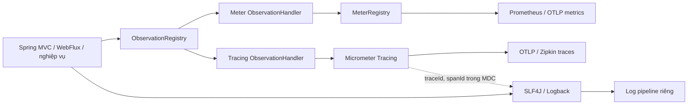

# Micrometer trong Spring ecosystem

## 1. Mục tiêu học tập

Sau bài này, bạn có thể:

- Giải thích vai trò của **Micrometer Metrics**, **Micrometer Observation** và **Micrometer Tracing** khi xây dựng observability cho ứng dụng Spring Boot.
- Phân biệt cách tạo metric trực tiếp bằng `MeterRegistry` với cách mô tả một thao tác bằng `ObservationRegistry`.
- Nhận diện những phần Spring Boot/Spring Framework đã tự instrument và những phần nghiệp vụ cần bổ sung.
- Tạo một observation cho thao tác nghiệp vụ, gắn metadata đúng cardinality, xuất metrics/traces và liên kết logs với trace.
- Phát hiện các lỗi thường gặp về propagation, sampling, exporter và số lượng chuỗi thời gian (time series).

**Phạm vi:** Bài tập trung vào Micrometer trong hệ sinh thái Spring, làm nền cho việc thiết lập metrics, logs và distributed tracing, theo dõi ngữ cảnh qua các dịch vụ và điều tra độ trễ/lỗi trên môi trường thực. Các ví dụ cấu hình có ghi rõ phiên bản vì Spring Boot 3.x và 4.x có khác biệt ở một số dependency/property.

## 2. Vì sao Spring cần Micrometer?

Giả sử một yêu cầu `POST /orders` đi qua API, lớp nghiệp vụ, cơ sở dữ liệu và dịch vụ thanh toán. Khi khách hàng gặp lỗi hoặc độ trễ tăng, các câu hỏi cần trả lời thuộc ba loại:

| Tín hiệu | Câu hỏi điển hình | Ví dụ |
| --- | --- | --- |
| **Metrics** | Có bao nhiêu yêu cầu lỗi? p95 latency thay đổi thế nào? | Số request theo mã HTTP, phân bố thời gian xử lý |
| **Traces** | Một request cụ thể chậm ở bước nào, qua dịch vụ nào? | Span HTTP → checkout → gọi payment |
| **Logs** | Tại bước đó ứng dụng đã ghi nhận điều gì? | Log ngoại lệ có cùng `traceId`, `spanId` |

Micrometer cung cấp các API thống nhất để thu thập metrics và mô tả thao tác quan sát được; Micrometer Tracing kết nối phần tracing với các triển khai như OpenTelemetry hoặc Brave. **Micrometer không phải nơi lưu trữ/hiển thị dữ liệu**: Prometheus, hệ thống trace như Jaeger/Tempo/Zipkin và hệ thống log là những thành phần riêng. Spring Boot Actuator làm nhiệm vụ tích hợp, tự cấu hình và công bố endpoint phù hợp.



Sơ đồ thể hiện các đường dữ liệu có thể cấu hình; không phải mọi ứng dụng đều bật tất cả handler hoặc exporter. Một observation chỉ tạo ra những tín hiệu tương ứng với handler đã được đăng ký.

## 3. Các thành phần chính và ranh giới trách nhiệm

| Thành phần | Vai trò | Dùng khi nào |
| --- | --- | --- |
| `micrometer-core` / `MeterRegistry` | Quản lý và xuất các meter như Counter, Timer, Gauge | Đo số lượng, thời gian, trạng thái hệ thống |
| `micrometer-observation` / `ObservationRegistry` | Quản lý vòng đời một thao tác và các handler quan sát | Instrument một thao tác có thể phục vụ đồng thời metrics và traces |
| `Observation` | Đại diện cho thao tác có tên, ngữ cảnh, metadata, lỗi và thời gian bắt đầu/kết thúc | Bọc một xử lý nghiệp vụ hoặc thao tác hạ tầng |
| `ObservationHandler` | Phản ứng với `start`, `stop`, `error`, scope, event | Chuyển observation thành timer, span hoặc xử lý tùy biến |
| `ObservationConvention` | Quy định tên và key-value cho một nhóm observation | Chuẩn hóa naming/tag giữa các service |
| `ObservationPredicate` / `ObservationFilter` | Lần lượt quyết định có quan sát hay không / điều chỉnh context | Loại bỏ hoạt động không cần thiết, thêm metadata dùng chung |
| `micrometer-tracing` / `Tracer` | API tracing độc lập với implementation cụ thể | Tạo/đọc span hiện hành, propagation, correlation |
| Bridge OTel hoặc Brave | Kết nối API Micrometer Tracing với tracer thực tế | Tích hợp exporter và trace backend |
| `micrometer-context-propagation` | Hỗ trợ chuyển các giá trị ngữ cảnh qua ranh giới thực thi | Executor, callback và các luồng bất đồng bộ được hỗ trợ |

### 3.1. Hai kiểu đo: Meter trực tiếp và Observation

**Meter trực tiếp** phù hợp cho một sự kiện hoặc trạng thái độc lập: tổng số đơn thành công, độ dài hàng đợi, số công việc đang chạy. Bạn chọn loại meter và thời điểm cập nhật nó.

**Observation** phù hợp để đo một *thao tác* có bắt đầu, kết thúc, lỗi và ngữ cảnh: xử lý checkout, kiểm tra tồn kho hoặc gọi API. Tùy handler được đăng ký, cùng instrumentation đó có thể sinh metric thời gian và trace span. Không nên mặc định rằng mọi observation luôn sinh đủ cả hai tín hiệu.

Ví dụ, nếu Spring MVC đã tạo observation cho `GET /products/{id}`, bạn không cần tự bọc lại toàn bộ controller chỉ để đo HTTP duration. Một observation riêng trong `inventory.reserve` có ý nghĩa nếu muốn thấy thời gian thực hiện bước nghiệp vụ bên trong request.

### 3.2. Vòng đời của một Observation

```text
createNotStarted(...) → start() → openScope() → xử lý
                                          ↘ error(exception) nếu thất bại
                             close Scope → stop()
```

- `start()` ghi nhận bắt đầu; `stop()` kết thúc và cho handler cơ hội tổng hợp dữ liệu.
- `openScope()` gắn observation vào ngữ cảnh hiện hành trong phạm vi scope; scope phải đóng. Scope **khác** vòng đời observation: đóng scope không thay thế `stop()`.
- `error(e)` thông báo lỗi để handler có thể gắn trạng thái/thuộc tính phù hợp.
- `observation.observe(() -> ...)` là cú pháp ngắn: framework quản lý start, scope, ghi nhận exception, đóng scope và stop quanh lambda.

Ví dụ instrumentation thủ công với `try/finally`:

```java
Observation observation = Observation.start("inventory.reserve", observationRegistry);
try (Observation.Scope scope = observation.openScope()) {
    reserveInventory();
} catch (RuntimeException ex) {
    observation.error(ex);
    throw ex;
} finally {
    observation.stop();
}
```

Trong code đồng bộ thông thường, ưu tiên `observe(...)` nếu không cần quản lý scope tường minh. Trong luồng bất đồng bộ, **không** để `try/finally` dừng observation ngay sau khi chỉ mới khởi chạy một `CompletableFuture`; phải xác định rõ khi nào công việc thực sự hoàn tất.

## 4. Spring Boot và Spring Framework tích hợp như thế nào?

Với Actuator và các dependency phù hợp, Spring Boot tự cấu hình `ObservationRegistry`, `MeterRegistry`, handler và tracer/exporter. Spring Framework cung cấp instrumentation cho nhiều API phổ biến.

Một số nguồn dữ liệu thường gặp:

| Thành phần | Tín hiệu có thể thu được | Điểm cần kiểm tra |
| --- | --- | --- |
| Spring MVC / WebFlux inbound HTTP | `http.server.requests` và HTTP server span nếu bật tracing | Dùng route template thay cho URL chứa ID |
| `RestClient`, `WebClient` outbound HTTP | `http.client.requests` và HTTP client span | Tạo client từ builder Spring Boot đã cấu hình |
| JVM / process / system | Heap, GC, CPU, threads, uptime... | Có Actuator và registry phù hợp |
| Spring Data Repository, cache, executor, Kafka... | Metrics/instrumentation tùy công nghệ và dependency | Kiểm tra đúng auto-configuration; không suy rằng mọi lời gọi đều đã trace |
| Các bước nghiệp vụ riêng | Chưa có sẵn | Tạo Observation hoặc Meter phù hợp |

**Bẫy thường gặp:** tự tạo `RestClient.create()` hoặc `WebClient.create()` rồi kỳ vọng trace context được truyền qua HTTP như client xây từ `RestClient.Builder`/`WebClient.Builder` do Spring quản lý. Nếu cần tùy biến client, hãy bắt đầu từ builder đã được auto-configure.

Annotation `@Observed` có thể giúp instrument method qua AOP khi đã bật hỗ trợ annotation và có AspectJ phù hợp. Tuy nhiên, đặt `@Observed` lên method/controller đã được framework instrument có thể sinh observation trùng; lời gọi nội bộ cùng bean cũng cần xem xét cơ chế proxy. Với thao tác nghiệp vụ cần điều khiển lỗi/tag rõ ràng, dùng `ObservationRegistry` trực tiếp thường dễ lý giải hơn.

## 5. Thực hành: metrics và tracing trên Spring Boot 3.5

Ví dụ dưới đây **chỉ định Spring Boot 3.5.x**, dùng Java 17+, Spring MVC và Actuator. Cấu hình của Spring Boot 4.x được nêu riêng ở mục 5.5; không trộn property của hai nhánh.

### 5.1. Dependency

Với dự án dùng Spring Boot BOM hoặc parent để quản lý phiên bản, thêm vào `pom.xml`:

```xml
<dependencies>
    <dependency>
        <groupId>org.springframework.boot</groupId>
        <artifactId>spring-boot-starter-web</artifactId>
    </dependency>
    <dependency>
        <groupId>org.springframework.boot</groupId>
        <artifactId>spring-boot-starter-actuator</artifactId>
    </dependency>
    <dependency>
        <groupId>io.micrometer</groupId>
        <artifactId>micrometer-registry-prometheus</artifactId>
    </dependency>
    <dependency>
        <groupId>io.micrometer</groupId>
        <artifactId>micrometer-tracing-bridge-otel</artifactId>
    </dependency>
    <dependency>
        <groupId>io.opentelemetry</groupId>
        <artifactId>opentelemetry-exporter-otlp</artifactId>
    </dependency>
</dependencies>
```

`micrometer-registry-prometheus` hỗ trợ endpoint scrape Prometheus; bridge OTel và OTLP exporter cho phép gửi span tới collector nhận OTLP. Muốn chỉ học metrics, có thể bỏ hai dependency tracing/exporter. Thêm dependency không có nghĩa đã có sẵn Prometheus hoặc OpenTelemetry Collector: cần chạy backend tương ứng.

### 5.2. Cấu hình

```yaml
spring:
  application:
    name: checkout-service

management:
  endpoints:
    web:
      exposure:
        include: health,info,metrics,prometheus
  metrics:
    tags:
      application: ${spring.application.name}
  tracing:
    sampling:
      probability: 1.0 # CHỈ để quan sát toàn bộ trace khi thực hành
  otlp:
    tracing:
      endpoint: http://localhost:4318/v1/traces
```

- `/actuator/metrics` cung cấp thông tin meter; `/actuator/prometheus` xuất định dạng Prometheus scrape khi dependency Prometheus có mặt và endpoint được expose.
- Địa chỉ `localhost:4318/v1/traces` là ví dụ collector OTLP/HTTP chạy trên cùng máy. Trong container, `localhost` trỏ về **chính container ứng dụng**; hãy dùng DNS dịch vụ collector trong mạng tương ứng.
- `sampling.probability: 1.0` chỉ phù hợp cho demo hoặc kiểm tra có kiểm soát. Môi trường thực cần tỷ lệ/chiến lược sampling theo lưu lượng và yêu cầu chẩn đoán.
- Các actuator endpoint được expose qua HTTP phải áp dụng kiểm soát truy cập/mạng phù hợp; không công khai vô điều kiện dữ liệu vận hành.

### 5.3. Instrument thao tác nghiệp vụ

Giả sử `PaymentGateway`, `Order` và `Receipt` là các kiểu nghiệp vụ của dự án. Lớp dưới đây cho thấy cách ghi **một observation** cho xử lý checkout, đồng thời đếm số kết quả:

```java
import io.micrometer.core.instrument.MeterRegistry;
import io.micrometer.observation.Observation;
import io.micrometer.observation.ObservationRegistry;
import org.springframework.stereotype.Service;

@Service
public class CheckoutService {
    private final ObservationRegistry observations;
    private final MeterRegistry meters;
    private final PaymentGateway payments;

    public CheckoutService(
            ObservationRegistry observations,
            MeterRegistry meters,
            PaymentGateway payments) {
        this.observations = observations;
        this.meters = meters;
        this.payments = payments;
    }

    public Receipt checkout(Order order) {
        // Chỉ cho phép một tập giá trị tag hữu hạn.
        String channel = order.isWebOrder() ? "web" : "other";

        return Observation.createNotStarted("checkout.process", observations)
                .contextualName("checkout")
                .lowCardinalityKeyValue("channel", channel)
                .observe(() -> {
                    try {
                        Receipt receipt = payments.charge(order);
                        meters.counter("checkout.completed",
                                "result", "success", "channel", channel).increment();
                        return receipt;
                    } catch (RuntimeException ex) {
                        meters.counter("checkout.completed",
                                "result", "failure", "channel", channel).increment();
                        throw ex;
                    }
                });
    }
}
```

Khi có meter handler, `checkout.process` có thể được đo bằng Timer; khi có tracing handler và tracer tương ứng, nó có thể sinh span. Counter `checkout.completed` là metric nghiệp vụ *bổ sung* phân biệt thành công/thất bại. Vì `observe` nhận lambda và nhận biết exception, ta không phải gọi `observation.error(ex)` trong đoạn này. Nếu cần tự ghi event trên observation, hãy giữ biến `Observation` để gọi `event(...)` trong lúc xử lý.

Đoạn code minh họa sử dụng các interface nghiệp vụ chưa định nghĩa; hãy thay `PaymentGateway`, `Order`, `Receipt` bằng class của ứng dụng khi chạy thật. Không đưa ID đơn hàng/email/IP vào metric tag `channel`.

### 5.4. Kiểm tra kết quả

1. Khởi động ứng dụng và gửi vài request tới endpoint checkout thật của dự án (trong đó có request thành công và thất bại).
2. Mở `GET /actuator/metrics`, sau đó `GET /actuator/metrics/checkout.process` và `GET /actuator/metrics/checkout.completed`. Nếu meter chưa xuất hiện, kiểm tra code đã được thực thi và `MeterRegistry`/handler có được khởi tạo hay chưa.
3. Mở `GET /actuator/prometheus`; tìm các chuỗi tương ứng với checkout và `http_server_requests_seconds_...`. Tên xuất ra sẽ được registry ánh xạ theo quy ước của Prometheus.
4. Kiểm tra collector có nhận span, trace backend có hiển thị HTTP server span và span `checkout.process` cùng trace ID hay không.
5. Gây độ trễ có kiểm soát trong `PaymentGateway`, so sánh metric latency tăng với span duration để tìm nguyên nhân.

Một mẫu truy vấn PromQL thường dùng để xem tốc độ HTTP 5xx:

```promql
sum(rate(http_server_requests_seconds_count{status=~"5.."}[5m]))
```

Muốn ước lượng p95 **trên nhiều instance**, cần bật histogram phù hợp và dùng `histogram_quantile` trên các bucket được tổng hợp theo `le`; không thể suy p95 chính xác từ `_sum/_count` đơn thuần. Tránh coi một giá trị p95 đo riêng từng instance rồi lấy trung bình là p95 của toàn hệ thống.

### 5.5. Chú ý tương thích Spring Boot 4.x

Spring Boot 4.x có bộ starter chuyên biệt và các property tracing OTLP khác nhánh 3.5. Với OpenTelemetry qua OTLP, tài liệu Boot 4 mô tả starter `org.springframework.boot:spring-boot-starter-opentelemetry` và nhóm property `management.opentelemetry.tracing.export.otlp.*`. Vì thế **không sao chép nguyên cấu hình `management.otlp.tracing.endpoint` của Boot 3.5** sang Boot 4 mà chưa kiểm tra tài liệu đúng phiên bản. API lập trình `Observation`, `ObservationRegistry`, `MeterRegistry` vẫn là điểm bắt đầu để hiểu mô hình.

## 6. Metrics: loại meter, tags và cardinality

| Meter | Ý nghĩa | Ví dụ | Lưu ý |
| --- | --- | --- | --- |
| `Counter` | Tổng số lần xảy ra sự kiện, chỉ tăng | Số giao dịch hoàn tất | Query `rate()` hoặc `increase()` khi cần tốc độ |
| `Timer` | Số lần thực thi và thời gian | Checkout duration | Có thể cấu hình histogram/SLO buckets |
| `DistributionSummary` | Phân bố một đại lượng không nhất thiết là thời gian | Kích thước payload | Chọn đơn vị và bucket rõ ràng |
| `Gauge` | Giá trị tức thời tại thời điểm đọc | Queue depth | Gauge không phù hợp để đếm tổng số sự kiện |
| `LongTaskTimer` | Theo dõi tác vụ còn đang chạy và kéo dài | Batch import lâu | Khác với Timer đo thời gian sau khi hoàn thành |

**Cardinality** là số tổ hợp giá trị của các nhãn (tags/labels). Ví dụ metric `http.server.requests` có nhãn `method` (3 giá trị), `status` (6), `uri` (20) sẽ có thể tạo tới `3 × 6 × 20 = 360` tổ hợp, trước khi tính `instance` hoặc các nhãn khác. Thêm `userId` với hàng triệu giá trị có thể làm số chuỗi thời gian bùng nổ, gây tốn RAM, đĩa, lưu trữ và query chậm.

Micrometer Observation phân biệt:

- **Low-cardinality key-values**: tập giá trị nhỏ và được kiểm soát (ví dụ `channel=web|other`, `result=success|failure`). Chúng có thể trở thành tag của cả metrics và traces.
- **High-cardinality key-values**: giá trị đa dạng như request ID, order ID; không được dùng làm metric tag thông qua Observation, nhưng có thể xuất hiện trên span nếu tracing handler hỗ trợ. **Không đồng nghĩa với được phép ghi dữ liệu nhạy cảm**: trace backend vẫn có chi phí, chính sách retention và yêu cầu bảo vệ dữ liệu.

Ví dụ:

```java
Observation.createNotStarted("checkout.process", observationRegistry)
    .lowCardinalityKeyValue("channel", "web")
    // Chỉ khi giá trị được phép ghi và đã loại dữ liệu nhạy cảm:
    .highCardinalityKeyValue("workflow.run.id", safeOpaqueRunId)
    .observe(this::performCheckout);
```

Nếu muốn chuẩn hóa metric/tag giữa nhiều module, sử dụng `ObservationConvention` thay vì rải các chuỗi key trong nhiều service. Khi cần lọc hoặc đặt giới hạn chuỗi thời gian, dùng `MeterFilter` cho `MeterRegistry`; khi cần quyết định một observation có được tạo hay không, dùng `ObservationPredicate`. Hai cơ chế ở hai tầng khác nhau.

## 7. Distributed tracing và propagation ngữ cảnh

Một trace biểu diễn hành trình của request qua nhiều thao tác hoặc dịch vụ. Mỗi span có định danh, thời điểm, thời lượng, quan hệ cha-con và thuộc tính. Request qua `API → checkout → payment-service` chỉ được nối thành **một trace** khi ngữ cảnh trace được truyền đúng qua ranh giới HTTP/message/async.

```text
traceId = 6f...ab
  API: POST /checkout                 [server span]
    checkout.process                  [internal span]
      payment: POST /charge           [client span]
        payment-service: POST /charge [server span, cùng traceId]
```

Trong HTTP, propagation thường sử dụng các header chuẩn W3C như `traceparent` (và `tracestate` khi có). Baggage là dữ liệu ngữ cảnh phụ được truyền xuyên service khi được cấu hình; không tự ý truyền thông tin nhận dạng hoặc bí mật. Trên inbound request, framework có thể lấy parent context từ header; trên outbound request, client được instrument sẽ inject context vào header.

Ở các ranh giới thread/executor hoặc callback, chỉ có `traceId` hiện trong log của thread đầu **không chứng minh** thread sau đã có đúng observation/span hiện hành. Cần propagation tương thích với cách thực thi:

- Spring MVC đồng bộ: scope thường theo request thread, thuận lợi cho instrumentation.
- WebFlux/Reactor: ngữ cảnh theo reactive chain; tránh giả định `ThreadLocal` tự truyền qua mọi operator.
- `@Async`, `CompletableFuture`, executor tùy biến: kiểm tra task decorator/context snapshot hoặc cơ chế propagation được framework hỗ trợ; đo bằng một request xuyên thread để xác nhận.
- Kafka/RabbitMQ hoặc message broker: producer và consumer cần instrumentation/propagator tương ứng; việc lưu header phụ thuộc protocol và thư viện.

Sampling quyết định trace/span nào được ghi và gửi tới backend. Với sampling xác suất `0.1`, **không có nghĩa** metrics chỉ ghi 10% request: meter vẫn tổng hợp theo instrumentation và registry của nó. Tuy nhiên khi trace không được sample, việc điều tra một request cụ thể có thể không có dữ liệu span. Thiết kế sampler cần cân nhắc traffic, tải backend và mục tiêu bắt lỗi hiếm; một số chiến lược còn dựa vào quyết định của parent.

## 8. Liên kết logs, metrics và traces để điều tra sự cố

Micrometer không tự gửi mọi dòng log lên hệ thống phân tích log. Ứng dụng thường vẫn ghi bằng SLF4J/Logback; pipeline log (agent/appender/collector) vận chuyển log. Khi cấu hình Micrometer Tracing phù hợp, trace và span hiện hành có thể được đưa vào MDC để log chứa `traceId` và `spanId`; định dạng log và pipeline phải giữ các trường này.

Ví dụ log minh họa:

```text
2026-11-22T10:15:03Z WARN checkout-service
traceId=6f22... spanId=2ac1... payment provider timeout
```

Quy trình điều tra một đợt checkout chậm:

1. **Metrics**: xác định thời điểm lỗi/latency tăng, route hoặc `channel` bị ảnh hưởng và tỷ lệ lỗi.
2. **Trace**: chọn một trace tương ứng thời điểm; so sánh span API, checkout và payment để định vị đoạn chiếm thời gian.
3. **Logs**: tìm theo `traceId` tại service liên quan để đọc exception, retry, mã lỗi nghiệp vụ.
4. **Xác minh**: so sánh trace mẫu với mức độ phổ biến qua metrics; một trace chậm không đủ đại diện cho toàn bộ traffic.

Hệ thống metric hỗ trợ *exemplars* có thể gắn tham chiếu trace vào mẫu histogram, tạo đường đi từ biểu đồ latency sang trace cụ thể. Điều này phụ thuộc registry, backend, khả năng trace context và cấu hình, không phải tính năng tự động có mặt ở mọi stack.

## 9. Những lỗi thiết kế cần tránh

| Triệu chứng | Nguyên nhân có thể | Cách kiểm tra và sửa |
| --- | --- | --- |
| Có `/actuator/metrics` nhưng không có `/actuator/prometheus` | Thiếu Prometheus registry hoặc chưa expose endpoint | Kiểm tra dependency và `management.endpoints.web.exposure.include` |
| Có HTTP metric nhưng không có trace | Thiếu tracing bridge/exporter, không gửi được OTLP, sampling | Kiểm tra classpath, endpoint collector, sampler và log lỗi exporter |
| Trace bị đứt giữa hai HTTP service | Outbound client không instrument hoặc header không truyền | Tạo client từ builder Spring, kiểm tra `traceparent` ở môi trường thử nghiệm |
| Trace biến mất sau `@Async` | Chưa propagation qua executor/thread | Kiểm tra task context propagation và current span trong callback |
| Metrics có quá nhiều series | Tag chứa ID/URL thực, nhãn không giới hạn | Dùng route template, enum/tag hữu hạn, áp dụng filter/giới hạn |
| Controller xuất hiện hai observation | Instrument tự động và `@Observed` cùng bọc thao tác | Chỉ giữ instrumentation cần thiết, kiểm tra tên/tags |
| Log có `traceId` nhưng không tìm được trace | Trace chưa được sample/export hoặc backend chưa nhận | Kiểm tra sampler, exporter và retention; log correlation không đảm bảo trace đã lưu |
| Timer không cho thấy p95 toàn hệ thống | Chưa bật histogram hoặc tổng hợp sai | Xuất bucket phù hợp và tính p95 từ histogram buckets theo các chiều cần thiết |
| Có metric checkout nhưng không biết vì sao chậm | Chỉ đo số lần, chưa đo được bước nghiệp vụ | Tạo Observation cho bước có ý nghĩa, đồng thời kiểm tra span con và log |

## 10. Nguyên tắc áp dụng trong môi trường thực

- Bắt đầu bằng instrumentation sẵn có của Spring, sau đó thêm observation cho các thao tác nghiệp vụ có giá trị chẩn đoán; không instrument trùng nhiều tầng cho cùng một ý nghĩa.
- Đặt tên ngắn, có quy ước, ổn định giữa các lần deploy. Tên observation nên là **tên thao tác** (`checkout.process`), không phải chứa số ID hay nội dung request.
- Xác định trước bảng key-values: giá trị nào hợp lệ, cardinality dự kiến, có dữ liệu nhạy cảm hay không. Áp dụng quy tắc này cho cả metric labels và span attributes.
- Xem xét chi phí cho histogram bucket, sampling, log volume, số trace/span và retention; dashboard đẹp nhưng dữ liệu sai lệch hoặc mất ngữ cảnh sẽ không giúp chẩn đoán.
- Kiểm chứng end-to-end: tạo lỗi/độ trễ thử, quan sát meter, trace liên dịch vụ, log correlation và trạng thái exporter. Endpoint trả HTTP 200 không tự chứng minh dữ liệu đã đến backend.

## 11. Tự kiểm tra kiến thức

1. Một method đã được Spring MVC instrument tự động. Khi nào vẫn cần thêm `Observation` bên trong method?
2. Sự khác nhau giữa `MeterRegistry`, `ObservationRegistry` và `Tracer` là gì?
3. Tại sao `orderId` không phù hợp làm metric tag? Nếu ghi vào span, cần kiểm soát thêm những gì?
4. Khi `WebClient` gọi một service khác nhưng trace bị tách đôi, bạn sẽ kiểm tra những điểm nào?
5. Vì sao sampling ở 10% không làm metric request count tự giảm xuống còn 10%?
6. Làm thế nào truy từ đỉnh p95 latency trên dashboard tới một đoạn nghiệp vụ chậm và dòng log tương ứng?

## Tài liệu tham khảo

- [Spring Boot 3.5 — Observability](https://docs.spring.io/spring-boot/3.5/reference/actuator/observability.html)
- [Spring Boot 3.5 — Metrics](https://docs.spring.io/spring-boot/3.5/reference/actuator/metrics.html)
- [Spring Boot 3.5 — Tracing](https://docs.spring.io/spring-boot/3.5/reference/actuator/tracing.html)
- [Spring Boot 4.x — Tracing](https://docs.spring.io/spring-boot/reference/actuator/tracing.html)
- [Micrometer — Observation Introduction](https://docs.micrometer.io/micrometer/reference/observation/introduction.html)
- [Micrometer — Observation Components](https://docs.micrometer.io/micrometer/reference/observation/components.html)
