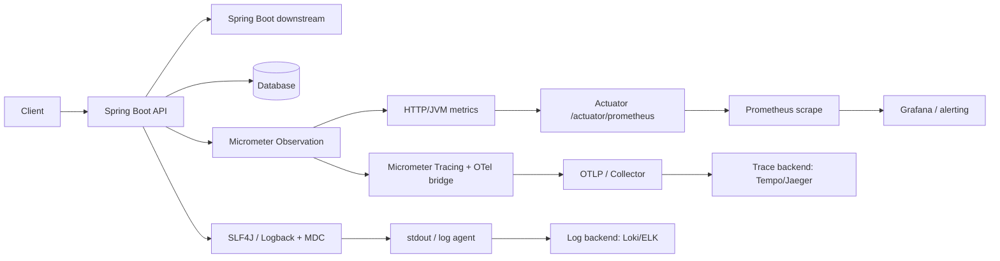

# Observability cho local và production trong Spring Boot

> **Chương:** Nền tảng Observability  
> **Phạm vi:** SPRING_BOOT_OBSERVABILITY — thiết lập và vận hành observability bằng Micrometer Observation, metrics, logs và distributed tracing; hiểu propagation ngữ cảnh, tag/cardinality, exporter, sampling và cách liên kết tín hiệu để điều tra lỗi, độ trễ, hành vi ứng dụng trên môi trường thực.

## Mục tiêu học tập

Sau bài này, bạn có thể:

1. Giải thích vì sao local và production cần **cùng mô hình quan sát** nhưng có mức sampling, bảo mật, chi phí và vận hành khác nhau.
2. Cấu hình Spring Boot để xuất HTTP/JVM metrics qua Actuator/Prometheus, xuất traces qua OpenTelemetry Protocol (OTLP), và ghi logs có trace ID/span ID.
3. Phân biệt metric tag có cardinality thấp với thông tin có cardinality cao chỉ nên xuất hiện có kiểm soát trong traces/logs.
4. Duy trì trace context khi gọi HTTP sang dịch vụ khác hoặc chuyển việc sang thread khác.
5. Dùng metrics → traces → logs để truy ra nguyên nhân một sự cố, đồng thời kiểm tra pipeline observability trước khi triển khai production.

## 1. Observability thay đổi thế nào giữa local và production?

**Monitoring** thường trả lời “hệ thống có vượt ngưỡng đã định không?”. **Observability** giúp suy luận tình trạng bên trong hệ thống từ các tín hiệu phát ra, kể cả khi trước đó chưa dự đoán được tình huống lỗi. Trong Spring Boot, ba tín hiệu thường dùng là:

| Tín hiệu | Nội dung hữu ích | Câu hỏi điển hình |
|---|---|---|
| **Metrics** | Số liệu tổng hợp theo thời gian: lưu lượng, tỷ lệ lỗi, latency, CPU, heap, pool kết nối | “Tỷ lệ 5xx có tăng không? p95 của endpoint nào chậm?” |
| **Distributed traces** | Các span theo một request hoặc luồng xử lý đi qua nhiều thành phần; thể hiện thứ tự, độ dài và quan hệ nhân quả | “Request này chờ database, HTTP downstream hay xử lý nội bộ?” |
| **Logs** | Các sự kiện cụ thể, lý do thất bại, giá trị nghiệp vụ đã được lọc an toàn, stack trace | “Tại span này, điều kiện nào khiến xử lý thất bại?” |

**Micrometer Observation** là lớp API instrumentation trong ứng dụng. Một observation có thể được handler ghi thành metric, trace hoặc cả hai tùy dependency và cấu hình. **Micrometer Tracing** nối hoạt động quan sát với tracer; khi dùng bridge OpenTelemetry, span có thể được gửi tới backend qua OTLP. Logs vẫn đi theo pipeline logging riêng, nhưng có thể chứa cùng trace ID để đối chiếu.

| Khía cạnh | Local/development | Production |
|---|---|---|
| Mục đích | Hiểu luồng xử lý, gỡ lỗi nhanh, kiểm tra instrumentation | Phát hiện sự cố, đo SLI/SLO, phân tích xu hướng, truy nguyên nhân |
| Metrics | Scrape một instance với khoảng lấy mẫu ngắn, dữ liệu ít | Scrape tập trung nhiều instance, retention và aggregation có kế hoạch |
| Traces | Có thể lấy mẫu 100% để thấy từng request thử nghiệm | Lấy mẫu theo ngân sách; cân nhắc tail sampling nếu cần giữ các trace lỗi |
| Logs | Dễ đọc bằng console, có thể tăng mức log tạm thời | Có cấu trúc, tương quan trace, kiểm soát dữ liệu và retention |
| Exposure | Endpoint Actuator chỉ truy cập từ máy/dev network | Endpoint chỉ ở mạng quản trị, cần kiểm soát truy cập và TLS thích hợp |
| Chi phí | Ưu tiên khả năng quan sát, dữ liệu nhỏ | Giới hạn cardinality, tần suất, số span, dung lượng logs và thời gian lưu |
| Độ tin cậy | Collector/backend có thể chạy cùng laptop | Pipeline telemetry độc lập, có buffer/backpressure và cảnh báo khi lỗi xuất dữ liệu |

**Nguyên tắc vận hành:** instrumentation, tên metric, tên observation và chính sách tag nên nhất quán giữa các môi trường. Điều chỉnh endpoint, sampling, mức logging, quyền truy cập và retention theo môi trường. Nhờ vậy, truy vấn dùng trong local vẫn có ý nghĩa khi chuyển sang production.

## 2. Kiến trúc ba tín hiệu



Sơ đồ thể hiện **luồng telemetry**; việc liên kết logs, metrics, traces chủ yếu dựa trên các thuộc tính chung như `service`, `environment`, HTTP route và đặc biệt là `traceId`.

Cần phân biệt hai cách truyền dữ liệu:

- **Metrics kiểu Prometheus:** ứng dụng **expose** `/actuator/prometheus`; Prometheus định kỳ **pull/scrape** endpoint này. Ứng dụng không tự gửi request metrics sang Prometheus trong mô hình này.
- **Traces kiểu OTLP:** SDK/exporter trong ứng dụng **push** spans tới OTLP receiver/Collector (thường HTTP `4318` hoặc gRPC `4317`, theo đúng protocol đã cấu hình).
- **Logs:** ứng dụng ghi ra stdout/file; agent hoặc nền tảng thu gom và chuyển tới backend. Việc có trace ID trong log không tự động biến log thành một span.

Trong production, thường đặt Collector/agent giữa workload và backend để quản lý routing, batching, retry, auth và xử lý telemetry. Collector cũng phải được quan sát: mất collector hoặc cấu hình sai có thể tạo “điểm mù” trong khi business traffic vẫn hoạt động.

## 3. Cấu hình Spring Boot cơ bản

Các ví dụ dưới đây sử dụng **Spring Boot 3.x**, Java 17+, Spring MVC và Maven với dependency management của Spring Boot. Với Spring Boot 4 hoặc những phiên bản khác, cần đối chiếu artifact và thuộc tính cấu hình tương ứng trước khi áp dụng.

### 3.1. Dependencies

Trong `pom.xml` của ứng dụng Spring Boot đã có parent/BOM phù hợp, thêm các dependency:

```xml
<dependencies>
    <!-- HTTP health/metrics/Prometheus endpoints -->
    <dependency>
        <groupId>org.springframework.boot</groupId>
        <artifactId>spring-boot-starter-actuator</artifactId>
    </dependency>
    <dependency>
        <groupId>io.micrometer</groupId>
        <artifactId>micrometer-registry-prometheus</artifactId>
    </dependency>

    <!-- Observation -> Micrometer Tracing -> OpenTelemetry -->
    <dependency>
        <groupId>io.micrometer</groupId>
        <artifactId>micrometer-tracing-bridge-otel</artifactId>
    </dependency>
    <dependency>
        <groupId>io.opentelemetry</groupId>
        <artifactId>opentelemetry-exporter-otlp</artifactId>
    </dependency>
</dependencies>
```

Nếu dùng Gradle, chọn các artifact tương đương và để Spring Boot quản lý phiên bản tương thích. Chỉ thêm bridge tracing phù hợp với stack đã chọn; không cấu hình đồng thời nhiều tracer/SDK độc lập cho cùng request nếu chưa chủ động thiết kế tích hợp.

Actuator cung cấp health/metrics endpoints. Prometheus registry xuất dạng mà Prometheus đọc được. Tracing bridge và OTLP exporter thực hiện instrumentation/correlation và xuất spans. SLF4J/Logback thường đã có qua Spring Boot starter logging; không cần thêm một “logs exporter” mới chỉ để xuất trace ID trong console logs.

### 3.2. Cấu hình chung

Ví dụ tệp `application.yml`:

```yaml
spring:
  application:
    name: checkout-service

management:
  endpoints:
    web:
      exposure:
        include: health,info,metrics,prometheus
  metrics:
    tags:
      application: ${spring.application.name}
    distribution:
      percentiles-histogram:
        http.server.requests: true
  tracing:
    sampling:
      probability: 0.10
  otlp:
    tracing:
      endpoint: ${OTLP_TRACES_ENDPOINT:http://localhost:4318/v1/traces}
```

Diễn giải:

- `spring.application.name` giúp định danh service. Trường `application` là common tag cho metrics; triển khai thực tế còn cần nhãn môi trường, namespace/cluster ở lớp thu gom.
- `percentiles-histogram.http.server.requests` cho phép xuất histogram bucket để tính p95/p99 tổng hợp nhiều instance. Histogram tạo thêm series và chi phí; chỉ bật cho meter cần thiết.
- `management.tracing.sampling.probability` là xác suất lấy mẫu traces tại ứng dụng. `0.10` nghĩa là mục tiêu khoảng 10% trace được chọn theo cơ chế head sampling; không có nghĩa mỗi 10 request chắc chắn sẽ lấy đúng một trace.
- Endpoint OTLP **HTTP** thường có đường dẫn `/v1/traces`. Đừng dùng địa chỉ giao diện truy vấn Jaeger/Tempo làm endpoint exporter.
- Việc expose endpoint bằng cấu hình không đồng nghĩa endpoint đã được xác thực; access control là trách nhiệm riêng.

Khi khởi động mà OTLP receiver chưa sẵn sàng, exporter có thể báo lỗi gửi traces. Điều này không nhất thiết khiến ứng dụng nghiệp vụ chết, nhưng làm mất trace. Trong bài thực hành local, nên bật receiver trước hoặc chấp nhận cảnh báo rõ ràng trong thời gian chưa khởi động backend.

### 3.3. Cấu hình local

Ví dụ `application-local.yml`:

```yaml
management:
  tracing:
    sampling:
      probability: 1.0
  endpoints:
    web:
      exposure:
        include: health,info,metrics,prometheus

logging:
  level:
    root: INFO
    com.example.checkout: DEBUG
```

Thay `com.example.checkout` bằng package thật. Sampling 100% hữu ích khi test ít request; tránh sao chép cấu hình này sang production lưu lượng cao.

Chạy ứng dụng theo profile local:

```bash
./mvnw spring-boot:run -Dspring-boot.run.profiles=local
```

Hoặc chạy JAR đã build:

```bash
java -jar app.jar --spring.profiles.active=local
```

Đảm bảo ứng dụng đang lắng nghe cổng tương ứng với cấu hình `server.port` (ví dụ mặc định `8080`). Kiểm tra:

```bash
curl -i http://localhost:8080/actuator/health
curl -s http://localhost:8080/actuator/metrics
curl -s http://localhost:8080/actuator/prometheus
```

Kết quả kỳ vọng: health trả trạng thái phù hợp, metrics liệt kê meter hiện diện, và Prometheus endpoint xuất các dòng `# HELP`, `# TYPE` cùng time series. Một vài metric chỉ xuất hiện sau khi có traffic hoặc khi instrumentation tương ứng được kích hoạt.

### 3.4. Stack local tối thiểu: Prometheus và OTLP Collector

Trong thư mục bài thực hành local, có thể chuẩn bị hai cấu hình sau. Đây là **ví dụ nội dung**, không yêu cầu tạo thêm file trong module.

`prometheus.yml`:

```yaml
global:
  scrape_interval: 15s

scrape_configs:
  - job_name: spring-boot-local
    metrics_path: /actuator/prometheus
    static_configs:
      - targets:
          - host.docker.internal:8080
```

`otel-collector.yml`:

```yaml
receivers:
  otlp:
    protocols:
      http:
        endpoint: 0.0.0.0:4318

exporters:
  debug:
    verbosity: basic

service:
  pipelines:
    traces:
      receivers: [otlp]
      exporters: [debug]
```

`compose.yaml` chạy hai thành phần local:

```yaml
services:
  prometheus:
    image: prom/prometheus:latest
    ports:
      - "9090:9090"
    volumes:
      - ./prometheus.yml:/etc/prometheus/prometheus.yml:ro

  otel-collector:
    image: otel/opentelemetry-collector:latest
    command: ["--config=/etc/otelcol/config.yaml"]
    ports:
      - "4318:4318"
    volumes:
      - ./otel-collector.yml:/etc/otelcol/config.yaml:ro
```

Chạy `docker compose up`. Prometheus UI nằm ở `http://localhost:9090`; query `up{job="spring-boot-local"}` bằng `1` nghĩa là lần scrape gần nhất thành công. Collector trong ví dụ chỉ **in trace bằng debug exporter**; muốn có waterfall/tìm kiếm trace, thay hoặc bổ sung exporter tới backend như Tempo/Jaeger. Trên Docker Desktop, `host.docker.internal` thường trỏ về máy host; trên Linux cần bảo đảm tên này phân giải được (chẳng hạn cấu hình `host-gateway`), hoặc đổi `targets` sang địa chỉ mà container có thể truy cập.

Thẻ image `latest` chỉ để minh họa thử nghiệm local. Trong môi trường có yêu cầu tái lập hoặc production, cố định version/digest đã kiểm thử, có chính sách nâng cấp và tránh mount cấu hình tùy tiện từ nơi không tin cậy.

**Bài kiểm tra đường đi dữ liệu local:**

1. Mở `/actuator/prometheus` trực tiếp: nếu lỗi, kiểm tra app trước khi kiểm tra Prometheus.
2. Mở Prometheus Targets: `spring-boot-local` phải có trạng thái **UP**.
3. Gửi vài request vào một API thực sự tồn tại trong app; query `http_server_requests_seconds_count` để xem HTTP metric tăng.
4. Kiểm tra logs của container collector: phải nhận được dữ liệu trace khi sampling là `1.0` và app có request được instrument.
5. Kiểm tra console log của Spring Boot có correlation ID khi request đang nằm trong trace context.

## 4. Từ local đến production: cấu hình theo môi trường

Một cấu hình production tham khảo trong `application-prod.yml`:

```yaml
management:
  server:
    port: 8081
  endpoints:
    web:
      exposure:
        include: health,info,prometheus
  endpoint:
    health:
      probes:
        enabled: true
  tracing:
    sampling:
      probability: ${TRACE_SAMPLING_PROBABILITY:0.10}
  otlp:
    tracing:
      endpoint: ${OTLP_TRACES_ENDPOINT}

logging:
  level:
    root: INFO
```

Ví dụ này chủ đích dùng biến môi trường `OTLP_TRACES_ENDPOINT` bắt buộc để tránh ứng dụng production vô tình gửi trace về `localhost`. Endpoint phải trỏ đúng OTLP receiver có thể truy cập từ container/pod, ví dụ một Service nội bộ. `management.server.port=8081` chỉ tách cổng quản trị; **không tạo xác thực hay network policy**. Khi áp dụng, giới hạn cổng bằng ingress/network policy/firewall và xác thực phù hợp, hoặc để agent scrape trực tiếp trong mạng nội bộ.

Với Kubernetes, health probes thường được dùng ở:

- `/actuator/health/liveness`: tiến trình có hoạt động được không?
- `/actuator/health/readiness`: instance có sẵn sàng nhận traffic không?

Nếu expose health ở cổng management riêng, probe thành công không nhất thiết chứng minh cổng HTTP nghiệp vụ đang nhận kết nối. Thiết kế readiness/liveness nên kiểm tra đúng đường đi phục vụ traffic và tránh gắn quá nhiều dependency dễ gây restart dây chuyền.

### 4.1. Những điều phải bổ sung ở production

| Quyết định | Gợi ý thực hành |
|---|---|
| **Service identity** | Giữ `service.name` ổn định, có environment/namespace/cluster để phân biệt các bản triển khai; chọn nhãn từ orchestrator/Collector |
| **Metrics scrape** | Dùng target discovery phù hợp (ServiceMonitor/PodMonitor hoặc job discovery), endpoint nội bộ, TLS/auth nếu cần |
| **OTLP transport** | Dùng Collector hoặc gateway nội bộ; quản lý TLS, credentials, batch, retry và giới hạn tải |
| **Sampling** | Bắt đầu bằng tỷ lệ có ngân sách, đo traffic/trace volume, điều chỉnh theo dịch vụ và tình huống |
| **Logs** | Ghi stdout, một dòng một event, ưu tiên structured logs; không log body/token/PII mặc định |
| **Retention** | Đặt retention riêng cho logs/metrics/traces, giới hạn nhãn và quản lý chi phí |
| **Dashboard/alerts** | Theo dõi traffic, errors, p95/p99, saturation cùng tín hiệu từ Collector và backend |
| **Vận hành** | Có owner cho dashboard, quy trình kiểm tra telemetry và runbook khi mất tín hiệu |

Spring Boot phiên bản hỗ trợ structured console logging có thể sử dụng cấu hình tương ứng (ví dụ `logging.structured.format.console: ecs` ở các phiên bản hỗ trợ). Hãy chọn schema cụ thể theo pipeline logs đang dùng, kiểm tra tên trường trace/span sau khi ingest; việc đổi format console mà không kiểm tra parser có thể khiến truy vấn logs ngừng hoạt động.

### 4.2. Không coi telemetry là điều kiện bắt buộc để xử lý request

Khi Collector hoặc backend mất kết nối, mục tiêu thông thường là business API vẫn phục vụ được, đồng thời log/metric nội bộ cho biết telemetry bị rơi. Do đó:

- Dùng cơ chế batching, timeout, queue và retry có giới hạn ở exporter/Collector; tránh retry vô hạn và tích tụ bộ nhớ.
- Theo dõi các chỉ số của collector/exporter như số span nhận/xuất, số bị drop, queue và lỗi gửi.
- Không đưa thông tin bí mật vào OTLP headers, baggage, tags hoặc log message.
- Kiểm thử lỗi mạng với OTLP receiver để xác nhận latency của request không tăng quá mức chấp nhận được.

## 5. Instrumentation bằng Micrometer Observation

Spring Boot đã instrument nhiều lớp HTTP/JVM thông qua Actuator và các integration. Không cần tự tạo metric HTTP request khi metric chuẩn đã có. Tạo observation riêng khi cần nhìn thấy một bước nghiệp vụ có ý nghĩa.

Ví dụ xử lý checkout:

```java
import io.micrometer.observation.Observation;
import io.micrometer.observation.ObservationRegistry;
import org.springframework.stereotype.Service;

@Service
public class CheckoutService {
    private final ObservationRegistry registry;
    private final PaymentGateway paymentGateway;

    public CheckoutService(
            ObservationRegistry registry,
            PaymentGateway paymentGateway) {
        this.registry = registry;
        this.paymentGateway = paymentGateway;
    }

    public Receipt place(OrderCommand command) {
        return Observation.createNotStarted("checkout.place", registry)
                .contextualName("place checkout")
                .lowCardinalityKeyValue("channel", command.channel().name())
                .observe(() -> paymentGateway.charge(command));
    }
}
```

`OrderCommand`, `Receipt` và `PaymentGateway` là các kiểu nghiệp vụ minh họa; điều quan trọng ở đây là cách mở observation quanh một hoạt động. Khi cấu hình meter/tracing handlers phù hợp, observation này có thể tạo thêm metric cho thời gian xử lý và span tương ứng; tên và tags thực tế cần kiểm tra tại exporter.

**Quy tắc cardinality:**

| Thuộc tính | Ví dụ | Dùng cho |
|---|---|---|
| Cardinality thấp | `method=GET`, `status=500`, `channel=WEB`, URI template `/orders/{id}` | Metric tags và dimensions dùng để aggregate |
| Cardinality cao | Order ID, user ID, email, raw URL/query, session ID, trace ID | Không đưa vào metric tags; chỉ sử dụng rất chọn lọc trong trace/log theo chính sách dữ liệu |
| Ngữ cảnh trace | `traceId`, `spanId`, tên span, duration | Đối chiếu request và các bước thực thi; không biến trace ID thành Prometheus label |

Tại sao? Nếu thêm `orderId` làm metric tag và có 100.000 đơn hàng, một metric có thể nở thành hàng trăm nghìn time series. Chi phí lưu trữ, số mẫu cần scrape và bộ nhớ tăng mạnh. Hãy dùng route template đã chuẩn hóa, enum có tập giá trị nhỏ hoặc mã trạng thái có nhóm giới hạn.

Đừng tạo observation trùng với instrumentation sẵn có mà không rõ mục đích: một đường request có thể bị đếm hai lần trong dashboard nếu trộn meter thủ công và meter tự động mà không phân biệt.

## 6. Propagation ngữ cảnh giữa các dịch vụ và luồng thực thi

Một trace nối các span bằng trace context; khi gọi service khác qua HTTP, cần truyền headers tiêu chuẩn, thường là W3C `traceparent` (và `tracestate` nếu có). Span ở downstream dùng cùng trace ID nhưng có span ID riêng; cấu trúc parent/child cho thấy vị trí thời gian và quan hệ gọi.

### 6.1. HTTP client

Spring Boot có thể tự instrument HTTP client khi client được tạo bằng các builder do Spring Boot cấu hình. Ví dụ:

```java
import org.springframework.stereotype.Service;
import org.springframework.web.client.RestClient;

@Service
public class InventoryClient {
    private final RestClient client;

    public InventoryClient(RestClient.Builder builder) {
        this.client = builder
                .baseUrl("http://inventory-service")
                .build();
    }

    public String getAvailability(String sku) {
        return client.get()
                .uri("/api/inventory/{sku}", sku)
                .retrieve()
                .body(String.class);
    }
}
```

Ví dụ cần Spring Boot/Spring Framework có `RestClient`. Nếu tự tạo HTTP client bên ngoài cơ chế auto-configuration hoặc dùng thư viện không được instrument, propagation có thể thiếu. Khi đó phải cấu hình instrumentation hoặc inject/extract context tường minh theo thư viện. Không tự nối chuỗi `traceparent` bằng tay nếu đã có propagator đúng chuẩn.

### 6.2. Chuyển thread và tác vụ bất đồng bộ

Trace context thường gắn với ngữ cảnh thực thi hiện tại. Chạy `CompletableFuture`, `@Async`, executor tự tạo hoặc callback mà không propagate context có thể làm mất MDC/span cha. Với Spring Framework 6.1+ có thể dùng task decorator:

```java
import org.springframework.context.annotation.Bean;
import org.springframework.context.annotation.Configuration;
import org.springframework.core.task.support.ContextPropagatingTaskDecorator;
import org.springframework.scheduling.concurrent.ThreadPoolTaskExecutor;

@Configuration
public class ExecutorConfig {
    @Bean("observedExecutor")
    public ThreadPoolTaskExecutor observedExecutor() {
        ThreadPoolTaskExecutor executor = new ThreadPoolTaskExecutor();
        executor.setCorePoolSize(4);
        executor.setMaxPoolSize(8);
        executor.setQueueCapacity(100);
        executor.setTaskDecorator(new ContextPropagatingTaskDecorator());
        executor.initialize();
        return executor;
    }
}
```

Ứng dụng phải thực sự sử dụng executor này ở chỗ dispatch việc. Với Reactor/WebFlux, kiểm tra cơ chế context propagation của Reactor và cấu hình tương ứng của phiên bản Spring Boot đang dùng; MDC dựa trên ThreadLocal đơn thuần không đủ cho toàn bộ reactive chain. Với messaging, producer/consumer cần propagate/extract context qua headers hoặc integration phù hợp; một message fan-out có thể cần span links thay vì một quan hệ cha/con trực tiếp.

**Thử nghiệm propagation:** gửi request A → B → C, xem logs và trace backend. Trace ID phải giữ nguyên giữa ba service; span ID thay đổi theo span. Nếu mỗi service có trace ID khác, kiểm tra builder HTTP, headers, proxy có loại bỏ headers không, cấu hình propagator và cơ chế async.

## 7. Correlation giữa logs, metrics và traces

### 7.1. Trace ID và span ID trong logs

Với Micrometer Tracing được cấu hình, Spring Boot có khả năng đưa trace/span ID vào MDC và mẫu log correlation. Nếu ứng dụng đã tùy chỉnh console pattern, có thể cần bổ sung correlation pattern, ví dụ:

```yaml
logging:
  pattern:
    correlation: '[${spring.application.name:app},%X{traceId:-},%X{spanId:-}] '
```

Giá trị thực tế và khả năng hỗ trợ property phụ thuộc phiên bản Spring Boot cùng logging layout. Với structured logs, đảm bảo trace/span ID được giữ thành trường có thể query và khớp schema của backend.

Ví dụ một dòng log trong request:

```text
INFO [checkout-service,4bf92f3577b34da6a3ce929d0e0e4736,00f067aa0ba902b7] Checkout completed
```

Trong code:

```java
private static final Logger log =
        LoggerFactory.getLogger(CheckoutService.class);

// Chỉ ghi mã trạng thái/giai đoạn đã chuẩn hóa; không log token/card data.
log.info("Checkout completed; channel={}", command.channel());
```

Không đặt trace ID vào metric label. Hãy truy vấn metrics theo route/status/service để tìm nhóm bất thường; từ một trace cùng service/route/khoảng thời gian, tìm logs theo trace ID để xem sự kiện cụ thể.

### 7.2. Quy trình điều tra một request chậm

Giả sử endpoint `POST /api/checkouts` có tỷ lệ lỗi và p95 tăng:

1. **Metrics:** xác định khoảng thời gian phát sinh, service, version/instance, `uri` và `status`; xem error ratio cùng latency histogram.
2. **Traces:** lọc trace theo service, operation, thời gian và trạng thái nếu backend hỗ trợ; tìm span chiếm nhiều duration (database, outbound HTTP, khóa/chờ queue).
3. **Logs:** dùng `traceId` của trace bất thường để xem log của cùng request, stack trace đã lọc dữ liệu và những sự kiện không thể hiện bằng span.
4. **Đối chiếu:** kiểm tra downstream latency và saturation. Đừng kết luận “database chậm” chỉ vì span DB dài: có thể thời gian gồm chờ pool, lock hoặc network.
5. **Xác minh sau khắc phục:** so sánh p95, error ratio, saturation trước/sau deploy ở cùng cửa sổ traffic; kiểm tra số mẫu đủ đại diện.

Một trace đơn lẻ không đại diện cho phân phối latency của toàn bộ hệ thống. Ngược lại, metrics cho biết “điều gì đang thay đổi” nhưng không luôn chỉ ra nguyên nhân của một request cụ thể. Kết hợp cả ba giúp tránh suy luận từ một tín hiệu.

## 8. Metrics và truy vấn thực hành

Trong Spring MVC, meter HTTP server thường có tên Micrometer `http.server.requests`. Ở `/actuator/metrics/http.server.requests` bạn có thể xem số liệu và available tags. Khi qua Prometheus registry, tên/đơn vị thường được chuyển đổi thành những series như `http_server_requests_seconds_count`, `http_server_requests_seconds_sum` và, khi bật histogram, `http_server_requests_seconds_bucket`.

Ví dụ PromQL dưới đây giả sử `job="spring-boot-prod"`; thay bằng nhãn thực tế trong Prometheus.

**Lưu lượng request/giây (RPS):**

```promql
sum(rate(http_server_requests_seconds_count{job="spring-boot-prod"}[5m]))
```

**Tỷ lệ 5xx trong tổng request (0–1):**

```promql
sum(rate(http_server_requests_seconds_count{
  job="spring-boot-prod",status=~"5.."
}[5m]))
/
clamp_min(
  sum(rate(http_server_requests_seconds_count{
    job="spring-boot-prod"
  }[5m])),
  1e-9
)
```

**p95 latency theo URI template, nếu đã bật histogram:**

```promql
histogram_quantile(
  0.95,
  sum by (le, uri) (
    rate(http_server_requests_seconds_bucket{
      job="spring-boot-prod"
    }[5m])
  )
)
```

**Gợi ý dashboard:** request rate, error ratio, p50/p95/p99 latency, số request đang xử lý (nếu có metric phù hợp), JVM heap/GC, CPU, thread, HTTP client latency, database connection pool và tình trạng collector/exporter. Chọn **SLI/SLO** theo yêu cầu dịch vụ; chỉ đặt ngưỡng cảnh báo sau khi hiểu traffic, mùa vụ và đặc tính endpoint. p95 theo route có ít traffic dễ dao động; nên xem cả số mẫu.

Lưu ý: một số phiên bản registry/instrumentation đặt tên hoặc tags khác nhau. Trước khi sao chép truy vấn, hãy kiểm tra chính xác tên time series và labels bằng `/actuator/prometheus` hay trình khám phá metrics. Histogram bucket chỉ tồn tại khi được kích hoạt và đã có dữ liệu phù hợp. Không tính p95 toàn cluster bằng cách lấy trung bình p95 của từng instance.

## 9. Sampling, cardinality và ngân sách telemetry

### Head sampling

Ứng dụng quyết định lấy mẫu sớm khi bắt đầu trace; `management.tracing.sampling.probability` là cấu hình thông dụng với Micrometer Tracing. Ưu điểm: chi phí thấp ngay tại nguồn. Nhược điểm: một request lỗi hiếm có thể không được lấy mẫu, dù logs và metrics vẫn ghi nhận sự cố.

### Tail sampling

Collector có thể quyết định giữ hay loại trace **sau khi quan sát thêm thông tin** như duration, status hoặc thuộc tính. Cách này hữu ích để giữ trace chậm/lỗi, nhưng đòi hỏi tập trung đủ các span liên quan, bộ nhớ/queue, chính sách nhất quán và đường routing phù hợp. Không chỉ đổi sampling tại Collector rồi kỳ vọng phục hồi những span đã bị ứng dụng loại bỏ từ head sampling.

### Chọn dữ liệu theo giá trị sử dụng

- **Metrics:** tags có tập giá trị được kiểm soát; cân nhắc histogram bucket và cardinality trước khi bật rộng.
- **Traces:** span name ổn định theo operation/route; số lượng span có ích, tránh tạo span cho từng vòng lặp hoặc record nhỏ.
- **Logs:** INFO cho sự kiện vận hành quan trọng, WARN/ERROR cho tình huống cần xử lý, DEBUG có giới hạn thời gian; không ghi toàn bộ request/response body.
- **Baggage:** chỉ truyền thuộc tính cần thiết, nhỏ, không nhạy cảm. Baggage có thể được gửi qua network và không phải cơ chế bảo mật thông tin người dùng.

Để ước lượng cardinality, xét metric có 12 URI templates × 5 HTTP methods × 6 status codes × 8 instances = tối đa khoảng **2.880 tổ hợp labels** trước khi tính thêm tags hoặc bucket. Nếu thay route template bằng URL chứa order ID, số tổ hợp có thể tăng theo số đơn hàng. Con số minh họa không phải đo đạc thực tế; điều cần nhớ là **tích số lượng giá trị của từng label**.

## 10. Bảo mật và tính toàn vẹn dữ liệu

Các endpoint như `/actuator/env`, `/actuator/configprops`, `/actuator/heapdump` hoặc `/actuator/threaddump` có thể lộ dữ liệu nội bộ nhạy cảm; không expose chúng công khai theo mặc định. Ngay cả `/actuator/prometheus` cũng có thể làm lộ tên service, endpoint, dependency và đặc điểm tải. Cần quản lý endpoint ở cả tầng ứng dụng lẫn mạng.

Hướng thực hành:

- Đặt management endpoint sau mạng nội bộ, xác thực/ủy quyền khi cần, TLS phù hợp và giới hạn ai có thể scrape.
- Lọc secrets, access tokens, email, dữ liệu thanh toán, URL chứa query nhạy cảm khỏi logs/spans/tags; kiểm soát cả exception messages.
- Sử dụng quyền truy cập tối thiểu tới dashboard và backend quan sát; cấu hình retention theo yêu cầu pháp lý, vận hành và chi phí.
- Định danh deployment qua nhãn ổn định; không đưa dữ liệu cá nhân làm label.
- Đo pipeline telemetry và áp dụng health/alerting cho Collector, Prometheus scrape, trace ingestion và log ingestion.

**Cảnh báo vận hành:** `health=UP` chỉ xác nhận những health indicators được cấu hình báo tốt. Nó không chứng minh tất cả dashboard, exporter, log agents và hệ thống downstream đang hoạt động bình thường.

## 11. Troubleshooting theo biểu hiện

| Biểu hiện | Kiểm tra theo thứ tự |
|---|---|
| `/actuator/prometheus` trả 404 | Có `spring-boot-starter-actuator` và `micrometer-registry-prometheus`? Đã expose endpoint? Có custom base path hoặc management port? |
| Endpoint trả 401/403 | Kiểm tra Spring Security, rule ingress/network, credential của Prometheus; không vô hiệu hóa bảo vệ chỉ để scrape cho dễ |
| Target Prometheus **DOWN** | Kiểm tra host/port từ **bên trong container Prometheus**, DNS, routing, HTTP status, TLS/auth, `metrics_path` |
| Không thấy metric HTTP | Đã gọi API có instrumentation? Có traffic? Kiểm tra `/actuator/metrics`, registry, tên meter và nhãn sau export |
| Không có `_bucket` để tính p95 | Đã bật `percentiles-histogram` cho đúng meter? Đã có request mới và Prometheus scrape đủ mẫu? |
| Collector không nhận traces | Kiểm tra dependencies bridge/exporter, sampling, `OTLP_TRACES_ENDPOINT`, HTTP `4318/v1/traces` so với gRPC `4317`, DNS và kết nối |
| Có log trace ID nhưng không tìm thấy trace | Kiểm tra sampling (trace có thể bị loại), exporter/Collector drop, backend retention, sai khoảng thời gian hoặc service name |
| Trace đứt ở call downstream | Kiểm tra client có được Spring Boot instrument, propagation headers, proxy, async boundaries và propagator hai đầu |
| Log async thiếu trace ID | Xác nhận executor có context propagation hoặc reactive context được thiết lập chính xác |
| Số series/tải bộ nhớ tăng mạnh | Kiểm tra tags có ID/URL động, histograms không cần thiết, thay đổi labels theo deployment, số target |
| Traces có nhưng mất logs | Kiểm tra stdout collector/log agent, parser format, field trace ID, index và retention của log backend |

## 12. Checklist bàn giao production

Trước khi cho một service mới nhận traffic, nên có bằng chứng cho các mục sau:

- [ ] Đã định danh service/environment/deployment và xác định owner của dashboard.
- [ ] `/actuator/health` và Prometheus endpoint truy cập đúng từ nơi cần dùng; management endpoints được giới hạn quyền và mạng.
- [ ] Prometheus target **UP**, HTTP/JVM metrics có dữ liệu sau request thật.
- [ ] Một request thử nghiệm tạo span trong trace backend, trace context truyền được qua ít nhất một call downstream.
- [ ] Logs tương ứng có trace ID/span ID và tra cứu được qua backend; không chứa dữ liệu nhạy cảm.
- [ ] Cấu hình sampling, histogram, tags và retention nằm trong ngân sách dữ liệu.
- [ ] Dashboard có traffic, 5xx, p95, saturation; alert có ngưỡng và người phụ trách xử lý.
- [ ] Đã thử tình huống Collector/backend tạm mất kết nối và xác nhận ảnh hưởng lên API trong giới hạn chấp nhận.
- [ ] Có runbook chỉ rõ cách đi từ alert metric → trace bất thường → logs → kiểm chứng sau sửa lỗi.

## 13. Bài thực hành tổng hợp

**Tình huống:** service checkout có một cuộc gọi HTTP sang inventory và một thao tác thanh toán. Khi tăng tải, người dùng phản ánh checkout chậm.

Thực hiện theo trình tự:

1. **Local:** bật profile `local`, gửi request thử và xác nhận `http.server.requests` tăng; chọn sampling `1.0` để nhìn thấy đầy đủ trace của luồng thử nghiệm.
2. **Đo điểm nghẽn:** bọc bước checkout bằng `Observation`; kiểm tra span/timer mới xuất hiện, gắn tag `channel` với tập giá trị giới hạn.
3. **Kiểm tra propagation:** xác nhận trace ID giữ nguyên qua call inventory và log của các service có thể được đối chiếu.
4. **Mô phỏng lỗi:** làm inventory trả lỗi hoặc tăng latency trong môi trường thử nghiệm; kiểm tra error ratio/p95, span downstream và log tương ứng.
5. **Chuyển cấu hình sang production:** giảm sampling về mức có ngân sách, dùng OTLP receiver nội bộ, expose endpoint trong mạng quản trị và bổ sung scrape/alerts.
6. **Viết kết luận sự cố:** ghi rõ metric nào chứng minh ảnh hưởng, span nào cho thấy thời gian bị tiêu tốn, log nào cho biết nguyên nhân, và chỉ số nào xác nhận đã phục hồi.

**Tiêu chí hoàn thành:** có thể chỉ ra một chuỗi bằng chứng đo được từ traffic thực nghiệm, thay vì chỉ nhìn một dòng log rồi đoán lỗi. Đồng thời giải thích được vì sao local ưu tiên chi tiết để debug, còn production phải đảm bảo an toàn, chi phí và tính liên tục của pipeline.

---

### Ghi nhớ

Observability hiệu quả bắt đầu từ instrumentation nhất quán trong Spring Boot: **Micrometer Observation → metrics và tracing**, logs có **trace context**, Prometheus scrape metrics, OTLP chuyển traces và log agent thu gom stdout. Local giúp xác minh từng mắt xích; production bổ sung sampling, cardinality control, bảo mật, độ tin cậy và quy trình điều tra dựa trên cả ba tín hiệu.
