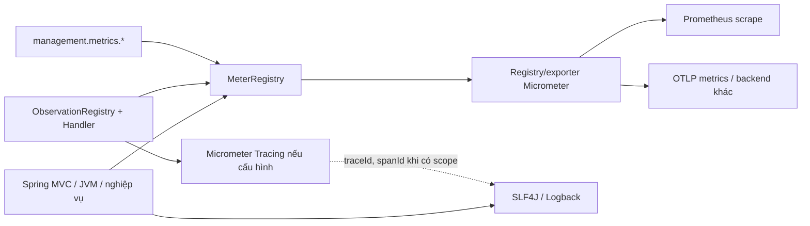
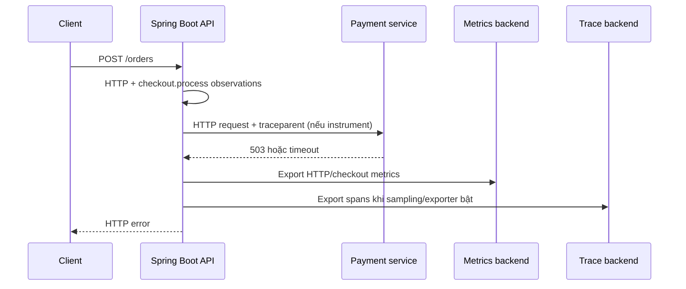

# `management.metrics`: cấu hình Micrometer Metrics trong Spring Boot

## 1. Mục tiêu và phạm vi

Trong Spring Boot, nhiều thông tin vận hành đã có sẵn: mức sử dụng heap, CPU, GC, số kết nối, HTTP request count và latency. Điều quan trọng là **định nghĩa metric nào được ghi nhận, gắn những nhãn nào và xuất thống kê theo cách nào**. Nhóm thuộc tính `management.metrics.*` chính là một điểm cấu hình trung tâm cho Micrometer Metrics ở tầng Spring Boot Actuator.

Bài thuộc chương **Spring Boot metrics** của module **SPRING_BOOT_OBSERVABILITY**. Sau khi học, bạn có thể:

- Giải thích `management.metrics` điều khiển những gì trong `MeterRegistry`, khác gì với `management.observations` và các thuộc tính exporter.
- Sử dụng `management.metrics.tags.*` để gắn common tags với tập giá trị kiểm soát được.
- Sử dụng `management.metrics.enable.*` để bật/tắt các meter theo tiền tố tên.
- Cấu hình `management.metrics.distribution.*`: histogram, percentiles, SLO buckets, giới hạn khoảng giá trị và cửa sổ thống kê.
- Tạo một metric nghiệp vụ bằng Micrometer Observation hoặc `MeterRegistry`, quan sát kết quả bằng Actuator/Prometheus và phân tích p95 latency.
- Phát hiện tác động tới cardinality, chi phí time series, dashboard, alerts và mối liên hệ với logs, tracing, sampling.
- Kiểm tra tài liệu đúng phiên bản Spring Boot 3.5.x/4.x trước khi chuyển cấu hình giữa các hệ thống.

**Phiên bản ví dụ chính:** Spring Boot **3.5.x**, Java 17+, Micrometer và Spring MVC. Những property cốt lõi ở bài này cũng xuất hiện trong tham chiếu Boot 4.x; tên starter, class và một số nhóm tự cấu hình có thể thay đổi nên các ví dụ dependency cần đối chiếu phiên bản cụ thể.

## 2. `management.metrics` đứng ở đâu trong kiến trúc observability?



- `MeterRegistry` là nơi đăng ký **Meter**, gồm `Counter`, `Timer`, `Gauge`, `DistributionSummary` và các loại khác. Nó quản lý tên, tags, mẫu thống kê và cách đọc/xuất theo registry.
- `management.metrics.*` là các **thuộc tính Spring Boot** dùng để cấu hình meter và registry được Spring Boot quản lý; đây không phải Java package hay một API tự tạo span.
- `ObservationRegistry` mô tả vòng đời thao tác. Với tích hợp Actuator, `DefaultMeterObservationHandler` có thể tạo metric từ observation hoàn tất.
- Exporter/registry như Prometheus và OTLP Metrics chuyển số liệu sang hệ thống giám sát. Các thuộc tính exporter **không nằm hết bên dưới** `management.metrics`.
- Distributed tracing và logs có pipeline, sampling và retention riêng. Chúng có thể liên kết với metrics bằng tên dịch vụ, thời điểm và trace ID nếu hệ thống hỗ trợ.

Phân biệt rõ ba việc: **thu thập số liệu**, **xuất số liệu** và **phân tích số liệu**. Một `/actuator/metrics` trả về dữ liệu chưa chứng minh Prometheus đã scrape hoặc OTLP Collector đã nhận được metrics.

### 2.1. Các namespace liên quan dễ nhầm

| Nhóm thuộc tính | Mục đích | Ví dụ |
| --- | --- | --- |
| `management.metrics.tags.*` | Common tags cho các meter | `application=checkout-service` |
| `management.metrics.enable.*` | Chấp nhận/từ chối meter theo tên | Tắt `jvm` trong môi trường thử nghiệm |
| `management.metrics.distribution.*` | Phân phối, percentiles, histogram và SLO | SLO bucket 100 ms, 300 ms, 1 s |
| `management.endpoints.web.exposure.include` | Expose Actuator endpoints qua HTTP | `metrics,prometheus` |
| `management.prometheus.metrics.export.*` | Registry/export Prometheus | Bật hoặc tắt registry Prometheus |
| `management.otlp.metrics.export.*` | Gửi metrics qua OTLP | `url` tới collector |
| `management.observations.*` | Điều khiển và cấu hình Observation | Enable observation, đổi tên HTTP observation |
| `management.tracing.*` | Điều khiển tracing/sampling | Xác suất sample trace |

Không dùng `management.metrics.tags` với hy vọng nó tự thêm span attributes vào tất cả distributed traces. Cũng không dùng `management.tracing.sampling` để giải quyết một metric có quá nhiều tag values.

## 3. Khởi tạo dự án minh họa

Với ứng dụng **Spring Boot 3.5.x** dùng Spring Boot parent/BOM quản lý phiên bản, các dependency Maven tối thiểu để chạy một API và xem Prometheus metrics là:

```xml
<dependencies>
    <dependency>
        <groupId>org.springframework.boot</groupId>
        <artifactId>spring-boot-starter-web</artifactId>
    </dependency>
    <dependency>
        <groupId>org.springframework.boot</groupId>
        <artifactId>spring-boot-starter-actuator</artifactId>
    </dependency>
    <dependency>
        <groupId>io.micrometer</groupId>
        <artifactId>micrometer-registry-prometheus</artifactId>
    </dependency>
</dependencies>
```

Actuator tích hợp Micrometer và tự cấu hình registry theo dependency có mặt. Prometheus registry cung cấp dữ liệu ở `/actuator/prometheus` nếu endpoint được expose. **Không cần bật tracing để học phần cấu hình metrics**; muốn xem spans sẽ cần thêm tracing bridge/exporter và backend riêng.

Ví dụ file `application.yml` tối giản, chỉ nên expose endpoint theo quyền truy cập thích hợp:

```yaml
spring:
  application:
    name: checkout-service

management:
  endpoints:
    web:
      exposure:
        include: health,info,metrics,prometheus
  metrics:
    tags:
      application: checkout-service
      environment: local
```

Trong môi trường thực, `/actuator/metrics` và `/actuator/prometheus` cần chính sách xác thực, mạng hoặc reverse proxy phù hợp. `localhost` và port dưới đây chỉ là minh họa chạy cục bộ, không mặc định dùng cho production.

## 4. `management.metrics.tags.*`: common tags

### 4.1. Common tags là gì?

Common tags là những chiều xuất hiện trên **mọi meter** của registry được cấu hình. Chúng giúp nhóm dữ liệu theo ứng dụng hoặc môi trường mà không phải lặp đi lặp lại tags khi tạo từng `Counter` hay `Timer`.

```yaml
management:
  metrics:
    tags:
      application: checkout-service
      environment: staging
      region: ap-southeast-1
```

Ví dụ cùng một tên `http.server.requests` trên hai ứng dụng hoặc vùng có thể được phân biệt bằng `application`, `environment`, `region`. Trong Prometheus, nhãn được xuất theo định dạng Prometheus và có thể bổ sung nhãn do cơ chế scrape/target tạo thêm, ví dụ `job`, `instance`.

| Nên dùng | Cần cân nhắc | Tránh dùng |
| --- | --- | --- |
| `application`, `environment`, vùng triển khai có tập giá trị quản lý | `version`/build hash (mỗi lần deploy tạo chiều mới) | `userId`, `orderId`, `traceId`, `sessionId` |
| `team`/nhóm dịch vụ cố định | `instance` nếu backend đã tự thêm | Raw URL, token, email |
| `component` được allowlist | Tenant khi số tenant có thể tăng không giới hạn | Nội dung exception hoặc request body |

**Common tag áp dụng cho mọi meter, nên tác động rộng.** Một `userId` xuất hiện trên common tags có thể làm bùng nổ số time series của toàn bộ ứng dụng, không chỉ một metric nghiệp vụ.

### 4.2. Ngân sách cardinality

Giả sử metric có `method` 4 giá trị, `status` 5, `uri` 30, được scrape từ 6 instance và bạn thêm `region` 2 giá trị. Giới hạn trên lý thuyết khi mọi tổ hợp xuất hiện là:

\[
4 \times 5 \times 30 \times 6 \times 2 = 7{,}200\ \text{series}
\]

Nếu gắn một ID request duy nhất cho mỗi request, cardinality có thể tăng không giới hạn theo traffic và retention. Với Timer histogram, mỗi tổ hợp tag còn có thể sinh nhiều series `_bucket`, `_count`, `_sum`.

Để điều tra *một request riêng lẻ*, nên dùng logs và traces có kiểm soát; để tính **error rate/p95/throughput**, nên dùng metrics với nhãn hữu hạn.

### 4.3. Common tags bằng Java thay vì thuộc tính

Khi cần điều khiển thứ tự tags (ví dụ một số registry kiểu phân cấp như Graphite), hoặc cấu hình có logic khác, Spring Boot hỗ trợ `MeterRegistryCustomizer`:

```java
import io.micrometer.core.instrument.MeterRegistry;
import org.springframework.boot.actuate.autoconfigure.metrics.MeterRegistryCustomizer;
import org.springframework.context.annotation.Bean;
import org.springframework.context.annotation.Configuration;

@Configuration(proxyBeanMethods = false)
class MetricsConfiguration {
    @Bean
    MeterRegistryCustomizer<MeterRegistry> metricsCommonTags() {
        return registry -> registry.config()
                .commonTags("application", "checkout-service",
                            "environment", "staging");
    }
}
```

Đây là ví dụ **thay thế** cho cấu hình common tags tương ứng trong YAML. Không nên cấu hình trùng cùng tag key ở nhiều nơi mà không kiểm soát giá trị cuối. `MeterRegistryCustomizer` cấu hình **metrics registry**, khác với `ObservationRegistryCustomizer` dùng cho registry observation.

Trong ứng dụng, ưu tiên inject `MeterRegistry` do Spring quản lý; tránh nhầm với lời gọi tĩnh `Metrics.counter(...)`, vì global registry có vòng đời và kiểm soát khác.

## 5. `management.metrics.enable.*`: nhận hoặc từ chối meter

Spring Boot dùng prefix của tên meter để quyết định có nhận meter vào registry hay không. Ví dụ:

```yaml
management:
  metrics:
    enable:
      jvm: false
```

Cấu hình trên sẽ **từ chối các meter có tên bắt đầu bằng `jvm`** trong registry chịu chính sách này, chẳng hạn `jvm.memory.used`. Mục đích có thể là giảm dữ liệu không cần thiết ở môi trường thử nghiệm, nhưng tắt quá rộng sẽ làm mất các dashboard/cảnh báo JVM hữu ích.

Ví dụ tắt một nhóm metric tự tạo:

```properties
management.metrics.enable.internal.poll=false
```

Bảng phân biệt:

| Trường hợp | Điều gì thay đổi? |
| --- | --- |
| `management.metrics.enable.jvm=false` | Các meter thuộc nhóm `jvm` bị loại khỏi registry có áp dụng cấu hình |
| `management.metrics.enable.checkout=false` | Các meter có tên bắt đầu bằng `checkout` có thể bị loại, kể cả tạo trực tiếp bằng `MeterRegistry` |
| `management.observations.enable.checkout=false` | Có thể chặn các observation cùng prefix; là tầng Observation, khác với meter filter |
| `management.tracing.sampling.probability=0.1` | Điều chỉnh sampling traces, không phải bật/tắt meter |

**Lưu ý chọn tiền tố:** các thuộc tính per-meter so khớp tên bắt đầu bằng prefix; nếu nhiều rule áp dụng thì phần khớp dài hơn được ưu tiên theo cơ chế của Boot. Đừng tắt toàn bộ `http` nếu bạn chỉ muốn bỏ một nhóm nội bộ.

Nếu một meter bị từ chối, code nghiệp vụ vẫn chạy; việc cập nhật counter/timer đó không còn cung cấp số liệu mong đợi. Vì vậy **tắt meter làm giảm độ quan sát**, không thay đổi logic xử lý đơn hàng.

### Kiểm tra rule

1. Chạy ứng dụng với cấu hình tắt `jvm`.
2. Gọi `GET /actuator/metrics`, kiểm tra các meter `jvm.*` đã không được cung cấp.
3. Bật lại và khởi động lại ứng dụng; kiểm tra các meter xuất hiện.
4. Đối chiếu dashboard và alerts trước khi đem rule vào production.

Khi cần lọc dựa trên **tag values** hoặc giới hạn cardinality theo nhóm, dùng `MeterFilter` thay vì chỉ dựa vào thuộc tính `enable`.

## 6. `management.metrics.distribution.*`: đo phân phối thời gian và kích thước

Các `Counter` cung cấp tổng số sự kiện; `Timer` cung cấp số lần và thời gian; `DistributionSummary` lưu phân bố đại lượng không nhất thiết là thời gian (ví dụ payload size). Để xem p95 latency hoặc tỷ lệ request nằm dưới ngưỡng SLO, cần cấu hình thống kê phân phối phù hợp.

### 6.1. Những property quan trọng

| Property dưới `management.metrics.distribution` | Tác dụng | Dùng khi |
| --- | --- | --- |
| `percentiles-histogram.<meter>` | Yêu cầu histogram hỗ trợ ước lượng percentile có thể tổng hợp qua dimensions/backend hỗ trợ | Muốn p95 từ các instance/route |
| `slo.<meter>` | Định nghĩa các ranh giới SLO cho histogram tích lũy | Muốn đo tỷ lệ dưới 100 ms, 300 ms, 1 s |
| `percentiles.<meter>` | Xuất percentiles tính tại ứng dụng | Muốn xem phân vị cục bộ, hiểu giới hạn tổng hợp |
| `minimum-expected-value.<meter>` | Giá trị nhỏ nhất kỳ vọng để điều chỉnh phạm vi bucket | Giảm bucket không liên quan |
| `maximum-expected-value.<meter>` | Giá trị lớn nhất kỳ vọng để điều chỉnh phạm vi bucket | Giới hạn bucket theo miền latency |
| `expiry.<meter>` | Thời gian xoay cửa sổ thống kê suy giảm ở một số registry | Tinh chỉnh cửa sổ thống kê cục bộ |
| `buffer-length.<meter>` | Số bộ đệm/cửa sổ thống kê | Tinh chỉnh độ mượt và chi phí RAM |

Tên được chọn theo **meter name trong code**, ví dụ `http.server.requests` hay `checkout.process`, chưa phải tên biến đổi của Prometheus như `http_server_requests_seconds`.

### 6.2. SLO buckets cho Timer nghiệp vụ

Giả sử tổ chức muốn biết tỷ lệ checkout hoàn thành trong **300 ms**. Ta cấu hình SLO cho `checkout.process`:

```yaml
management:
  metrics:
    distribution:
      slo:
        "[checkout.process]":
          - 100ms
          - 300ms
          - 1s
```

Dấu ngoặc vuông được đặt trong dấu nháy để Spring Boot Binder giữ **nguyên dấu chấm** trong key của map, thay vì diễn giải nó thành các nhánh cấu hình. Bạn cũng có thể biểu diễn trong `application.properties`:

```properties
management.metrics.distribution.slo.checkout.process=100ms,300ms,1s
```

Sau khi một Timer tên `checkout.process` nhận mẫu, exporter hỗ trợ cumulative histogram như Prometheus có thể sinh bucket với ranh giới 0,1 s; 0,3 s; 1 s và `+Inf`, cùng những chuỗi count/sum tương ứng. Số/tên chuỗi đầu ra phụ thuộc registry và Micrometer version; không kỳ vọng có histogram ở backend không hỗ trợ.

Để ước lượng tỷ lệ checkout trong 300 ms khi Prometheus đã scrape:

```promql
sum(rate(checkout_process_seconds_bucket{le="0.3"}[5m]))
/
sum(rate(checkout_process_seconds_count[5m]))
```

Công thức trên áp dụng khi bucket `le="0.3"` thực sự có mặt và bạn tổng hợp cùng tập instance/labels cho tử và mẫu. Nó là **tỷ lệ các mẫu quan sát dưới hoặc bằng 300 ms** trong khoảng đánh giá, không phải xác suất cho mọi request tương lai.

### 6.3. Histogram cho p95 có thể tổng hợp

Cách cấu hình sau là **phương án khác** khi muốn p95/p99 trên histogram theo backend hỗ trợ:

```yaml
management:
  metrics:
    distribution:
      percentiles-histogram:
        "[checkout.process]": true
      minimum-expected-value:
        "[checkout.process]": 10ms
      maximum-expected-value:
        "[checkout.process]": 3s
```

Đặt `minimum-expected-value`/`maximum-expected-value` để Micrometer chỉ xuất phạm vi bucket phù hợp với thời gian kỳ vọng. **Không có nghĩa phép đo ngoài khoảng bị cắt hoặc bỏ đi**; cần xem đúng semantics của Micrometer/registry về bucket boundaries và số liệu cực trị.

Nếu có các series `checkout_process_seconds_bucket`, truy vấn p95 tổng hợp:

```promql
histogram_quantile(
  0.95,
  sum by (le) (
    rate(checkout_process_seconds_bucket[5m])
  )
)
```

Cần chú ý:
- Đây là **ước lượng** p95 từ các bucket, không phải percentile chính xác của toàn bộ raw request.
- Khi cần p95 *theo route hoặc channel*, giữ chiều đó trong `sum by (le, uri)` hoặc `sum by (le, channel)`, không nhầm gộp hết.
- Nếu histogram không được cấu hình hoặc backend không cung cấp bucket phù hợp, `histogram_quantile` không có dữ liệu để tính.
- `_sum / _count` là **trung bình**, không phải p95; trung bình các p95 của từng instance cũng không phải p95 tổng.

### 6.4. `percentiles` tính ở phía ứng dụng: lợi ích và giới hạn

Có thể cấu hình:

```yaml
management:
  metrics:
    distribution:
      percentiles:
        "[checkout.process]":
          - 0.5
          - 0.95
```

Các số `0.5` và `0.95` tương ứng p50 và p95 **tính trong ứng dụng/registry**. Những quantile này **không có tính cộng gộp** theo nhiều instance: không thể tính p95 toàn hệ thống bằng cách lấy trung bình giá trị p95 của mỗi pod.

So sánh lựa chọn:

| Mục tiêu | Nên dùng |
| --- | --- |
| Xem p95 cục bộ của một instance | `percentiles` khi registry hỗ trợ |
| Tổng hợp p95 nhiều instance | `percentiles-histogram` và histogram query phù hợp |
| Theo dõi % request dưới ngưỡng cam kết | `slo` buckets, tỷ lệ từ `_bucket / _count` |
| Chỉ cần request count, tổng thời gian | Timer thông thường, không nhất thiết cần thêm histogram |
| Giảm dữ liệu | Tối ưu tags, giới hạn metric family/buckets, chọn SLO cần thiết |

`percentiles`, `slo` và `percentiles-histogram` có thể ảnh hưởng nhau và đến chi phí xuất dữ liệu; thiết kế một cấu hình phù hợp mục tiêu thay vì bật cả ba cho tất cả meters.

### 6.5. `expiry` và `buffer-length` không phải retention của Prometheus

Một số hệ thống metrics giữ cửa sổ thống kê trượt trong bộ nhớ để tính percentile/max gần đây. `management.metrics.distribution.expiry.*` và `buffer-length.*` tác động đến cách tích lũy và xoay các thống kê này.

Ví dụ minh họa:

```properties
management.metrics.distribution.expiry.checkout.process=1m
management.metrics.distribution.buffer-length.checkout.process=3
```

Điều này **không đổi thời gian lưu trữ dữ liệu đã được scrape vào Prometheus**. Retention ở Prometheus/OTLP backend phải cấu hình tại hệ thống lưu trữ tương ứng. Với cumulative histogram, việc chỉnh cửa sổ thống kê cũng không thay thế việc định nghĩa bucket.

## 7. Ví dụ Java: một nghiệp vụ, một Counter và một Observation

Spring Boot có thể tự instrument HTTP server request thành `http.server.requests`. Ta thêm một thao tác nghiệp vụ `checkout.process` và counter `checkout.attempts` để hiểu rõ một phần xử lý bên trong request.

```java
package com.example.checkout;

import io.micrometer.core.instrument.MeterRegistry;
import io.micrometer.observation.Observation;
import io.micrometer.observation.ObservationRegistry;
import org.springframework.web.bind.annotation.GetMapping;
import org.springframework.web.bind.annotation.RequestParam;
import org.springframework.web.bind.annotation.RestController;

@RestController
public class CheckoutDemoController {

    private final ObservationRegistry observations;
    private final MeterRegistry meters;

    public CheckoutDemoController(
            ObservationRegistry observations,
            MeterRegistry meters) {
        this.observations = observations;
        this.meters = meters;
    }

    @GetMapping("/demo/checkout")
    public String checkout(
            @RequestParam(defaultValue = "false") boolean fail) {

        return Observation.createNotStarted(
                        "checkout.process", observations)
                .contextualName("process checkout")
                .lowCardinalityKeyValue("channel", "web")
                .observe(() -> {
                    if (fail) {
                        meters.counter("checkout.attempts",
                                "outcome", "failure").increment();
                        throw new IllegalStateException(
                                "Simulated checkout failure");
                    }

                    meters.counter("checkout.attempts",
                            "outcome", "success").increment();
                    return "checkout completed";
                });
    }
}
```

Cách đọc:
- Spring MVC tự theo dõi request HTTP nếu instrumentation được kích hoạt. Observation mới đo phần nghiệp vụ, có thể sinh Timer `checkout.process`.
- `MeterRegistry` tạo Counter `checkout.attempts` phân loại hai kết quả.
- Khi request lỗi, `observe` ghi nhận exception vào observation và ném tiếp; với Spring MVC mặc định, request lỗi chưa được xử lý thường nhận HTTP 500.
- `channel` và `outcome` có tập giá trị nhỏ. Không thêm `orderId` hoặc `userId` làm metrics tags.
- Common tags `application`, `environment` trong cấu hình sẽ áp dụng cho các meter do Spring quản lý; chúng không biến thành mọi tracing attribute.

Nếu cấu hình SLO `checkout.process` ở mục 6.2, sau vài request thành công/lỗi sẽ có samples cho Timer và các bucket tương ứng khi registry hỗ trợ.

## 8. Xem kết quả: Actuator metrics và Prometheus

### 8.1. Endpoint Actuator

Sau khi chạy ứng dụng tại `localhost:8080`, dùng các request:

```text
GET http://localhost:8080/demo/checkout
GET http://localhost:8080/demo/checkout?fail=true

GET http://localhost:8080/actuator/metrics
GET http://localhost:8080/actuator/metrics/checkout.process
GET http://localhost:8080/actuator/metrics/checkout.attempts
GET http://localhost:8080/actuator/prometheus
```

Đường dẫn `/actuator/metrics/checkout.process` dùng **tên Micrometer trong code**. Đừng thay bằng `checkout_process_seconds` của Prometheus khi truy cập Actuator. Endpoint `metrics` có thể trả `COUNT`, `TOTAL_TIME`, `MAX` và danh sách tags, tùy loại meter/registry.

Bạn có thể lọc theo tag:

```text
GET /actuator/metrics/checkout.attempts?tag=outcome:failure
GET /actuator/metrics/checkout.process?tag=channel:web
```

Khi metric chưa xuất hiện, kiểm tra code có chạy, observation đã `stop()`, có `MeterRegistry` và metrics handler, tên meter đúng, rule `management.metrics.enable` có chặn hay không.

### 8.2. Prometheus scrape

Với `micrometer-registry-prometheus` và endpoint được expose, `/actuator/prometheus` có thể chứa các chuỗi dạng:

```text
checkout_attempts_total{application="checkout-service",outcome="success",...} ...
checkout_process_seconds_count{application="checkout-service",channel="web",...} ...
checkout_process_seconds_sum{application="checkout-service",channel="web",...} ...
checkout_process_seconds_bucket{le="0.3",...} ...
```

Đây là **minh họa cấu trúc**, không phải output nguyên văn. Nhãn/tên cụ thể do convention, registry, Micrometer version và cấu hình histogram quyết định; `_bucket` chỉ xuất hiện khi histogram/buckets có hiệu lực.

Một cấu hình scrape mẫu ở máy chạy Prometheus:

```yaml
scrape_configs:
  - job_name: "checkout-spring"
    metrics_path: "/actuator/prometheus"
    static_configs:
      - targets: ["localhost:8080"]
```

Nếu Prometheus chạy trong container còn Spring Boot chạy ngoài container, `localhost` trong container không trỏ tới host ứng dụng. Phải dùng địa chỉ có thể truy cập từ Prometheus (ví dụ service DNS trên mạng container). Đừng công khai Actuator tùy tiện chỉ để backend scrape thành công.

### 8.3. PromQL theo nghiệp vụ

Tốc độ checkout thất bại:

```promql
sum(rate(checkout_attempts_total{outcome="failure"}[5m]))
```

Tỷ lệ lỗi trên tổng số checkout:

```promql
sum(rate(checkout_attempts_total{outcome="failure"}[5m]))
/
sum(rate(checkout_attempts_total[5m]))
```

Khi mẫu rất ít hoặc mẫu số bằng 0, tỷ lệ có thể không ổn định/không xác định; cần quyết định rõ điều kiện alert và ngưỡng lưu lượng tối thiểu. `rate`/counter cần xử lý reset của process khi deploy lại.

Độ trễ trung bình checkout:

```promql
sum(rate(checkout_process_seconds_sum[5m]))
/
sum(rate(checkout_process_seconds_count[5m]))
```

Đây là trung bình thời gian xử lý theo giây. Muốn p95 phải dựa trên histogram buckets phù hợp như mục 6.3.

## 9. Exporter: vì sao `management.metrics` chưa đủ?

### 9.1. Prometheus là mô hình pull

Prometheus đọc `/actuator/prometheus` theo lịch scrape. Bạn cần:
1. Dependency `micrometer-registry-prometheus`.
2. Actuator Prometheus endpoint được expose.
3. Prometheus cấu hình target/metrics path và có quyền truy cập.
4. Kiểm tra trạng thái target, sample ingestion và truy vấn cụ thể.

Thuộc tính `management.prometheus.metrics.export.enabled` điều khiển registry Prometheus ở tầng export; nó khác `management.metrics.enable.<meter>` vốn quyết định một **meter cụ thể** có được nhận vào registry hay không.

### 9.2. OTLP Metrics là mô hình push/export

Trong **Spring Boot 3.5.x**, nếu dùng registry `micrometer-registry-otlp`, ví dụ endpoint OTLP Metrics:

```yaml
management:
  otlp:
    metrics:
      export:
        url: http://localhost:4318/v1/metrics
```

Đây là `management.otlp.metrics.export.url`, thuộc nhánh **metrics exporter**, không phải `management.metrics.distribution`. Collector phải nhận OTLP Metrics tại đúng protocol/địa chỉ. Trong container, `localhost` là container hiện tại.

**Lưu ý:** cấu hình `management.otlp.metrics.export.url` khác với property tracing OTLP và khác với OpenTelemetry trace exporter. Sử dụng cùng một collector không có nghĩa hai tín hiệu dùng cùng endpoint hay cùng SDK. Khi muốn thêm logs, tracing và metrics, cần xác minh từng đường dữ liệu riêng.

### 9.3. Simple registry và global registry

Spring Boot có thể sử dụng **simple in-memory registry** như fallback khi chưa cấu hình registry khác. Trong nhánh 3.5, có thể tắt fallback bằng:

```properties
management.simple.metrics.export.enabled=false
```

Spring Boot 3.5 còn hỗ trợ:

```properties
management.metrics.use-global-registry=false
```

Thuộc tính trên điều khiển việc liên kết các registry do Boot tự cấu hình vào global static composite registry của Micrometer. Trong code Spring, **ưu tiên inject `MeterRegistry` bean**, giảm việc phụ thuộc vào static `Metrics.counter(...)` để việc cấu hình, test và vòng đời nhất quán.

## 10. Tối ưu cardinality khi bật histogram và common tags

Nguy cơ lớn nhất của metrics là **số lượng time series**, không phải số dòng code ghi metric.

Giả sử `http.server.requests` có:
- 4 HTTP methods,
- 6 HTTP statuses,
- 25 URI templates,
- 8 instance,
- 2 environments.

Giới hạn trên nếu tất cả tổ hợp xảy ra:

\[
4 \times 6 \times 25 \times 8 \times 2 = 9{,}600\ \text{tổ hợp nhãn}
\]

Nếu mỗi tổ hợp có 12 histogram bucket series cộng `_count` và `_sum`, số series tương ứng có thể đến **134.400** theo giả định này. Thực tế phụ thuộc bucket set, nhãn, registry, traffic và tổ hợp đã xảy ra.

Các biện pháp:
- Chỉ gắn tags từ **enum/allowlist/route template**; không gắn raw URI, request ID, exception message hoặc customer ID.
- Không bật `percentiles-histogram` bừa bãi trên `all` hoặc một prefix quá rộng; xem xét metric nào thật sự cần p95.
- Dùng các ranh giới SLO có ý nghĩa, kiểm tra số bucket và ước lượng chi phí trước deploy.
- Đánh giá common tags có bị trùng với labels mà backend scrape thêm (`job`, `instance`) hoặc biến động theo mỗi request không.
- Theo dõi `prometheus_tsdb_head_series` ở backend Prometheus và số meter tại ứng dụng; lượng series tăng bất thường có thể do histogram, tag mới, tăng instance hoặc thay đổi route.
- Với các thư viện có tag giá trị động, cân nhắc `MeterFilter.maximumAllowableTags(...)` làm giới hạn phòng vệ, nhưng **meter bị deny sẽ làm số liệu thiếu**; giải pháp chính vẫn là chuẩn hóa đầu vào.

### Một `MeterFilter` giới hạn tags minh họa

```java
import io.micrometer.core.instrument.config.MeterFilter;
import org.springframework.context.annotation.Bean;
import org.springframework.context.annotation.Configuration;

@Configuration(proxyBeanMethods = false)
class MetricGuardrails {
    @Bean
    MeterFilter limitChannelValues() {
        return MeterFilter.maximumAllowableTags(
                "checkout.process",
                "channel",
                3,
                MeterFilter.deny());
    }
}
```

Spring Boot tự áp dụng `MeterFilter` bean cho registry được quản lý. Bộ lọc có thể ngăn thêm giá trị `channel` mới sau ngưỡng, nhưng **không tự chuyển giá trị thứ tư thành `other`**. Chúng ta nên normalise `channel` trước khi tạo meter để không mất mẫu cần thiết.

## 11. Phân biệt metrics với observations, tracing và logs khi điều tra lỗi

Một luồng `POST /orders` đi qua:
- HTTP server observation của Spring MVC;
- observation nghiệp vụ `checkout.process`;
- HTTP client span gọi cổng thanh toán nếu có tracing/instrumentation;
- logging khi thanh toán lỗi.



Cách sử dụng tín hiệu để tìm nguyên nhân:

1. **Metrics:** từ `http.server.requests` và `checkout.process`, xác định thời điểm tăng độ trễ, tỷ lệ lỗi, route/channel bị ảnh hưởng. Tags phải ổn định.
2. **Traces:** chọn một trace tương ứng thời điểm, kiểm tra span HTTP server, checkout, payment client/server. Nếu không thấy trace, kiểm tra sampling, exporter và propagation.
3. **Logs:** tìm bằng `traceId`/`spanId` (nếu đã cấu hình MDC/correlation), xem exception/retry/timeout.
4. **Đối chiếu:** dùng metrics để đánh giá mức phổ biến; một trace cá biệt không đại diện cho toàn bộ traffic.

**Cấu hình `management.metrics.distribution.percentiles-histogram` không tự bật distributed tracing.** Tương tự, `management.tracing.sampling.probability=0.1` không khiến Counter tự giảm xuống còn 10% events. Metrics và traces có hệ thống thu thập, lưu trữ, cardinality và sampling khác nhau.

Prometheus **exemplars** có thể liên kết một histogram sample với trace ID để đi từ biểu đồ sang trace, nếu cả exporter/backend hỗ trợ, có span context đúng và cấu hình tương thích. Đây là tính năng phụ thuộc hệ thống, không mặc nhiên có khi chỉ thêm common tags.

## 12. Sự khác nhau giữa Spring Boot 3.5.x và 4.x

**Nhóm cốt lõi `management.metrics.*` vẫn xuất hiện trong tài liệu Spring Boot 4.x**, bao gồm common tags, per-meter enable, percentile histogram, SLO, percentiles, expiry và buffer-length. Điểm cần kiểm tra khi nâng cấp không chỉ là từng property mà còn là dependency/starter, auto-configuration và integration cụ thể được phân tách lại ở Spring Boot 4.x.

| Khía cạnh | Cách kiểm tra khi nâng phiên bản |
| --- | --- |
| `management.metrics.tags.*` | Xác minh tags xuất ở Actuator và exporter, không trùng label |
| `management.metrics.enable.*` | Xác minh đúng meter name/prefix được lọc |
| `management.metrics.distribution.*` | Xác minh SLO/histogram được áp dụng và bucket thực tế |
| Exporter Prometheus / OTLP | Kiểm tra dependencies, endpoint, URL và quyền truy cập |
| Observation → Metrics | Xác minh handler/registry còn tạo Timer đúng tên |
| Java customizer/filter | Dùng package API tương thích phiên bản Boot mới |
| Tracing/logs | Kiểm tra property tracing/exporter và context propagation riêng |

Không dùng một ví dụ `application.yml` của Boot 3.5 để suy ra mọi property tracing/OTLP exporter của Boot 4.x. Nội dung bài này giữ **một baseline metrics Boot 3.5** và hướng dẫn xác minh khi dùng nhánh khác.

## 13. Các lỗi cấu hình thường gặp

| Hiện tượng | Nguyên nhân có thể | Cách tìm và sửa |
| --- | --- | --- |
| `/actuator/metrics` trả 404 | Endpoint chưa được expose, Actuator vắng hoặc đổi base path | Kiểm tra dependency và `management.endpoints.web.exposure.include` |
| Có `/actuator/metrics` nhưng không có `/actuator/prometheus` | Thiếu registry Prometheus hoặc chưa expose | Kiểm tra dependency `micrometer-registry-prometheus` và exposure |
| Có metric ở Actuator nhưng Prometheus không thấy | Target scrape sai, mạng lỗi, auth hoặc relabeling | Xem Prometheus targets, scrape logs và network |
| Không thấy `checkout.process` | Code chưa chạy/stop, handler metrics thiếu, hoặc enable rule loại | Thực thi đường nghiệp vụ rồi xem registry, cấu hình enable |
| Tắt `jvm` nhưng alert JVM mất dữ liệu | `management.metrics.enable.jvm=false` có hiệu lực quá rộng | Đánh giá tiền tố và khôi phục rule phù hợp |
| Số series tăng nhanh khi bật p95 | Histogram thêm bucket cho từng tổ hợp labels | Rà soát `percentiles-histogram`, tags, bucket và instance |
| p95 sai khi gộp nhiều pod | Dùng trung bình các client-side quantiles | Dùng histogram và `histogram_quantile` đúng phép tổng hợp |
| SLO bucket `le="0.3"` không xuất hiện | SLO chưa áp dụng đúng name, không có samples hoặc backend khác | Xem key config, `/actuator/prometheus`, meter name |
| `management.metrics.tags.application` không xuất trên một metric | Registry không do Boot quản lý hoặc meter đăng ký ở nơi khác | Inject Spring-managed `MeterRegistry`; kiểm tra mapper/filters |
| OTLP Metrics không đến backend | Sai `management.otlp.metrics.export.url`, protocol/collector hoặc credential | Kiểm tra exporter logs và network, OTLP Metrics endpoint |
| Có metrics nhưng không có traces | Chưa thêm tracing bridge/exporter, sampling loại | Kiểm tra tracing độc lập |
| Tăng cardinality sau thêm tag | Gắn ID/URL thô hoặc common tag động | Chuẩn hóa giá trị, giảm chiều, xem MeterFilter |
| HTTP request metric bị gán lỗi chưa mong muốn | Exception đã được handler xử lý, convention/outcome khác dự kiến | Kiểm tra HTTP status và quy tắc ghi exception; không suy chỉ từ stack trace |
| Đổi `management.metrics` lúc chạy không có hiệu lực | Nhiều cấu hình được đọc lúc tạo registry/meter | Khởi động lại hoặc thiết kế cơ chế reload được hỗ trợ; không giả định hot reload |

## 14. Thực hành có kiểm soát

Để hiểu từng property, thực hiện một lần thay đổi trong mỗi bước và so sánh:

1. **Baseline:** chạy ứng dụng với Actuator và Prometheus registry. Gửi 10 request `/demo/checkout`, trong đó có 2 request lỗi; đọc `checkout.attempts`, `checkout.process`.
2. **Common tags:** thêm `management.metrics.tags.environment=local`, khởi động lại, xem metric mới có nhãn `environment`.
3. **Enable:** tắt riêng `jvm`, xác nhận `jvm.memory.used` không còn xuất trong registry; bật lại trước khi tiếp tục.
4. **SLO:** cấu hình `management.metrics.distribution.slo.checkout.process=100ms,300ms,1s`, chạy lại request và kiểm tra bucket `le="0.3"` nếu dùng exporter Prometheus hỗ trợ.
5. **Histogram:** thử phương án `percentiles-histogram.checkout.process=true`, đo số bucket/time series trước và sau; đưa ra quyết định có cần p95 tổng hợp hay không.
6. **Query:** dùng `rate(checkout_attempts_total[5m])`, tính error ratio và `histogram_quantile` khi histogram tồn tại.
7. **Điều tra:** giả lập lỗi checkout, xem metrics tại thời điểm lỗi; nếu có tracing và log correlation, mở trace/span và log cùng thời điểm để xác định nguyên nhân.

Khi làm bài tập, đừng đọc các mẫu ngay sau khi vừa khởi động rồi kết luận meter bị mất: nhiều meter chỉ xuất hiện **sau lần hoạt động đầu tiên**; một số registry có lịch export/scrape riêng.

## 15. Câu hỏi tự luyện

1. `management.metrics.tags.application=checkout-service` có làm mọi span của distributed tracing có attribute `application` không? Vì sao?
2. `management.metrics.enable.jvm=false` và `management.observations.enable.http.server.requests=false` tác động đến tầng nào?
3. Tại sao thêm `userId` làm common tag có thể nguy hiểm hơn thêm `userId` vào một metric đơn lẻ?
4. Khi nào chọn `percentiles`, khi nào chọn `percentiles-histogram` hoặc `slo`?
5. Có thể tính p95 toàn hệ thống bằng trung bình p95 của các instance không? Hãy nêu một cách đúng khi backend có histogram.
6. Với `checkout.process`, tại sao endpoint Actuator dùng `/actuator/metrics/checkout.process` mà Prometheus dùng `checkout_process_seconds_count`?
7. Giải thích vì sao việc giảm sampling traces từ 100% xuống 10% không giảm cardinality của `checkout.attempts`.
8. Một ứng dụng có metrics Actuator nhưng Prometheus target luôn DOWN. Bạn sẽ kiểm tra các điểm nào?
9. Bật histogram cho 20 route có 5 status trên 10 instance có thể ảnh hưởng số series như thế nào?
10. Bạn dùng `management.metrics.distribution.slo.*` cho timeout 300 ms; làm sao tính tỷ lệ thao tác nằm trong ngưỡng đó?

## Tài liệu tham khảo

- [Spring Boot 3.5 — Metrics](https://docs.spring.io/spring-boot/3.5/reference/actuator/metrics.html)
- [Spring Boot 3.5 — Common Application Properties](https://docs.spring.io/spring-boot/3.5/appendix/application-properties/index.html)
- [Spring Boot 4.0 — Metrics](https://docs.spring.io/spring-boot/4.0/reference/actuator/metrics.html)
- [Spring Boot 4.0 — Common Application Properties](https://docs.spring.io/spring-boot/4.0/appendix/application-properties/index.html)
- [Micrometer — Meter Filters](https://docs.micrometer.io/micrometer/reference/concepts/meter-filters.html)
- [Micrometer — Timers](https://docs.micrometer.io/micrometer/reference/concepts/timers.html)
- [Micrometer — Histograms and Percentiles](https://docs.micrometer.io/micrometer/reference/concepts/histogram-quantiles.html)
- [Prometheus — Histograms and Summaries](https://prometheus.io/docs/practices/histograms/)
- [Prometheus — Data Model](https://prometheus.io/docs/concepts/data_model/)
