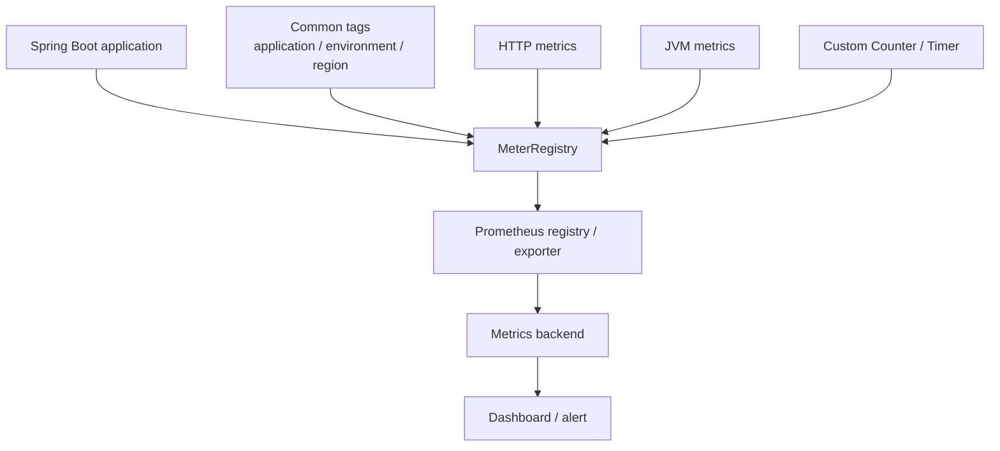
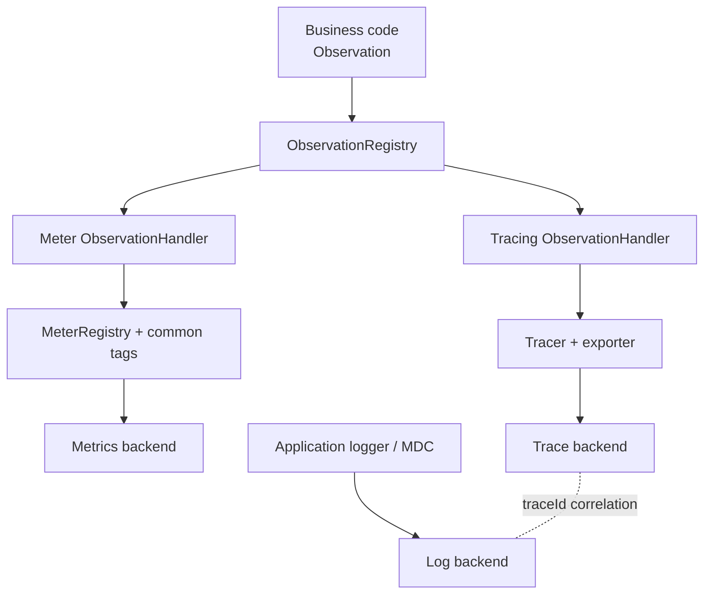

# Common tags trong Spring Boot Metrics

Khi một công ty vận hành nhiều ứng dụng Spring Boot, biểu đồ chỉ có tên metric như `http.server.requests` hoặc `jvm.memory.used` thường chưa đủ để trả lời: **metric này đến từ ứng dụng nào, môi trường nào và khu vực triển khai nào?** Nếu các dịch vụ đều xuất metrics vào cùng hệ thống Prometheus hoặc nền tảng quan sát tập trung, người vận hành cần một cách gắn metadata thống nhất để lọc và tổng hợp số liệu.

Trong Micrometer Metrics, **common tags** là những cặp `key=value` được áp dụng chung cho các meter đăng ký trong một `MeterRegistry`. Ví dụ: `application=order-service`, `environment=prod` và `region=ap-southeast-1`. Một `Timer` hoặc `Counter` sau đó có thể mang cả common tags và các tag riêng như `outcome=success`, giúp quan sát một thao tác trong bối cảnh triển khai mà không phải lặp code cấu hình ở mỗi nơi.

Đây là bài **Common tags**, thuộc chương **Spring Boot metrics** của module **SPRING_BOOT_OBSERVABILITY**. Mục tiêu module là thiết lập observability cho Spring Boot bằng Micrometer Observation, metrics, logs và distributed tracing; hiểu propagation ngữ cảnh, tag/cardinality, exporter, sampling và liên kết tín hiệu để điều tra lỗi, độ trễ, hành vi ứng dụng trên môi trường thực. Bài học tập trung vào **cách cấu hình và quản trị common tags**, cũng như ranh giới của chúng với metadata của Observation, logging và tracing.

## 1. Mục tiêu học tập

Sau bài này, bạn có thể:

- Giải thích common tags là gì, được gắn vào đâu và khác tag riêng của một meter như thế nào.
- Cấu hình common tags trong Spring Boot bằng `management.metrics.tags.*`.
- Viết `MeterRegistryCustomizer<MeterRegistry>` để cấu hình common tags bằng Java khi cần xử lý linh hoạt.
- Chọn bộ tag phù hợp cho ứng dụng, môi trường và vùng triển khai, tránh dữ liệu biến đổi theo request.
- Dự đoán tác động của common tags lên cardinality và histogram time series.
- Kiểm tra tags qua Actuator, Prometheus và một số truy vấn PromQL.
- Phân biệt common tags của **metrics** với trace attributes, baggage và logging MDC.
- Chẩn đoán nguyên nhân metric thiếu tag, tag xung đột hoặc không xuất hiện ở backend.

## 2. Common tags giải quyết vấn đề gì?

Một service có thể cung cấp nhiều meter:

- `http.server.requests`: đếm và đo thời lượng HTTP requests.
- `jvm.memory.used`: lượng bộ nhớ JVM đang sử dụng.
- `system.cpu.usage`: mức sử dụng CPU của hệ thống, khi binder tương ứng được bật.
- `business.checkout.duration`: timer nghiệp vụ do ứng dụng tự tạo.
- `business.payment.failed`: counter nghiệp vụ.

Giả sử đội vận hành muốn lọc **tất cả** metrics phát ra từ môi trường production của `order-service` trong region `ap-southeast-1`. Nếu từng vị trí tạo meter đều phải thêm ba nhãn trên, code sẽ trùng lặp và dễ thiếu nhãn.

Với common tags, cấu hình của `MeterRegistry` sẽ áp dụng cùng một bộ nhãn cho những meter được đăng ký qua registry đó:



Ví dụ, cùng một tag `application=order-service` có thể xuất hiện trong dữ liệu của HTTP, JVM và một counter nghiệp vụ. Khi điều tra request bị chậm, người vận hành có thể lọc theo ứng dụng và vùng triển khai nhất quán giữa nhiều loại metric.

### Common tag và tag riêng khác nhau thế nào?

| Loại metadata | Ví dụ | Phạm vi | Ai thường thiết lập? |
| --- | --- | --- | --- |
| **Common tag** | `application=order-service` | Nhiều hoặc tất cả meter trong registry | Cấu hình Spring Boot / `MeterRegistryCustomizer` |
| **Tag riêng của meter** | `operation=reserve`, `outcome=error` | Một họ metric hoặc một thao tác | Code nghiệp vụ, meter binder |
| **Tag của HTTP instrumentation** | `method=POST`, `status=500`, `uri=/orders/{id}` | HTTP request metrics | Instrumentation/convention của framework |
| **Resource label của backend** | `job`, `instance`, `pod` | Dữ liệu tại scrape/collector/backend | Hạ tầng Prometheus, OpenTelemetry, collector |
| **Trace attribute** | `db.system`, `http.request.method` | Span/trace | Tracing instrumentation |
| **Log field** | `event=order_failed`, `traceId=...` | Bản ghi log | Logger, MDC, encoder và pipeline |

Common tags **không phải thông tin bắt buộc phải giống trên mọi backend**. Chúng thuộc cấu hình metrics của Micrometer. Việc đưa những trường tương đương vào traces, logs hoặc resource metadata cần cơ chế tương ứng và xác minh riêng.

## 3. Chọn common tags nào?

Một bộ common tags tốt mô tả **nguồn phát metrics** và có ý nghĩa vận hành ổn định trong suốt vòng đời một instance:

| Key gợi ý | Ví dụ | Mục đích |
| --- | --- | --- |
| `application` | `order-service` | Nhận diện ứng dụng/service phát metric |
| `environment` | `dev`, `staging`, `prod` | Lọc theo môi trường |
| `region` | `ap-southeast-1` | So sánh giữa khu vực triển khai |
| `deployment.group` | `blue`, `green` | So sánh hai nhóm triển khai nếu thực sự cần |
| `team` | `payments`, `orders` | Sở hữu vận hành, nếu danh sách nhóm ổn định |

Không nhất thiết dùng tất cả các tag trên. Chọn trường cần cho dashboard, cảnh báo và phân tích sự cố. Nếu exporter hoặc hạ tầng đã cung cấp nhãn phù hợp, ví dụ `job` hoặc `cluster`, hãy cân nhắc **tái sử dụng ở tầng truy vấn** thay vì tạo thêm nhãn tương đương từ ứng dụng.

**Các trường không nên là common tags:**

- `userId`, `orderId`, `tenantId` với hàng nghìn hoặc hàng triệu giá trị.
- `traceId`, `spanId`, request ID, session ID.
- URL chứa path parameter, query string, message payload, exception message.
- IP người dùng, email, token, cookie hoặc dữ liệu nhạy cảm.
- Timestamp, UUID khởi tạo mỗi request hoặc tên deployment sinh mới liên tục mà không có nhu cầu giám sát cụ thể.

Một common tag xuất hiện trên **nhiều meter**. Vì vậy, tag cardinality cao có thể làm phình dữ liệu ở phạm vi rộng hơn nhiều so với một custom metric đơn lẻ.

### Common tags có bất biến hoàn toàn không?

Không cần bất biến mãi mãi. `environment` hoặc `region` có thể khác giữa các deployment, và `application` khác giữa các service. Điều quan trọng là **mỗi instance sử dụng tập giá trị kiểm soát** và thay đổi tag theo chủ đích triển khai, thay vì theo từng request.

Nếu một container khởi động với `region=ap-southeast-1` thì hầu hết meter của nó nên nhất quán với thông tin đó. Khi chuyển sang region khác, đó thường là một instance/nguồn metric khác với giá trị mới, không phải một tag tự đổi tùy ý giữa các request.

## 4. Cấu hình bằng `management.metrics.tags`

Với các phiên bản **Spring Boot 3.x** có Actuator metrics auto-configuration, cách thường dùng là khai báo thuộc tính `management.metrics.tags` trong `application.yml`:

```yaml
spring:
  application:
    name: order-service

management:
  metrics:
    tags:
      application: ${spring.application.name}
      environment: ${APP_ENV:local}
      region: ${APP_REGION:local}
```

Giải thích:

1. `spring.application.name` cung cấp tên ứng dụng đã được cấu hình, ví dụ `order-service`.
2. `management.metrics.tags.application` tạo một common tag tên `application` cho metrics.
3. `APP_ENV` và `APP_REGION` là biến môi trường triển khai do hệ thống vận hành cung cấp; `local` là fallback khi chưa thiết lập.
4. Khi các meter được đăng ký vào registry do Boot quản lý, chúng có thể nhận bộ common tags này cùng tags riêng.

Ví dụ một môi trường production có:

```text
APP_ENV=prod
APP_REGION=ap-southeast-1
```

Các meter phát từ ứng dụng sẽ được gắn nhãn tương ứng như `application=order-service`, `environment=prod`, `region=ap-southeast-1`, miễn là chúng đi qua registry được Spring Boot cấu hình và không bị các cấu hình/filter khác thay đổi.

**Điểm cần lưu ý:** giá trị cấu hình là dữ liệu do môi trường triển khai cung cấp. Nếu mỗi pod ghi một `APP_REGION` tùy ý hoặc application name chứa ID sinh động, các giá trị đó vẫn có thể gây cardinality cao. Cấu hình property **không tự kiểm tra** xem tập giá trị có an toàn hay không.

### Cấu hình YAML và properties tương đương

Trong `application.properties`, ý tưởng giống nhau:

```properties
spring.application.name=order-service
management.metrics.tags.application=${spring.application.name}
management.metrics.tags.environment=${APP_ENV:local}
management.metrics.tags.region=${APP_REGION:local}
```

Hãy chọn một định dạng cấu hình phù hợp với dự án. Khi có nhiều profile hoặc nguồn property, dùng cơ chế precedence của Spring Boot và kiểm tra **giá trị cuối cùng** ở môi trường chạy. Tránh gắn cùng một key với các giá trị mâu thuẫn ở nhiều nơi.

### Áp dụng ở môi trường triển khai

| Môi trường | `application` | `environment` | `region` |
| --- | --- | --- | --- |
| Máy phát triển | `order-service` | `local` | `local` |
| Staging | `order-service` | `staging` | `ap-southeast-1` |
| Production vùng A | `order-service` | `prod` | `ap-southeast-1` |
| Production vùng B | `order-service` | `prod` | `ap-southeast-2` |

Bảng trên chỉ là ví dụ quy ước triển khai. Về kiến trúc, hai vùng production dùng cùng `application` và `environment`, còn `region` cho phép nhóm vận hành đối chiếu latency và tỷ lệ lỗi theo vùng.

## 5. Cấu hình bằng `MeterRegistryCustomizer`

Khi common tags cần được tính toán, chuẩn hóa từ config hoặc chọn theo quy tắc cụ thể, có thể khai báo một bean kiểu `MeterRegistryCustomizer<MeterRegistry>`:

```java
import io.micrometer.core.instrument.MeterRegistry;
import org.springframework.beans.factory.annotation.Value;
import org.springframework.boot.actuate.autoconfigure.metrics.MeterRegistryCustomizer;
import org.springframework.context.annotation.Bean;
import org.springframework.context.annotation.Configuration;

@Configuration(proxyBeanMethods = false)
public class MetricsCommonTagsConfiguration {

    @Bean
    MeterRegistryCustomizer<MeterRegistry> commonMetricTags(
            @Value("${spring.application.name:application}") String app,
            @Value("${observability.region:local}") String rawRegion) {

        String region = switch (rawRegion) {
            case "ap-southeast-1" -> "ap-southeast-1";
            case "ap-southeast-2" -> "ap-southeast-2";
            case "eu-west-1" -> "eu-west-1";
            default -> "other";
        };

        return registry -> registry.config().commonTags(
            "application", app,
            "region", region
        );
    }
}
```

Đoạn code minh họa API thường dùng trong **Spring Boot 3.x**. Tên package và cơ chế auto-configuration cần được kiểm tra lại nếu dùng major version khác. Đặt class configuration trong phạm vi Spring component scan hoặc import vào ứng dụng.

Trong ví dụ:

- Bean customizer được Spring Boot áp dụng lên `MeterRegistry` mà Boot quản lý, theo thứ tự cấu hình phù hợp trước khi các meter được đăng ký.
- `region` được chuẩn hóa về một danh sách cho phép; giá trị triển khai không hợp lệ được gộp thành `other`, tránh phát sinh vô hạn chuỗi metric.
- `application` nên đến từ nguồn cấu hình deployment đáng tin cậy, có quy ước đặt tên cố định. Có thể áp dụng validation tương tự nếu nền tảng cho phép tên tùy ý.
- `registry.config().commonTags(...)` cấu hình nhãn chung cho registry, không gọi cho một timer hay counter riêng lẻ.

**Không nên khai báo cùng một key bằng cả `management.metrics.tags` và `MeterRegistryCustomizer` nếu chưa xác định rõ quy tắc áp dụng.** Hai cách này là lựa chọn hoặc có thể bổ sung nhau khi các key khác nhau. Trùng key với giá trị mâu thuẫn có thể dẫn đến hành vi khó đoán hoặc metric có tag không nhất quán.

### Phân biệt cấu hình registry với đăng ký meter

Nếu bạn tự tạo một `SimpleMeterRegistry` hoặc một registry độc lập bằng `new`, bean customizer do Spring Boot quản lý **không tự tìm đến registry đó**. Cấu hình common tags phải được áp dụng lên **đúng registry** nơi các meter được tạo.

Nếu gọi `commonTags(...)` **sau** khi nhiều meter đã được đăng ký, không nên giả định các meter cũ sẽ lập tức được đổi ID hoặc mang lại toàn bộ nhãn mới. Thiết kế chuẩn là cấu hình registry **trước khi đăng ký meter**; với Spring Boot, dùng property hoặc customizer trong giai đoạn khởi tạo.

## 6. Common tags xuất hiện như thế nào trên meter?

Giả sử service khai báo một counter nghiệp vụ:

```java
import io.micrometer.core.instrument.MeterRegistry;
import org.springframework.stereotype.Component;

@Component
public class CheckoutMetrics {

    private final MeterRegistry meterRegistry;

    public CheckoutMetrics(MeterRegistry meterRegistry) {
        this.meterRegistry = meterRegistry;
    }

    public void completed(String outcome) {
        String safeOutcome = switch (outcome) {
            case "success", "rejected", "error" -> outcome;
            default -> "unknown";
        };

        meterRegistry.counter(
            "business.checkout.completed",
            "outcome", safeOutcome
        ).increment();
    }
}
```

Ở đây, `outcome` là tag **riêng của counter**. Phương thức `completed` chỉ nên được gọi sau khi checkout thực sự hoàn tất; việc chuẩn hóa đầu vào bảo đảm chỉ có bốn giá trị có thể xuất. Code **không** nhắc lại `application`, `environment` hoặc `region`.

Nếu registry đã được cấu hình common tags như phần trước, một mẫu xuất Prometheus có thể trông như:

```text
business_checkout_completed_total{
  application="order-service",
  environment="prod",
  region="ap-southeast-1",
  outcome="success"
} 120
```

Đây là minh họa có xuống dòng để dễ đọc; định dạng scrape thực tế thường nằm trên một dòng và tên metric/label tuân theo naming convention của registry/exporter. Điều quan trọng là **một meter có cả common tags và tags của chính nó**.

### Tại sao không đặt `outcome` thành common tag?

`outcome` thay đổi theo **từng lần xử lý**. Nó không thể là một giá trị chung đúng cho JVM memory, CPU usage và mọi counter. Nếu cấu hình `outcome=success` ở cấp registry, cả các meter không có khái niệm “thành công” cũng bị gắn nhãn sai.

Tương tự, `http.method`, `http.status`, `uri`, `exception` thường là metadata của **request cụ thể** hoặc một họ metrics nhất định. Không đưa chúng vào common tags. Chỉ nên dùng các key mô tả **nguồn triển khai chung**.

### Những tag do framework đã thêm

Spring Boot Actuator thường instrument HTTP server requests với các tag như method, status, outcome hoặc route template, tùy phiên bản và convention. Common tags được kết hợp với tập tag đó khi meter đi qua registry phù hợp.

Nếu framework dùng `uri=/orders/{id}` thì không tự thay bằng đường dẫn thực tế `/orders/483927`. URL có ID động làm cardinality tăng mạnh. Việc dùng common tags không khắc phục được một tag riêng có cardinality quá cao.

## 7. Tác động lên cardinality và chi phí

**Cardinality** là số lượng giá trị khác nhau của mỗi tag. Số time series tiềm năng của một meter chịu ảnh hưởng bởi **tích các tập giá trị** nếu những tổ hợp xuất hiện trong thực tế.

Ví dụ một hệ thống có:

| Chiều | Số giá trị |
| --- | ---: |
| `application` | 5 |
| `environment` | 3 |
| `region` | 4 |
| `http.method` | 5 |
| `http.route` | 12 |
| `outcome` | 4 |

Nếu mọi tổ hợp đều xuất hiện, số tổ hợp nhãn tối đa theo phép nhân là:

\[
5 \times 3 \times 4 \times 5 \times 12 \times 4 = 14\,400
\]

Con số trên chỉ là **ước tính lý thuyết**, không phải số series thực tế. Một số route chỉ tồn tại trên một application, nhiều môi trường không triển khai đủ vùng, một số kết quả không xảy ra; ngược lại, Prometheus có thể thêm `job`, `instance`, `pod` hoặc label scrape khác làm tổng series tăng.

Nếu thêm tag `requestId` có 100.000 giá trị khác nhau, biên lý thuyết thành:

\[
14\,400 \times 100\,000 = 1\,440\,000\,000
\]

Đây là lý do tag nhận ID từng request không phù hợp với metrics. Với Timer có histogram, các series bucket, count và sum còn nhân số lượng dữ liệu theo tập nhãn.

### Common tags có thể tạo giá trị trùng với label backend

Ví dụ `region` đã được collector gắn vào mọi series từ metadata Kubernetes hoặc service discovery. Nếu ứng dụng cũng gắn `region` với một giá trị khác, pipeline có thể gặp collision, đổi nhãn hoặc làm kết quả truy vấn khó giải thích. Hãy quyết định **tầng nào sở hữu từng nhãn** và giữ tên, giá trị đồng nhất.

Không nhất thiết tạo `instance.id` hoặc `pod.uid` ở cấp `management.metrics.tags` khi backend đã có các label nhận diện instance. Các giá trị thay đổi khi scale hoặc rollout, tạo nhiều series mới và tăng churn. Khi cần phân tích theo pod, ưu tiên nhãn hạ tầng đang có.

### Ngân sách tag

Một quy trình quản trị phù hợp:

1. Liệt kê các common tags bắt buộc và số giá trị dự kiến.
2. Liệt kê tags của từng họ metric quan trọng (HTTP, database, messaging, business timers).
3. Ước lượng tổ hợp giá trị và số series bổ sung khi bật histogram.
4. Kiểm tra labels từ hạ tầng, exporter, collector, không chỉ Java code.
5. Đặt giới hạn/alert về active series hoặc metric churn theo năng lực backend.
6. Khi đề xuất một tag mới, nêu câu hỏi vận hành mà tag đó trả lời và tác động cardinality dự kiến.

**Không có ngưỡng “low cardinality” cố định cho mọi dự án.** Bộ tag hợp lý cho mười service nhỏ có thể trở thành gánh nặng khi nhân lên hàng nghìn instance và nhiều histogram.

## 8. Common tags và Micrometer Observation

Trong mô hình Micrometer Observation, một `Observation` mô tả một công việc, còn các `ObservationHandler` có thể chuyển nó thành **metrics** hoặc **tracing spans**. Trong Spring Boot, meter observation handler có thể ghi Timer vào `MeterRegistry` đã cấu hình common tags.



### Ví dụ: custom observation với low-cardinality key-value

```java
import io.micrometer.observation.Observation;
import io.micrometer.observation.ObservationRegistry;
import org.springframework.stereotype.Service;

@Service
public class InventoryService {
    private final ObservationRegistry observationRegistry;
    private final InventoryGateway gateway;

    public InventoryService(ObservationRegistry observationRegistry,
                            InventoryGateway gateway) {
        this.observationRegistry = observationRegistry;
        this.gateway = gateway;
    }

    public void reserve(String orderId) {
        Observation observation = Observation
            .createNotStarted("business.inventory.reserve", observationRegistry)
            .lowCardinalityKeyValue("operation", "reserve")
            .start();

        try (Observation.Scope ignored = observation.openScope()) {
            try {
                gateway.reserve(orderId);
                observation.lowCardinalityKeyValue("outcome", "success");
            } catch (RuntimeException ex) {
                observation.lowCardinalityKeyValue("outcome", "error");
                observation.error(ex);
                throw ex;
            }
        } finally {
            observation.stop();
        }
    }
}

interface InventoryGateway {
    void reserve(String orderId);
}
```

Đây là observation **nghiệp vụ**: `operation=reserve` và `outcome=success|error` thuộc về riêng thao tác inventory. Nếu nó được meter handler chuyển thành Timer trên `MeterRegistry` của Boot, timer đó còn có thể có common tags như `application=order-service` và `environment=prod`.

**Chú ý ba lớp tag khác nhau:**

- `management.metrics.tags.*`: metadata chung của **MeterRegistry**.
- `observation.lowCardinalityKeyValue(...)`: metadata của **observation**, có thể được handler metrics chuyển thành meter tags.
- `observation.highCardinalityKeyValue(...)`: metadata chi tiết, thường không dùng làm metric label bởi meter handler tiêu chuẩn, nhưng có thể được tracing handler dùng làm span attributes.

Thêm common tags ở tầng metrics **không tự động gắn tương tự** vào trace attributes hay log fields. Nếu cần truy vấn traces theo vùng hoặc service, hãy cấu hình **tracing resource attributes** ở stack tương ứng; nếu cần logs có môi trường/vùng, cấu hình structured logging hoặc enrichment trong log pipeline.

### Observation tags có thay thế common tags không?

Không. Một số observation không mang tag `region` vì region không phải đặc tính của thao tác. Nếu cả trăm observation đều tự gắn `region`, code sẽ lặp lại thông tin deployment. Common tags gom việc này vào `MeterRegistry`, còn low-cardinality observation key-value mô tả **công việc**.

## 9. Common tags không phải trace context hoặc baggage

Ba khái niệm dễ bị nhầm:

| Cơ chế | Phạm vi | Ví dụ | Có tự truyền sang service khác? |
| --- | --- | --- | --- |
| **Common metrics tags** | MeterRegistry của ứng dụng | `application`, `region` | **Không** |
| **Trace context** | Span/trace của một request | `traceId`, `spanId`, `traceparent` | Có thể, khi có propagator/instrumentation |
| **Baggage** | Context nghiệp vụ/trace được chủ đích cho phép truyền | `correlation-type` có kiểm soát | Tùy cấu hình propagator và chính sách |
| **MDC / structured log fields** | Một bản ghi log hoặc scope logging | `traceId`, `environment` | Không tự động qua network |

Nếu `order-service` gọi `payment-service`, hai ứng dụng có thể có common tags `application=order-service` và `application=payment-service` khác nhau. Tracing propagation giúp các spans của một yêu cầu dùng cùng trace ID nếu instrumentation được thiết lập, nhưng **không truyền common metrics tags** từ service gọi sang service nhận.

Không đưa `traceId` vào `management.metrics.tags`. Mỗi trace ID khác nhau gần như mỗi yêu cầu, gây cardinality khổng lồ. Trace ID thuộc về logs/traces để tương quan theo từng request; metrics dùng các chiều ổn định để chỉ ra **nhóm** yêu cầu gặp vấn đề.

### Ví dụ điều tra lỗi bằng ba tín hiệu

Một dashboard báo tỷ lệ HTTP 5xx tăng ở `application=order-service`, `environment=prod`, `region=ap-southeast-1`. Quy trình:

1. Lọc metrics theo ba common tags để xác định vùng và dịch vụ bị ảnh hưởng.
2. Kiểm tra tốc độ 5xx và latency của HTTP hoặc custom observation liên quan.
3. Tìm logs của cùng service, vùng và khoảng thời gian, đọc mã lỗi ổn định và `traceId` nếu có.
4. Mở trace theo `traceId` để thấy đường đi HTTP → inventory → database, nếu trace đã được sampling và xuất thành công.
5. Đối chiếu traces/logs với metrics của dependency trước khi kết luận lỗi hoặc nghẽn ở đâu.

Common tags giúp **khoanh vùng theo nguồn phát metrics**; correlation ID giúp **theo dấu một yêu cầu cụ thể**. Hai cơ chế phục vụ mục đích khác nhau.

## 10. Cách kiểm tra common tags trong Spring Boot

### 10.1. Bật Actuator và Prometheus registry

Với dự án Gradle Kotlin DSL sử dụng Spring Boot BOM tương thích:

```kotlin
dependencies {
    implementation("org.springframework.boot:spring-boot-starter-actuator")
    runtimeOnly("io.micrometer:micrometer-registry-prometheus")
}
```

Ví dụ bật endpoint dùng để kiểm tra:

```yaml
management:
  endpoints:
    web:
      exposure:
        include: health,info,metrics,prometheus
```

Phần `management.endpoints.web.exposure` điều khiển endpoint nào được truy cập qua HTTP khi chúng tồn tại và được cho phép. Để có `/actuator/prometheus` cần Prometheus registry tương thích; muốn có backend lưu trữ cần Prometheus hoặc collector thực sự scrape và lưu dữ liệu.

Trong production, hạn chế quyền truy cập các endpoint theo chính sách bảo mật. Không công khai dữ liệu vận hành nội bộ không cần thiết.

### 10.2. Kiểm tra qua Actuator

Sau khi ứng dụng chạy và ít nhất một meter đã đăng ký:

```text
GET /actuator/metrics
GET /actuator/metrics/jvm.memory.used
GET /actuator/metrics/business.checkout.completed
```

Endpoint metrics liệt kê tên meter và cung cấp thông tin measurement, available tags theo dữ liệu thực tế. Nếu đã cấu hình common tags, hãy kiểm tra `application`, `environment` và `region` có xuất hiện đúng trong kết quả của những meter liên quan hay không.

Ví dụ response minh họa cho một meter:

```json
{
  "name": "business.checkout.completed",
  "measurements": [
    { "statistic": "COUNT", "value": 120.0 }
  ],
  "availableTags": [
    { "tag": "application", "values": ["order-service"] },
    { "tag": "environment", "values": ["prod"] },
    { "tag": "region", "values": ["ap-southeast-1"] },
    { "tag": "outcome", "values": ["success"] }
  ]
}
```

Đây chỉ là mô hình kết quả để minh họa; số liệu thực tế phụ thuộc dữ liệu đã ghi, phiên bản Actuator và cách các meter được nhóm khi truy vấn.

### 10.3. Kiểm tra qua Prometheus

```text
GET /actuator/prometheus
```

Tìm một metric quen thuộc và xem các label:

```text
jvm_memory_used_bytes{application="order-service",environment="prod",region="ap-southeast-1",area="heap",id="G1 Eden Space"} 1.23456E8
```

Đây là ví dụ về ý tưởng: common tags được gắn bên cạnh các nhãn riêng của JVM meter. Tên và nhãn bộ nhớ cụ thể phụ thuộc JVM, Micrometer, registry và exporter đang sử dụng.

Nếu thấy common tags trên `business.checkout.completed` nhưng không thấy trên `jvm.memory.used`, hãy kiểm tra liệu các meter có thực sự sử dụng cùng registry đã được cấu hình không, có filter hoặc pipeline khác nhau không, và các meter được tạo trước hay sau khi customizer được áp dụng.

## 11. PromQL: dùng common tags để phân tích nhiều dịch vụ

Giả sử Prometheus cung cấp các counter `http_server_requests_seconds_count` từ HTTP instrumentation của Spring Boot; tên series phải xác minh bằng scrape trước khi dùng truy vấn.

### 11.1. Request rate theo ứng dụng và vùng

```promql
sum by (application, region) (
  rate(http_server_requests_seconds_count{
    environment="prod"
  }[5m])
)
```

Truy vấn trả về request/second theo cặp application/region trong production, dựa trên cửa sổ 5 phút. Nó gộp các nhãn còn lại như instance và route.

### 11.2. Tỷ lệ HTTP 5xx theo ứng dụng và vùng

```promql
sum by (application, region) (
  rate(http_server_requests_seconds_count{
    environment="prod", status=~"5.."
  }[5m])
)
/
sum by (application, region) (
  rate(http_server_requests_seconds_count{
    environment="prod"
  }[5m])
)
```

Kết quả là tỷ lệ request HTTP có mã 5xx trên tổng request được ghi nhận cho từng application/region. Nếu mẫu số bằng 0 trong khoảng thời gian, cần xử lý tình huống không có traffic trong dashboard. Một HTTP request 4xx do dữ liệu người dùng sai thường không đồng nghĩa lỗi kỹ thuật của service.

### 11.3. Mean HTTP latency theo vùng

```promql
sum by (application, region) (
  rate(http_server_requests_seconds_sum{environment="prod"}[5m])
)
/
sum by (application, region) (
  rate(http_server_requests_seconds_count{environment="prod"}[5m])
)
```

Kết quả có đơn vị giây/request. Đây là **mean latency** từ tổng duration và số requests, không phải p95.

### 11.4. p95 nếu đã có histogram

```promql
histogram_quantile(
  0.95,
  sum by (le, application, region) (
    rate(http_server_requests_seconds_bucket{environment="prod"}[5m])
  )
)
```

Truy vấn trên chỉ phù hợp khi backend nhận được các **classic histogram buckets** từ instrumentation; không mặc định `Timer` nào cũng có `_bucket`. Nếu triển khai dùng native histogram hoặc backend khác, cấu trúc metric và truy vấn sẽ khác. P95 từ histogram là ước lượng phụ thuộc bucket và dữ liệu; không lấy trung bình p95 của các pod để ra p95 toàn hệ thống.

### Khi nào nên giữ hoặc bỏ một common tag trong tổng hợp?

Nếu mục tiêu là SLO chung cho một ứng dụng trên mọi vùng, có thể `sum by (application)` để gộp region. Nếu muốn xác định vùng có vấn đề, giữ `region`. Nếu phát cảnh báo theo môi trường, phải lọc hoặc giữ `environment`. Mỗi dashboard và alert cần xác định rõ **đơn vị chịu trách nhiệm và phạm vi dữ liệu**.

## 12. Các lỗi thiết kế thường gặp

| Vấn đề | Triệu chứng | Cách xử lý |
| --- | --- | --- |
| Mỗi nơi tự gắn `application` bằng code | Meter có tag không đồng nhất hoặc thiếu | Cấu hình ở registry một lần |
| Service tự tạo `MeterRegistry` ngoài Spring Boot | Một số metrics không nhận common tags | Inject registry do Boot cấu hình |
| Gọi `commonTags(...)` sau khi meter đã đăng ký | Meter cũ thiếu nhãn mới | Áp dụng cấu hình trước khi tạo meter |
| Dùng cùng key trong YAML và customizer | Nhãn xung đột, khó dự đoán | Chọn một nơi sở hữu từng tag |
| Gắn `orderId`, `traceId` vào common tags | Cardinality tăng cực lớn | Chỉ dùng nhãn triển khai có tập giá trị nhỏ |
| Đưa `outcome` thành common tag | JVM/HTTP/DB metrics bị gắn nghĩa sai | Đặt outcome ở meter hoặc observation liên quan |
| Giá trị môi trường không được chuẩn hóa | Có `prod`, `production`, `prd` cho cùng một ý | Xác lập enum giá trị ở cấu hình triển khai |
| Nhãn region của app khác nhãn region của collector | Dashboard lọc lệch hoặc khó gộp | Quy định nguồn sở hữu nhãn và naming |
| Coi common tags là trace baggage | Không tìm thấy giá trị ở service tiếp theo | Cấu hình tracing propagation riêng |
| Nghĩ `management.metrics.tags` tự ghi vào logs | Log thiếu application/region | Cấu hình log schema/MDC/pipeline riêng |
| Không có Prometheus registry | `/actuator/prometheus` không khả dụng | Thêm dependency và cấu hình registry |
| Bật endpoint nhưng backend không scrape | Không có biểu đồ dài hạn | Kiểm tra scrape target, quyền truy cập, collector |
| Thêm nhiều nhãn khi bật histogram | Active series tăng mạnh | Lập ngân sách tag và bucket |
| Đo trùng HTTP từ auto-instrumentation và code | Số liệu dễ bị hiểu sai | Kiểm tra meter/observation hiện có |

## 13. Thực hành: áp dụng và xác minh Common tags

**Bối cảnh:** bạn vận hành hai service Spring Boot là `order-service` và `payment-service` ở staging và production, mỗi môi trường có các vùng triển khai khác nhau. Bạn muốn lọc metrics theo service, môi trường, vùng; đồng thời vẫn xem tỷ lệ lỗi checkout theo outcome.

### Phần A — Cấu hình

1. Thêm `spring.application.name` và `management.metrics.tags.application/environment/region` cho từng service.
2. Cung cấp `APP_ENV` và `APP_REGION` từ deployment có giá trị chuẩn hóa.
3. Dùng một `MeterRegistry` do Spring Boot quản lý trong code nghiệp vụ; tạo counter `business.checkout.completed` với tag riêng `outcome`.
4. Bật Actuator metrics và, nếu cần quan sát bằng Prometheus, thêm Prometheus registry cùng endpoint tương ứng.
5. Xác minh các common tags trên JVM metric và custom business metric.

### Phần B — Ca kiểm chứng

| Ca | Hành động | Kết quả mong đợi |
| --- | --- | --- |
| A | Khởi chạy order-service với `APP_ENV=staging` | Common tag `environment=staging` |
| B | Đổi sang production ở deployment khác | `environment=prod` trên metrics từ instance đó |
| C | Đổi `APP_REGION` giữa hai deployment | Có thể lọc metrics theo từng region |
| D | Ghi một checkout thành công | Counter có common tags và `outcome=success` |
| E | Ghi checkout thất bại | Counter có cùng common tags, `outcome=error` |
| F | Tạo nhiều order ID khác nhau | Số tag values không tăng theo order ID |
| G | Xem `jvm.memory.used` | Có common tags dù code JVM binder không tự gắn tay |
| H | Tra một request lỗi bằng trace ID | Trace ID nằm trong logs/traces, không là common metrics tag |

### Phần C — Bài tập cardinality

Giả sử 4 applications, 3 environments, 2 regions, 6 routes và 5 HTTP status groups. Nếu mọi tổ hợp xuất hiện, số tổ hợp tag tối đa là:

\[
4 \times 3 \times 2 \times 6 \times 5 = 720
\]

Sau đó thêm `podId` với 500 giá trị:

\[
720 \times 500 = 360\,000
\]

Hãy giải thích vì sao thực tế có thể ít hơn biên lý thuyết, đồng thời cho biết khi Prometheus còn gắn `instance` hoặc `pod` thì việc thêm `podId` trong ứng dụng có thể gây trùng metadata thế nào. Cuối cùng, đề xuất **hai hoặc ba common tags** thật sự cần thiết cho dashboard của nhóm.

### Phần D — Tình huống xử lý sự cố

Metrics cho thấy tỷ lệ 5xx của `payment-service` trong `ap-southeast-2` tăng, còn vùng `ap-southeast-1` ổn định. Hãy xác minh:

1. Các series từ hai vùng có cùng naming convention và khác nhau đúng ở tag `region` hay không.
2. Prometheus scrape có bị gián đoạn hoặc thiếu targets ở vùng có vấn đề không.
3. HTTP error rate và latency có tăng cùng lúc hay không.
4. Log và traces trong khoảng thời gian đó có cho thấy timeout đến dependency, connection pool cạn hay lỗi ứng dụng không.
5. Sau khắc phục, tỷ lệ lỗi của vùng bị ảnh hưởng có giảm mà không làm thay đổi bộ tag triển khai hay không.

### Câu hỏi tự đánh giá

1. Khi nào nên dùng `management.metrics.tags` thay vì `MeterRegistryCustomizer`?
2. Vì sao common tags cần mô tả nguồn metrics, còn `status` và `outcome` thường là tags riêng của từng họ meter?
3. `application=order-service` có tự động được gửi trong HTTP header sang `payment-service` không? Vì sao?
4. Nếu một meter không có common tags còn các meter khác có, những khả năng nào cần kiểm tra?
5. Việc thêm một tag chỉ có 4 giá trị có thể nhân số tổ hợp series lên bao nhiêu lần trong trường hợp xấu nhất?
6. Vì sao `traceId` phù hợp để tương quan log/trace nhưng không phù hợp làm common metric tag?
7. Nếu Prometheus đã có label `cluster` và `instance`, khi nào nên để backend quản lý thay vì tạo common tags tương tự ở ứng dụng?
8. Làm thế nào để so sánh error rate và p95 theo vùng mà không lấy trung bình p95 của từng pod?

## 14. Ghi nhớ

**Common tags** là metadata được cấu hình chung ở `MeterRegistry`, cho phép nhiều loại meter của Spring Boot mang cùng những nhãn ổn định như `application`, `environment` và `region`. Cách phổ biến là sử dụng `management.metrics.tags.*`; khi cần logic cấu hình linh hoạt, dùng `MeterRegistryCustomizer<MeterRegistry>`. Hãy cấu hình trước khi meter được đăng ký, kiểm tra kết quả qua Actuator/Prometheus và tránh gắn cùng key mâu thuẫn ở nhiều nơi.

Common tags giúp lọc và tổng hợp **metrics** theo nguồn triển khai. Tag riêng của meter hoặc `Observation.lowCardinalityKeyValue(...)` mô tả **công việc**, còn trace context và log fields phục vụ điều tra **từng yêu cầu**. Khi chọn tập tag có cardinality thấp, xác định rõ tầng sở hữu nhãn và quản lý exporter/sampling/context propagation phù hợp, hệ thống Spring Boot có thể liên kết metrics, logs và distributed tracing để điều tra lỗi, độ trễ và hành vi ứng dụng mà vẫn kiểm soát được chi phí quan sát.
