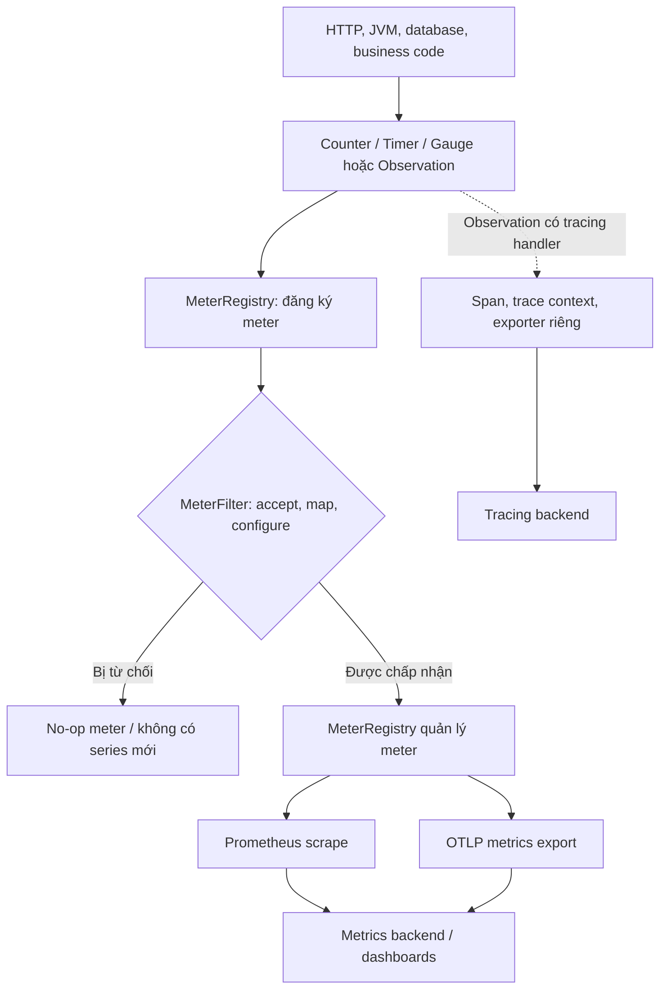
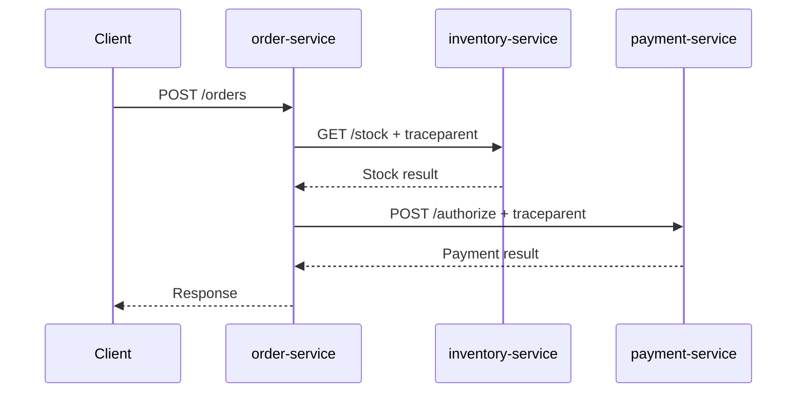
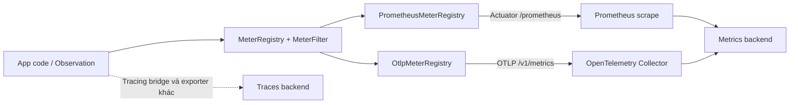

# MeterFilter trong Spring Boot metrics

**MeterFilter** là cơ chế của Micrometer cho phép áp dụng chính sách lên các **meter** khi chúng được đăng ký với `MeterRegistry`: quyết định có chấp nhận meter, điều chỉnh tên hoặc tags, và tùy biến cấu hình thống kê phân phối của một số loại meter. Trong Spring Boot, nó là công cụ quan trọng để kiểm soát số lượng time series, thống nhất metadata và tránh xuất các phép đo không cần thiết tới hệ thống monitoring.

Bài học thuộc chương **Spring Boot metrics** của module **SPRING_BOOT_OBSERVABILITY**. Sau bài này, người học có thể viết và đăng ký MeterFilter, giải thích tác động của nó với Counter/Timer/Gauge, đánh giá rủi ro cardinality, kiểm tra metrics qua Actuator/Prometheus/OTLP và phân biệt chính sách metrics với **Micrometer Observation**, logs, distributed tracing, context propagation, sampling.

## 1. MeterFilter nằm ở đâu trong đường đi của metrics?

Một Spring Boot service có thể ghi metrics trực tiếp qua `MeterRegistry` hoặc thông qua `ObservationRegistry` và metrics handler. Khi meter được tạo, Micrometer sử dụng các filter đã cấu hình để xác định cách meter đó được đăng ký.



Điều cần phân biệt:

- **`MeterRegistry`** là nơi meter được đăng ký và xuất measurements.
- **`MeterFilter`** quyết định chính sách áp dụng khi đăng ký meter vào registry.
- **`ObservationRegistry`** quản lý vòng đời Observation; metrics handler có thể dùng MeterRegistry để ghi kết quả đo.
- **Tracing bridge/exporter** cung cấp spans và distributed trace context theo pipeline riêng.

Một MeterFilter loại bỏ một meter **không đồng nghĩa** nó ngăn Observation chạy hay xóa spans/logs có liên quan. Nếu muốn kiểm soát toàn bộ dữ liệu observability, cần các chính sách ở từng lớp phù hợp.

### Ví dụ động cơ sử dụng

Giả sử ứng dụng có 300 endpoint; mỗi endpoint nhận nhiều query parameters. Nếu instrumentation ghi raw URL thành nhãn `uri`, một Timer HTTP có thể tạo hàng chục nghìn time series. Hoặc hệ thống mang theo nhiều meter `legacy.*` không còn được dashboard sử dụng. MeterFilter có thể hỗ trợ:

1. Từ chối nhóm meter `legacy.*`.
2. Thống nhất một key hoặc một nhóm giá trị tag có cardinality thấp.
3. Chặn đăng ký meter mới vượt quá ngưỡng tags cho phép, như một cơ chế phòng vệ.
4. Quy định cấu hình histogram/percentiles cho một số Timers quan trọng.

Tuy nhiên, **sửa instrumentation ở nguồn** để sử dụng route template và tập giá trị hữu hạn vẫn là phương án bền vững nhất. Một filter từ chối series cũng có thể khiến dữ liệu cảnh báo bị thiếu.

## 2. Cơ chế chính: accept, map và configure

Micrometer mô tả `MeterFilter` bằng ba nhóm chức năng, được áp dụng trong quá trình **đăng ký meter**.

| Nhóm | API điển hình | Câu hỏi nó trả lời | Kết quả |
| --- | --- | --- | --- |
| Chấp nhận/từ chối | `accept(Meter.Id)` | Meter này có được đăng ký không? | `ACCEPT`, `DENY`, `NEUTRAL` |
| Biến đổi định danh | `map(Meter.Id)` | Tên hoặc tags của meter nên trông thế nào? | Trả về `Meter.Id` đã điều chỉnh |
| Cấu hình thống kê | `configure(Meter.Id, DistributionStatisticConfig)` | Timer/summary cần histogram hoặc SLO như thế nào? | Trả về cấu hình phân phối |

`Meter.Id` chứa danh tính và metadata của meter, ví dụ tên, tags, base unit và description. Micrometer cần định danh này để quản lý meter đã đăng ký và xử lý các trường hợp trùng tên/tags.

### 2.1. Ý nghĩa của MeterFilterReply

Với quyết định cho phép hoặc từ chối:

- `DENY`: từ chối meter tương ứng. Registry thường cung cấp một meter **no-op** cho bên gọi; thao tác trên meter đó không tạo measurements được xuất.
- `NEUTRAL`: không đưa ra quyết định dứt khoát, cho phép các filter khác tiếp tục được xét; nếu không có bộ lọc chặn, meter thường được chấp nhận.
- `ACCEPT`: chấp nhận theo chính sách lọc; có thể kết thúc việc đánh giá những quyết định chấp nhận/từ chối tiếp theo theo cơ chế Micrometer đang dùng.

Thứ tự đăng ký filter và thứ tự các quy tắc có thể ảnh hưởng tới kết quả. Không dùng một `ACCEPT` quá rộng rồi mặc định các quy tắc chặn về sau chắc chắn vẫn chạy.

### 2.2. Filter chạy khi nào?

**MeterFilter áp dụng khi meter được đăng ký**, thường lúc mã gọi `registry.counter(...)`, `registry.timer(...)` hoặc `Gauge.builder(...).register(registry)` lần đầu đối với một Meter.Id mới. Filter không phải callback được gọi ở mọi lần `counter.increment()` hay mỗi lần backend scrape.

Điều này kéo theo các lưu ý:

- Đăng ký filter **trước khi** các meter quan trọng được tạo. Spring Boot thường áp dụng filter beans khi cấu hình MeterRegistry trong startup.
- Đổi filter sau khi meter đã đăng ký không đảm bảo những meter cũ được lọc hoặc đổi tên hồi tố.
- Đăng ký nhiều lần với cùng Meter.Id thường tái sử dụng meter hiện có; không nên dựa vào việc gọi đăng ký lại để áp quy tắc mới.
- Cách mapping tên/tags có thể khiến hai meter ban đầu khác nhau trở thành **cùng một định danh**, dẫn đến xung đột hoặc mất tính phân biệt.

## 3. Chuẩn bị Spring Boot 3.x và Actuator

Ví dụ trong bài dùng **Spring Boot 3.x** với dependency management tương thích. Các starter và tên property có thể khác ở dòng Spring Boot khác; khi nâng phiên bản, cần kiểm tra cấu hình đang được sử dụng.

### 3.1. Dependency Maven

```xml
<dependencies>
    <dependency>
        <groupId>org.springframework.boot</groupId>
        <artifactId>spring-boot-starter-actuator</artifactId>
    </dependency>

    <!-- Chỉ cần khi muốn Prometheus scrape metrics -->
    <dependency>
        <groupId>io.micrometer</groupId>
        <artifactId>micrometer-registry-prometheus</artifactId>
    </dependency>
</dependencies>
```

Actuator tích hợp Micrometer với Spring Boot và cho phép quan sát metrics của JVM, HTTP stack và những thư viện hỗ trợ instrumentation. Thêm Prometheus registry để kiểm tra cách meter sau khi lọc được xuất dưới dạng time series.

### 3.2. application.yml

```yaml
spring:
  application:
    name: order-service

management:
  endpoints:
    web:
      exposure:
        include: health,info,metrics,prometheus
  metrics:
    tags:
      application: order-service
      environment: development
```

Chạy ứng dụng và tạo một số request HTTP để có measurements:

```bash
curl -s http://localhost:8080/actuator/metrics
curl -s http://localhost:8080/actuator/metrics/http.server.requests
curl -s http://localhost:8080/actuator/prometheus
```

`/actuator/metrics` cho biết meters trong ứng dụng. `/actuator/prometheus` xuất dữ liệu để Prometheus scrape nếu registry đã có mặt và endpoint được expose. Có dữ liệu ở endpoint **chưa đảm bảo** Prometheus đã scrape và lưu; cần kiểm tra target health, network, quyền truy cập và PromQL ở backend.

Với Spring Boot, một bean `MeterFilter` trong ApplicationContext thường được áp dụng tự động cho registries do framework quản lý. Khi viết business service, inject `MeterRegistry` của Spring thay vì khởi tạo riêng một registry không mang cấu hình đã thống nhất.

## 4. Từ chối những meter không cần thiết

Trường hợp đơn giản nhất là tắt những metric không còn dùng, ví dụ toàn bộ nhóm tên `legacy.*`.

### 4.1. Deny theo tiền tố tên

```java
import io.micrometer.core.instrument.config.MeterFilter;
import org.springframework.context.annotation.Bean;
import org.springframework.context.annotation.Configuration;

@Configuration
public class MetricsFilterConfiguration {

    @Bean
    MeterFilter denyLegacyMetrics() {
        return MeterFilter.denyNameStartsWith("legacy.");
    }
}
```

Ví dụ trên từ chối những meter có tên bắt đầu bằng `legacy.` khi chúng được đăng ký qua registry đã nhận filter. Không ảnh hưởng tới toàn bộ meter `http.server.requests` hoặc JVM chỉ vì chúng thuộc cùng ứng dụng.

Giả sử business code gọi:

```java
registry.counter("legacy.orders", "outcome", "success").increment();
registry.counter("orders.completed", "outcome", "success").increment();
```

Kỳ vọng:

- `legacy.orders` bị từ chối, không có series tương ứng được backend xuất từ registry đó.
- `orders.completed` vẫn được ghi nếu không có filter khác loại bỏ.

**Không dựa vào giá trị đối tượng Counter trả về để kết luận bị chặn hay chưa.** Meter no-op vẫn có thể nhận lời gọi `increment()` mà không làm số liệu tăng. Kiểm tra danh sách meters và output exporter.

### 4.2. Tự viết quyết định theo Meter.Id

Khi cần điều kiện rõ ràng hơn, triển khai `accept(...)`:

```java
import io.micrometer.core.instrument.Meter;
import io.micrometer.core.instrument.config.MeterFilter;
import io.micrometer.core.instrument.config.MeterFilterReply;
import org.springframework.context.annotation.Bean;
import org.springframework.context.annotation.Configuration;

@Configuration
public class DebugMetricsPolicy {

    @Bean
    MeterFilter rejectDebugMeters() {
        return new MeterFilter() {
            @Override
            public MeterFilterReply accept(Meter.Id id) {
                if (id.getName().startsWith("debug.")) {
                    return MeterFilterReply.DENY;
                }
                return MeterFilterReply.NEUTRAL;
            }
        };
    }
}
```

Trả về `NEUTRAL` ở nhánh còn lại giúp các quy tắc khác tiếp tục xử lý. Không tự trả `ACCEPT` cho mọi meter chỉ để “bật phần còn lại” nếu đang dùng nhiều filter ở các thành phần khác nhau.

### 4.3. Khi nào **không** nên deny?

Không tắt meter chỉ vì nó tạo nhiều series mà chưa tìm nguyên nhân. Ví dụ nếu `http.server.requests` có raw URL trong nhãn `uri`, deny toàn bộ metric HTTP sẽ làm mất dữ liệu về lưu lượng, độ trễ và tỷ lệ lỗi. Nên sửa cách đặt nhãn tại instrumentation, dùng route template và kiểm soát cardinality, sau đó áp giới hạn như lớp bảo vệ.

## 5. Kiểm soát cardinality bằng MeterFilter

**Cardinality** là số giá trị phân biệt của một tag; trong backend kiểu Prometheus, mỗi tổ hợp tên metric và toàn bộ labels có thể tạo một time series riêng.

Ví dụ một Timer HTTP có:

| Tag | Số giá trị giả định |
| --- | ---: |
| `uri` theo route template | 40 |
| `method` | 4 |
| `status` | 5 |
| `instance` | 10 |

Giới hạn trên của số tổ hợp:

\[
40 \times 4 \times 5 \times 10 = 8\,000
\]

Đây là giới hạn trên lý thuyết; nhiều tổ hợp có thể không xuất hiện. Với histogram có nhiều buckets, số series còn có thể cao hơn theo dạng xuất của backend.

Nếu thay `uri=/orders/{id}` bằng từng raw URL như `/orders/8711`, `/orders/8712`, số giá trị `uri` có thể tăng theo số đơn hàng. Điều này gây **label explosion**, tăng chi phí lưu trữ và làm dashboard khó tổng hợp.

### 5.1. Đặt ngưỡng số giá trị cho tag

Micrometer hỗ trợ `MeterFilter.maximumAllowableTags(...)`:

```java
import io.micrometer.core.instrument.config.MeterFilter;
import org.springframework.context.annotation.Bean;
import org.springframework.context.annotation.Configuration;

@Configuration
public class CardinalityProtection {

    @Bean
    MeterFilter limitHttpUriCardinality() {
        return MeterFilter.maximumAllowableTags(
                "http.server.requests",
                "uri",
                100,
                MeterFilter.deny()
        );
    }
}
```

Ý nghĩa:

- Áp dụng cho meters có tên bắt đầu bằng `http.server.requests`.
- Theo dõi số giá trị phân biệt của tag `uri` theo phạm vi mà filter hỗ trợ.
- Khi gặp thêm giá trị `uri` mới vượt ngưỡng 100, áp dụng filter trả về `DENY`.
- Những measurements của meter bị từ chối **không được ghi như bình thường**.

Giới hạn này là **cầu chì bảo vệ cardinality**, không phải công cụ tự động sửa raw URL thành route template. Nếu endpoint mới hợp lệ xuất hiện khi đã đạt ngưỡng, số liệu của endpoint đó có thể biến mất. Cần theo dõi và đánh giá rủi ro thiếu dữ liệu đối với alert/SLO.

### 5.2. Ngưỡng này không phải hạn mức toàn hệ thống

Những điều cần phân biệt:

- Giới hạn tag `uri` không trực tiếp giới hạn số tổ hợp với `method`, `status` hoặc tags khác.
- Meter còn có thể nhận common tags và labels do scrape/backend thêm sau khi xuất.
- Với nhiều instance, mỗi tiến trình có thể áp quy tắc độc lập; tổng series ở backend có thể cao hơn nhiều.
- Các giá trị tag mới xuất hiện theo thời gian có thể gây churn, kể cả khi số series active tại một thời điểm không quá lớn.
- Không tự suy ra rằng MeterFilter sẽ quản lý đầy đủ cardinality của logs hay traces.

### 5.3. Giảm cardinality đúng cách

Nguồn dữ liệu nên được chuẩn hóa:

| Không nên dùng | Nên dùng | Mục đích |
| --- | --- | --- |
| `uri=/orders/8917` | `uri=/orders/{id}` | Gộp nhiều URL cùng route |
| `user.id=8342` | `user.tier=standard/premium` nếu thật sự cần | Phân tích nhóm hữu hạn |
| `exception.message=Timeout for order 8917` | `error.category=timeout` | Giảm giá trị tự do |
| `request.id=<uuid>` | Không dùng request ID làm metric label | Tránh series theo request |
| `channel=<raw input>` | `channel=web/mobile/other` | Giới hạn số nhóm |

Đừng đưa access token, địa chỉ email, thông tin thẻ, raw payload hoặc dữ liệu cá nhân vào tags. Dù sau đó một MeterFilter có bỏ nhãn, dữ liệu đã được truyền qua các lớp khác hoặc ghi vào logs/traces vẫn có thể lộ. **Cần kiểm soát ngay tại nguồn instrumentation**.

## 6. Biến đổi tags bằng MeterFilter

Khi cần đồng nhất labels giữa các thành phần, MeterFilter có các hàm hỗ trợ như `ignoreTags(...)`, `renameTag(...)` hoặc `replaceTagValues(...)`, tùy phiên bản Micrometer.

### 6.1. Bỏ một tag không phù hợp

```java
import io.micrometer.core.instrument.config.MeterFilter;
import org.springframework.context.annotation.Bean;
import org.springframework.context.annotation.Configuration;

@Configuration
public class TagPolicy {

    @Bean
    MeterFilter ignoreRequestIdentifierTag() {
        return MeterFilter.ignoreTags("request.id");
    }
}
```

Nếu instrumentation trước đó gắn `request.id` vào meter, filter có thể loại bỏ tag này khi tạo Meter.Id đã được map, tránh xuất nhãn riêng cho từng request.

Đây là **biện pháp phòng vệ**. Nếu dữ liệu nhạy cảm đã được sử dụng ở tên meter, span, baggage hay logs, filter metrics không đủ để bảo đảm đã loại bỏ dữ liệu trên mọi tín hiệu.

### 6.2. Đổi tên một tag

Giả sử hệ metrics cũ dùng `sales_channel`, còn dashboard mới thống nhất tên `channel`. Có thể map key ở tầng registry:

```java
@Bean
MeterFilter renameSalesChannelTag() {
    return MeterFilter.renameTag(
            "orders.",
            "sales_channel",
            "channel"
    );
}
```

Ví dụ này giả định bean nằm trong class cấu hình Spring phù hợp đã import `MeterFilter` và `Bean`.

Filter đổi key trên những meter khớp tiền tố. **Nó không làm giảm cardinality** nếu values của tag vẫn là ID hoặc input tùy ý. Khi đổi tên tag đã dùng trong production, cần sửa dashboard/alert và đánh giá khả năng dữ liệu lịch sử vẫn sử dụng key cũ.

### 6.3. Chuẩn hóa tập giá trị tag

Ví dụ nhãn `channel` đến từ nhiều nguồn có cách viết khác nhau:

```java
@Bean
MeterFilter normalizeChannelTag() {
    return MeterFilter.replaceTagValues(
            "channel",
            value -> {
                if ("web".equalsIgnoreCase(value)) {
                    return "web";
                }
                if ("mobile".equalsIgnoreCase(value)) {
                    return "mobile";
                }
                return "other";
            }
    );
}
```

Mục tiêu là giữ một tập giá trị nhỏ và nhất quán. Tuy nhiên, **giá trị nhãn cho metrics không được thay đổi kết quả nghiệp vụ**. Một giá trị thanh toán không hợp lệ phải được xử lý theo hợp đồng nghiệp vụ; không âm thầm hợp thức hóa nó chỉ vì filter chuyển tag thành `other`.

Nếu dùng chung key `channel` với nhiều loại meter, cần xem xét phạm vi ảnh hưởng. Phương án chuẩn hơn thường là chuẩn hóa ở code tạo tags hoặc `ObservationConvention` của từng operation; filter dùng khi muốn áp chính sách thống nhất cho registry.

### 6.4. Cẩn thận khi hai meter bị gộp vào cùng định danh

Giả sử hai meter khác nhau chỉ phân biệt bằng tag `request.id`. Khi bỏ tag đó, **hai Meter.Id có thể trở thành cùng một name+tags**. Registry có thể tái sử dụng meter đã có hoặc phát sinh xung đột kiểu/đơn vị; không mặc nhiên bảo toàn hai luồng dữ liệu riêng biệt.

Nếu mục tiêu là tổng hợp request, thiết kế Counter/Timer ngay từ đầu với các tags ổn định sẽ dễ dự đoán hơn. Với Gauge, hai object khác nhau cùng một Meter.Id là tình huống đặc biệt cần tránh vì cách ghi nhận object nguồn có thể gây kết quả không như mong đợi.

## 7. Cấu hình thống kê phân phối của Timer/DistributionSummary

Ngoài quyết định accept/deny và map tags, MeterFilter có thể tham gia **distribution configuration** cho những meter có tính chất phân phối như `Timer` và `DistributionSummary`.

Ví dụ cần phân tích p95/p99 độ trễ của HTTP requests trên nhiều instances. Một Timer chỉ có count và total time sẽ chưa đủ để backend tính phân vị trên toàn hệ thống nếu chưa có cơ chế histogram/buckets phù hợp.

Trong Spring Boot 3.x, nhiều yêu cầu có thể giải quyết bằng properties trước:

```yaml
management:
  metrics:
    distribution:
      percentiles-histogram:
        http.server.requests: true
      slo:
        http.server.requests: 100ms,300ms,1s
```

Mục đích:

- Bật phân phối histogram cho nhóm timer quan trọng.
- Tạo các ngưỡng độ trễ có ý nghĩa với SLO như 100 ms, 300 ms, 1 giây.
- Cho phép backend có hỗ trợ histogram tính phân vị dựa trên các buckets được xuất.

**Các buckets có chi phí.** Với nhiều nhãn như `uri`, `method`, `status`, `instance`, mỗi tổ hợp có thể tạo nhiều series hơn. Nên bật histogram ở những operation thực sự cần dùng cho SLO và quan sát chi phí sau triển khai.

### Khi nào viết configure(...) tùy biến?

Có thể dùng phương thức `MeterFilter.configure(Meter.Id, DistributionStatisticConfig)` để thiết lập quy tắc distribution có điều kiện theo Meter.Id. Chẳng hạn một nhóm Timer nghiệp vụ cần buckets khác với HTTP server Timer. Điều này thích hợp khi logic quá phức tạp cho properties hoặc cần áp quy ước chung cho nhiều loại meters.

Cần đánh giá thứ tự các filter và cách Micrometer merge distribution configuration. Khi ứng dụng dùng Spring Boot và chỉ cần histogram/SLO cơ bản, properties thường dễ quản lý và kiểm chứng hơn custom code.

### Phân biệt histogram với việc đổi tên tags

- `map(...)` ảnh hưởng tới **định danh meter**.
- `configure(...)` ảnh hưởng tới **cách thống kê phân phối**.
- `accept(...)` ảnh hưởng tới **việc meter có tồn tại hay không**.

Ba loại chính sách nên được thiết kế riêng, tránh dùng một filter quá phức tạp để làm tất cả.

## 8. MeterFilter và ObservationConvention khác nhau ở đâu?

Trong hệ sinh thái Spring Boot Observability, ứng dụng có thể dùng `Observation.createNotStarted(...)` để đo một bước nghiệp vụ và phát cả metrics lẫn traces nếu các handler được cấu hình.

Ví dụ:

```java
import io.micrometer.observation.Observation;
import io.micrometer.observation.ObservationRegistry;
import org.springframework.stereotype.Service;

@Service
public class PaymentService {

    private final ObservationRegistry observationRegistry;

    public PaymentService(ObservationRegistry observationRegistry) {
        this.observationRegistry = observationRegistry;
    }

    public void authorize(String method, Runnable action) {
        String group = "wallet".equals(method) ? "wallet" : "card";

        Observation.createNotStarted(
                    "payment.authorize",
                    observationRegistry
                )
                .lowCardinalityKeyValue("payment.method", group)
                .observe(action);
    }
}
```

Một metrics observation handler có thể tạo Timer dựa trên Observation. Tracing observation handler có thể tạo span trong trace hiện hành, tùy các dependencies, context và sampling.

Một filter sau đó có thể loại meter hoặc map tags **chỉ trên nhánh metrics**. Nó không nhất thiết thay tên span hoặc các span attributes.

| Công cụ | Tác động chính | Ví dụ |
| --- | --- | --- |
| **`ObservationConvention`** | Chuẩn hóa tên/key-values cho một loại Observation | `payment.authorize`, `payment.method` |
| **`ObservationFilter`** | Bổ sung/chỉnh metadata trong lifecycle Observation | Thêm một thuộc tính chung khi Observation được xử lý |
| **`ObservationPredicate`** | Quyết định có bật xử lý Observation cụ thể không | Bỏ qua một loại Observation nội bộ |
| **`MeterFilter`** | Cho phép, từ chối, map, cấu hình meter tại MeterRegistry | Chặn `legacy.*`; giới hạn tag `uri` |
| **Tracing sampler/exporter** | Quyết định trace được lấy mẫu và chuyển tới backend | Lấy mẫu một phần traces, gửi OTLP |

### Đặt chính sách ở đâu cho đúng?

Nếu muốn **cả metrics và tracing** thống nhất `payment.method=card/wallet`, nên chuẩn hóa tại code nghiệp vụ hoặc ObservationConvention. Nếu chỉ muốn **registry metrics** bỏ một tag hoặc meter không cần thiết, dùng MeterFilter.

Nếu muốn **không tạo observation** cho một trường hợp nhất định, `ObservationPredicate` là cơ chế phù hợp hơn trong phạm vi Observation. Tuy nhiên, cần cân nhắc rằng khi Observation bị tắt, cả những tín hiệu dựa trên Observation đó có thể không được tạo.

Nếu muốn **giảm số trace**, hãy xét tracing sampling hoặc tail sampling ở Collector/backend. MeterFilter không phải trace sampler và không có trách nhiệm với W3C `traceparent`.

## 9. Những quy tắc tác động tới logs và distributed tracing

Spring Boot observability thường kết hợp ba tín hiệu:

- **Metrics** phát hiện xu hướng: error rate, request rate, latency, saturation.
- **Traces** mô tả hành trình của một request cụ thể qua các span.
- **Logs** cung cấp diễn biến chi tiết, stack trace, lỗi và thông tin nghiệp vụ được phép lưu.

Ví dụ một request `POST /orders` chậm:



Những nhãn có cardinality thấp của HTTP Timer như `uri=/orders`, `method=POST`, `outcome=SERVER_ERROR` giúp biết **bao nhiêu request đang lỗi hoặc chậm**. Một trace được lấy mẫu giúp nhìn rõ nhánh `payment-service` chậm ở đâu, và logs cùng Trace ID hỗ trợ kiểm chứng timeout hoặc retry.

**Không gắn `trace.id`, `request.id` hay `user.id` vào metric labels để liên kết metrics với traces.** Các mã định danh này có rất nhiều giá trị và làm tăng cardinality. Nếu registry/backend hỗ trợ exemplars, một số measurements có thể chứa tham chiếu trace phục vụ điều tra mà không trở thành dimension metrics thông thường; tính năng phụ thuộc exporter, backend và tracing context.

### Propagation là cơ chế riêng

Một distributed trace đi qua nhiều dịch vụ cần truyền context, ví dụ header W3C:

```http
traceparent: 00-4bf92f3577b34da6a3ce929d0e0e4736-00f067aa0ba902b7-01
```

Sử dụng HTTP client có instrumentation và context propagation phù hợp khi đổi thread, Reactor hoặc message broker. Một MeterFilter không thể tạo quan hệ parent span hoặc khôi phục trace context bị mất.

### Sampling là cơ chế riêng

Trong Spring Boot 3.x, cấu hình ví dụ:

```yaml
management:
  tracing:
    sampling:
      probability: 0.10
```

Giá trị 0.10 biểu diễn xác suất lấy mẫu tại sampler tương ứng, không bảo đảm đúng 10% trong mọi khoảng thời gian. **Metrics không tự giảm 90% chỉ vì tracing sampling là 10%**: measurements được metrics handler xử lý vẫn có thể phản ánh toàn bộ hoạt động, trong khi chỉ một phần traces được lưu.

Ngược lại, nếu MeterFilter từ chối HTTP meter, trace vẫn có thể xuất hiện trên tracing backend. Khi điều tra lỗi cần kiểm tra từng đường tín hiệu.

## 10. MeterFilter và các backend Prometheus/OTLP

Một ứng dụng có thể dùng `PrometheusMeterRegistry` hoặc `OtlpMeterRegistry`:



Với Spring Boot 3.x, Prometheus registry thường được kích hoạt khi có dependency `micrometer-registry-prometheus`. OTLP metrics có thể dùng `micrometer-registry-otlp` và một cấu hình như:

```yaml
management:
  otlp:
    metrics:
      export:
        enabled: true
        url: http://collector:4318/v1/metrics
        step: 30s
```

Đây là cấu hình minh họa OTLP/HTTP, giả định `collector` có receiver phù hợp. Cổng 4318 thường là OTLP/HTTP, 4317 thường là OTLP/gRPC; endpoint và protocol phải khớp triển khai. Việc thêm OTLP **metrics** không tự bật OTLP **traces**.

### Filter được áp vào registry nào?

Với Spring Boot auto-configuration thông thường, `MeterFilter` beans được áp dụng cho registries mà Boot quản lý. Nhưng nếu ứng dụng tự tạo một `SimpleMeterRegistry` riêng trong service ngoài Spring, hoặc dùng code bên ngoài ApplicationContext, filter bean có thể **không được gắn** vào registry đó.

Nếu có nhiều registries, cần kiểm tra từng registry nhận chính sách phù hợp và tên/tags sau mapping có nhất quán không. Không giả định mọi backend xử lý histogram, units và semantic names giống nhau.

## 11. Cấu hình bằng properties hay bằng MeterFilter bean?

Spring Boot 3.x cung cấp properties giúp xử lý nhiều nhu cầu mà không phải viết Java.

### 11.1. Tắt một nhóm metrics

```yaml
management:
  metrics:
    enable:
      jvm: false
```

Ví dụ này có thể tắt meters thuộc prefix `jvm` theo cơ chế hỗ trợ của Spring Boot. Dùng khi đã quyết định chủ động loại nhóm đó; trên production, tắt JVM metrics có thể làm mất tín hiệu quan trọng để phát hiện GC, heap hoặc memory pressure.

### 11.2. Common tags

```yaml
management:
  metrics:
    tags:
      application: order-service
      environment: staging
```

Common tags có thể áp dụng cho nhiều meters, giúp tổng hợp theo service/environment. Chỉ dùng giá trị có cardinality thấp và không chứa dữ liệu nhạy cảm.

### 11.3. Distribution settings

```yaml
management:
  metrics:
    distribution:
      percentiles-histogram:
        http.server.requests: true
      slo:
        http.server.requests: 100ms,300ms,1s
```

Nếu chính sách có thể mô tả rõ bằng properties, đây là lựa chọn thuận tiện để vận hành. Dùng `MeterFilter` bean cho những điều kiện tùy biến cần xét `Meter.Id` hoặc khi phải tập trung quy tắc riêng của ứng dụng.

### 11.4. Không lặp nhiều chính sách mâu thuẫn

Ví dụ nếu property đã thêm common tag `application=order-service` mà một filter lại đổi tag thành tên khác hoặc ghi giá trị khác, dashboards có thể bị phân mảnh. Nên quy định một chỗ sở hữu mỗi tag:

- Instrumentation/ObservationConvention quyết định dữ liệu nghiệp vụ.
- Properties quyết định common tags, histogram, việc bật/tắt nhóm metrics.
- MeterFilter xử lý những chính sách đặc biệt ở tầng meter registration.
- Collector/backend áp các giới hạn và naming/relabeling phục vụ hạ tầng.

## 12. Kiểm chứng MeterFilter và phân biệt lỗi

Một MeterFilter có thể hoạt động đúng nhưng làm mất dữ liệu mong đợi, hoặc hoạt động không đúng vì không được gắn vào registry. Nên kiểm tra có hệ thống.

### 12.1. Kiểm tra trong ứng dụng

1. Kiểm tra filter là một bean Spring và Spring Boot đang quản lý `MeterRegistry`.
2. Tạo một meter có thể xác nhận trước và sau khi áp filter.
3. Gọi `/actuator/metrics` để xem tên meter sau khi filter áp dụng.
4. Gọi `/actuator/metrics/{name}` để kiểm tra measurements và `availableTags`.
5. Đối chiếu với output `/actuator/prometheus` hoặc OTLP backend.

Ví dụ muốn xác minh deny `legacy.*`, tạo một Counter `legacy.orders` và một Counter `orders.completed` trước khi tra. Nếu `legacy.orders` không xuất hiện nhưng `orders.completed` vẫn tăng, đó là dấu hiệu chính sách đang có hiệu lực.

### 12.2. Kiểm tra MeterFilterReply qua một ví dụ nhỏ

Đoạn code dưới đây minh họa cách đọc kết quả filter với một ID, chỉ nhằm hiểu logic của `accept(...)`:

```java
MeterFilter filter = MeterFilter.denyNameStartsWith("legacy.");
MeterFilterReply decision = filter.accept(
        new Meter.Id(
                "legacy.orders",
                Tags.empty(),
                null,
                null,
                Meter.Type.COUNTER
        )
);
```

Trong ví dụ này cần import `Meter`, `Tags`, `MeterFilter` và `MeterFilterReply` tương ứng. API tạo `Meter.Id` cụ thể có thể thay đổi theo phiên bản; trong code thực tế, ưu tiên kiểm chứng behavior qua registry và meters thay vì phụ thuộc constructor nội bộ.

Mục tiêu là thấy filter trả `DENY` cho tên `legacy.orders`. Một test tích hợp có registry đã được cấu hình sẽ cho biết rõ hơn filter thực sự được áp dụng vào meter.

### 12.3. Triệu chứng và hướng kiểm tra

| Hiện tượng | Nguyên nhân có thể | Hành động |
| --- | --- | --- |
| Filter bean tồn tại nhưng metric không bị chặn | Meter đã đăng ký trước, registry ngoài Spring, thứ tự filter | Kiểm tra lifecycle, bean, thứ tự và registry |
| Không thấy metric đã bị deny | Filter đang hoạt động đúng | Xác nhận liệu meter đó có cần cho dashboard/alert không |
| Counter vẫn nhận `increment()` nhưng số liệu không tăng | Counter no-op vì bị deny | Kiểm tra MeterFilterReply và output registry |
| Tên metric đã đổi nhưng PromQL cũ trống | Filter map tên/tag, Prometheus cũng đổi format | Cập nhật query/dashboard và xem output thật |
| Các route mới không có dữ liệu | `maximumAllowableTags` đã đến ngưỡng | Xem cardinality thực, sửa nhãn ở nguồn |
| Vẫn có nhiều series dù giới hạn `uri` | Các tags khác hoặc backend labels gây tổ hợp lớn | Phân tích toàn bộ dimensions |
| Chỉ một exporter có data | Registry/collector/target khác nhau | Kiểm tra từng pipeline Prometheus/OTLP |
| Tracing vẫn có span nhưng meter mất | MeterFilter chỉ tác động metrics | Kiểm tra Observation/tracing riêng |
| Trace đứt qua service | Thiếu propagation | Kiểm tra `traceparent`, HTTP client, async |
| Histogram nở quá lớn | Buckets × labels quá nhiều | Thu hẹp operation và tags, cân chỉnh buckets |

### 12.4. Lưu ý khi thay đổi chính sách ở production

Đổi tên/tag có thể tạo ra **series mới** ở backend; các series cũ vẫn hiện diện cho đến khi hết retention. Alert rules hoặc dashboards dựa trên tên cũ có thể không còn dữ liệu sau deploy.

Từ chối meter có thể làm giảm traffic metrics hoặc làm lệch error rate được suy ra nếu không phải mọi request được đo. Vì vậy cần xem các metrics bị thay đổi như một thay đổi hợp đồng dữ liệu vận hành, có review và khả năng kiểm chứng.

## 13. Thực hành: thiết kế và kiểm tra chính sách MeterFilter

Giả sử ứng dụng xử lý đơn hàng có ba nhóm metrics:

- `orders.completed`: Counter với `channel=web/mobile`.
- `http.server.requests`: Timer mặc định của web stack.
- `legacy.orders.count`: một metric cũ cần ngừng sử dụng.

### Bước 1 — Bật Actuator và một backend metrics

Trong Spring Boot 3.x, thêm `spring-boot-starter-actuator` và `micrometer-registry-prometheus` như phần 3. Expose `metrics,prometheus` chỉ trong môi trường thử nghiệm phù hợp. Tạo vài request rồi kiểm tra metrics đang có.

### Bước 2 — Thêm filter từ chối meter cũ

Đăng ký `MeterFilter.denyNameStartsWith("legacy.")`. Kiểm tra `legacy.orders.count` không còn xuất hiện sau khi khởi động và đăng ký meter; `orders.completed` vẫn tăng bình thường.

### Bước 3 — Thêm bộ tag hữu hạn ở nguồn

```java
import io.micrometer.core.instrument.MeterRegistry;
import org.springframework.stereotype.Service;

@Service
public class OrderMetrics {

    private final MeterRegistry registry;

    public OrderMetrics(MeterRegistry registry) {
        this.registry = registry;
    }

    public void completed(String source) {
        String channel = "mobile".equalsIgnoreCase(source)
                ? "mobile" : "web";

        registry.counter(
                "orders.completed",
                "channel", channel
        ).increment();
    }
}
```

Đoạn code này chỉ minh họa một quy ước rất đơn giản. Với input không hợp lệ, logic nghiệp vụ phải xử lý theo contract; không nên tự chuyển mọi input không biết thành `web` nếu điều đó làm sai nghĩa dữ liệu. Một thiết kế production có thể dùng allowlist và nhãn `other`.

### Bước 4 — Kiểm soát nhãn có cardinality cao

Dùng `MeterFilter.maximumAllowableTags(...)` với một ngưỡng nhỏ **chỉ trong lab** cho metric thử nghiệm. Tạo các giá trị tag giả lập và kiểm tra hiện tượng meter mới vượt ngưỡng bị từ chối.

Không thử bằng ID hoặc dữ liệu người dùng thật; không dùng dữ liệu sinh tràn lan để làm căng backend production.

### Bước 5 — Kiểm tra tên/tags sau mapping

Thêm một filter `renameTag(...)` hoặc `replaceTagValues(...)` trong lab. Gửi traffic và so sánh `/actuator/metrics` với exposition Prometheus. Đảm bảo dashboard/query sử dụng tên cuối cùng đã xuất.

### Bước 6 — Kiểm tra Observer/Tracer cùng lúc

Instrument một thao tác `payment.authorize` bằng Observation. Nếu đã có Micrometer Tracing bridge và exporter, đối chiếu Timer của thao tác với span tương ứng trong trace được lấy mẫu. Thử tắt metric bằng MeterFilter và xác minh tracing có thể tiếp tục hoạt động nếu tracing pipeline đã cấu hình.

### Bước 7 — Kiểm tra histogram và costs

Bật histogram cho HTTP Timer ở lab. Ước lượng số label combinations và số buckets. Truy vấn series count ở backend, so sánh trước/sau. Xác nhận thiết kế metric phù hợp câu hỏi p95/p99.

### Bước 8 — Kiểm tra tín hiệu thực tế

Đưa ra một tình huống `POST /orders` chậm:

1. Metrics cho thấy error rate hoặc p95 tăng.
2. Trace timeline chỉ ra một nhánh payment chậm.
3. Logs chứa Trace ID và thông tin timeout/retry được phép lưu.
4. MeterFilter không đưa request ID vào metric labels, nhưng vẫn giữ đủ tags để tổng hợp.

### Checklist kết quả

| Điều cần xác nhận | Dấu hiệu đạt |
| --- | --- |
| Đăng ký filter | Spring quản lý bean, registry nhận filter |
| Deny | Meter cũ không được xuất, meter hợp lệ vẫn ghi dữ liệu |
| Map | Tên/tag sau mapping thống nhất, query backend dùng đúng schema |
| Cardinality | Tags có tập giá trị hữu hạn; có thể ước lượng series |
| Giới hạn tags | Vượt ngưỡng trong lab dẫn đến meter bị deny như dự kiến |
| Distribution | Histogram/SLO chỉ bật cho operation cần thiết |
| Observation | Metrics handler hoạt động đúng với meter được phép |
| Tracing | Trace/sampling/propagation được kiểm tra độc lập |
| Export | Prometheus/OTLP backend nhận được dữ liệu sau filter |
| Bảo mật | Không có token, ID cá nhân hoặc raw payload trong metadata |

## 14. Những sai lầm cần tránh

1. **Dùng MeterFilter như công cụ xóa bí mật ở mọi nơi.** Nó chỉ làm việc ở nhánh metrics của registry; spans, baggage và logs có pipeline riêng.
2. **Dùng deny thay vì sửa raw URL tags ở nguồn.** Có thể làm mất request metrics và ảnh hưởng SLO.
3. **Gắn `request.id` hoặc `trace.id` vào labels.** Gây cardinality quá cao; dùng tracing/log correlation và exemplars khi có hỗ trợ.
4. **Cho phép filter quá rộng bằng `ACCEPT`.** Có thể làm vô hiệu hóa những quy tắc kiểm soát ở vị trí khác theo thứ tự filter.
5. **Mong filter áp dụng hồi tố cho meters đã tồn tại.** Chính sách cần được đăng ký trước khi meter được tạo.
6. **Đăng ký cùng tên/tags cho những trạng thái thực sự khác nhau.** Có thể gây xung đột meter hoặc dùng object/measurement không như mong đợi.
7. **Bật histogram cho mọi Timer không kiểm soát tags.** Có thể nhân lớn số time series và chi phí.
8. **Nhầm lỗi exporter với lỗi filter.** Có meter trong Actuator nhưng không có ở backend cần kiểm tra scrape/OTLP pipeline.
9. **Nhầm trace sampling với metrics filtering.** Một request không có trace không đồng nghĩa metric bị deny; ngược lại.
10. **Đổi schema metrics không cập nhật dashboard/alerts.** Tên/tag mới có thể làm các truy vấn cũ không còn kết quả.

## 15. Kết luận

`MeterFilter` là công cụ kiểm soát chính sách **ở thời điểm đăng ký meter** trong Micrometer: **`accept`** để chấp nhận/từ chối, **`map`** để điều chỉnh tên/tags và **`configure`** để cấu hình thống kê phân phối. Trong Spring Boot, có thể đăng ký MeterFilter bean hoặc sử dụng những properties tương ứng khi cấu hình đủ đơn giản.

Với hệ thống thực tế, hãy ưu tiên dữ liệu metrics có **tên ổn định, tags cardinality thấp, không chứa thông tin nhạy cảm**, sử dụng bộ lọc giới hạn như một lớp bảo vệ đã hiểu rõ tác động. Kiểm chứng lần lượt từ MeterRegistry, Actuator, exporter đến backend để phân biệt lỗi instrumentation với lỗi xuất dữ liệu.

MeterFilter giúp metrics dễ tổng hợp và có chi phí dự đoán được; **ObservationConvention** giữ metadata của hoạt động nhất quán giữa metrics và traces; **distributed tracing** và **logs** cung cấp ngữ cảnh của từng request. Kết hợp đúng những cơ chế này giúp điều tra lỗi, độ trễ và hành vi ứng dụng Spring Boot mà không biến các ID riêng lẻ thành hàng triệu metric series.
