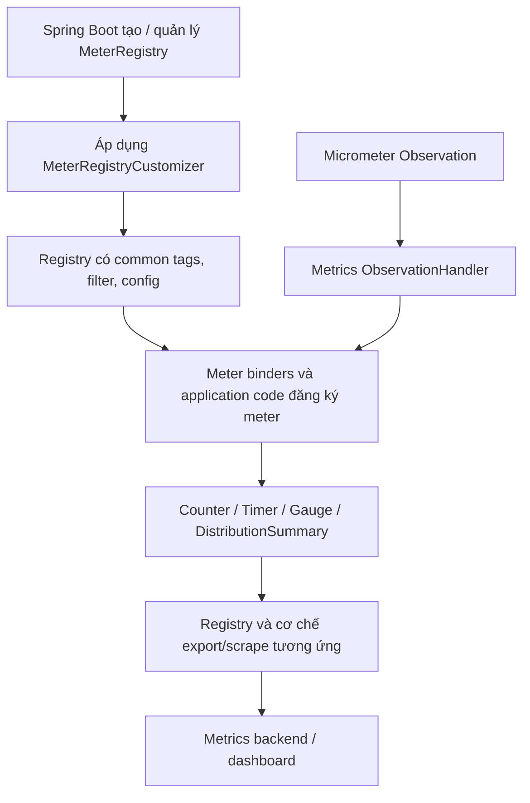
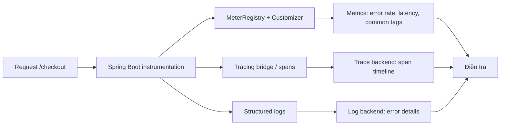

# MeterRegistryCustomizer trong Spring Boot

Một ứng dụng Spring Boot có thể xuất hàng chục loại metrics: số request HTTP, thời gian phản hồi, bộ nhớ JVM, connection pool, hàng đợi và các phép đo nghiệp vụ. Khi một ứng dụng chạy trên nhiều môi trường, đội vận hành cần nhận biết metric đến từ dịch vụ nào, môi trường nào, đồng thời giới hạn những tag khiến số lượng time series tăng không kiểm soát.

Nếu mỗi vị trí gọi `Counter.builder(...)` hoặc `Timer.builder(...)` phải tự gắn `application=checkout-service`, một đoạn code bị quên sẽ tạo ra series thiếu nhãn. Nếu mỗi thư viện tự định nghĩa chính sách metrics, dashboard cũng khó đối chiếu giữa các instance. **`MeterRegistryCustomizer`** là một điểm mở rộng của Spring Boot để áp dụng **cấu hình chung lên những `MeterRegistry` được Spring Boot quản lý**, trước khi meter được đăng ký.

Bài học thuộc chương **Spring Boot metrics** trong module **SPRING_BOOT_OBSERVABILITY**. Module hướng tới thiết lập observability bằng Micrometer Observation, metrics, logs và distributed tracing; học context propagation, tag/cardinality, exporter, sampling và liên kết tín hiệu khi điều tra lỗi hoặc độ trễ trên môi trường thực. Ở đây, trọng tâm là cấu hình **metrics registry**, hiểu phạm vi tác động và kiểm tra xem dữ liệu thực sự được ghi và xuất như mong đợi hay không.

## Mục tiêu học tập

Sau bài này, bạn có thể:

1. Nêu đúng vai trò của `MeterRegistryCustomizer` trong Spring Boot và phân biệt nó với `MeterRegistry`, `MeterBinder`, `MeterFilter` và `ObservationRegistry`.
2. Tạo một bean `MeterRegistryCustomizer<MeterRegistry>` để thiết lập common tags nhất quán cho metrics.
3. Biết khi nào cấu hình bằng `management.metrics.tags.*` là đủ và khi nào cần customizer bằng Java.
4. Áp dụng hoặc đăng ký `MeterFilter` để kiểm soát các meter/tag được chấp nhận, hiểu giới hạn của guardrail cardinality.
5. Nắm nguyên tắc tùy biến registry theo loại, thứ tự áp dụng, tác động của auto-configuration và những registry được tạo thủ công.
6. Đọc kết quả qua `/actuator/metrics` và `/actuator/prometheus`, đối chiếu các series trên backend.
7. Phân biệt việc cấu hình metrics với tracing sampling, log correlation và exporter, tránh khẳng định một customizer giải quyết mọi vấn đề observability.

## 1. `MeterRegistryCustomizer` giải quyết vấn đề gì?

**`MeterRegistry`** là đối tượng trung tâm của Micrometer Metrics: meter như `Counter`, `Timer`, `Gauge` và `DistributionSummary` được đăng ký vào registry. Registry chịu trách nhiệm quản lý các meter, áp dụng chính sách đo và kết nối cơ chế xuất metrics thích hợp với loại registry đang dùng.

**`MeterRegistryCustomizer<T extends MeterRegistry>`** là hợp đồng tùy biến của **Spring Boot**. Một bean triển khai hợp đồng này nhận vào một registry tương thích để chỉnh cấu hình, thông thường ở giai đoạn Boot khởi tạo và quản lý registry.

Một customizer có thể thiết lập:

- **Common tags:** metadata chung như tên ứng dụng và môi trường cho các meter.
- **`MeterFilter`:** từ chối hoặc điều chỉnh meter ID/tag, áp quy tắc giới hạn theo tên/tag.
- **Naming convention** hoặc các tùy chọn `MeterRegistry.Config` khác khi thực sự cần, có xét tới registry và exporter.
- Các cấu hình chuyên biệt cho **loại registry** phù hợp với generic type và cách Spring Boot tạo registry.

Customizer **không** biểu diễn một phép đo, không ghi giá trị metric và không tự làm xuất hiện một `Counter` hay `Timer`. Nó cấu hình **nơi các meter được đăng ký**.

### Hình dung dòng dữ liệu



Điểm quan trọng: customizer cần được áp dụng **trước khi meter được đăng ký**. Thêm common tags hoặc filter sau khi meter đã có ID không bảo đảm các meter cũ được cập nhật lại. Các thay đổi cấu hình nên đi qua quá trình khởi tạo của Spring Boot, đồng thời được kiểm chứng bằng dữ liệu thật.

## 2. Phân biệt các thành phần liên quan

| Thành phần | Trách nhiệm | Ví dụ |
|---|---|---|
| `MeterRegistry` | Đăng ký và quản lý meter, kết nối cơ chế thu thập/xuất metrics | `PrometheusMeterRegistry`, `SimpleMeterRegistry` |
| `MeterRegistryCustomizer<T>` | Áp dụng cấu hình trên registry tương thích do Spring Boot quản lý | Thiết lập common tags `application` và `environment` |
| `MeterFilter` | Xét/chỉnh meter ID, giới hạn hoặc từ chối meter, điều chỉnh cấu hình phân bố khi phù hợp | Chặn một nhóm meter hoặc giới hạn số giá trị của tag `uri` |
| `MeterBinder` | Đăng ký một nhóm meter từ nguồn cụ thể | Metrics JVM, executor hoặc connection pool |
| `ObservationRegistry` | Quản lý vòng đời observation, scope, context và các observation handlers | Quan sát xử lý HTTP hoặc bước nghiệp vụ |
| Metrics `ObservationHandler` | Biến sự kiện observation thành phép đo metrics nếu được cấu hình | Đo thời lượng observation thành timer |
| Exporter/collector/backend | Chuyển, lọc, lưu và truy vấn telemetry | Prometheus scrape, OTLP metrics pipeline |

Trong Spring Boot, Micrometer Observation và Micrometer Metrics có thể phối hợp nhưng **hai registry khác nhau về trách nhiệm**. `MeterRegistryCustomizer` tùy biến `MeterRegistry`; nó không tự thêm tracing handler vào `ObservationRegistry`, không tự tạo span, không thay đổi chính sách sampling của tracer và không định dạng log.

Ví dụ, bạn đã thêm common tag `application=checkout-service` cho metrics. Điều này **không bảo đảm** log hay distributed trace tự có cùng thuộc tính. Muốn liên kết signals, cần thiết kế thêm service/resource metadata, log correlation, trace propagation và backend phù hợp.

## 3. Spring Boot áp dụng customizer vào lúc nào?

Với hệ Spring Boot 3.x có Micrometer Metrics và auto-configuration thích hợp, Spring Boot có thể tự quản lý `MeterRegistry` từ các registry dependency trên classpath. Nó tìm các bean `MeterRegistryCustomizer<?>` rồi áp dụng cho những registry phù hợp trong quá trình cấu hình.

Luồng khái niệm:

```text
1. Ứng dụng khởi động
2. Spring Boot chuẩn bị MeterRegistry và các cấu hình tương ứng
3. Áp dụng MeterRegistryCustomizer phù hợp
4. MeterBinder/instrumentation/application đăng ký meters
5. Registry thu thập giá trị, exporter/scrape cung cấp dữ liệu
6. Backend lưu và biểu diễn metrics
```

Tùy phiên bản và registry, các bước khởi tạo nội bộ có thể khác. Điều kiện để tùy biến đúng là **registry được tích hợp vào cơ chế quản lý của Spring Boot** và customizer được phát hiện như một Spring bean.

Có hai giới hạn quan trọng:

1. Một `MeterRegistry` được tạo trực tiếp bằng `new SimpleMeterRegistry()` bên trong code rồi giữ riêng, ngoài đường quản lý phù hợp của Spring Boot, **không mặc nhiên** nhận các customizer bean.
2. Một meter được đăng ký quá sớm, trước khi common tags/filter có hiệu lực, có thể giữ ID/schema đã tạo. Đừng cố giải quyết bằng cách thay đổi config giữa lúc ứng dụng đang xử lý request; hãy bảo đảm cấu hình được áp dụng từ lúc khởi tạo.

Nếu ứng dụng có nhiều registry (ví dụ composite registry, registry cho test và registry chuyên biệt), cần kiểm tra loại registry nào được customizer nhận và thực tế meter được ghi vào registry nào.

## 4. Cấu hình common tags bằng `MeterRegistryCustomizer`

Giả sử một dịch vụ checkout chạy trên môi trường `staging` và `production`. Ta muốn mọi metrics có hai chiều ổn định:

- `application=checkout-service`: tên ứng dụng.
- `environment=production` hoặc `environment=staging`: môi trường triển khai.

Một cấu hình Java minh họa trong **Spring Boot 3.x**:

```java
import io.micrometer.core.instrument.MeterRegistry;
import org.springframework.boot.actuate.autoconfigure.metrics.MeterRegistryCustomizer;
import org.springframework.context.annotation.Bean;
import org.springframework.context.annotation.Configuration;
import org.springframework.core.env.Environment;

@Configuration(proxyBeanMethods = false)
class MetricsConfiguration {

    @Bean
    MeterRegistryCustomizer<MeterRegistry> commonMetricsTags(
            Environment environment) {

        String applicationName = environment.getProperty(
                "spring.application.name", "checkout-service");
        String deploymentEnvironment = environment.getProperty(
                "app.deployment.environment", "local");

        return registry -> registry.config().commonTags(
                "application", applicationName,
                "environment", deploymentEnvironment
        );
    }
}
```

Ví dụ ở trên dùng:

- `@Configuration` để khai báo cấu hình Spring.
- `@Bean` để Spring Boot có thể phát hiện customizer.
- Generic `MeterRegistry` để hướng tới những registry tương thích với kiểu tổng quát; việc áp dụng cụ thể vẫn phụ thuộc cơ chế auto-configuration.
- `Environment` để lấy tên ứng dụng/môi trường từ cấu hình triển khai, không lấy từ input mỗi request.
- `registry.config().commonTags(...)` để các meter được đăng ký sau cấu hình mang tập tags dùng chung.

Cấu hình đầu vào ví dụ:

```yaml
spring:
  application:
    name: checkout-service

app:
  deployment:
    environment: staging
```

Một meter HTTP hoặc nghiệp vụ được đăng ký thông qua registry phù hợp có thể xuất ra cùng các tag `application=checkout-service`, `environment=staging`. Tên metric và định dạng tag ở backend có thể bị thay đổi theo naming convention/exporter; cần kiểm tra output thực tế.

### Common tags không tự tách dữ liệu theo tenant

Nếu tên application được lấy cố định theo triển khai, đó là tag ít giá trị và hữu ích để nhóm metrics. Ngược lại, việc lấy mã khách hàng/tenant từ HTTP header rồi thêm vào tag của mọi meter làm cardinality tăng cao, đồng thời có nguy cơ xử lý dữ liệu nhạy cảm.

`commonTags` áp dụng **toàn registry**, không phải cấu hình riêng cho từng request. Các giá trị chung nên phản ánh **thuộc tính ổn định của ứng dụng hoặc môi trường**, không phải thuộc tính động của một request.

### Khác biệt với truyền tags khi tạo meter

Giả sử code nghiệp vụ đăng ký:

```java
import io.micrometer.core.instrument.Counter;
import io.micrometer.core.instrument.MeterRegistry;

class CheckoutMetrics {
    private final Counter acceptedOrders;

    CheckoutMetrics(MeterRegistry registry) {
        this.acceptedOrders = Counter.builder("checkout.orders.accepted")
                .description("Accepted checkout orders")
                .tag("channel", "web")
                .register(registry);
    }

    void orderAccepted() {
        acceptedOrders.increment();
    }
}
```

Nếu `registry` đã nhận customizer, meter này có thể chứa cả common tags `application`, `environment` và tag riêng `channel=web`. `Counter` vẫn do code nghiệp vụ đăng ký và tăng giá trị. Customizer chỉ cung cấp cấu hình chung, không tự gọi `increment()`.

Nếu cùng một khóa tag được khai báo ở cả common tags và meter cụ thể, cách xử lý xung đột có thể phụ thuộc logic lọc và thứ tự áp dụng. **Nên tránh trùng khóa**, chuẩn hóa schema tags và xác minh kết quả qua Actuator/registry.

## 5. Khi chỉ cần cấu hình thuộc tính Spring Boot

Một số nhu cầu đơn giản có thể dùng application properties thay vì viết class Java. Ví dụ Spring Boot 3.x hỗ trợ cấu hình các common tags cho metrics qua nhóm thuộc tính `management.metrics.tags.*`:

```yaml
management:
  metrics:
    tags:
      application: checkout-service
      environment: staging
```

Cách này hợp lý khi tags là những giá trị tĩnh theo cấu hình môi trường, không cần logic tùy biến.

| Nhu cầu | Phương án nên cân nhắc |
|---|---|
| Thêm `application` và `environment` vào mọi metric | `management.metrics.tags.*` hoặc một customizer chung |
| Lấy giá trị từ nhiều nguồn cấu hình, có chuẩn hóa/fallback | `MeterRegistryCustomizer` |
| Áp giới hạn hoặc sửa ID theo quy tắc cụ thể | `MeterFilter`, đăng ký qua cấu hình phù hợp |
| Tạo metric nghiệp vụ mới | `Counter`, `Timer`, `DistributionSummary`, `MeterBinder` hoặc instrumentation |
| Thay đổi tên/tag của một loại HTTP observation | Observation convention/instrumentation tương ứng |
| Bật/điều chỉnh exporter đến backend | Dependency và cấu hình registry/exporter/collector |
| Điều chỉnh tỷ lệ lấy mẫu distributed traces | Cơ chế sampling của tracing implementation/collector |

**Không cần khai báo cùng một common tag ở cả Java customizer và YAML** chỉ để chắc chắn nó xuất hiện. Việc làm trùng có thể tạo xung đột hoặc khiến người vận hành khó biết nguồn cấu hình cuối. Hãy chọn cách có quyền sở hữu rõ và kiểm tra schema cuối cùng.

Ở các phiên bản Spring Boot khác nhau, tên package/type của customizer, thứ tự auto-configuration và thuộc tính metrics có thể thay đổi. Ví dụ Java trên được đặt trong ngữ cảnh Spring Boot 3.x; khi chuyển sang phiên bản khác cần đối chiếu với tài liệu/API thực tế của phiên bản đang dùng.

## 6. Dùng `MeterFilter` cùng customizer

Một `MeterFilter` có thể từ chối meter hoặc điều chỉnh cấu hình meter phù hợp với chính sách của registry. Ví dụ trong ứng dụng, một số meter debug chỉ phục vụ phát triển và không cần xuất ra backend production.

```java
import io.micrometer.core.instrument.MeterRegistry;
import io.micrometer.core.instrument.config.MeterFilter;
import org.springframework.boot.actuate.autoconfigure.metrics.MeterRegistryCustomizer;
import org.springframework.context.annotation.Bean;
import org.springframework.context.annotation.Configuration;

@Configuration(proxyBeanMethods = false)
class MeterPolicyConfiguration {

    @Bean
    MeterRegistryCustomizer<MeterRegistry> excludeDebugMeters() {
        return registry -> registry.config().meterFilter(
                MeterFilter.denyNameStartsWith("internal.debug.")
        );
    }
}
```

Trong ví dụ này, filter sẽ từ chối đăng ký những meter khớp tiền tố `internal.debug.` theo ngữ nghĩa của API. Không dùng filter này để loại bỏ meter nghiệp vụ cần phục vụ SLO hay cảnh báo mà chưa đánh giá hậu quả.

### Giới hạn số giá trị tag để chống bùng nổ cardinality

Một ví dụ khác là guardrail:

```java
import io.micrometer.core.instrument.MeterRegistry;
import io.micrometer.core.instrument.config.MeterFilter;
import org.springframework.boot.actuate.autoconfigure.metrics.MeterRegistryCustomizer;
import org.springframework.context.annotation.Bean;
import org.springframework.context.annotation.Configuration;

@Configuration(proxyBeanMethods = false)
class HttpMetricLimitConfiguration {

    @Bean
    MeterRegistryCustomizer<MeterRegistry> guardHttpUriCardinality() {
        return registry -> registry.config().meterFilter(
                MeterFilter.maximumAllowableTags(
                        "http.server.requests",
                        "uri",
                        100,
                        MeterFilter.deny()
                )
        );
    }
}
```

Ý tưởng của ví dụ: với các meter có tên bắt đầu bằng `http.server.requests`, giới hạn số giá trị của tag `uri` mà filter chấp nhận. Khi vượt giới hạn, các ID mới có thể bị từ chối đăng ký.

Đây là **biện pháp bảo vệ cuối cùng**, không phải cách chuẩn hóa tag đúng. Nếu tag `uri` chứa raw URL như `/orders/984712` thay vì route template `/orders/{id}`, phải sửa instrumentation/naming trước. Filter ở ngưỡng 100 có thể che mất metrics của một route hợp lệ mới xuất hiện sau khi đã đạt ngưỡng. Nên giám sát số meter bị từ chối và kiểm tra tác động đến monitoring/SLO.

Cũng cần tránh dùng `MeterFilter` để xử lý thông tin nhạy cảm đã lọt vào đường tạo meter. Dữ liệu cần được loại bỏ hoặc chuẩn hóa **trước** khi đưa vào telemetry; filter chỉ là một lớp bảo vệ bổ sung.

### `MeterFilter` không đồng nghĩa với `ObservationFilter`

Hai tên đều có “filter” nhưng vai trò khác:

- **`MeterFilter`:** xử lý meter ID, tags hoặc cấu hình phân bố trong **Micrometer Metrics**.
- **`ObservationFilter`:** điều chỉnh context của **Micrometer Observation** theo vòng đời observation.
- **`ObservationPredicate`:** quyết định một observation có được các handlers quan sát theo điều kiện phù hợp hay không.

Một Observation được handler chuyển thành metric có thể chịu tác động của MeterFilter, nhưng một MeterFilter **không** quyết định toàn bộ số span được sampling trong tracing backend.

## 7. Tùy biến registry theo loại

Khi ứng dụng có nhiều registry, không phải mọi cấu hình đều phù hợp với tất cả. Ví dụ, một thiết lập đặc thù của Prometheus registry không nên bị áp dụng mù quáng cho một registry chỉ lưu dữ liệu trong bộ nhớ.

Customizer dùng generic type:

```java
MeterRegistryCustomizer<MeterRegistry>
```

để diễn tả loại registry mục tiêu. Khi cần chính sách cho một loại registry cụ thể, có thể viết dạng:

```java
// Dạng minh họa cho trường hợp dùng Prometheus registry.
MeterRegistryCustomizer<PrometheusMeterRegistry>
```

Dạng thứ hai cần class `PrometheusMeterRegistry` của registry tương ứng có trên **compile classpath** nếu viết code tham chiếu trực tiếp tới nó. Đồng thời, Spring Boot phải quản lý đúng registry đó để customizer được áp dụng. Nếu chỉ khai báo Prometheus dependency ở `runtimeOnly` mà source Java import class này, code có thể không biên dịch do thiếu dependency compile.

Trong phần lớn ứng dụng chỉ cần common tags và MeterFilter chung, hãy giữ `MeterRegistryCustomizer<MeterRegistry>` và tránh đưa logic đặc thù exporter vào đường cấu hình tổng quát.

### Composite registry và nhiều registry backend

Một ứng dụng có thể xuất cùng phép đo tới nhiều hệ thống, hoặc dùng composite registry. Khi đó cần kiểm tra:

1. Customizer chạy trên registry nào: composite, registry con hay cả hai theo cơ chế auto-configuration của phiên bản đang dùng?
2. Có tạo tag trùng/lặp chính sách không?
3. Meter đã được đăng ký trước lúc một registry con được thêm vào composite chưa?
4. Backend A và B có hỗ trợ cùng tên, tag và loại metric không?
5. Có đo trùng một hoạt động tại instrumentation hoặc handler khác không?

Cùng một giá trị `registry.counter(...).increment()` có thể được ghi và xuất bởi nhiều registry/backend, nhưng đó là **một hoạt động được phân phối đến nhiều nơi**, không nhất thiết là hai sự kiện nghiệp vụ khác nhau. Cần kiểm tra số lần instrumentation thực sự gọi `increment()` trước khi kết luận metric bị đếm gấp đôi.

## 8. Thứ tự cấu hình và thay đổi schema metrics

### Customizer phải chạy trước khi meter được đăng ký

Lý do rất thực tế: Micrometer gắn một meter với tên và tập tag tại thời điểm đăng ký. Một khi registry đã có meter ID đó, việc thêm common tag mới không mặc nhiên tái tạo mọi meter cũ theo ID mới.

Vì vậy:

- Đưa chính sách registry vào cấu hình khởi tạo của Spring Boot.
- Tránh tạo meter ngay trong quá trình dựng cấu hình khi các customizer còn chưa áp dụng.
- Khi có nhiều customizer cùng sửa registry config, quản lý thứ tự một cách có chủ đích nếu chúng phụ thuộc nhau; chỉ thêm `@Order` khi thật sự cần và xác minh thứ tự trên phiên bản đang sử dụng.
- Không kỳ vọng thay đổi property cấu hình trong lúc runtime sẽ biến đổi mọi time series đã xuất trước đó.

### Đổi tên/tag là thay đổi hợp đồng telemetry

Giả sử trước đây mọi metric chỉ có tag `application`. Sau khi thêm `environment`, Prometheus có thể thấy **bộ time series mới** với tổ hợp labels khác. Dashboard hoặc alert lọc label cũ có thể cần điều chỉnh.

Tương tự, đổi tên `application=checkout-service` thành `application=checkout` khiến các truy vấn gộp theo application bị chia thành hai nhóm trước và sau triển khai.

Một thay đổi nên được quản lý như thay đổi schema dữ liệu:

1. Kiểm tra dashboard, recording rules và các alert/SLO đang tiêu thụ metric.
2. Thống nhất danh sách tag và ý nghĩa giá trị giữa các service.
3. Kiểm soát rollout theo môi trường, theo dõi cả series cũ/mới nếu cần.
4. Xác minh kết quả trên exporter/backend, đặc biệt khi có nhiều instance chạy xen kẽ phiên bản.
5. Bảo đảm đơn vị đo và loại meter không bị thay đổi âm thầm.

**Không dùng tag để “sửa” sự khác biệt đơn vị đo.** Nếu một service ghi milliseconds vào timer còn service khác ghi seconds vào một summary có tên giống nhau, vấn đề nằm ở ngữ nghĩa meter/instrumentation, không thể chỉ giải quyết bằng thêm một common tag.

## 9. Kiểm tra customizer qua Actuator và Prometheus

Giả sử ứng dụng dùng Actuator và Micrometer Prometheus registry. Với Spring Boot 3.x và Gradle, dependency minh họa:

```groovy
dependencies {
    implementation 'org.springframework.boot:spring-boot-starter-actuator'
    runtimeOnly 'io.micrometer:micrometer-registry-prometheus'
}
```

Ví dụ cấu hình các endpoint để quan sát trong môi trường kiểm thử:

```yaml
spring:
  application:
    name: checkout-service

app:
  deployment:
    environment: staging

management:
  endpoints:
    web:
      exposure:
        include: health,info,metrics,prometheus
```

Khi registry Prometheus được auto-configured đúng cách, endpoint thường là `/actuator/prometheus` ở đường dẫn Actuator mặc định. Endpoint `/actuator/metrics` giúp xem các meter đã được registry nhận, tên và các tag theo cấu hình. Cần bảo vệ các endpoint vận hành bằng cấu hình mạng/bảo mật phù hợp; không công khai telemetry hoặc endpoint quản trị không cần thiết.

### Quy trình xác minh

1. **Khởi động ứng dụng** với customizer bean trên classpath và registry phù hợp.
2. **Phát sinh ít nhất một request** tới một endpoint hoặc gọi một nghiệp vụ có meter được instrument.
3. **Kiểm tra `/actuator/metrics`** để xem tên meter mong đợi; truy vấn chi tiết một meter để xem các tag khả dụng, bao gồm `application` và `environment`.
4. **Kiểm tra `/actuator/prometheus`** để xem series đã xuất có labels mong đợi không. Tên metric có thể được chuyển từ dấu chấm sang dấu gạch dưới và thêm hậu tố tùy kiểu meter.
5. **Kiểm tra Prometheus/backend** sau một số lần scrape: có data points không, label values có nhất quán giữa các instance và môi trường không?
6. **Kiểm tra ảnh hưởng filter:** meter bị loại có thực sự vắng mặt không, và các meter hợp lệ vẫn xuất đầy đủ không?
7. **Kiểm tra cardinality:** số distinct values của từng tag và số time series phát sinh có phù hợp ngân sách không?

Ví dụ output minh họa cho một counter có thể trông như:

```text
checkout_orders_accepted_total{
  application="checkout-service",
  environment="staging",
  channel="web"
} 42
```

Đây là **ví dụ định dạng**, không phải cam kết rằng registry/phiên bản nào cũng phát ra đúng tên `checkout_orders_accepted_total`. Tên metric cụ thể, đơn vị và suffix cần được lấy từ endpoint thực tế. Thậm chí `/actuator/metrics` và `/actuator/prometheus` có thể thể hiện tên theo những quy ước khác nhau.

### Vì sao không thấy common tag?

Một số khả năng:

- Bean chứa customizer chưa được Spring quét hoặc bị điều kiện cấu hình loại bỏ.
- Meter được đăng ký trong một registry tự tạo ngoài cơ chế auto-config của Spring Boot.
- Meter được tạo trước khi customizer áp dụng, hoặc một customizer/filter khác tác động đến tag.
- Có nhiều registry và người kiểm tra đang xem registry/backend khác.
- Exporter, naming convention hoặc query ở backend hiển thị/nhóm tag khác kỳ vọng.
- Không có mẫu mới hoặc scrape chưa diễn ra, nên series chưa xuất hiện ở nơi đang tra cứu.

Đừng ngay lập tức tăng log level hoặc bổ sung tag vào từng điểm tạo metric. Hãy xác định **registry thực tế đang sở hữu meter** và các customizer/filter được áp dụng lên registry đó.

## 10. Customizer trong bức tranh observability tổng thể

`MeterRegistryCustomizer` chỉ ảnh hưởng đến **đường metrics**. Trong Spring Boot, một request có thể cùng lúc tạo:

- **HTTP metrics:** thời gian phản hồi, count, status và các labels hữu hạn.
- **Structured logs:** sự kiện timeout hoặc lỗi nghiệp vụ, có thể kèm trace ID/span ID khi log correlation được tích hợp.
- **Distributed traces:** span HTTP server, HTTP client và các bước nghiệp vụ được instrument.
- **Metrics nghiệp vụ:** số giao dịch được chấp nhận hoặc kích thước giỏ hàng.

Ví dụ khi `POST /checkout` có tỷ lệ lỗi tăng:



Common tags giúp chọn đúng service/môi trường trên dashboard. Sau đó người vận hành dùng traces để định vị đoạn chậm và logs để đọc lỗi cụ thể.

Nhưng cần nhớ:

- Customizer **không** quyết định tracer sampling hay số trace được giữ. Sampling 10% trace không đồng nghĩa metrics chỉ đo 10% request.
- Thêm `application` vào metrics **không** làm logs/traces có cùng resource attribute. Phải cấu hình naming/resource metadata tương ứng của mỗi đường telemetry.
- Không gắn `traceId` hoặc `requestId` vào metric tags để nối từng request: cardinality rất cao. Nếu backend hỗ trợ **exemplar**, có thể liên kết một mẫu metric với trace theo cơ chế riêng.
- Một trace bị thiếu có thể do propagation, sampling, exporter hoặc collector. MeterRegistryCustomizer không sửa lỗi propagate context giữa thread hay service.
- Một metric tăng đột biến không tự chứng minh nguyên nhân gốc. Dùng nhiều tín hiệu và kiểm chứng lại giả thuyết.

## 11. Tình huống thực tế: metrics không gộp được sau deploy

Một nhóm vận hành có ba instance của `checkout-service`. Sau triển khai mới, dashboard tổng hợp tỷ lệ lỗi HTTP theo ứng dụng chỉ hiện dữ liệu của hai instance. Instance thứ ba vẫn xử lý request và log bình thường.

Thông tin giả định:

- Hai instance cũ có tag `application=checkout-service`.
- Instance mới dùng registry được tạo thủ công trong một adapter và không nhận common tag từ Spring Boot.
- Một số meter tự tạo khác vẫn dùng registry mặc định và có tag đầy đủ.
- Tracing vẫn thấy request đi qua instance mới, do đường tracing được cấu hình riêng.

### Đường điều tra

**Bước 1 — Xác minh dữ liệu thực sự thiếu ở đâu.** Truy vấn tổng metrics không đồng nghĩa dữ liệu tuyệt đối không tồn tại. So sánh meter theo instance và label; kiểm tra scrape targets, tên series, label values.

**Bước 2 — Xác định registry của từng meter.** Tìm nơi adapter inject `MeterRegistry` và nơi tự tạo registry bằng `new`. Nếu adapter dùng registry khác ngoài Boot, common customizer không mặc nhiên đi vào nó.

**Bước 3 — Kiểm tra customizer bean.** Xác nhận bean có trong application context và được áp dụng cho registry mà meter đang đăng ký. Kiểm tra cấu hình ở giai đoạn khởi tạo.

**Bước 4 — Khôi phục quyền sở hữu registry.** Nếu không có lý do kỹ thuật để giữ registry riêng, dùng `MeterRegistry` do Boot quản lý hoặc thiết kế wiring cho registry riêng với customizer và exporter phù hợp. Tránh tạo bean/trùng registry khiến autoconfiguration hoặc injection mơ hồ.

**Bước 5 — Đối chiếu với logs/traces.** Log và trace giúp xác nhận request đã đi qua instance mới, nhưng không thay thế phép đo HTTP error rate theo đúng mẫu số. Kiểm tra các đoạn thiếu context propagation nếu trace bị đứt.

**Bước 6 — Đánh giá lại dashboard và alert.** Sau khi tag thống nhất, xem các series theo environment, instance và version; xác minh alert/SLO không còn loại nhầm instance do bộ lọc label.

### Điều có thể kết luận

Customizer đã giúp thống nhất nhãn của những registry thực sự nhận cấu hình đó. Việc các meter khác thiếu common tag có thể xuất phát từ **đường đăng ký registry khác**, không phải do toàn bộ Spring Boot metrics hỏng.

**Điều chưa được chứng minh:** một instance xử lý request bình thường chỉ vì có trace hoặc log. Cần đo riêng latency, throughput và error rate trên đúng registry/pipeline.

## 12. Những lỗi thường gặp và cách khắc phục

| Lỗi | Hệ quả | Cách khắc phục |
|---|---|---|
| Tưởng `MeterRegistryCustomizer` tạo metric tự động | Không thấy metric nghiệp vụ mới | Dùng meter/instrumentation cụ thể để ghi giá trị |
| Thêm common tags sau khi meter đã đăng ký | Meter cũ có thể giữ schema khác | Đặt customizer trong giai đoạn khởi tạo |
| Tạo `new SimpleMeterRegistry()` rồi đợi Boot tùy biến | Registry riêng không nhận bean customizer như kỳ vọng | Inject registry Boot quản lý, hoặc tùy biến registry riêng tường minh |
| Gắn `userId` hoặc `traceId` vào common tags | Tăng cardinality cực lớn, rủi ro dữ liệu | Dùng tags theo deployment/operation hữu hạn |
| Đặt cùng khóa tag ở Java và YAML | Khó xác định giá trị cuối, dễ xung đột | Chọn một nguồn cấu hình rõ ràng |
| Cấm quá nhiều meter bằng `MeterFilter` | Mất metrics cần cho SLO/điều tra | Giới hạn chính xác và giám sát meter bị loại |
| Nghĩ `maximumAllowableTags` sửa raw URL | Meter mới bị deny, lỗi instrumentation vẫn tồn tại | Chuẩn hóa HTTP route template từ nguồn |
| Áp setting đặc thù exporter cho mọi registry | Sai tương thích hoặc khó gỡ lỗi | Tùy biến theo registry type nếu thực sự cần |
| Đổi tên common tag mà không cập nhật alert | Dashboard/SLO bỏ sót series | Quản lý schema telemetry và kế hoạch chuyển đổi |
| Tưởng common tags áp dụng luôn cho traces/logs | Không liên kết được các tín hiệu | Cấu hình resource metadata và log correlation riêng |
| Không thấy metric ở Prometheus rồi sửa code vội | Có thể chỉ lỗi scrape/export/query | Kiểm tra Actuator → registry → exporter → backend |
| Đọc count của log lỗi như số request lỗi | Đếm trùng do retry và log lặp | Dùng request metric hoặc SLI với mẫu số đúng |

## 13. Checklist triển khai `MeterRegistryCustomizer`

Trước khi đưa cấu hình vào production, hãy kiểm tra:

1. **Mục tiêu:** đang cần common tags, filter, naming convention hay exporter? Có thật sự cần customizer bằng Java không?
2. **Registry:** meter được đăng ký trên `MeterRegistry` nào? Registry đó có được Spring Boot quản lý và tùy biến không?
3. **Thời điểm:** cấu hình được áp dụng trước khi binders/application tạo meter chưa?
4. **Tags:** có dùng các chiều ổn định như application/environment/operation không? Có tag động, ID người dùng hoặc raw URL không?
5. **Tương thích:** tên metric, tag và đơn vị có thống nhất với dashboard/alert/SLO trước đó không?
6. **Filters:** các meter bị từ chối có được chủ động xác định? Guardrail tag values có làm mất dữ liệu quan trọng không?
7. **Nhiều registry:** generic type và các đường export đã được kiểm chứng, không cấu hình trùng hoặc injection sai?
8. **Cấu hình Spring:** bean customizer được phát hiện, property trùng được loại bỏ và auto-configuration còn hoạt động?
9. **Quan sát runtime:** `/actuator/metrics` có tên/tag đúng? `/actuator/prometheus` và backend có series phù hợp?
10. **Bảo mật:** endpoint metrics được bảo vệ, telemetry không chứa thông tin nhạy cảm?
11. **Chi phí:** số lượng meter/time series và các label values tăng đến mức nào sau khi thêm tag?
12. **Liên kết tín hiệu:** khi thấy metric xấu, có đủ log, span và trace context để điều tra lỗi/độ trễ không?

## 14. Tự đánh giá

**Câu 1.** Đã khai báo `MeterRegistryCustomizer<MeterRegistry>` thêm tag `application=checkout-service`. Có phải mọi log và span đều có tag này?

**Gợi ý:** Không. Customizer áp dụng cho đường Micrometer Metrics. Log/tracing cần cấu hình riêng về correlation và resource metadata.

**Câu 2.** Một developer tạo `SimpleMeterRegistry` bằng `new` trong một utility và đăng ký counter vào đó. Common tags từ customizer bean có tự xuất hiện không?

**Gợi ý:** Không nên giả định. Registry ngoài cơ chế Boot quản lý phải được cấu hình riêng hoặc thay bằng registry được inject đúng.

**Câu 3.** Khi muốn thêm hai tag tĩnh `application` và `environment`, bắt buộc viết Java customizer không?

**Gợi ý:** Không. `management.metrics.tags.*` có thể đáp ứng nhu cầu cơ bản nếu phiên bản Boot hỗ trợ. Chọn một nguồn cấu hình phù hợp.

**Câu 4.** Một filter giới hạn `uri` tối đa 100 giá trị. Nó có sửa tự động tag `/orders/123` thành `/orders/{id}` không?

**Gợi ý:** Không. Guardrail chỉ giới hạn giá trị mới được chấp nhận; vấn đề phải được giải quyết ở tầng route/instrumentation.

**Câu 5.** Một dashboard chỉ hiện hai trong ba instance sau khi thêm common tag. Có thể kết luận instance thứ ba không nhận request không?

**Gợi ý:** Chưa. Kiểm tra registry, label schema, scrape target và query. Logs/traces có thể cho biết request vẫn chạy nhưng không tự thay thế request count của metrics.

**Câu 6.** Một customizer thêm `traceId` vào tất cả metrics để từ dashboard tìm từng trace. Đây có phải cách tốt không?

**Gợi ý:** Không. Trace ID có cardinality rất cao, tạo nhiều time series. Dùng trace/log correlation và exemplar khi stack hỗ trợ.

**Câu 7.** Một meter được đăng ký trước khi customizer thêm `environment`. Sau đó sẽ luôn tự có tag mới chứ?

**Gợi ý:** Không được giả định. Meter ID thường được xác định lúc đăng ký; nên áp dụng customizer trước khi meter được tạo và kiểm tra thực tế.

## Kết luận

**`MeterRegistryCustomizer` là điểm mở rộng của Spring Boot để cấu hình các Micrometer MeterRegistry được quản lý**, đặc biệt hữu ích khi cần common tags và MeterFilter nhất quán giữa metrics do framework và ứng dụng tạo ra. Nó cần được áp dụng đúng thời điểm, trên đúng registry và với tag có cardinality được kiểm soát. Cấu hình registry không thay thế việc instrument nghiệp vụ, không tự tạo log/span và không quyết định sampling hay context propagation. Khi vận hành, hãy xác minh dữ liệu từ Actuator tới exporter/backend, theo dõi tác động tới time series và kết hợp metrics với logs, distributed traces để điều tra các bất thường có bằng chứng.
