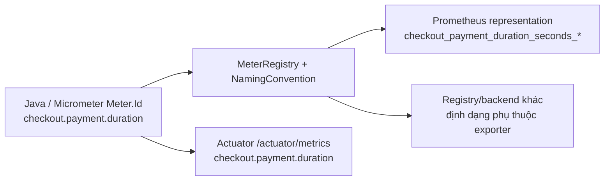

# Metric naming convention

Bạn thêm một timer tên `checkout.payment.duration` trong mã Spring Boot, nhưng tại `/actuator/prometheus` lại thấy các series như `checkout_payment_duration_seconds_count` và `checkout_payment_duration_seconds_sum`. Một đồng nghiệp tìm `checkout_payment_duration` trong Actuator mà không thấy; người khác tạo metric mới tên `checkout_payment_duration_seconds` để “khớp Prometheus”, khiến dữ liệu bị chia thành nhiều tên hoặc xung đột. Dashboard của hai service cũng khó ghép vì một service dùng `payment.latency`, service kia dùng `payments.time` cho cùng một loại phép đo.

Đó là vấn đề của **metric naming convention**: chọn tên có ngữ nghĩa ổn định ở tầng instrumentation, hiểu cách mỗi registry/exporter chuyển đổi tên và đơn vị, đồng thời thống nhất tên với meter type và tags. Trong chương **Spring Boot metrics** của module **SPRING_BOOT_OBSERVABILITY**, kỹ năng này giúp bạn triển khai observability bằng **Micrometer Observation, metrics, logs và distributed tracing**, liên kết các tín hiệu khi điều tra lỗi hoặc độ trễ, tránh chi phí cardinality quá lớn và không làm hỏng dashboard khi đổi exporter.

Sau bài học, bạn sẽ có thể:

1. Phân biệt **tên meter Micrometer**, **`Meter.Id`**, **exported metric name** và **trace/span name**.
2. Đặt tên thống nhất cho Counter, Gauge, Timer và DistributionSummary, bao gồm kiểu dữ liệu, đơn vị và suffix.
3. Giải thích cách các dấu chấm được chuyển thành dấu gạch dưới, cùng các hậu tố `_total`, `_seconds`, `_count`, `_sum`, `_bucket` trong Prometheus khi phù hợp.
4. Sử dụng Spring Boot Actuator, `MeterRegistry`, `MeterFilter` và `NamingConvention` ở đúng tầng.
5. Giữ metric names và tag keys có cardinality kiểm soát, tránh dữ liệu động và thông tin nhạy cảm.
6. Phân biệt **Micrometer ObservationConvention** với **Micrometer Metrics NamingConvention**.
7. Xây dựng quy trình đổi tên có kiểm soát và xác minh tên thực tế ở Actuator, exporter, dashboard và cảnh báo.

## 1. Cùng một phép đo có thể có nhiều cách biểu diễn tên

Một ứng dụng đo thời gian của bước xác thực thanh toán. Trong mã Java, tên nên mang cấu trúc dễ đọc và ổn định:

```java
Timer.builder("checkout.payment.duration")
     .description("Time to authorize a payment")
     .register(meterRegistry);
```

Với Micrometer, `checkout.payment.duration` là **tên meter ở mức ứng dụng**. Khi xuất qua Prometheus registry, tên này có thể được chuẩn hóa và kèm đơn vị giây, sau đó biểu diễn thành nhiều time series:

```text
Tên trong mã Java / Actuator:
    checkout.payment.duration

Ví dụ tên xuất qua Prometheus khi cấu hình phù hợp:
    checkout_payment_duration_seconds_count
    checkout_payment_duration_seconds_sum
    checkout_payment_duration_seconds_max
    checkout_payment_duration_seconds_bucket{le="0.5", ...}
```

Các series cụ thể phụ thuộc **meter type, phiên bản registry, cấu hình histogram và naming convention**. Chẳng hạn `_bucket` chỉ có khi histogram được xuất, còn `_max` phụ thuộc cách registry biểu diễn maximum. Không nên giả định mọi series trong minh họa đều tự xuất hiện.

Ba lớp quan trọng:

| Lớp | Bạn cấu hình ở đâu? | Ví dụ | Vai trò |
| --- | --- | --- | --- |
| **Tên meter chuẩn ở mã** | `Counter.builder(...)`, `Timer.builder(...)`, Observation name | `checkout.payment.duration` | Định danh ổn định để instrument và tra cứu trong Micrometer |
| **Meter identity** | `Meter.Id`: tên, tags, type, base unit và metadata | `checkout.payment.duration{provider=primary}` | Phân biệt các meters được đăng ký |
| **Tên được export** | Registry/exporter naming convention và quy tắc định dạng | `checkout_payment_duration_seconds_count` | Tên dùng trong backend/query/alert |

Tên meter trong Java là **nguồn danh nghĩa**, còn tên metric ở Prometheus là biểu diễn theo backend. Hãy bắt đầu từ tên Micrometer có ngữ nghĩa rõ, sau đó để registry phù hợp chuyển đổi. Việc viết luôn tên Prometheus vào `Timer.builder(...)` thường gây lặp suffix và làm mất tính tương thích khi đổi exporter.

### 1.1. Tên và tags cùng xác định chuỗi số liệu

Ví dụ hai lời gọi dùng cùng tên timer nhưng khác provider:

```text
checkout.payment.duration{provider="primary", outcome="approved"}
checkout.payment.duration{provider="backup",  outcome="error"}
```

Chúng cùng đo một đại lượng, chỉ khác **dimensions**. Không cần đặt:

```text
checkout.payment.primary.duration
checkout.payment.backup.duration
```

trừ khi có lý do rõ ràng chúng là hai loại meter khác nhau. Đưa một thuộc tính hữu hạn vào tag thường giúp dashboard và truy vấn linh hoạt hơn so với nhân tên meter theo từng giá trị.

**Cẩn thận:** tag values có thể làm số time series tăng mạnh. Giữ `provider` trong danh mục cho phép; không dùng `orderId`, `userId`, token hay URL chứa ID làm metric name hoặc metric tag.

## 2. Đặt tên gì để người khác hiểu phép đo?

Micrometer khuyến khích các tên có cấu trúc **phân cấp bằng dấu chấm**, thường dùng chữ thường, mô tả rõ miền nghiệp vụ và đại lượng được đo. Một mẫu thực hành:

```text
<domain>.<component-or-operation>.<measurement>

checkout.payment.duration
checkout.payment.attempts
checkout.queue.depth
inventory.reservation.duration
inventory.reservation.rejections
report.generation.duration
```

Đây là **quy ước đặt tên**, không phải cú pháp bắt buộc của Java. Có thể chọn một cấu trúc khác nếu nhất quán và thể hiện rõ semantics.

### 2.1. Các nguyên tắc thiết kế

1. **Bắt đầu bằng miền/ngữ cảnh có ý nghĩa**: `checkout`, `inventory` hoặc `billing`, không dùng `data` hay `metric` chung chung.
2. **Chỉ rõ thứ được đo**: `duration`, `attempts`, `depth`, `size`, `connections.active` thay vì tên mơ hồ như `value`.
3. **Dùng tên ổn định giữa các invocation**: một request không được tạo ra tên meter mới chứa ID hoặc timestamp.
4. **Giữ meter type nhất quán**: không dùng cùng tên và cùng tags cho cả Counter lẫn Gauge/Timer với semantics khác nhau.
5. **Tách tên và dimensions**: provider, outcome, route template và môi trường nên là tags khi chúng có tập giá trị kiểm soát được.
6. **Gắn đúng đơn vị**: ghi `baseUnit` khi instrument hỗ trợ; Timer chuyển duration sang đơn vị phù hợp khi export.
7. **Đừng tự gắn hậu tố của một exporter** vào tên canonical nếu hậu tố đó do registry tự tạo.

Bảng ví dụ:

| Nhu cầu đo | Tên Micrometer đề xuất | Meter phù hợp | Tags hữu ích |
| --- | --- | --- | --- |
| Số lần thử thanh toán | `checkout.payment.attempts` | Counter | `provider`, `result` nếu đã định nghĩa đúng |
| Thời gian xử lý thanh toán | `checkout.payment.duration` | Timer | `provider`, `outcome` |
| Số phần tử trong hàng đợi | `checkout.queue.depth` | Gauge | `queue` thuộc danh mục hữu hạn |
| Kích thước payload đầu vào | `checkout.request.size`, base unit `bytes` | DistributionSummary | `route` chuẩn hóa hoặc loại request |
| Số kết nối đang sử dụng | `datasource.connections.active` | Gauge | `pool` có tập giá trị giới hạn |
| Thời gian tạo báo cáo | `report.generation.duration` | Timer | `report.type` hữu hạn |

Một tên `checkout.payment.attempts` được sử dụng cho Counter là lựa chọn ngôn ngữ; registry Prometheus có thể thêm `_total` khi export. Không tự thêm `_total` vào tên Java nếu mục tiêu là Counter thông thường.

### 2.2. Tên metric không phải tên bảng dữ liệu nghiệp vụ

Đừng biến mỗi entity hay giao dịch thành một metric riêng:

```text
Sai:
  checkout.payment.ORD-829317.duration
  checkout.payment.customer-4721.duration
  http.server.requests./orders/829317

Tốt hơn:
  checkout.payment.duration{outcome="approved", provider="primary"}
  http.server.requests{uri="/orders/{id}", method="GET", status="200"}
```

Tất cả order IDs đều có thể tạo thêm tên/series mới, làm tăng bộ nhớ ứng dụng, tải scrape, dung lượng backend và chi phí truy vấn. Tìm giao dịch cụ thể thông qua **trace ID và log/audit correlation có bảo vệ**, không thông qua tên metric.

## 3. Tên metric và meter type phải ăn khớp

Tên hay nhưng chọn sai meter type vẫn dẫn đến dashboard gây hiểu nhầm.

| Meter type | Nên đo gì? | Ý nghĩa và ví dụ |
| --- | --- | --- |
| **Counter** | Sự kiện tăng dần, số lần gọi/lỗi | `checkout.payment.attempts`: mỗi attempt tăng 1 |
| **Gauge** | Giá trị tức thời có thể lên/xuống | `checkout.queue.depth`: số item đang chờ |
| **Timer** | Thời lượng thao tác và số lần ghi nhận | `checkout.payment.duration`: thời gian các lần thanh toán |
| **DistributionSummary** | Phân phối giá trị không phải duration | `checkout.request.size`, đơn vị bytes |
| **LongTaskTimer** | Công việc dài cần biết đang chạy bao nhiêu và elapsed time | `report.generation.active` khi cần theo dõi job chưa kết thúc |

Một số lỗi thường thấy:

- Dùng Gauge để đếm tổng request, nhưng Gauge chỉ cho biết giá trị hiện tại, không tự có semantics của counter tăng dần.
- Dùng Counter để đo duration, khiến tên `duration` không thể đưa vào truy vấn histogram/quantile hợp lý.
- Tạo Counter `http.server.requests` thủ công trong khi Spring Boot HTTP metrics đã đo cùng request; có thể dẫn đến tên trùng nhưng type không tương thích hoặc số đo bị đếm đôi.
- Đặt cùng tên cho Timer và DistributionSummary, khiến registry/backend không thể nhất quán về kiểu và đơn vị.

**Timer** thường cho phép xem count và total time, do đó không phải lúc nào cũng cần tạo thêm Counter chỉ để đếm **cùng một lần hoàn tất**. Nếu mục tiêu là **attempt bắt đầu** nhưng timer chỉ ghi nhận **attempt hoàn tất**, hai phép đo có định nghĩa khác nhau và có thể cùng tồn tại với tên khác nhau.

## 4. Đơn vị và suffix: vì sao tên Prometheus khác tên Micrometer?

Micrometer instrument theo semantics của meter. Registry/exporter chuyển định dạng theo quy tắc của đích nhận dữ liệu. Prometheus thường dùng dấu gạch dưới và hậu tố thể hiện **đơn vị** hoặc **loại series**.

Ví dụ thường gặp (chỉ mang tính minh họa; phải xem exporter thật):

| Tên Micrometer | Loại / cấu hình | Dạng Prometheus thường gặp |
| --- | --- | --- |
| `checkout.payment.attempts` | Counter | `checkout_payment_attempts_total` |
| `checkout.payment.duration` | Timer | `checkout_payment_duration_seconds_count`, `checkout_payment_duration_seconds_sum` |
| `checkout.payment.duration` | Timer + histogram | Các series trên và `checkout_payment_duration_seconds_bucket` |
| `checkout.queue.depth` | Gauge | `checkout_queue_depth` |
| `checkout.request.size` | DistributionSummary với `baseUnit("bytes")` | `checkout_request_size_bytes_count`, `checkout_request_size_bytes_sum` và buckets nếu bật histogram |
| `jvm.memory.used` | Gauge đo bytes | `jvm_memory_used_bytes` |

### 4.1. Ý nghĩa một số suffix

- **`_total`**: thường thể hiện counter tích lũy trong Prometheus.
- **`_seconds`**: thể hiện đơn vị giây. Micrometer Timer được biểu diễn theo đơn vị của backend, thông thường là giây với Prometheus.
- **`_count`**: số quan sát của Timer/DistributionSummary hoặc một metric dạng summary/histogram.
- **`_sum`**: tổng các giá trị quan sát; với Timer thường là tổng thời gian tính bằng giây.
- **`_bucket`**: bucket của classic histogram, thường có nhãn `le` (*less than or equal*), dùng tính tỉ lệ dưới ngưỡng và ước lượng percentile.
- **`_max`**: có thể được exporter xuất như một series bổ sung để biểu diễn giá trị lớn nhất theo cửa sổ; không nên xem nó là thành phần bắt buộc của classic histogram Prometheus.

Một Timer tên `checkout.payment.duration` **không** trở thành chỉ một scalar “duration”. Một lần đo tạo ra dữ liệu để registry tổng hợp count, total time, maximum và histogram/percentiles theo cấu hình.

### 4.2. Đừng tự thêm suffix hai lần

Nếu tên Java là `checkout.payment.duration.seconds`, exporter có thể biến nó thành tên kém tự nhiên hoặc thêm một hậu tố đơn vị nữa. Thay vào đó, dùng:

```java
Timer.builder("checkout.payment.duration")
     .description("Payment authorization latency")
     .register(registry);
```

Với payload size, có thể cung cấp base unit riêng:

```java
DistributionSummary.builder("checkout.request.size")
    .baseUnit("bytes")
    .description("Size of checkout request payloads")
    .register(registry);
```

Sử dụng `baseUnit("bytes")` giúp metadata về đơn vị rõ ràng hơn. Không nhầm **base unit** với tag `unit=bytes`: đơn vị là thuộc tính của phép đo; nếu cố dùng tag để sửa sai naming, query sẽ khó diễn giải và vẫn có thể xuất tên không đúng chuẩn backend.

### 4.3. Hai tên Java có thể đụng nhau sau chuyển đổi

Các tên:

```text
checkout.payment.duration
checkout_payment_duration
```

là hai chuỗi khác nhau trong mã, nhưng một naming convention chuyển dấu chấm thành dấu gạch dưới có thể tạo **cùng chuỗi exported name**. Tương tự, một tag key `client.channel` và `client_channel` có thể trùng sau chuẩn hóa.

Hậu quả tùy registry: series xung đột, warning lúc đăng ký, output không mong đợi hoặc backend từ chối metadata khác loại. Tránh dựa vào dấu phân cách để phân biệt hai metric có ý nghĩa khác nhau; hãy dùng **từ ngữ khác nhau thực sự** ở tên canonical.

## 5. NamingConvention trong Micrometer là gì?

Micrometer có giao diện **`NamingConvention`** để biến đổi tên meter, tag keys và tag values theo quy tắc thích hợp với registry. Các registry khác nhau có thể sử dụng cách biểu diễn khác nhau cho **cùng tên canonical** của ứng dụng.



Ví dụ, Prometheus có những quy định về tên metric và label mà registry phải đáp ứng; hệ thống khác có thể hỗ trợ dấu chấm, gạch dưới, tên đơn vị hay metadata khác nhau. Nên giữ tên canonical ổn định để instrumentation có thể tái sử dụng.

**Phân biệt quan trọng:** NamingConvention ở tầng registry **không phải** một hợp đồng biến đổi dữ liệu của `Meter.Id` theo cách giống như đổi tên trong code. Nó quyết định tên/nhãn *được biểu diễn ra ngoài*; việc đổi tên meter ở mức cấu hình MeterFilter lại thay đổi cách meter được đăng ký và nhận diện trong registry.

### 5.1. Khi nào cần custom NamingConvention?

Mặc định nên dùng naming convention do registry cung cấp. Chỉ tùy chỉnh khi có yêu cầu rõ ràng, chẳng hạn chuẩn hóa một namespace cũ trước khi xuất cho hệ thống đã có quy chuẩn riêng. Lợi ích phải cân bằng với rủi ro:

- Tên xuất ở backend thay đổi nhưng mã `Meter.builder(...)` và một số endpoint Actuator vẫn theo tên canonical.
- Một luật prefix hoặc replace thiếu chặt chẽ có thể làm hai meter khác nhau có cùng tên sau export.
- Tracing, logs và dashboards không tự được đổi theo naming convention của metrics.
- Khi nâng cấp Micrometer hoặc exporter, cần kiểm chứng lại unit suffix và label normalization.

Dưới đây là ví dụ minh họa cách **bọc naming convention sẵn có**, chỉ thêm prefix cho một nhóm metric khi export. Hãy xem nó là một lựa chọn cho hệ thống có hợp đồng đổi tên cụ thể, không phải thiết lập mặc định nên áp dụng cho mọi dự án.

```java
import io.micrometer.core.instrument.Meter;
import io.micrometer.core.instrument.config.NamingConvention;

public final class CommercePrefixNamingConvention
        implements NamingConvention {

    private final NamingConvention delegate;

    public CommercePrefixNamingConvention(NamingConvention delegate) {
        this.delegate = delegate;
    }

    @Override
    public String name(String name, Meter.Type type, String baseUnit) {
        String exportedName = name.startsWith("checkout.")
                ? "commerce." + name
                : name;
        return delegate.name(exportedName, type, baseUnit);
    }

    @Override
    public String tagKey(String key) {
        return delegate.tagKey(key);
    }

    @Override
    public String tagValue(String value) {
        return delegate.tagValue(value);
    }
}
```

Ở giai đoạn cấu hình registry **trước khi meter được đăng ký**, bạn có thể gắn convention đã bọc:

```java
import io.micrometer.core.instrument.MeterRegistry;
import org.springframework.boot.actuate.autoconfigure.metrics.MeterRegistryCustomizer;
import org.springframework.context.annotation.Bean;
import org.springframework.context.annotation.Configuration;

@Configuration
class MetricsNamingConfig {

    @Bean
    MeterRegistryCustomizer<MeterRegistry> commerceNamingCustomizer() {
        return registry -> {
            var existing = registry.config().namingConvention();
            registry.config().namingConvention(
                    new CommercePrefixNamingConvention(existing));
        };
    }
}
```

Ví dụ dành cho **Spring Boot 3.x**, dùng package autoconfiguration tương ứng. Với ứng dụng đa registry, từng registry có thể có convention riêng; nếu thay chung trên tất cả registry, cần đánh giá tên xuất của từng exporter. Luôn kiểm tra các series thực tế sau khi cấu hình. Spring Boot 4.x có thể thay đổi package/starter tích hợp; đối chiếu tài liệu của đúng phiên bản.

**Cân nhắc kỹ:** prefix “commerce” có thể hợp lý ở backend cũ nhưng chưa chắc tốt hơn các meter names gốc. Tên xuất thay đổi có thể làm alert và dashboard hiện hữu ngừng nhận dữ liệu. Đừng áp dụng một convention mang tính thử nghiệm vào hệ thống đang vận hành mà chưa kiểm kê consumers.

## 6. MeterFilter và việc đổi tên meter ở mức registry

Nếu muốn **chuyển một tên meter cũ sang tên canonical mới ngay từ lúc đăng ký**, có thể dùng `MeterFilter`. Đây là cơ chế khác với `NamingConvention` dùng để định dạng khi export.

Ví dụ tên cũ `checkout.payment.time` cần chuyển sang `checkout.payment.duration`:

```java
import io.micrometer.core.instrument.Meter;
import io.micrometer.core.instrument.config.MeterFilter;
import org.springframework.context.annotation.Bean;
import org.springframework.context.annotation.Configuration;

@Configuration
class MetricMigrationConfig {

    @Bean
    MeterFilter renameLegacyPaymentTime() {
        return new MeterFilter() {
            @Override
            public Meter.Id map(Meter.Id id) {
                if ("checkout.payment.time".equals(id.getName())) {
                    return id.withName("checkout.payment.duration");
                }
                return id;
            }
        };
    }
}
```

Bộ lọc được áp dụng khi đăng ký meter (trong điều kiện cấu hình và cơ chế autoconfiguration tương ứng), nên không dùng nó để “đổi tên trực tiếp” một time series đã xuất trong quá khứ. Nếu tên mới đã có một meter type khác hoặc tập tag không tương thích, việc đổi tên có thể dẫn đến xung đột. Đảm bảo migration được định nghĩa rõ và xác minh cả Actuator lẫn exporter.

| Nhu cầu | Công cụ phù hợp |
| --- | --- |
| Chọn tên meter mới trong code | `Timer.builder("...")`, `Counter.builder("...")` |
| Đồng nhất tên của một nhóm observation nghiệp vụ | `ObservationConvention` hoặc tên truyền vào Observation API |
| Đổi tên meter lúc đăng ký | `MeterFilter.map(Meter.Id)` |
| Định dạng tên/tag cho backend | `NamingConvention` của registry |
| Đổi các tag keys có quy tắc riêng | Một `MeterFilter` phù hợp hoặc convention/tag handling của registry |
| Đổi dashboard sang tên mới | Cập nhật backend queries, recording rules và alert rules |

Không nhầm **`MeterFilter`** (Micrometer Metrics) với **`ObservationFilter`** (Micrometer Observation). Hai extension points hoạt động ở các tầng và thời điểm khác nhau.

### 6.1. Giữ quyền sở hữu rõ ràng cho một quy tắc đặt tên

Nếu một team đặt tên metric trong instrumentation, team khác đổi tên qua MeterFilter, team thứ ba thêm prefix qua NamingConvention, cuối cùng mọi người sẽ khó biết tên nào được backend lưu. Một kiến trúc ổn định nên có:

1. Danh mục meter names canonical và meter types được thống nhất.
2. Tags và base units được mô tả ở cùng danh mục.
3. Registry/exporter được cấu hình có kiểm soát, ít override không cần thiết.
4. Mapping tên backend được kiểm chứng định kỳ bằng raw telemetry.
5. Chính sách migration rõ nếu thật sự cần đổi tên.

## 7. Spring Boot Actuator và các metric names có sẵn

Spring Boot Actuator và các thư viện tích hợp có thể đăng ký nhiều meters tự động, chẳng hạn HTTP server, JVM, process, system, connection pool và caches. Không nhất thiết mọi meter đều tồn tại trong mọi ứng dụng: điều đó phụ thuộc dependencies, technology stack và việc một hoạt động đã xảy ra hay chưa.

Một số tên Micrometer thường gặp (phụ thuộc phiên bản/cấu hình):

| Tên trong Micrometer | Ý nghĩa điển hình | Gợi ý kiểm tra |
| --- | --- | --- |
| `http.server.requests` | Số lần và thời gian HTTP requests đến ứng dụng | Tạo request rồi kiểm tra method/uri/status |
| `http.client.requests` | HTTP client metrics khi instrumentation được kích hoạt | Kiểm tra cách tạo client và dependency |
| `jvm.memory.used` | Dung lượng bộ nhớ JVM đang sử dụng | Xem tags như `area` và `id` |
| `jvm.gc.pause` | Thời gian GC pauses được đo | Tìm meter và phân phối thời lượng |
| `process.cpu.usage` | Mức sử dụng CPU của process | Phân biệt với system CPU |
| `system.cpu.usage` | Mức sử dụng CPU hệ thống | Chỉ xuất khi binder tương ứng có dữ liệu |

Tác dụng của naming convention là giữ tên **dễ hiểu và tái sử dụng**. Nếu bạn tự tạo một timer tên `web.response.time` để đo đúng cùng ranh giới mà `http.server.requests` đã đo, bạn có thể tạo dữ liệu trùng mà không làm tăng khả năng quan sát.

Với metric built-in, trước tiên cần hiểu semantics và tags sẵn có. Chỉ đổi tên hay bổ sung instrumentation khi có câu hỏi vận hành chưa được trả lời.

### 7.1. Ví dụ truy vấn bằng Actuator

Trong môi trường lab với Actuator đã cấu hình:

```bash
curl -fsS http://localhost:8080/actuator/metrics
curl -fsS http://localhost:8080/actuator/metrics/http.server.requests
curl -fsS http://localhost:8080/actuator/prometheus
```

- `/actuator/metrics` liệt kê những meter names có sẵn trong registry.
- `/actuator/metrics/http.server.requests` cho phép truy vấn meter theo **tên canonical** và khám phá tags/measurements.
- `/actuator/prometheus` cho biết **tên time series thực tế sau export**, bao gồm suffix theo đơn vị và kiểu dữ liệu khi phù hợp.

Nếu meter không xuất hiện, có thể ứng dụng chưa phát sinh hoạt động tương ứng, dependency/binder chưa được bật, filter đã vô hiệu, hoặc registry/exposure khác dự kiến. Đừng đổi tên để “chữa” một lỗi pipeline chưa được xác minh.

Endpoints Actuator là giao diện quản trị. Trong production cần kiểm soát mạng, xác thực/phân quyền và hạn chế exposure theo chính sách ứng dụng.

## 8. Tạo metric có tên nhất quán trong Spring Boot

### 8.1. Dependencies cơ bản (ví dụ Spring Boot 3.x)

Trong ứng dụng Maven dùng dependency management của Spring Boot:

```xml
<!-- Actuator cung cấp các tích hợp metrics và Observation -->
<dependency>
    <groupId>org.springframework.boot</groupId>
    <artifactId>spring-boot-starter-actuator</artifactId>
</dependency>

<!-- Khi cần Prometheus scrape -->
<dependency>
    <groupId>io.micrometer</groupId>
    <artifactId>micrometer-registry-prometheus</artifactId>
</dependency>
```

Một ứng dụng HTTP còn cần starter web/webflux tương ứng. Prometheus registry xuất dữ liệu; để lưu, truy vấn và dựng dashboard cần Prometheus server hoặc backend tương thích tiếp nhận telemetry.

### 8.2. Cấu hình endpoint và common tags

```yaml
management:
  endpoints:
    web:
      exposure:
        include: health,info,metrics,prometheus
  metrics:
    tags:
      application: checkout-service
      environment: lab
    distribution:
      percentiles-histogram:
        checkout.payment.duration: true
```

Giải thích:

- `management.metrics.tags.application` và `environment` là common tags giúp phân biệt ứng dụng/môi trường trong dữ liệu metrics.
- Common tags **không** nên chứa request ID, hostname động không cần thiết hoặc giá trị có cardinality không được kiểm soát.
- Cấu hình histogram theo tên canonical `checkout.payment.duration`, không dùng tên sau export như `checkout_payment_duration_seconds_bucket`.
- Các tag keys được registry chuẩn hóa theo quy tắc của backend; tên label cuối cùng cần kiểm tra trong raw output.
- Với hệ thống nhiều services, bảo đảm cách định danh service thống nhất để tránh query trộn nhầm dữ liệu.

Cấu hình này phục vụ metrics. Tracing, logs correlation, OTLP exporter và sampling là các cơ chế có cấu hình riêng, không được thiết lập chỉ bằng tên meter.

### 8.3. Code Java: Counter và Timer theo cùng một taxonomy

Ví dụ dưới đây đo số lần *bắt đầu thử* thanh toán và duration của *mỗi lần hoàn tất*. Tất cả tags có tập giá trị hữu hạn.

```java
import io.micrometer.core.instrument.Counter;
import io.micrometer.core.instrument.MeterRegistry;
import io.micrometer.core.instrument.Timer;
import org.springframework.stereotype.Service;

@Service
public class PaymentMetricsService {
    private final MeterRegistry registry;
    private final PaymentGateway gateway;

    public PaymentMetricsService(MeterRegistry registry,
                                 PaymentGateway gateway) {
        this.registry = registry;
        this.gateway = gateway;
    }

    public boolean authorize(String provider, String paymentToken) {
        String safeProvider = switch (
                provider == null ? "" : provider) {
            case "primary" -> "primary";
            case "backup" -> "backup";
            default -> "other";
        };

        Counter.builder("checkout.payment.attempts")
                .description("Number of payment authorization attempts")
                .tag("provider", safeProvider)
                .register(registry)
                .increment();

        Timer.Sample sample = Timer.start(registry);
        String outcome = "error";

        try {
            boolean accepted = gateway.authorize(paymentToken);
            outcome = accepted ? "approved" : "rejected";
            return accepted;
        } finally {
            Timer timer = Timer.builder("checkout.payment.duration")
                    .description("Time to authorize a payment")
                    .tag("provider", safeProvider)
                    .tag("outcome", outcome)
                    .register(registry);
            sample.stop(timer);
        }
    }
}

interface PaymentGateway {
    boolean authorize(String paymentToken);
}
```

Các quyết định quan trọng:

- `checkout.payment.attempts` là **Counter**: tăng trước lời gọi dependency.
- `checkout.payment.duration` là **Timer**: được ghi sau lời gọi, kể cả khi dependency ném lỗi vì `finally` vẫn chạy.
- `provider=primary|backup|other` và `outcome=approved|rejected|error` có tập giá trị nhỏ.
- `paymentToken` tuyệt đối không xuất vào tags, metric names, traces hay logs.
- `Timer.Sample` đo thời lượng theo đơn vị chuẩn, tránh tự truyền mili giây vào một meter đang kỳ vọng nanoseconds hoặc seconds.
- Tên Counter/Timer cùng namespace `checkout.payment` nhưng khác **đại lượng** và type.

`Timer.builder(...).register(registry)` tìm hoặc đăng ký meter theo identity; trong hệ thống nhiều traffic có thể lưu sẵn các meters cho bộ tag hữu hạn để giảm thao tác lookup, nhưng không tạo meter cache riêng dựa trên ID giao dịch.

**Lưu ý mô hình lỗi:** `outcome=error` trong ví dụ áp dụng khi lời gọi ném exception trước khi trả boolean. Nếu ứng dụng có fallback trả thành công hoặc phân loại business outcomes đặc biệt, hãy cập nhật taxonomy phù hợp. Nếu muốn ghi lỗi lên trace, cần Observation/tracing instrumentation hoặc cơ chế bắt lỗi tương ứng; Timer đơn thuần không tạo một span.

### 8.4. Query Prometheus cho các tên đã export

Giả sử raw endpoint thực sự xuất counter với tên `checkout_payment_attempts_total`, có thể tính số attempt/giây theo provider:

```promql
sum by (provider) (
  rate(checkout_payment_attempts_total[5m])
)
```

Nếu timer `checkout.payment.duration` đã bật histogram, ví dụ p95 toàn bộ instance của provider `primary`:

```promql
histogram_quantile(
  0.95,
  sum by (le) (
    rate(
      checkout_payment_duration_seconds_bucket{
        provider="primary"
      }[5m]
    )
  )
)
```

Ví dụ này dùng **classic histogram** và chỉ hợp lệ khi histogram buckets thực sự được xuất. Tên metric có thể được registry/Prometheus phiên bản đang chạy chuẩn hóa khác đi; hãy đọc raw endpoint trước khi sao chép truy vấn.

Không lấy trung bình những giá trị p95 đã tính riêng từng pod để tính p95 toàn service. Với histogram tương thích, cộng bucket rates trước rồi mới gọi `histogram_quantile()`. Histogram/percentile có sai số ước lượng phụ thuộc bucket boundaries; theo dõi request count cùng với p95/p99.

## 9. Naming convention và Micrometer Observation

Spring Boot observability có thêm một tầng khái niệm: **Micrometer Observation**. Observation là API mô tả một thao tác với ngữ cảnh và lifecycle; khi có metrics handler, nó có thể tạo timer/metric; khi có tracing handler, nó có thể tạo span.

```java
import io.micrometer.observation.Observation;
import io.micrometer.observation.ObservationRegistry;

public boolean authorizeWithObservation(
        ObservationRegistry registry,
        PaymentGateway gateway,
        String token) {

    return Observation.createNotStarted(
                    "checkout.payment.authorization", registry)
            .contextualName("authorize payment")
            .lowCardinalityKeyValue("operation", "authorize")
            .lowCardinalityKeyValue("dependency", "payment")
            .observe(() -> gateway.authorize(token));
}
```

Trong ví dụ:

- **Observation name**: `checkout.payment.authorization`, dùng để nhận dạng thao tác. Với metrics handler phù hợp, nó thường là nguồn tên meter.
- **Contextual name**: `authorize payment`, mô tả thân thiện hơn cho span/tracing context khi handler hỗ trợ.
- **Low-cardinality key-values**: `operation` và `dependency`, có thể trở thành metric tags.
- **Registry NamingConvention**: định dạng tên metric khi xuất ra backend.
- **ObservationConvention**: chọn tên và key-values dựa trên loại `Observation.Context` cho một nhóm observation, **không phải** quy tắc đổi dấu chấm thành dấu gạch dưới của Prometheus.

### 9.1. Hai “convention” khác nhau

| Công cụ | Gói/tầng | Quyết định | Ví dụ |
| --- | --- | --- | --- |
| `ObservationConvention` | Micrometer Observation | Observation name, contextual name, low/high-cardinality key-values | Gọi bước thanh toán là `checkout.payment.authorization` |
| `NamingConvention` | Micrometer Metrics registry | Cách tên meter/tag được biểu diễn trong backend | `checkout.payment.authorization` → tên tương thích Prometheus |
| `MeterFilter` | Micrometer Metrics registry | Chấp nhận/từ chối/đổi `Meter.Id` hoặc tags khi đăng ký | Đổi tên canonical cũ sang mới |
| `ObservationFilter` | Micrometer Observation | Bổ sung/biến đổi Observation.Context ở giai đoạn thích hợp | Gắn outcome từ context vào observation |

Một `ObservationConvention` không làm Prometheus tự xuất trace. Một `NamingConvention` không tự truyền trace context giữa HTTP services. Mỗi tầng phục vụ một mục đích riêng; cần metrics registry, tracing bridge, exporter và collector để dữ liệu đến backend.

**Tránh instrument trùng:** Nếu tạo cả Timer thủ công `checkout.payment.duration` và một Observation cùng phạm vi với metrics handler tạo timer nữa, dashboard có thể có hai phép đo cùng bản chất. Chọn ranh giới và ownership rõ ràng: đo business step bằng Observation khi cần liên kết metrics/traces, hoặc Timer trực tiếp khi chỉ cần một duration metric.

## 10. Tag keys và cardinality cũng là một phần của naming strategy

Một metric name ổn định chỉ giải quyết một nửa vấn đề. Mỗi tổ hợp tag values khác nhau có thể tạo time series riêng.

Giả sử metric `http.server.requests` có các dimensions:

- `uri`: 30 route templates.
- `method`: 4 HTTP methods.
- `status`: 5 nhóm trạng thái.
- `instance`: 12 instances.

Số tổ hợp lý thuyết là:

```text
30 × 4 × 5 × 12 = 7.200 tập nhãn
```

Nếu thêm `customerId` có 50.000 giá trị, số tổ hợp tiềm năng có thể thành **360 triệu**, chưa tính histogram buckets. Những tổ hợp thực sự có dữ liệu mới xuất hiện, nhưng mức bùng nổ chi phí vẫn rất lớn.

### 10.1. Tên tag nên nhất quán

| Nên dùng khi phù hợp | Tránh | Lý do |
| --- | --- | --- |
| `uri=/orders/{id}` | `uri=/orders/721891` | Route template gộp nhiều request |
| `outcome=approved|rejected|error` | `outcome=exception message` | Tập giá trị hữu hạn |
| `provider=primary|backup` | `provider=<hostname request tùy ý>` | Tránh label biến động |
| `environment=prod|staging` | Timestamp trong tên metric | Dùng tag cho môi trường |
| `error.kind=timeout|validation|other` | Stacktrace trong label | Tóm tắt lỗi theo nhóm |
| `traceId` ở logs/traces | `traceId` là metric label | ID gần như duy nhất mỗi request |
| `service.name` được đặt thống nhất | Mỗi service dùng một key riêng tùy ý | Dễ gộp dashboard nhiều ứng dụng |

Khi export, tag keys như `client.channel` có thể được chuyển thành `client_channel`. Không tạo cả hai kiểu trong cùng một hệ thống vì chúng có thể xung đột sau normalization.

Đặt nhãn cần mô tả ý nghĩa **ổn định giữa các service và phiên bản**. Nếu service A dùng `outcome=failed` còn service B dùng `outcome=error` cho cùng một trạng thái, dashboard gộp sẽ dễ sai. Hãy xác định từ điển tag chung trước khi phát hành.

### 10.2. Cardinality của metric name cũng có thể tăng

Metric naming không phải nơi nhét dimensions:

```text
Sai:
  checkout.payment.provider-a.success.duration
  checkout.payment.provider-b.error.duration
  checkout.payment.order-000123.duration

Tốt:
  checkout.payment.duration{
    provider="primary",
    outcome="approved"
  }
```

Dùng tên ổn định và labels có tập giá trị hữu hạn giúp giữ một phép đo có thể truy vấn được khi triển khai hàng chục instance. Lưu ý rằng nhiều labels dù mỗi label ít giá trị vẫn có thể nhân thành lượng series lớn; hãy đo tổng số series thực tế tại registry/backend.

## 11. Tên metric trong OTLP/Prometheus và khả năng đổi backend

Một ứng dụng có thể dùng Prometheus scrape metrics, đồng thời gửi traces qua OTLP đến collector. Tên metric mà Prometheus nhận được **không nhất thiết** giống tên metric của một exporter khác.

Các điểm cần phân biệt:

- **Micrometer Meter name:** thường được định nghĩa trong Java bằng dạng dấu chấm.
- **Prometheus time series:** được registry chuyển sang cách đặt tên/nhãn/đơn vị phù hợp Prometheus.
- **OTLP metrics:** biểu diễn qua OpenTelemetry metric data model và các quy tắc exporter/semantic conventions tương ứng; không mặc định tên giống Prometheus.
- **Trace span name:** do tracing instrumentation và Observation contextual name quyết định, không nhất thiết bằng Timer name.
- **Logs:** có thể chứa `traceId`/`spanId` khi correlation được cấu hình, nhưng không tự nhận mọi metric tag hoặc tên meter.

Không viết code để “giả vờ” OTLP và Prometheus phải có cùng một chuỗi tên exported. Cách tốt hơn là thống nhất **ý nghĩa và tên canonical** trong ứng dụng, sau đó công bố mapping/query phù hợp từng backend.

### 11.1. Sampling tracing không đổi nghĩa của metric name

Nếu tracing sampling = 10%, một request vẫn có thể tạo metric Timer ở ứng dụng dù trace của nó không được xuất. Vì vậy:

- Metrics dùng để xác định tỷ lệ lỗi, lượng traffic và phân phối latency của tập request đã được instrument.
- Traces cho thấy đường đi của **một số request được ghi nhận**, có thể bị sampling.
- Logs cho biết exception, retry, trạng thái nghiệp vụ; chỉ liên kết được nếu có correlation và hệ thống lưu trữ phù hợp.

Đổi tên meter không giải quyết tình trạng thiếu trace do sampling hoặc mất propagation. Khi dashboard có metrics nhưng trace không thấy, kiểm tra tracing bridge, context propagation, exporter và collector.

## 12. Quy trình đổi tên metric mà không làm gián đoạn giám sát

Trong hệ thống đã vận hành, metric names là một phần của **hợp đồng dữ liệu telemetry**. Đổi một tên có thể ảnh hưởng dashboard, PromQL, alert rules, recording rules, SLO reports và các công cụ phụ thuộc.

Ví dụ bạn muốn đổi:

```text
Tên cũ: payment.time
Tên mới: checkout.payment.duration
```

Nên thực hiện theo từng bước:

1. **Xác định semantics:** Cả hai tên có thật sự đo cùng ranh giới không? Đơn vị, meter type và tags có giữ nguyên không?
2. **Kiểm kê consumers:** Tìm query, alert, dashboard, SLO, pipeline transform và tài liệu dùng tên cũ.
3. **Chọn phương án migration:** Thay đổi instrumentation, dùng MeterFilter đúng lúc đăng ký, hoặc xuất song song trong một giai đoạn chuyển tiếp có kiểm soát.
4. **Xác minh collision:** Không để tên mới trùng một meter khác sau khi registry chuyển đổi dấu chấm, đơn vị và suffix.
5. **Kiểm tra thực tế:** So sánh count, duration, units, tags, histogram buckets giữa tên cũ và tên mới trên cùng mẫu traffic.
6. **Cập nhật consumers:** Đổi dashboard, alert rules và recording rules theo lịch đã thống nhất.
7. **Ngừng tên cũ có chủ đích:** Xác nhận đã chuyển đủ consumers, bảo đảm dữ liệu lịch sử được giải thích đúng khi vẽ biểu đồ qua giai đoạn chuyển.

**Xuất song song** có thể giúp migration nhưng làm tăng chi phí metrics và có nguy cơ đếm hai lần nếu query vô tình cộng tên cũ và mới. Chỉ sử dụng với kế hoạch ngắn hạn và định nghĩa rõ.

### 12.1. Kiểm tra tương thích khi nâng cấp Spring Boot/Micrometer

Khi nâng cấp framework hoặc registry, cần đặc biệt chú ý:

- Instrumentation tự động có thể thay đổi observation name, conventions hoặc tags giữa các phiên bản.
- Registry/exporter có thể thay đổi cách xử lý suffix và units.
- Tên Prometheus classic histogram, native histogram và các dạng summary có quy tắc riêng; không giả định mọi phiên bản sẽ xuất cùng tập series.
- Đổi từ scrape Prometheus sang OTLP có thể làm query phía backend cần viết lại.
- Các cấu hình Spring Boot 3.x và 4.x có khác biệt về starter/package/property; kiểm tra release notes/reference đúng phiên bản.

**Đừng “sửa” tên metric trong code chỉ vì dashboard dùng tên khác** trước khi xác minh đường đi và naming convention của exporter.

## 13. Điều tra sự cố từ tên metric đến kết luận đúng

**Tình huống:** Sau một lần deploy, biểu đồ `checkout_payment_duration_seconds_count` đột nhiên về 0. Nhóm vận hành lo rằng ứng dụng ngừng xử lý giao dịch.

Có ít nhất bốn khả năng:

| Giả thuyết | Bằng chứng cần kiểm tra | Diễn giải |
| --- | --- | --- |
| Ứng dụng thật sự không có traffic | Gateway request rate, access logs, synthetic checks | Có thể không có request hợp lệ |
| Meter đã đổi tên | `/actuator/metrics` và `/actuator/prometheus` | Có thể vẫn đo nhưng query cũ không khớp |
| Labels thay đổi | Raw series và các filters trong PromQL | Query theo `provider`/`service` cũ bị rỗng |
| Exporter/scrape lỗi | Prometheus targets, scrape failures, collector logs | Dữ liệu backend mất dù ứng dụng đang hoạt động |
| Instrumentation không ghi duration | Code path, exception và `stop()` | Timer count thiếu một số nhánh |
| Chỉ trace biến mất | Sampler, tracing bridge và collector | Không liên quan trực tiếp tới metric naming |

**Quy trình khoanh vùng ngắn:**

```text
1. Người dùng/Gateway có request không?
           |
           v
2. /actuator/metrics có tên canonical không?
           |
           v
3. /actuator/prometheus xuất series tên gì, tags gì?
           |
           v
4. Prometheus có scrape series đó không?
           |
           v
5. Dashboard/alert đang truy vấn đúng tên + labels chưa?
           |
           v
6. Nếu metric có nhưng latency tăng: mở trace/logs để điều tra nguyên nhân
```

Nếu HTTP metrics vẫn bình thường nhưng business timer bị thiếu, hãy xem custom observation hoặc Timer có được start/stop đúng không, nhánh early return có bỏ qua instrumentation không, và config histogram có áp dụng cho đúng tên meter không.

Nếu p95 tăng, tên metric chỉ giúp bạn tìm đúng phân phối. Để biết **vì sao** p95 tăng, cần đối chiếu lỗi, saturation, traces của request chậm và logs có trace correlation. Tên metric tốt giúp truy vấn đáng tin cậy; nó không thay thế phương pháp điều tra.

## 14. Bài thực hành: đặt tên thống nhất và đối chiếu exporter

Giả sử bạn xây dựng một Spring Boot API nhỏ với endpoint `POST /checkout`. Có thể triển khai bài thực hành theo thứ tự:

1. **Liệt kê các meter names:** Gọi `/actuator/metrics`, tìm `http.server.requests` và các JVM metrics có sẵn. Phân biệt tên canonical với tên Prometheus.
2. **Tạo Counter và Timer:** Tạo `checkout.payment.attempts`, `checkout.payment.duration` như ví dụ ở phần 8. Gọi endpoint thành công và gây lỗi có kiểm soát trong môi trường lab.
3. **Kiểm tra tags:** Chỉ cho phép `provider=primary|backup|other` và `outcome=approved|rejected|error`. Thử gửi 100 order IDs khác nhau và bảo đảm số tên/tag values không tăng theo ID.
4. **Bật histogram:** Cấu hình `management.metrics.distribution.percentiles-histogram.checkout.payment.duration=true` (hoặc YAML tương đương). Kiểm tra bucket series thực tế trong `/actuator/prometheus`.
5. **Viết truy vấn:** Tính attempt rate bằng Counter, tính p95 bằng `histogram_quantile()` trên bucket rates đã gộp qua instances.
6. **Thử collision:** Giả sử hai tên canonical chỉ khác dấu chấm và gạch dưới. Giải thích vì sao chúng có thể trùng sau chuyển đổi và chọn tên lại cho rõ ý nghĩa.
7. **Thử migration:** Sử dụng MeterFilter cho một tên legacy trong lab, xem tên trước/sau ở Actuator và exporter. Không đổi trực tiếp production trước khi cập nhật dashboards/alerts.
8. **Liên kết tracing:** Tạo custom Observation cho bước thanh toán, bật tracing trong lab, xem tên span và tên metric không nhất thiết trùng. Tìm log qua traceId khi correlation được bật.
9. **Quan sát pipeline:** Tạm ngắt scrape hoặc đổi sai query trong lab để phân biệt “metric không tồn tại” với “backend chưa lấy được metric”.
10. **Viết quy ước của team:** Lập bảng chính thức gồm meter name, type, unit, tags, owner, nguồn phát, exporter mapping và consumer dashboards/alerts.

### Tự kiểm tra

**Câu 1.** Vì sao trong Java nên viết `http.server.requests` nhưng Prometheus có thể dùng `http_server_requests_seconds_count`?

Vì tên canonical của Micrometer được registry/exporter biến đổi thành tên tương thích backend, bao gồm đơn vị và các suffix biểu diễn Timer. Hai chuỗi nói về cùng nhóm dữ liệu ở hai tầng khác nhau.

**Câu 2.** Một Counter nên được đặt tên `checkout.payment.attempts_total` ngay trong Java không?

Thường **không**. Hậu tố `_total` thuộc convention của Prometheus dành cho counter xuất ra. Dùng tên canonical `checkout.payment.attempts` rồi kiểm tra output registry.

**Câu 3.** Có nên đặt `orderId` vào metric name để debug một đơn cụ thể?

Không. Sẽ sinh nhiều meter names/series và có rủi ro dữ liệu. Dùng tags có cardinality hữu hạn cho thống kê; dùng traces/logs/audit có phân quyền để tra cứu giao dịch.

**Câu 4.** `ObservationConvention` và `NamingConvention` có phải là một không?

Không. ObservationConvention quy định tên/ngữ cảnh/key-values của một loại Observation. NamingConvention của Micrometer Metrics quy định cách tên meter/tag được biểu diễn cho registry/backend.

**Câu 5.** Đổi tên meter bằng MeterFilter có tự sửa các biểu đồ Prometheus cũ không?

Không. Nó ảnh hưởng cách meter được đăng ký và xuất từ thời điểm cấu hình có hiệu lực; query/dashboard/alert và dữ liệu lịch sử vẫn phải được quản lý riêng.

**Câu 6.** Vì sao không nên dùng cùng một tên canonical cho Gauge và Timer?

Vì chúng đo đại lượng và kiểu dữ liệu khác nhau. Registry/backend có thể bị xung đột type hoặc dữ liệu bị hiểu sai; tên nên phân biệt rõ current value và duration.

**Câu 7.** Mất trace nhưng metric count vẫn tăng, có phải metric naming sai?

Không thể kết luận. Tracing sampling, propagation, bridge, exporter hoặc collector có thể khiến trace không được lưu trong khi metrics tiếp tục ghi nhận.

## 15. Checklist thiết kế metric naming convention cho production

| Câu hỏi | Tiêu chí đạt |
| --- | --- |
| Metric có tên ổn định? | Không chứa user/order/request ID, timestamp hoặc hostname tùy ý |
| Ngữ nghĩa rõ? | Tên mô tả domain, operation và measurement |
| Meter type đúng? | Counter/Gauge/Timer/Summary tương ứng đại lượng đo |
| Unit rõ? | Timer và base unit được định nghĩa nhất quán; không nhân suffix thủ công |
| Tags phù hợp? | Key nhất quán, values được chuẩn hóa, cardinality kiểm soát được |
| Không xung đột sau export? | Tên canonical khác nhau không bị gộp vô tình sau normalization |
| Tên exporter đã xác minh? | Xem raw `/actuator/prometheus` hoặc endpoint OTLP/backend tương ứng |
| Dữ liệu đủ để điều tra? | Có traffic/error/latency metrics và log/trace correlation theo đúng điểm đo |
| Có chính sách migration? | Dashboard/alert/recording rules và lịch sử được tính đến |
| Có ownership? | Team biết nơi định nghĩa tên và những filters/conventions đang hoạt động |

Một naming convention hữu ích phải giúp người đọc trả lời được **“đây là đại lượng gì, đo ở đâu, đơn vị nào, với những dimensions nào?”** trước khi viết query. Khi names, units và tags nhất quán, metrics có thể liên kết với tracing và logs một cách đáng tin cậy hơn trong quá trình điều tra sự cố.

### Tài liệu tham khảo

- [Micrometer — Naming Meters](https://docs.micrometer.io/micrometer/reference/concepts/naming.html)
- [Micrometer — Meter Filters](https://docs.micrometer.io/micrometer/reference/concepts/meter-filters.html)
- [Micrometer — Counters](https://docs.micrometer.io/micrometer/reference/concepts/counters.html)
- [Micrometer — Timers](https://docs.micrometer.io/micrometer/reference/concepts/timers.html)
- [Micrometer — Histograms and Percentiles](https://docs.micrometer.io/micrometer/reference/concepts/histogram-quantiles.html)
- [Spring Boot 3.5 — Metrics](https://docs.spring.io/spring-boot/3.5/reference/actuator/metrics.html)
- [Spring Boot 3.5 — Observability](https://docs.spring.io/spring-boot/3.5/reference/actuator/observability.html)
- [Prometheus — Data Model](https://prometheus.io/docs/concepts/data_model/)
- [Prometheus — Naming and Labeling](https://prometheus.io/docs/practices/naming/)

