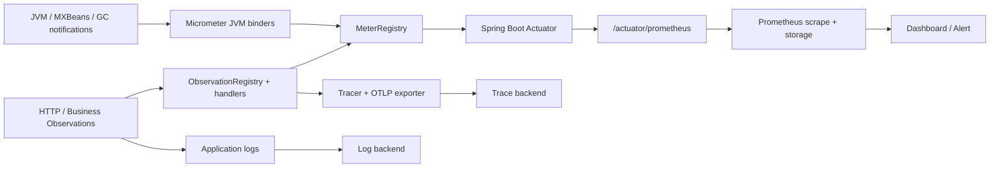
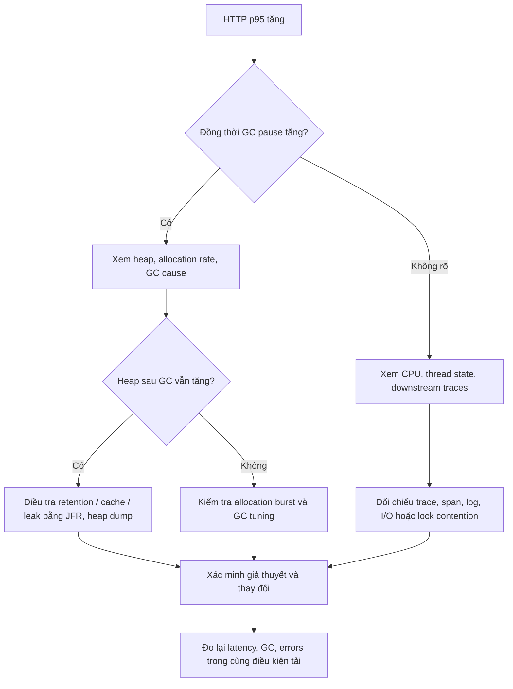

# JVM metrics trong Spring Boot: quan sát bộ nhớ, GC và luồng thực thi

Một API Spring Boot có thể trả về HTTP 200 nhưng thời gian phản hồi p95 tăng từ 120 ms lên 1,8 giây. Nhìn vào trace của một request chậm, ta có thể thấy thời gian trôi qua rất lớn mà không có lời gọi downstream tương ứng. Một giả thuyết cần kiểm tra là **JVM chịu áp lực bộ nhớ hoặc garbage collection (GC)**. Nếu chỉ có metric HTTP, việc giải thích nguyên nhân sẽ rất khó. JVM metrics cung cấp dữ liệu về heap, non-heap, garbage collector, thread, class loading và một số tài nguyên ở tầng tiến trình.

Bài học **JVM metrics** thuộc chương **Spring Boot metrics** trong module `SPRING_BOOT_OBSERVABILITY`. Mục tiêu chung là thiết lập observability cho Spring Boot bằng Micrometer Observation, metrics, logs và distributed tracing; hiểu propagation ngữ cảnh, tag/cardinality, exporter và sampling; kết hợp các tín hiệu để điều tra lỗi, độ trễ và hành vi ứng dụng trên môi trường thực. Ở đây, trọng tâm là thu thập, đọc và diễn giải JVM metrics đúng cách, rồi liên kết chúng với biểu hiện tại API.

## 1. JVM metrics trả lời câu hỏi nào?

**JVM metrics** là các phép đo trạng thái và hoạt động của máy ảo Java, thường được Micrometer thu thập qua các cơ chế quản trị của JVM như JMX/MXBeans và công bố qua một `MeterRegistry`. Khi Spring Boot Actuator được cấu hình phù hợp, nhiều meter JVM tiêu chuẩn được đăng ký tự động.

Các câu hỏi thường gặp:

- Heap đã dùng bao nhiêu, bao nhiêu vùng đã được JVM cấp phát và giới hạn hiện tại là gì?
- Sau GC, lượng heap được giữ lại có tiếp tục tăng qua thời gian không?
- GC diễn ra thường xuyên hay có những lần dừng ứng dụng quá dài?
- Số thread sống hoặc thread bị blocked có tăng đột ngột không?
- Metaspace/class loading hoặc direct buffers có tăng bất thường không?
- CPU của tiến trình có tăng cùng lúc với độ trễ request không?

JVM metrics đo **sức khỏe của runtime**, còn business metrics đo thao tác nghiệp vụ, HTTP metrics đo request, tracing mô tả một lần thực thi và logs bổ sung chi tiết lỗi. JVM metrics không thể tự xác định request hay class Java nào gây rò rỉ bộ nhớ; chúng giúp thu hẹp giả thuyết trước khi dùng heap dump, thread dump, JFR hoặc các công cụ chẩn đoán thích hợp.

| Nhóm tín hiệu | Tên meter thường gặp | Ý nghĩa khái quát |
| --- | --- | --- |
| Heap/non-heap | `jvm.memory.used`, `jvm.memory.committed`, `jvm.memory.max` | Đã dùng, đã cam kết và mức tối đa theo vùng/pool |
| GC | `jvm.gc.pause` | Số lần và thời gian các sự kiện GC pause được ghi nhận |
| Phân bổ/di chuyển bộ nhớ | `jvm.gc.memory.allocated`, `jvm.gc.memory.promoted` | Tổng byte được ước tính cấp phát hoặc đẩy lên vùng đời dài hơn, khi binder hỗ trợ |
| Kích thước vùng sống | `jvm.gc.live.data.size`, `jvm.gc.max.data.size` | Ước tính dữ liệu sống/capacity liên quan GC khi có dữ liệu |
| Thread | `jvm.threads.live`, `jvm.threads.daemon`, `jvm.threads.peak`, `jvm.threads.states` | Số thread theo trạng thái và loại |
| Class | `jvm.classes.loaded`, `jvm.classes.unloaded` | Class đang được nạp và số lần unload tích lũy |
| Buffer | `jvm.buffer.count`, `jvm.buffer.memory.used`, `jvm.buffer.total.capacity` | Các buffer pool như `direct` và `mapped` |
| Process/system liên quan | `process.cpu.usage`, `system.cpu.usage`, `process.uptime` | CPU tương đối và thời gian sống của tiến trình/hệ thống |

**Lưu ý về phiên bản:** tên meter, nhãn và sự hiện diện của từng phép đo phụ thuộc Spring Boot, Micrometer, JDK, collector, nền tảng và registry. Không mặc định mọi JVM đều xuất được đầy đủ những meter trong bảng. Hãy kiểm tra tên và tag thực tế qua Actuator hoặc exporter.

## 2. JVM metrics đi từ ứng dụng đến dashboard như thế nào?



Micrometer có nhiều *binder* dành cho thông tin JVM và hệ thống. Một binder đọc trạng thái runtime và đăng ký meter vào registry; **Actuator tạo các endpoint giúp kiểm tra hoặc công bố meter**. Prometheus cần scrape theo chu kỳ để có lịch sử; Actuator `/metrics` một mình không phải time-series database.

Khi ứng dụng có Micrometer Observation và tracing bridge, một request có thể tạo metric HTTP, span và log có correlation. Các metric JVM được lấy mẫu/ghi nhận ở cấp runtime, **không tự mang traceId của từng request**. Khi điều tra, ta liên kết chúng theo **dịch vụ, instance và mốc thời gian**, rồi dùng trace/log để tìm công việc cụ thể.

## 3. Bật JVM metrics trong Spring Boot

Ví dụ dành cho **Spring Boot 3.x với Java 17+**, dependency versions do Spring Boot parent/BOM quản lý. Phần lớn ứng dụng thêm Actuator là đã có nhiều JVM binders tiêu chuẩn. Registry Prometheus được thêm nếu cần scrape bằng Prometheus.

```xml
<dependencies>
    <dependency>
        <groupId>org.springframework.boot</groupId>
        <artifactId>spring-boot-starter-actuator</artifactId>
    </dependency>
    <dependency>
        <groupId>io.micrometer</groupId>
        <artifactId>micrometer-registry-prometheus</artifactId>
    </dependency>
</dependencies>
```

Cấu hình minh họa trong `application.yml`:

```yaml
spring:
  application:
    name: order-service

management:
  endpoints:
    web:
      exposure:
        include: health,info,metrics,prometheus
  metrics:
    tags:
      application: order-service
```

Trường `application` là **common tag** để phân biệt dịch vụ trong hệ metrics. Các nhãn như `instance`, `job`, `namespace` có thể do Prometheus hoặc hạ tầng triển khai bổ sung; không nhất thiết xuất phát từ ứng dụng.

Sau khi service chạy ở cổng 8080 theo cấu hình mặc định:

```bash
curl -s http://localhost:8080/actuator/health
curl -s http://localhost:8080/actuator/metrics
curl -s http://localhost:8080/actuator/metrics/jvm.memory.used
curl -s http://localhost:8080/actuator/metrics/jvm.gc.pause
curl -s http://localhost:8080/actuator/metrics/jvm.threads.live
curl -s http://localhost:8080/actuator/prometheus
```

Nếu `jvm.gc.pause` chưa có dữ liệu, có thể chưa xảy ra sự kiện GC phù hợp kể từ khi ứng dụng chạy. Nếu endpoint trả 404, kiểm tra dependency, exposure, base path/management port, tên meter thực tế và việc hỗ trợ từ runtime. Nếu nhận 401/403, kiểm tra chính sách truy cập.

**Bảo mật:** `management.endpoints.web.exposure.include` chỉ quyết định endpoint được công bố qua web; không tự thiết lập authentication/authorization. Chỉ cho monitoring và người vận hành được phép truy cập, dùng network policy/gateway/Spring Security tương thích. Không mở các endpoint chẩn đoán nhạy cảm như heap dump ra Internet.

## 4. Heap và non-heap: hiểu đúng used, committed, max

### 4.1. Heap khác non-heap ra sao?

**Heap** là nơi lưu trữ nhiều đối tượng Java được cấp phát khi ứng dụng chạy. GC quản lý vòng đời phần lớn các đối tượng này. **Non-heap** bao gồm một số vùng do JVM quản lý như metaspace và code cache. Ngoài ra, tiến trình Java có thể sử dụng bộ nhớ native cho thread stack, direct buffers, JIT, runtime và các thư viện native.

Vì vậy:

> **JVM heap used không đồng nghĩa tổng bộ nhớ mà container hoặc tiến trình đang chiếm.**

Một ứng dụng có heap ổn định nhưng container memory tăng vẫn có thể gặp áp lực từ direct buffers, native allocations, thread stacks hoặc thành phần ngoài heap. JVM memory metrics không phải bản kiểm kê đầy đủ RSS/cgroup memory.

### 4.2. Ý nghĩa các meter bộ nhớ

| Meter | Câu hỏi | Cách diễn giải |
| --- | --- | --- |
| `jvm.memory.used` | Bao nhiêu byte đang được sử dụng? | Giá trị hiện tại theo memory pool |
| `jvm.memory.committed` | JVM đã cam kết có thể sử dụng bao nhiêu byte? | Không có nghĩa tất cả byte đó đều được dùng |
| `jvm.memory.max` | Mức tối đa được báo bởi pool là bao nhiêu? | Có thể không xác định hoặc thay đổi theo pool/GC |

Các meter này thường có tag như `area=heap/nonheap` và `id=<memory pool>`. Ví dụ `id=G1 Eden Space` hoặc `id=Metaspace`; tên pool phụ thuộc JDK và GC.

Ví dụ một phản hồi Actuator **minh họa** cho `jvm.memory.used` có thể liệt kê:

```json
{
  "name": "jvm.memory.used",
  "baseUnit": "bytes",
  "measurements": [
    {"statistic": "VALUE", "value": 268435456}
  ],
  "availableTags": [
    {"tag": "area", "values": ["heap", "nonheap"]},
    {"tag": "id", "values": ["G1 Eden Space", "G1 Old Gen", "Metaspace"]}
  ]
}
```

Con số và danh sách pool trên chỉ để minh họa. Khi truy vấn `/actuator/metrics/jvm.memory.used` mà **không lọc tag**, endpoint có thể tổng hợp nhiều meter cùng tên; nó không nhất thiết đại diện riêng cho heap.

Lọc cho đúng vùng:

```bash
curl -G 'http://localhost:8080/actuator/metrics/jvm.memory.used' \
  --data-urlencode 'tag=area:heap'

curl -G 'http://localhost:8080/actuator/metrics/jvm.memory.used' \
  --data-urlencode 'tag=area:nonheap'
```

### 4.3. Đọc tỷ lệ heap như thế nào?

Một biểu đồ hữu ích là tổng `jvm.memory.used` với `area=heap` theo từng instance. Có thể so sánh với committed heap để thấy mức sử dụng phần bộ nhớ đã cam kết:

\[
\text{Tỷ lệ so với committed heap}
=\frac{\text{heap used}}{\text{heap committed}}\times100\%.
\]

Tuy nhiên đây **không phải** tỷ lệ sử dụng so với toàn bộ heap limit cấu hình `-Xmx`. Các pool có thể có max không xác định (thường biểu diễn bằng giá trị âm trong API JVM hoặc không có metric hợp lệ), và việc cộng trực tiếp tất cả `jvm.memory.max` theo pool không luôn cho một giá trị giới hạn heap đáng tin cậy. Khi cần so với heap limit thực, xác minh flag JVM và cgroup/container limit của phiên bản runtime đang chạy.

Heap sau GC tăng dần **có thể** gợi ý bộ nhớ được giữ lại ngày càng nhiều; nó chưa đủ để kết luận memory leak. Bộ nhớ cache đang ấm lên, lịch tải khác, collector thay đổi hành vi hoặc peak traffic đều có thể giải thích xu hướng đó.

## 5. GC metrics: tần suất, thời gian dừng và lượng dữ liệu sống

Garbage collector thu hồi bộ nhớ của các đối tượng không còn được sử dụng. GC có thể tạo ra những khoảng dừng (*pause*) và chi phí CPU; tùy collector, nhiều hoạt động còn diễn ra đồng thời với ứng dụng. JVM metrics giúp quan sát tác động tổng thể, nhưng từng tên metric và thông tin cung cấp phụ thuộc JDK/collector.

### 5.1. `jvm.gc.pause` là Timer

`jvm.gc.pause` thường được Micrometer ghi bằng `Timer`. Dữ liệu quan trọng là:

- **Count:** số lần quan sát pause.
- **Total time:** tổng thời gian các pause được ghi nhận.
- **Maximum hoặc histogram:** thông tin về pause lớn hoặc phân bố, khi cấu hình và backend hỗ trợ.
- **Tags:** có thể gồm `gc`, `action`, `cause` theo thông tin mà JVM cung cấp.

Không được đọc một mẫu tổng thời gian của `jvm.gc.pause` như thời gian của **lần GC gần nhất**. Count và tổng thời gian là dữ liệu tích lũy trong phạm vi meter; muốn biết tốc độ hoặc thời gian trung bình trong một cửa sổ, cần so sánh giá trị qua thời gian tại backend.

Ví dụ kết quả minh họa cho một instance:

| Khoảng thời gian | GC pause count tăng | Tổng thời gian pause tăng | Thời gian trung bình mỗi pause |
| --- | ---: | ---: | ---: |
| 5 phút trước | 20 | 0,6 s | 30 ms |
| 5 phút sau | 60 | 6 s | 100 ms |

Trong khoảng thứ hai, ứng dụng có nhiều pause hơn và pause trung bình dài hơn. Dữ liệu này đáng đối chiếu với p95 HTTP latency, request throughput và CPU. Nó không chứng minh mọi request chậm đều do GC; cần xem thời điểm và bằng chứng bổ sung.

### 5.2. Allocation, promotion và live data

| Meter thường gặp | Ý nghĩa | Giới hạn cần biết |
| --- | --- | --- |
| `jvm.gc.memory.allocated` | Tổng byte được ước tính cấp phát ở những vùng được theo dõi | Không tương đương phép đếm chính xác mọi allocation của từng thread |
| `jvm.gc.memory.promoted` | Tổng byte được ước tính di chuyển vào vùng sống lâu hơn | Phụ thuộc thông tin GC, không phải mọi collector đều giống nhau |
| `jvm.gc.live.data.size` | Kích thước dữ liệu sống được ước tính sau các chu kỳ thích hợp | Có thể cập nhật theo sự kiện GC và không phải số đo tức thời liên tục |
| `jvm.gc.max.data.size` | Giá trị capacity liên quan vùng dữ liệu sống/old generation | Có thể không có hoặc không cố định |

Allocation rate tăng khi request traffic tăng thường là điều tự nhiên. Nhưng nếu allocation rate tăng mạnh trong khi throughput tương đương, có thể đã xuất hiện thêm đối tượng trung gian, serialization hoặc thao tác tạo dữ liệu tạm thời. Promotion tăng lâu dài có thể đáng điều tra khi kết hợp với old-generation occupancy và GC pause.

### 5.3. GC metrics không trả lời hết mọi câu hỏi

- Một pause lớn không nhất thiết làm tất cả request chậm; phải đối chiếu khoảng thời gian.
- Pause duration phụ thuộc collector và loại sự kiện; một số concurrent work không thể suy ra trực tiếp từ timer pause.
- GC metrics không chỉ ra chính xác object graph đang giữ bộ nhớ. Khi cần có thể dùng Java Flight Recorder (JFR), heap dump hoặc profiler trong điều kiện vận hành an toàn.
- Thay đổi GC algorithm hoặc JDK có thể làm tag `gc`, tên memory pool, nhịp cập nhật và phân bố khác đi. So sánh trước/sau cần lưu thông tin version và cấu hình.

## 6. Thread metrics: khi request chờ thay vì làm việc

Một ứng dụng có thể chậm ngay cả khi CPU thấp: nhiều thread đang chờ lock, I/O hoặc hết connection pool. JVM thread metrics giúp phân biệt một vài biểu hiện:

| Meter | Cách đọc |
| --- | --- |
| `jvm.threads.live` | Số thread còn sống |
| `jvm.threads.daemon` | Số daemon thread |
| `jvm.threads.peak` | Đỉnh số thread JVM từng quan sát được |
| `jvm.threads.states` | Số thread theo trạng thái `RUNNABLE`, `BLOCKED`, `WAITING`, `TIMED_WAITING`, ... |

Ví dụ `jvm.threads.states{state="blocked"}` tăng trong lúc latency tăng có thể là dấu hiệu tranh chấp monitor/lock. Nhưng cần kiểm tra thread dump hoặc JFR để xác định lock cụ thể. `WAITING` không mặc nhiên là lỗi: nhiều thread pool thường chủ động chờ công việc và vẫn hoạt động bình thường.

**Đừng gắn thread name hoặc request ID vào metric tag** để theo dõi từng thread. Số thread hoặc tên thread động có thể làm cardinality tăng nhanh. Khi cần điều tra một thread cụ thể, dùng thread dump/profiler và log với ngữ cảnh phù hợp.

Với Spring MVC/Servlet, số thread HTTP worker còn phụ thuộc vào server container và cấu hình executor. JVM thread count tăng chưa chứng minh riêng HTTP worker bị leak; có thể do scheduler, HTTP client, executor nghiệp vụ hoặc thư viện khác.

## 7. Class, buffer pool và CPU: bộ nhớ ngoài heap cũng quan trọng

### 7.1. Class loading và metaspace

`jvm.classes.loaded` phản ánh số class hiện đang được nạp. `jvm.classes.unloaded` thường phản ánh số class được unload tích lũy. Metaspace có thể thấy qua `jvm.memory.used{area="nonheap",id="Metaspace"}` hoặc giá trị tương ứng với tên pool của JDK.

Class count tăng trong quá trình warm-up có thể bình thường. Nếu tiếp tục tăng sau nhiều lần triển khai lại class loader trong cùng tiến trình, hoặc tăng cùng non-heap memory, hãy kiểm tra class loader retention và hành vi tạo proxy/dynamic class. Đây là **giả thuyết**, không phải chẩn đoán chắc chắn chỉ từ hai metric.

### 7.2. Direct và mapped buffers

Các meter `jvm.buffer.memory.used`, `jvm.buffer.total.capacity` và `jvm.buffer.count` có thể có tag `id=direct` hoặc `id=mapped`. Chúng hữu ích cho ứng dụng NIO, networking, file mapping và thư viện dùng direct buffers.

Buffer metrics không bao phủ toàn bộ native memory. Container bị OOMKill khi heap used không cao có thể liên quan memory ngoài heap, nhưng cần đối chiếu cả cgroup/container metrics, thread stacks, thư viện native và cấu hình JVM trước khi kết luận.

### 7.3. CPU và tiến trình

`process.cpu.usage` và `system.cpu.usage` thường biểu diễn tỷ lệ sử dụng trong một khoảng quan sát, nhưng cách lấy mẫu và ý nghĩa chính xác phụ thuộc runtime/platform. `process.cpu.usage` không phải “số giây CPU” để cộng trực tiếp và không nhất thiết có cùng mẫu số với percent CPU trong `top` hay dashboard Kubernetes.

`process.uptime` giúp nhận diện ứng dụng vừa restart, nhưng metric này không thay thế dữ liệu về container restart count, OOMKill và CPU throttling. Trên Kubernetes, dùng thêm chỉ số container/cgroup để biết việc bị giới hạn CPU hoặc memory. CPU cao cùng allocation rate cao có thể gợi ý GC hoặc xử lý nhiều đối tượng; CPU thấp cùng nhiều thread blocked gợi ý kiểu nghẽn khác.

## 8. Nhãn và cardinality của JVM metrics

JVM metrics thường đã có các chiều hữu hạn do binder định nghĩa, chẳng hạn:

| Nhóm | Tag hay gặp | Số giá trị |
| --- | --- | --- |
| Memory | `area=heap/nonheap`, `id=<pool>` | Ít, phụ thuộc JVM/GC |
| GC pause | `gc`, `action`, `cause` | Phụ thuộc collector, thường có tập giá trị giới hạn |
| Threads | `state` | Các trạng thái thread của JVM |
| Buffer | `id=direct/mapped` | Tập hữu hạn |
| Hạ tầng | `application`, `instance`, `pod` | Tăng theo số instance/pod triển khai |

Mỗi tổ hợp tên metric và bộ tag tạo ra các time series riêng ở hệ backend. Nếu có nhiều instance, nhiều JDK/GC pools và nhiều bucket histogram, số series tăng theo các chiều đó. Do đó, dù các tag JVM thông dụng có cardinality thấp, vẫn cần xem tổng số series theo quy mô triển khai.

Không nên dùng tag `userId`, `requestId`, `traceId`, thread ID hoặc raw exception message trên metrics JVM. Chúng không giúp phân tích runtime theo nhóm mà có thể làm tăng chi phí. Trace ID và ID theo request phù hợp hơn với hệ tracing/logging có retention và quyền truy cập riêng.

**Thay GC hoặc JDK** có thể thay tên memory pool `id`. Nếu dashboard lọc cứng `id="G1 Old Gen"`, biểu đồ có thể biến mất khi service chuyển sang collector khác. Ưu tiên truy vấn theo `area=heap` để tổng quan và chỉ lọc pool cụ thể khi có nhu cầu rõ ràng.

## 9. Truy vấn JVM metrics trong Prometheus

Các ví dụ dưới đây giả định Spring Boot sử dụng Micrometer Prometheus registry và một hệ Prometheus scrape dịch vụ. Tên xuất thường đổi dấu chấm thành dấu gạch dưới và bổ sung hậu tố đơn vị, ví dụ `jvm.memory.used` thành `jvm_memory_used_bytes`. **Hãy xác minh tên series trên `/actuator/prometheus` của phiên bản đang chạy** trước khi sao chép PromQL.

Các biểu thức giả định common label `application="order-service"` và Prometheus có label `instance` cho target. Để điều tra một pod cụ thể, giữ phân nhóm theo instance thay vì cộng gộp mọi pod.

### 9.1. Heap đang dùng (byte), theo instance

```promql
sum by (application, instance) (
  jvm_memory_used_bytes{
    application="order-service", area="heap"
  }
)
```

Biểu thức cộng các pool heap để có mức used tổng quan theo instance. Dữ liệu pool được backend thu thập tại những thời điểm scrape gần nhau, nhưng không nên coi đây là ảnh chụp atomic hoàn hảo của mọi pool.

### 9.2. Tỷ lệ sử dụng so với committed heap

```promql
100 *
sum by (application, instance) (
  jvm_memory_used_bytes{
    application="order-service", area="heap"
  }
)
/
sum by (application, instance) (
  jvm_memory_committed_bytes{
    application="order-service", area="heap"
  }
)
```

Biểu thức phản ánh tỷ lệ **used/committed**, không phải used/`-Xmx`. Mẫu số cần dương và đầy đủ dữ liệu; nếu thiếu meter hoặc xảy ra thay đổi pool, biểu đồ phải được diễn giải thận trọng. Một tỷ lệ lớn ngắn hạn trước GC có thể bình thường, tùy workload và GC algorithm.

### 9.3. Số GC pause mỗi giây

```promql
sum by (application, instance) (
  rate(jvm_gc_pause_seconds_count{
    application="order-service"
  }[5m])
)
```

Đơn vị kết quả là **lần pause/giây** trong cửa sổ 5 phút. Muốn ra **lần/phút**, nhân với 60 ở lớp truy vấn hoặc hiển thị.

### 9.4. Thời lượng GC pause trung bình

```promql
sum by (application, instance) (
  rate(jvm_gc_pause_seconds_sum{
    application="order-service"
  }[5m])
)
/
sum by (application, instance) (
  rate(jvm_gc_pause_seconds_count{
    application="order-service"
  }[5m])
)
```

Giá trị trả về là **giây/pause**, tức duration trung bình của các pause được ghi nhận trong cửa sổ 5 phút. Với lưu lượng GC quá thấp, mẫu số có thể gần 0 hoặc không có dữ liệu; đừng vẽ một con số trung bình đáng tin khi chưa có đủ mẫu.

### 9.5. Allocation rate và thread blocked

Nếu có series `jvm_gc_memory_allocated_bytes_total`:

```promql
sum by (application, instance) (
  rate(jvm_gc_memory_allocated_bytes_total{
    application="order-service"
  }[5m])
)
```

Kết quả có đơn vị **byte/giây** theo định nghĩa meter và cơ chế lấy mẫu của binder. Số liệu này là ước tính theo sự kiện mà Micrometer/JVM hỗ trợ, không phải profiler allocation chính xác theo phương thức Java.

Với số thread đang ở trạng thái `BLOCKED`:

```promql
sum by (application, instance) (
  jvm_threads_states_threads{
    application="order-service", state="blocked"
  }
)
```

Tên xuất của `jvm.threads.states` có thể bao gồm hậu tố đơn vị `_threads` như ví dụ, tùy naming convention. Kiểm tra thực tế trước khi dùng làm alert. Tăng blocked threads chỉ là dấu hiệu điều tra thêm bằng thread dump/JFR.

### 9.6. p95 thời gian GC pause

Nếu đã cấu hình **histogram phù hợp** cho Timer `jvm.gc.pause` và exporter thực sự có bucket `jvm_gc_pause_seconds_bucket`:

```promql
histogram_quantile(
  0.95,
  sum by (le, application, instance) (
    rate(jvm_gc_pause_seconds_bucket{
      application="order-service"
    }[5m])
  )
)
```

Không thể lấy p95 chỉ từ series `_count` và `_sum`. Histogram phải được cấu hình đúng trong MeterRegistry/Actuator và có đủ samples; số bucket bổ sung nhiều series và chi phí. Trước khi bật cho toàn hệ thống, kiểm tra tác động lên số series của metrics GC theo tags hiện có.

## 10. Ghép JVM metrics với HTTP metrics, logs và distributed tracing

Một sự cố thực tế: sau triển khai, p95 của `POST /orders` tăng, trong khi lỗi HTTP 5xx chưa tăng rõ. Cách điều tra hợp lý:



| Bước | Tín hiệu | Câu hỏi kiểm tra |
| --- | --- | --- |
| 1. Xác định tác động | HTTP server metrics theo route/status | Chậm trên route nào? Độ trễ và traffic biến động thế nào? |
| 2. So thời gian | `jvm.gc.pause`, allocation/heap | Pause tăng cùng lúc với p95 hay ở thời điểm khác? |
| 3. Xem footprint | Heap, non-heap, buffer, container memory | Áp lực ở heap hay ngoài heap? Có gần cgroup limit không? |
| 4. Kiểm tra cạnh tranh | Thread states, CPU, connection pool metrics | Có blocked thread, nghẽn CPU hoặc cạn pool không? |
| 5. Truy một request | Distributed trace và span | Đoạn chậm là local processing, downstream call hay khoảng chờ không rõ? |
| 6. Tìm bằng chứng lỗi | Logs có traceId/spanId và GC/JVM log khi cấu hình | Có timeout, OOM, safepoint, exception hay lỗi của đối tác không? |
| 7. Xác minh sau sửa | Các metrics trên cùng biểu đồ thời gian | Độ trễ, GC và tỷ lệ lỗi có cải thiện bền vững không? |

**Tương quan không đủ chứng minh nhân quả.** Nếu GC pause tăng đúng lúc p95 tăng, đây là giả thuyết mạnh hơn, nhưng có thể cả hai cùng do một nguyên nhân thứ ba như traffic burst. Cần xem GC log, JFR, heap allocation và chi tiết trace để xác định.

### Vì sao trace có thể không hiển thị tác động của JVM một cách trực tiếp?

Span thường thể hiện tổng thời gian hoạt động, nhưng không nhất thiết gắn nhãn “GC đã dừng 80 ms” cho từng request. Một span dài không có child span kéo dài có thể do lock contention, queueing, CPU scheduling, GC hoặc logic nội bộ. JVM metrics theo instance và mốc thời gian giúp thu hẹp nguyên nhân, còn JFR/GC logs có thể cung cấp bằng chứng ở mức runtime.

Tracing bridge, exporter và context propagation quyết định span qua HTTP/message/thread có liên kết đúng không. Sampling chỉ giữ một phần trace; request lỗi không có trace lưu ở backend vẫn có thể xuất hiện trong HTTP/JVM metrics. JVM metrics không phụ thuộc xác suất trace sampling theo cùng cách, nên có thể là nguồn dữ liệu hữu ích ngay cả khi trace của sự cố hiếm bị loại.

### Liên kết logs với metrics JVM

Application logs có thể chứa `traceId`, `spanId` khi tracing + MDC được cấu hình đúng. GC logs/JFR thường dùng kênh chẩn đoán riêng và không tự có trace ID của request. Khi kết hợp, hãy đối chiếu **service, instance, container, timezone và timestamp**; lưu ý đồng bộ đồng hồ khi dữ liệu đến từ nhiều máy.

## 11. Các hiểu lầm và lỗi cấu hình phổ biến

| Nhận định/lỗi | Vì sao chưa chính xác | Cách xử lý |
| --- | --- | --- |
| “Heap used tăng tức chắc chắn memory leak” | Heap có thể tăng theo cache, tải hoặc chu kỳ GC | Theo dõi sau GC và so sánh workload; kiểm tra JFR/heap dump nếu cần |
| “Heap used thấp nên container không thể OOMKill” | Native/off-heap, thread stacks và cgroup còn tiêu thụ memory | Kết hợp container memory, buffer metrics và JVM flags |
| “`used/committed` = mức sử dụng `-Xmx`” | Committed có thể khác giới hạn heap tối đa | Xác định metric giới hạn thực và cấu hình JVM/cgroup |
| “Mọi JVM đều có đủ `jvm.gc.memory.allocated`” | Phụ thuộc JDK/GC/binder | Kiểm tra meter thực tế |
| “GC pause tổng 3 s nghĩa một lần pause 3 s” | Tổng thời gian là tích lũy qua nhiều sự kiện | Dùng count, rate và histogram nếu cần phân bố |
| “Thread `WAITING` nghĩa deadlock” | Thread pool nhàn rỗi thường ở WAITING | Dùng thread dump để kiểm tra |
| “CPU process bằng CPU throttling của container” | Chỉ số khác phạm vi và đơn vị | Kết hợp metrics container/cgroup |
| “Không thấy trace nghĩa JVM không gây latency” | Trace có thể bị sampling loại hoặc exporter lỗi | Dùng JVM/HTTP metrics và GC/JFR để điều tra |
| “Cứ bật mọi histogram là tốt” | Histogram làm tăng số series | Bật cho meter cần SLO/p95 rõ ràng |
| “Tag thread ID, request ID giúp debug JVM metrics” | Tạo cardinality cao, khó tổng hợp | Dùng logs/traces/dump cho từng request/thread |

### Khi dashboard đột nhiên mất JVM series

Kiểm tra service còn sống không, Prometheus scrape có thành công không, endpoint có bị đổi cổng/path hay security policy không. Sau đó xác minh app có meter qua `/actuator/metrics`, rồi kiểm tra tên xuất tại `/actuator/prometheus`. Nếu vừa nâng JDK hoặc đổi GC, tên pool và một số tag có thể thay đổi; nếu vừa nâng Micrometer, naming convention cũng có thể khác. Không khắc phục bằng cách tự tạo hàng loạt metric trùng tên mặc định khi chưa xác định nguyên nhân.

## 12. Thực hành: quan sát JVM dưới tải có kiểm soát

Tạo một ứng dụng Spring Boot có Actuator và một endpoint nghiệp vụ để gửi request. Thực hiện các bước sau trong **môi trường thử nghiệm**, không tạo áp lực bộ nhớ cố ý trên production:

1. **Khởi động ứng dụng** và ghi lại JDK, GC algorithm, heap flags, cgroup memory limit (nếu chạy trong container) và phiên bản Spring Boot/Micrometer.
2. **Khám phá meter:** gọi `/actuator/metrics` rồi chọn `jvm.memory.used`, `jvm.memory.committed`, `jvm.gc.pause`, `jvm.threads.states` và buffer/class metrics nếu có.
3. **Lọc heap/non-heap:** dùng query param `tag=area:heap` hoặc `tag=area:nonheap` để phân biệt vùng. Ghi nhận giá trị theo nhiều thời điểm để thấy sự thay đổi.
4. **Tạo tải vừa phải:** gửi một tập request có số lượng và tốc độ giới hạn, hoặc chạy một bài test allocation có kiểm soát. Quan sát heap used, GC count và pause cùng lúc với HTTP latency.
5. **Bật Prometheus scrape:** xác minh `jvm_memory_used_bytes`, `jvm_gc_pause_seconds_count` và các series thực tế khác. Viết PromQL cho heap used, GC pause rate, GC pause trung bình và thread blocked.
6. **Thử suy luận:** nếu p95 HTTP tăng, kiểm tra GC pause, heap và CPU trước khi quyết định nguyên nhân. Nếu chúng bình thường, chuyển sang traces, thread state, pool metrics hoặc downstream latency.
7. **Kiểm tra propagation:** với tracing đã cấu hình, gửi request qua hai service và xác minh log/trace correlation; giải thích vì sao JVM metrics chỉ liên kết với request gián tiếp qua instance và thời gian.
8. **Rà soát vận hành:** hạn chế quyền truy cập management endpoint, kiểm soát cardinality, số histogram buckets, retention và alert; so sánh dữ liệu sau thay đổi với baseline cùng điều kiện tải.

### Câu hỏi tự kiểm tra

1. `jvm.memory.used`, `committed` và `max` khác nhau thế nào? Vì sao không thể cộng mọi pool max để luôn suy ra `-Xmx`?
2. Vì sao heap used thấp không loại trừ container bị OOMKill?
3. Khi `jvm.gc.pause` tăng, cần dùng count, sum và histogram như thế nào để tách tần suất, trung bình và p95?
4. `jvm.threads.states{state="blocked"}` tăng có đủ kết luận deadlock không?
5. Nếu một request chậm không có trace trên backend, JVM metrics và GC logs vẫn hỗ trợ điều tra bằng cách nào?
6. Khi đổi GC từ G1 sang collector khác, tại sao dashboard lọc theo tên memory pool có thể ngừng hoạt động?

## 13. Checklist vận hành JVM metrics

- Bật các binder JVM cần thiết qua Actuator và xác minh meter thực sự có trên runtime.
- Gắn nhãn dịch vụ/instance nhất quán để có thể đối chiếu dữ liệu của đúng tiến trình.
- Phân biệt heap, non-heap và container memory; kiểm tra giới hạn JVM/cgroup.
- Diễn giải `used`, `committed`, `max` theo ngữ nghĩa từng pool.
- Đánh giá GC qua tần suất, tổng thời gian, duration trung bình và phân bố khi có histogram.
- Xem xu hướng allocation và live data cùng traffic; đừng chẩn đoán leak từ một gauge duy nhất.
- Kết hợp thread state, CPU, connection pool và thread dump khi điều tra nghẽn.
- Không thêm ID có cardinality cao vào metrics JVM.
- Xác minh exporter/scrape, đơn vị, label và biến động sau thay đổi JDK/GC.
- Đọc JVM metrics cùng HTTP/business metrics, traces, logs và GC/JFR khi cần chứng minh nguyên nhân.
- Bảo vệ management endpoints và cân nhắc chi phí histogram, retention, số lượng instance.

## Kết luận

**JVM metrics** giúp hiểu trạng thái runtime phía sau những con số độ trễ và lỗi của một ứng dụng Spring Boot. Micrometer/Actuator cung cấp các meter về heap, GC, thread, class, buffer và một số tài nguyên liên quan; Prometheus hoặc backend khác lưu lịch sử để so sánh và cảnh báo. Muốn dùng dữ liệu chính xác, cần hiểu đơn vị và phạm vi từng metric, đặc điểm collector/JDK, tag/cardinality và giới hạn của các phép đo. Khi kết hợp JVM metrics với HTTP/business observations, distributed tracing, logs, context propagation, exporter và sampling đúng cách, đội vận hành có thể phân biệt áp lực bộ nhớ, GC, tranh chấp thread và lỗi downstream để điều tra sự cố production có bằng chứng.
