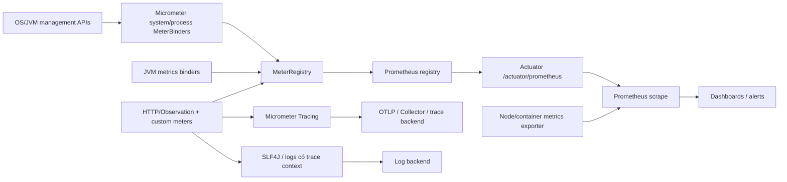
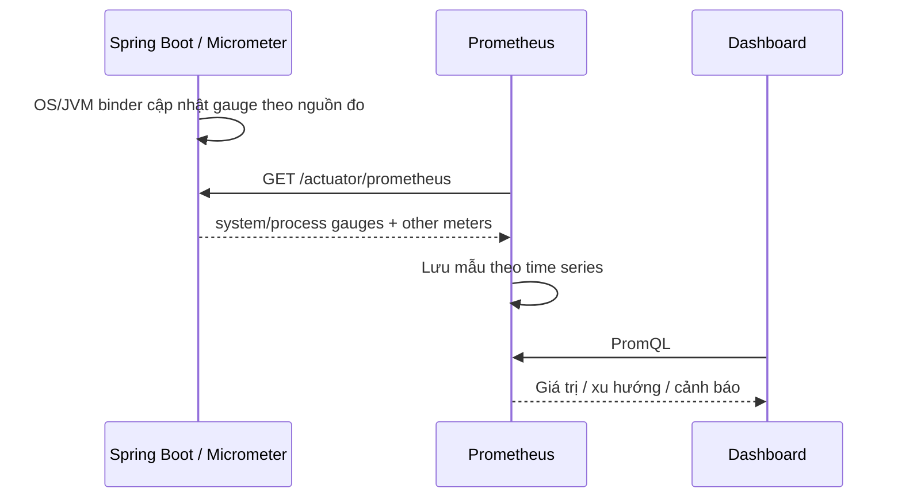
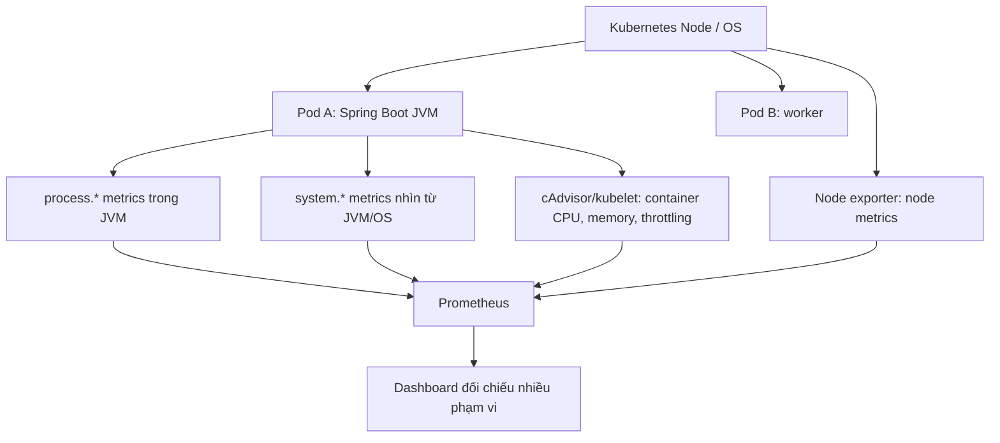

# System metrics trong Spring Boot: CPU, load, uptime, disk và file descriptors

> **Chương:** Spring Boot metrics  
> **Module:** `SPRING_BOOT_OBSERVABILITY` — Thiết lập observability cho Spring Boot bằng Micrometer Observation, metrics, logs và distributed tracing. Học propagation ngữ cảnh, tag/cardinality, exporter, sampling và liên kết tín hiệu để điều tra lỗi, độ trễ và hành vi ứng dụng trên môi trường thực.  
> **Phạm vi bài:** Hiểu, thu thập, đọc và diễn giải **system metrics** được Micrometer/Spring Boot cung cấp; xác định ranh giới quan sát giữa process, máy chủ và container; dùng những số liệu này để kiểm tra tài nguyên cùng độ trễ, tỷ lệ lỗi và dấu vết request.

## Mục tiêu học tập

Sau bài này, bạn có thể:

1. Phân biệt system metrics, process metrics, JVM metrics, application metrics và infrastructure metrics; xác định **thực thể nào thực sự được đo**.
2. Giải thích ý nghĩa, đơn vị và giới hạn của những meter như `system.cpu.usage`, `process.cpu.usage`, `system.cpu.count`, `system.load.average.1m`, `process.uptime`, `process.start.time`, `disk.free`, `disk.total` và metrics file descriptor khi hệ điều hành hỗ trợ.
3. Bật Spring Boot Actuator và Micrometer Prometheus registry, kiểm tra meter qua `/actuator/metrics` và `/actuator/prometheus`.
4. Viết PromQL đúng cho **Gauge**: đo mức hiện tại, trung bình hoặc đỉnh trong cửa sổ thời gian; tránh dùng `rate()` như với Counter khi không phù hợp.
5. Hiểu sự khác nhau giữa CPU được báo trong process/JVM và CPU hoặc bộ nhớ ở mức host/container/Kubernetes; biết khi nào phải bổ sung metrics từ cAdvisor, kubelet, node exporter hoặc cloud monitoring.
6. Xây dashboard và cảnh báo tài nguyên có ngữ cảnh, tránh hiểu nhầm load average, giá trị thiếu/`NaN`, disk paths và các đợt restart.
7. Kết hợp system metrics với request latency, errors, traces và logs để phân biệt nghẽn CPU, disk, dependency, thread pool hay tài nguyên container.

## 1. System metrics trả lời câu hỏi nào?

Khi người dùng báo API chậm, một câu hỏi đầu tiên là: **ứng dụng có đang thiếu tài nguyên tính toán hoặc tài nguyên hệ thống không?** System metrics cung cấp một phần bằng chứng trả lời câu hỏi này.

Ví dụ, checkout service xử lý chậm sau khi tăng traffic. Ta muốn xác minh:

- CPU của process Java có tăng cùng thời điểm p95 latency tăng hay không?
- Máy đang chạy process có bị tải cao trên nhiều lõi CPU không?
- Ứng dụng vừa restart, khiến cache còn lạnh hoặc số kết nối đang được tạo lại?
- Ổ đĩa nơi process ghi dữ liệu/log còn dung lượng không?
- Số file descriptors/socket đang mở có tiến gần giới hạn của process không?
- Nếu chạy trong container, số liệu nhìn thấy thực sự phản ánh container hay cả node?

System metrics là **tín hiệu bối cảnh và mức tài nguyên**, không tự giải thích nguyên nhân nghiệp vụ. CPU cao có thể đến từ xử lý JSON, GC, mã hóa, thuật toán tốn CPU hoặc nhiều hoạt động đồng thời. CPU thấp nhưng latency cao có thể do chờ database, mạng, lock, queue hoặc tài nguyên bị giới hạn ở tầng khác.

### 1.1. Cần xác định đúng phạm vi đo

| Nhóm | Ví dụ | Đối tượng được đo | Giải đáp tốt |
|---|---|---|---|
| **System/OS** | `system.cpu.usage`, `system.load.average.1m` | Hệ điều hành hoặc phạm vi mà JVM/OS API nhìn thấy | Hệ thống đang tải CPU ra sao? |
| **Process** | `process.cpu.usage`, `process.uptime`, `process.files.open` | Tiến trình ứng dụng Java hiện tại | Process tiêu thụ CPU, sống bao lâu, mở bao nhiêu descriptors? |
| **JVM** | `jvm.memory.used`, `jvm.gc.pause`, `jvm.threads.live` | JVM và các thành phần runtime | Heap, GC, threads có tạo áp lực không? |
| **Application** | `http.server.requests`, custom Timer/Counter | Request hoặc bước nghiệp vụ | Endpoint nào chậm, lỗi hoặc được gọi nhiều? |
| **Container/node** | CPU usage/throttling, memory working set, OOM events, node disk | Cgroup/container, pod hoặc node | Container bị quota CPU, memory limit hoặc node pressure không? |

**System metrics trong JVM không đồng nghĩa với container metrics.** Một meter hệ thống có thể dựa vào OS management bean và phản ánh host, trong khi pod có CPU quota riêng. Trên Java hiện đại, một số giá trị được điều chỉnh theo container, nhưng hành vi cụ thể thay đổi theo JDK, OS, runtime và cách triển khai. Với Kubernetes, luôn đối chiếu với nguồn cấp độ container/node trước khi kết luận về quota hoặc throttling.

## 2. Luồng thu thập system metrics trong Spring Boot

Micrometer cung cấp các **meter binders** thu thập thông tin từ JVM và OS. Spring Boot Actuator có auto-configuration để gắn các binders thích hợp vào `MeterRegistry` khi đủ dependency và điều kiện môi trường.



Trong mô hình **Prometheus pull**, ứng dụng expose metrics; Prometheus định kỳ scrape endpoint. Traces thường được gửi qua exporter/Collector; logs thường đi qua stdout/log collector. Những đường này có thể được xem chung trên dashboard nhưng **system gauges không tự chứa trace ID**.

### 2.1. Các thành phần cần phân biệt

- `MeterRegistry` là registry nhận và quản lý các meter như Gauge, Counter và Timer. System binders đăng ký meter ở đây.
- `ObservationRegistry` quản lý vòng đời và handlers của `Observation`. Khi có meter/tracing handlers, Observation có thể sinh Timer hoặc span; **không cần tạo một Observation cho CPU mỗi lần đọc CPU**.
- `Gauge` phản ánh giá trị đo tại thời điểm lấy mẫu. Nhiều system/process metrics là Gauge.
- `Counter` phản ánh đại lượng tích lũy chỉ tăng, thường dùng `rate()`/`increase()` với Prometheus.
- Collector/exporter/remote-write và dashboards là các phần tiếp theo của đường dữ liệu; lỗi scrape có thể khiến dữ liệu mất dù binder trong JVM vẫn hoạt động.

### 2.2. Những gì Spring Boot cung cấp tự động

Trong một ứng dụng Spring Boot 3.x thông dụng, `spring-boot-starter-actuator` đưa vào Micrometer và cấu hình các meter binders có sẵn. Một số số liệu phụ thuộc hỗ trợ OS hoặc quyền truy cập và có thể không xuất hiện trên mọi platform. Nếu dùng Spring Boot 4 hoặc phiên bản khác, hãy xác minh các starter, property và tên meter theo chính tài liệu của version đó.

**Không nên tự đăng ký `new ProcessorMetrics().bindTo(...)` trong ứng dụng đã được Actuator cấu hình**, trừ khi đã biết chính xác vì sao binder mặc định không đáp ứng. Gắn binder lặp có thể gây meter trùng/khó chẩn đoán, dù registry thường hợp nhất các meter cùng ID.

## 3. Danh mục system và process metrics quan trọng

Micrometer dùng tên dấu chấm ở tầng Java; Prometheus có thể chuẩn hóa dấu chấm thành dấu gạch dưới và thêm suffix đơn vị. Bảng dưới ghi tên **Micrometer** phổ biến, không khẳng định mọi tên đều có mặt trên mọi máy.

| Meter Micrometer | Loại thường gặp | Ý nghĩa và đơn vị | Cần chú ý |
|---|---|---|---|
| `system.cpu.usage` | Gauge | Mức sử dụng CPU hệ thống, thường là tỷ lệ trong khoảng 0–1 | Phạm vi host/container tùy OS/JDK; không tự bằng mức dùng quota của pod |
| `process.cpu.usage` | Gauge | Mức sử dụng CPU của process Java theo cách API nền tảng chuẩn hóa, thường trong khoảng 0–1 | Không lấy trực tiếp làm “millicores” của Kubernetes nếu chưa xác minh semantics |
| `system.cpu.count` | Gauge | Số processor khả dụng mà JVM/binder nhìn thấy | Có thể chịu ảnh hưởng bởi container-aware JVM và giới hạn CPU |
| `system.load.average.1m` | Gauge, tùy platform | Load average khoảng một phút, **không phải phần trăm CPU** | Chủ yếu có ý nghĩa trên hệ điều hành hỗ trợ; có thể thiếu/không hợp lệ |
| `process.uptime` | Gauge | Số giây process Java đã chạy | Thường về gần 0 khi process restart |
| `process.start.time` | Gauge | Thời điểm process bắt đầu, thường dưới dạng giây Unix epoch | Hữu ích để đối chiếu restart; không phải duration |
| `disk.free` | Gauge | Dung lượng còn trống tại filesystem/path được bind, đơn vị bytes | Có thể thiếu tùy cấu hình; không suy ra dung lượng của **mọi** ổ đĩa |
| `disk.total` | Gauge | Tổng dung lượng filesystem/path tương ứng, bytes | So sánh với `disk.free` **cùng path** |
| `process.files.open` | Gauge, tùy platform | Số file descriptors đang mở | Thường chỉ có trên OS cung cấp hỗ trợ kiểu Unix |
| `process.files.max` | Gauge, tùy platform | Giới hạn số file descriptors của process | Có thể phụ thuộc OS/user limits/container |

Một số tên có thể được xuất Prometheus ở dạng `system_cpu_usage`, `process_cpu_usage`, `system_cpu_count`, `process_uptime_seconds`, `disk_free_bytes`, `disk_total_bytes`. **Không sao chép nguyên những tên này vào dashboard khi chưa kiểm tra `/actuator/prometheus`**, vì version, base unit, naming convention và exporter có thể khác nhau.

Ngoài danh sách này, dashboard production thường cần `jvm.memory.used`, `jvm.gc.pause`, `jvm.threads.live` cùng HTTP server metrics, connection pool metrics và số liệu container/host từ hệ thống hạ tầng.

## 4. CPU usage: đọc đúng phần trăm

### 4.1. `system.cpu.usage` và `process.cpu.usage` khác nhau thế nào?

`system.cpu.usage` mô tả mức CPU được API hệ thống báo là đang sử dụng. `process.cpu.usage` đo mức CPU quy cho tiến trình Java. Những giá trị này thường được biểu diễn bằng **tỷ lệ**:

- `0.25` tương ứng khoảng 25% theo mẫu số mà binder/OS API sử dụng.
- `0.80` tương ứng khoảng 80%.
- `1.00` tương ứng khoảng 100% theo cách chuẩn hóa của nguồn đo.

Chỉ đổi sang phần trăm bằng cách nhân 100. Tuy nhiên, cần hiểu **100% của cái gì?** Trong một JVM chạy trên máy 8 cores, process có thể dùng đồng thời nhiều cores. OS/JDK có thể báo phần trăm trên tổng processor khả dụng, trong khi container orchestration sử dụng đơn vị core hoặc millicore và có hạn mức riêng. Vì vậy, cùng một workload có thể có tỷ lệ khác nhau giữa CPU process gauge và metric CPU container.

**Ví dụ phân tích:**

| Mẫu quan sát | Gợi ý đọc | Việc kiểm tra tiếp theo |
|---|---|---|
| Process CPU cao, system CPU cũng cao | Java có thể góp phần đáng kể vào tải CPU | GC, profiling, workload concurrency, node contention |
| Process CPU thấp, system CPU cao | Tải có thể đến từ process khác trên node | Node exporter/cAdvisor, danh sách process và noisy neighbors |
| Process CPU thấp, latency tăng | Có thể đang **chờ** I/O, lock, pool, queue | Traces, DB/client timings, thread dump, saturation |
| Process CPU cao nhưng throughput không tăng | Có thể có công việc lặp, busy loop, GC hoặc xử lý quá tốn CPU | CPU profiles, GC metrics, code paths |
| Container bị CPU throttling, process CPU gauge trông thấp | Quota/throttle có thể hạn chế lượng CPU thực dùng | Cgroup CPU throttling metrics, pod limits/requests |

Các hàng trên là **giả thuyết điều tra**, không phải chẩn đoán tự động chỉ từ một gauge.

### 4.2. `system.cpu.count` không phải số core được cấp chắc chắn cho pod

Metric này thường đại diện số CPU mà runtime nhìn thấy, nhưng thông tin đó không thể thay thế resource requests/limits của Kubernetes. Ví dụ pod giới hạn 500 millicores trên node 16 cores: số processors JVM nhận biết, CPU quota và mức throttling cần đối chiếu từ JDK/container metrics. Nếu muốn đo “pod đang dùng bao nhiêu trong quota”, dùng nguồn đo container cùng giới hạn cấu hình tương ứng.

### 4.3. CPU cao bao lâu mới đáng cảnh báo?

CPU sử dụng 95% trong vài giây khi ứng dụng warm-up có thể bình thường; 95% kéo dài cùng p95 latency và error ratio tăng thì đáng điều tra. Nên xem:

- Trung bình trong 5–15 phút để tránh nhiễu.
- Đỉnh trong một cửa sổ khi cần nhìn burst.
- Throughput, p95/p99, error ratio và queue size để biết CPU cao có ảnh hưởng tới người dùng hay không.
- Số replica, quota, mức throttling và sự kiện deploy/restart.

Không dùng một ngưỡng CPU cứng cho mọi dịch vụ. Batch workers, low-latency APIs, JVM warm-up và các app có traffic theo mùa có đặc điểm khác nhau.

## 5. Load average: không phải CPU utilization

`system.load.average.1m` phản ánh **system load average** trong khoảng thời gian ngắn, trên các nền tảng có cung cấp thông tin này. Với Linux, load average bao gồm trung bình số task có thể chạy và một số task ở trạng thái chờ I/O không ngắt được. Do đó:

- Load average `4` **không** có nghĩa CPU 4%.
- Load average `4` trên máy 4 logical cores đáng xem xét theo cách khác với máy 32 cores.
- Load cao kèm CPU cao có thể gợi ý cạnh tranh CPU.
- Load cao kèm CPU không cao có thể liên quan blocked I/O hoặc khác biệt cách OS báo load.
- Trong container, load có thể phản ánh phạm vi host hoặc một phạm vi không trùng CPU quota của pod.

### 5.1. Ví dụ diễn giải với số cores

Giả sử hệ thống có 4 CPU khả dụng và load average khoảng 1 phút bằng `6.0`. Tỷ số tham khảo `6 / 4 = 1.5` có thể cho biết nhiều task cạnh tranh hoặc chờ hơn sức chứa CPU trực giác, **nhưng không phải công thức tính CPU utilization hay bằng chứng CPU bottleneck**.

Trong Kubernetes, dùng tỷ số này với sự thận trọng cao hơn vì numerator và denominator có thể không cùng phạm vi quan sát. Không tự động scale pod chỉ vì `system.load.average.1m` vượt `system.cpu.count` nếu chưa xem container CPU throttling, latency và các chỉ số workload.

### 5.2. Nền tảng không hỗ trợ

Một số OS/JDK trả giá trị không có ý nghĩa hoặc không expose load average. Backend có thể biểu diễn missing series, `NaN` hoặc giá trị đặc biệt; cần kiểm tra dữ liệu thực. Nếu meter không tồn tại, **không ép giá trị 0** vì 0 mang ngữ nghĩa “không tải”, khác hẳn “không có thông tin”.

## 6. Process uptime và start time

`process.uptime` trả thời gian từ lúc process bắt đầu đến hiện tại, thường bằng giây. `process.start.time` cho biết thời điểm bắt đầu, thường là Unix timestamp tính theo giây.

Ví dụ:

```text
process.uptime = 7200 seconds
process.start.time = 1795000000 seconds
```

Hai giá trị trên minh họa định dạng, không phải dữ liệu từ một hệ thống cụ thể.

**Vì sao đáng theo dõi?**

- Một process mới restart có thể trải qua JVM JIT warm-up, cache cold start, pool tái tạo hoặc readiness thay đổi.
- Nếu p95 tăng ngay sau rolling deployment, uptime và thời điểm bắt đầu giúp đặt telemetry vào đúng bối cảnh.
- Process uptime ngắn lặp lại nhiều lần có thể gợi ý crash loop; cần xác minh từ Kubernetes restart count, logs, exit code và các sự kiện orchestrator.

**Không dùng uptime thay cho lịch sử restart đáng tin cậy.** Pod mới có thể dùng instance label khác; Prometheus có thể thấy series cũ biến mất và series mới xuất hiện. Với Kubernetes, các metric như container restart counters và pod status từ nguồn hạ tầng thích hợp thường rõ hơn.

### 6.1. Uptime là Gauge dù giá trị thường tăng

Uptime tăng theo đồng hồ trong lúc process sống, nhưng nó phản ánh **trạng thái hiện tại của một process**, không phải Counter đếm sự kiện. Vì vậy không dùng `rate(process_uptime_seconds[5m])` để đo số request/giây. Muốn đếm request, dùng Counter hoặc count của HTTP Timer; muốn xem uptime, hiển thị mức giây hoặc đổi sang giờ/ngày.

## 7. Disk space: đo đúng filesystem và đúng đơn vị

`disk.free` và `disk.total` thường biểu diễn số **bytes còn trống** và **bytes tổng** của filesystem tại một đường dẫn mà binder được cấu hình quan sát. Các giá trị này có thể gắn với tag path hoặc nguồn tương ứng, tùy binder/registry.

Cách tính dung lượng đã dùng theo phần trăm ở mức tổng quát:

\[
\text{used ratio} = \frac{\text{disk.total} - \text{disk.free}}{\text{disk.total}}
\]

Ví dụ `disk.total=100 GiB` và `disk.free=20 GiB` thì used ratio gần 80% theo cách các trường hợp này được đo. Phải dùng **cùng path** và xác nhận `disk.total > 0` trước khi chia.

### 7.1. Những gì disk space **không** nói

- Không cho biết tốc độ đọc/ghi đĩa, độ trễ I/O hoặc số thao tác đang chờ.
- Không chứng minh tất cả volumes của pod đều còn chỗ.
- Không phản ánh chính xác ephemeral storage/quota riêng của container trong mọi runtime.
- Không thay thế inode metrics: filesystem có thể còn bytes nhưng cạn inode.
- Không thay thế các chỉ số cloud disk, PVC usage, node filesystem, log volumes hoặc database storage.

Trong một Spring Boot container, đường dẫn `/`, `/tmp` và một mounted volume có thể thuộc các filesystem khác nhau. Nếu ứng dụng lưu file upload ở `/data/uploads`, kiểm tra metrics cho chính filesystem/path đó, hoặc bổ sung giám sát hạ tầng tương ứng. Health indicator kiểm tra disk space và disk metrics cũng là hai cơ chế khác nhau: **health=UP không bảo đảm bạn đã có tất cả metrics về I/O và storage**.

### 7.2. Quy tắc cảnh báo disk

Đặt ngưỡng “còn dưới 10% dung lượng” có thể là tín hiệu ban đầu, nhưng cần thêm:

- Tốc độ giảm của free bytes (bao lâu nữa sẽ đầy?).
- Dung lượng tuyệt đối còn lại (10% của 10 TiB khác 10% của 10 GiB).
- Đường dẫn/service chịu ảnh hưởng.
- Kiểu workload (temporary files, logs, cache, database), khả năng dọn dẹp và quota.
- Inode usage, volume health và lỗi I/O từ exporter cấp hệ thống khi phù hợp.

## 8. File descriptors: nhiều socket cũng là tài nguyên hệ thống

Trên những hệ điều hành hỗ trợ (thường là Unix-like), metrics như `process.files.open` và `process.files.max` phản ánh số descriptors đang mở và giới hạn của process.

Mỗi TCP socket, file hoặc pipe có thể tiêu thụ descriptor. Nếu process tiến gần giới hạn, ứng dụng có thể gặp lỗi mở file/socket mới dù CPU, heap vẫn còn dư.

Ví dụ:

```text
process.files.open = 850
process.files.max = 1024
open / max = 0.83
```

Con số này tương ứng khoảng 83% giới hạn trong ví dụ. Khi thấy tỷ lệ cao và liên tục tăng:

1. Kiểm tra connection pool và việc đóng response body/input streams.
2. Kiểm tra ứng dụng có mở file hoặc socket mà không đóng hay không.
3. Đối chiếu số connections đến database, HTTP clients và traffic.
4. Xem `ulimit`/container security limits, khả năng platform cung cấp max descriptor.
5. Khi cần, đối chiếu OS-level diagnostics và thread dumps/logs tại thời điểm lỗi.

Không coi mọi mức 80% là sự cố: một service có pool/socket ổn định có thể vận hành bình thường. Quan trọng hơn là **xu hướng**, giới hạn thực tế và lỗi tạo kết nối/file.

## 9. Bật system metrics bằng Spring Boot Actuator

Ví dụ dành cho **Spring Boot 3.x** với Java 17+ và dependency management của Spring Boot (parent hoặc BOM). Với phiên bản Spring Boot 4 hoặc stack khác, cần đối chiếu artifact và configuration properties tương ứng.

### 9.1. Maven dependencies

```xml
<dependencies>
    <!-- Actuator và Micrometer instrumentation -->
    <dependency>
        <groupId>org.springframework.boot</groupId>
        <artifactId>spring-boot-starter-actuator</artifactId>
    </dependency>

    <!-- Xuất metrics theo định dạng Prometheus -->
    <dependency>
        <groupId>io.micrometer</groupId>
        <artifactId>micrometer-registry-prometheus</artifactId>
    </dependency>
</dependencies>
```

Nếu dùng Gradle:

```groovy
implementation 'org.springframework.boot:spring-boot-starter-actuator'
runtimeOnly 'io.micrometer:micrometer-registry-prometheus'
```

Actuator và Micrometer instrumentation là nền tảng; Prometheus registry giúp expose `/actuator/prometheus`. **Không cần tracing bridge hoặc OTLP exporter chỉ để đo CPU/disk gauges**. Các dependency tracing chỉ cần khi bạn muốn liên kết tài nguyên với traces của requests.

### 9.2. Cấu hình local

Ví dụ `application.yml`:

```yaml
spring:
  application:
    name: checkout-service

management:
  endpoints:
    web:
      exposure:
        include: health,info,metrics,prometheus
  metrics:
    tags:
      application: ${spring.application.name}
      environment: ${APP_ENVIRONMENT:local}
```

Đây là cấu hình minh họa cho Spring Boot 3.x. `application` và `environment` là **common meter tags** có số lượng giá trị giới hạn; nhãn môi trường lấy từ deployment. Đừng gắn request ID, user ID hay raw URL vào common tags.

Mặc định web management endpoints thường ở port và base path của server ứng dụng, trừ khi bạn đã đổi `management.server.port` hoặc `management.endpoints.web.base-path`. Trên local, nếu ứng dụng đang lắng nghe `localhost:8080`:

```bash
curl -i http://localhost:8080/actuator/health
curl -s http://localhost:8080/actuator/metrics
curl -s http://localhost:8080/actuator/metrics/system.cpu.usage
curl -s http://localhost:8080/actuator/metrics/process.cpu.usage
curl -s http://localhost:8080/actuator/prometheus
```

Hãy kiểm tra `/actuator/metrics` trước để xác nhận tên meter thực tế. Nếu `system.cpu.usage` không xuất hiện, có thể do platform/JDK, điều kiện binder, metric filters hoặc cấu hình đã tắt metric; không suy diễn rằng CPU bằng 0.

### 9.3. Dữ liệu Actuator metrics endpoint

`/actuator/metrics/system.cpu.usage` có thể trả JSON dạng:

```json
{
  "name": "system.cpu.usage",
  "description": "The recent CPU usage for the system",
  "baseUnit": null,
  "measurements": [
    {
      "statistic": "VALUE",
      "value": 0.37
    }
  ],
  "availableTags": []
}
```

Đây là **ví dụ minh họa cấu trúc và giá trị**, không phải output cố định. Một Gauge thường có measurement `VALUE`; Counter thường có `COUNT`, Timer có count/total time/max. Các trường và tags có thể thay đổi theo meter hoặc phiên bản.

Nếu có nhiều tags/series, Actuator có thể tổng hợp hoặc hiển thị kết quả theo quy tắc endpoint. Để xem đúng một chiều, có thể lọc bằng `?tag=...` hoặc `--data-urlencode` trong curl; tránh coi kết quả tổng hợp là giá trị của duy nhất một instance.

## 10. Prometheus scrape và tên series

Một cấu hình Prometheus local minh họa:

```yaml
global:
  scrape_interval: 15s

scrape_configs:
  - job_name: spring-boot-local
    metrics_path: /actuator/prometheus
    static_configs:
      - targets:
          - host.docker.internal:8080
```

Nếu Prometheus chạy trong Docker Desktop và Spring Boot chạy trên host, `host.docker.internal` thường trỏ tới host. Trên Linux, địa chỉ này có thể cần cấu hình mạng `host-gateway` hoặc thay bằng hostname/IP mà container truy cập được. Nếu cả hai chạy trong cùng Docker Compose network, hãy dùng tên service và port nội bộ. **`localhost` bên trong Prometheus container trỏ tới chính container Prometheus**, không tự trỏ tới Spring Boot host.

Prometheus định kỳ lấy dữ liệu:



Kiểm tra trong Prometheus UI, `up{job="spring-boot-local"}` bằng `1` cho biết target scrape thành công gần đây. Nếu `up=1` nhưng một metric không có, nguyên nhân có thể nằm ở binder, platform, config hoặc metric name; đừng vội thay đổi network.

Các series phổ biến sau khi Prometheus rename có thể gồm:

```text
system_cpu_usage{application="checkout-service",environment="local"} 0.37
process_cpu_usage{application="checkout-service",environment="local"} 0.12
system_cpu_count{application="checkout-service",environment="local"} 8.0
process_uptime_seconds{application="checkout-service",environment="local"} 7200.0
disk_free_bytes{application="checkout-service",environment="local",path="/"} 2.5e+10
```

Đây chỉ là **ví dụ hình dạng**. Kiểm tra số thực và nhãn thực trên `/actuator/prometheus`, đặc biệt khi có tags `instance`, `job`, `pod`, `namespace` được Prometheus hoặc orchestrator thêm vào.

## 11. PromQL đúng cho System Gauges

Nhiều system metrics là **Gauge**, nên câu hỏi là “giá trị bao nhiêu lúc này?”, “trung bình/đỉnh trong 5 phút là bao nhiêu?”, hoặc “đã thay đổi như thế nào?”. `rate()` và `increase()` được thiết kế chủ yếu cho **Counter**, không phải cách mặc định để phân tích CPU usage gauge.

Các ví dụ sau giả định tên series `system_cpu_usage`, `process_cpu_usage`, `system_load_average_1m`, `disk_free_bytes`, `disk_total_bytes`, `process_uptime_seconds`. Cần đổi theo output thật.

### 11.1. Mức sử dụng CPU process hiện tại (%)

```promql
100 * process_cpu_usage{job="checkout-service"}
```

Ví dụ trả `63.4` nghĩa là khoảng 63,4% **theo mẫu số mà meter định nghĩa**. Nếu bạn cần % so với CPU quota của pod, hãy dùng CPU usage và quota/limit từ metrics container phù hợp.

### 11.2. CPU trung bình 5 phút cho từng instance

```promql
100 * avg_over_time(
  process_cpu_usage{job="checkout-service"}[5m]
)
```

`avg_over_time` cho trung bình của các mẫu Gauge trong cửa sổ, phù hợp để giảm nhiễu. Kết quả vẫn còn nhãn mỗi series, kể cả `instance`/`pod` nếu có.

### 11.3. CPU đỉnh 5 phút của từng instance

```promql
100 * max_over_time(
  process_cpu_usage{job="checkout-service"}[5m]
)
```

Đỉnh chỉ phản ánh các mẫu đã scrape, **không đảm bảo phát hiện mọi spike ngắn hơn chu kỳ scrape**. Đối với workload burst nhanh, tăng tần suất scrape hoặc kết hợp profiler/metrics khác khi cần.

### 11.4. CPU system theo instance

```promql
100 * system_cpu_usage{job="checkout-service"}
```

Giá trị này có thể đại diện host/OS scope; không nên trộn với CPU cgroup rồi suy ra “pod đang dùng X% node” nếu chưa xác minh hai nguồn cùng phạm vi.

### 11.5. Load average một phút

```promql
system_load_average_1m{job="checkout-service"}
```

Hiển thị nguyên giá trị load và số CPU khả dụng cùng môi trường. Có thể tham khảo tỷ số load trên số core, **chỉ nếu hai metric thực sự đo cùng phạm vi**:

```promql
system_load_average_1m{job="checkout-service"}
/
on (instance)
system_cpu_count{job="checkout-service"}
```

Tỷ số này chỉ là chỉ dấu thô cho tình trạng tải, **không phải CPU percentage**. Khi Prometheus có nhiều series cho một instance do labels khác, hãy điều chỉnh vector matching dựa trên labels thực tế; đừng bỏ nhãn phân biệt pod rồi để nối nhầm series.

### 11.6. Process uptime theo giờ

```promql
process_uptime_seconds{job="checkout-service"} / 3600
```

Theo dõi uptime giảm đột ngột hoặc instance xuất hiện lại sau deploy. Nếu muốn biết số restart **chính xác theo Kubernetes**, dùng counters/events của orchestrator khi có; uptime một mình không lưu lịch sử crash.

### 11.7. Disk đã sử dụng (%)

```promql
100 *
(
  1 -
  disk_free_bytes{job="checkout-service"}
  /
  clamp_min(disk_total_bytes{job="checkout-service"}, 1)
)
```

Biểu thức chỉ có ý nghĩa khi `free` và `total` cùng filesystem/path cùng các tags liên quan, và khi `total` thực sự khác 0. Lọc rõ `path` nếu một instance có nhiều mount paths. `clamp_min` tránh chia 0 trong ví dụ, nhưng **không biến dữ liệu total=0 thành chỉ số storage hợp lệ**; trong production cần phát hiện giá trị không hợp lệ riêng.

### 11.8. Tỷ lệ file descriptors đang mở

Tên Prometheus của file descriptor metrics phụ thuộc cách exporter đổi tên/đơn vị. Nếu tên thực tế là `process_files_open_files` và `process_files_max_files`:

```promql
100 *
process_files_open_files{job="checkout-service"}
/
clamp_min(process_files_max_files{job="checkout-service"}, 1)
```

Không dùng truy vấn nếu một hoặc cả hai metric không được hỗ trợ trên OS/JDK. Khi thiếu series, dashboard nên biểu diễn “không có dữ liệu” thay vì kết luận 0% sử dụng.

### 11.9. Quy tắc tổng hợp nhiều replicas

- Với CPU per-process Gauge, **đừng sum các giá trị tỷ lệ rồi gọi kết quả là “CPU trung bình”**. Nếu muốn hiển thị tỷ lệ điển hình, dùng `avg by (application)`; nếu muốn tìm instance quá tải, dùng `max by (application)` hoặc xem từng pod.
- Khi tính tỷ lệ từ hai chỉ số, phải xác định **mẫu số/nhãn/phạm vi đo** trước khi aggregate. Với CPU cores và quota, phép tổng hợp chỉ đúng khi các nguồn và đơn vị tương thích.
- Với Counter của HTTP requests, dùng `sum(rate(...[5m]))`; không áp dụng cùng công thức đó lên Gauge CPU chỉ vì tên metric có số thay đổi theo thời gian.
- Metrics bị thiếu do scrape lỗi không phải giá trị 0. Theo dõi `up`, số targets và missing series song song.

## 12. Cảnh báo thực tế: kết hợp tài nguyên và tác động người dùng

Giả sử service có CPU cao ngắn hạn khi chạy batch vào ban đêm. Nếu alert “CPU > 80% ngay lập tức” sẽ có nhiều thông báo không hữu ích. Một alert có ý nghĩa hơn nên xem **độ kéo dài**, **quy mô ảnh hưởng** và **tác động đến requests**.

Ví dụ **minh họa** PromQL cho CPU process trung bình 5 phút trên 85%:

```promql
avg_over_time(
  process_cpu_usage{job="checkout-service"}[5m]
) > 0.85
```

Một rule thực tế có thể dùng `for: 10m` và thêm điều kiện throughput/error ratio/latency phù hợp với SLO. Tuy nhiên, nếu `process.cpu.usage` phản ánh host CPU khác với pod quota, rule này có thể bỏ sót throttling; nên có metrics container riêng.

Ví dụ rule cấu trúc cho Prometheus:

```yaml
groups:
  - name: checkout-system-resource
    rules:
      - alert: CheckoutProcessCpuSustainedHigh
        expr: avg_over_time(process_cpu_usage{job="checkout-service"}[5m]) > 0.85
        for: 10m
        labels:
          severity: warning
        annotations:
          summary: "Checkout process CPU sử dụng cao kéo dài"
          description: "Kiểm tra p95, error ratio, GC, quota/throttling và workload trước khi kết luận nghẽn CPU."
```

Đây là ví dụ học tập, chưa phải rule production có sẵn: cần xác nhận metric/labels thực tế, ngưỡng nền, noise, độ đầy đủ của scrape và quy trình owner nhận cảnh báo.

### 12.1. Dashboard nên có những panel nào?

| Panel | Tín hiệu | Mục đích |
|---|---|---|
| Process CPU per instance (%) | `process.cpu.usage` | Phát hiện process Java dùng CPU cao kéo dài |
| System CPU (%) | `system.cpu.usage` | Đối chiếu tải host/system mà JVM nhìn thấy |
| CPU count và load average | `system.cpu.count` / `system.load.average.1m` | Xem sức chứa/tải tương đối, có chú thích về scope |
| Process uptime/start time | `process.uptime` / `process.start.time` | Đặt biến động vào bối cảnh restart/deploy |
| Disk usage/free theo path | `disk.free`, `disk.total` | Theo dõi nguy cơ hết dung lượng |
| File descriptors (% max) | `process.files.open`, `process.files.max` | Phát hiện nguy cơ cạn file/socket descriptors |
| JVM heap/GC/threads | `jvm.*` | Phân biệt CPU do GC/threads với xử lý request |
| HTTP traffic, error ratio, p95 | `http.server.requests` | Đo ảnh hưởng trực tiếp tới người dùng |
| Container CPU throttling/memory | Nguồn kubelet/cAdvisor/cloud | Kiểm tra quota/limits và hiện tượng bị bóp tài nguyên |
| Scrape/Collector health | `up` và telemetry pipeline metrics | Biết khi nào dashboard đang thiếu dữ liệu |

**Khi báo cáo dashboard:** thể hiện đơn vị rõ ràng (`%`, `bytes`, `seconds`, `file descriptors`), đặt giá trị max/average có nhãn và dùng cùng time window khi so sánh hai tín hiệu.

## 13. Container và Kubernetes: ranh giới đo dễ sai nhất

Một Spring Boot service chạy trực tiếp trên máy ảo tương đối dễ đối chiếu process CPU với system CPU. Trong Kubernetes, cùng một node có thể chứa nhiều pods; CPU request/limit, memory cgroups và scheduling là tầng bổ sung.



### 13.1. Ví dụ điều tra CPU throttling

Pod đặt CPU limit `500m` (tức 0,5 vCPU). Khi có burst, container có thể tiêu thụ hết quota trong một khoảng CFS và bị throttled. Kết quả thường thấy:

- Latency ứng dụng tăng dù process CPU Gauge không nhất thiết đạt “100%” theo cách đo trên host.
- Thời gian chờ của request tăng và throughput có thể không tăng theo traffic.
- Container metrics cho biết throttled periods/throttled seconds hoặc CPU usage gần quota.
- Traces có thể cho thấy nhiều spans cùng kéo dài, nhưng không thể tự chứng minh CPU throttling nếu thiếu metrics ở tầng cgroup.

**Hướng xử lý:** so sánh CPU requests/limits, container CPU usage/throttling, HTTP traffic và profile CPU. Thay đổi limit hoặc tăng replicas là quyết định dựa trên loại workload và capacity, không thể đưa ra chỉ từ một Gauge `system.cpu.usage`.

### 13.2. Memory system metrics không thay JVM heap metrics

JVM heap chỉ là một phần tổng memory của process/container. Container memory có thể gồm heap, off-heap, direct buffers, metaspace, thread stacks, mmap và các thành phần khác tùy runtime. Nếu container bị OOMKilled, không thể chỉ nhìn `jvm.memory.used{area="heap"}` rồi kết luận “heap còn nhiều nên không thể OOM”.

System metrics như CPU, uptime và disk cung cấp bối cảnh; để xác định memory pressure/OOM, cần JVM memory/GC metrics **và** container memory limits/working set/OOM events từ hạ tầng.

### 13.3. Disk trong container

Ephemeral filesystem của container, writable layer, mounted PVC và node filesystem có thể có dung lượng/quota khác nhau. Một metric `disk.free` đọc từ path mặc định có thể không đo volume mà ứng dụng thực sự ghi file. Với workloads lưu dữ liệu, phải giám sát đúng mount path và sử dụng metrics của volume/storage backend khi cần.

### 13.4. Labels và cardinality trong Kubernetes

Prometheus thường bổ sung labels như `namespace`, `pod`, `instance` và `job`. Đây là labels vận hành hữu ích, nhưng số pod thay đổi qua deployment và autoscaling. Với custom common tags, tránh nhân thêm các giá trị động như request ID, user ID, session ID vào mọi system metric; cardinality tăng sẽ làm phình time series và chi phí lưu trữ.

## 14. Đọc metric trong code: chỉ khi có nhu cầu rõ ràng

Với mục tiêu quan sát, thường chỉ cần Actuator và exporter; không cần thêm REST endpoint riêng để đọc CPU. Tuy nhiên, khi chẩn đoán một instance hoặc xác minh binder, bạn có thể **đọc một Gauge đã đăng ký** từ `MeterRegistry`.

```java
package com.example.checkout.diagnostics;

import io.micrometer.core.instrument.Gauge;
import io.micrometer.core.instrument.MeterRegistry;
import java.util.OptionalDouble;
import org.springframework.stereotype.Component;

@Component
public class ProcessCpuMetricReader {

    private final MeterRegistry registry;

    public ProcessCpuMetricReader(MeterRegistry registry) {
        this.registry = registry;
    }

    public OptionalDouble currentProcessCpuFraction() {
        Gauge gauge = registry.find("process.cpu.usage").gauge();

        if (gauge == null) {
            return OptionalDouble.empty();
        }

        double value = gauge.value();
        return Double.isFinite(value)
                ? OptionalDouble.of(value)
                : OptionalDouble.empty();
    }
}
```

Giải thích:

- `registry.find(...).gauge()` có thể trả `null` nếu meter chưa có.
- Gauge có thể trả một giá trị không hữu hạn hoặc không khả dụng; biểu diễn **không có dữ liệu** bằng `OptionalDouble.empty()` phù hợp hơn ép thành 0.
- Đây chỉ là công cụ chẩn đoán. **Đừng dùng CPU Gauge làm điều kiện nghiệp vụ quan trọng** hoặc quyết định có thực hiện thanh toán không: phép đo có độ trễ và phạm vi tùy môi trường.
- Không nên mở public REST endpoint mới chỉ để expose kết quả này. Actuator/Prometheus đã có cơ chế quản lý truy cập và thu gom phù hợp.

### 14.1. Vì sao không tạo custom Counter “CPU usage”?

CPU utilization là giá trị hiện tại có thể tăng/giảm. Counter là đại lượng tích lũy tăng theo sự kiện, không phù hợp để biểu diễn phần trăm CPU. Khi cần đo một giá trị tài nguyên hiện tại chưa có binder, cân nhắc Gauge có đơn vị rõ ràng, tránh tự cập nhật Counter bằng “CPU% vừa đo”.

## 15. Kết hợp system metrics, HTTP metrics, traces và logs

Một system metric thường không có trace ID. Nó trả lời câu hỏi **“điều kiện tài nguyên của một instance trong khoảng thời gian đó ra sao?”**. Để tìm request cụ thể khiến latency tăng, cần những tín hiệu bổ sung.

### 15.1. Tình huống: p95 API tăng sau deployment

Giả sử từ 10:10 đến 10:20, `POST /api/checkouts` tăng p95 từ 180 ms lên 1,2 giây.

**Bước 1 — Xác minh ảnh hưởng:** lấy HTTP server latency histogram và request/error rate theo route template, service, deployment version. Kiểm tra đây là thay đổi bền vững hay do lượng mẫu thấp.

**Bước 2 — Kiểm tra tài nguyên:** nhìn `process.cpu.usage` và `system.cpu.usage` per instance, CPU throttling ở pod, JVM GC, threads và connection pools. Nếu CPU process tăng rõ sau deploy, đặt giả thuyết CPU-intensive code hoặc GC.

**Bước 3 — Xem tracing:** tìm các traces cùng khoảng thời gian, endpoint và version; xem span nào dài nhất. Nếu span database chậm trong khi CPU thấp, khả năng chờ DB/pool/network cần được kiểm tra. Nếu nhiều bước xử lý nội bộ đồng loạt kéo dài cùng CPU/throttling, nghi ngờ contention hoặc scheduling.

**Bước 4 — Đọc logs có correlation:** dùng trace ID/span ID của request được lấy mẫu để tìm exception, slow query, retries, timeout hoặc dấu hiệu fallback. Logs chỉ có correlation ID nếu tracing instrumentation, scope và log format đã được cấu hình.

**Bước 5 — Kiểm chứng sau sửa:** so sánh error ratio/p95, CPU, throttling và saturation trước–sau trên cùng điều kiện traffic; tránh chỉ dựa vào một trace đẹp.

### 15.2. Tại sao cần quan sát cả ba tín hiệu?

| Câu hỏi | Nguồn chính |
|---|---|
| Bao nhiêu request đang chậm/lỗi? | HTTP metrics, error ratio, histogram |
| Instance nào quá tải CPU hoặc thiếu disk? | System/process/container metrics |
| Request chậm ở đoạn xử lý nào? | Distributed tracing |
| Ngoại lệ và quyết định nghiệp vụ cụ thể là gì? | Logs có trace correlation |
| Vì sao span HTTP downstream dài? | Traces kết hợp client/DB metrics, pool, network và logs |
| Có mất khả năng quan sát không? | Prometheus `up`, Collector/exporter metrics và backend health |

**Sampling áp dụng cho traces**, không có nghĩa system CPU Gauge cũng chỉ có dữ liệu 10% thời gian khi đặt tracing sampling probability 0.1. Ngược lại, mức CPU trung bình trên dashboard không thể chỉ ra 10% request nào đã được trace; correlation thường dựa trên service/instance/time window và trace ID của các request được instrument.

## 16. Xử lý sự cố theo biểu hiện

| Biểu hiện | Cần kiểm tra |
|---|---|
| `/actuator/metrics` trả 404 | Actuator dependency, exposure, base path, management port và security |
| `/actuator/prometheus` trả 404 | Có `micrometer-registry-prometheus`? Endpoint được expose? |
| `system.cpu.usage` không xuất hiện | Binder được cấu hình chưa, OS/JDK có hỗ trợ không, meter filter có disable không? |
| `system.load.average.1m` thiếu hoặc giá trị không hợp lệ | Nền tảng/OS API có cung cấp load average không? |
| `process.files.open` không có | OS có hỗ trợ file descriptor metrics không? Binder/permissions có đúng không? |
| `disk.free` không phản ánh nơi ứng dụng lưu file | Binder đang đo filesystem/path nào? PVC và node volume có khác không? |
| Process CPU 30% nhưng container throttling cao | Phạm vi mẫu số khác nhau; kiểm tra quota/limit và cgroup metrics |
| System CPU cao nhưng Java process CPU thấp | Process khác trên host/node đang dùng CPU, hoặc phạm vi đo không trùng |
| CPU bằng 0 dù tải lớn | Có thiếu dữ liệu, `NaN`, sai labels, quãng scrape lỗi hoặc metric đổi tên không? |
| Uptime đột ngột thấp | Process mới restart, rolling deployment hoặc instance mới xuất hiện |
| File descriptors tăng đều | Socket/file leak, pool không đóng, tải tăng, OS limit thấp |
| Dashboard mất dữ liệu sau deploy | Scrape discovery, target labels, service/namespace, version names, metric rename |
| Metrics có nhưng không có traces | Tracing bridge/exporter/Collector/sampling; system metrics không tự tạo spans |
| Thấy nhiều time series không cần thiết | Dynamic tags, quá nhiều pods/instances, metric filters/conventions thêm nhãn tự do |

### 16.1. Thứ tự tìm nguyên nhân hợp lý

1. **Ứng dụng:** health endpoint và đường request nghiệp vụ có hoạt động?
2. **Meter:** `/actuator/metrics` liệt kê đúng meter? Giá trị có hữu hạn và đơn vị đúng?
3. **Exporter:** `/actuator/prometheus` có series sau khi Prometheus registry được bật?
4. **Scrape:** target `up`, DNS, network, TLS/auth, labels của Prometheus?
5. **Phạm vi đo:** host, process, pod hay container? Metric có đúng ý nghĩa đối với giới hạn tài nguyên?
6. **Ảnh hưởng nghiệp vụ:** p95, error rate, queue và traces/logs có thay đổi đồng thời?
7. **Kết luận:** chọn hành động theo bằng chứng cụ thể thay vì chỉ nhìn một giá trị CPU hoặc disk.

## 17. An toàn, chi phí và tính nhất quán trong production

System metrics thường không chứa dữ liệu cá nhân, nhưng nhãn đường dẫn, hostname, tên service và deployment có thể lộ cấu trúc hạ tầng. Cần có chính sách truy cập với Actuator, Prometheus và dashboard.

### 17.1. Bảo vệ Actuator

- Chỉ expose những endpoint cần thiết. Không mở `/actuator/env`, `/actuator/heapdump`, `/actuator/configprops` hoặc thread/heap artifacts công khai.
- Dùng management port/network riêng khi có thể, giới hạn bằng firewall/ingress/network policy, xác thực và TLS phù hợp.
- Trong Kubernetes, chỉ cho phép Prometheus hoặc agent được phép scrape đúng đường mạng.
- Kiểm tra logs/traces không chứa token, dữ liệu thanh toán hoặc bí mật khi điều tra những sự cố có ảnh hưởng người dùng.

### 17.2. Đặt tags có kiểm soát

- `application`, `environment`, `region`, `cluster` và `namespace` có ý nghĩa khi được chuẩn hóa.
- `pod`/`instance` giúp điều tra riêng từng target, nhưng cần xem chi phí series theo churn của workload.
- Không gắn `userId`, `requestId`, `traceId` hoặc URL động vào common meter tags.
- Không tạo meter mới với tên khác theo mỗi lần deploy. Tên metric ổn định giúp dashboard so sánh được phiên bản cũ/mới.
- Nếu Prometheus/Collector đã cung cấp nhãn môi trường, không thêm nhãn trùng hoặc giá trị mâu thuẫn ở ứng dụng.

### 17.3. Kiểm soát chi phí và độ tin cậy

- Chọn scrape interval phù hợp với traffic và mục tiêu quan sát, không scrape nhanh hơn mức có thể lưu/điều tra hữu ích.
- Đặt retention và remote-write budgets theo nhu cầu. Xem series count và số target sau autoscaling.
- Theo dõi exporter errors, Prometheus scrape duration/`up` và nguồn log/trace ingestion.
- Khi metrics backend bị gián đoạn, business API thường vẫn phải phục vụ; tránh tạo các callback đo lường đồng bộ nặng hoặc network request thủ công trong đường xử lý.
- Khi kết luận “mất tín hiệu”, phân biệt process tắt, target không scrape được, meter không có hoặc dashboard query sai.

## 18. Bài thực hành: điều tra CPU và latency trên một Spring Boot service

**Bối cảnh:** checkout API chạy 3 replicas. Sau một đợt traffic, dashboard cho thấy p95 tăng; team nghi ngờ CPU hoặc database.

### Phần A — Thu thập

1. Thêm `spring-boot-starter-actuator` và `micrometer-registry-prometheus` vào ứng dụng Spring Boot 3.x dùng BOM phù hợp.
2. Expose các endpoint cần thiết ở môi trường local, kiểm tra `/actuator/metrics` có `system.cpu.usage` và `process.cpu.usage` nếu OS hỗ trợ.
3. Gọi `/actuator/metrics/process.uptime` và `/actuator/prometheus` để xem đơn vị/naming thật.
4. Cấu hình Prometheus scrape đúng host/port rồi kiểm tra `up=1`.
5. Nếu ứng dụng chạy trong Kubernetes, bổ sung dashboard container CPU usage/throttling và node CPU từ nguồn phù hợp.

### Phần B — Phân tích

1. Vẽ `process_cpu_usage * 100` theo từng instance; hiển thị trung bình 5 phút.
2. Đặt cạnh p95 HTTP latency và error ratio theo route. So sánh cùng khoảng thời gian.
3. Xem JVM GC pause, heap, thread pool hoặc database connection pool để tránh quy mọi latency cho CPU.
4. Xem process uptime hoặc sự kiện deployment để xác định vừa restart hay không.
5. Nếu process CPU thấp nhưng p95 cao, chọn một trace chậm và tìm thời gian chờ downstream; lấy trace ID tìm log liên quan.

### Phần C — Tình huống giả định

| Quan sát | Giả thuyết phù hợp | Bằng chứng cần thêm |
|---|---|---|
| Process CPU > 90% kéo dài, p95 tăng, throughput không tăng | CPU contention hoặc code tốn CPU | CPU profiling, GC, container throttling, số core/quota |
| Process CPU < 20%, p95 tăng, trace DB call dài | Chờ DB/pool/lock/network | DB metrics, pool wait time, slow queries, DB logs |
| Pod bị throttling mạnh, process CPU gauge chỉ 40% | CPU quota chặn burst | Cgroup throttling metrics, requests/limits |
| Uptime chỉ vài phút sau deployment, p95 tăng tạm thời | Cold start/JIT/cache/pool warm-up | Deployment events, startup/GC/connection metrics |
| Disk free giảm nhanh, log write lỗi | Filesystem gần đầy hoặc volume issue | Đúng path, PVC/node disk/inodes, logs I/O |
| File descriptors gần max, nhiều connection timeout | Cạn descriptors/socket leak | OS diagnostics, pool metrics, error logs |

### Phần D — Câu hỏi kiểm tra

1. `system.cpu.usage=0.75` có luôn nghĩa pod dùng 75% CPU limit không? Vì sao?
2. Vì sao `system.load.average.1m=8` không có nghĩa 8% CPU? Thông tin nào cần để diễn giải?
3. Khi process restart, `process.uptime` và time series thay đổi thế nào? Vì sao không dùng chúng để đếm chính xác số lần restart?
4. Vì sao `avg_over_time(process_cpu_usage[5m])` hợp lý hơn `rate(process_cpu_usage[5m])` khi muốn xem CPU trung bình?
5. Nếu `disk.free` vẫn cao nhưng ứng dụng báo “No space left on device”, cần kiểm tra điều gì về path, inode, volume và quota?
6. Vì sao CPU cao không đủ để kết luận request lỗi do CPU? Traces/logs giúp bổ sung những bằng chứng gì?
7. Nếu Prometheus không có metric nhưng `/actuator/metrics` có, bạn sẽ kiểm tra những tầng nào?

**Tiêu chí hoàn thành:** Bạn xác định được phạm vi đo của từng metric, biết cách kiểm tra output và đơn vị thật, dùng PromQL phù hợp với Gauge, biết giới hạn của host/container metrics, và có thể liên kết sự thay đổi tài nguyên với request latency và logs/traces mà không đưa trace ID thành nhãn metric.

## 19. Checklist khi đưa system metrics lên production

- [ ] Có Actuator/Micrometer registry và endpoint được bảo vệ phù hợp.
- [ ] Các system/process metrics thực sự hiện diện trên OS/JDK đang chạy; missing values được xử lý đúng.
- [ ] Dashboard ghi rõ đơn vị và phân biệt host/process/container scopes.
- [ ] Prometheus target và pipeline export hoạt động; `up`/scrape failures có giám sát.
- [ ] Có CPU, uptime, disk theo path và file descriptors khi platform hỗ trợ.
- [ ] Có JVM GC/heap/threads và HTTP traffic/error/latency để đối chiếu.
- [ ] Có container CPU throttling và memory/quota metrics nếu chạy trong container.
- [ ] Alert theo duration/impact phù hợp SLO, không chỉ một spike Gauge.
- [ ] Tên metric/tags ổn định, không có high-cardinality request IDs.
- [ ] Có runbook đi từ resource alert sang HTTP metrics, tracing và logs.
- [ ] Đã thử xem dashboard khi pod restart và khi Prometheus scrape bị mất để tránh hiểu sai dữ liệu.

---

## Ghi nhớ

**System metrics cho biết điều kiện tài nguyên, nhưng phải đọc đúng phạm vi và đơn vị.** `system.cpu.usage` và `process.cpu.usage` thường là Gauge tỷ lệ; `system.load.average.1m` không phải phần trăm CPU; `process.uptime`/`process.start.time` giúp nhận diện trạng thái process; `disk.free` và `disk.total` chỉ có ý nghĩa khi đo đúng filesystem; file descriptor metrics phụ thuộc nền tảng. Với Gauge, ưu tiên giá trị hiện tại và `avg_over_time`/`max_over_time` thay vì dùng `rate` như Counter.

Spring Boot Actuator và Micrometer cung cấp điểm bắt đầu thuận tiện; Prometheus cho phép đo biến động theo thời gian. Trong Docker/Kubernetes, phải đối chiếu với cgroup/node metrics vì JVM có thể nhìn thấy phạm vi tài nguyên khác với quota của pod. Khi có vấn đề, kết hợp **system/process metrics + JVM metrics + HTTP latency/error + distributed tracing + logs tương quan** để tìm nguyên nhân, thay vì kết luận chỉ từ một số liệu CPU.
