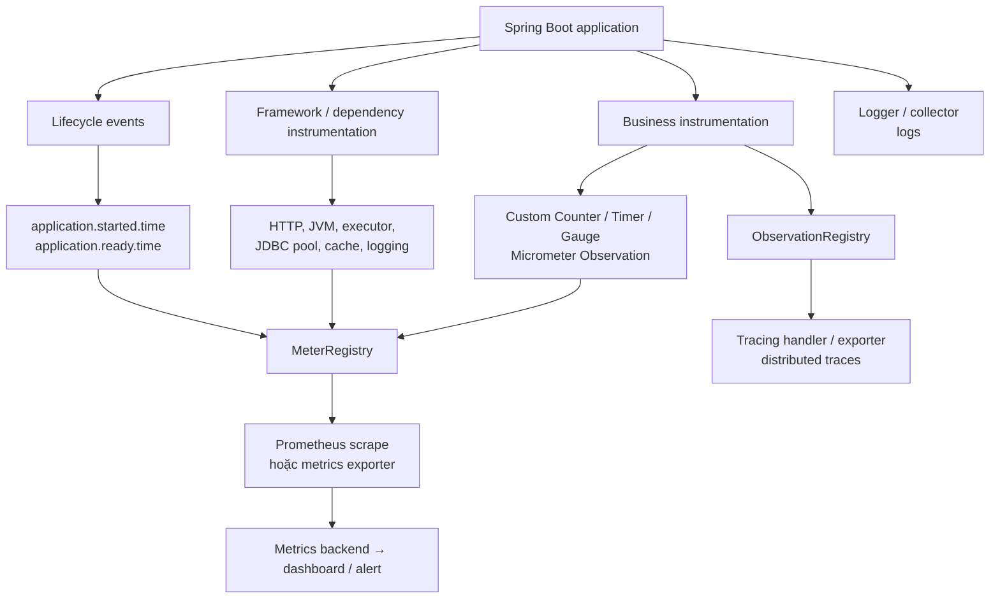
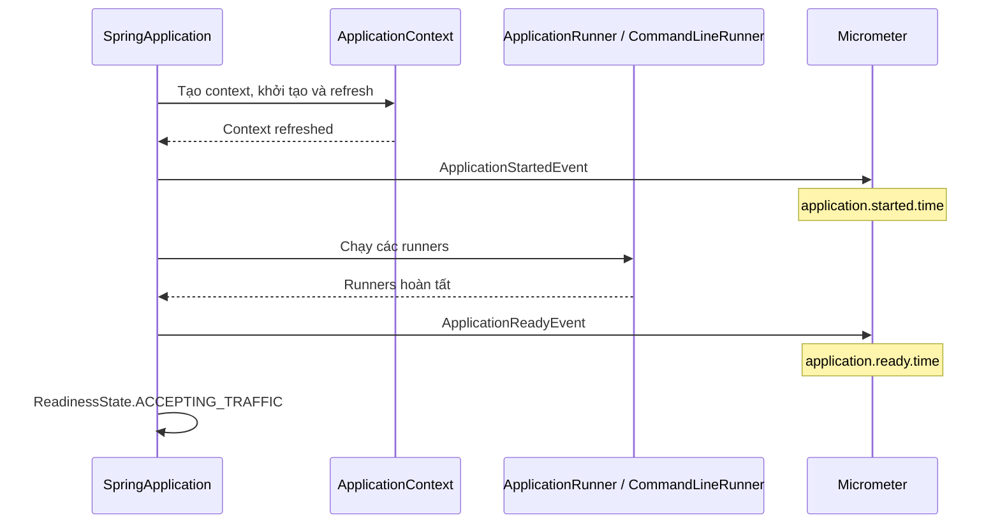

# Application metrics

Một bản phát hành Spring Boot mới khiến ứng dụng khởi động chậm hơn, nhưng các pod vẫn đạt trạng thái Running. Vài phút sau, người dùng phản ánh API đặt hàng tăng độ trễ, trong khi CPU không cao và không có nhiều HTTP 500. Muốn phân biệt “khởi động chậm”, “chưa sẵn sàng phục vụ” và “nghiệp vụ xử lý chậm”, ta cần những nhóm số đo khác nhau. **Application metrics** biến các mốc vòng đời và hành vi của ứng dụng thành tín hiệu định lượng để phát hiện, khoanh vùng và kiểm chứng vấn đề.

Bài này thuộc chương **Spring Boot metrics** trong module **SPRING_BOOT_OBSERVABILITY**. Phạm vi module là xây dựng observability cho Spring Boot bằng **Micrometer Observation, metrics, logs và distributed tracing**, tìm hiểu propagation ngữ cảnh, tag/cardinality, exporter, sampling và liên kết tín hiệu để điều tra lỗi, độ trễ cùng hành vi ứng dụng trong môi trường thực. Trọng tâm của bài là **application metrics**: các số đo vòng đời ứng dụng do Spring Boot cung cấp, metrics ứng dụng được tự động instrument và các metrics nghiệp vụ mà đội phát triển chủ động thiết kế.

> **Phân biệt quan trọng:** Trong tài liệu Spring Boot, **Application Startup Metrics** là một nhóm cụ thể gồm `application.started.time` và `application.ready.time`. Khi nói “application metrics” theo nghĩa vận hành rộng hơn, ta còn quan tâm HTTP, task, connection pool, cache và metrics nghiệp vụ. Hai nghĩa có liên hệ nhưng không đồng nhất: đừng dùng startup time để suy đoán latency của mỗi request hoặc xem một chỉ số JVM như thước đo trực tiếp mức độ thành công của nghiệp vụ.

## 1. Mục tiêu học tập

Sau bài này, bạn có thể:

1. Giải thích chính xác ý nghĩa của `application.started.time` và `application.ready.time` trong vòng đời Spring Boot.
2. Phân biệt mốc **started**, **ready**, **liveness**, **readiness** và khả năng phục vụ nghiệp vụ thực tế.
3. Nhận diện nhóm application metrics tự động có sẵn khi phù hợp với stack và dependency, đồng thời biết giới hạn của chúng.
4. Thiết kế metrics nghiệp vụ cho traffic, tỷ lệ từ chối, latency, queue depth và kết quả xử lý.
5. Ghi dữ liệu bằng `MeterRegistry` hoặc `ObservationRegistry` và hiểu lúc nào dùng cách nào.
6. Kiểm tra các chỉ số qua Actuator/Prometheus, đọc timer và viết truy vấn rate, error ratio, p95 khi đủ dữ liệu.
7. Giữ metric name và tag có cardinality hợp lý, tránh tạo dữ liệu nhạy cảm hoặc trùng lặp.
8. Dùng application metrics phối hợp với logs/traces để điều tra khởi động chậm hoặc suy giảm chất lượng phục vụ.

## 2. Bức tranh application metrics trong Spring Boot

Có thể chia application metrics thành ba lớp theo câu hỏi vận hành:

| Lớp | Ví dụ số đo | Câu hỏi phù hợp |
|---|---|---|
| **Vòng đời ứng dụng** | `application.started.time`, `application.ready.time`, uptime, trạng thái readiness | Ứng dụng mất bao lâu để khởi động? Đã hoàn thành các runner chưa? |
| **Hạ tầng và luồng thực thi của ứng dụng** | `http.server.requests`, `http.client.requests`, executor, `jdbc.connections.*`, `hikaricp.*`, cache, JVM, process | Ứng dụng nhận traffic thế nào? Điểm nghẽn ở HTTP client, thread, DB pool hay bộ nhớ? |
| **Hành vi nghiệp vụ** | `checkout.authorize`, `order.submission.result`, `inventory.reservation.rejected`, `jobs.pending` | Bao nhiêu giao dịch thành công? Người dùng chờ bao lâu? Có bao nhiêu đơn bị từ chối dù HTTP trả 200? |



Spring Boot Actuator phối hợp với Micrometer để đăng ký nhiều meter tự động. Tuy nhiên, **không phải mọi loại metrics đều xuất hiện trên mọi ứng dụng**: metrics Hikari cần pool phù hợp; cache metrics cần cache được cấu hình và binding; HTTP client metrics phụ thuộc client đã được instrumentation; custom metrics cần chính code phát sinh sự kiện.

Một số meter chỉ xuất hiện **sau khi hành động tương ứng đã xảy ra**. Không tìm thấy một tên trong `/actuator/metrics` ngay sau khi startup không mặc nhiên có nghĩa auto-configuration lỗi.

## 3. Application Startup Metrics: hai thời điểm dễ nhầm

Spring Boot cung cấp hai tên được tài liệu chính thức mô tả:

| Metric | Mốc được đo | Nên dùng để hỏi |
|---|---|---|
| `application.started.time` | Khoảng thời gian khởi động đến mốc `ApplicationStartedEvent`, sau khi application context được refresh và **trước khi** gọi `ApplicationRunner`, `CommandLineRunner`. | Quá trình chuẩn bị context, beans và phần khởi tạo nền tảng mất bao lâu? |
| `application.ready.time` | Khoảng thời gian khởi động đến mốc `ApplicationReadyEvent`, được phát sau khi các application/command-line runners hoàn thành. | Mất bao lâu để Spring Boot đi đến mốc sẵn sàng theo vòng đời ứng dụng? |

Hai metrics thường được tự động đăng ký khi hạ tầng metrics của Spring Boot hoạt động. Các phiên bản Spring Boot có thể gắn tag nhận diện **fully qualified application class name**; danh sách tag cụ thể cần xem ở phiên bản và exporter đang dùng.

Một timeline tiêu biểu:



**Diễn giải cẩn thận:** Nếu `application.started.time` khoảng 2 giây còn `application.ready.time` khoảng 9 giây, có thể có khoảng 7 giây tiêu tốn sau giai đoạn context refresh, trong đó bao gồm runner execution và chi phí xử lý sự kiện. Không tự kết luận chính xác “CommandLineRunner X mất 7 giây” từ phép trừ này; phải có thêm instrumentation chi tiết cho từng runner hoặc thông tin startup tracing/profiling.

### 3.1 Mốc started không đồng nghĩa sẵn sàng nhận traffic

Trong vòng đời `SpringApplication`:

1. `ApplicationStartedEvent` được phát sau refresh context, **trước các runners**.
2. Spring Boot phát thay đổi trạng thái liveness tương ứng.
3. Các `ApplicationRunner` / `CommandLineRunner` được gọi.
4. `ApplicationReadyEvent` được phát sau khi các runners chạy xong.
5. Spring Boot phát `ReadinessState.ACCEPTING_TRAFFIC` sau mốc ready.

Nếu runner nạp dữ liệu cần thiết kéo dài, ứng dụng có thể đã tới mốc started nhưng chưa tới ready. Nếu runner ném exception khiến startup thất bại, metric `application.ready.time` có thể không được ghi nhận vì mốc ready không xảy ra.

Các **thời điểm lifecycle** này không bảo đảm toàn bộ chức năng nghiệp vụ đã sẵn sàng theo mọi tiêu chí riêng của tổ chức. Chẳng hạn ứng dụng có thể phát ready nhưng một dịch vụ ngoài chưa đáp ứng SLO, hoặc bộ nhớ đệm nghiệp vụ chưa đủ dữ liệu khi quá trình nạp được đẩy sang background.

### 3.2 Ready time khác health/readiness endpoint

`application.ready.time` là **thời lượng của một sự kiện khởi động**. Nó không tự cập nhật liên tục mỗi lần readiness thay đổi.

`/actuator/health/readiness` (khi readiness probe được bật và endpoint khả dụng) phản ánh **trạng thái hiện tại** theo cơ chế health groups. Một ứng dụng có thể khởi động nhanh nhưng sau đó chuyển sang không sẵn sàng khi gặp sự cố, trong khi giá trị startup metric đã ghi vẫn giữ nguyên.

| Tình huống | Startup metric | Readiness/health |
|---|---|---|
| Khởi động mất nhiều thời gian vì runner | `application.ready.time` lớn | Có thể chỉ ready sau khi runner hoàn tất. |
| App đã ready, sau đó DB gặp sự cố | Startup time lịch sử không tự thay đổi | Health/readiness có thể thay đổi **nếu** health group bao gồm thành phần phụ thuộc phù hợp. |
| Web server mở port nhưng app chưa ready | Có thể đã có `application.started.time` | Readiness chưa chắc chấp nhận traffic. |
| Tiến trình restart | Startup time được đo lại cho tiến trình mới | Readiness trải qua chu kỳ khởi động mới. |

Không xem một startup metric là bằng chứng về **availability hiện tại**; cần kết hợp readiness, request success rate, synthetic checks và metrics của hệ thống điều phối.

### 3.3 Startup metrics không mô tả từng lần request

Các giá trị này phản ánh **quá trình khởi động của một instance**, không phải tốc độ ứng dụng phục vụ sau khi đã khởi động. Để đo latency của request, sử dụng HTTP observation/timer; để đo thời gian nghiệp vụ, tạo custom Timer hoặc Observation.

Việc thay đổi pool connection làm `application.ready.time` giảm chưa chắc làm p95 của API tốt hơn. Cần đo các mục tiêu tương ứng và kiểm tra trên cùng phiên bản triển khai.

## 4. Kiểm tra Application Startup Metrics

### 4.1 Dependency

Giả sử ứng dụng đã có Spring Boot web starter và dependency management phù hợp, bổ sung:

```groovy
dependencies {
    implementation 'org.springframework.boot:spring-boot-starter-actuator'
    runtimeOnly 'io.micrometer:micrometer-registry-prometheus'
}
```

Actuator/Micrometer cho phép quan sát metrics; registry Prometheus hỗ trợ xuất định dạng scrape. Những dependency này **không tự tạo trace backend hay hệ thống lưu log tập trung**. Nếu chỉ thử `/actuator/metrics` với một registry phù hợp, không bắt buộc phải có Prometheus.

Spring Boot 3.x và 4.x có những khác biệt về packaging và các starter khác, đặc biệt tracing và web. Hãy dùng dependency management đúng phiên bản của dự án, và kiểm tra tài liệu tương ứng.

### 4.2 Cấu hình local

```yaml
spring:
  application:
    name: order-service

management:
  endpoints:
    web:
      exposure:
        include: "health,info,metrics,prometheus"
  metrics:
    tags:
      application: order-service
      environment: local
  endpoint:
    health:
      probes:
        enabled: true
```

Cấu hình cho phép kiểm tra các endpoint trong môi trường local. `management.metrics.tags.*` gắn các common tags có tập giá trị được kiểm soát. Không đưa `orderId`, `userId` hoặc `traceId` vào common tags.

Ở production, chỉ expose endpoint quản trị cần thiết và kiểm soát mạng, xác thực, phân quyền. Việc mở `/actuator/prometheus` cho scraper cần được thiết kế riêng; không mặc định public endpoint này qua internet.

### 4.3 Gọi endpoint

Sau khi ứng dụng khởi động và phục vụ được HTTP:

```bash
curl http://localhost:8080/actuator/health
curl http://localhost:8080/actuator/health/readiness

curl http://localhost:8080/actuator/metrics
curl http://localhost:8080/actuator/metrics/application.started.time
curl http://localhost:8080/actuator/metrics/application.ready.time

curl http://localhost:8080/actuator/prometheus
```

Trong `/actuator/metrics/application.ready.time`, chú ý `measurements`, `availableTags` và các đơn vị mà endpoint trả về; **không khẳng định cấu trúc như COUNT hay VALUE nếu chưa kiểm tra loại meter thực tế của phiên bản đang chạy**.

Tên ở `/actuator/metrics` là tên Micrometer. Tên trong Prometheus exposition có thể được đổi theo naming convention và đơn vị. Ví dụ nên **kiểm tra dòng thật trong `/actuator/prometheus`**, không đoán đuôi `_seconds`, `_sum` hay `_count` chỉ từ tên Micrometer.

### 4.4 Nếu không có `application.ready.time`

Kiểm tra theo thứ tự:

1. Ứng dụng đã thực sự phát `ApplicationReadyEvent` chưa, hay startup thất bại hoặc runner vẫn đang chạy?
2. Actuator và `MeterRegistry` đã được auto-configure đúng chưa?
3. Endpoint `metrics` có được expose/cho phép truy cập không?
4. Có `MeterFilter` hoặc cấu hình vô hiệu metrics theo tên không?
5. Có dùng custom `SpringApplication` lifecycle hoặc test harness không phát event theo cách thường gặp không?
6. Nếu chỉ mất dữ liệu trên backend: kiểm tra registry exporter, scraping và query name/labels.

Nếu ứng dụng chỉ đang trong giai đoạn start dở, không kết luận từ việc endpoint chưa mở. Nếu service đã phục vụ bình thường nhưng metric vẫn thiếu, cần kiểm tra registry, startup listener và cấu hình theo phiên bản thực tế.

## 5. Metrics ứng dụng tự động ngoài startup

Spring Boot hỗ trợ tự động instrument nhiều thành phần dựa trên stack và beans hiện diện. Chúng giúp trả lời câu hỏi “ứng dụng xử lý yêu cầu như thế nào?” trước khi thêm custom metrics.

| Nhóm | Tên/tiền tố thông dụng | Khi nào hữu ích | Điều kiện/giới hạn |
|---|---|---|---|
| HTTP server | `http.server.requests` (Micrometer conventions) | Rate, error ratio, latency theo route/status. | Spring MVC/WebFlux được instrument; tên/tag có thể khác khi dùng OpenTelemetry conventions. |
| HTTP client | `http.client.requests` | Dependency nào chậm hoặc lỗi? | Sử dụng client/builder được Spring cấu hình hoặc instrumentation thích hợp. |
| JVM | `jvm.*` | Heap, GC, thread, class loading. | Phụ thuộc khả năng JVM và instrumentation. |
| Process/system | `process.*`, `system.*`, `disk.*` | CPU, uptime, file descriptors, tài nguyên. | Một số chỉ số phụ thuộc OS/container. |
| Thread pool/executor | Nhóm `executor.*` hoặc meter tương ứng | Active workers, queue, pending tasks. | Loại executor và cách auto-bind quyết định meter thực tế. |
| JDBC pool/HikariCP | `jdbc.connections.*`, `hikaricp.*` | Pool active/idle/pending, wait, timeout. | Cần datasource/pool phù hợp. |
| Cache | `cache.*` và cache-specific | Hit/miss/eviction. | Cần cache được đăng ký/bind; cache tạo động có thể cần đăng ký thủ công. |
| Logging events | `logback.events.*` hoặc `log4j2.events.*` | Tần suất WARN/ERROR theo mức log. | Tùy logging implementation; đếm log không bằng error rate nghiệp vụ. |
| Task scheduling, JMS, Batch | Tên theo framework và convention | Job duration, message processing, failures. | Chỉ có khi công nghệ và instrumentation được bật. |

### 5.1 HTTP metrics giúp biết trải nghiệm request, nhưng có giới hạn

Với Spring MVC, `http.server.requests` thường là timer có các chiều như method, URI template và status/outcome. Nó giúp tìm endpoint chậm hoặc có 5xx.

Tuy nhiên, HTTP 200 **không bảo đảm giao dịch nghiệp vụ thành công**. Một API thanh toán có thể trả 200 cho kết quả “declined” hoặc “đang xử lý”. Nếu chỉ có status code metric, đội vận hành sẽ không biết tỷ lệ giao dịch bị từ chối. Khi đó cần **metric nghiệp vụ**.

Nếu application sử dụng semantic conventions khác, tên metric và tag keys có thể thay đổi. Đừng hard-code mọi query theo một convention mà chưa kiểm tra output exporter.

### 5.2 Pool và cache giúp khoanh vùng nguyên nhân

Giả sử p95 của `POST /orders` tăng nhưng CPU ổn định. HTTP metrics xác nhận sự chậm trễ; HikariCP metrics có thể cho thấy số connection đang hoạt động cao và pending threads tăng. Cách kết hợp này giúp hình thành giả thuyết bottleneck nằm ở database pool.

Tương tự, tỷ lệ cache miss tăng sau rollout có thể giải thích số truy vấn DB tăng. Một metric `cache.misses` cao **không tự chứng minh** truy vấn DB là nguyên nhân cuối; cần đối chiếu timing, query logs và traces.

### 5.3 Logger metrics không thay thế logs

`logback.events` hoặc `log4j2.events` cho biết bao nhiêu sự kiện log ở mỗi mức độ, nhưng không chứa đầy đủ stack trace hoặc business context từng sự kiện. Muốn biết exception cụ thể, phải đọc **logs**. Muốn biết request đi qua đâu, xem **traces** nếu được instrument và sampling giữ lại.

## 6. Thiết kế application metrics có ý nghĩa nghiệp vụ

Một custom metric nên trả lời **một câu hỏi vận hành có thể hành động**, không chỉ “đo vì có thể đo”.

Ví dụ hệ thống checkout:

| Câu hỏi | Metric đề xuất | Loại meter | Tags hữu ích |
|---|---|---|---|
| Bao nhiêu lần authorize có kết quả approved/declined/error? | `checkout.authorization.result` | Counter | `outcome` từ tập hữu hạn. |
| Một lần gọi payment provider mất bao lâu? | `checkout.authorization.duration` | Timer | `provider`, `method` đã chuẩn hóa. |
| Bao nhiêu job đang chờ xử lý? | `checkout.jobs.pending` | Gauge | `queue` có tập tên nhỏ. |
| Một batch có bao nhiêu item? | `checkout.batch.items` | DistributionSummary | `type` hoặc `source` hữu hạn. |
| Công việc export dài còn hoạt động bao lâu? | `checkout.export.active` | LongTaskTimer | `type` hữu hạn. |
| Có bao nhiêu request HTTP 5xx? | `http.server.requests` | Auto-instrumented Timer | `uri` template, `status`. |

Quy tắc chọn:

- **Counter** cho các sự kiện đếm tăng dần (business outcomes, retries, rejects).
- **Gauge** cho trạng thái hiện tại (queue depth, active tasks).
- **Timer** cho mỗi khoảng thời gian đã hoàn tất.
- **DistributionSummary** cho phân phối giá trị số không phải thời gian.
- **LongTaskTimer** cho tiến độ của tác vụ dài còn đang chạy.

Tránh thêm Counter trùng với `Timer.count` nếu cả hai đo đúng cùng một invocation và cùng ranh giới. Counter riêng về `outcome=declined` có ý nghĩa vì nó đo một kết quả mà HTTP status hoặc timer duration chưa nói rõ.

### 6.1 Đặt tên ổn định theo loại hoạt động

Nên dùng:

```text
checkout.authorization.result
checkout.authorization.duration
inventory.reservation.rejected
report.generate
```

Không dùng:

```text
checkout.authorization.ORDER-3842
checkout.authorization.customer-771
checkout.authorization.2026-11-22T10:15:00Z
```

Tên meter và tag values biến thiên theo mỗi request có thể làm số series tăng cực lớn. Giữ tên ổn định và chuyển các phân nhóm có tập giá trị hữu hạn vào low-cardinality tags.

## 7. Ví dụ Java: ghi metrics kết quả nghiệp vụ

Giả sử ứng dụng đã có `MeterRegistry` của Spring Boot Actuator. Ta instrument một service gọi cổng thanh toán. Ví dụ Java 17+ sau tập trung vào tên và semantics; `PaymentGateway` là interface mà dự án sẽ triển khai.

```java
import java.util.concurrent.Callable;

import io.micrometer.core.instrument.Counter;
import io.micrometer.core.instrument.MeterRegistry;
import io.micrometer.core.instrument.Timer;
import org.springframework.stereotype.Service;

@Service
public class AuthorizationMetrics {
    private final MeterRegistry registry;
    private final Counter approved;
    private final Counter declined;
    private final Counter failed;
    private final Timer duration;

    public AuthorizationMetrics(MeterRegistry registry) {
        this.registry = registry;

        approved = Counter.builder("checkout.authorization.result")
                .description("Payment authorization results")
                .tag("outcome", "approved")
                .register(registry);

        declined = Counter.builder("checkout.authorization.result")
                .description("Payment authorization results")
                .tag("outcome", "declined")
                .register(registry);

        failed = Counter.builder("checkout.authorization.result")
                .description("Payment authorization results")
                .tag("outcome", "error")
                .register(registry);

        duration = Timer.builder("checkout.authorization.duration")
                .description("Time spent authorizing payment")
                .register(registry);
    }

    public boolean recordAuthorization(Callable<Boolean> operation)
            throws Exception {
        Timer.Sample sample = Timer.start(registry);
        try {
            boolean accepted = operation.call();
            if (accepted) {
                approved.increment();
            } else {
                declined.increment();
            }
            return accepted;
        } catch (Exception failure) {
            failed.increment();
            throw failure;
        } finally {
            sample.stop(duration);
        }
    }
}
```

Caller có thể dùng:

```java
boolean approved = authorizationMetrics.recordAuthorization(
        () -> paymentGateway.authorize(command));
```

Code trên cần bean thực tế của `paymentGateway`, input `command` và phần gọi từ service/controller/job. Nó minh họa kỹ thuật instrumentation và **không phải ứng dụng chạy độc lập hoàn chỉnh**.

**Tại sao chọn các meter như vậy?**

1. `checkout.authorization.result` là **một tên** với ba giá trị tag `outcome`, không tạo tên động cho từng request.
2. `Timer.Sample` đo khoảng thời gian của mọi lần thực hiện được gọi.
3. `finally` bảo đảm `sample.stop(...)` được gọi ngay cả khi `Callable` ném `Exception`.
4. Kết quả `false` được xem là `declined` theo hợp đồng nghiệp vụ, dù HTTP có thể trả 200. Nó không bị ghi nhầm thành Java exception.
5. Code bắt `Exception`, không cố bắt mọi `Throwable`; một lỗi JVM nghiêm trọng vẫn có thể kết thúc qua finally nhưng không bị ép thành kết quả business thông thường.

Với cancellation/timeout, phải định nghĩa thêm outcome rõ ràng nếu hệ thống cần đo chúng riêng. Không mặc định mọi timeout hoặc user cancellation đều là lỗi 5xx.

### 7.1 Nếu cần Gauge cho công việc đang chờ

```java
import java.util.concurrent.atomic.AtomicInteger;
import io.micrometer.core.instrument.Gauge;

private final AtomicInteger pending = new AtomicInteger();

public void registerQueueGauge(MeterRegistry registry) {
    Gauge.builder("checkout.jobs.pending", pending, AtomicInteger::get)
            .description("Jobs currently waiting in the checkout queue")
            .register(registry);
}
```

Đây là **phác thảo thành phần trong một bean**, không phải một file Java hoàn chỉnh. Field `pending` cần tồn tại suốt vòng đời bean vì gauge có thể giữ weak reference đến đối tượng được đo. Với production, ưu tiên đo trực tiếp độ dài queue thực sự, nếu thư viện cung cấp cách đọc an toàn. Đừng tạo gauge hoặc một `AtomicInteger` mới mỗi request.

### 7.2 Dùng Observation khi cần cả metrics lẫn traces

Nếu muốn đo một bước nghiệp vụ và nhìn thấy span cùng trace ID của HTTP request, dùng `ObservationRegistry` là cách tích hợp thống nhất:

```java
import io.micrometer.observation.Observation;
import io.micrometer.observation.ObservationRegistry;
import org.springframework.stereotype.Service;

@Service
public class ReservationService {
    private final ObservationRegistry observations;

    public ReservationService(ObservationRegistry observations) {
        this.observations = observations;
    }

    public String reserve(boolean stockAvailable) {
        Observation observation = Observation
                .createNotStarted("inventory.reserve", observations)
                .contextualName("reserve inventory")
                .lowCardinalityKeyValue("operation", "reserve");

        return observation.observe(() -> {
            if (stockAvailable) {
                observation.lowCardinalityKeyValue("outcome", "reserved");
                return "reserved";
            }
            observation.lowCardinalityKeyValue("outcome", "rejected");
            return "rejected";
        });
    }
}
```

Khi có metrics handler, `inventory.reserve` có thể tạo Timer. Khi có tracing handler, cùng Observation có thể tạo span con nằm trong trace hiện hành. Nếu ghi log bên trong scope, correlation ID có thể xuất hiện theo cấu hình logging/tracing.

Cần nhớ:

- `Observation` không tự phát ra mọi log nghiệp vụ.
- **Trace sampling** có thể bỏ qua span dù metrics vẫn được ghi.
- Nếu một timer thủ công đã đo chính đoạn `inventory.reserve`, đừng tự động ghi thêm Timer cùng tên cho đúng một invocation mà không đánh giá double counting.
- Metadata `outcome` chỉ gồm hai giá trị được chuẩn hóa, tránh tăng cardinality.

## 8. Application metrics khác business KPIs như thế nào?

Khi xây dashboard cho ứng dụng, thường có ba lớp:

| Lớp | Ví dụ | Ý nghĩa |
|---|---|---|
| **Technical metrics** | CPU, GC, HTTP 5xx, connection pool pending | Cho thấy sức khỏe và tài nguyên kỹ thuật. |
| **Business-operational metrics** | Số lần payment declined, đơn thất bại, backlog, retry | Gắn vận hành hệ thống với kết quả nghiệp vụ. |
| **Business KPIs** | Doanh thu đã đối soát, tỷ lệ chuyển đổi chính thức, số đơn hợp lệ | Chỉ số kinh doanh cần định nghĩa, đối soát và nguồn dữ liệu tin cậy. |

Micrometer Counter về `checkout.authorization.result` có thể cung cấp **tín hiệu gần thời gian thực** để phát hiện tỷ lệ thanh toán bị từ chối tăng. Tuy nhiên, metric này không tự thay thế hệ thống kế toán hoặc dữ liệu đơn hàng chính thức: counter có thể reset khi restart, event có thể bị retry, telemetry có thể thất lạc và metrics backend thường có thời gian lưu hữu hạn.

**Không dùng metrics pipeline làm nguồn sự thật duy nhất** cho các con số đòi hỏi độ chính xác kiểm toán hoặc yêu cầu thanh toán. Các event/KPI phải được thiết kế với semantics như exactly-once/idempotency và lưu trữ nghiệp vụ thích hợp nếu cần.

### 8.1 Định nghĩa mẫu số trước khi báo tỷ lệ

Ví dụ tỷ lệ payment declined phải ghi rõ mẫu số:

- Tổng số **authorization attempts**?
- Tổng số **checkout sessions**?
- Tổng số **đơn đặt hàng duy nhất**?
- Chỉ tính những giao dịch đã có kết quả cuối?

Nếu một request retry ba lần, `Counter` theo attempt sẽ tăng ba lần. Không nên dùng số attempt như số khách hàng gặp lỗi mà không nói rõ. Việc định nghĩa đúng đối tượng đo là bước trước khi viết PromQL.

## 9. Histogram, percentiles và câu hỏi latency

Timer có `count` và `total time`, đủ để tính trung bình trong một cửa sổ. Nhưng để đánh giá trải nghiệm **đuôi phân phối** như p95/p99, cần histogram hoặc cơ chế phân phối phù hợp.

Cấu hình mẫu:

```yaml
management:
  metrics:
    distribution:
      percentiles-histogram:
        checkout.authorization.duration: true
```

Khi Prometheus registry và histogram classic tương ứng hoạt động, các series dạng `checkout_authorization_duration_seconds_bucket` có thể xuất hiện.

Ví dụ PromQL:

```promql
# Số authorization attempts/giây, theo counter đã instrument
sum(rate(checkout_authorization_result_total[5m]))

# Tỷ lệ bị từ chối theo attempts; chỉ diễn giải khi lưu lượng đủ lớn
sum(rate(checkout_authorization_result_total{outcome="declined"}[5m]))
/
sum(rate(checkout_authorization_result_total[5m]))

# Độ trễ trung bình của authorization
sum(rate(checkout_authorization_duration_seconds_sum[5m]))
/
sum(rate(checkout_authorization_duration_seconds_count[5m]))

# p95, chỉ khi đã có các histogram buckets tương thích
histogram_quantile(
  0.95,
  sum by (le) (
    rate(checkout_authorization_duration_seconds_bucket[5m])
  )
)
```

**Các tên Prometheus là ví dụ**. Tên exporter có thể khác theo registry và naming convention. Hãy xem output `/actuator/prometheus` để xác nhận `_total`, `_seconds_count`, `_sum`, `_bucket` và tag keys.

Nếu không có histogram bucket, không thể khôi phục p95 từ riêng `_count` và `_sum`. Không lấy trung bình p95 của các instance để coi là p95 toàn hệ thống. Histogram có thêm series theo bucket; cần chọn phạm vi bật histogram để cân bằng chi phí và độ chính xác.

Để so sánh startup time, thường xem giá trị đo khi các instance khởi động; **không dùng rate của startup time như thể đó là counter request**.

## 10. Cardinality và hợp đồng tên/tag

Một metric có thể tạo nhiều series khi kết hợp tags. Chẳng hạn:

```text
checkout.authorization.result
  outcome = {approved, declined, error}          3 giá trị
  channel = {web, mobile, partner}              3 giá trị
  region  = {north, central, south}             3 giá trị

Tối đa theo tổ hợp: 3 × 3 × 3 = 27 series.
```

Nếu thêm `orderId` có 100.000 giá trị, số tổ hợp lý thuyết tăng lên **2.700.000**. Cardinality cao làm tăng memory của ứng dụng, dung lượng backend và chi phí truy vấn.

| Thuộc tính | Thích hợp cho metric tags? | Ví dụ |
|---|---|---|
| Nhóm kết quả cố định | Có | `outcome=approved/declined/error`. |
| Route mẫu | Có | `uri=/orders/{id}`. |
| HTTP method/status | Có | `method=POST`, `status=200`. |
| Region/env đã chuẩn hóa | Có nếu cần | `environment=prod`. |
| Request ID/order ID/user ID | Không | Giá trị gần như duy nhất mỗi lần gọi. |
| Token, password, email, thông tin riêng tư | Không | Rủi ro bảo mật và cardinality. |

Đối với distributed tracing, một số high-cardinality attributes **có thể** phục vụ điều tra một request cụ thể, nhưng vẫn cần chính sách thu thập/bảo mật/retention. Không chuyển token hoặc PII từ metric tag sang span một cách máy móc.

### 10.1 Tên application metrics cũng phải ổn định

Không tạo tên động như `checkout.authorization.ORDER-10243` hoặc `inventory.reserve.customer-882`. Một loại nghiệp vụ nên có một tên ổn định, còn kết quả/nhóm do low-cardinality tags thể hiện.

Nếu đổi tên `checkout.authorization.result` trong phiên bản mới, dashboard và alert đọc tên cũ sẽ mất tín hiệu. Vì vậy cần migration có kiểm soát, hỗ trợ truy vấn tên cũ/mới trong rollout và bảo đảm không đếm cùng một sự kiện hai lần.

## 11. Kết hợp metrics với logs và distributed tracing

Một yêu cầu thanh toán có thể đi qua:

```text
HTTP POST /checkout       1300 ms (http.server.requests)
  ├─ Validate input          15 ms
  ├─ Call payment provider 1180 ms
  └─ Persist result          65 ms

Metric nghiệp vụ:
  checkout.authorization.duration
  checkout.authorization.result{outcome="declined"}

Log theo traceId:
  "Payment provider timeout after retry"

Trace:
  HTTP server span → HTTP client span → provider span (nếu được instrument)
```

**Metrics** xác nhận tỷ lệ lỗi/từ chối và latency trên nhiều requests. **Traces** cho biết một request đã đi qua bước nào và tốn thời gian ở đâu. **Logs** ghi chi tiết exception, retry hoặc quyết định nghiệp vụ.

Cần điều kiện để liên kết:

- Đặt cùng `service.name`/application identity và các labels nhất quán khi xuất metrics/traces/logs.
- Dùng trace context được truyền qua HTTP client, messaging hoặc asynchronous executor được instrument.
- Ghi log trong scope có tracing context; tìm `traceId` qua log backend nếu có.
- Đừng gắn `traceId` làm metric tag vì cardinality gần như vô hạn.
- Nhớ rằng tracing sampling có thể làm một trace không xuất hiện ở backend dù request đã tạo metrics.

Một metric “payment declines tăng” **không tự chứng minh** provider là nguyên nhân. Kiểm tra thêm outcome categories, traces mẫu, log errors và dependencies để loại trừ nguyên nhân khác.

## 12. Quy trình điều tra ứng dụng khởi động chậm

**Tình huống:** Sau rollout, container mất 18 giây mới nhận traffic; trước đây chỉ khoảng 5 giây.

1. **Xác nhận mốc:** đọc `application.started.time` và `application.ready.time` theo instance/version nếu hệ thống có labels đó.
2. **Khoanh vùng giai đoạn:** started đã tăng hay chỉ ready tăng? Nếu khoảng chênh ready-started lớn, điều tra runners, listeners hoặc phần công việc sau refresh.
3. **Kiểm tra logs khởi động:** xem timestamp bean initialization, migration, kết nối DB, cache warm-up, secrets/config fetch, timeout và retries.
4. **Quan sát dependencies:** startup có phải chờ DB, service discovery, storage hay external service không?
5. **Kiểm tra readiness:** xác nhận readiness chuyển khi kỳ vọng; không giả định có port mở là app đã sẵn sàng.
6. **Đo chi tiết hơn:** nếu cần phân rã startup, sử dụng công cụ `ApplicationStartup`/`/actuator/startup` hoặc instrumentation có chủ đích, thay vì suy đoán toàn bộ từ hai số đo.
7. **Kiểm chứng:** so sánh nhiều lần restart, các instances tương đương, phiên bản, tải và tình trạng dependency; đảm bảo ready time giảm mà chức năng nghiệp vụ vẫn đúng.

**Lưu ý:** endpoint `/actuator/startup` sử dụng thông tin của Spring Framework `ApplicationStartup` khi được cấu hình phù hợp. Nó là một công cụ phân tích các bước startup, **khác** với hai metrics `application.started.time` và `application.ready.time`. Không mặc định endpoint này có lịch sử đầy đủ nếu chưa bật cơ chế ghi nhận startup steps.

## 13. Quy trình điều tra suy giảm chất lượng API

**Tình huống:** Một dịch vụ đã ready nhưng p95 của `POST /orders` tăng mạnh.

| Bước | Tín hiệu | Câu hỏi |
|---|---|---|
| 1 | HTTP server metrics | Tỷ lệ lỗi và latency tăng ở route nào? Bao nhiêu traffic bị ảnh hưởng? |
| 2 | Business metrics | Tỷ lệ order reject/payment declined có thay đổi dù HTTP 200? |
| 3 | JDBC/Hikari/executor metrics | Có queue, pool pending, thread bão hòa không? |
| 4 | Distributed traces | Span nào dài bất thường? Lỗi xảy ra ở dependency nào? |
| 5 | Logs có correlation | Có timeout/retry/exception nào giải thích span chậm? |
| 6 | Metrics sau sửa | p95, error ratio, success rate và throughput đã phục hồi chưa? |

Startup time không phải chỉ số phù hợp để xác minh p95 của API sau khi hệ thống đã chạy nhiều giờ. Cần **đặt đúng câu hỏi trước khi chọn signal**.

## 14. Những lỗi triển khai thường gặp

| Hiện tượng | Nguyên nhân có thể | Cách kiểm tra/xử lý |
|---|---|---|
| `application.started.time` có, `application.ready.time` không có | Runner chưa xong, startup failed hoặc metric bị filter. | Kiểm tra mốc `ApplicationReadyEvent`, log khởi động, registry. |
| Cả hai startup metrics thấp nhưng người dùng không truy cập được | Startup đã xong nhưng readiness/route/dependency gặp vấn đề. | Xem health/readiness và HTTP/synthetic probe. |
| `/actuator/metrics` 404 | Thiếu Actuator, chưa expose endpoint hoặc security. | Kiểm tra starter, cấu hình endpoints và cổng management. |
| Có `/actuator/metrics` nhưng thiếu `/actuator/prometheus` | Thiếu Prometheus registry hoặc chưa expose. | Thêm registry/exposure tương ứng. |
| Không thấy HTTP metric ngay khi startup | Chưa có request hoặc instrumentation chưa được kích hoạt. | Gửi request, kiểm tra stack và conventions. |
| Có HTTP metric, thiếu business outcome | Chỉ đo HTTP status, chưa instrument kết quả nghiệp vụ. | Thêm Counter hoặc Observation có outcome tag hữu hạn. |
| Metric `checkout.authorization.result` có quá nhiều series | Đưa userId/orderId làm tag. | Chuẩn hóa tag, kiểm soát cardinality. |
| Gauge queue có giá trị NaN/mất tích | Nguồn đo bị garbage collected hoặc object bị thay. | Giữ strong reference, gắn gauge với nguồn ổn định. |
| PromQL không tìm thấy tên metric | Tên được chuyển đổi theo exporter/semantic convention. | Xem `/actuator/prometheus` và điều chỉnh truy vấn. |
| Dashboard p95 trống | Chưa bật histogram hoặc chưa có bucket series. | Bật histogram đúng timer; kiểm tra lưu lượng và buckets. |
| Count nhân đôi | Framework auto-instrument và custom timer trùng ranh giới. | Giữ một owner đo cùng một hoạt động. |
| Trace không có nhưng metric vẫn tăng | Trace bị sampling hoặc exporter/propagation lỗi. | Kiểm tra tracing pipeline; không suy đoán metric sai. |
| Dashboard trống sau deploy | Rename metric/tag hoặc collector lỗi. | So sánh output cũ/mới, scrape target và labels. |

## 15. Bài tập tình huống

**Bài 1 — Started và ready.** Sau một thay đổi, `application.started.time` vẫn khoảng 2 giây nhưng `application.ready.time` tăng từ 4 lên 15 giây. Bạn sẽ ưu tiên kiểm tra những giai đoạn và nguồn dữ liệu nào? Vì sao không thể kết luận ngay một runner cụ thể làm chậm 13 giây?

**Bài 2 — Startup nhanh, readiness lỗi.** Ứng dụng có ready time 3 giây nhưng endpoint readiness trả trạng thái không chấp nhận traffic sau 30 phút chạy. Bạn sẽ kiểm tra gì? Vì sao không nên yêu cầu startup metric tự thay đổi?

**Bài 3 — HTTP 200 và thanh toán bị từ chối.** Thiết kế metric để đo tỷ lệ payment declined theo attempts. Đặt tên, meter type, outcome tags, và nói rõ mẫu số trước khi xây alert.

**Bài 4 — Quá nhiều series.** Một developer đưa `orderId` vào `checkout.authorization.result` và thấy số series tăng hàng triệu. Nêu cách sửa giữ nguyên khả năng điều tra một yêu cầu cụ thể qua traces/logs.

**Bài 5 — p95 và histogram.** Tại sao không thể suy p95 từ count/sum? Khi nào có thể dùng `histogram_quantile`? Vì sao không lấy trung bình p95 của ba pods?

**Bài 6 — Startup metrics ở backend thiếu.** `/actuator/metrics/application.ready.time` trả dữ liệu nhưng Prometheus không có series tương ứng. Hãy kiểm tra theo thứ tự registry, endpoint, tên exporter, scrape target, auth, labels và thời gian lấy mẫu.

**Bài 7 — Thời gian khởi động của pod.** Pod chuyển Running, vài giây sau ứng dụng mới ready. Hãy phân biệt lifecycle của container, `ApplicationStartedEvent`, `ApplicationReadyEvent` và readiness probe. Nêu lý do cần đo cả sự kiện ứng dụng lẫn trạng thái ở orchestrator.

**Gợi ý đáp án:** Bài 1 kiểm tra các runners, listeners và dependency sau refresh; bài 2 health group/readiness, các dependency và trạng thái ứng dụng; bài 3 Counter với outcome hữu hạn và mẫu số attempts; bài 4 bỏ ID khỏi metric tags; bài 5 cần histogram bucket đủ mẫu; bài 6 kiểm tra đường xuất/thu thập; bài 7 nhận ra Running không đồng nghĩa application ready.

## 16. Tài liệu tham khảo chính thức

- [Spring Boot — Metrics](https://docs.spring.io/spring-boot/reference/actuator/metrics.html): danh sách supported metrics, `application.started.time`, `application.ready.time`, registries và custom metrics.
- [Spring Boot — SpringApplication events](https://docs.spring.io/spring-boot/reference/features/spring-application.html): thứ tự `ApplicationStartedEvent`, runners, `ApplicationReadyEvent` và availability events.
- [Spring Boot — Actuator Endpoints](https://docs.spring.io/spring-boot/reference/actuator/endpoints.html): endpoint exposure, `health`, bảo vệ management endpoints.
- [Spring Boot — Application Availability](https://docs.spring.io/spring-boot/reference/features/spring-application.html#features.spring-application.application-availability): liveness/readiness và các trạng thái lifecycle.
- [Spring Boot — Application Startup](https://docs.spring.io/spring-boot/reference/features/spring-application.html#features.spring-application.startup-tracking): `ApplicationStartup` và cách phân tích startup steps.
- [Micrometer — Counters](https://docs.micrometer.io/micrometer/reference/concepts/counters.html): đếm sự kiện theo rate và trách nhiệm lựa chọn meter.
- [Micrometer — Timers](https://docs.micrometer.io/micrometer/reference/concepts/timers.html): đo duration và `Timer.Sample`.
- [Micrometer — Gauges](https://docs.micrometer.io/micrometer/reference/concepts/gauges.html): đo trạng thái hiện hành và vòng đời đối tượng.
- [Micrometer — Observation](https://docs.micrometer.io/micrometer/reference/observation/introduction.html): Observation, handler metrics/tracing và key-values.
- [Prometheus — Histograms and Summaries](https://prometheus.io/docs/practices/histograms/): histogram, buckets và quantiles.
- [Prometheus — Query Functions](https://prometheus.io/docs/prometheus/latest/querying/functions/): `rate`, `increase` và `histogram_quantile`.

**Ghi nhớ:** Spring Boot application metrics cho biết **ứng dụng khởi động đến đâu**, **các thành phần kỹ thuật hoạt động ra sao** và **nghiệp vụ đang tạo ra kết quả gì**. `application.started.time` và `application.ready.time` là hai mốc startup có ý nghĩa cụ thể; HTTP/pool/JVM metrics phản ánh runtime; custom business metrics lấp khoảng trống mà HTTP status không diễn đạt. Kết hợp đúng metric với readiness, logs và distributed traces để đặt giả thuyết và kiểm chứng, đồng thời bảo vệ hệ thống khỏi cardinality cao, dữ liệu nhạy cảm và những kết luận dựa trên một tín hiệu đơn lẻ.
