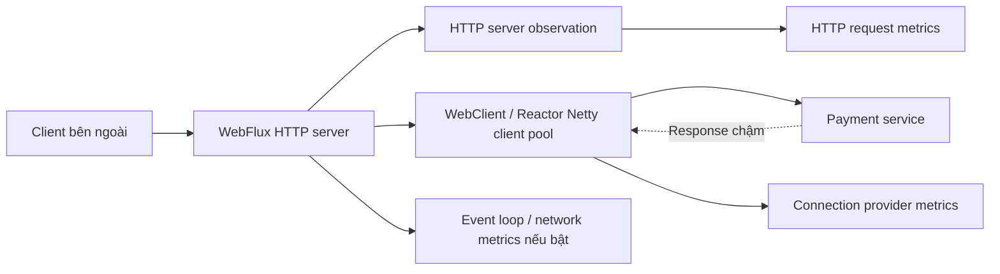
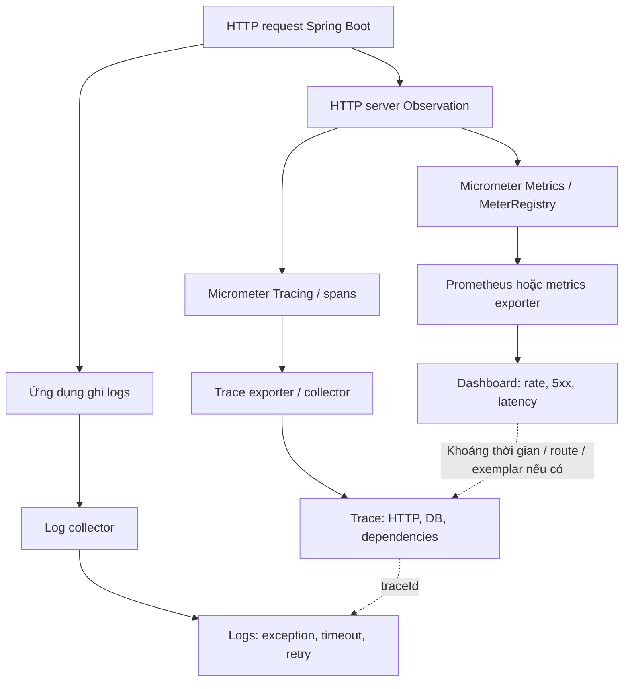

# Tomcat và WebFlux metrics

> **Chương:** Spring Boot metrics  
> **Module:** `SPRING_BOOT_OBSERVABILITY` — thiết lập observability cho Spring Boot bằng Micrometer Observation, metrics, logs và distributed tracing. Bài học tập trung vào metrics của HTTP server và runtime Tomcat/WebFlux, cách đánh giá độ trễ và lỗi, liên kết với traces/logs, cùng các giới hạn về cardinality, exporter, sampling và context propagation.

## Mục tiêu học tập

Sau bài này, bạn có thể:

- Phân biệt **HTTP request metrics dùng chung** với **metrics của servlet container Tomcat**, **Reactor Netty** và các connection pools trong ứng dụng WebFlux.
- Giải thích sự khác nhau giữa mô hình Servlet dùng request-handling threads và mô hình reactive event loop; tránh kết luận sai khi so sánh thread metrics giữa hai runtime.
- Đọc các chỉ số như số request, error rate, p95 latency, Tomcat busy threads và Reactor Netty connection pool pending acquisitions.
- Cấu hình Spring Boot Actuator/Micrometer và Prometheus để kiểm tra những meter đang được phát ra, biết khi nào cần bật thêm instrumentation.
- Thiết kế labels có cardinality thấp, dùng metrics để xác định phạm vi sự cố rồi liên kết với logs/traces nhằm điều tra nguyên nhân.
- Xây dựng quy trình kiểm chứng khi hệ thống có lỗi HTTP 5xx, timeout, blocking trong event loop hoặc cạn connection pool.

## 1. Vì sao cần phân biệt Tomcat và WebFlux metrics?

Hãy xét hai ứng dụng đều có endpoint `POST /orders`:

- Ứng dụng A sử dụng Spring MVC trên **embedded Tomcat**.
- Ứng dụng B sử dụng Spring WebFlux trên **Reactor Netty**.

Khi tải tăng, cả hai có thể trả 503/504 hoặc chậm hơn bình thường. Cả hai đều cần biết tỉ lệ lỗi và độ trễ HTTP. Nhưng **cơ chế tiêu thụ tài nguyên** không giống nhau.

Tomcat trong mô hình Servlet truyền thống dùng các luồng của connector/executor để xử lý request; quá nhiều công việc chờ hoặc xử lý chậm có thể khiến số busy threads tiến gần giới hạn cấu hình. WebFlux chạy trên Reactor Netty thường dùng một nhóm **event-loop threads** nhỏ để phục vụ nhiều kết nối theo cơ chế nonblocking. Chỉ nhìn số luồng của Reactor Netty không cho thấy trực tiếp “còn bao nhiêu request slots”, còn blocking trên event loop có thể ảnh hưởng nhiều request cùng lúc.

Vì vậy, hãy tách ba lớp đo:

1. **Lớp HTTP:** request count, rate, error rate, latency và tags theo route/method/status.
2. **Lớp runtime/server:** Tomcat connector threads/connections hoặc Reactor Netty event-loop/network metrics.
3. **Lớp dependency/business:** DB pool, HTTP client connection pool, queue, các observation nghiệp vụ như `checkout.submit` hoặc `payment.authorize`.

Việc so sánh chính xác phải dựa trên **chức năng runtime thực tế**, không chỉ trên tên framework.

### 1.1. WebFlux không đồng nghĩa tuyệt đối với Reactor Netty

Spring WebFlux là web framework reactive. **Reactor Netty** là HTTP runtime mặc định phổ biến khi ứng dụng chỉ dùng `spring-boot-starter-webflux`, nhưng WebFlux cũng có thể chạy trên servlet containers phù hợp, bao gồm Tomcat ở các cấu hình được hỗ trợ.

Tương tự, Spring Boot dùng MVC khi có cả hai starter MVC và WebFlux trong cấu hình mặc định thông dụng, trừ khi ứng dụng thay đổi lựa chọn web application type. Không suy luận “thấy WebFlux dependency thì chắc chắn đang chạy Reactor Netty”.

| Phạm vi | Tomcat + Spring MVC | WebFlux + Reactor Netty |
| --- | --- | --- |
| Mô hình xử lý phổ biến | Request được phục vụ bởi các luồng Servlet connector/executor | Event loop, callback và reactive pipelines |
| HTTP request metrics | Có thể dùng `http.server.requests` khi instrumentation phù hợp | Cũng có thể dùng `http.server.requests` khi instrumentation phù hợp |
| Metrics runtime đáng chú ý | Tomcat busy/current/configured threads, connectors/connections | Reactor Netty event loop, network I/O; outbound connection provider pools nếu được instrument |
| Dấu hiệu nghẽn cần điều tra | Busy threads cao, queue, DB wait, dependency timeout | Event loop bị blocking, pending tasks, outbound pool pending, backpressure, dependency timeout |
| Sai lầm phổ biến | Cứ busy threads cao là CPU cao | Cứ JVM threads ít là ứng dụng còn nhiều năng lực xử lý |

**Điểm chung:** metrics cung cấp xu hướng và mức ảnh hưởng; traces cho biết chậm ở thao tác nào; logs mô tả timeout, exception, retry và các sự kiện cụ thể.

## 2. HTTP server metrics: đường cơ sở cho cả hai runtime

Micrometer/Spring Boot có thể instrument các yêu cầu HTTP server và ghi metric logic như:

```text
http.server.requests
```

Ở các cấu hình Spring Boot phổ biến, đây là một **Timer** ghi số lần và thời lượng xử lý yêu cầu. Những key-value thường gặp có thể bao gồm `method`, `uri`, `status`, `outcome` và `exception`. Tập tags chính xác phụ thuộc phiên bản và convention đang dùng; hãy xem meter thực trong ứng dụng.

| Tín hiệu | Cách đọc | Câu hỏi được trả lời |
| --- | --- | --- |
| Request count / rate | Số request hoặc tốc độ request trong khoảng thời gian | Hệ thống đang nhận bao nhiêu tải? |
| HTTP error rate | Tỷ lệ 5xx (và các loại lỗi được định nghĩa) trên tổng request | Phần trăm request thất bại có tăng không? |
| Average latency | Tổng duration chia số request trong cửa sổ thời gian | Thời gian trung bình đang thay đổi thế nào? |
| p95/p99 latency | Phân vị trên phân bố thời gian, khi dữ liệu phân phối thích hợp có sẵn | Phần chậm của người dùng chịu ảnh hưởng ra sao? |
| In-flight/active requests | Những request đang xử lý nếu instrumentation hỗ trợ | Có nhiều request đang treo/chờ hơn bình thường không? |

### 2.1. Vì sao `uri` phải là route được chuẩn hóa?

Xét endpoint `GET /orders/{id}`. Nếu mỗi request dùng URL thực như `/orders/123`, `/orders/124`... làm tag, số time series sẽ tăng theo số đơn hàng.

**Đúng về mặt tổng hợp:**

```text
method=GET
uri=/orders/{id}
status=200
```

**Rủi ro cardinality:**

```text
method=GET
uri=/orders/283194
status=200
```

HTTP server observation conventions thường cố gắng dùng route template khi có mapping phù hợp, nhưng hãy kiểm chứng các request chưa map, 404, route động, WebFlux functional endpoints và các tùy biến. Không thêm query string, request ID, user ID, tenant ID hoặc trace ID vào tags.

### 2.2. Count, sum, histogram khác nhau

Khi sử dụng Prometheus registry, một Timer logic có thể được xuất thành các series như:

```text
http_server_requests_seconds_count
http_server_requests_seconds_sum
http_server_requests_seconds_bucket
```

`_count` là số lần đo; `_sum` là tổng thời lượng; `_bucket` chỉ có khi histogram được cấu hình và exporter hỗ trợ dạng tương ứng. Tên vật lý có thể khác tùy phiên bản và naming convention, vì vậy phải kiểm tra `/actuator/prometheus`.

Để xem request rate, khi metric có tên như ví dụ:

```promql
sum(rate(http_server_requests_seconds_count[5m]))
```

Để xem tỷ lệ HTTP 5xx trên tổng request trong cửa sổ 5 phút:

```promql
sum(rate(http_server_requests_seconds_count{status=~"5.."}[5m]))
/
sum(rate(http_server_requests_seconds_count[5m]))
```

Tỷ lệ chỉ có ý nghĩa khi mẫu số dương và bộ lọc metric phản ánh chính xác traffic cần đo. Với lưu lượng rất thấp, rate và phân vị có thể dao động mạnh.

Nếu có **classic histogram buckets**, p95 theo route có thể được ước lượng:

```promql
histogram_quantile(
  0.95,
  sum by (le, uri) (
    rate(http_server_requests_seconds_bucket[5m])
  )
)
```

Kết quả trong ví dụ có đơn vị giây. Nếu backend chỉ có count và sum, **không thể suy ra p95** từ trung bình. Native histograms hoặc cấu hình histogram khác có thể cần cú pháp truy vấn khác.

### 2.3. Trạng thái HTTP không kể hết câu chuyện

HTTP 500 có thể đại diện lỗi code, dependency timeout hoặc lỗi cấu hình; metric HTTP không tự xác định root cause. Một exception đã được handler chuyển thành response 200 theo hợp đồng nghiệp vụ cũng có thể không được tính là HTTP 5xx, dù nghiệp vụ cần đo thất bại.

Hãy đặt **observation nghiệp vụ** riêng khi cần phân biệt `payment.authorize` thất bại, hết tồn kho, timeout hay retry, tránh suy luận mọi trạng thái hệ thống chỉ qua HTTP status.

## 3. Tomcat metrics: quan sát servlet container

Với Spring Boot chạy **embedded Tomcat**, metrics của Tomcat phản ánh tài nguyên tại container HTTP. Các tên logic có thể gặp (tùy phiên bản và mức instrumentation):

| Metric logic minh họa | Ý nghĩa | Cách diễn giải |
| --- | --- | --- |
| `tomcat.threads.busy` | Số luồng connector/executor đang bận | Tăng gần giới hạn là tín hiệu cần kiểm tra tình trạng chờ hoặc nghẽn |
| `tomcat.threads.current` | Số luồng hiện đang có trong pool | Không phải số request đang xử lý |
| `tomcat.threads.config.max` | Giới hạn luồng cấu hình được ghi nhận | Dùng làm mốc đối chiếu khi meter này có mặt |
| `tomcat.connections.current` | Số kết nối hiện hành được Tomcat ghi nhận | Bao gồm đặc tính keep-alive, không đồng nghĩa số request chạy đồng thời |
| `tomcat.connections.config.max` | Giới hạn kết nối được báo cáo | Có thể khác nhau theo connector và cấu hình |
| `tomcat.sessions.active.current` | Số session đang hoạt động, nếu được hỗ trợ | Hữu ích khi ứng dụng sử dụng HTTP sessions |

Không phải mọi meter trong bảng đều tồn tại trên mọi phiên bản hoặc connector. Chỉ sử dụng những meter thực sự thấy trong `/actuator/metrics`; các metric phụ thuộc JMX/MBean có thể cần cấu hình riêng.

### 3.1. Bật điều kiện cần cho Tomcat metrics

Với một số phiên bản Spring Boot, cần bật MBeanRegistry của Tomcat để có được nhóm Tomcat metrics:

```yaml
server:
  tomcat:
    mbeanregistry:
      enabled: true
```

Thuộc tính này phục vụ việc đăng ký MBeans cần cho các số đo Tomcat trong những phiên bản hỗ trợ. Nó **không đồng nghĩa** mở một cổng JMX công khai ra mạng. Cũng không phải lời hứa rằng mọi biến thể Tomcat sẽ phát đầy đủ các metric trong bảng.

Trước khi dùng cấu hình production, hãy kiểm tra tài liệu tương ứng **đúng phiên bản Spring Boot/Tomcat**; sự có mặt của TomcatMetrics binder, việc kích hoạt MBeans và tên meter có thể khác qua phiên bản. Nếu ứng dụng đang chạy Undertow/Jetty hoặc Reactor Netty, thiết lập Tomcat này không tạo metrics cho runtime khác.

### 3.2. Busy threads cao nói lên điều gì?

Giả sử Tomcat được cấu hình `maxThreads=200` và trong một giai đoạn có:

```text
tomcat.threads.busy        = 190
tomcat.threads.current     = 200
tomcat.threads.config.max  = 200
p95 HTTP latency           = 5.0 s
```

Đó là tín hiệu Tomcat đang gần bão hòa ở **nhóm luồng** đang đo. Nó chưa đủ để kết luận CPU quá tải: luồng có thể đang chờ database, lock, network hoặc một API bên ngoài.

Quy trình hợp lý:

1. So sánh `threads.busy` với giới hạn ứng dụng **thực sự dùng**.
2. Kiểm tra HTTP latency, request rate và error rate cùng thời điểm.
3. Xem connection pool DB, outgoing HTTP calls và thread dumps/stack traces khi phù hợp.
4. Dùng distributed traces để xác định khoảng chờ nằm ở DB, payment API hay chính controller.

Nếu CPU thấp nhưng `threads.busy` cao, hãy đặc biệt kiểm tra **blocking I/O, locks và chờ dependency**. Nếu CPU cao, xem mã tính toán, contention, GC và thời gian CPU per process.

### 3.3. Thread pool không đại diện hoàn toàn cho khả năng xử lý

Tomcat có thể có nhiều connectors, executor dùng chung hoặc giới hạn khác như accept queue, số kết nối tối đa, socket backlog. Do đó:

- `threads.current` tăng không có nghĩa mọi request đang làm việc.
- `connections.current` tăng không tự chứng minh có nhiều request chạy đồng thời; keep-alive có thể duy trì kết nối nhàn rỗi.
- `busy / config.max` chỉ là một tín hiệu cho mức bận của pool, chưa đo đầy đủ queue, tốc độ nhận request hoặc thời gian chờ tại phía client.
- Khi dùng async Servlet processing, thời gian request và thời gian chiếm luồng có thể không bằng nhau.

Sự có mặt của con số “200 luồng” cũng không có nghĩa tăng lên 400 sẽ cải thiện latency. Nếu bottleneck thật là database pool hoặc dependency, tăng luồng có thể làm queue ở tầng sau dài hơn.

## 4. WebFlux metrics: quan sát reactive runtime đúng cách

Spring WebFlux mô tả request handling dưới dạng **reactive pipeline**. Với Reactor Netty, một nhóm event-loop threads xử lý hoạt động I/O cho nhiều kết nối.

Điều cần nhớ: **một request không sở hữu một event-loop thread từ đầu tới cuối**, và số lượng thread thấp không biểu thị số request thấp. Nếu code gọi API blocking ngay trên event loop, nhiều request khác có thể bị chậm vì event loop không được trả quyền xử lý đúng lúc.

### 4.1. Ba nhóm thông tin cần phân biệt

| Nhóm | Ví dụ chỉ số | Ý nghĩa |
| --- | --- | --- |
| **HTTP server observation** | `http.server.requests` và phân bố duration/status | Trải nghiệm request tại layer ứng dụng |
| **Reactor Netty server runtime** | Event-loop pending tasks, network data sent/received nếu instrumentation phát ra | Hành vi event loop và I/O ở tầng server |
| **Reactor Netty connection provider** | `active.connections`, `idle.connections`, `pending.connections` của một pool | Thường dùng để quan sát **outbound HTTP client connection pool** theo từng provider |

**Cảnh báo quan trọng:** `reactor.netty.connection.provider.*` thường mô tả connection provider của các **client pools** được instrument. Không dùng số `pending.connections` của một WebClient pool để khẳng định embedded HTTP server đang có đúng từng ấy kết nối chờ.

Các tên logic có thể thấy khi Reactor Netty metrics được kích hoạt phù hợp:

```text
reactor.netty.eventloop.pending.tasks
reactor.netty.connection.provider.active.connections
reactor.netty.connection.provider.idle.connections
reactor.netty.connection.provider.pending.connections
reactor.netty.http.server.data.received
reactor.netty.http.server.data.sent
```

Tên thực tế, đơn vị và tag keys còn phụ thuộc Reactor Netty/Micrometer phiên bản và việc bật metrics cho server, client hoặc provider tương ứng. Một WebFlux app bình thường **không được bảo đảm** phát tất cả những meter này chỉ vì đã thêm Actuator.

### 4.2. Event loop bị blocking: metric nào gợi ý?

Giả sử một controller reactive vô tình gọi JDBC blocking hoặc `Thread.sleep()` ngay trên event loop. Có thể xuất hiện:

- HTTP p95/p99 latency tăng ngay cả khi CPU không cao.
- Reactor Netty event-loop pending tasks tăng nếu metric này được thu thập.
- Một số endpoints cùng chậm dù chúng không dùng chung dependency nghiệp vụ.
- Traces hoặc profiling chỉ ra thao tác blocking trên event-loop thread.

Chỉ số `pending.tasks` tăng là **tín hiệu cần điều tra**, không phải bằng chứng tuyệt đối của blocking. Nó còn có thể chịu ảnh hưởng của tải, scheduling và cấu trúc pipeline. Kết hợp với HTTP latency, thread dumps/profiling và ngữ cảnh trace.

**Sai lầm:** nhìn vào `jvm.threads.live` của WebFlux rồi áp một ngưỡng giống Tomcat. JVM thread count gồm nhiều pool khác nhau; nó không thể thay thế một phép đo mức bận của event loop.

### 4.3. Không block trong reactive request pipeline

Ví dụ endpoint mô phỏng xử lý bất đồng bộ không chặn event loop:

```java
import java.time.Duration;
import java.util.Map;

import org.springframework.web.bind.annotation.GetMapping;
import org.springframework.web.bind.annotation.RestController;
import reactor.core.publisher.Mono;

@RestController
public class ReactiveDemoController {

    @GetMapping("/demo/delay")
    public Mono<Map<String, String>> delay() {
        return Mono.delay(Duration.ofMillis(150))
                .map(ignored -> Map.of("status", "ok"));
    }
}
```

`Mono.delay(...)` dùng scheduling để phát kết quả sau một khoảng thời gian; nó không chặn thread như `Thread.sleep(150)`. Khi endpoint được instrument, HTTP server duration có thể phản ánh thời gian xử lý đến khi response được hoàn tất theo ngữ nghĩa của instrumentation/framework. Với response streaming, cancellation hoặc lỗi giữa chừng, cần kiểm tra cách hệ thống đo.

Khi buộc phải gọi API blocking từ code reactive, hãy sử dụng ranh giới phù hợp như `Schedulers.boundedElastic()` trong tình huống được kiểm soát, hoặc dùng client/driver nonblocking. Việc chuyển công việc sang boundedElastic **không loại bỏ tải**, mà chuyển nó sang một pool có giới hạn và có thể tạo hàng chờ riêng.

Ví dụ minh họa riêng cho thao tác blocking bắt buộc:

```java
import reactor.core.publisher.Mono;
import reactor.core.scheduler.Schedulers;

Mono<String> result = Mono.fromCallable(() -> blockingLegacyClient.fetch())
        .subscribeOn(Schedulers.boundedElastic());
```

`blockingLegacyClient` là dependency minh họa, cần được khai báo/tiêm vào trong ứng dụng thật. Không áp dụng mẫu này cho tất cả các bước nonblocking.

## 5. Cấu hình Spring Boot Actuator và metric exporter

### 5.1. Dependency theo web stack

Trong một dự án Gradle sử dụng Spring Boot dependency management, cấu hình điển hình cho **Spring MVC + Tomcat**:

```groovy
dependencies {
    implementation 'org.springframework.boot:spring-boot-starter-web'
    implementation 'org.springframework.boot:spring-boot-starter-actuator'
    runtimeOnly 'io.micrometer:micrometer-registry-prometheus'
}
```

Nếu ứng dụng chọn **WebFlux với Reactor Netty**:

```groovy
dependencies {
    implementation 'org.springframework.boot:spring-boot-starter-webflux'
    implementation 'org.springframework.boot:spring-boot-starter-actuator'
    runtimeOnly 'io.micrometer:micrometer-registry-prometheus'
}
```

Hai đoạn trên là hai **lựa chọn runtime minh họa**. Không chép cả hai starter web vào cùng app rồi mặc định kỳ vọng runtime reactive; cần xác minh web application type và server đang thực sự khởi động.

Các version dependencies nên lấy từ Spring Boot BOM/dependency management tương ứng. Đừng tự chọn các phiên bản Micrometer, Reactor Netty, Tomcat và Spring Boot không tương thích.

### 5.2. Bật các endpoint cần thiết

Ví dụ:

```yaml
management:
  endpoints:
    web:
      exposure:
        include: health,info,metrics,prometheus
  metrics:
    distribution:
      percentiles-histogram:
        http.server.requests: true
```

Đoạn YAML thể hiện ý định bật histogram cho HTTP server timer trong các bản Spring Boot có nhóm thuộc tính tương ứng. **Kiểm tra thuộc tính distribution thực tế theo phiên bản** và khả năng xuất classic/native histograms của registry đang dùng. Histograms có chi phí time series đáng kể; cân nhắc chỉ bật cho các meter/route có yêu cầu phân vị.

`/actuator/metrics` hiển thị danh sách tên meter **logic** đang được ghi nhận, còn `/actuator/prometheus` hiển thị dữ liệu mà Prometheus exporter công bố. Với hệ thống chỉ dùng một backend khác, endpoint `prometheus` có thể không tồn tại hoặc không được sử dụng.

Các endpoint quản trị cần được bảo vệ bằng mạng/quyền truy cập phù hợp. Không công khai thông tin vận hành nhạy cảm qua Internet.

### 5.3. Kiểm tra từng nhóm metrics bằng Actuator

Liệt kê metrics hiện có:

```http
GET /actuator/metrics
```

Xem HTTP timer:

```http
GET /actuator/metrics/http.server.requests
```

Lọc theo HTTP method:

```http
GET /actuator/metrics/http.server.requests?tag=method:GET
```

Trong ứng dụng Tomcat, thử:

```http
GET /actuator/metrics/tomcat.threads.busy
```

Trong ứng dụng dùng Reactor Netty, thử tìm các meter có tiền tố `reactor.netty` tại danh sách metrics. Nếu không có meter mong đợi, kiểm tra **runtime thực sự**, sự có mặt instrumentation, cấu hình metrics của Reactor Netty, và việc meter đó chỉ được đăng ký **sau khi có traffic**.

Khi xem Prometheus:

```http
GET /actuator/prometheus
```

Tìm các series thực sự xuất hiện trước khi viết PromQL. Không giả định tên logic có dấu chấm sẽ xuất y nguyên hay mỗi meter đều có histogram buckets.

## 6. Reactor Netty connection provider metrics trong WebFlux

Với WebFlux dùng `WebClient` trên Reactor Netty, rủi ro phổ biến là số outbound connections bị giới hạn: khi tất cả connection đang được dùng, các request mới phải **chờ cấp connection**.

Nếu cần đo riêng một pool gọi đối tác, có thể cấu hình một `ConnectionProvider` được đặt tên ổn định và bật metrics:

```java
package example.webflux;

import io.netty.channel.ChannelOption;
import org.springframework.context.annotation.Bean;
import org.springframework.context.annotation.Configuration;
import org.springframework.http.client.reactive.ReactorClientHttpConnector;
import org.springframework.web.reactive.function.client.WebClient;

import reactor.netty.http.client.HttpClient;
import reactor.netty.resources.ConnectionProvider;

import java.time.Duration;

@Configuration(proxyBeanMethods = false)
public class PartnerClientConfig {

    @Bean(destroyMethod = "dispose")
    ConnectionProvider partnerConnectionProvider() {
        return ConnectionProvider.builder("partner-api")
                .maxConnections(100)
                .pendingAcquireMaxCount(200)
                .pendingAcquireTimeout(Duration.ofSeconds(10))
                .metrics(true)
                .build();
    }

    @Bean
    WebClient partnerWebClient(WebClient.Builder builder,
                               ConnectionProvider partnerConnectionProvider) {
        HttpClient httpClient = HttpClient.create(partnerConnectionProvider)
                .option(ChannelOption.CONNECT_TIMEOUT_MILLIS, 5000);

        return builder
                .clientConnector(new ReactorClientHttpConnector(httpClient))
                .baseUrl("https://partner.example")
                .build();
    }
}
```

**Ý nghĩa của ví dụ:**

- `partner-api` là tên pool cố định để dễ lọc metrics theo provider.
- `maxConnections(100)` giới hạn số outbound connections trong phạm vi provider; `pendingAcquireMaxCount(200)` giới hạn số yêu cầu chờ lấy connection theo chính sách pool.
- `pendingAcquireTimeout(...)` cho biết thời gian chờ cấp connection tối đa ở ví dụ; nó **không phải** tổng timeout của cả lời gọi HTTP hoặc response timeout.
- `metrics(true)` yêu cầu bật metrics cho connection provider trong các phiên bản Reactor Netty hỗ trợ. Phải có Micrometer registry và các thành phần tích hợp phù hợp để thấy meter tại backend.
- `WebClient.Builder` do Spring Boot quản lý giúp tận dụng các customizers/instrumentation có thể có; việc thay connector vẫn cần **xác minh tracing/observations thực tế**.
- `partner.example` chỉ là hostname minh họa; muốn chạy ứng dụng thật, thay bằng endpoint hợp lệ và chính sách timeout/bảo mật tương ứng.

Ở một số phiên bản Reactor Netty, APIs hoặc tên meter liên quan có thể khác; xác minh qua tài liệu runtime và endpoint metrics thực tế. Việc bật metrics cho **client pool** không đồng nghĩa đã bật mọi metric HTTP server của Reactor Netty.

### 6.1. Cách phân tích nghẽn connection pool

Giả sử:

```text
reactor.netty.connection.provider.active.connections   = 100
reactor.netty.connection.provider.pending.connections  = 140
HTTP client latency p95                                = 6 s
HTTP server latency p95                                = 6.4 s
```

Nếu các số liệu áp dụng cho cùng pool `partner-api`, chúng gợi ý outbound connections đang bận hết và nhiều thao tác đang chờ cấp connection. Nhưng còn phải phân biệt:

- **Pool quá nhỏ** so với lưu lượng và thời gian giữ connection.
- **Dependency trả chậm**, làm connections bị chiếm lâu.
- **Timeout/connection leak** hoặc response body không được tiêu thụ/giải phóng đúng cách.
- **Lỗi DNS/connect/network** tạo ra các lần retry và tăng hàng chờ.

Tăng giới hạn pool ngay lập tức có thể đẩy áp lực sang dependency. Hãy kiểm tra latency của đối tác, độ dài queue, timeout và kết quả của các lần thử; đối chiếu với traces ở HTTP client spans để xác định điểm chờ.

### 6.2. Server và client phải có dashboard tách bạch

Một ứng dụng WebFlux thường vừa nhận HTTP requests (server) vừa gọi services khác (client). Hai chiều đều dùng Reactor Netty nhưng có **mục đích và giới hạn tài nguyên khác nhau**:



Nếu chỉ có HTTP server p95 tăng, bạn chưa biết thời gian đó là do ứng dụng tự xử lý, event-loop blocking hay đợi external service. Pool metrics và tracing giúp thu hẹp giả thuyết.

## 7. Metric tags và cardinality cho Tomcat/WebFlux

Metrics server có thể chứa nhiều dimensions như route, method, status, outcome, exception, instance hoặc connection pool name. Chọn tags để trả lời câu hỏi cụ thể nhưng kiểm soát số tổ hợp.

| Giá trị | Dùng làm metric tag? | Lý do |
| --- | --- | --- |
| `method=GET|POST` | Có | Tập giá trị nhỏ |
| `uri=/orders/{id}` | Có | Route đã chuẩn hóa |
| `status=200|500` | Có | Mã HTTP hữu hạn |
| `outcome=SUCCESS|SERVER_ERROR` | Có nếu được convention hỗ trợ | Phân nhóm kết quả |
| `pool.name=partner-api` | Có | Tên pool do ứng dụng quản lý |
| `requestId` hoặc `traceId` | Không | Gần như mỗi request một giá trị |
| `uri=/orders/987654` | Không | Route chứa ID thật |
| `userId` hoặc `tenantId` | Thường không | Cardinality cao, có thể chứa dữ liệu nhạy cảm |
| Full URL có query string | Không | Nhiều biến thể, dễ lộ thông tin nhạy cảm |

Một phép ước tính: 10 routes × 4 methods × 5 status groups × 3 regions đã có **600 tổ hợp** tiềm năng. Histogram buckets và labels instance còn làm số series tăng thêm. Nếu thêm 50.000 user IDs, số tổ hợp lý thuyết có thể lớn hơn hàng triệu.

Chú ý riêng với **Reactor Netty URI metrics**: nếu tự bật ghi network metrics và tùy biến cách gắn URI, phải chuẩn hóa route/path trước khi đưa thành nhãn. Đừng dùng URI raw chứa ID của request hoặc query parameters.

**Metric name khác trace ID.** Tên metric giúp nhóm một loại phép đo, còn trace ID giúp tìm đường đi của một request. Không nhúng trace ID vào tên meter hoặc labels để kết nối hai tín hiệu.

## 8. Liên kết metrics với logs và distributed tracing

Một cấu hình observability đáng tin cậy cần kết hợp:



Một quy trình điều tra điển hình:

1. **Metrics phát hiện bất thường:** `http.server.requests` p95 tăng ở `POST /orders` và có thêm HTTP 5xx.
2. **Metrics runtime giúp phân loại:** Tomcat busy threads gần giới hạn, hoặc WebFlux connection-provider pending tăng; cũng có thể cả hai bình thường.
3. **Trace xác định bước chậm:** mở các traces được lấy mẫu, xem thời gian nằm ở DB, outbound HTTP, logic nghiệp vụ hay vùng thiếu instrumentation.
4. **Logs cung cấp bằng chứng:** tìm timeout, retry, exception cùng `traceId`/`spanId` và thời điểm.
5. **Kiểm chứng nguyên nhân:** đối chiếu cấu hình pool, tải thực tế, triển khai mới, network, DB và các dependent services.

Spring Boot Actuator và metrics registry **không tự tạo distributed tracing** khi chưa thêm bridge/tracing handler, exporter và configuration phù hợp. Logs muốn có `traceId`/`spanId` cần logging correlation được thiết lập đúng với active tracing context.

Sampling ảnh hưởng tới việc **trace có được xuất/lưu** hay không; một request không có trace trong backend vẫn có thể được tính vào metrics. Ngược lại, exporter có thể bị lỗi nên cần quan sát chính pipeline telemetry. Không dùng trace bị sampling làm ước lượng lỗi toàn hệ thống nếu chưa đánh giá sự thiên lệch mẫu.

### 8.1. Bẫy context propagation trong WebFlux

Với servlet stack, nhiều công cụ logging sử dụng thread-local MDC trong scope hiện hành. Với WebFlux, execution có thể chuyển giữa event loops và scheduler; một request không gắn cố định với một thread.

Khi instrument thêm:

- Dùng các tích hợp Micrometer Tracing/Reactor Context propagation tương thích, thay vì mong `ThreadLocal` tự tồn tại qua mọi toán tử.
- Truyền tracing context qua HTTP client/server hoặc messaging bằng các cơ chế inject/extract phù hợp (ví dụ W3C `traceparent`).
- Không dùng một correlation ID do client gửi như bằng chứng định danh hoặc phân quyền.
- Đối với custom observation trong reactive chain, **đo đúng thời gian reactive operation thực sự hoàn tất**, không chỉ thời điểm tạo hoặc subscribe publisher.

Trace links có thể mất nếu dùng thư viện HTTP client không được instrument hoặc tự tạo worker tasks không giữ context. Khi đó metric HTTP vẫn có thể được thu nhưng điều tra từ metric sang trace sẽ thiếu các spans quan trọng.

## 9. Ba tình huống và cách diễn giải

### Tình huống A: Tomcat busy threads tăng, CPU vẫn thấp

**Quan sát:** HTTP p95 tăng, `tomcat.threads.busy` cao trong thời gian dài, CPU chỉ 25%.

**Giả thuyết:** nhiều servlet threads đang chờ DB lock, HTTP dependency hoặc connection pool. Chưa thể kết luận.

**Kiểm chứng:** đối chiếu DB pool, network dependency latency, thread dumps và traces. Nếu các spans gọi DB kéo dài cùng thời điểm, kiểm tra index/locks/queries; nếu HTTP client spans chậm, kiểm tra đối tác và timeout.

**Không kết luận:** “CPU thấp nên tăng số Tomcat threads chắc chắn giải quyết vấn đề.”

### Tình huống B: WebFlux p95 tăng, outbound pool pending tăng

**Quan sát:** HTTP server latency tăng, nhiều yêu cầu đang pending tại pool `partner-api`.

**Giả thuyết:** WebClient đang chờ cấp connection do pool nhỏ hoặc dependency giữ connection lâu.

**Kiểm chứng:** đo active/idle/pending connections, latency/cancellation/timeout của HTTP client, retry và service đối tác. Traces có thể chỉ ra bước chậm, nhưng không phải lúc nào phân biệt được thời gian chờ pool nếu thiếu instrumentation chi tiết.

**Không kết luận:** “Tăng `maxConnections` sẽ luôn giảm latency.” Nếu downstream quá tải, tăng kết nối có thể làm lỗi nhiều hơn.

### Tình huống C: WebFlux chậm nhiều route nhưng pool không nghẽn

**Quan sát:** nhiều endpoints chậm, CPU không cao, outbound pool bình thường, event-loop pending tasks tăng nếu metric được bật.

**Giả thuyết:** blocking code trên event loop hoặc một scheduler đang quá tải.

**Kiểm chứng:** profiling/thread dumps, tìm blocking calls trong reactive operators, kiểm tra scheduling/CPU, đối chiếu traces và logs. Thay driver blocking bằng nonblocking nếu phù hợp hoặc offload thao tác blocking có kiểm soát.

**Không kết luận:** “WebFlux ít thread nên phải tăng thread count để tăng throughput.”

## 10. Cảnh báo và dashboard nên xây như thế nào?

Một dashboard tối thiểu cho cả MVC/Tomcat và WebFlux có thể có:

| Khu vực | Metrics ưu tiên | Cách dùng |
| --- | --- | --- |
| Lưu lượng | HTTP request rate theo route | Phát hiện traffic spike và đánh giá tính đại diện của latency |
| Độ trễ | p50/p95/p99 khi có histogram, average khi phù hợp | Đo trải nghiệm và kiểm tra biến động |
| Lỗi | Tỷ lệ HTTP 5xx và lỗi nghiệp vụ khi có instrumentation | Theo dõi chất lượng dịch vụ |
| Nguồn lực ứng dụng | CPU, heap, GC, process | Phân biệt bão hòa tính toán và chờ I/O |
| Tomcat | Busy/current/max threads; connections nếu có | Kiểm tra giới hạn và nghẽn servlet runtime |
| WebFlux/Reactor Netty | Event-loop pending tasks, network I/O nếu có; outbound pool active/pending | Xác định blocking hoặc chờ cấp outbound connection |
| Dependencies | DB pool, HTTP client latency/errors, queue | Xác định bottleneck nằm ngoài web server |

Đặt alerts dựa trên **tác động người dùng** trước: error rate và latency theo service/route. Các metric runtime dùng để **giải thích nguyên nhân có thể** và tạo cảnh báo phụ phù hợp. Chỉ báo `threads.busy` hoặc `pool.pending` vượt ngưỡng trong một giây không đủ để kết luận sự cố; kết hợp với thời gian duy trì, traffic, SLO và error budget.

Với hệ thống có ít request, nên kiểm tra số mẫu trước khi kết luận p95 bất thường. Với WebFlux streaming, response có thể kéo dài theo bản chất giao thức; cần phân biệt streaming endpoints với request/response thông thường khi thiết kế SLO latency.

## 11. Thực hành kiểm chứng trên môi trường thử nghiệm

Chuẩn bị hai ứng dụng độc lập: **A: Spring MVC + Tomcat** và **B: WebFlux + Reactor Netty**, mỗi ứng dụng bật Actuator/Prometheus phù hợp với phiên bản.

1. **Kiểm tra runtime.** Xác định startup logs và dependency thực sự cho thấy app A dùng embedded Tomcat, app B dùng Reactor Netty; không dựa vào tên starter đơn thuần.
2. **Gửi request bình thường.** Tạo một endpoint có route template, gửi các GET/POST thành công rồi xem `/actuator/metrics/http.server.requests` và `/actuator/prometheus`. Ghi lại tag keys, timer count và time unit thật.
3. **Tạo HTTP 5xx có kiểm soát.** Gửi các request lỗi, so sánh rate và latency. Kiểm tra status/outcome của observation, không chỉ log exception.
4. **Thử Tomcat.** Kích hoạt MBeanRegistry theo phiên bản nếu cần; gây một nhóm request chờ blocking dependency trong môi trường thử nghiệm. Theo dõi `tomcat.threads.busy`, request latency và thread dumps. Không vượt quá tải của môi trường dùng chung.
5. **Thử WebFlux.** Dùng endpoint `Mono.delay(...)` rồi đối chiếu latency. Thêm một thử nghiệm blocking riêng trên môi trường kiểm soát và dùng profiling/event-loop metrics để phân biệt hành vi. Không đưa blocking demo vào production.
6. **Đo outbound pool.** Tạo `WebClient` với connection provider có metrics, gửi lưu lượng tới mock server có độ trễ. Kiểm tra active, idle và pending connections theo pool name.
7. **Kiểm tra cardinality.** Gửi nhiều URL chứa ID khác nhau cho một route. Xác nhận `uri` tag được chuẩn hóa, không tăng theo từng ID. Kiểm tra tên tags thực trên exporter.
8. **Bật tracing nếu đã có cấu hình.** Quan sát trace HTTP server/client và logs có trace ID. Thử sampling thấp để thấy vì sao metrics vẫn tăng trong khi không phải mọi request đều có trace.
9. **Xác minh dashboard và alert.** Thiết lập biểu đồ cho error rate/latency và ít nhất một metric runtime theo đúng server; dùng dữ liệu thử nghiệm để kiểm tra nhãn, đơn vị và ngưỡng.

**Tiêu chí đạt:** bạn giải thích được một metric đo **HTTP request**, **container threads**, **event-loop task** hay **outbound connection pool**; biết cách kiểm tra meter thật, tìm bottleneck từ nhiều tín hiệu và nêu được giới hạn của instrumentation, tags, exporter và sampling.

## 12. Các lỗi thường gặp

| Hiện tượng | Nguyên nhân có thể | Cách kiểm tra |
| --- | --- | --- |
| Không thấy `tomcat.threads.busy` | App không chạy Tomcat; metrics MBean chưa bật; instrumentation/version khác | Xác minh runtime, MBeanRegistry, Actuator và danh sách metrics |
| WebFlux app không có các metric Reactor Netty | Metrics server/client/provider chưa được bật phù hợp hoặc app dùng runtime khác | Kiểm tra server thực, connection provider, Micrometer classpath và cấu hình |
| Prometheus không có `http.server.requests` nguyên văn | Registry đổi tên và thêm suffix | Xem `/actuator/prometheus`, tìm tên vật lý thực tế |
| HTTP p95 trống | Chưa cấu hình histogram hoặc phân phối dữ liệu không được xuất | Kiểm tra count/sum/buckets, distribution settings, backend |
| Tomcat busy cao nhưng CPU thấp | Chờ I/O, lock, DB pool hoặc dependency | Xem traces, thread dumps, dependency metrics |
| Reactor Netty pending tăng | Outbound connection pool đầy, downstream chậm hoặc connection không được giải phóng | Kiểm tra active/idle/pending, timeouts, retries, consumption/cancellation |
| Nhiều WebFlux endpoints cùng chậm | Blocking trên event loop hoặc scheduling contention | Profiling, event-loop metrics và kiểm tra reactive chain |
| `uri` label tăng không ngừng | Dùng raw path/query string hoặc route mapping không chuẩn hóa | Sửa observation convention/URI mapping; áp dụng giới hạn cardinality |
| Logs thiếu trace ID khi WebFlux chuyển scheduler | Mất Reactor/tracing context hoặc logging correlation | Kiểm tra context propagation và tích hợp MDC phù hợp |
| Có metric nhưng không có trace | Sampling, thiếu bridge/exporter hoặc lỗi pipeline | Kiểm tra trace sampler, collector, instrumentation và trace backend |
| Tăng thread/pool nhưng lỗi vẫn tăng | Bottleneck thật ở dependency/DB hoặc retry storm | Xem tải toàn chuỗi và giới hạn downstream |
| Dashboard trộn lẫn Tomcat/WebFlux một cách sai | Dùng chung tên biểu đồ nhưng khác runtime/đơn vị/mức đo | Nhóm dashboard theo HTTP chung và runtime cụ thể |

## 13. Tự kiểm tra

**Câu 1.** `http.server.requests` có chỉ dành cho Spring MVC/Tomcat không?  
**Gợi ý:** Không. Đây là metric logic cho HTTP server requests và có thể dùng ở các stack đã được instrument, bao gồm WebFlux; tags/naming phụ thuộc framework/version.

**Câu 2.** Trong WebFlux + Reactor Netty, có nên dùng `tomcat.threads.busy` để đánh giá tải không?  
**Gợi ý:** Không nếu runtime không dùng Tomcat. Hãy xem HTTP metrics, Reactor Netty runtime metrics và dependency pools phù hợp.

**Câu 3.** `reactor.netty.connection.provider.pending.connections` có biểu thị số inbound requests chờ ở WebFlux server không?  
**Gợi ý:** Không mặc nhiên. Nó thường liên quan tới outbound client connection-provider pool được instrument; kiểm tra provider và tags.

**Câu 4.** Nếu `tomcat.threads.busy` gần `tomcat.threads.config.max`, nguyên nhân chắc chắn là CPU cao?  
**Gợi ý:** Không. Threads có thể đang chờ I/O, locks hoặc external service. Cần đối chiếu CPU, DB/HTTP client metrics và traces.

**Câu 5.** Có thể tính HTTP p95 chỉ từ `_seconds_count` và `_seconds_sum` không?  
**Gợi ý:** Không. Hai series này cho phép tính mean; p95 cần histogram buckets hoặc dữ liệu phân phối phù hợp.

**Câu 6.** Vì sao `uri=/orders/1234` nguy hiểm làm metric tag?  
**Gợi ý:** Path riêng từng đơn hàng có cardinality cao; nên dùng route template `/orders/{id}`.

**Câu 7.** Reactor Netty event loop có ít thread thì có nghĩa throughput luôn cao không?  
**Gợi ý:** Không. Blocking trong event loop, contention hoặc dependency/pool saturation vẫn có thể làm nhiều requests chậm.

**Câu 8.** Vì sao metric HTTP rate có dữ liệu nhưng một request không có trace?  
**Gợi ý:** Trace có thể không được sampling, exporter/collector lỗi hoặc instrumentation thiếu; không đồng nhất metric recording với trace export.

**Câu 9.** Khi WebFlux HTTP p95 và client pool pending tăng đồng thời, bạn kiểm tra gì tiếp?  
**Gợi ý:** Kiểm tra active/idle connections, pending acquisition timeout, downstream latency, retry và client spans để xác định bottleneck.

**Câu 10.** Cấu hình `server.tomcat.mbeanregistry.enabled` có giúp app Reactor Netty tạo Tomcat metrics?  
**Gợi ý:** Không. Cấu hình có ý nghĩa khi ứng dụng đang chạy Tomcat tương thích; không tạo metrics cho runtime khác.

**Điểm cần nhớ:** **HTTP server metrics** giúp so sánh request rate, error rate và latency giữa nhiều Spring Boot web stacks, trong khi **Tomcat metrics** mô tả servlet container threads/connections và **Reactor Netty metrics** giúp quan sát event loops/network hoặc outbound connection pools khi được instrument. Dùng từng nhóm metric theo đúng runtime và ranh giới đo; kiểm soát tags/cardinality, xác minh tên thật trong Actuator/exporter và liên kết metrics với logs/traces khi điều tra lỗi, độ trễ trong môi trường thực.
