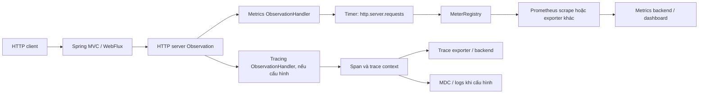
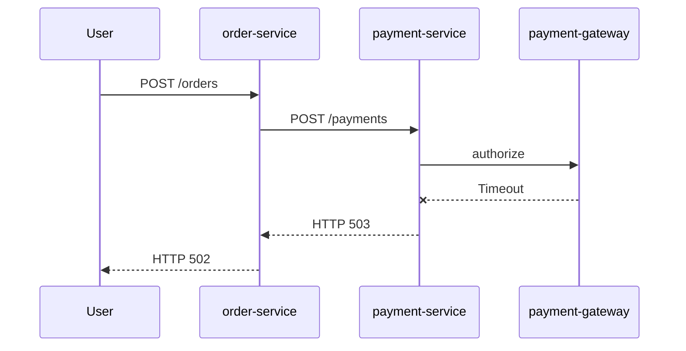
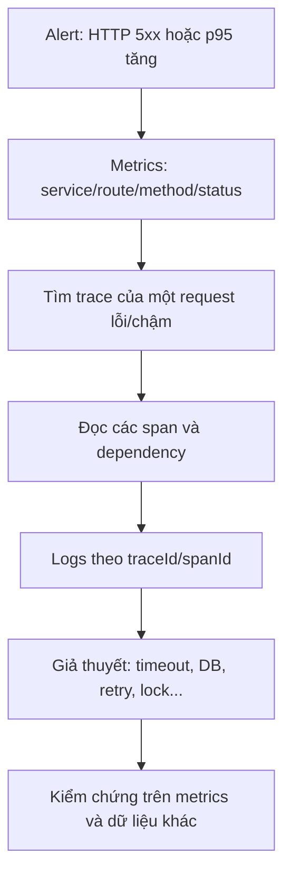
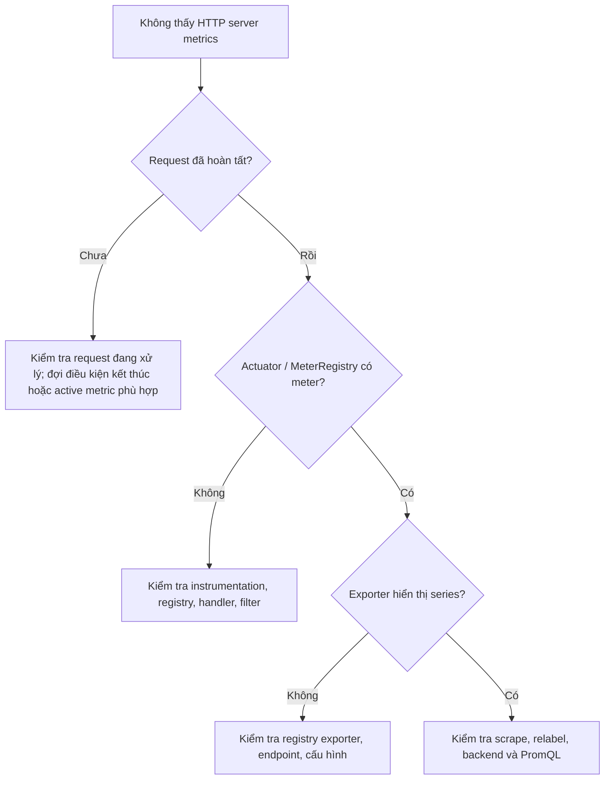

# HTTP request metrics trong Spring Boot

Khi một dịch vụ Spring Boot bị chậm hoặc trả về nhiều lỗi HTTP 5xx, nhóm vận hành cần biết: **có bao nhiêu request**, **request đến những endpoint nào**, **tỷ lệ lỗi là bao nhiêu**, **độ trễ biến động ra sao** và **ảnh hưởng có kéo dài hay không**. HTTP request metrics trả lời các câu hỏi này dưới dạng số liệu tổng hợp theo thời gian. Chúng thường là điểm xuất phát để điều tra trước khi mở distributed trace hoặc đọc log của một yêu cầu cụ thể.

Bài **“HTTP request metrics”** thuộc chương **Application metrics** trong module **SPRING_BOOT_OBSERVABILITY**. Bài tập trung vào cách Spring Boot sử dụng Micrometer Observation/Metrics để thu thập phép đo HTTP, cách xem dữ liệu bằng Spring Boot Actuator và Prometheus, thiết kế tag có cardinality phù hợp, tính throughput/error rate/latency và nối kết metrics với logs, distributed tracing, sampling và context propagation khi điều tra ứng dụng đang chạy.

## 1. HTTP request metrics là gì?

HTTP request metrics là những phép đo mô tả **tập hợp request HTTP** mà một ứng dụng đã xử lý. Trong Spring Boot có tích hợp Micrometer, HTTP server instrumentation thường phát ra một Observation với tên kỹ thuật `http.server.requests`; một metrics handler có thể chuyển hoạt động đó thành **Timer** cùng tên.

Timer tổng hợp các thông tin quan trọng:

- **Count:** số lần đo đã hoàn tất trong khoảng dữ liệu của meter.
- **Total time:** tổng thời lượng các lần được đo.
- **Max:** thời lượng lớn nhất theo chính sách thống kê của registry, thường có cửa sổ và khả năng reset; không xem là “max từ khi ứng dụng khởi động” trong mọi registry.
- **Histogram buckets:** phân bố thời lượng theo các ngưỡng, nếu được bật và backend hỗ trợ.
- **Percentiles:** có thể được tính ở ứng dụng hoặc ở backend tùy cơ chế cấu hình; không mặc nhiên có trên mọi Timer.

Một request `GET /orders/42` xử lý xong sau 120 ms có thể làm Count tăng 1 và Total Time tăng thêm 0,120 giây cho **tổ hợp tags** của request đó. Request tiếp theo cùng route/method/status được cộng vào phép đo tổng hợp, chứ không tạo một chuỗi mới chỉ vì ID đơn hàng khác nhau.

### Metrics khác gì access log và trace?

| Tín hiệu | Đơn vị dữ liệu | Giúp trả lời |
| --- | --- | --- |
| HTTP metric | Giá trị số đã tổng hợp theo nhãn và thời gian | Lưu lượng bao nhiêu? Error rate/p95 tăng tại route nào? |
| HTTP/access log hoặc application log | Một dòng/sự kiện của một request hay một bước xử lý | Request nào bị lỗi? Exception, request reference, retry hay fallback là gì? |
| Distributed trace | Một trace gồm nhiều span của một yêu cầu | Độ trễ nằm ở controller, database, HTTP client hay dịch vụ kế tiếp? |

Metric có thể cảnh báo **một vấn đề mang tính hệ thống**. Trace và log giúp xem **một trường hợp cụ thể**. Không thể suy ra đường đi của request chỉ từ một chuỗi metric, cũng không thể suy ra tỷ lệ lỗi toàn hệ thống từ một trace đơn lẻ.

## 2. Luồng tạo HTTP server metrics trong Spring Boot

Với ứng dụng Spring MVC hoặc WebFlux đã được cấu hình observability, Spring có thể tự instrument vòng đời request HTTP. Micrometer Observation mô tả quá trình, còn handler metrics cập nhật Timer trong `MeterRegistry`.



Một cấu hình thường gặp:

1. Spring Boot Actuator/Micrometer cung cấp nền tảng instrumentation và `ObservationRegistry`.
2. Spring HTTP instrumentation quan sát request server và đặt tên/tags theo convention phù hợp.
3. Metrics handler ghi dữ liệu vào `MeterRegistry`.
4. Registry/exporter cung cấp metric cho Prometheus hoặc backend khác.
5. Nếu có tracing bridge, tracer, sampler và exporter, Observation có thể đồng thời tham gia distributed trace.

**Có Actuator hoặc có `ObservationRegistry` chưa đủ để bảo đảm dữ liệu hiện trong Prometheus.** Cần exporter/registry đúng loại, endpoint/scrape và backend đang thu thập. Tương tự, HTTP metrics có dữ liệu không chứng minh distributed tracing đã hoạt động.

### Vòng đời và thời điểm ghi Timer

HTTP request Timer thường phản ánh **các request đã hoàn tất** và thời lượng xử lý được đo ở phía server. Request treo lâu hoặc đang xử lý có thể chưa tăng Count cho đến khi kết thúc. Nếu cần quan sát lưu lượng **đang xử lý**, phải kiểm tra loại meter active/in-flight do phiên bản framework và instrumentation cung cấp; không dùng Count của Timer hoàn tất làm số kết nối đang mở.

Độ trễ đo ở server cũng khác **thời gian người dùng cảm nhận**: client có thể chịu thêm DNS, TLS, mạng, proxy, retry và thời gian render. Để tìm nguyên nhân chậm theo chiều dài đường đi, nên kết hợp server metrics với client metrics, gateway metrics và distributed tracing.

## 3. Thiết lập HTTP metrics cho ứng dụng ví dụ

Một ứng dụng Spring Boot dùng Spring MVC có thể có các dependency Gradle Groovy:

```groovy
dependencies {
    implementation 'org.springframework.boot:spring-boot-starter-web'
    implementation 'org.springframework.boot:spring-boot-starter-actuator'
    runtimeOnly 'io.micrometer:micrometer-registry-prometheus'
}
```

Đối với WebFlux, thay phần web MVC bằng starter WebFlux phù hợp. Các dependency thường được Spring Boot quản lý phiên bản qua BOM/plugin; tránh tự ghim phiên bản Micrometer không tương thích.

Cấu hình minh họa:

```yaml
spring:
  application:
    name: order-service

management:
  endpoints:
    web:
      exposure:
        include: health,info,metrics,prometheus
  metrics:
    tags:
      application: order-service
      environment: local
```

Trong cấu hình này:

- `management.metrics.tags` cung cấp các **common tags** ổn định cho metrics do registry được cấu hình quản lý.
- Endpoint `/actuator/metrics` giúp kiểm tra meter trong ứng dụng.
- Endpoint `/actuator/prometheus` cho Prometheus scrape khi registry Prometheus có mặt và endpoint được bật.
- `health` và `info` là các endpoint khác, không thay thế HTTP request metrics.
- Dữ liệu chỉ đến Prometheus khi Prometheus hoặc hệ thống thu thập phù hợp **thực sự scrape endpoint**; tự bật endpoint không tự cấu hình máy chủ Prometheus.

Các endpoint Actuator có thể tiết lộ thông tin vận hành. Hãy hạn chế truy cập và xác thực/bảo vệ endpoint theo chính sách triển khai, đặc biệt trên môi trường production. Không coi ví dụ mở endpoints trên môi trường local là mặc định phù hợp cho Internet công cộng.

### Ứng dụng mẫu tạo nhiều status code

```java
import org.springframework.http.ResponseEntity;
import org.springframework.web.bind.annotation.GetMapping;
import org.springframework.web.bind.annotation.PathVariable;
import org.springframework.web.bind.annotation.RequestMapping;
import org.springframework.web.bind.annotation.RestController;

@RestController
@RequestMapping("/orders")
public class OrderController {

    @GetMapping("/{id}")
    public ResponseEntity<String> findOrder(@PathVariable long id) {
        if (id == 42L) {
            return ResponseEntity.ok("paid");
        }
        return ResponseEntity.notFound().build();
    }
}
```

Có thể phát request thử bằng terminal:

```bash
curl -i http://localhost:8080/orders/42
curl -i http://localhost:8080/orders/43
```

Kết quả minh họa: request đầu `200`, request sau `404`. Với route do controller xử lý, HTTP instrumentation thường có thể dùng **route template** `/orders/{id}` làm tag `uri`; hai ID khác nhau không nên tạo hai series riêng vì giá trị path động.

Chi tiết status/uri tag, cách xử lý route không khớp hoặc exception phụ thuộc Spring Boot/Spring Framework và phiên bản instrumentation. Hãy kiểm tra dữ liệu thực tế.

## 4. Những tag chính của HTTP request metrics

Một HTTP server Timer có thể có các low-cardinality tags như:

| Tag thường gặp | Giá trị ví dụ | Cách diễn giải |
| --- | --- | --- |
| `method` | `GET`, `POST` | HTTP method |
| `uri` | `/orders/{id}` | Route template đã được chuẩn hóa |
| `status` | `200`, `404`, `503` | HTTP status của response |
| `outcome` | `SUCCESS`, `CLIENT_ERROR`, `SERVER_ERROR` | Nhóm kết quả, nếu convention có cung cấp |
| `exception` | `None` hoặc tên loại exception | Loại exception được instrumentation ghi nhận, nếu có |
| `application` | `order-service` | Common tag do ứng dụng cấu hình |
| `environment` | `local`, `prod` | Common tag do triển khai cấu hình |

Không phải mọi bản Spring Boot hoặc mọi metrics registry đều có **chính xác** bộ tag này. Một số trường là mặc định thường gặp ở Spring MVC, một số có thể thay đổi khi dùng custom ObservationConvention/MeterFilter hoặc exporter.

### Đặc biệt chú ý `uri`

Với `GET /orders/42` và `GET /orders/43`, tag tốt là:

```text
uri="/orders/{id}"
```

Tag rủi ro là:

```text
uri="/orders/42"
uri="/orders/43"
```

Nếu đưa đường dẫn đầy đủ chứa ID vào `uri`, số series có thể tăng theo số đơn hàng. Một endpoint chưa match route có thể được gắn nhãn chung như `NOT_FOUND`/`UNKNOWN` hoặc giá trị tương đương theo instrumentation; **không gán mọi đường dẫn chưa match thành URI riêng**.

### Status và outcome không hoàn toàn đồng nghĩa lỗi nghiệp vụ

`200` là HTTP success nhưng nghiệp vụ có thể trả thông báo từ chối trong body. `404` là HTTP client error theo phân loại, nhưng một endpoint tra cứu tài nguyên không tồn tại có thể là hành vi bình thường. `503` thường cho thấy sự cố server hoặc dependency, nhưng nguyên nhân cần điều tra.

Nếu dùng HTTP 5xx làm error SLI, đó là lựa chọn vận hành có lý do, **không tự bao gồm tất cả lỗi nghiệp vụ**. Với thanh toán bị từ chối hợp lệ, hãy bổ sung metric nghiệp vụ khác thay vì cố diễn giải từ HTTP status.

### Exception tag có giới hạn

Đối với lỗi đã được handler/ControllerAdvice xử lý và trả response, `exception` có thể không giống loại exception ban đầu hoặc có giá trị cho biết không ghi exception. Đừng dựa duy nhất vào tag này để kiểm đếm lỗi; phối hợp status, metric nghiệp vụ và log/trace chi tiết.

## 5. Cardinality và chi phí của HTTP metrics

Một metric có tên `http.server.requests` và nhiều nhãn có thể tạo một series cho mỗi **tổ hợp giá trị** được quan sát.

Giả sử một dịch vụ có:

| Chiều nhãn | Số giá trị giả định |
| --- | ---: |
| `method` | 4 |
| `uri` (route template) | 20 |
| `status` | 6 |
| `outcome` | 4 |
| `environment` | 2 |

Tổng số tổ hợp có thể có tối đa theo mô hình đơn giản:

\[
4 \times 20 \times 6 \times 4 \times 2 = 3840
\]

Đây là số tổ hợp giả định, **không phải** số series chắc chắn được phát: nhiều method/status/outcome không xuất hiện cùng một route. Tuy nhiên, nếu thêm `user.id` với 50.000 giá trị vào cùng metric, số tổ hợp lý thuyết trở thành:

\[
3840 \times 50\,000 = 192\,000\,000
\]

Nếu có histogram, mỗi tổ hợp tag còn có thể phát nhiều bucket series. Khi đó, cardinality ảnh hưởng bộ nhớ MeterRegistry, kích thước scrape, băng thông, lưu trữ, indexing và tốc độ PromQL.

**Nguyên tắc thực hành:**

- Dùng route **template**, ví dụ `/orders/{id}`, không dùng path cụ thể.
- Dùng nhãn hữu hạn: `method`, `status`, nhóm `outcome`, `application`, `environment`.
- Tránh `userId`, `orderId`, `sessionId`, `traceId` và query string nguyên bản làm metric label.
- Không đưa email, token, cookie, request body hoặc stack trace vào tags.
- Nếu cần phân tích theo người dùng/giao dịch cụ thể, sử dụng log, trace hoặc dữ liệu nghiệp vụ đã được quản trị, với mục đích, quyền truy cập và retention phù hợp.

**High-cardinality key values của Observation** có thể được tracing handler sử dụng cho span attributes khi được phép. Nhưng chúng không tự thành nhãn metric, log field hoặc baggage. Cũng không thể dùng sampling để sửa cardinality meter đã tạo ra tại nguồn.

## 6. Xem metrics trong Actuator

Sau khi có request được xử lý, endpoint có thể liệt kê meter names:

```bash
curl http://localhost:8080/actuator/metrics
```

Và tra meter HTTP server:

```bash
curl http://localhost:8080/actuator/metrics/http.server.requests
```

Một phản hồi JSON **minh họa** có thể có dạng:

```json
{
  "name": "http.server.requests",
  "measurements": [
    {"statistic": "COUNT", "value": 2.0},
    {"statistic": "TOTAL_TIME", "value": 0.052},
    {"statistic": "MAX", "value": 0.031}
  ],
  "availableTags": [
    {"tag": "method", "values": ["GET"]},
    {"tag": "uri", "values": ["/orders/{id}"]},
    {"tag": "status", "values": ["200", "404"]}
  ]
}
```

Giá trị và tags chỉ để minh họa. Endpoint metrics của Actuator cho phép xem các phép đo đã tổng hợp, thường có thể lọc bằng tham số `tag` khi endpoint hỗ trợ:

```bash
curl 'http://localhost:8080/actuator/metrics/http.server.requests?tag=method:GET&tag=status:404'
```

Lưu ý: Timer có thể chứa thời lượng theo đơn vị cơ sở được báo trong dữ liệu; đừng mặc định mọi exporter hiển thị đơn vị giống nhau. Với Actuator, cách trình bày/khả dụng của statistic phụ thuộc loại meter/registry.

### Endpoint Prometheus

Khi có `micrometer-registry-prometheus` và endpoint được bật:

```bash
curl http://localhost:8080/actuator/prometheus
```

Có thể tìm các chuỗi dạng:

```text
# Dữ liệu minh họa, tên tag/series phụ thuộc exporter.
http_server_requests_seconds_count{method="GET",uri="/orders/{id}",status="200",application="order-service"} 1
http_server_requests_seconds_sum{method="GET",uri="/orders/{id}",status="200",application="order-service"} 0.021
```

Các series này biểu diễn dữ liệu tích lũy theo tổ hợp label. `_count` không phải requests per second; `_sum` không phải latency của request cuối cùng. Muốn xem tốc độ hoặc độ trễ trong một khoảng thời gian, hãy truy vấn đúng cửa sổ.

## 7. Bốn chỉ số vận hành quan trọng từ HTTP metrics

### 7.1 Throughput: số request trên đơn vị thời gian

Throughput thường được đo bằng requests/second (RPS). Với Prometheus, một ví dụ:

```promql
sum(
  rate(http_server_requests_seconds_count{
    application="order-service"
  }[5m])
)
```

`rate(...)` ước lượng tốc độ tăng trung bình của counter qua cửa sổ 5 phút, có xử lý hiện tượng counter reset theo đặc tính Prometheus. `sum(...)` gộp request rate từ các instance và các nhãn khác.

Muốn phân tích theo route:

```promql
sum by (uri) (
  rate(http_server_requests_seconds_count{
    application="order-service"
  }[5m])
)
```

Không dùng một giá trị Count tích lũy tại một thời điểm rồi gọi nó là tốc độ.

### 7.2 Error rate: tỷ lệ phản hồi lỗi HTTP

Số phản hồi HTTP 5xx mỗi giây:

```promql
sum(
  rate(http_server_requests_seconds_count{
    application="order-service",
    status=~"5.."
  }[5m])
)
```

Tỷ lệ 5xx trên tổng request:

```promql
sum(rate(http_server_requests_seconds_count{
  application="order-service",
  status=~"5.."
}[5m]))
/
sum(rate(http_server_requests_seconds_count{
  application="order-service"
}[5m]))
```

Nếu cần hiển thị phần trăm, nhân 100 hoặc để dashboard hiển thị dưới dạng percentage từ tỷ lệ. Khi traffic bằng 0, mẫu số có thể bằng 0/thiếu dữ liệu; phải có xử lý phù hợp trước khi dùng làm alert.

**HTTP 5xx error rate không phải toàn bộ business failure rate.** Ví dụ cổng thanh toán từ chối thẻ hợp lệ và ứng dụng trả 200 hoặc 409 cần metric nghiệp vụ riêng nếu đó là điều nhóm vận hành muốn theo dõi.

### 7.3 Latency trung bình

Nếu `_sum` và `_count` dùng cùng tập nhãn/timer:

```promql
sum(rate(http_server_requests_seconds_sum{
  application="order-service"
}[5m]))
/
sum(rate(http_server_requests_seconds_count{
  application="order-service"
}[5m]))
```

Kết quả có đơn vị **giây** khi exporter Prometheus đang xuất duration bằng giây. Đây là **trung bình**, không phải p95. Một vài request cực chậm có thể bị che khuất nếu lưu lượng lớn.

### 7.4 p95/p99 latency và histogram

p95 bằng một giá trị sao cho khoảng 95% quan sát không vượt quá ngưỡng đó trong phân bố được xét. Với hệ thống web, p95 hoặc p99 giúp nhận diện phần đuôi chậm tốt hơn trung bình.

Nếu Spring Boot/Micrometer được cấu hình phát **histogram buckets** cho HTTP server Timer, Prometheus có thể tính p95 bằng `histogram_quantile(...)`:

```promql
histogram_quantile(
  0.95,
  sum by (le) (
    rate(http_server_requests_seconds_bucket{
      application="order-service"
    }[5m])
  )
)
```

Muốn xem p95 theo route:

```promql
histogram_quantile(
  0.95,
  sum by (uri, le) (
    rate(http_server_requests_seconds_bucket{
      application="order-service"
    }[5m])
  )
)
```

**Các truy vấn này chỉ dùng được khi `_bucket` thực sự tồn tại.** Không có histogram thì việc nhìn `_sum`/`_count` không thể tạo ra p95. Không lấy trung bình các p95 của nhiều instance rồi xem là p95 toàn hệ thống; cách tổng hợp phù hợp là gộp bucket rates trước khi áp dụng histogram quantile.

## 8. Bật histogram để tính phân vị

Một cấu hình Spring Boot minh họa cho Timer `http.server.requests`:

```yaml
management:
  metrics:
    distribution:
      percentiles-histogram:
        http.server.requests: true
```

Cấu hình phải được áp dụng đúng tên meter, có registry hỗ trợ buckets và có exporter thích hợp. Với Prometheus, hãy kiểm tra dữ liệu trên `/actuator/prometheus` xem có `http_server_requests_seconds_bucket` trước khi triển khai truy vấn p95.

Không bật histogram một cách vô điều kiện cho mọi Timer có cardinality lớn. Mỗi tổ hợp tags có thể thêm nhiều bucket series và tăng chi phí đáng kể. Nên chọn meter phục vụ SLI/SLO, kiểm tra số bucket và kích thước scrape trước khi bật rộng.

### Histogram khác client-side percentile

| Cách đo | Ý nghĩa | Khi tổng hợp nhiều instance |
| --- | --- | --- |
| Count và sum | Số lần và tổng thời lượng | Có thể tổng hợp để tính trung bình |
| Histogram buckets | Số đo rơi vào từng ngưỡng | Có thể gộp bucket counts/rates, rồi tính phân vị gần đúng |
| Client-side percentiles | Phân vị được tính trong registry/ứng dụng theo cấu hình | Không nên cộng hoặc lấy trung bình đơn giản giữa nhiều instance |
| Max (time-window) | Giá trị lớn nhất trong cửa sổ do registry quản lý | Không phải p95 và không nhất thiết là maximum lịch sử |

Trong dashboard, ghi rõ đơn vị (ms hay s), cửa sổ tính, nhóm route và phạm vi instance. Một p95 “2.0” mà không có đơn vị hoặc không biết gộp trên những route nào dễ gây hiểu nhầm.

## 9. Biểu đồ Golden Signals cho HTTP service

Những tín hiệu phổ biến cần theo dõi với HTTP service là **traffic**, **errors**, **latency** và **saturation**.

| Tín hiệu | HTTP request metrics cung cấp | Cần bổ sung để hiểu đầy đủ |
| --- | --- | --- |
| Traffic | RPS theo service/route/method | Hàng đợi, background work hoặc message traffic ngoài HTTP |
| Errors | Tỷ lệ status 5xx/4xx và lỗi ứng dụng nếu được instrument | Business error rate, downstream failures |
| Latency | Mean/p95/p99 HTTP server duration | Client/gateway latency, dependency spans |
| Saturation | Chỉ gián tiếp qua RPS/latency | CPU, JVM memory/GC, thread pool, connection pool, queue depth, requests in flight |

HTTP request metrics mô tả **đầu ra** của quá trình xử lý HTTP. Khi p95 tăng mà throughput không đổi, nguyên nhân có thể là database lock, dependency chậm, connection pool, GC hoặc CPU saturation. Metrics khác và distributed trace giúp phân biệt những khả năng này.

### Một ngưỡng cảnh báo có cần cùng loại cho mọi route?

Không nhất thiết. `/health`, `/login`, `/checkout` và một endpoint export báo cáo có đặc tính khác nhau. Nếu gộp tất cả route, các request nhanh với số lượng lớn có thể che khuất một route ít traffic nhưng đang chậm. Nên xác định **service-level indicator (SLI)** phù hợp hành trình người dùng hoặc endpoint quan trọng, cùng cửa sổ cảnh báo và lượng traffic tối thiểu.

Ví dụ, tỷ lệ 5xx của `POST /checkout` có thể quan trọng hơn tỷ lệ 404 trên một URL không tồn tại. Với ít request, một lỗi đơn lẻ làm tỷ lệ tăng mạnh; cảnh báo cần xét traffic và thời gian để hạn chế nhiễu.

## 10. HTTP client metrics và điều tra dependency

HTTP server Timer ở `order-service` cho biết tổng thời gian xử lý request tại service. Nếu phần lớn thời gian nằm ở lời gọi `payment-service`, cần quan sát cả **HTTP client metrics** và các span của lời gọi mạng.

Các HTTP client được Spring Boot/Spring Framework instrument phù hợp có thể tạo metrics/Observation cho outbound calls, thường với tên meter như `http.client.requests`; khả năng hoạt động phụ thuộc HTTP client và cách khởi tạo (ví dụ các builder được framework cung cấp), phiên bản và wiring instrumentation.



Các phép đo có thể xuất hiện:

- `order-service` **server metric**: thời lượng `POST /orders` và status 502.
- `order-service` **client metric**: thời lượng HTTP call đến `payment-service` và status trả về 503, nếu client được instrument.
- `payment-service` **server metric**: thời lượng `POST /payments` và status 503.
- `payment-service` **client metric**: lời gọi đến gateway, nếu gateway HTTP client được instrument.

**Không cộng thẳng duration của HTTP server và HTTP client metrics** để suy tổng latency: hai khoảng có thể bao nhau, và metrics là dữ liệu tổng hợp từ nhiều request khác nhau. Muốn thấy khoảng thời gian thực tế và quan hệ cha–con cho một request, dùng distributed trace.

Các tên và tập tag của client/server có thể khác nhau; phải xác nhận metric có mặt trên phiên bản Spring Boot, HTTP client và exporter thực tế trước khi viết dashboard.

## 11. Tùy biến HTTP request metrics mà không tạo cardinality cao

HTTP instrumentation mặc định thường phù hợp cho những chỉ số nền tảng. Khi cần metadata khác, có thể dùng **ObservationConvention** dành cho HTTP server hoặc những extension point do Spring Boot/Spring Framework hỗ trợ, tùy phiên bản.

Các tình huống hợp lý:

- Thêm nhóm routing hoặc loại API có số giá trị được kiểm soát.
- Đổi tên tag để phù hợp taxonomy thống nhất, đồng thời cập nhật dashboards/alerts.
- Thêm low-cardinality key `api.version=v1` hoặc `channel=web` nếu thực sự có ý nghĩa, ổn định và không quá nhiều giá trị.

Tránh đưa những trường này vào HTTP metric labels: `user.id`, `order.id`, `session.id`, `traceId`, IP nguyên bản, raw URL, query string, email, token hoặc exception message tùy ý. Khi cần điều tra cá biệt, chỉ lưu thuộc tính phù hợp ở trace/log hoặc nguồn dữ liệu nghiệp vụ với chính sách bảo vệ rõ ràng.

### Khi nào cần custom metric nghiệp vụ thay vì sửa HTTP metric?

HTTP status đôi khi không biểu diễn kết quả nghiệp vụ. Ví dụ endpoint trả 200 nhưng một giao dịch bị `DECLINED` theo quy tắc thanh toán. Khi đó nên tạo metric `payment.authorization.attempts` với `result=approved|declined|error` và phương thức thanh toán hữu hạn, thay vì ép HTTP request metric mang mã giao dịch.

Ví dụ dùng Micrometer Metrics trực tiếp:

```java
import io.micrometer.core.instrument.Counter;
import io.micrometer.core.instrument.MeterRegistry;
import org.springframework.stereotype.Service;

@Service
public class PaymentResultMetrics {
    private final MeterRegistry meters;

    public PaymentResultMetrics(MeterRegistry meters) {
        this.meters = meters;
    }

    public void recordApproved() {
        Counter.builder("payment.authorization.attempts")
                .tag("result", "approved")
                .register(meters)
                .increment();
    }

    public void recordDeclined() {
        Counter.builder("payment.authorization.attempts")
                .tag("result", "declined")
                .register(meters)
                .increment();
    }
}
```

Đây là metric nghiệp vụ bổ sung, không thay thế HTTP server Timer. Ở production, cần thống nhất cách đo retry, kết quả trung gian và idempotency trước khi diễn giải count.

### Common tags cho các metrics application

`management.metrics.tags` có thể thêm `application`/`environment` vào HTTP metrics và các meter khác của registry. Nhưng common tags thuộc **đường metrics**, không tự gắn vào span/log. Phần tracing nên cấu hình service identity (ví dụ `service.name`) và log pipeline theo quy tắc tương ứng.

## 12. Từ HTTP metric đến trace và log của một request

Giả sử dashboard báo p95 của `POST /orders` tăng từ 150 ms lên 2 giây và tỷ lệ 5xx tăng. Một lượt điều tra có thể đi theo hướng:

1. **Metric xác nhận phạm vi.** Xem throughput, p95 và 5xx theo `application`, `environment`, `uri`, `method`; so sánh cùng khoảng thời gian và trước/sau triển khai.
2. **Chọn trace đại diện.** Trong trace backend, tìm request lỗi hoặc duration cao thuộc cùng service/route/time window. Nếu backend hỗ trợ *exemplar* gắn trace ID vào điểm dữ liệu metric, có thể mở trace trực tiếp; exemplar cần cấu hình riêng.
3. **Đọc spans.** Xác định thời gian nằm ở controller, DB, HTTP client, queue hay dependency. Xem retry và tính song song; không cộng duration của những span chồng nhau.
4. **Tìm log đúng ngữ cảnh.** Lấy `traceId` từ trace và tìm log có cùng ID, kết hợp `spanId`/service/time khi cần. Kiểm tra exception, timeout và fallback.
5. **Quay lại metric.** Kiểm tra dependency error rate/latency và tỉ lệ lỗi toàn route để đánh giá giả thuyết có giải thích được nhiều request hay không.



### Vì sao trace không xuất hiện dù HTTP count vẫn tăng?

Có thể có nhiều nguyên nhân:

- Tracing chưa được cấu hình; ứng dụng chỉ có metrics handler.
- Head/tail sampling loại trace.
- Exporter/collector bị lỗi hoặc backend không nhận span.
- Instrumentation của HTTP client/custom code thiếu.
- Context propagation bị đứt qua executor, reactive pipeline, HTTP hoặc message broker.
- Backend không index được các thuộc tính dùng để tìm trace.

**Trace sampling không làm HTTP Timer tự động chỉ đếm các request được giữ trace.** Trong cấu hình metrics/tracing thông thường, Timer vẫn tổng hợp request độc lập với việc span được export hay không. Đừng lấy số trace lỗi chia số trace để coi là HTTP error rate thực nếu sampler có thể thiên lệch.

### Log correlation

Micrometer Tracing có thể đưa `traceId` và `spanId` vào MDC của logging framework khi scope tracing hoạt động. Nhưng `http.server.requests` không tự viết mọi HTTP access log, và common metric tags không tự biến thành field log. Cần kiểm tra encoder JSON/pattern và pipeline logs thật sự giữ các trường tương quan.

Không gắn trace ID thành metric label để “liên kết” metrics với logs: `traceId` có cardinality rất cao. Hãy dùng exemplars nếu backend hỗ trợ, hoặc tìm trace theo time, route, status rồi mở log theo trace ID.

## 13. Những lỗi thường gặp khi đọc HTTP metrics

| Biểu hiện hoặc nhận định | Điểm cần xem lại |
| --- | --- |
| “`_count` là RPS hiện tại” | `_count` là counter tích lũy; dùng `rate(...)`/`increase(...)` |
| “`_sum / _count` là p95” | Đây là trung bình; p95 cần distribution/histogram |
| “Tính trung bình các p95 instance để có p95 toàn service” | Phân vị không cộng/tính trung bình đơn giản; gộp histogram buckets nếu có |
| “URL nào cũng được làm `uri` tag” | Raw paths và IDs làm tăng cardinality; dùng route template |
| “Tất cả HTTP 4xx đều là lỗi server” | 4xx thuộc phía client theo phân loại HTTP, nhưng ý nghĩa nghiệp vụ tùy endpoint |
| “HTTP 200 nghĩa là nghiệp vụ thành công” | Body/status nghiệp vụ có thể báo declined; cần metric nghiệp vụ |
| “Có `http.server.requests` nghĩa là đã có trace” | Metrics handler không đảm bảo tracing bridge/sampler/exporter |
| “Mất trace chứng minh request không xảy ra” | Sampling, exporter và tracing instrumentation có thể làm trace vắng mặt |
| “Request chưa hoàn tất cũng chắc chắn tăng Timer count” | Timer thường ghi nhận khi hoàn tất; cần active/in-flight metrics riêng nếu muốn theo dõi đang xử lý |
| “Actuator metrics endpoint trống nghĩa là code không instrument” | Có thể chưa có request, endpoint khác context/port, registry thiếu handler hoặc chưa enable |
| “`/actuator/prometheus` bật là Prometheus đã scrape” | Cần scrape job/đường mạng/quyền truy cập hoạt động |
| “Metric status 503 chỉ ra nguyên nhân là DB” | Status chỉ mô tả kết quả; trace, logs và dependency metrics mới khoanh vùng nguyên nhân |

## 14. Quy trình kiểm tra HTTP metrics khi không có dữ liệu

Bắt đầu bằng một request có thể lặp lại được trên môi trường thử nghiệm, rồi kiểm tra từng tầng:

### Tầng 1 — Ứng dụng và instrumentation

- Ứng dụng có chạy trên Spring MVC/WebFlux với Actuator/Micrometer tương thích không?
- Request đã thực sự tới controller/filter/handler của ứng dụng chưa?
- Có custom code vô hiệu hóa Observation hoặc meter không?
- Có `ObservationRegistry.NOOP` hoặc registry tự tạo không chứa metrics handler ở đường instrument cần kiểm tra không?

### Tầng 2 — MeterRegistry và Actuator

- Endpoint `/actuator/metrics` có hiện tên `http.server.requests` sau khi request kết thúc không?
- Tên/tags cuối cùng là gì? Có custom convention/filter làm thay đổi tên?
- Common tag `application`/`environment` có xuất hiện như mong đợi?
- Meter được đăng ký vào registry nào, có vô tình dùng registry khác không?

### Tầng 3 — Exporter và backend

- Có dependency và exporter phù hợp (ví dụ Prometheus registry) không?
- Endpoint `/actuator/prometheus` có dữ liệu Timer không?
- Scrape target có hoạt động, trả HTTP success và đủ quyền truy cập không?
- Backend có giới hạn series, drop rules, relabel hoặc name normalization không?
- PromQL lọc có đúng label names, app/environment và time range không?

### Tầng 4 — Liên kết traces/logs

- Tracing bridge/tracer/sampler/exporter đã cấu hình chưa?
- Trace context qua HTTP client, messaging và async có được propagate đúng không?
- Log pattern/JSON encoder có giữ `traceId`/`spanId` không?
- Trace bị sampling hay exporter drop có được hiểu đúng khi đối chiếu HTTP metric không?

Cây kiểm tra:



Nếu endpoint bị bảo vệ, dùng tài khoản/đường vận hành được cấp phép để kiểm tra. Không mở công khai actuator metrics/prometheus cho cả Internet chỉ để sửa dashboard.

## 15. Bài thực hành: đo ba trạng thái HTTP và đọc p95

Thực hiện trong môi trường local/test.

### Phần A — Tạo traffic có kiểm soát

Dùng `OrderController` ở mục 3. Gọi một số request `GET /orders/42` (200) và `GET /orders/43` (404). Với đường lỗi server, tạo một endpoint **chỉ ở môi trường test** có thể phát lỗi 500 chủ động, hoặc dùng test tương thích của ứng dụng để tạo response 500.

Xác minh request count được phân theo `uri`/`method`/`status`. Đừng kỳ vọng request 404 do controller trả về có `exception` bằng một exception Java; đó có thể là một response hợp lệ.

### Phần B — Đọc Count và throughput

Tra `/actuator/metrics/http.server.requests` rồi truy vấn Prometheus:

```promql
sum by (uri, status) (
  rate(http_server_requests_seconds_count[5m])
)
```

So sánh RPS và tổng request trong cửa sổ thời gian. Đừng nhầm Count tích lũy với số request trong 5 phút.

### Phần C — Bật histogram và đọc p95

Bật cấu hình `management.metrics.distribution.percentiles-histogram.http.server.requests` như mục 8, khởi động lại ứng dụng trong test, rồi xác minh `_bucket` đã được phát. Tính p95 theo `uri` và so với mức trung bình để hiểu sự khác biệt.

Nếu histogram bucket không có, tìm nguyên nhân trong cấu hình và exporter trước khi dùng `histogram_quantile`.

### Phần D — Đối chiếu trace và log

Khi có Micrometer Tracing và một trace đã được sampling giữ lại, mở trace của request chậm và tìm logs bằng `traceId`. Kiểm tra mối quan hệ giữa thời lượng span server và các span con, kể cả các cuộc gọi có thể chồng lấp.

Nếu không thấy trace, kiểm tra sampler, exporter và propagation trước khi kết luận request không tồn tại.

### Phần E — Thử cardinality

Gửi nhiều request đến `/orders/{id}` với ID giả lập khác nhau. Kiểm tra số giá trị `uri`. Nếu số series tăng theo từng ID, xem lại instrumentation hoặc custom convention: metric tag cần giữ **route template**, không giữ raw path.

## 16. Câu hỏi tự kiểm tra

1. HTTP server Timer đo Count và Total Time của những request nào? Điều gì xảy ra với request đang treo?
2. Vì sao `/orders/42` và `/orders/43` nên chia sẻ tag `uri=/orders/{id}`?
3. Sự khác nhau giữa `status=500` và một lỗi nghiệp vụ có response 200 là gì?
4. Muốn có RPS theo route, vì sao cần `rate(...)` thay vì đọc `_count` trực tiếp?
5. Vì sao `_sum / _count` không phải p95?
6. Cần bật thành phần nào để truy vấn `http_server_requests_seconds_bucket` bằng `histogram_quantile`?
7. Nếu một HTTP client mất 2 giây và server request mất 2,1 giây, vì sao không cộng hai con số?
8. Một common tag `application=order-service` xuất hiện trên metrics có tự xuất hiện trong logs hoặc trace resource không?
9. Trace sampling 10% có làm HTTP request Count chỉ ghi 10% request không?
10. Tại sao một số request trả 404 hoặc 403 không nhất thiết đồng nghĩa ứng dụng bị lỗi?
11. Nếu Actuator có meter nhưng Prometheus không có series, nên kiểm tra những bước nào?
12. Khi muốn điều tra một user cụ thể, tại sao không gắn `user.id` vào HTTP request metric label?

## Kết luận

**HTTP request metrics** giúp đo lưu lượng, tỷ lệ lỗi và độ trễ của Spring Boot theo service, endpoint, method và status với cardinality có thể kiểm soát. Trong Spring Boot, Micrometer Observation/Metrics và Actuator cung cấp nền tảng quan sát, còn MeterRegistry, histogram, exporter và backend quyết định cách dữ liệu được xuất và truy vấn.

Khi hệ thống phát sinh lỗi hoặc độ trễ cao, bắt đầu bằng metrics để xác định phạm vi và thời điểm, sau đó dùng distributed tracing để tìm công đoạn chậm, logs để giải thích lỗi cụ thể, rồi quay lại metrics để kiểm chứng mức độ ảnh hưởng. Sampling, context propagation, log correlation và chính sách tag phù hợp là điều kiện quan trọng để quá trình điều tra này đáng tin cậy.

