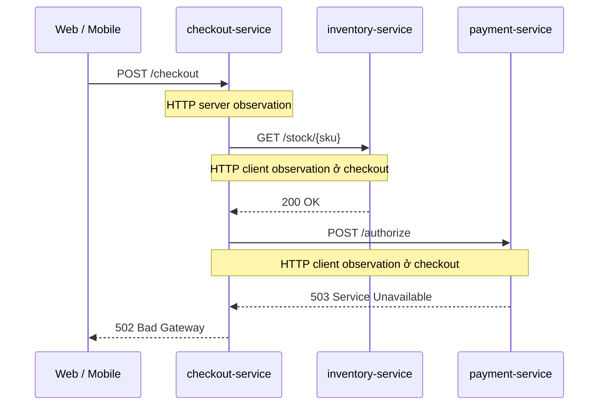
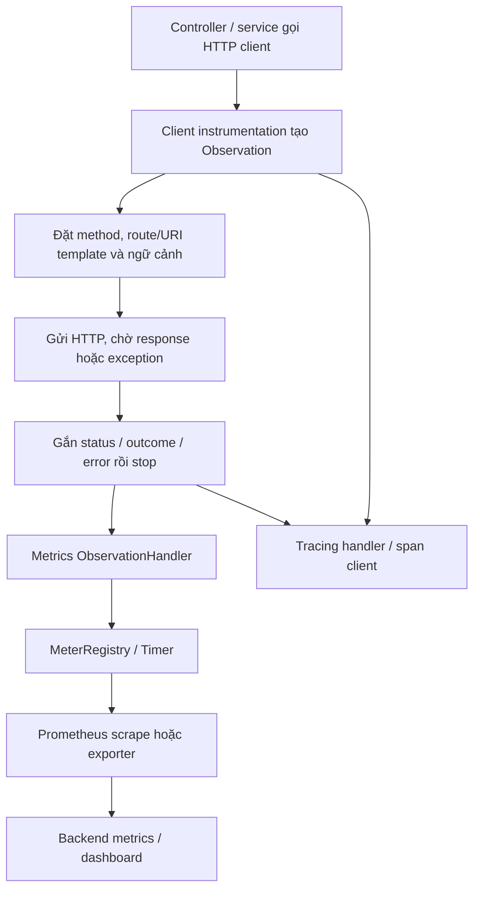
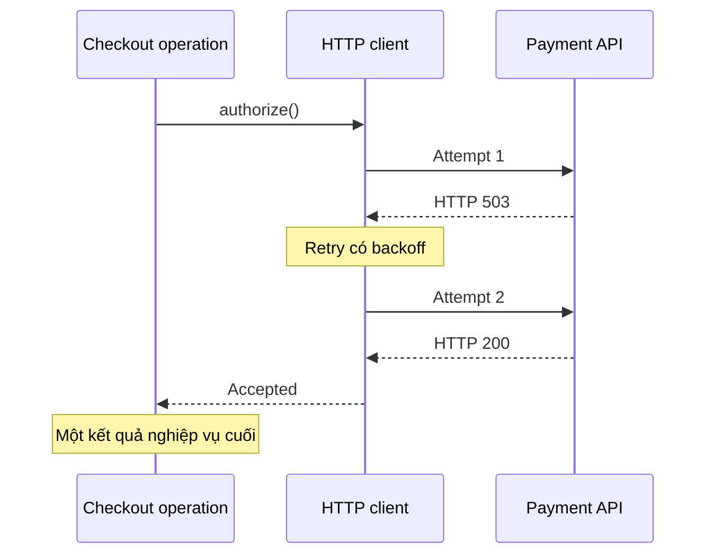
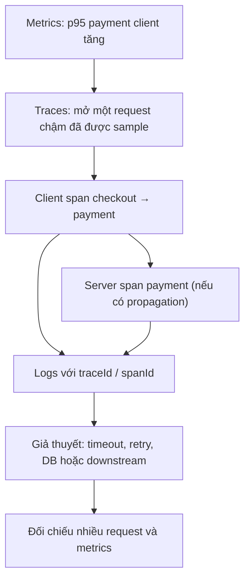

# HTTP client metrics trong Spring Boot: đo các lời gọi ra ngoài

Khi một API `POST /checkout` mất hai giây để trả lời, nguyên nhân có thể không nằm ở controller hay database của chính ứng dụng. Request đó có thể phải gọi dịch vụ tồn kho, thanh toán hoặc một API bên thứ ba. Nếu chỉ đo thời gian xử lý HTTP **đầu vào** của checkout, chúng ta biết người dùng đang đợi lâu nhưng chưa biết lời gọi **đầu ra** nào gây chậm.

**HTTP client metrics** cung cấp góc nhìn định lượng về những HTTP request mà ứng dụng **gửi tới hệ thống khác**: số lần gọi, thời lượng, phân bố độ trễ, mã trạng thái, lỗi và cách các giá trị này thay đổi theo thời gian. Trong chương **Application metrics** của module **SPRING_BOOT_OBSERVABILITY**, bài học này tập trung vào cách Spring Boot dùng **Micrometer Observation** và **Micrometer Metrics** để đo HTTP client, thiết kế nhãn có cardinality an toàn, xuất dữ liệu và liên kết metrics với logs/distributed traces khi điều tra sự cố.

Kết thúc bài, bạn cần phân biệt được inbound/outbound metrics, instrument đúng HTTP client mình đang dùng, tránh tạo hàng triệu time series từ URL động, đọc truy vấn latency/error rate, hiểu ảnh hưởng của retry/sampling và biết xác minh dữ liệu ở từng chặng của pipeline.

## 1. HTTP client metrics khác HTTP server metrics thế nào?

Trong một request phân tán, **cùng một dịch vụ** vừa đóng vai trò HTTP server với client của nó, vừa đóng vai trò HTTP client với các downstream services.



Trong ví dụ giả định:

| Góc quan sát | Đo tại đâu? | Câu hỏi trả lời |
| --- | --- | --- |
| **HTTP server metrics** | checkout-service nhận `POST /checkout` | Người dùng gọi endpoint có chậm/lỗi không? |
| **HTTP client metrics** | checkout-service gửi `GET /stock/{sku}` và `POST /authorize` | Downstream nào chậm, timeout hoặc trả 5xx? |
| **HTTP server metrics downstream** | inventory/payment nhận request | Downstream có ghi nhận và xử lý request đó không? |
| **Distributed tracing** | Các span client và server được liên kết | Request đi qua các service nào và thời gian chờ ở đâu? |
| **Logs** | Các service ghi sự kiện/lỗi có ngữ cảnh | Lý do từ chối, timeout hoặc exception cụ thể là gì? |

HTTP client metric phản ánh góc nhìn của **bên gọi**, không nhất thiết giống thời gian xử lý thuần ở phía server downstream. Nó có thể bao gồm phần overhead của client, kết nối và chờ response tùy instrumentation. Một timeout trước khi downstream nhận request có thể xuất hiện trong client metrics nhưng **không** xuất hiện trong server metrics downstream.

## 2. Một HTTP client metric nên cung cấp dữ liệu nào?

Trong hệ sinh thái Spring Framework 6 / Spring Boot 3.x, tên observation HTTP client phổ biến là `http.client.requests`. Khi được metrics handler ghi nhận, nó thường trở thành một **Timer** trong `MeterRegistry`. Timer có các thành phần quan trọng:

- **Count:** bao nhiêu lời gọi đã được ghi nhận.
- **Total time:** tổng thời lượng đã ghi, hữu ích để tính trung bình.
- **Max:** giá trị lớn nhất trong cửa sổ/thiết kế đo của registry; không nên coi nó là mức cao nhất của mọi thời đại.
- **Histogram/buckets**, nếu bật: phân bố các thời lượng giúp tính p95/p99 trên nhiều instance.
- **Tags:** nhóm lời gọi theo phương thức, URI template, client name, status/outcome và exception, tùy phiên bản instrumentation.

Không phải mọi Timer tự có percentile hay histogram. Các dữ liệu phân bố cần cấu hình và exporter/backend hỗ trợ. Một Timer cũng **không tự phân biệt** “request nghiệp vụ logic” với “mỗi HTTP attempt”; điều đó phụ thuộc chỗ instrumentation nằm trong luồng retry.

| Loại meter | Khi nào phù hợp cho outbound HTTP? |
| --- | --- |
| **Timer** | Đo số lời gọi và duration của request HTTP |
| **Counter** | Đếm một sự kiện nghiệp vụ khác với HTTP attempt, ví dụ số lệnh thanh toán thất bại cuối cùng |
| **Gauge** | Đo số kết nối đang mở, pending requests hoặc queue nếu pool/client có instrumentation tương ứng |
| **LongTaskTimer** | Chỉ dùng khi thật sự cần theo dõi các hoạt động đang chạy kéo dài; không thay Timer mặc định |

**Quy tắc:** bắt đầu bằng Timer HTTP client được framework instrument. Không tạo lại counter và timer thủ công cho mỗi request trừ khi cần một **phép đo có ý nghĩa khác**.

## 3. Vòng đời từ HTTP request đến time series

Một HTTP client được instrument bằng Micrometer Observation thường có quá trình:



Sơ đồ khái quát: tên observation, key-values, thời điểm mở scope, callback error và hành vi khi cancel phụ thuộc implementation. Nhưng cần hiểu ba điểm:

1. **Observation** mô tả vòng đời một lời gọi. **Timer** có thể được cập nhật mỗi lần observation kết thúc; một Timer phục vụ nhiều request cùng tên/tags.
2. **MeterRegistry** giữ phép đo trong ứng dụng. Backend chỉ thấy dữ liệu khi exporter hoặc hệ thống scrape thu thập thành công.
3. **Tracing handler** có thể tạo HTTP client span và inject trace context vào header. Trace có thể không được lưu vì sampling, trong khi Timer metrics vẫn được ghi qua pipeline độc lập.

Nếu client tự tạo không được gắn `ObservationRegistry`, code vẫn gửi HTTP bình thường nhưng **không chắc** có observation/metric HTTP client mặc định.

## 4. Điều kiện để Spring Boot tự đo outbound HTTP

Với Spring Boot 3.x, Actuator và Micrometer cung cấp phần nền cho instrumentation. Một tập dependency Gradle minh họa:

```groovy
dependencies {
    implementation 'org.springframework.boot:spring-boot-starter-actuator'
    runtimeOnly 'io.micrometer:micrometer-registry-prometheus'

    // Khi ứng dụng sử dụng WebClient:
    implementation 'org.springframework.boot:spring-boot-starter-webflux'
}
```

`spring-boot-starter-webflux` **chỉ cần** nếu dự án dùng WebClient hoặc stack tương ứng; ứng dụng dùng RestTemplate/RestClient có thể hoạt động với các dependency web thích hợp khác. Muốn có tracing còn cần bridge/tracer/exporter theo stack và phiên bản; **không** phải điều kiện bắt buộc để ghi HTTP client Timer.

Điểm quan trọng hơn dependencies là **cách tạo HTTP client**:

- `RestClient.Builder`: với các phiên bản Spring Boot hỗ trợ `RestClient` (thường từ Boot 3.2 trở lên), ưu tiên inject builder do Spring Boot quản lý.
- `RestTemplateBuilder`: dùng builder do Spring Boot cung cấp để nhận customizers/observation configuration.
- `WebClient.Builder`: inject builder do Spring Boot cung cấp; có thể sử dụng trong ứng dụng servlet hoặc reactive nếu dependency phù hợp.
- Tự tạo bằng `new RestTemplate()`, `RestClient.create()` hoặc `WebClient.builder()` ngoài cấu hình của Spring có thể **bỏ qua instrumentation mặc định**.

Không nên xem danh sách này là hợp đồng cho mọi phiên bản Spring Boot. Tên annotation, API, cấu hình observation và cách setup registry có thể thay đổi theo dòng framework. Hãy xác minh phiên bản thực và kiểm tra endpoint `/actuator/metrics/http.client.requests` hoặc `/actuator/prometheus`.

### Cấu hình expose metrics để kiểm chứng

```yaml
management:
  endpoints:
    web:
      exposure:
        include: health,info,metrics,prometheus
```

`/actuator/metrics` hiển thị dữ liệu quản trị về meter; `/actuator/prometheus` cung cấp dữ liệu scrape khi có Prometheus registry và endpoint phù hợp. Hãy bảo vệ endpoint quản trị, chỉ expose những endpoint cần thiết; không bật công khai toàn bộ Actuator ra Internet.

## 5. Ví dụ RestClient: HTTP client metrics tự động

Trong Spring Boot hỗ trợ `RestClient`, một service có thể inject `RestClient.Builder` và tạo HTTP client với base URL:

```java
import org.springframework.stereotype.Service;
import org.springframework.web.client.RestClient;

@Service
public final class PaymentHttpClient {
    private final RestClient client;

    public PaymentHttpClient(RestClient.Builder builder) {
        this.client = builder
            .baseUrl("https://payments.internal.example")
            .build();
    }

    public String getPaymentStatus(String paymentId) {
        return client.get()
            .uri("/payments/{id}/status", paymentId)
            .retrieve()
            .body(String.class);
    }
}
```

Nếu builder được cấu hình với observation registry phù hợp, lời gọi `getPaymentStatus(...)` sẽ được instrument như một HTTP client operation. Thông thường code nghiệp vụ **không cần tự tạo `Timer`** để đo duration của chính request này.

**Tại sao dùng `"/payments/{id}/status"`?** Cấu trúc URI template giúp instrumentation có cơ sở gắn nhãn route/URI ổn định, thay vì sinh một nhãn khác cho mỗi payment ID. Tên tag thực tế và khả năng giữ template vẫn phải kiểm chứng theo client/version.

Payment ID vẫn xuất hiện trên **request URL thật** để phía downstream định tuyến. Việc metric sử dụng URI template **không đảm bảo** proxy logs, tracing attributes hoặc network captures không ghi raw URL. Nếu ID nhạy cảm, cần chính sách bảo vệ toàn bộ pipeline và không dùng secrets trong URL.

### Khi response có 4xx/5xx

Với `RestClient.retrieve()`, nhiều HTTP status 4xx/5xx thường dẫn tới exception theo xử lý trạng thái mặc định. Nếu ứng dụng bắt exception rồi trả một kết quả dự phòng, **HTTP client metric** vẫn có thể ghi status 4xx/5xx của attempt, trong khi **HTTP server metric** của endpoint checkout kết thúc 200.

Do đó không được suy rằng “checkout trả 200” đồng nghĩa mọi outbound request đều thành công. Ngược lại, status 404 từ downstream có thể là kết quả nghiệp vụ được dự kiến; có nên xem là lỗi phụ thuộc hợp đồng và mục đích cảnh báo.

## 6. RestTemplate và WebClient: cùng mục tiêu, đường thực thi khác nhau

### RestTemplate

Ứng dụng Spring MVC lâu năm có thể sử dụng `RestTemplateBuilder`:

```java
import org.springframework.boot.web.client.RestTemplateBuilder;
import org.springframework.stereotype.Component;
import org.springframework.web.client.RestTemplate;

@Component
public final class InventoryHttpClient {
    private final RestTemplate restTemplate;

    public InventoryHttpClient(RestTemplateBuilder builder) {
        this.restTemplate = builder.build();
    }

    public String getStock(String sku) {
        return restTemplate.getForObject(
            "https://inventory.internal.example/stock/{sku}",
            String.class,
            sku);
    }
}
```

Builder do Boot quản lý có thể đưa observation registry và những client customizers cần thiết vào RestTemplate. Khi tự tạo `new RestTemplate()`, có thể thiếu phần thiết lập này. Trong môi trường dùng Spring Framework 6, có thể thiết lập registry tường minh với API như `restTemplate.setObservationRegistry(...)` khi cần test hoặc tự cấu hình.

### WebClient

`WebClient` có mô hình reactive; một HTTP request thường chỉ được thực thi khi một publisher được **subscribe**:

```java
import org.springframework.stereotype.Service;
import org.springframework.web.reactive.function.client.WebClient;
import reactor.core.publisher.Mono;

@Service
public final class InventoryReactiveClient {
    private final WebClient client;

    public InventoryReactiveClient(WebClient.Builder builder) {
        this.client = builder
            .baseUrl("https://inventory.internal.example")
            .build();
    }

    public Mono<String> getStock(String sku) {
        return client.get()
            .uri("/stock/{sku}", sku)
            .retrieve()
            .bodyToMono(String.class);
    }
}
```

Trong reactive code, chỉ **khởi tạo `Mono`** không chứng minh request đã được gửi hoặc Timer đã ghi. Cần subscription/thực thi để quan sát kết quả. Timeout, cancellation, retry và lifecycle của publisher có thể ảnh hưởng điểm dừng của observation; behavior phụ thuộc phiên bản client và operator.

Đừng gọi `block()` tùy tiện trong reactive event-loop để làm test hoặc thu thập metric; điều này có thể gây blocking không đúng mô hình. Dùng phương pháp kiểm thử reactive phù hợp khi ứng dụng thực sự chạy reactive.

### Các thư viện HTTP client khác

Ứng dụng có thể dùng Java `HttpClient`, Apache HttpClient, OkHttp, Feign hoặc client tự viết. **Không có bảo đảm mọi client được Spring Boot tự instrument chỉ vì Actuator đã được cài**. Với client không thuộc các builder được Boot hỗ trợ, hãy tìm instrumentation/Observation API tương ứng hoặc tự tạo observation bao quanh lời gọi ở một adapter. Cần tránh đo chồng khi SDK/agent đã instrument cùng request.

## 7. Tên metric và các tags quan trọng

HTTP client observation thường cung cấp những dimensions tương tự:

| Dimension | Ý nghĩa | Lưu ý |
| --- | --- | --- |
| `method` | Phương thức HTTP như GET, POST | Tập giá trị hữu hạn |
| `uri` | URI template hoặc nhãn route được chuẩn hóa | **Không** dùng raw URL chứa ID/query |
| `status` | HTTP response status nếu có | I/O error hoặc timeout có thể không có status HTTP thật |
| `outcome` | Nhóm kết quả nếu instrumentation tạo ra | Không đồng nhất với “thành công nghiệp vụ” |
| `client.name` | Tên client/host theo quy ước instrumentation | Nên hữu hạn và được kiểm soát |
| `exception` | Loại exception hoặc giá trị mặc định nếu không lỗi | Không dùng exception message làm tag |

Đây là những **tag thường gặp**, không phải danh sách hay value contract cố định ở mọi phiên bản. Một số instrumentation dùng tên tag khác hoặc không phát một tag khi không đủ thông tin. Hãy xem `/actuator/metrics/http.client.requests` và dữ liệu đã export để biết tập tag thực.

### Low-cardinality và high-cardinality

Đối với metrics, tags phải là **low-cardinality**: tập giá trị đủ nhỏ để tổng hợp trên nhiều instance. Micrometer Observation có thể biểu diễn thêm **high-cardinality key-values** để phục vụ tracing tùy handler, nhưng không có nghĩa được phép đưa dữ liệu nhận dạng hoặc secrets vào trace.

Ví dụ:

```text
Tốt:
  method=GET
  uri=/stock/{sku}
  client.name=inventory.internal.example
  outcome=SUCCESS

Không phù hợp:
  uri=/stock/ABC-194834?user=alice@example.test
  orderId=ORDER-928374
  requestId=5fa0d8...
  authorization=Bearer FAKE-TOKEN
```

Trong code, dùng các overload nhận **URI template** thay vì nối chuỗi:

```java
// Nên: URI template là dữ liệu ổn định.
client.get().uri("/stock/{sku}", sku);

// Tránh: ghép raw URL; URI tag có thể có cardinality rất cao.
client.get().uri("/stock/" + sku);
```

Đây là các đoạn mã minh họa trong phạm vi `RestClient`, chưa gọi `retrieve()` để thực thi request. Bên cạnh mã, có thể cần `ClientRequestObservationConvention`/convention tương ứng nếu client không tự giữ template như mong đợi.

### Cardinality tăng thế nào?

Giả sử metric có 4 client names, 3 HTTP methods, 8 URI templates và 5 nhóm status, số tổ hợp tối đa từ bốn nhãn này là:

\[
4 \times 3 \times 8 \times 5 = 480
\]

Nếu thêm một nhãn `orderId` với 200.000 giá trị tiềm năng, số tổ hợp lý thuyết có thể tăng đến 96 triệu trước khi xét instance/service. Các tổ hợp thực tế phụ thuộc lưu lượng, nhưng nguy cơ bộ nhớ và storage rất rõ ràng. Một giá trị `uri=UNKNOWN` ổn định thường tốt hơn raw URI độc nhất khi instrumentation không có route template.

## 8. Thành công, 4xx, 5xx, timeout và I/O error

Một HTTP client Timer có thể được ghi trong nhiều tình huống:

| Kết quả lời gọi | Có HTTP status? | Điều nên kiểm tra |
| --- | --- | --- |
| `200/201/204` | Có | Duration, method, URI template, outcome |
| `400/404/409` | Có | Đây là lỗi kỹ thuật hay kết quả nghiệp vụ mong đợi? |
| `429` | Có | Throttling, Retry-After, giới hạn rate |
| `500/502/503/504` | Có | Downstream lỗi, gateway hoặc overload |
| Timeout khi kết nối/đọc | Có thể không có response status | Loại exception, timeout config, tracing/logs |
| DNS/TLS/connection refused | Thường không có HTTP status | Client/network error; có thể không tới downstream |
| Cancel trước khi nhận response | Có thể chưa có status | Hành vi instrumentation phụ thuộc client và reactive lifecycle |

**Không nên coi mọi kết quả không phải 2xx là lỗi giống nhau.** Ví dụ `404` khi kiểm tra tài nguyên không tồn tại có thể là kết quả bình thường. Cũng không được coi `status=200` là bằng chứng rằng mọi request nghiệp vụ thành công: một API có thể trả 200 nhưng body báo từ chối.

Đối với transport errors, không có HTTP status thực. Một số instrumentations ghi các giá trị status/outcome mặc định như `IO_ERROR`, `UNKNOWN` hoặc tag exception; không nên hard-code một chuỗi cụ thể nếu chưa xác minh dữ liệu từ phiên bản đang dùng.

Để đo **tỷ lệ thất bại nghiệp vụ**, có thể thêm metric outcome ở tầng service, độc lập với HTTP client Timer. Metric tầng HTTP trả lời “lần gọi mạng thế nào”; metric nghiệp vụ trả lời “đơn hàng cuối cùng thành công hay không”.

## 9. Retry, redirect và circuit breaker làm thay đổi cách đếm

Giả sử một thao tác `checkout.placeOrder` gọi payment. Lần đầu nhận 503, lần hai nhận 200. Có ít nhất hai khái niệm cần phân biệt:

- **Một yêu cầu nghiệp vụ logic:** khách hàng đặt một đơn.
- **Hai HTTP attempts:** client đã thực hiện hai lần gửi request.



Nếu HTTP instrumentation nằm ở lớp thực hiện từng network exchange, Timer có thể ghi **hai attempts**; nếu một wrapper observation bao quanh cả retry, nó có thể ghi **một hoạt động logic**. Vị trí chính xác phụ thuộc client, interceptor/filter và cơ chế retry được dùng. **Không mặc định `http.client.requests` luôn đếm attempts hoặc luôn đếm lời gọi logic** nếu chưa kiểm chứng.

Những tình huống cần chú ý:

1. **Retry:** có thể tăng số lời gọi downstream so với số inbound requests. Đặt giới hạn và tránh retry thao tác không idempotent nếu không có cơ chế an toàn.
2. **Redirect:** client có thể tự đi theo nhiều HTTP response; cách instrumentation đếm redirect phụ thuộc lớp đo.
3. **Circuit breaker:** nếu request bị từ chối trước khi chạm HTTP client, **không nhất thiết** có HTTP client metric mới. Cần metric riêng cho circuit breaker hoặc kết quả nghiệp vụ.
4. **Timeout tổng thể vs mỗi attempt:** cùng một metric duration không cho biết client đã chờ bao nhiêu lần; trace spans/events và log có thể bổ sung ngữ cảnh.
5. **Bulkhead/rate limiter:** lượng request bị chặn trước khi gửi HTTP có thể không xuất hiện trong outbound client metrics.

Khi dashboard báo downstream RPS tăng gấp đôi sau deploy, trước khi kết luận traffic tăng hãy kiểm tra **retry policy** và sự thay đổi ở vị trí instrumentation.

## 10. Histogram, percentiles và SLO cho HTTP client

Mean latency dễ che giấu tail latency: 95% request nhanh nhưng 5% rất chậm vẫn có thể gây timeout dây chuyền. Vì vậy HTTP client metrics thường cần **p95/p99** hoặc **tỷ lệ request trong SLO**.

Với Spring Boot 3.x, một cấu hình minh họa:

```yaml
management:
  metrics:
    distribution:
      percentiles-histogram:
        http.client.requests: true
      slo:
        http.client.requests: 100ms,300ms,1s
```

Đây là ví dụ về cấu hình distribution cho một meter; thuộc tính, cách binding và backend histogram phải được kiểm tra theo phiên bản Spring Boot/Micrometer. Bật percentile histogram có thể sinh thêm buckets/time series và tăng chi phí. Không nên bật một cách vô điều kiện cho mọi client/URI nếu lượng tags đã lớn.

**Histogram buckets** cho phép cộng gộp đúng cách giữa nhiều instance (với bộ bucket tương thích) và tính phân vị xấp xỉ. **Client-side percentiles** riêng từng instance thường **không thể gộp** thành p95 toàn hệ thống bằng phép lấy trung bình.

Một số câu hỏi vận hành hợp lý:

- `inventory-service` có p95 dưới 200 ms trong giờ cao điểm không?
- Tỷ lệ outbound 5xx/timeout từ `payment-service` có vượt ngưỡng cảnh báo không?
- Sau deployment, request count và bucket latency thay đổi thế nào?
- Nếu có `client.name` và `uri`, nhóm nào đang chịu phần lớn thời gian chờ?

SLO cho **phụ thuộc downstream** cần được định nghĩa theo nhu cầu của ứng dụng gọi nó. Một endpoint giao dịch có yêu cầu 300 ms không đồng nghĩa mọi lời gọi HTTP nhỏ trong hệ thống đều phải có cùng ngưỡng.

## 11. Đọc Prometheus metrics và PromQL

Khi Spring Boot sử dụng Prometheus registry, Timer logic `http.client.requests` thường được xuất thành các chuỗi tương tự:

```text
http_client_requests_seconds_count{method="GET",uri="/stock/{sku}",...}
http_client_requests_seconds_sum{method="GET",uri="/stock/{sku}",...}
http_client_requests_seconds_bucket{method="GET",uri="/stock/{sku}",le="0.5",...}
```

Các chuỗi trên **chỉ minh họa cấu trúc**: tên suffix, labels, đơn vị và bucket thực tế tùy registry/version/cấu hình. Chuỗi `_bucket` chỉ có khi histogram được bật và exporter hỗ trợ định dạng tương ứng.

### Tốc độ outbound requests

```promql
sum by (client_name) (
  rate(http_client_requests_seconds_count[5m])
)
```

Đây là số **recorded HTTP calls mỗi giây** theo `client_name`, nếu label đó tồn tại. Nếu client name có thể nằm dưới label khác, hãy xem output thật và sửa query tương ứng.

### Tỷ lệ HTTP 5xx trên các responses có status

```promql
sum(rate(http_client_requests_seconds_count{status=~"5.."}[5m]))
/
sum(rate(http_client_requests_seconds_count[5m]))
```

Truy vấn cho ra một **tỷ lệ từ 0 đến 1**, không phải phần trăm đã nhân 100. Mẫu số tính mọi recorded calls nên bao gồm cả calls không có HTTP status nếu được ghi; do đó kết quả là tỷ lệ **recorded calls với status 5xx**, chưa phải tỷ lệ mọi lỗi transport hay tất cả lỗi nghiệp vụ. Khi mẫu số bằng 0 hoặc ít samples, kết quả có thể không đủ tin cậy.

Muốn tính **failure rate** bao gồm timeout/connection errors, cần xác định convention cho những call không nhận response. Có thể phân loại bằng `exception`, `outcome` hoặc một metric thất bại riêng, tùy instrumentation.

### Latency trung bình

```promql
sum(rate(http_client_requests_seconds_sum[5m]))
/
sum(rate(http_client_requests_seconds_count[5m]))
```

Giá trị là **giây** với tên metric minh họa trên. Phân tích cần đặt bộ lọc `client_name`, `uri`, `method` hoặc service label nếu muốn tập trung một downstream; nếu không, thời lượng của các endpoint khác nhau sẽ bị gộp.

### p95 từ histogram buckets

```promql
histogram_quantile(
  0.95,
  sum by (le, client_name) (
    rate(http_client_requests_seconds_bucket[5m])
  )
)
```

Truy vấn giả định **classic Prometheus histogram buckets** và các client có bucket boundaries tương thích. Với native histograms hoặc kiểu exporter khác, công thức và cách tổng hợp có thể khác. p95 được ước lượng từ bucket, không phải giá trị chính xác của request thứ 95/100.

**Lưu ý:** `http.client.requests` không nhất thiết là tên cuối cùng ở mọi hệ thống. Trước khi copy query, hãy kiểm tra `/actuator/prometheus`, target labels và format exporter của chính ứng dụng.

## 12. Bảo vệ dữ liệu và kiểm soát cardinality

HTTP client metrics thường dễ gây cardinality cao vì URL, hostname và error detail thay đổi theo request. Cần một hợp đồng tags minh bạch:

| Dữ liệu | Khuyến nghị | Lý do |
| --- | --- | --- |
| `method`, status class, outcome hữu hạn | Cho phép | Tập giá trị nhỏ |
| `uri` là route/template chuẩn hóa | Cho phép | Giúp tìm endpoint chậm mà không lộ ID |
| `client.name` là logical downstream đã kiểm soát | Cho phép có giới hạn | Phân biệt inventory, payment, shipping |
| Raw query string, `orderId`, `userId` | Không làm metric tags | Nhạy cảm và/hoặc cực nhiều giá trị |
| Authorization header, cookie, token | Không thu thập | Secret có thể bị phát tán |
| Exception message hoặc request body | Không làm tags | Có thể chứa PII, nội dung nghiệp vụ và cardinality cao |

Đối với traffic qua proxy hoặc partner API, URL có thể chứa ký tự đặc biệt, object ID và query string do người dùng tạo. Việc lọc ở `ObservationFilter` khi stop **không bảo đảm** xóa những dữ liệu đã được ghi trong logs/traces trước đó. Cần an toàn ngay ở nguồn instrumentation và kiểm soát riêng logging/tracing exporters.

`MeterFilter` của Micrometer Metrics có thể hỗ trợ chặn meter mang một tag không phù hợp; đây là **lớp phòng thủ bổ sung**, không thay thế việc chọn URI template và giới hạn giá trị tại nguồn.

## 13. Traces, logs và context propagation cho outbound HTTP

Metrics trả lời “bao nhiêu” và “chậm bao nhiêu”, nhưng khi payment timeout, ta muốn biết **một request cụ thể** đã xảy ra như thế nào. Với Micrometer Observation kết hợp tracing bridge, một HTTP client observation có thể tạo **client span**. Nếu downstream cũng được instrument và context được truyền đúng, client span và server span có thể thuộc cùng một trace.



Những lưu ý quan trọng:

1. **Không có tracing bridge** vẫn có thể có HTTP client Timer, nếu metrics handler đã cấu hình.
2. **Sampling** có thể khiến không tìm thấy trace của một request dù metric vẫn tăng. Log có trace ID cũng không bảo đảm trace được lưu ở backend.
3. **Context propagation** qua HTTP cần client instrumentation inject headers phù hợp (ví dụ W3C `traceparent`) và server downstream extract chúng. Tạo observation thủ công không tự bảo đảm propagation.
4. **Baggage** có thể được gửi tiếp qua ranh giới HTTP nếu được cấu hình. Không đưa email, token, số thẻ hay dữ liệu riêng tư vào baggage.
5. **Raw URL và headers** có thể rò dữ liệu trong span attributes/logs. URI template ở metrics không tự làm sạch các tín hiệu khác.
6. **Exemplars** có thể liên kết điểm đo histogram với trace ở một số hệ thống, nhưng yêu cầu hỗ trợ của registry, exporter và backend; không nên giả định liên kết tự có.

Khi cần điều tra một transaction, dùng trace ID/correlation ID theo policy thay vì gắn `traceId` làm metric label. Metric label chứa trace ID sẽ tạo cardinality lớn và làm mất mục tiêu tổng hợp.

## 14. Kiểm thử HTTP client metrics không gọi mạng thật

Một unit/integration test gọn có thể ghép `ObservationRegistry` với `SimpleMeterRegistry` và một `RestTemplate` được instrument. Dùng `MockRestServiceServer` của Spring Test để trả response giả, rồi assert Timer được ghi. Ví dụ dưới đây dùng API thường gặp trong Spring Framework 6 / Micrometer 1.x:

```java
import io.micrometer.core.instrument.Timer;
import io.micrometer.core.instrument.observation.DefaultMeterObservationHandler;
import io.micrometer.core.instrument.simple.SimpleMeterRegistry;
import io.micrometer.observation.ObservationRegistry;
import org.junit.jupiter.api.Test;
import org.springframework.http.MediaType;
import org.springframework.test.web.client.MockRestServiceServer;
import org.springframework.web.client.RestTemplate;

import static org.junit.jupiter.api.Assertions.*;
import static org.springframework.test.web.client.match.MockRestRequestMatchers.requestTo;
import static org.springframework.test.web.client.response.MockRestResponseCreators.withSuccess;

class HttpClientMetricsTest {
    @Test
    void recordsOneSuccessfulOutboundCall() {
        try (SimpleMeterRegistry meters = new SimpleMeterRegistry()) {
            ObservationRegistry observations = ObservationRegistry.create();
            observations.observationConfig().observationHandler(
                new DefaultMeterObservationHandler(meters));

            RestTemplate client = new RestTemplate();
            client.setObservationRegistry(observations);
            MockRestServiceServer server =
                MockRestServiceServer.bindTo(client).build();

            server.expect(requestTo(
                    "https://inventory.example.test/stock/ABC"))
                .andRespond(withSuccess("available", MediaType.TEXT_PLAIN));

            String response = client.getForObject(
                "https://inventory.example.test/stock/{sku}",
                String.class,
                "ABC");

            assertEquals("available", response);
            server.verify();

            Timer timer = meters.find("http.client.requests")
                .tag("method", "GET")
                .timer();
            assertNotNull(timer);
            assertEquals(1L, timer.count());
        }
    }
}
```

Test này chứng minh: **HTTP request giả được gọi một lần**, observation có metrics handler và Timer ghi nhận một call. Nó không chứng minh exporter Prometheus, collector hay tracing propagation hoạt động. Việc mock server/interceptor có thể ảnh hưởng đường thực thi của một số client/version; cần điều chỉnh test khi nâng Spring Framework.

Mở rộng test nên có:

- Một response HTTP 503 để xác minh status/outcome tag tương ứng, nhưng không hard-code những giá trị exception mà instrumentation không cam kết.
- Một transport exception giả để biết hệ thống có ghi Timer khi không nhận HTTP status.
- Hai path với hai ID khác nhau nhưng cùng URI template, bảo đảm **không tạo hai giá trị `uri` độc nhất**.
- Kiểm tra `method` và `client.name` thực tế; không phụ thuộc vào địa chỉ môi trường không tồn tại.
- Một integration test với client builder do Spring Boot cấu hình để xác minh **auto-wiring**; unit test tự gọi `setObservationRegistry(...)` không kiểm tra auto-configuration.

Với WebClient, dùng công cụ test reactive phù hợp và chú ý việc request chỉ thực sự chạy khi publisher được subscribe. Không dùng `Thread.sleep(...)` tùy ý để hy vọng exporter hoàn thành rồi mới assert.

## 15. Khi metric “không xuất hiện”: kiểm tra theo từng tầng

Không có `http.client.requests` trên dashboard chưa đủ để kết luận client không được instrument. Hãy truy từ gần nguồn đến xa:

| Triệu chứng | Nguyên nhân có thể | Cách xác minh |
| --- | --- | --- |
| Không có meter trong `MeterRegistry` | Client tự tạo, không gắn registry, không có traffic | Kiểm tra builder/`ObservationRegistry` và tạo request có kiểm soát |
| Có Timer nhưng count không tăng | Request chưa thực thi, reactive `Mono` chưa subscribe, sai registry | Xác minh execution path, registry và vòng đời observation |
| Có HTTP server metric nhưng không có client metric | Inbound và outbound instrumentation khác nhau | Kiểm tra builder và HTTP library phía outbound |
| Có meter trong JVM nhưng Actuator trống | Endpoint/config/registry khác, `MeterFilter` từ chối | Xem `/actuator/metrics`, dependency và endpoint |
| `/actuator/prometheus` có sample, backend không có | Target scrape, auth, network, exporter hoặc relabeling | Kiểm tra target health, collector và pipeline |
| Chỉ thấy `uri=UNKNOWN` | Client không giữ URI template | Dùng template overload và kiểm tra instrumentation |
| Rất nhiều giá trị `uri` | Raw URL chứa IDs/query hoặc custom convention sai | Chuẩn hóa template, kiểm tra cardinality |
| 5xx ít nhưng checkout thất bại nhiều | Timeout không có status hoặc logic trả lỗi sau call | Kết hợp exception tags, client errors và business metrics |
| RPS downstream tăng sau deploy | Retry, redirect, thay đổi instrumentation | Phân biệt số HTTP attempts và số nghiệp vụ logic |
| Có metrics nhưng không tìm được span | Chưa có tracing bridge, trace không sample, exporter lỗi | Kiểm tra tracing và propagation riêng |
| p95 không hiện | Chưa bật histogram, bucket bị drop hoặc query sai | Kiểm tra `_bucket`, labels `le` và exporter |

Một lộ trình kiểm tra nhanh:

1. Xác định service đang dùng `RestClient`, `RestTemplate`, `WebClient` hay client khác.
2. Tạo **một request thật hoặc mock có kiểm soát**, xác nhận client đã instrument.
3. Tìm meter `http.client.requests` và count/tags trong registry.
4. Kiểm tra endpoint Actuator hoặc exporter để xác nhận dữ liệu ra khỏi JVM.
5. Kiểm tra scrape target/collector/backend, rồi mới đọc query trên dashboard.
6. Nếu vấn đề là độ trễ/lỗi thật, dùng traces và logs để xác định nguồn, không chỉ đo count.

## 16. Case study: payment chậm nhưng checkout vẫn trả HTTP 200

**Tình huống giả định:** sau khi tăng timeout và bật retry trong `checkout-service`, người dùng ít thấy HTTP 502 hơn, nhưng p95 của `POST /checkout` tăng từ 400 ms lên 1,7 giây. Đội vận hành nhận thấy số outbound requests tới payment tăng trong khi số đơn hàng không thay đổi tương ứng.

**Bước 1 — Phát hiện từ metrics.** HTTP server metric cho checkout cho thấy phần lớn response là 200 nhưng latency tăng. HTTP client metric theo `client.name=payment` cho thấy 503/timeout và RPS downstream tăng. Cần kiểm tra các giá trị labels thật trước khi viết query.

**Bước 2 — Phân biệt logic và attempts.** Trước đây một đơn gọi payment một lần; sau thay đổi, một số request bị 503 rồi retry thành công. HTTP client metrics có thể ghi nhiều attempts trên một đơn tùy vị trí instrumentation. Một metric nghiệp vụ `checkout.orders.completed` cho biết số đơn hoàn tất, không thay thế HTTP attempt count.

**Bước 3 — Đối chiếu latency histogram.** p95 HTTP client tới payment tăng, có thể chiếm phần lớn thời gian `POST /checkout`. Truy vấn histogram theo đúng client, route và environment; không gộp endpoint payment khác bản chất chỉ vì cùng hostname.

**Bước 4 — Mở traces được sample.** Trong một trace chậm, client span thứ nhất có response 503, sau backoff xuất hiện attempt tiếp theo thành công. Log theo trace ID có event `payment.retry.scheduled` và nguyên nhân được chuẩn hóa. Đây là ví dụ về dữ liệu mong muốn, **không mặc định mọi trace thực tế đều có cấu trúc đó**.

**Bước 5 — Đánh giá chính sách.** Timeout, backoff, maximum retries, circuit breaker và idempotency phải được rà soát. Retry có thể cải thiện tỷ lệ hoàn tất nhưng làm tăng tải lên hệ thống đang lỗi, kéo dài tail latency.

**Bước 6 — Xác nhận sau thay đổi.** Kiểm tra đồng thời HTTP server p95, HTTP client p95, 5xx/transport errors, số attempts trên một đơn và tỷ lệ nghiệp vụ hoàn tất. Không coi một biểu đồ tốt hơn là bằng chứng toàn hệ thống đã phục hồi.

Kết luận từ ví dụ: **metrics định lượng nơi có vấn đề, traces mô tả thứ tự gọi, logs cung cấp ngữ cảnh lỗi**. URI template và tag cardinality thấp giúp truy vấn chính xác mà không cần ghi payment ID, token hoặc thông tin khách hàng vào metrics.

## 17. Các sai lầm thiết kế thường gặp

| Sai lầm | Hậu quả | Cách sửa |
| --- | --- | --- |
| Dùng raw URL làm `uri` tag | Hàng loạt time series theo ID/query | Dùng URI template và convention an toàn |
| Chỉ instrument controller, bỏ outbound client | Biết API chậm nhưng không biết downstream nào | Dùng builder được Boot quản lý hoặc instrumentation phù hợp |
| Tạo Counter mới cho mọi payment ID | Rò memory/chi phí metrics, nguy cơ PII | Đếm theo outcome hữu hạn |
| Gộp mọi downstream vào một p95 | Mất tín hiệu về endpoint đang chậm | Group theo client/URI template phù hợp |
| Xem mọi 4xx là lỗi hạ tầng | Alert ồn và sai | Phân biệt status với business outcome |
| Dựa vào status code để bắt timeout | Timeout có thể không có HTTP response | Kiểm tra exception/transport metrics |
| Tính p95 bằng trung bình các p95 instance | Không phải p95 toàn hệ thống | Dùng buckets tương thích và `histogram_quantile` |
| Chỉ ghi một logical Timer nhưng hiểu là attempts | RPS/denominator sai | Xác định vị trí instrumentation so với retry |
| Bật histogram cho mọi URL động | Cardinality và chi phí tăng rất lớn | Giới hạn tags, buckets và phạm vi histogram |
| Nghĩ có metrics là đã có distributed tracing | Mất context khi điều tra request cụ thể | Cấu hình tracing bridge/exporter và propagation |

## 18. Bài tập tự kiểm tra

**Bài 1.** Một API checkout gọi inventory bằng `new RestTemplate()` và không thấy `http.client.requests`. Có thể kết luận Spring Boot Actuator bị lỗi không?

*Gợi ý:* Chưa. Kiểm tra client có nhận `ObservationRegistry` không; ưu tiên `RestTemplateBuilder` do Boot cung cấp hoặc cấu hình registry thủ công và xác minh meter tại nguồn.

**Bài 2.** Hai request `GET /stock/ABC` và `GET /stock/XYZ` tạo hai giá trị tag `uri` khác nhau. Nguy cơ gì?

*Gợi ý:* Nhãn URI đang dùng path cụ thể, dễ bùng nổ cardinality. Dùng `/stock/{sku}` hoặc convention chuẩn hóa, rồi kiểm tra các tag sau instrumentation.

**Bài 3.** WebClient trả `Mono<String>` nhưng test không subscribe, tại sao Timer count bằng 0?

*Gợi ý:* Reactive publisher lười thực thi; chưa có HTTP exchange thực, nên chưa có phép đo hoàn tất.

**Bài 4.** Một checkout đặt hàng và retry HTTP hai lần trước khi thành công. HTTP client count nhất thiết tăng ba lần không?

*Gợi ý:* Không nhất thiết. Phụ thuộc instrumentation nằm ở mỗi network attempt hay bao quanh toàn bộ retry. Đo riêng số logical operations nếu cần.

**Bài 5.** PromQL lọc `status=~"5.."` trả tỷ lệ 0% nhưng người dùng thấy timeout. Có mâu thuẫn không?

*Gợi ý:* Timeout có thể không có HTTP status. Xem exception/outcome tags, network errors và thời lượng request; status-only query bỏ sót transport failures.

**Bài 6.** Muốn p95 outbound requests của toàn bộ ba instance, có nên lấy trung bình p95 mỗi instance?

*Gợi ý:* Không. Cần gộp histogram bucket từ các instance với bucket boundaries tương thích rồi dùng `histogram_quantile`.

**Bài 7.** Metric tăng đều, nhưng log có trace ID mà backend không tìm thấy trace. Điều đó cho thấy điều gì?

*Gợi ý:* Metrics và tracing khác pipeline. Trace có thể không được sample/export, collector lỗi hoặc context propagation đứt; không suy từ metric rằng span luôn tồn tại.

**Bài 8.** Vì sao phải kiểm tra logs/traces ngay cả khi metric `uri` đã là template an toàn?

*Gợi ý:* Raw URL, headers và body vẫn có thể được ghi ở các thành phần khác. Chính sách bảo vệ dữ liệu phải áp dụng lên cả metrics, logs, tracing, baggage và exporters.

## 19. Ghi nhớ

- **HTTP client metrics** đo các lời gọi **đi ra ngoài** ứng dụng, bổ sung cho HTTP server metrics đo lời gọi **đi vào**.
- Trong Spring Boot với Micrometer Observation, `http.client.requests` thường tạo **Timer** cho số lần gọi và duration, kèm tags như method, URI template, status, client name và exception tùy phiên bản.
- Dùng **`RestClient.Builder`, `RestTemplateBuilder` hoặc `WebClient.Builder` do Spring Boot quản lý** để nhận instrumentation thích hợp; HTTP client tự tạo có thể bỏ qua registry.
- **URI template và tags ít cardinality** là điều kiện quan trọng để metrics có ích và an toàn. Không đưa ID, raw URL, token, query hoặc thông tin cá nhân vào metric labels.
- **Retry, redirect, timeout, circuit breaker và reactive cancellation** có thể làm số lần đo hoặc ý nghĩa outcome khác số thao tác nghiệp vụ logic; cần xác nhận điểm instrumentation.
- Histogram/PromQL giúp phân tích throughput, error rate và p95; không lấy trung bình các p95 instance. Status-only error rate không bao quát mọi transport failure.
- Khi điều tra sự cố, kết hợp **HTTP client metrics + traces + logs**, xác minh sampling và context propagation; kiểm tra tuần tự từ client/registry đến exporter, collector, backend và dashboard.
