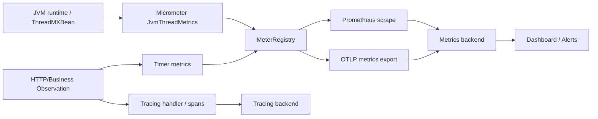
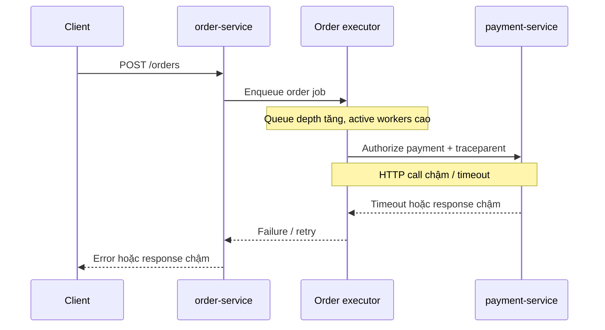

# JVM threads metrics trong Spring Boot Observability

**JVM threads metrics** cho biết trạng thái các luồng mà JVM quan sát được, chẳng hạn tổng số thread đang sống, số daemon threads, mức đỉnh lịch sử và phân bố thread theo trạng thái. Trong Spring Boot, Micrometer cùng Spring Boot Actuator có thể tự cấu hình các phép đo này, xuất qua Prometheus hoặc một metrics backend khác để theo dõi áp lực tài nguyên và dấu hiệu ứng dụng bị nghẽn.

Bài thuộc chương **Application metrics** của module **SPRING_BOOT_OBSERVABILITY**. Mục tiêu là không chỉ đọc tên metric, mà còn **diễn giải đúng những gì metric chứng minh và không chứng minh**: phân biệt trạng thái thread JVM với hàng đợi executor, nhận diện thread leak, monitor contention, tình trạng chờ I/O, hiểu giới hạn của Java virtual threads, rồi kết hợp metrics với logs và distributed tracing khi điều tra lỗi, độ trễ trên môi trường thực tế.

## 1. Vì sao cần theo dõi JVM threads?

Một API Spring Boot có thể đáp ứng tốt ở mức lưu lượng thấp nhưng bắt đầu tăng độ trễ khi nhiều request cùng đến. Một số nguyên nhân khả dĩ:

- Số lượng thread tăng liên tục vì có thành phần tạo thread nhưng không giải phóng.
- Thread đang chờ lock hoặc monitor, gây nghẽn một vùng code có tranh chấp.
- Nhiều worker chờ HTTP downstream, database connection, semaphore hoặc queue.
- Pool đã sử dụng hết worker; công việc phải chờ trong hàng đợi và request time tăng.
- Garbage collection, CPU saturation hoặc tài nguyên khác khiến hệ thống xử lý chậm; thread count là tín hiệu bổ trợ chứ chưa phải nguyên nhân.

Một dashboard chỉ có latency hoặc HTTP error rate thường chưa đủ để phân biệt các tình huống trên. **JVM thread metrics cho biết phần nào của bức tranh tài nguyên**, từ đó giúp chọn hướng điều tra.

Ví dụ khi p95 của `POST /orders` tăng từ 200 ms lên 3 s, ta muốn xem cùng lúc:

| Tín hiệu | Câu hỏi |
| --- | --- |
| `jvm.threads.live` | Có đang tạo thêm nhiều JVM threads không? |
| `jvm.threads.states` | Có nhiều thread ở trạng thái BLOCKED/WAITING/TIMED_WAITING không? |
| Executor active/queued | Thread pool xử lý nghiệp vụ có đang bão hòa không? |
| HTTP/DB connection pool metrics | Có đang chờ kết nối đến dependency không? |
| HTTP Timer/Observation | Độ trễ tăng ở operation hoặc route nào? |
| Distributed traces | Một request chậm dành thời gian ở span nào? |
| Logs/thread dump | Có stack trace, lock hoặc retry bất thường không? |

**Không suy luận “nhiều WAITING threads nghĩa là deadlock”.** Với server hiện đại, worker threads nhàn rỗi thường ở trạng thái chờ một cách hoàn toàn bình thường.

## 2. Nền tảng: Java thread và ThreadMXBean

Trong Java, một **platform thread** thường gắn với thread do hệ điều hành hỗ trợ. JVM có thể cung cấp thông tin thống kê về threads qua JMX/management API `java.lang.management.ThreadMXBean`.

Các phương thức quan trọng:

- `getThreadCount()`: số live threads mà ThreadMXBean thống kê tại thời điểm đọc.
- `getDaemonThreadCount()`: số daemon threads hiện còn sống trong tập được quản lý.
- `getPeakThreadCount()`: mức cao nhất của live thread count kể từ khi JVM khởi động hoặc kể từ lần reset peak gần nhất.
- `getAllThreadIds()`, `getThreadInfo(...)`: dữ liệu cần thiết để kiểm tra một tập threads và trạng thái của chúng.
- `findDeadlockedThreads()`: hỗ trợ chẩn đoán một số kiểu Java-level deadlock khi JVM triển khai có khả năng tương ứng.

Micrometer có binder **`JvmThreadMetrics`** sử dụng các API quản lý JVM để công bố những meter chuẩn, giúp người phát triển không phải tự viết Gauge cho số thread toàn JVM.

### Luồng dữ liệu



Bài toán **thread count** và **request duration** đo các đối tượng khác nhau. Một thread có thể phục vụ nhiều requests theo thời gian; một request có thể đi qua nhiều threads hoặc sử dụng mô hình non-blocking. Không thể lấy live threads chia cho request count để suy trực tiếp mức bão hòa.

## 3. Những JVM thread metrics thường gặp

Trong ứng dụng Spring Boot 3.x có Micrometer JVM thread binder, các tên meter thông dụng gồm:

| Tên Micrometer | Loại | Ý nghĩa |
| --- | --- | --- |
| `jvm.threads.live` | Gauge | Số live JVM threads tại thời điểm lấy mẫu |
| `jvm.threads.daemon` | Gauge | Số daemon threads hiện đang sống |
| `jvm.threads.peak` | Gauge | Mức đỉnh số live threads từng ghi nhận trong cửa sổ kể từ startup/reset peak |
| `jvm.threads.states` | Gauge có tag trạng thái | Phân bố threads theo `Thread.State` |

Các metric trên có thể không khả dụng trong mọi JVM/runtime/configuration. Tên series tại Prometheus thường khác tên meter do quy tắc thay dấu và suffix đơn vị; hãy kiểm tra output của exporter đang dùng.

### 3.1. `jvm.threads.live`

Chỉ số này phản ánh số threads mà JVM management API đang thống kê. Nếu tăng từ 80 lên 500 và **không giảm sau khi tải đã trở về bình thường**, có thể có bất thường trong quản lý thread hoặc một pool đang giữ nhiều worker.

Tuy nhiên, số live threads tăng còn có thể là hành vi có chủ đích:

- Thread pool mở rộng dưới tải rồi giữ worker chờ.
- Web server hoặc scheduler tạo thêm threads theo cấu hình.
- Thư viện tạo threads nền khi khởi tạo.
- Một bước triển khai thay đổi thread pool sizing.

Một ngưỡng “live threads hơn 100 là lỗi” thường thiếu căn cứ. Cần biết baseline, quy mô CPU, cấu hình pool, traffic và biến động theo phiên bản.

### 3.2. `jvm.threads.daemon`

**Daemon thread** là đặc tính vòng đời Java thread; nó không đồng nghĩa “thread không cần quan tâm” hoặc “thread chỉ phục vụ tác vụ nền nhẹ”. Daemon threads vẫn có thể tốn CPU, giữ tài nguyên hoặc bị blocked.

Daemon thread count thường là **một tập con của live thread count**. Chênh lệch giữa hai số có thể gợi ý số non-daemon threads, nhưng cần hiểu phạm vi của JVM management API và điều kiện lúc lấy mẫu.

### 3.3. `jvm.threads.peak`

Peak thường tăng khi số live threads lập mức cao mới và không tự giảm theo live count. Khi traffic hết cao điểm:

```text
Thời điểm         09:00  09:05  09:10  09:20
Live threads        70    150    110     75
Peak threads        90    150    150    150
```

Đây là ví dụ giả định. Peak là dữ liệu lịch sử trong vòng đời mà ThreadMXBean theo dõi, không phải cực đại trong mọi cửa sổ truy vấn dashboard. Peak có thể reset qua management API; sau restart, dữ liệu bắt đầu vòng đời mới.

Để biết live threads đã vượt ngưỡng nào trong **15 phút qua**, dùng truy vấn thời gian như `max_over_time` trên các mẫu được thu thập; đó không phải ý nghĩa tương đương hoàn toàn với `jvm.threads.peak`.

### 3.4. `jvm.threads.states`

Gauge này chia threads theo trạng thái Java:

- `NEW`
- `RUNNABLE`
- `BLOCKED`
- `WAITING`
- `TIMED_WAITING`
- `TERMINATED`

Giá trị của tag `state` có thể được backend hoặc binder chuẩn hóa chữ hoa/thường hoặc dấu phân cách. Đọc `availableTags` trong Actuator trước khi viết query hoặc alert cố định.

Thông tin trạng thái là **snapshot**, không phải lịch sử đầy đủ của từng thread. Giữa hai lần đọc, một thread có thể chuyển trạng thái rất nhanh. Từng phép đọc và tổng hợp có thể không tạo một ảnh chụp nguyên tử tuyệt đối của toàn JVM.

## 4. Diễn giải Thread.State chính xác

Đây là phần dễ gây hiểu lầm nhất khi xem JVM thread metrics.

| Trạng thái | Ý nghĩa theo Java | Có đồng nghĩa lỗi không? |
| --- | --- | --- |
| `NEW` | Thread object đã được tạo nhưng chưa khởi động | Không; thường không xuất hiện nhiều trong thống kê live threads |
| `RUNNABLE` | Thread có thể chạy trong JVM; có thể đang thực thi hoặc chờ tài nguyên hệ điều hành | Không; **không đồng nghĩa 100% thời gian dùng CPU** |
| `BLOCKED` | Thread đang chờ vào monitor được bảo vệ bởi `synchronized` | Nếu duy trì bất thường, có thể do lock contention |
| `WAITING` | Thread chờ vô thời hạn một điều kiện/hoạt động khác | Rất thường gặp khi pool nhàn rỗi |
| `TIMED_WAITING` | Thread chờ có thời hạn, ví dụ sleep, wait(timeout) | Có thể bình thường hoặc là dấu hiệu retry/backoff |
| `TERMINATED` | Thread đã hoàn tất thực thi | Không phải dấu hiệu trực tiếp cho thread leak |

### RUNNABLE không đồng nghĩa “đang chạy CPU”

Trong mô hình Java, RUNNABLE có thể bao gồm việc chờ để được OS lên lịch hoặc những tình huống liên quan native calls. Với một số loại I/O, thread có thể được hiển thị RUNNABLE dù đang chờ ở tầng native. Vì vậy khi `RUNNABLE` tăng mạnh:

1. So sánh với CPU usage/process CPU.
2. Quan sát load average, GC và thread pool.
3. Lấy thread dump hoặc profile phù hợp để xem stack traces thực tế.
4. Xác định có tác vụ CPU-bound, spin loop hay blocking native I/O không.

Chỉ thấy số RUNNABLE tăng **chưa đủ** để kết luận CPU saturation.

### BLOCKED và lock contention

`BLOCKED` gắn với chờ monitor của Java, thường liên quan tới `synchronized`. Nếu nhiều thread lâu dài ở BLOCKED và tất cả cùng chờ một monitor, throughput có thể suy giảm.

Tuy nhiên, không phải mọi hình thức chờ lock đều chuyển thành Java `BLOCKED`. Chẳng hạn các loại lock dựa trên `LockSupport.park` có thể khiến thread ở WAITING hoặc TIMED_WAITING. Cần đọc stack traces và lock owners, không chỉ nhìn nhãn trạng thái.

### WAITING/TIMED_WAITING có thể là trạng thái bình thường

Thread-pool workers đang nhàn rỗi thường chờ queue; scheduler threads chờ thời điểm chạy; các thread có timeout chờ I/O hoặc điều kiện đồng bộ. Do đó:

> Một tỷ lệ lớn WAITING threads chỉ trở nên đáng nghi khi đi cùng **queue backlog, request latency, starvation, timeout, hoặc các dấu hiệu bất thường khác**.

Phân biệt “chờ vì không có việc” và “chờ vì hệ thống không thể tiến triển” bằng dữ liệu executor, workload và thread dump.

## 5. Thiết lập Spring Boot Actuator và Micrometer

Các cấu hình sau minh họa cho **Spring Boot 3.x**. Ở những dòng Spring Boot khác, starter hoặc properties có thể thay đổi. Sử dụng dependency management/BOM tương thích với phiên bản dự án.

### 5.1. Maven dependencies

```xml
<dependencies>
    <dependency>
        <groupId>org.springframework.boot</groupId>
        <artifactId>spring-boot-starter-actuator</artifactId>
    </dependency>

    <!-- Tùy chọn nếu muốn Prometheus scrape -->
    <dependency>
        <groupId>io.micrometer</groupId>
        <artifactId>micrometer-registry-prometheus</artifactId>
    </dependency>
</dependencies>
```

Spring Boot Actuator và Micrometer thường tự cấu hình binder JVM khi các điều kiện phù hợp. Với trường hợp chỉ cần theo dõi các JVM thread gauges chuẩn, **không nhất thiết phải tự khai báo một `JvmThreadMetrics` bean**.

Không tự tạo `SimpleMeterRegistry` trong service nếu Spring Boot đang quản lý registry Prometheus/OTLP. Một registry tự tạo có thể không được nối với đường xuất metrics đã cấu hình.

### 5.2. Cấu hình application.yml

```yaml
spring:
  application:
    name: order-service

management:
  endpoints:
    web:
      exposure:
        include: health,info,metrics,prometheus
  metrics:
    tags:
      application: order-service
      environment: development
```

Trong môi trường phát triển có thể kiểm tra:

```bash
curl -s http://localhost:8080/actuator/metrics
curl -s http://localhost:8080/actuator/metrics/jvm.threads.live
curl -s http://localhost:8080/actuator/metrics/jvm.threads.daemon
curl -s http://localhost:8080/actuator/metrics/jvm.threads.peak
curl -s http://localhost:8080/actuator/metrics/jvm.threads.states
```

Endpoint `/actuator/metrics/jvm.threads.states` có thể trả về `measurements` cùng các giá trị trong `availableTags`; sử dụng các giá trị đó để lọc một state cụ thể.

Ví dụ, nếu tag trạng thái được xuất là `runnable`:

```bash
curl -s "http://localhost:8080/actuator/metrics/jvm.threads.states?tag=state:runnable"
```

**Đừng mặc định tên tag value luôn đúng chữ thường hoặc đúng chính tả ví dụ**; hãy đọc dữ liệu thực. Endpoint Actuator cũng có thể bị đổi port/base-path hoặc yêu cầu xác thực.

### 5.3. Metrics tự động khác với endpoint export

`/actuator/metrics` cho biết meter đã được đăng ký trong ứng dụng. Nếu thêm Prometheus registry và expose `prometheus`:

```bash
curl -s http://localhost:8080/actuator/prometheus
```

Backend Prometheus cần scrape endpoint; việc endpoint trả dữ liệu chỉ chứng tỏ **ứng dụng có dữ liệu để xuất**, chưa chứng minh backend đã lưu mẫu. Trong production cần bảo vệ Actuator và kiểm tra quyền truy cập từ scraper.

## 6. Tên metrics khi sang Prometheus

Micrometer dùng tên có dấu chấm và đơn vị; Prometheus chuẩn hóa tên sang dạng phù hợp. Với JVM thread gauges, bạn thường thấy các tên series tương tự:

```promql
jvm_threads_live_threads
jvm_threads_daemon_threads
jvm_threads_peak_threads
jvm_threads_states_threads
```

Các tên trên mang tính **ví dụ thường gặp** với Micrometer Prometheus registry. Tên và nhãn chính xác phụ thuộc phiên bản binder, registry, naming convention và các filters. Luôn tra đầu ra `/actuator/prometheus` hoặc metadata của backend.

### Các truy vấn PromQL minh họa

Giả sử metric và các nhãn bên dưới tồn tại:

```promql
# Live threads theo instance
jvm_threads_live_threads{application="order-service"}

# Tổng live threads trong các instance đang được scrape
sum by (application) (
  jvm_threads_live_threads{application="order-service"}
)

# Phân bố các trạng thái thread theo từng instance
sum by (instance, state) (
  jvm_threads_states_threads{application="order-service"}
)

# Live threads cao nhất trong 15 phút dữ liệu mẫu
max_over_time(
  jvm_threads_live_threads{application="order-service"}[15m]
)
```

Lưu ý rất quan trọng: cộng live thread counts trên nhiều instance cho ra **số threads được quan sát trên tất cả instances**, không cho biết thread count trên một instance đã quá ngưỡng chưa. Nếu muốn phát hiện một JVM có vấn đề, theo dõi per-instance hoặc dùng `max by (instance)`/các biểu thức phù hợp với cơ sở hạ tầng.

Không dùng `rate(...)` trên Gauge `jvm_threads_live_threads` như đang xử lý Counter. Gauge có thể tăng/giảm nên `rate` không có cùng ý nghĩa “sự kiện trên giây”. Nếu muốn đo xu hướng thay đổi, có thể dùng `deriv` ở những trường hợp được hiểu rõ, nhưng cần tránh diễn giải các mẫu nhiễu thành tốc độ tạo thread thật.

### Vì sao thông số có thể khác giữa Actuator và backend?

- Chúng được đọc tại **thời điểm khác nhau**.
- Prometheus scrape theo lịch, còn Actuator được gọi thủ công.
- Một số gauge được chuẩn hóa tên và đơn vị khi xuất.
- Tags có thể được thêm, đổi hoặc loại tại registry, scrape hoặc Collector.
- Dashboard có thể đang tổng hợp nhiều instances hoặc chỉ xem một instance.

Đó thường là khác biệt về **cửa sổ quan sát**, không nhất thiết là lỗi instrumentation.

## 7. Thread metrics khác thread-pool metrics

**Điểm quan trọng nhất khi điều tra nghẽn:** `jvm.threads.live` là thống kê toàn JVM trong phạm vi management API; nó **không** cho biết riêng pool nào đang chạy hết công suất.

Xét một executor có:

- Core pool size: 8.
- Max pool size: 16.
- Queue capacity: 200.
- Active workers: 8.
- Queued tasks: 180.

JVM có thể có 100 live threads trong toàn process, nhưng điều làm API chậm là **180 tasks đang chờ executor**. Nếu chỉ nhìn `jvm.threads.live=100` thì khó phát hiện nghẽn.

| Metric | Phạm vi | Câu hỏi |
| --- | --- | --- |
| JVM live threads | Toàn JVM theo binder | Có bao nhiêu threads đang sống? |
| Executor active threads | Một executor cụ thể | Bao nhiêu worker đang thực thi? |
| Executor pool size | Một executor cụ thể | Có bao nhiêu worker trong pool? |
| Executor queued tasks | Một executor cụ thể | Có bao nhiêu tác vụ đang chờ? |
| Executor completed tasks | Một executor cụ thể | Bao nhiêu tác vụ đã kết thúc? |
| HTTP/Tomcat busy threads | Web server pool nếu được instrument | Có bao nhiêu threads đang phục vụ request? |

Spring Boot và Micrometer có hỗ trợ metrics cho một số executor/web server khi thành phần đó được quản lý hoặc instrument thích hợp. Tên cụ thể như `executor.active` hay `tomcat.threads.busy` phụ thuộc phiên bản, implementation và instrumentation có mặt. Không mặc định mọi pool tự viết đều được đo.

### 7.1. Khi nào cần thêm gauges cho executor?

Nếu một executor quan trọng chưa có metrics, có thể thêm Gauge đọc trạng thái pool. Ví dụ đối với một `ThreadPoolTaskExecutor` đã được tạo và khởi tạo trong Spring:

```java
import io.micrometer.core.instrument.Gauge;
import io.micrometer.core.instrument.MeterRegistry;
import org.springframework.beans.factory.annotation.Qualifier;
import org.springframework.scheduling.concurrent.ThreadPoolTaskExecutor;
import org.springframework.stereotype.Component;

@Component
public class OrderExecutorMetrics {

    public OrderExecutorMetrics(
            MeterRegistry registry,
            @Qualifier("orderExecutor") ThreadPoolTaskExecutor executor) {

        Gauge.builder(
                "orders.executor.active",
                executor,
                ThreadPoolTaskExecutor::getActiveCount
        )
        .description("Active workers in the order executor")
        .baseUnit("threads")
        .register(registry);

        Gauge.builder(
                "orders.executor.queued",
                executor,
                e -> e.getThreadPoolExecutor().getQueue().size()
        )
        .description("Queued jobs awaiting order executor workers")
        .baseUnit("tasks")
        .register(registry);
    }
}
```

Đoạn này giả định ứng dụng **đã có** bean `ThreadPoolTaskExecutor` tên `orderExecutor` và nó đã hoàn tất khởi tạo. Chỉ thêm gauges này khi chưa có meter tương đương hoặc khi có nhu cầu rõ ràng; tránh **đăng ký trùng** một trạng thái dưới quá nhiều tên.

Đối tượng executor do Spring quản lý tồn tại lâu dài, giúp Gauge không mất đối tượng nguồn do weak reference. Phép đọc queue size cần cân nhắc độ chính xác tức thời và chi phí với executor/queue implementation cụ thể.

### 7.2. Vì sao active workers chưa đủ?

Một pool active 8/8 chưa chắc quá tải nếu queue rỗng và tasks hoàn tất nhanh. Nhưng active 8/8 **kèm queue liên tục tăng** và task processing p95 tăng là dấu hiệu bão hòa rõ hơn.

Phải xem cả:

- Queue depth và thời gian chờ.
- Tốc độ nhận/hoàn tất/reject tasks.
- Duration Timer của công việc.
- CPU và downstream latency.
- Các cấu hình pool: core/max size, queue capacity, rejection policy.

Thread count có thể không tăng dù queue backlog tăng, đặc biệt khi executor có cơ chế đẩy công việc vào queue trước khi mở rộng tối đa.

## 8. Virtual threads trong Java 21+

Java 21 giới thiệu **virtual threads** như một lựa chọn quan trọng cho ứng dụng dùng nhiều tác vụ chờ I/O. Spring Boot 3.2+ có thể hỗ trợ bật virtual threads trong những thành phần phù hợp khi chạy trên Java 21 trở lên.

Ví dụ property thường gặp:

```yaml
spring:
  threads:
    virtual:
      enabled: true
```

**Cảnh báo về khả năng đo đạc:** các chỉ số dựa trên `ThreadMXBean` truyền thống không nhất thiết đếm hoặc mô tả **tất cả virtual threads** giống như platform threads. Trên một số JDK, `ThreadMXBean.getThreadCount()` chủ yếu phản ánh platform threads. Do đó:

- `jvm.threads.live` không thể mặc nhiên được hiểu là “tổng mọi virtual thread đang sống”.
- Thay đổi từ platform thread pool sang virtual-thread-per-task có thể làm cách nhìn thread count thay đổi.
- Nếu cần đo virtual thread scheduling, pinning, creation/rate hoặc trạng thái chuyên biệt, cần instrumentation/JFR/metrics phù hợp với JDK và thư viện đang dùng.
- Khi dùng virtual threads, vẫn phải kiểm soát số kết nối DB, số lời gọi HTTP đồng thời và các tài nguyên downstream; virtual threads không làm những tài nguyên đó trở nên vô hạn.

Trong quá trình nâng cấp JDK hoặc đổi mô hình concurrency, **ghi rõ loại thread mà từng metric quan sát** và kiểm tra lại alert thresholds. Không giữ nguyên một cảnh báo `jvm.threads.live > N` nếu ý nghĩa vận hành của phép đo đã thay đổi.

### Virtual threads và pinning

Một virtual thread có thể bị pin vào carrier thread trong những tình huống nhất định, làm giảm lợi ích của việc treo/khôi phục linh hoạt. Việc xác định pinning cần công cụ tương thích như Java Flight Recorder (JFR) hoặc các tín hiệu chuyên dụng. `jvm.threads.states` truyền thống thường không đủ để kết luận có pinning hay không.

## 9. Thread leak: dấu hiệu và cách xác minh

**Thread leak** thường chỉ tình huống thread được tạo hoặc giữ lại lâu hơn dự kiến, khiến số thread tăng theo thời gian và không quay về baseline sau khi công việc kết thúc.

### Một kịch bản giả định

Sau mỗi lần đồng bộ dữ liệu, code tạo một executor mới nhưng quên shutdown. Khi job chạy 100 lần, một số worker vẫn sống dù không còn công việc. Dashboard có thể thấy:

```text
Giờ           08:00   09:00   10:00   11:00
Live threads     80     120     165     210
Peak threads     80     120     165     210
Request rate     ổn    ổn     ổn     ổn
Heap used        gần như không đổi
```

Đây là **triệu chứng đáng nghi**, chưa phải bằng chứng của thread leak. Ví dụ rollout thêm service worker hoặc pool tăng theo cấu hình cũng có thể tạo xu hướng tương tự.

### Quy trình kiểm tra

1. So sánh live/daemon/peak với cùng một instance trước và sau khi tải giảm.
2. Kiểm tra các pool đã cấu hình, lịch tác vụ scheduler, thư viện khởi tạo nền.
3. Lấy thread dump trong môi trường được phép, xem tên và stack của nhóm threads tăng.
4. Kiểm tra code tạo thread/executor: có dùng `ExecutorService.shutdown()` khi vòng đời kết thúc không? Có để Spring quản lý pool hay không?
5. Đối chiếu phiên bản deploy, feature flags, traffic và cấu hình thread pool.
6. Xác minh sau khi sửa, số live threads quay về baseline hợp lý và API latency/CPU/memory không bất thường.

Tránh “chữa” bằng cách chỉ nâng giới hạn số threads. Nếu nguyên nhân là tạo threads không kiểm soát, tăng giới hạn có thể trì hoãn sự cố nhưng không giải quyết gốc rễ.

## 10. Từ BLOCKED tăng cao đến chẩn đoán lock contention

Giả sử dashboard ghi nhận số threads ở `BLOCKED` tăng từ 0–2 lên 60, đồng thời latency tăng và throughput giảm. Một giả thuyết hợp lý là nhiều threads cùng tranh chấp monitor `synchronized`.

### Ví dụ code có thể gây tranh chấp

```java
import org.springframework.stereotype.Component;

@Component
public class SerialInventoryCounter {

    private long reserved;

    public synchronized void reserveOne() {
        // Ví dụ minh họa: thao tác chậm khi đang giữ monitor.
        simulateSlowDependency();
        reserved++;
    }

    private void simulateSlowDependency() {
        // Giả lập lời gọi chậm; không phải triển khai production.
    }
}
```

Nếu method thực hiện I/O hoặc chờ lâu trong vùng `synchronized`, nhiều request đồng thời có thể phải chờ monitor. Cách sửa thường là giảm phạm vi lock, tách I/O khỏi critical section hoặc thiết kế lại đồng bộ, tùy yêu cầu nhất quán dữ liệu. **Không tự động bỏ lock** nếu chưa phân tích race conditions.

### Thread dump giúp trả lời điều gì?

Một Java thread dump có thể cung cấp:

- Tên thread và state.
- Stack trace nơi thread đang chạy hoặc chờ.
- Monitor/object lock đang chờ trong những trường hợp có dữ liệu.
- Thread đang giữ monitor liên quan.
- Nhóm nhiều threads có cùng call stack.

Những thông tin này giúp phân biệt lock contention với việc thread ngủ nhàn rỗi hoặc chờ downstream. Các công cụ có thể dùng gồm `jcmd`, `jstack` hoặc JFR, với quyền truy cập thích hợp.

Ví dụ chạy từ môi trường có công cụ JDK và quyền truy cập process:

```bash
jcmd <PID> Thread.print
```

Đây là lệnh hướng dẫn, ký hiệu `<PID>` cần được thay bằng mã tiến trình thực. Thread dumps có thể chứa tên threads, stack và dữ liệu nội bộ; phải hạn chế quyền truy cập, không đăng công khai và cân nhắc tác động hiệu năng khi lấy lặp lại.

### Thread deadlock khác gì BLOCKED cao?

Một JVM-level deadlock xảy ra khi các threads chờ nhau trong một vòng phụ thuộc lock, khiến không ai có thể tiến triển. `BLOCKED` cao có thể chỉ là tranh chấp tạm thời, **không đủ kết luận deadlock**. Ngược lại, các loại deadlock/chờ khác nhau có thể không biểu hiện đơn giản bằng số BLOCKED tăng.

Khi nghi deadlock, xem thread dump nhiều thời điểm và dùng công cụ phát hiện phù hợp. `ThreadMXBean.findDeadlockedThreads()` có thể giúp chẩn đoán một số deadlocks trên monitor hoặc ownable synchronizers, nhưng không phát hiện mọi kiểu chờ application-level, network hay database.

## 11. Phân tích starvation, chờ I/O và pool saturation

**Thread starvation** xảy ra khi công việc cần worker nhưng không được phục vụ kịp vì số worker khả dụng không đủ hoặc bị giữ quá lâu. Một dấu hiệu thường thấy:

- Active workers gần đạt pool max trong thời gian dài.
- Queue depth tăng.
- Time-to-start hoặc end-to-end latency tăng.
- Thread dump cho thấy workers đang chờ một dependency hoặc giữ lock.

Trạng thái JVM sẽ khác theo cơ chế chờ:

| Nguyên nhân | Trạng thái có thể thấy | Tín hiệu bổ trợ nên xem |
| --- | --- | --- |
| Chờ monitor `synchronized` | BLOCKED | Thread dump, lock owner |
| Idle worker chờ queue | WAITING / TIMED_WAITING | Queue depth, task rate |
| Timeout/retry/backoff | TIMED_WAITING hoặc trạng thái khác | Retry Counter, dependency Timer |
| Blocking native I/O | Có thể thấy RUNNABLE hoặc trạng thái khác | Thread dump, socket/HTTP latency |
| CPU-bound tasks | RUNNABLE có thể tăng | CPU load, profiler, task duration |
| Chờ DB connection pool | WAITING/TIMED_WAITING tùy implementation | Connection pool active/pending/timeout |
| Virtual thread scheduling | Không mô tả đầy đủ bởi các JVM gauges truyền thống | JDK/JFR/virtual-thread instrumentation |

Không cố suy “80 WAITING threads nghĩa là 80 requests bị treo”. Có thể phần lớn là idle pool workers. Cần map được **thread ownership**: thread nào thuộc HTTP server, executor nghiệp vụ, scheduler, message consumer hay hạ tầng database.

### Một bước theo dõi quan trọng: queueing time

Nếu một request có tổng thời gian 2 s nhưng span xử lý nghiệp vụ chỉ 200 ms, có thể phần thời gian còn lại nằm trước khi task bắt đầu (chờ queue), trong HTTP connector hoặc tầng khác chưa instrument.

Timer của tác vụ chỉ đo từ khi worker bắt đầu không tự thể hiện thời gian chờ trước đó. Khi hệ thống có queue quan trọng, đo thêm:

- Queue depth (Gauge).
- Time in queue (Timer từ thời điểm enqueue đến start).
- Task execution duration (Timer từ start đến finish).
- Accepted/rejected counters.
- End-to-end latency ở HTTP/consumer.

Nhờ đó, thread metrics trở thành một phần của chuỗi bằng chứng thay vì một chỉ số đứng riêng.

## 12. Tác động của sampling, scrape interval và cardinality

### 12.1. JVM thread metrics thường là Gauge

`jvm.threads.live` và các meter tương tự phản ánh trạng thái tại thời điểm đọc. Nếu thread count tăng đột biến trong 200 ms giữa hai lần Prometheus scrape 15 s, backend có thể **không ghi nhận đỉnh tức thời**.

Do đó:

- `max_over_time` trả về cực đại của **các mẫu đã được lưu**, không khôi phục những biến động không được lấy mẫu.
- `jvm.threads.peak` có thể cung cấp góc nhìn lịch sử khác từ ThreadMXBean, nhưng có thể reset sau JVM restart hoặc reset peak.
- Scrape quá dày có chi phí; chọn chu kỳ theo nhu cầu phát hiện và đặc tính workload.
- Nếu cần phân tích hiện tượng ngắn, dùng profiling/JFR hoặc instrumentation chuyên biệt.

### 12.2. Tags của JVM thread metrics thường có cardinality thấp

Tag `state` có tập giá trị hữu hạn, vì Java `Thread.State` chỉ có một số giá trị. Các tags chung như `application`, `environment`, `region` cũng thường an toàn khi được chuẩn hóa.

Không tạo metric kiểu:

```text
jvm.thread.state{thread.name="http-nio-8080-exec-147"}
jvm.thread.state{thread.id="742"}
jvm.thread.state{trace.id="..."}
```

Mỗi thread ID hoặc name động có thể tạo nhiều time series. Những chi tiết từng thread phù hợp hơn với thread dump, profile hoặc logs có kiểm soát; không nên đưa mặc định vào metric labels.

### 12.3. Tracing sampling hoàn toàn khác metrics scrape

Một cấu hình minh họa trong Spring Boot 3.x:

```yaml
management:
  tracing:
    sampling:
      probability: 0.10
```

Tracing sampling chọn một phần trace để ghi/xuất. Nó **không đồng nghĩa** JVM thread Gauge chỉ đo 10% threads. JVM metrics tiếp tục được registry thu theo cơ chế riêng, ngay cả khi một request bị loại khỏi tracing.

Cần phân biệt ba hiện tượng:

- Gauge không được đăng ký/không có sample: xem binder/registry/exporter.
- Gauge có sample nhưng miss spike: xem scrape interval và bản chất snapshot.
- Trace không xuất hiện: xem sampling, instrumentation, context propagation, exporter hoặc backend tracing.

## 13. Liên kết thread metrics với metrics, logs và distributed tracing

Mục tiêu của **Spring Boot Observability** không phải chỉ hiển thị thread count. Mục tiêu là dùng các tín hiệu cùng nhau để điều tra **lỗi, độ trễ và hành vi ứng dụng**.

Giả sử dịch vụ đặt hàng có p99 tăng, queue depth tăng và một nhóm threads chờ xử lý.



Kịch bản điều tra:

1. **Metrics tổng thể:** HTTP request rate, error rate và latency xác định service và route bị ảnh hưởng.
2. **Thread/executor metrics:** JVM live/states cho bức tranh runtime; executor active/queued cho biết pool nghiệp vụ có bão hòa không.
3. **Traces:** một trace được lấy mẫu cho thấy span gọi `payment-service` kéo dài, liệu có retry hoặc chờ trước khi thực thi không.
4. **Logs:** dùng Trace ID/Span ID trong MDC khi tracing context được duy trì để đọc timeout, retry và exception được phép lưu.
5. **Thread dump/JFR:** nếu vẫn không rõ, quan sát stack, lock hoặc I/O để kiểm chứng giả thuyết.

### Không gắn Trace ID vào JVM thread metric

Trace ID là thông tin định danh một trace, có cardinality rất cao. Đưa Trace ID thành label của `jvm.threads.live` sẽ làm mất tính tổng hợp và tăng mạnh số series. Thay vào đó, dùng **service, instance, khoảng thời gian** để liên hệ dashboard metrics với trace search.

Nếu có **exemplars** trên loại metrics được registry/backend hỗ trợ, chúng có thể giúp nhảy từ một measurement sang trace mà không tạo label bình thường theo từng Trace ID. Tuy nhiên không nên giả định JVM thread Gauge nào cũng có exemplar.

### Trace context propagation không thuộc JVM thread binder

Để các span xuyên service giữ quan hệ đúng, Spring Boot/Micrometer Tracing dùng HTTP client instrumentation và propagation tương ứng, ví dụ W3C `traceparent`:

```http
traceparent: 00-4bf92f3577b34da6a3ce929d0e0e4736-00f067aa0ba902b7-01
```

Khi xử lý qua `@Async`, executor tự tạo hoặc messaging, cần context propagation phù hợp. **Cùng một JVM thread count không chứng minh trace context được duy trì**; kiểm tra Trace ID và parent-child relationships trên tracing backend.

## 14. Cấu hình Prometheus và OTLP metrics

### Prometheus scrape

Nếu ứng dụng có `micrometer-registry-prometheus`, có thể expose endpoint:

```yaml
management:
  endpoints:
    web:
      exposure:
        include: health,info,metrics,prometheus
```

Prometheus phải được cấu hình scrape target tương ứng. Trên backend, tìm `jvm_threads_live_threads` hoặc tên series thực tế và kiểm tra các labels `application`, `instance`, `job`.

### OTLP metrics export

Nếu dùng OpenTelemetry Collector, ứng dụng có thể dùng `micrometer-registry-otlp` để **push metrics** qua OTLP. Ví dụ Spring Boot 3.x:

```xml
<dependency>
    <groupId>io.micrometer</groupId>
    <artifactId>micrometer-registry-otlp</artifactId>
</dependency>
```

```yaml
management:
  otlp:
    metrics:
      export:
        enabled: true
        url: http://collector:4318/v1/metrics
        step: 30s
```

Địa chỉ minh họa sử dụng OTLP/HTTP; trong container, `collector` phải là hostname có thể truy cập. Cổng 4318 thường dùng OTLP/HTTP; 4317 thường dùng OTLP/gRPC. Cần xác nhận protocol và receiver trên triển khai thực tế.

**OTLP metrics** khác với **OTLP traces**. Micrometer Tracing bridge và trace exporter có cấu hình riêng. Nếu backend metrics trống nhưng Actuator vẫn thấy `jvm.threads.live`, hãy kiểm tra registry/exporter, Collector và kết nối mạng trước khi kết luận JVM binder bị lỗi.

## 15. Thiết kế dashboard và cảnh báo JVM threads

Một dashboard hữu ích nên đặt JVM thread metrics cạnh những tín hiệu có quan hệ nguyên nhân – hệ quả:

| Nhóm panel | Mục đích |
| --- | --- |
| Live, daemon, peak thread counts theo instance | Phát hiện thay đổi về số threads |
| States theo instance | Quan sát tranh chấp monitor/chờ trong runtime |
| CPU usage và GC pauses | Phân biệt CPU/GC pressure với thread backlog |
| Executor active, queued, rejected | Thấy rõ tình trạng bão hòa pool |
| HTTP request rate, error rate, p95/p99 | Đo tác động tới trải nghiệm người dùng |
| DB pool active/pending/timeout | Kiểm tra thiếu connection |
| Downstream client duration và error rate | Phát hiện phụ thuộc chậm hoặc lỗi |

### Ví dụ những cảnh báo có thể cân nhắc

- **Live threads tăng liên tục sau khi tải đã ổn định:** cảnh báo theo xu hướng và ngưỡng baseline, không chỉ theo số tuyệt đối.
- **BLOCKED threads duy trì cao đồng thời throughput giảm:** nghi lock contention, kiểm tra thread dump.
- **Executor queue depth cao nhiều phút cùng rejected count tăng:** dấu hiệu bão hòa hoặc dependency xử lý chậm.
- **Thread pool active gần max + request latency cao:** ưu tiên phân tích queue wait và dependency duration.

Ngưỡng thực tế phải dựa trên workload, SLO và cấu hình JVM/thread pools. Tránh cảnh báo chỉ dựa trên `WAITING` vì idle workers cũng có thể WAITING.

### Alert không thay thế chẩn đoán

Một alert tốt chỉ ra triệu chứng có khả năng ảnh hưởng tới người dùng. Để kết luận nguyên nhân gốc, cần kiểm tra trace, logs, thread dumps, deployment changes và các tài nguyên khác. Không nên dùng một biến động JVM metric đơn lẻ để tự động restart ứng dụng trong mọi tình huống.

## 16. Troubleshooting: khi số liệu không như mong đợi

| Hiện tượng | Nguyên nhân có thể | Bước kiểm tra |
| --- | --- | --- |
| Không thấy `jvm.threads.live` trong Actuator | Actuator/binder/auto-configuration không hoạt động hoặc meter bị filter | Kiểm tra dependencies, `/actuator/metrics`, conditions/filter |
| Actuator có meter nhưng Prometheus trống | Registry/export endpoint hoặc scrape target sai | Kiểm tra `/actuator/prometheus`, target health, auth, network |
| OTLP metrics không tới backend | URL, protocol, TLS, Collector hoặc pipeline sai | Kiểm tra registry, exporter logs và Collector |
| Live threads tăng nhưng CPU thấp | Idle threads, pool expansion, blocked I/O hoặc leak | Xem executor metrics, thread dump và trend sau tải |
| WAITING threads nhiều | Có thể là idle workers bình thường | So với queue backlog, latency và thread dump |
| BLOCKED threads tăng đột ngột | Có thể tranh chấp monitor | Kiểm tra call stacks, lock owner, throughput |
| Peak không giảm | Peak là lịch sử kể từ startup/reset | Phân biệt peak với live và `max_over_time` |
| Tổng các states không khớp live tuyệt đối | Snapshot và phạm vi/phương pháp lấy mẫu khác nhau | Kiểm tra sampling timing, JVM binder và version |
| Virtual threads có nhiều nhưng live count không tăng tương ứng | ThreadMXBean không bao quát virtual threads như platform threads | Kiểm tra JDK, instrumentation/JFR chuyên biệt |
| Thread pool bão hòa nhưng JVM live không tăng | Pool đã đạt kích thước, tasks chờ queue | Xem executor active/queued/rejected |
| Dashboard không khớp tên metric | Naming conventions, base unit, MeterFilter khác | Đọc output exporter thực tế |
| Trace không khớp request chậm | Sampling/propagation/instrumentation chưa phù hợp | Kiểm tra trace context và exporter riêng |
| Quá nhiều series | Tag theo thread name/id, pod churn hoặc labels khác | Loại ID động, chuẩn hóa tags và theo dõi cardinality |

Khi chẩn đoán, tách bốn lớp: **JVM instrumentation → MeterRegistry → exporter/scraper → backend/query**. Không thay đổi tracing sampling để khắc phục một JVM Gauge bị thiếu.

## 17. Bài thực hành: từ JVM thread gauges tới phân tích sự cố

### Chuẩn bị

- Một ứng dụng Spring Boot 3.x chạy với JVM phù hợp.
- `spring-boot-starter-actuator` và một metrics registry như Prometheus.
- Một môi trường phát triển có thể tạo request/tác vụ thử nghiệm.
- Nếu muốn điều tra sâu, quyền truy cập công cụ JDK như `jcmd` và tracing backend.

**Không tạo hàng nghìn threads hoặc gây deadlock cố ý trên hệ thống production.** Những thí nghiệm gây nghẽn chỉ thực hiện trên máy hoặc môi trường thử nghiệm có giới hạn tài nguyên.

### Bước 1 — Xác minh binder

Khởi động ứng dụng, gọi:

```bash
curl -s http://localhost:8080/actuator/metrics
curl -s http://localhost:8080/actuator/metrics/jvm.threads.live
curl -s http://localhost:8080/actuator/metrics/jvm.threads.states
```

Ghi lại live, daemon, peak và các state tag values thực tế.

### Bước 2 — Ghi baseline khi không tải

Lấy dữ liệu vài phút, ghi lại:

- Live threads trung bình/dao động.
- Daemon threads và peak.
- Phân bố trạng thái.
- CPU usage, GC và HTTP request rate.

Baseline giúp phân biệt một sự thay đổi thực sự với những con số vốn bình thường ở ứng dụng.

### Bước 3 — Tạo tải có kiểm soát

Gửi một lượng request vừa phải qua endpoint test đã biết. Quan sát:

- JVM live threads có thay đổi không?
- Thread states thay đổi ra sao?
- Executor active/queue hoặc Tomcat busy threads có metric không?
- p95/p99 HTTP request latency tăng hay không?

Giữ tải trong giới hạn của môi trường, không coi việc live threads không tăng là dấu hiệu lỗi. Với một pool đã đủ worker, queue có thể tăng trước khi số threads thay đổi.

### Bước 4 — Bổ sung executor metrics

Nếu có `ThreadPoolTaskExecutor` phù hợp, thử đăng ký gauges ở phần 7 và kiểm tra kết quả trên Actuator. Đối chiếu active workers/queued tasks với JVM thread counts để thấy phạm vi khác nhau.

### Bước 5 — Thử một nút thắt an toàn

Tạo thao tác chậm có kiểm soát hoặc queue test để mô phỏng backlog; không tạo deadlock vô hạn. Xác nhận nếu queue tăng, thời gian end-to-end có thể tăng dù live threads không thay đổi.

### Bước 6 — Đọc thread dump

Trên môi trường được phép, chạy `jcmd` để xem một snapshot. Tìm worker threads và stack của chúng, so sánh với states gauges. Chú ý dữ liệu có thể thay đổi nhanh nên không kỳ vọng snapshot trùng chính xác mẫu metrics trước đó.

### Bước 7 — Kết hợp traces/logs

Nếu có Micrometer Tracing, gửi một số requests và tìm trace của request chậm. Kiểm tra:

- Span nào kéo dài?
- Có thời gian chờ trước khi một task bắt đầu không?
- Logs cùng Trace ID có timeout/retry không?
- Có đủ bằng chứng để kết luận pool starvation hay downstream latency không?

Không thêm Trace ID hoặc thread name động vào JVM metric labels.

### Bước 8 — Kiểm tra mô hình virtual threads nếu ứng dụng dùng

Nếu chạy Java 21+ với virtual threads, so sánh JVM thread metrics với các nguồn đo virtual threads phù hợp. Ghi lại điểm khác biệt của ThreadMXBean trước khi đặt alert.

### Bước 9 — Kiểm tra đường xuất

Xác nhận Prometheus/OTLP backend nhận metrics; kiểm tra query theo đúng tên đã xuất. Đối chiếu số liệu dashboard với Actuator ở các thời điểm gần nhau.

### Checklist nghiệm thu

| Điều cần chứng minh | Kết quả mong đợi |
| --- | --- |
| JVM binder hoạt động | Có live/daemon/peak/states khi runtime hỗ trợ |
| Đọc đúng semantics | Biết peak khác live; WAITING không mặc định là lỗi |
| Biết phạm vi thread metrics | Không nhầm JVM threads với executor active/queue |
| Có baseline | So sánh trạng thái trước/sau tải theo cùng instance |
| Có cảnh báo phù hợp | Dựa trên xu hướng, độ trễ, queue và trạng thái tài nguyên |
| Có chẩn đoán sâu | Dùng thread dump/JFR khi cần xác minh lock/I/O |
| Quản lý cardinality | Không có thread ID, request ID hoặc Trace ID trong labels |
| Hiểu virtual threads | Không coi ThreadMXBean là bộ đếm toàn bộ virtual threads |
| Export và correlation | Metrics thấy trên backend; traces/logs giúp điều tra request cụ thể |

## 18. Tổng kết và những nguyên tắc vận hành

**JVM threads metrics là các tín hiệu quan trọng về trạng thái runtime, nhưng không phải công cụ tự động chỉ ra nguyên nhân lỗi.** Khi dùng chúng trong Spring Boot Observability:

1. Nắm ý nghĩa `jvm.threads.live`, `daemon`, `peak` và `states` trước khi tạo dashboard.
2. Đọc trạng thái thread bằng ngữ cảnh: RUNNABLE không đồng nghĩa 100% CPU; WAITING có thể là bình thường; BLOCKED chủ yếu phản ánh chờ monitor.
3. Đặt các JVM Gauges cạnh **executor active/queued/rejected**, connection pools, CPU và HTTP latency; không suy bão hòa từ tổng live threads.
4. Nhận diện thread leak theo **xu hướng kéo dài sau tải**, không chỉ một đỉnh ngắn.
5. Kiểm chứng nghi ngờ contention/deadlock bằng **thread dump hoặc JFR** trong môi trường được phép.
6. Với Java virtual threads, kiểm tra phạm vi mà ThreadMXBean/binder hỗ trợ và bổ sung công cụ đo đạc phù hợp.
7. Giữ metric tags có **cardinality thấp**, dùng tên service/instance ổn định thay vì Thread ID hoặc Trace ID.
8. Phân biệt **metrics scrape**, **tracing sampling**, **trace context propagation** và **OTLP exporters**; mỗi cơ chế giải quyết một phần khác nhau.
9. Kết hợp **metrics để thấy xu hướng**, **traces để hiểu request chậm** và **logs để xác minh lỗi**, thay vì tìm nguyên nhân bằng một biểu đồ đơn lẻ.

Khi được đặt đúng ngữ cảnh, JVM threads metrics giúp phát hiện sớm pool saturation, thread leak và dấu hiệu tranh chấp tài nguyên. Chúng là một thành phần thiết yếu của bức tranh quan sát Spring Boot, đặc biệt khi liên kết với các phép đo nghiệp vụ, logs và distributed traces trên môi trường vận hành thực tế.
