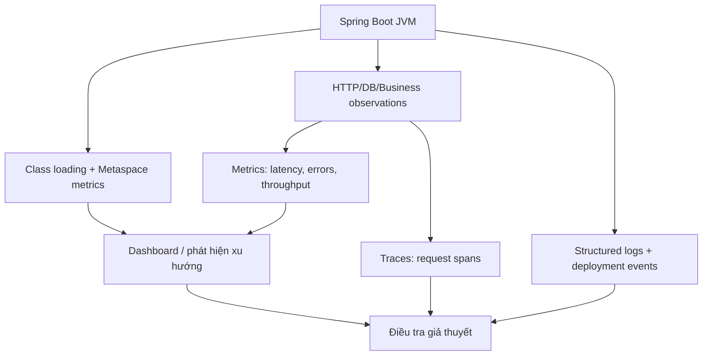

# Class loading metrics trong Spring Boot

Một dịch vụ Spring Boot chạy ổn định trong nhiều ngày nhưng lượng bộ nhớ **Metaspace** tăng dần. Sau mỗi lần gọi một nhóm API, số lớp Java đang được JVM nạp cũng tăng. Đây có phải lỗi rò rỉ class loader? Hay chỉ là hiện tượng nạp lớp muộn khi lần đầu sử dụng một thư viện, tạo proxy động hoặc khởi tạo phần tử của framework?

Để trả lời, cần hiểu **class loading metrics**: các phép đo liên quan đến số lớp đã nạp, đang được nạp và đã được giải phóng trong **JVM**, cùng cách đọc chúng bên cạnh memory, garbage collection, logs và traces.

Bài này thuộc chương **Application metrics** của module **SPRING_BOOT_OBSERVABILITY**. Module xây dựng observability cho Spring Boot bằng Micrometer Observation, metrics, logs và distributed tracing; thực hành context propagation, tag/cardinality, exporter, sampling và liên kết các tín hiệu để điều tra lỗi, độ trễ và hành vi ứng dụng trong môi trường thực. Trọng tâm ở đây là **diễn giải và sử dụng đúng class loading metrics**, không xem chúng như một phép chẩn đoán rò rỉ bộ nhớ tự động.

## Mục tiêu học tập

Sau khi học, bạn có thể:

1. Mô tả class loading, unloading và vai trò của class loader trong JVM.
2. Phân biệt **số lớp hiện đang được nạp** với **tổng số lượt nạp/gỡ lớp kể từ khi JVM khởi động**.
3. Biết cách quan sát class loading qua Spring Boot Actuator, Micrometer JVM metrics và `ClassLoadingMXBean`.
4. Phân biệt **gauge** với **cumulative counter**, đọc biến động theo thời gian và xử lý đúng khi process restart.
5. Phân tích class loading metrics cùng Metaspace, GC, CPU, logs, traces và sự kiện triển khai khi điều tra sự cố.
6. Nhận ra các nguồn tăng số lớp hợp lệ, những dấu hiệu đáng nghi và giới hạn của telemetry tổng hợp.
7. Thiết kế dashboard/alert với tag cardinality thấp và tránh gắn dữ liệu riêng của từng class hoặc request vào metric labels.

## 1. JVM class loading là gì?

Ứng dụng Java không phải lúc nào cũng nạp tất cả các lớp mà nó có thể sử dụng ngay khi process bắt đầu. JVM có thể nạp lớp khi code lần đầu tham chiếu tới một loại, khi framework tạo proxy hoặc khi thư viện động tạo ra bytecode.

Một cách đơn giản, quá trình sử dụng class gồm các khái niệm:

- **Loading:** class loader tìm định nghĩa và tạo biểu diễn `Class` tương ứng trong JVM.
- **Linking:** xác minh, chuẩn bị và có thể phân giải các tham chiếu theo quy tắc JVM.
- **Initialization:** thực thi logic khởi tạo class khi các điều kiện yêu cầu được đáp ứng.
- **Unloading:** khi những điều kiện thích hợp về khả năng sống của class loader và các class liên quan được thỏa mãn, JVM có thể giải phóng metadata của các class không còn cần thiết.

**Loading không đồng nghĩa với initialization**, và việc một class được nạp không có nghĩa mỗi request đều tạo ra một bản sao class mới. Đối tượng Java trong heap, định nghĩa class trong JVM và class loader là ba đối tượng khái niệm khác nhau.

### Ví dụ với Spring Boot

Các tình huống có thể làm số lớp đang nạp tăng:

- Ứng dụng bắt đầu sử dụng một module hoặc thư viện trước đây chưa chạy đến.
- Hibernate, Spring AOP, Jackson hoặc thư viện khác tạo proxy, adapter hay cấu trúc hỗ trợ động.
- JVM nạp thêm lớp khi một endpoint được gọi lần đầu.
- Công cụ instrument code, bytecode enhancement hoặc plugin tạo thêm loại class.
- Cơ chế hot reload, ứng dụng nhúng plugin hoặc redeploy trong cùng JVM tạo thêm class loader.

Vì vậy, **đường biểu diễn lớp đang nạp tăng sau lúc khởi động không mặc nhiên là rò rỉ**. Điều cần biết là tăng bao lâu, có ổn định sau warm-up hay không, có đi kèm tăng Metaspace, thay đổi class loader hoặc sự cố thực tế hay không.

### Một class có thể được nạp bởi nhiều class loader

Hai class loader khác nhau có thể nạp hai định nghĩa từ cùng tên class nhị phân nhưng chúng là những loại khác nhau trong JVM về mặt identity. Vì thế, số lớp được nạp không đơn giản bằng số file `.class` có trong JAR.

Các class loader giữ vai trò quan trọng trong hệ thống module/plugin, application server, hot restart và thư viện tạo class động. Tuy nhiên, **class loading metrics chuẩn ở mức JVM không cho biết class loader cụ thể nào tạo ra mỗi lớp**.

## 2. Những đại lượng cần phân biệt

JVM cung cấp giao diện quản lý `java.lang.management.ClassLoadingMXBean` với ba phép đo rất hữu ích:

| Java API | Ý nghĩa | Kiểu dữ liệu khi phân tích |
|---|---|---|
| `getLoadedClassCount()` | Số lớp hiện đang được JVM nạp | **Gauge:** có thể tăng hoặc giảm |
| `getTotalLoadedClassCount()` | Tổng số lượt nạp lớp kể từ khi JVM bắt đầu thực thi | **Cumulative counter:** không giảm trong cùng vòng đời process theo ngữ nghĩa API |
| `getUnloadedClassCount()` | Tổng số lớp đã được gỡ khỏi JVM kể từ khi JVM bắt đầu thực thi | **Cumulative counter:** không giảm trong cùng vòng đời process theo ngữ nghĩa API |

Ví dụ giả định tại một thời điểm:

```text
Currently loaded classes      = 18,400
Total loaded since JVM start  = 21,200
Total unloaded since JVM start=  2,800
```

Các con số minh họa mối quan hệ giữa số lớp đang có và các tổng tích lũy. Trong một ảnh chụp nhất quán, số đang nạp có thể được hiểu gần với **tổng đã nạp trừ tổng đã gỡ**. Nhưng nếu bạn đọc ba giá trị vào những thời điểm khác nhau, JVM đang thực hiện loading/unloading đồng thời thì phép trừ có thể lệch đôi chút.

Không dùng mối quan hệ số học này để suy ra lớp nào đã bị gỡ, vì ba chỉ số đều ở cấp JVM.

### 2.1. Loaded classes hiện tại là gauge

Một gauge trả lời “**hiện giờ có bao nhiêu?**”. Số lớp đang nạp có thể tăng khi thực thi code mới, giảm sau unloading, hoặc đi ngang trong thời gian dài.

**Đọc sai phổ biến:** `loaded = 20.000` nghĩa là có “20.000 lần nạp trong phút này”. Không đúng; đó là mức tại thời điểm đọc.

Tương tự, giảm từ 20.000 xuống 19.000 không tự động chứng minh một lỗi đã được sửa. Có thể lớp thuộc class loader đã được giải phóng, process khởi động lại, hoặc tập instance đang xem đã thay đổi.

### 2.2. Total loaded là counter tích lũy

`getTotalLoadedClassCount()` ghi nhận **tổng số lượt lớp được nạp kể từ khi JVM khởi chạy**. Nó hữu ích khi tính tốc độ phát sinh lớp mới theo thời gian, nhất là trong ứng dụng tạo bytecode động.

Một đường total-loaded tăng không có nghĩa current-loaded nhất thiết tăng tương ứng: JVM cũng có thể unload lớp.

### 2.3. Total unloaded là counter tích lũy

`getUnloadedClassCount()` tăng khi JVM gỡ lớp. Tuy nhiên, class unloading phụ thuộc điều kiện đạt được, cơ chế GC và class loader. Không có class unloading trong vài phút **không đủ chứng minh JVM bị rò rỉ**, nhất là dịch vụ bình thường giữ class loader sống suốt vòng đời ứng dụng.

Số lớp đã gỡ cũng không trực tiếp bằng số byte Metaspace đã giải phóng; mỗi class có kích thước metadata khác nhau, và bộ nhớ native được quản lý theo các cấu trúc cấp thấp hơn.

## 3. Class loading metrics do Micrometer cung cấp

Micrometer có binder JVM thường được biết đến với tên `JvmClassLoaderMetrics`. Trong các ứng dụng Spring Boot 3.x có Actuator và metrics auto-configuration thích hợp, nhóm JVM metrics có thể được đăng ký tự động.

Những tên meter thường gặp trong Micrometer:

| Meter | Ngữ nghĩa | Cách đọc |
|---|---|---|
| `jvm.classes.loaded` | Số lớp đang được nạp | Gauge, xem mức hiện tại và xu hướng |
| `jvm.classes.unloaded` | Tổng số lớp đã unload kể từ lúc JVM chạy | Counter tích lũy, dùng tốc độ tăng để đánh giá hoạt động unloading |

Tên chính xác được trình bày ở đây theo cách Micrometer thường sử dụng. **Tên xuất sang Prometheus có thể khác** do naming convention, đơn vị đo, suffix và phiên bản registry/exporter. Một số stack hoặc agent khác có thể công bố thêm **total loaded**, nhưng không nên mặc nhiên coi mọi ứng dụng Micrometer đều có một meter total-loaded tiêu chuẩn cùng tên.

Ở cấp JMX, `ClassLoadingMXBean` luôn cung cấp cả ba đại lượng đã nêu trong phần trước; nếu muốn xuất thêm một phép đo không được binder hiện tại cung cấp, phải thiết kế riêng và tránh làm trùng/sai ngữ nghĩa với meter sẵn có.

### 3.1. Thêm Actuator và exporter

Ví dụ dependency Gradle cho Spring Boot 3.x:

```groovy
dependencies {
    implementation 'org.springframework.boot:spring-boot-starter-actuator'
    runtimeOnly 'io.micrometer:micrometer-registry-prometheus'
}
```

Trong môi trường được cấu hình phù hợp, Actuator và Micrometer cung cấp các meters JVM; registry Prometheus cho phép scrape dữ liệu metrics. Dependency và khả năng hoạt động của từng endpoint cần được xác minh theo phiên bản Spring Boot và Micrometer cụ thể.

**Không cần tự tạo một `Gauge` khác có cùng tên `jvm.classes.loaded`** nếu binder đã đăng ký meter đó. Việc instrument trùng có thể tạo xung đột ID/type hoặc khó hiểu về phép đo.

### 3.2. Endpoint quan sát

Ví dụ cấu hình tối thiểu cho môi trường kiểm thử:

```yaml
management:
  endpoints:
    web:
      exposure:
        include: health,info,metrics,prometheus
```

Các endpoint thường gặp với đường dẫn Actuator mặc định:

- `/actuator/metrics`: liệt kê tên meters khả dụng.
- `/actuator/metrics/jvm.classes.loaded`: xem chi tiết meter đang có số lớp được nạp.
- `/actuator/metrics/jvm.classes.unloaded`: xem meter về tổng số lớp đã gỡ.
- `/actuator/prometheus`: dữ liệu metrics được exporter cung cấp để Prometheus scrape khi registry tương ứng đã được cấu hình.

**Bảo vệ các endpoint vận hành** bằng cấu hình bảo mật và mạng phù hợp. Không mở công khai metrics hoặc endpoint quản trị chỉ để tiện quan sát.

Nếu một tên meter không xuất hiện, hãy kiểm tra dependency, cấu hình bật/tắt metrics, trạng thái binder, `MeterRegistry` đang được dùng và khả năng ứng dụng thật sự có hệ thống metrics phù hợp.

## 4. Lấy dữ liệu trực tiếp bằng `ClassLoadingMXBean`

Trong những trường hợp cần hiểu nguồn số liệu từ JVM, có thể dùng Java Management API:

```java
import java.lang.management.ClassLoadingMXBean;
import java.lang.management.ManagementFactory;

public final class ClassLoadingSnapshot {
    public static void main(String[] args) {
        ClassLoadingMXBean bean =
                ManagementFactory.getClassLoadingMXBean();

        int currentlyLoaded = bean.getLoadedClassCount();
        long totalLoaded = bean.getTotalLoadedClassCount();
        long totalUnloaded = bean.getUnloadedClassCount();

        System.out.println("Current loaded = " + currentlyLoaded);
        System.out.println("Total loaded  = " + totalLoaded);
        System.out.println("Total unloaded= " + totalUnloaded);
    }
}
```

Đây là code Java tự chứa để đọc ba phép đo JVM. Nó cho thấy rõ sự khác biệt giữa **gauge** và **counter**. Chương trình `main` này tự đo JVM đang chạy chính nó; muốn lấy số liệu của Spring Boot service phải thực thi đoạn đọc trong process đó, hoặc dùng công cụ quản lý JVM tương ứng.

### Ví dụ bean Spring Boot đọc ảnh chụp khi cần chẩn đoán

Trong ứng dụng, bạn có thể đóng gói phương thức đọc:

```java
import java.lang.management.ClassLoadingMXBean;
import java.lang.management.ManagementFactory;
import org.springframework.stereotype.Component;

@Component
public class ClassLoadingDiagnostics {
    private final ClassLoadingMXBean bean =
            ManagementFactory.getClassLoadingMXBean();

    public Snapshot snapshot() {
        return new Snapshot(
                bean.getLoadedClassCount(),
                bean.getTotalLoadedClassCount(),
                bean.getUnloadedClassCount()
        );
    }

    public record Snapshot(
            int currentlyLoaded,
            long totalLoaded,
            long totalUnloaded
    ) {}
}
```

`Snapshot` là một object chẩn đoán nội bộ. **Không nên tạo một HTTP endpoint công khai** chỉ để trả những giá trị này khi Actuator đã có metrics phù hợp. Nếu ứng dụng ghi snapshot định kỳ vào log, phải giới hạn tần suất và biết rằng ba giá trị không nhất thiết được đọc atomically.

Không bật các cơ chế ghi chi tiết từng class mỗi request chỉ để có dashboard class loading; chúng có thể tăng overhead và khối lượng log, đồng thời không cần thiết cho trường hợp quan sát thông thường.

## 5. Đọc dữ liệu trên Prometheus đúng ngữ nghĩa

Một exporter Prometheus có thể chuyển `jvm.classes.loaded` thành tên gần như `jvm_classes_loaded_classes` và `jvm.classes.unloaded` thành một counter có hậu tố `_total`. **Đây chỉ là ví dụ naming**: hãy kiểm tra chính xác tên ở `/actuator/prometheus` của ứng dụng đang chạy trước khi sao chép truy vấn.

Giả sử exporter tạo ra:

```text
# Giá trị hiện thời, kiểu gauge (minh họa)
jvm_classes_loaded_classes{application="checkout-service",instance="a"} 18500

# Tổng số lớp đã unload, kiểu counter (minh họa)
jvm_classes_unloaded_classes_total{application="checkout-service",instance="a"} 2700
```

### 5.1. Xem mức hiện tại theo instance

```promql
jvm_classes_loaded_classes{application="checkout-service"}
```

Dùng line chart hoặc bảng theo `instance`/`pod` để thấy mỗi JVM đang nạp bao nhiêu lớp. Nếu ba replica có mức 18.000, 18.500 và 19.000, **không có nghĩa hệ thống đã nạp 55.500 class khác nhau**. Mỗi JVM có không gian class loading riêng; cộng các gauges chỉ có ý nghĩa nếu câu hỏi thực sự là tổng số class entries đang được quản lý trên toàn bộ các JVM.

Khi so sánh bản phát hành, hãy xét từng instance với thời gian uptime và giai đoạn warm-up tương tự.

### 5.2. Xem biến động của gauge

```promql
delta(jvm_classes_loaded_classes{application="checkout-service"}[15m])
```

`delta(...)` có thể giúp ước tính **mức thay đổi của gauge** trong khoảng thời gian xét. Nó không phải tốc độ tải lớp tổng cộng, vì class đã load và đã unload có thể triệt tiêu nhau. Nếu JVM restart, giá trị gauge nhảy về mức mới; cần đặt biểu đồ cạnh `process.uptime` hoặc metric process start để phân biệt restart với sự kiện unloading.

Tương tự, một gauge giảm đột ngột không nhất thiết tương ứng đúng số lớp bị unload trong cùng khoảng nếu tập target hoặc quá trình scrape thay đổi.

### 5.3. Đọc tốc độ unloading từ counter

Nếu backend có counter phù hợp:

```promql
rate(jvm_classes_unloaded_classes_total{
  application="checkout-service"
}[5m])
```

Kết quả là tốc độ unload **lớp/giây** được ước lượng trong cửa sổ năm phút. Do số lớp unloading có thể tăng theo từng đợt, giá trị có thể bằng 0 trong thời gian dài rồi xuất hiện spike.

Muốn xem tổng số lớp đã unload tăng thêm khoảng 30 phút:

```promql
increase(jvm_classes_unloaded_classes_total{
  application="checkout-service"
}[30m])
```

`rate` và `increase` trên counter có thể xử lý reset theo quy tắc của Prometheus, nhưng vẫn cần đủ mẫu scrape và đúng target. **Không dùng `rate()` cho gauge loaded hiện tại** chỉ vì tên của nó chứa từ `loaded`.

### 5.4. Giữ thông tin phiên bản và uptime

Trong triển khai nhiều instance, nên ghép dữ liệu với các thuộc tính vận hành phù hợp như `application`, `environment`, `instance`, phiên bản triển khai (qua label hoặc deployment event) và process uptime.

Ví dụ, một instance mới chạy 10 phút có thể đang nạp class muộn, còn instance đã chạy 20 ngày ở trạng thái cân bằng. So sánh trực tiếp hai số đếm mà không xét tuổi JVM có thể khiến kết luận sai.

Đặc biệt khi toàn bộ pod thay mới trong rolling deployment, đường tổng hợp có thể dao động vì các JVM **khác tuổi** cùng hiện diện, không nhất thiết vì hành vi nạp class bên trong một JVM thay đổi bất thường.

## 6. Class loading không giống Metaspace và GC

Class loading metrics có liên hệ với memory, nhưng không thay thế memory metrics.

| Tín hiệu | Nó đo gì? | Giới hạn |
|---|---|---|
| Current loaded classes | Số class hiện đang tồn tại trong JVM | Không cho biết kích thước metadata từng class |
| Total loaded | Số lượt nạp class tích lũy | Có thể tăng bình thường suốt đời process |
| Total unloaded | Số lượt gỡ class tích lũy | Không cho biết bao nhiêu byte được hoàn trả cho OS |
| Metaspace used | Một phần bộ nhớ non-heap liên quan đến class metadata | Không chỉ là phép nhân đơn giản với số class |
| Compressed Class Space | Vùng memory liên quan tới metadata trong một số cấu hình JVM | Có thể không có hoặc khác tùy JVM/options |
| Heap used | Bộ nhớ đối tượng trên heap | Không phải nơi mọi class metadata được lưu |
| GC activity | Hoạt động thu gom rác | Không đồng nghĩa mỗi GC đều unload class |

Với Micrometer JVM memory metrics, một số ứng dụng cung cấp series liên quan tới `jvm.memory.used`, có tag `area=nonheap` và `id=Metaspace`. Khi xuất sang Prometheus, tên/đơn vị có thể chuyển đổi, ví dụ thành dạng `jvm_memory_used_bytes`. Nên kiểm tra tên thật, thay vì giả định mọi runtime có cấu trúc label giống nhau.

### Cùng tăng không chứng minh nguyên nhân

Nếu loaded classes tăng và Metaspace cũng tăng, giả thuyết hợp lý là ứng dụng tạo thêm class metadata. Nhưng cần kiểm chứng:

- Đang nạp các class lần đầu theo warm-up hay lặp đi lặp lại?
- Có code generation, proxies hoặc plugin lifecycle không?
- Các class loader cũ có bị giữ tham chiếu sau reload không?
- Có thay đổi JVM, framework hoặc instrumentation agent sau deploy không?
- Metaspace có ổn định lại sau các chu kỳ GC hay tiếp tục tăng không?

**Không thể kết luận “class loader leak” chỉ từ hai đường biểu đồ cùng tăng.**

Ngược lại, Metaspace tăng trong khi số lớp đang nạp gần như đi ngang vẫn có thể xảy ra vì kích thước metadata và cách phân bổ bộ nhớ không đồng nhất. Cần dùng thêm công cụ chẩn đoán runtime thích hợp.

## 7. Phân biệt các dạng biến động thường gặp

### 7.1. Tăng nhanh lúc khởi động, sau đó đi ngang

```text
Loaded classes
   ^
   |                 ____________
   |            ____/
   |        ___/
   |  _____/
   +--------------------------------> uptime
```

Đây có thể là hành vi **bình thường**: khởi động Spring context, nạp thư viện theo nhu cầu, warm-up các đường request phổ biến. Giữ một đường baseline theo uptime sau deploy giúp biết “cao” hay “thấp” có thực sự đáng chú ý.

### 7.2. Tăng theo bậc sau mỗi lần sử dụng tính năng mới

Ví dụ các chức năng export PDF, kết nối một driver hoặc xử lý loại dữ liệu mới được gọi lần đầu. Số loaded classes có thể tăng theo bậc và sau đó giữ nguyên. Nếu không có sự tăng kéo dài, lỗi chức năng hoặc áp lực Metaspace, đây chưa chắc là vấn đề.

### 7.3. Tăng lặp lại sau mỗi lần reload/plugin refresh

Nếu ứng dụng dùng class loader động để nạp lại module, một class loader cũ không được giải phóng có thể khiến các class của nó còn tồn tại. Số current classes và Metaspace có thể tăng dần qua các đợt reload.

**Dấu hiệu đáng kiểm tra:** sau nhiều lần thực hiện cùng một vòng đời tải/gỡ plugin, mức hiện tại không quay về gần baseline và bộ nhớ non-heap tiếp tục tăng. Tuy vậy, vẫn phải kiểm tra GC và tham chiếu giữ class loader để chứng minh nguyên nhân.

### 7.4. Loaded classes ổn định nhưng tốc độ unloading tăng

Trường hợp này có thể do tạo rồi giải phóng các nhóm class tạm thời. Tổng loaded/unloaded có thể cùng tăng trong khi loaded hiện tại gần như không đổi.

Đó là **class-loading churn**: nhiều hoạt động load/unload dù số hiện tại ổn định. Nó có thể gây overhead CPU hoặc GC trong một số tình huống, nhưng cần dữ liệu profiling/JFR hoặc chỉ số tài nguyên khác để xác nhận tác động.

### 7.5. Sụt đột ngột khi process restart

JVM mới có counter bắt đầu lại từ đầu và gauge có mức của instance mới. Nếu Prometheus target hoặc label `instance` được tái sử dụng, đường biểu đồ có thể trông như unloading đột ngột.

**Trước khi kết luận:** so sánh process start time, uptime, thời điểm deploy và trạng thái pod. Một restart còn có thể làm mất các triệu chứng đã tích lũy trước đó, khiến lỗi rò rỉ tạm thời bị che.

## 8. Điều tra class loader leak: class loading metrics làm được gì?

Class loader leak thường liên quan tới class loader đáng ra phải được giải phóng nhưng còn bị các tham chiếu sống giữ lại. Những tham chiếu có thể đến từ thread, static field, callback, cache, registry, timer hoặc tài nguyên không được dọn trong một cơ chế reload/plugin.

**Metrics cho biết có dấu hiệu bất thường; không cho biết object reference nào giữ class loader.** Một quy trình điều tra có thể gồm:

1. **Xác lập cùng một JVM:** giữ nguyên identity của instance và so sánh theo uptime; loại bỏ nhầm lẫn do rolling deploy.
2. **Định nghĩa tình huống kích hoạt:** ví dụ tải/gỡ plugin hoặc khởi tạo một loại proxy mới.
3. **Xem current loaded classes:** có tăng liên tục qua nhiều vòng tương tự không?
4. **Đọc tổng loaded/unloaded:** nếu có dữ liệu phù hợp, quan sát lượng class được tạo mới và có được gỡ sau giai đoạn GC không.
5. **So sánh Metaspace, GC và tài nguyên process:** có cùng xu hướng tăng, dấu hiệu memory pressure hoặc lỗi `OutOfMemoryError: Metaspace` không?
6. **Kiểm tra code và lifecycle:** thread/executor còn sống, static caches, listener, instrumentation, app restart/reload hooks, class loader references.
7. **Dùng chẩn đoán JVM chuyên sâu khi cần:** công cụ JVM/JFR/heap diagnostics hoặc class-loader statistics để xác định loader nào còn sống và nguyên nhân; phải chọn theo runtime, quyền và môi trường.

Với HotSpot JDK, một lệnh **có thể khả dụng** trong môi trường hỗ trợ là:

```text
jcmd <pid> VM.classloader_stats
```

Không phải mọi JVM/JDK đều có cùng diagnostic command, và một số lệnh cần quyền hoặc gây overhead. Đây là gợi ý chẩn đoán khi nhóm vận hành đã xác định runtime và chính sách tác nghiệp, **không phải thao tác mặc định cho mọi production service**. Cũng không đồng nhất class histogram của heap với danh sách mọi class loader hoặc metadata trong Metaspace.

### Dấu hiệu nào thật sự đáng cảnh báo?

Không có ngưỡng tuyệt đối “20.000 class = lỗi”. Một ứng dụng lớn có thể nạp rất nhiều class hợp lệ. Cảnh báo nên dựa trên:

- **Xu hướng kéo dài theo cùng instance/uptime** vượt baseline được biết.
- **Tăng Metaspace** tới mức áp lực bộ nhớ hoặc gần giới hạn cấu hình.
- **Dấu hiệu người dùng bị ảnh hưởng:** độ trễ, lỗi, restart, OOM.
- **Mối liên hệ với thay đổi phần mềm** hoặc thao tác reload/plugin cụ thể.
- **Tính lặp lại** của triệu chứng khi kích hoạt cùng workflow.

Đặt alert chỉ dựa trên `jvm.classes.loaded > 15000` thường kém bền vững giữa các service, JVM và phiên bản ứng dụng.

## 9. Thiết kế dashboard class loading cho Spring Boot

Một dashboard thực tế nên có nhiều ô liên quan thay vì chỉ một gauge:

| Ô trên dashboard | Ý nghĩa và lưu ý |
|---|---|
| Current loaded classes theo `instance` | Xem mức hiện tại, xu hướng, warm-up và các điểm tăng theo bậc |
| Rate/increase của unloaded classes | Xem hoạt động unloading theo cửa sổ thời gian |
| Total loaded (nếu thu thập) | Xem tốc độ nạp class theo thời gian; không đồng nhất với current classes |
| Metaspace used/committed/max khi khả dụng | Phân tích memory pressure và capacity, nhớ rằng max có thể không xác định |
| GC pause/count và process CPU | Kiểm tra tương quan với overhead hoặc áp lực runtime |
| Process uptime, restart, deployment version | Phân biệt thay đổi thực với replacement process |
| HTTP latency/error rate | Đặt tín hiệu JVM trong bối cảnh ảnh hưởng người dùng |
| Log/traces tương ứng | Điều tra endpoint hoặc workflow kích hoạt thay đổi |

Một số chỉ số memory max hoặc giới hạn Metaspace có thể không được JVM trả về dưới dạng giá trị hữu hạn. **Không tính phần trăm sử dụng** nếu mẫu số không tồn tại hoặc mang ngữ nghĩa “không xác định”.

### Tag/cardinality

Class loading metrics là phép đo **cấp process**. Các tag phù hợp thường là:

```text
application=checkout-service
environment=production
instance=checkout-7c6d...    # identity theo deployment, nếu đã có
version=1.42.0
```

Không nên gắn:

```text
userId=...
orderId=...
traceId=...
className=com.example.SomeDynamicProxy123
requestPath=/orders/193828
```

Class name có thể hữu ích trong **dữ liệu chẩn đoán chuyên sâu**, nhưng không phù hợp thành một tag cho JVM-wide class loading gauge vì có thể gây cardinality rất cao và phá ngữ nghĩa của phép đo. Một meter cấp process không có quan hệ một-một với từng request, vì vậy gắn `traceId` vào meter đó cũng không giúp tương quan đáng tin cậy.

Nếu dùng `MeterRegistryCustomizer` để bổ sung common tags, các giá trị nên ổn định theo deployment; không lấy dữ liệu từ header người dùng.

## 10. Kết hợp metrics với logs, traces và Micrometer Observation

Class loading là một **tín hiệu tổng hợp ở cấp JVM**. Trong khi đó, một trace mô tả hành trình của một request được instrument và giữ lại; log ghi các sự kiện mà code lựa chọn lưu. Ba loại dữ liệu không thay thế nhau.



Giả sử số loaded classes tăng mạnh sau khi kích hoạt chức năng tạo báo cáo:

- **Class loading metrics:** xác nhận mức tăng xuất hiện ở instance nào và khi nào.
- **Metaspace metrics:** cho biết biến động memory có tương quan không.
- **Request latency metrics:** cho biết người dùng có gặp chậm hay không.
- **Traces của request tạo báo cáo:** nếu có instrumentation/sampling phù hợp, giúp khoanh vùng thao tác được thực hiện.
- **Structured logs:** cho biết sự kiện tạo báo cáo, loại lỗi và phiên bản triển khai.
- **Chẩn đoán JVM:** khi cần, xác định loader, class và tham chiếu gây giữ tài nguyên.

**Trace không tự chứa danh sách các class được load trong request.** Cũng không thể suy ra một trace dài là nguyên nhân class loading cao chỉ từ sự trùng thời gian. Muốn khẳng định, cần đo thêm, tái hiện và kiểm tra runtime.

### ObservationRegistry khác MeterRegistry

Trong Spring Boot:

- `ObservationRegistry` điều phối vòng đời observation, scope/context và handlers.
- `MeterRegistry` lưu/thu thập các meter, bao gồm class loading metrics khi JVM binder được cấu hình.
- `JvmClassLoaderMetrics` lấy số liệu từ JVM ở cấp process; nó không cần mở observation scope cho từng lần class load.
- Tracing sampling có thể làm một phần spans không xuất hiện, **không đồng nghĩa** class loading gauge chỉ đo những request được sample.
- Context propagation quan trọng để nối span/log giữa thread và service, nhưng không biến một JVM-wide gauge thành phép đo per-request.

Mối quan hệ này giúp tránh sửa sai lớp cấu hình: không cần thay tracing sampler chỉ để quan sát thêm class loading metrics; cũng không nên thêm high-cardinality metadata vào class loading meter để tìm đúng request.

## 11. Tình huống thực tế: Metaspace tăng sau rolling deployment

Giả sử ứng dụng thanh toán chạy trên ba pod Spring Boot. Sau bản phát hành mới, biểu đồ Metaspace used tăng và thỉnh thoảng có request chậm. Một kỹ sư nhận thấy `jvm.classes.loaded` trên pod mới cao hơn pod cũ khoảng 3.000 lớp.

### Những kết luận chưa đủ cơ sở

- **“Bản mới chắc chắn leak 3.000 lớp.”** Có thể do thay đổi dependency, warm-up hoặc proxy generation hợp lệ.
- **“Loaded classes tăng nên Metaspace chắc chắn tăng tỷ lệ thuận.”** Mỗi class có metadata khác nhau, và bộ nhớ Metaspace có cơ chế phân bổ riêng.
- **“Một request chậm là do JVM đang load class.”** Cần trace/profiling và tái hiện; request có thể chậm vì DB, network, thread pool hoặc provider.
- **“Pod vừa restart và số loaded giảm, vậy đã sửa được leak.”** Restart xóa trạng thái JVM cũ nhưng không chứng minh nguyên nhân gốc biến mất.

### Quy trình kiểm chứng

**Bước 1 — Xác định đúng các JVM đang so sánh.** Dựa vào pod/instance, version, start time và uptime. So sánh sau warm-up tương đương; không so sánh pod mới 5 phút với pod cũ chạy một tuần mà bỏ qua tuổi JVM.

**Bước 2 — Đọc các gauge và counter đúng kiểu.** Xem loaded hiện tại, rate/increase của unloaded; nếu cần total-loaded thì đọc `ClassLoadingMXBean` hoặc nguồn thống kê thực tế có sẵn. Chú ý process restart.

**Bước 3 — So sánh memory pressure.** Xem Metaspace used/committed, GC, process memory và các lỗi liên quan. Xác nhận đồ thị tăng là do cùng một instance thay vì do query gộp nhiều pod.

**Bước 4 — Xác định trigger.** Đối chiếu deployment events, lần gọi endpoint tạo báo cáo, chạy batch hoặc plugin reload. Dùng request metrics để định lượng ảnh hưởng và trace/log khi có dữ liệu tương quan.

**Bước 5 — Chạy tái hiện có kiểm soát.** Lặp cùng workflow trong môi trường phù hợp, theo dõi loaded classes và Metaspace trước/sau mỗi vòng; nếu tiếp tục tăng, dùng JVM diagnostics để xác định class loader sống lâu ngoài dự kiến.

**Bước 6 — Xác minh giải pháp bằng hành vi dài hạn.** Sau khi sửa code giữ tham chiếu hoặc thay đổi vòng đời resource, chạy thử đủ số vòng và thời gian cần thiết. Kiểm tra xu hướng ổn định hơn và tỷ lệ lỗi/độ trễ trở lại mục tiêu.

### Kết luận hợp lý

Class loading metrics có thể chứng minh **một JVM đang nạp/giữ bao nhiêu class và xu hướng thay đổi**. Chúng giúp hình thành giả thuyết về class generation hoặc class loader lifecycle. Nhưng việc xác nhận leak cần thêm dữ liệu về class loader references, GC, Metaspace, profiling hoặc thực nghiệm.

## 12. Các lỗi thường gặp

| Sai lầm | Hậu quả | Cách làm đúng |
|---|---|---|
| Đọc `jvm.classes.loaded` như số class đã nạp từ khi process chạy | Hiểu sai gauge thành counter | Xem loaded hiện tại; dùng total-loaded nếu cần số tích lũy |
| Dùng `rate()` cho current-loaded gauge | Có thể diễn giải sai kiểu metric | Dùng gauge trực tiếp, `delta()`/xu hướng khi phù hợp |
| Coi counter unloaded giảm khi restart là unloading âm | Nhầm reset process với sự kiện JVM | Kiểm tra uptime và dùng query counter phù hợp |
| Xem số loaded tăng sau warm-up là leak chắc chắn | Báo động giả | So sánh theo uptime, load pattern, Metaspace và vòng đời class loader |
| Coi Metaspace used bằng số lớp nhân kích thước cố định | Sai mô hình memory | Đọc memory metrics riêng và kiểm tra JVM |
| Gắn class name, trace ID hoặc user ID vào class loading meter | Cardinality cao, mất ngữ nghĩa JVM-wide | Tag ổn định theo service/environment/instance |
| Cộng mọi instance rồi suy ra số lớp độc nhất của ứng dụng | Đếm lặp các class nằm ở nhiều JVM | Xem theo process; gộp chỉ khi có ý nghĩa rõ |
| Thêm binder thứ hai cùng tên meter | Có thể trùng meter hoặc xung đột | Kiểm tra Actuator metrics đã có trước |
| Không thấy series Prometheus rồi kết luận JVM không load class | Có thể lỗi exporter/registry/scrape/query | Xác minh từ MXBean/Actuator đến backend |
| Thay trace sampling để tăng class loading metrics | Sửa sai lớp dữ liệu | Class loading là JVM metrics, độc lập với sampling trace thông thường |
| Coi log lỗi Metaspace là bằng chứng leak do một endpoint | Thiếu bằng chứng quan hệ nhân quả | Kết hợp workload, diagnostics và tái hiện |
| Bật logging class-loading chi tiết dài hạn mà không đánh giá | Gây overhead và flood logs | Chỉ bật có mục tiêu, theo chính sách runtime |

## 13. Checklist triển khai class loading observability

Trước khi dùng class loading metrics trong production, hãy kiểm tra:

1. **Nguồn đo:** ứng dụng đang dùng Spring Boot Actuator + Micrometer JVM binder hay exporter khác? Các metric có tên và kiểu gì thực tế?
2. **Ngữ nghĩa:** phân biệt current loaded gauge và các total counters; không đánh đồng `loaded` với `totalLoaded`.
3. **Registry:** `MeterRegistry` đã nhận các JVM binders chưa? Có bị `MeterFilter` từ chối hoặc đăng ký trùng không?
4. **Endpoint:** `/actuator/metrics` và `/actuator/prometheus` có dữ liệu phù hợp không? Endpoint có được bảo vệ không?
5. **Tag:** có gắn `application`, `environment`, `instance` và phiên bản ổn định khi cần không? Có ID động gây cardinality cao không?
6. **Uptime:** dashboard có hiển thị process start/restart để phân biệt counter reset và warm-up không?
7. **Memory:** có Metaspace/non-heap và GC metrics cho cùng instance không?
8. **Luồng tải:** có baseline class loading sau deploy, sau warm-up và khi idle không?
9. **Alert:** có dựa vào xu hướng và memory pressure thay vì một ngưỡng số lớp tuyệt đối không?
10. **Cross-signal:** khi gặp bất thường, có thể đối chiếu HTTP latency/error rate, logs, traces và deployment events không?
11. **Privacy/chi phí:** có tránh ghi raw class names và dữ liệu người dùng vào metric tags không?
12. **Chẩn đoán:** có quy trình sử dụng JFR/JVM tools phù hợp và an toàn khi metrics không đủ kết luận không?

## 14. Câu hỏi tự đánh giá

**Câu 1.** `getLoadedClassCount()` trả 20.000. Có nghĩa trong 5 phút vừa qua JVM đã nạp 20.000 class không?

**Gợi ý:** Không. Đây là số class **đang được nạp** ở thời điểm đọc, không phải số lượt nạp trong cửa sổ 5 phút.

**Câu 2.** `getTotalLoadedClassCount()` tăng từ 22.000 lên 23.000, `getUnloadedClassCount()` cũng tăng thêm 800. Số current loaded có nhất thiết tăng 1.000 không?

**Gợi ý:** Không. Nếu dữ liệu được đọc tại các thời điểm nhất quán, mức hiện tại chỉ tăng gần 1.000 − 800 = 200 lớp. Tổng đã nạp và số đang tồn tại có ngữ nghĩa khác nhau.

**Câu 3.** Sau khi restart pod, `jvm.classes.unloaded` trở về 0. Có phải JVM đã “unload âm” không?

**Gợi ý:** Không. Counter tích lũy bắt đầu lại theo vòng đời process mới; cần kiểm tra uptime và dùng truy vấn xử lý counter reset.

**Câu 4.** Một ứng dụng tạo nhiều proxy động nhưng current-loaded ổn định. Có thể vẫn có chi phí class loading không?

**Gợi ý:** Có. JVM có thể liên tục load rồi unload các nhóm class, khiến counter tổng thay đổi dù gauge ít đổi. Cần phân tích tốc độ, GC/CPU và profiling khi nghi ngờ overhead.

**Câu 5.** Số loaded classes và Metaspace cùng tăng sau deploy. Có đủ để kết luận class loader leak không?

**Gợi ý:** Chưa. Cần loại trừ warm-up, dependency changes, code generation bình thường, so sánh cùng JVM theo uptime và kiểm tra class loader references/runtime diagnostics.

**Câu 6.** Muốn tìm endpoint nào gây load class nhiều nhất, có nên thêm `http.route` hoặc `traceId` trực tiếp vào `jvm.classes.loaded` không?

**Gợi ý:** Không. Meter này là JVM-wide gauge, không gắn trực tiếp với từng request. Dùng trace/log và diagnostic profiling để điều tra trigger; không biến class loading metric thành per-request metric giả.

**Câu 7.** Không thấy `jvm.classes.loaded` ở Prometheus dù service vẫn chạy. Nên kiểm tra những gì?

**Gợi ý:** Bắt đầu từ binder/MeterRegistry, `/actuator/metrics`, endpoint Prometheus, tên xuất thực tế, trạng thái scrape, filter và query. Không kết luận JVM không nạp class vì thiếu series.

## Kết luận

**Class loading metrics cho biết trạng thái và hoạt động nạp/gỡ lớp của JVM**, giúp nhận diện warm-up, code generation, class-loading churn và dấu hiệu đáng điều tra về class loader lifecycle. Trong Spring Boot, hãy đọc đúng gauge/counter từ Micrometer/JMX, đối chiếu cùng uptime, Metaspace và GC, giữ metric tags ở cardinality thấp, rồi liên kết với HTTP metrics, logs, traces và deployment events để hiểu tác động thực tế. Một đường class count tăng là **tín hiệu để đặt câu hỏi**, không tự chứng minh class loader leak; chẩn đoán đáng tin cần thêm bằng chứng và kiểm chứng theo cùng vòng đời JVM.
