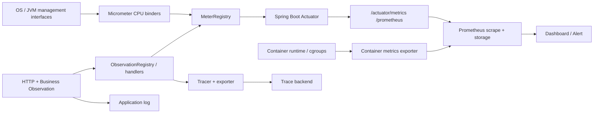
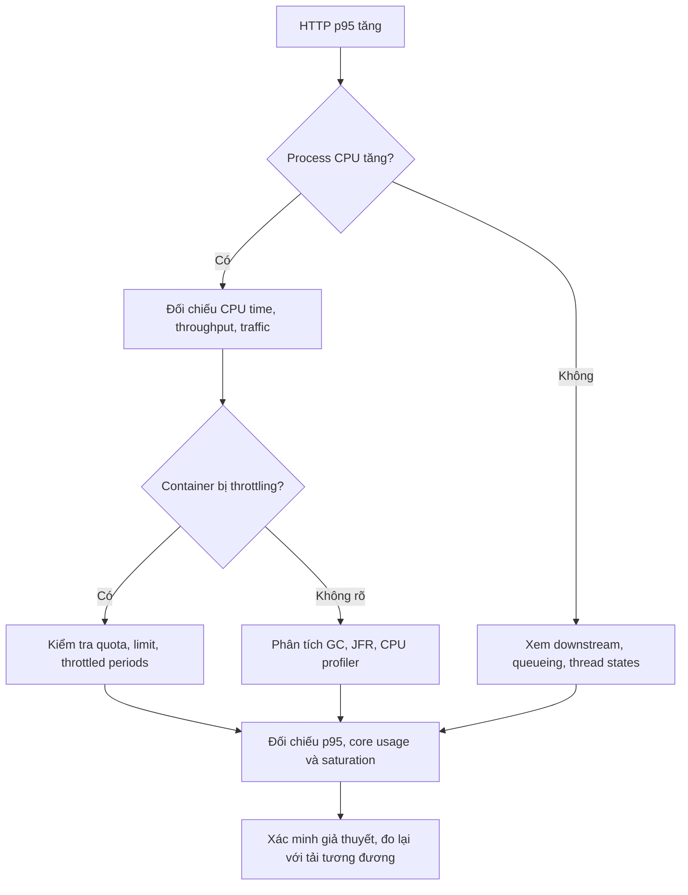

# CPU metrics trong Spring Boot: đo mức sử dụng và tìm nguyên nhân quá tải

Một API Spring Boot có thể chậm hơn nhiều sau khi triển khai, dù bộ nhớ heap và số lần garbage collection (GC) gần như không đổi. Dashboard hiển thị CPU của tiến trình ở mức cao, nhưng người vận hành vẫn phải trả lời: **ứng dụng đang thực sự tính toán nhiều hơn, đang bị giới hạn CPU trong container, hay đang chờ một tài nguyên khác?** Chỉ nhìn một con số “CPU 90%” thường không đủ.

Bài **CPU metrics** thuộc chương **Application metrics** của module `SPRING_BOOT_OBSERVABILITY`. Module hướng tới việc thiết lập observability bằng Micrometer Observation, metrics, logs và distributed tracing; hiểu context propagation, tag/cardinality, exporter, sampling và kết hợp tín hiệu để điều tra lỗi, độ trễ, hành vi ứng dụng trên môi trường thực. Trong bài này, chúng ta tập trung vào các phép đo CPU của tiến trình Java, của hệ thống và của container, cách công bố qua Spring Boot Actuator/Micrometer, rồi cách dùng chúng cùng HTTP metrics và traces để khoanh vùng sự cố.

> **Kết quả học tập:** Phân biệt CPU utilization với CPU time, load average và throttling; đọc đúng các meter thường gặp; tạo biểu đồ Prometheus theo service/instance; liên kết CPU cao với độ trễ và lỗi; tránh kết luận sai do giới hạn container hoặc nhãn cardinality cao.

## 1. CPU metrics đo điều gì?

**CPU utilization** mô tả mức CPU được sử dụng so với một khả năng xử lý tham chiếu trong một khoảng thời gian. **CPU time** là thời gian CPU thực sự dành để chạy các thread của tiến trình, có thể cộng dồn qua nhiều lõi. Hai chỉ số liên quan nhưng **không đồng nhất**.

Trong hệ sinh thái Spring Boot 3.x và Micrometer, các meter thường gặp gồm:

| Meter logic | Loại | Đơn vị/ý nghĩa | Phạm vi cần hiểu |
| --- | --- | --- | --- |
| `process.cpu.usage` | Gauge | Thường là tỷ lệ sử dụng CPU được chuẩn hóa, gần 0–1 khi hỗ trợ | Tiến trình JVM |
| `process.cpu.time` | Function counter hoặc meter thời gian CPU tích lũy | Thời gian CPU mà tiến trình đã dùng | Tiến trình JVM; không phải wall-clock uptime |
| `system.cpu.usage` | Gauge | Tỷ lệ sử dụng CPU hệ thống theo thông tin JVM/OS cung cấp | Hệ thống mà JVM có thể quan sát |
| `system.cpu.count` | Gauge | Số bộ xử lý logic được JVM/binder báo cáo, khi có | Năng lực tham chiếu, có thể phụ thuộc container awareness |
| `system.load.average.1m` | Gauge | Load average 1 phút trên nền tảng hỗ trợ | Chỉ số tải, **không phải CPU %** |
| `process.uptime` | Gauge | Thời gian tiến trình đã chạy | Giúp nhận biết restart, không phải CPU time |

Tên metric, base unit, khả năng đo và tập nhãn phụ thuộc phiên bản Spring Boot, Micrometer, JDK, hệ điều hành, cách triển khai và exporter. Một meter có thể không tồn tại hoặc trả giá trị không khả dụng trên một số nền tảng. Đừng coi bảng này là cam kết rằng mọi ứng dụng đều có đủ tất cả các phép đo.

### 1.1. CPU-bound, I/O-bound và waiting

Độ trễ của một request có thể tăng vì:

- **CPU-bound:** nhiều phép tính, serialization, compression, mã hóa hoặc xử lý dữ liệu làm CPU bận.
- **I/O-bound:** thread chờ database, HTTP service, filesystem hoặc network.
- **Contention:** thread phải chờ lock, connection pool, executor queue hoặc một tài nguyên dùng chung.
- **Runtime overhead:** GC, JIT, safepoint, instrumentation hoặc hệ thống xử lý dữ liệu gây thêm chi phí.
- **Giới hạn hạ tầng:** container bị CPU throttling hoặc node bị tranh chấp tài nguyên.

CPU thấp **không có nghĩa request nhanh**: một request có thể chờ database 2 giây mà hầu như không dùng CPU. CPU cao **không tự chứng minh có lỗi**: service xử lý batch đúng công suất có thể dùng CPU cao nhưng throughput, latency và SLO vẫn tốt.

## 2. CPU time khác thời gian thực thi (wall time)

Ví dụ một tác vụ Java chạy trong 2 giây theo đồng hồ:

| Tình huống | Wall time | CPU time gần đúng | Ý nghĩa |
| --- | ---: | ---: | --- |
| Một thread tính toán liên tục | 2 s | 2 CPU-s | Một lõi gần như bận liên tục |
| Một thread chờ network phần lớn thời gian | 2 s | 0,1 CPU-s | Thời gian chờ chiếm phần lớn |
| Hai thread cùng tính toán trên hai lõi | 2 s | 4 CPU-s | Tổng thời gian CPU qua các lõi có thể lớn hơn wall time |
| Tác vụ bị xếp hàng 1 s rồi tính toán 1 s | 2 s | Xấp xỉ 1 CPU-s | Queueing không phải CPU execution |

**CPU-second** là đơn vị biểu diễn một giây sử dụng một lõi logic tương đương. Một tiến trình đa luồng có thể tích lũy nhiều CPU-second trong một giây đồng hồ.

Với `process.cpu.time`, nếu giá trị tích lũy tăng từ 100 CPU-s lên 110 CPU-s trong 5 giây wall-clock, tiến trình đã tiêu thụ trung bình:

\[
\frac{110-100}{5}=2\ \text{CPU cores tương đương}.
\]

Nói cách khác, tốc độ tăng của CPU time theo thời gian có đơn vị **CPU-second/second**, thường được diễn giải như **số lõi CPU đang sử dụng trung bình**. Đây không phải trực tiếp là tỷ lệ phần trăm: để có tỷ lệ sử dụng, phải biết mẫu số là số CPU logic của host, số CPU JVM thấy hay CPU quota có hiệu lực của container.

### 2.1. Tỷ lệ `process.cpu.usage` là bao nhiêu phần trăm?

Trong nhiều môi trường, JVM/Micrometer đưa ra một giá trị đã chuẩn hóa trong khoảng 0–1. Có thể hiển thị giá trị 0,65 thành 65%, **nhưng phải nêu rõ mẫu số của 65% đó là gì**.

Một cách hình dung (không phải công thức đảm bảo cho mọi JVM) là:

\[
\text{Process CPU utilization}
\approx
\frac{\Delta \text{CPU time}}
{\Delta \text{wall time}\times N},
\]

trong đó \(N\) là số bộ xử lý khả dụng mà API đo dùng để chuẩn hóa. Ví dụ tiến trình tiêu thụ trung bình 2 CPU cores trên một phạm vi tính 4 logical processors thì tỷ lệ là khoảng 0,5, tức 50%.

Trên máy ảo, Kubernetes hoặc container, phạm vi đó có thể khác số lõi vật lý của host và khác quota CPU được cấp. **Không lấy 0,65 nhân với một số lõi tùy đoán để suy ra CPU tuyệt đối.** Xác minh JDK, cách JVM nhận diện container và metric hạ tầng khi cần tính chính xác.

## 3. Phân biệt process CPU, system CPU và load average

### 3.1. Process CPU

`process.cpu.usage` và `process.cpu.time` tập trung vào **tiến trình JVM**, gồm CPU mà các thread của tiến trình tiêu thụ. Chúng hữu ích khi một node chạy nhiều dịch vụ và cần phân biệt ứng dụng Java có phải nguồn tiêu thụ CPU chính hay không.

Đây không phải metric đo riêng CPU của controller, endpoint hay phương thức. Muốn biết đoạn code nào tiêu thụ CPU, cần sử dụng profiling/JFR và đối chiếu với các observation của nghiệp vụ.

### 3.2. System CPU

`system.cpu.usage` mô tả CPU theo phạm vi hệ thống mà JVM/OS có thể nhìn thấy. Có môi trường đó là host; trong môi trường container-aware, cách báo cáo có thể khác theo JDK và nền tảng. Nếu node có nhiều tiến trình, `system.cpu.usage` cao nhưng `process.cpu.usage` thấp có thể gợi ý tải đến từ tiến trình khác; vẫn cần kiểm tra scope và dữ liệu node/container trước khi kết luận.

### 3.3. Load average không phải CPU usage

`system.load.average.1m` thường phản ánh số công việc runnable và, trên một số hệ điều hành, cả công việc đang chờ I/O không thể ngắt trong khoảng thời gian tính tải. Con số 4 **không có nghĩa 4% CPU**. Để diễn giải, phải biết số logical processors và đặc điểm hệ điều hành.

| CPU usage | Load average | Diễn giải ban đầu |
| --- | --- | --- |
| Cao | Cao | Có thể có nhiều công việc tính toán đang cạnh tranh CPU |
| Thấp | Cao | Có thể đang chờ I/O hoặc có nhiều công việc trong hàng đợi |
| Cao | Thấp hoặc vừa | Một số thread nặng CPU hoặc khác biệt giữa các cửa sổ đo |
| Thấp | Thấp | Có thể nhàn rỗi, nhưng một endpoint vẫn có thể chậm do downstream |

Trên nền tảng không hỗ trợ, load average có thể không có hoặc mang giá trị không hợp lệ. Không biến một giá trị “-1” thành “âm 100% tải”.

## 4. Luồng thu thập CPU metrics trong Spring Boot



Ở mức khái niệm, binder đọc thông tin JVM/OS, đăng ký meter trong `MeterRegistry`, sau đó registry có thể công bố qua Actuator hoặc exporter. **CPU metrics thông dụng không cần tự tạo custom Observation cho từng request.** Chúng là số đo cấp tiến trình/hệ thống.

Container CPU usage và throttling thường đến từ hệ thống giám sát hạ tầng như cAdvisor/Prometheus hoặc giải pháp tương đương; **chỉ thêm Actuator không bảo đảm có đủ chỉ số cgroup/quota/throttling**. Hai nguồn JVM và container nên được đối chiếu theo instance/pod và timestamp.

Traces và logs giúp tìm đoạn code hoặc request đáng điều tra, nhưng CPU metric cấp tiến trình không mang một `traceId` riêng cho mỗi mẫu. Việc liên kết thường dựa trên **dịch vụ, instance, thời gian**, sau đó chọn trace/log phù hợp.

## 5. Thiết lập Spring Boot Actuator và Prometheus

Ví dụ dùng Spring Boot 3.x, Java 17+ và Maven; phiên bản thư viện được quản lý bằng Spring Boot BOM/parent.

```xml
<dependencies>
    <dependency>
        <groupId>org.springframework.boot</groupId>
        <artifactId>spring-boot-starter-web</artifactId>
    </dependency>
    <dependency>
        <groupId>org.springframework.boot</groupId>
        <artifactId>spring-boot-starter-actuator</artifactId>
    </dependency>
    <dependency>
        <groupId>io.micrometer</groupId>
        <artifactId>micrometer-registry-prometheus</artifactId>
    </dependency>
</dependencies>
```

Actuator cùng những meter binders tương thích thường cung cấp các CPU metrics chuẩn mà không phải viết code thu thập từ `OperatingSystemMXBean` bằng tay. Registry Prometheus cần khi muốn xuất metrics theo định dạng Prometheus để hệ giám sát scrape.

```yaml
spring:
  application:
    name: report-service

management:
  endpoints:
    web:
      exposure:
        include: health,metrics,prometheus
  metrics:
    tags:
      application: report-service
```

Trong cấu hình này, `application` là một common tag ổn định giúp tách dịch vụ trên backend. Các nhãn như `instance`, `pod`, `namespace` có thể được thêm tại hệ thống scrape. Phải kiểm tra tránh trùng label hoặc thêm một nhãn động không kiểm soát.

Khi application chạy ở cổng 8080:

```bash
curl -s http://localhost:8080/actuator/health
curl -s http://localhost:8080/actuator/metrics
curl -s http://localhost:8080/actuator/metrics/process.cpu.usage
curl -s http://localhost:8080/actuator/metrics/process.cpu.time
curl -s http://localhost:8080/actuator/metrics/system.cpu.usage
curl -s http://localhost:8080/actuator/metrics/system.load.average.1m
curl -s http://localhost:8080/actuator/prometheus
```

Nếu một tên metric không có trong `/actuator/metrics`, kiểm tra danh sách meter thực tế, phiên bản JDK/Micrometer, chính sách bật/tắt metrics, nền tảng hỗ trợ và cấu hình exporter. Không nên tự tạo metric khác trùng tên khi chưa biết binder hiện tại hoạt động ra sao.

**Bảo mật:** `management.endpoints.web.exposure.include` chỉ quyết định endpoint nào được công bố qua HTTP; không thay thế authentication, authorization hoặc giới hạn mạng. Bảo vệ management endpoints phù hợp với Spring Security/gateway và hệ thống monitoring, tránh công bố thông tin vận hành nhạy cảm ra Internet.

## 6. Đọc giá trị CPU từ Actuator

Phản hồi `/actuator/metrics/process.cpu.usage` có thể có cấu trúc dạng sau (**ví dụ minh họa**, không phải dữ liệu đã đo):

```json
{
  "name": "process.cpu.usage",
  "measurements": [
    {
      "statistic": "VALUE",
      "value": 0.42
    }
  ],
  "availableTags": []
}
```

Nếu runtime của bạn báo một tỷ lệ chuẩn hóa 0–1 thì giá trị 0,42 có thể diễn giải là khoảng 42% của **phạm vi CPU tham chiếu đang được đo**. Nó không chứng minh tiến trình tiêu thụ “42% của cả node” trong mọi môi trường container.

Đối với `process.cpu.time`, một số registry/Actuator có thể hiển thị giá trị tích lũy với base unit thời gian. **Một giá trị tích lũy tăng không có nghĩa CPU đang quá tải**: một tiến trình chạy đủ lâu sẽ dùng CPU time ngày càng nhiều dù hiện tại gần như idle. Để đo tốc độ sử dụng CPU, hãy so sánh mức tăng của counter theo một khoảng thời gian.

Nếu đầu ra có `VALUE`, `COUNT` hoặc `TOTAL`, cần hiểu meter type và base unit trước khi tính toán. Thời gian CPU tích lũy và mức sử dụng CPU tức thời không thể đọc theo cùng một cách.

### Những điểm cần kiểm tra trước khi tin một con số

1. Tiến trình đã chạy đủ lâu để bộ lấy mẫu có dữ liệu chưa? Một số metric CPU cần khoảng thời gian để có giá trị ổn định.
2. JVM có hỗ trợ phép đo trên hệ điều hành đó không? Có giá trị không khả dụng hoặc metric vắng mặt không?
3. JVM có container-aware không, và đang nhìn thấy bao nhiêu logical processors?
4. Có CPU limit/quota khác với số CPU logic nhìn thấy không?
5. Giá trị đến từ đúng instance hay đã bị dashboard cộng/tổng hợp nhiều instance?

## 7. CPU trên Kubernetes/container: quota khác usage

Khi chạy trên Kubernetes, phải phân biệt ít nhất bốn đại lượng:

| Khái niệm | Mô tả | Câu hỏi phù hợp |
| --- | --- | --- |
| CPU request | Lượng CPU được dùng để scheduling/đảm bảo tương đối theo cấu hình Kubernetes | Pod được đặt vào node dựa trên mức nào? |
| CPU limit/quota | Mức CPU tối đa được phép tiêu thụ trong một khoảng quota, khi có cấu hình | Tác vụ có thể bị hạn chế đến mức nào? |
| CPU usage | Lượng CPU thực sự đã tiêu thụ | Pod đang dùng trung bình bao nhiêu core? |
| CPU throttling | Thời gian/kỳ mà workload bị giới hạn CPU theo cơ chế quota | Có đang bị trì hoãn dù còn việc cần chạy không? |

**Ví dụ:** một container được giới hạn ở 0,5 CPU. Nếu nó liên tục muốn chạy tương đương 1 core, hệ thống có thể throttling để mức tiêu thụ trung bình không vượt quota. Khi đó người vận hành có thể thấy container usage gần 0,5 core và latency tăng mạnh dù CPU của **toàn node** chưa đạt 100%.

Mức 0,5 CPU không đồng nghĩa “một nửa lõi vật lý cố định” cho một thread. CPU scheduler phân phối thời gian xử lý theo quota, và việc bị throttle còn tùy chu kỳ quota, tải và cấu hình runtime.

### 7.1. Vì sao `system.cpu.usage` có thể gây nhầm lẫn?

Một số chỉ số của JVM được lấy từ API hệ điều hành và có thể phản ánh host hoặc scope mà runtime nhìn thấy. Trong container, chúng không nhất thiết bằng usage hay quota của chính container. Các thế hệ JDK khác nhau có mức hỗ trợ cgroup/container awareness khác nhau.

Khi điều tra CPU saturation trên Kubernetes, đối chiếu:

- `process.cpu.usage` và `process.cpu.time` từ ứng dụng;
- `container_cpu_usage_seconds_total` hoặc metric tương đương từ container exporter;
- CPU limit/quota từ Kubernetes/cgroup;
- các metric throttling như `container_cpu_cfs_throttled_periods_total` nếu hệ monitoring cung cấp;
- latency, throughput, queue depth và error rate của ứng dụng.

Không khẳng định một metric cAdvisor phải có trong mọi cụm; tên, nhãn và khả năng cung cấp thay đổi theo phiên bản exporter, cgroup v1/v2 và pipeline monitoring.

### 7.2. CPU throttling không phải một JVM metric mặc định

`process.cpu.usage` có thể không phân biệt rõ tiến trình idle với tiến trình **muốn chạy nhưng bị throttle** trong từng thời điểm. Vì vậy nếu request chậm mà process CPU usage không tăng như dự kiến, đừng bỏ qua khả năng quota thấp hoặc CPU scheduler đang giới hạn tiến trình.

Một tỷ lệ throttled periods cao có thể là tín hiệu cần kiểm tra; nó không trực tiếp quy đổi thành “phần trăm thời gian request bị chậm”. Cần đối chiếu với thời lượng throttling, SLO và cấu hình quota.

## 8. Truy vấn CPU metrics bằng Prometheus

Các biểu thức dưới đây là **mẫu PromQL**, giả định ứng dụng có common label `application="report-service"` và Prometheus gắn nhãn `instance`. Tên xuất thực tế phụ thuộc registry/naming convention; hãy kiểm tra `/actuator/prometheus` trước khi dùng. Ví dụ thường gặp: `process.cpu.usage` được xuất thành `process_cpu_usage`, còn `process.cpu.time` có thể thành một series counter thời gian như `process_cpu_time_seconds_total`.

### 8.1. Process CPU utilization theo instance

```promql
100 * avg by (application, instance) (
  process_cpu_usage{application="report-service"}
)
```

Biểu đồ đưa tỷ lệ 0–1 thành phần trăm **theo cách metric được chuẩn hóa**. Không gọi đây là “% quota của container” trừ khi đã xác minh mẫu số thật sự phù hợp với quota đó.

Một gauge có thể biến động theo chu kỳ ngắn, vì vậy cần theo dõi trên một cửa sổ đủ dài và so sánh với baseline cùng kiểu tải. Có thể dùng `avg_over_time(process_cpu_usage[5m])` theo mỗi series khi muốn làm trơn thay vì chỉ quan sát một điểm tức thời.

### 8.2. CPU time tiêu thụ theo core tương đương

Nếu exporter thực tế có counter `process_cpu_time_seconds_total`:

```promql
sum by (application, instance) (
  rate(process_cpu_time_seconds_total{
    application="report-service"
  }[5m])
)
```

Kết quả có đơn vị **CPU-second/second**, tức số CPU cores tương đương được tiến trình dùng trung bình. Ví dụ 1,4 nghĩa là tiến trình sử dụng xấp xỉ 1,4 core trong cửa sổ 5 phút; nó không phải tỷ lệ 140% của quota, trừ khi hệ quy chiếu được định nghĩa như vậy.

Counter thời gian CPU có thể reset khi tiến trình restart. Hàm `rate` thường xử lý counter reset tốt hơn phép trừ thủ công hai mẫu; vẫn cần xem nhãn instance/pod và độ tin cậy của các điểm scrape.

### 8.3. CPU usage của container

Nếu nguồn hạ tầng công bố `container_cpu_usage_seconds_total` và các nhãn phù hợp:

```promql
sum by (namespace, pod, container) (
  rate(container_cpu_usage_seconds_total{
    namespace="production",
    container="report-service"
  }[5m])
)
```

Kết quả là số cores tương đương của container trung bình trong cửa sổ, **không mặc nhiên là phần trăm**. Bộ nhãn có thể khác trong cụm thực tế; tránh gộp nhầm infrastructure container hoặc series trùng do nhiều scrape targets. Muốn tính % CPU quota cần chia cho CPU limit thực tế theo cùng đơn vị và đảm bảo mẫu số hợp lệ.

### 8.4. Tỷ lệ các kỳ bị throttle

Nếu hạ tầng xuất hai counter về CFS quota:

```promql
sum by (namespace, pod, container) (
  rate(container_cpu_cfs_throttled_periods_total{
    namespace="production",
    container="report-service"
  }[5m])
)
/
sum by (namespace, pod, container) (
  rate(container_cpu_cfs_periods_total{
    namespace="production",
    container="report-service"
  }[5m])
)
```

Biểu thức tính **tỷ lệ kỳ CFS có throttling**, không phải tỷ lệ CPU đã mất và cũng không phải tỷ lệ request bị ảnh hưởng. Nếu không có CPU limit hoặc exporter không ghi những counter này, biểu thức có thể không có dữ liệu. Không xem giá trị thiếu là “không throttle” nếu chưa kiểm tra nguồn.

### 8.5. So sánh với HTTP latency

Nếu đã cấu hình histogram cho `http.server.requests` và backend có bucket `http_server_requests_seconds_bucket`, có thể tính p95:

```promql
histogram_quantile(
  0.95,
  sum by (le, uri, method) (
    rate(http_server_requests_seconds_bucket{
      application="report-service"
    }[5m])
  )
)
```

Histogram phải được bật cho meter tương ứng, ví dụ khi phiên bản Spring Boot/Micrometer hỗ trợ:

```yaml
management:
  metrics:
    distribution:
      percentiles-histogram:
        http.server.requests: true
```

Không phải cứ có Timer HTTP là sẵn `_bucket`. Histogram có chi phí series theo route, status, method và buckets; cần kiểm soát tag/cardinality để tránh tăng chi phí monitoring quá mức.

## 9. Kết hợp CPU metrics với custom Observation, logs và tracing

CPU metric cấp tiến trình không biết request nào gây tải. Để hiểu code nghiệp vụ, nên instrument ranh giới có ý nghĩa, ví dụ thao tác tạo báo cáo:

```java
import io.micrometer.observation.Observation;
import io.micrometer.observation.ObservationRegistry;
import org.springframework.stereotype.Service;

@Service
public class ReportService {
    private final ObservationRegistry registry;
    private final ReportEngine engine;

    public ReportService(ObservationRegistry registry, ReportEngine engine) {
        this.registry = registry;
        this.engine = engine;
    }

    public ReportResult generate(ReportRequest request) {
        String mode = "full".equals(request.mode()) ? "full" : "basic";

        return Observation.createNotStarted("report.generate", registry)
            .contextualName("generate-report")
            .lowCardinalityKeyValue("report.mode", mode)
            .observe(() -> engine.generate(request));
    }
}

record ReportRequest(String mode) {}
record ReportResult(String content) {}

interface ReportEngine {
    ReportResult generate(ReportRequest request);
}
```

Ví dụ giả định ứng dụng có một implementation Spring bean của `ReportEngine` và gọi `ReportService.generate` từ controller hoặc một adapter tương ứng. Observation này đo thời lượng **đồng bộ** của thao tác; nó **không phải phép đo CPU time riêng của phương thức**. Nếu engine chờ I/O trong hai giây, Observation có thể dài hai giây dù CPU tiêu thụ rất ít.

Khi hệ thống có Micrometer Observation handler cho metrics, `report.generate` có thể tạo Timer nghiệp vụ. Nếu có tracing bridge, handler tracing, exporter và backend, thao tác có thể tạo span. Với logging correlation được cấu hình, log bên trong scope có thể mang `traceId` và `spanId`.

### 9.1. Điều gì được liên kết và điều gì không?

| Tín hiệu | Phạm vi | Dùng để trả lời |
| --- | --- | --- |
| `process.cpu.usage` | Tiến trình JVM | Service đang dùng bao nhiêu CPU tương đối? |
| `process.cpu.time` | Tiến trình JVM | Số CPU cores tương đương tiêu thụ qua thời gian? |
| Container CPU/throttling | Container/pod | Quota có đang kìm hãm workload không? |
| `report.generate` Timer | Một loại thao tác nghiệp vụ, tổng hợp theo tag | Báo cáo có chậm, chậm theo mode nào? |
| HTTP Timer | Endpoint, method, status | Người dùng bị ảnh hưởng ở route nào? |
| Distributed trace | Một request được ghi nhận và giữ lại | Thời gian mất ở bước nào, gọi downstream nào? |
| Logs | Sự kiện kèm timestamp và correlation | Có exception, timeout, retry, queueing nào không? |

**Không gắn `traceId`, `requestId` hoặc mã người dùng vào CPU metric tag.** CPU metrics vốn là các mẫu cấp tiến trình; những giá trị riêng từng request sẽ khiến số series tăng không kiểm soát mà không giúp xác định chi phí CPU của riêng request đó.

### 9.2. Trace sampling và context propagation

Traces chỉ được lưu khi tracing integration, exporter/collector, sampling và backend hoạt động. Một request không có trace lưu ở backend vẫn có thể góp phần vào HTTP metrics, business Timer và mức CPU của tiến trình.

Nếu xử lý từ Servlet thread sang executor, `@Async`, `CompletableFuture` hoặc Reactor, cần context propagation phù hợp để duy trì trace/span và log correlation. Chỉ có một bean `ObservationRegistry` không bảo đảm trace tự đi qua thread hoặc HTTP request outbound. Phải sử dụng instrumentation và propagation format tương thích, thường là W3C Trace Context cho truyền qua network.

## 10. Tình huống thực tế: p95 tăng, CPU process gần 100%

Giả sử `report-service` có p95 HTTP tăng từ 150 ms lên 1,2 s. Dashboard cho thấy `process.cpu.usage` tăng từ khoảng 0,3 lên 0,95 trong cùng giai đoạn.



Một quy trình điều tra có bằng chứng:

1. **Đánh giá phạm vi sự cố:** HTTP latency tăng ở mọi route hay chỉ `/reports`? Request rate, tỷ lệ 5xx và số request đồng thời có tăng không?
2. **Kiểm tra CPU scope:** `process.cpu.usage` là tỷ lệ theo phạm vi nào? CPU time tăng bao nhiêu core tương đương? Có bao nhiêu instance đang phục vụ?
3. **Đối chiếu quota:** Nếu pod bị limit 0,5 CPU và usage gần 0,5 core, xem throttling. Node CPU chưa bão hòa không loại trừ container bị throttle.
4. **Loại trừ GC hoặc contention:** Xem `jvm.gc.pause`, heap, thread states, connection pool và queue depth. CPU process cao có thể bao gồm chi phí GC.
5. **Truy trace mẫu:** Xem span `report.generate` và các child spans, thời gian chờ downstream; tìm log có cùng traceId/spanId nếu được lưu.
6. **Profiling đúng môi trường:** Nếu nghi CPU-bound, thu thập Java Flight Recorder (JFR) hoặc CPU profiler trong phạm vi an toàn để nhận diện hot methods. Chỉ nhìn trace duration không xác định được phương thức nào tiêu thụ CPU nhiều nhất.
7. **Kiểm tra kết quả:** Sau khi tối ưu code, thay đổi quota hoặc giảm contention, so sánh throughput, p95, CPU time, throttling và error rate ở điều kiện tải tương đương.

### Ba kịch bản rất dễ nhầm

| Quan sát | Giả thuyết cần kiểm tra | Bằng chứng tiếp theo |
| --- | --- | --- |
| Process CPU cao, CPU time/core cao, không throttle | CPU-bound logic hoặc GC | JFR/CPU profile, GC metrics, request mix |
| Container usage gần CPU limit, throttled periods tăng, p95 tăng | CPU quota kìm hãm tác vụ | Cgroup/quota, latency theo thời gian, thử quota trong môi trường kiểm soát |
| Process CPU thấp, p95 tăng, nhiều thread waiting/blocked | I/O, lock contention, queueing | Thread dump, pool metrics, downstream traces/logs |

Các tín hiệu này **gợi ý giả thuyết**, không phải quan hệ nhân quả đã chứng minh. Ví dụ một đợt tăng traffic có thể khiến CPU và p95 cùng tăng, ngay cả khi không có lỗi code; cần phân tích capacity và tải thực tế.

## 11. Tag/cardinality, units và chi phí vận hành

CPU metrics của tiến trình thường không cần nhiều tag nghiệp vụ. Những chiều hữu ích nhất là:

| Tag | Ví dụ | Lý do |
| --- | --- | --- |
| `application` | `report-service` | Phân biệt ứng dụng |
| `environment` | `prod`, `staging` | Phân biệt môi trường |
| `instance` | Do hệ scrape gắn | Điều tra tiến trình cụ thể |
| `namespace`, `pod` | Kubernetes metadata | Liên kết với quota/throttling |

Không thêm `url`, `orderId`, `customerId`, `threadId` hoặc `traceId` làm CPU metric tag. Số giá trị lớn sẽ làm tăng time series; CPU metric không chứa thông tin per-request nên việc thêm ID cũng thiếu ý nghĩa đo lường.

Chú ý **đơn vị**:

- `process.cpu.usage`: thường là tỷ lệ không thứ nguyên; hiển thị phần trăm bằng nhân 100 khi đúng thang 0–1.
- `process.cpu.time`: CPU time tích lũy; rate của nó thường diễn giải như CPU cores tương đương.
- `container_cpu_usage_seconds_total`: CPU seconds tích lũy; rate cũng là số cores tương đương.
- `system.load.average.1m`: giá trị tải, không phải CPU percent.
- Container CPU quota/request: thường dùng đơn vị core hoặc millicore, không tự bằng một gauge usage.

Không đặt nhãn `unit=percent` trong metric nhưng lại ghi số 0–1 vào lúc này và 0–100 ở lúc khác. Chọn một hợp đồng thống nhất, đối chiếu base unit và cách exporter chuyển đổi, rồi để dashboard đổi cách hiển thị.

## 12. Khi CPU metrics không xuất hiện hoặc biểu đồ bất thường

| Triệu chứng | Nguyên nhân có thể | Hướng kiểm tra |
| --- | --- | --- |
| Không thấy `process.cpu.usage` trong Actuator | Thiếu binder, metric bị disable, JDK/OS không hỗ trợ, tên khác | Xem `/actuator/metrics` và cấu hình/phiên bản |
| CPU usage bằng 0 hoặc gần 0 dù đang có request | Workload I/O-bound, đo chưa đủ thời gian, scope tính khác | So với CPU time rate, traffic, trace và container usage |
| CPU usage bị bỏ trống hoặc âm | Giá trị không khả dụng từ JDK/OS | Kiểm tra runtime/binder, tránh ép số thiếu thành 0 |
| Prometheus không có series | Chưa scrape, thiếu registry, endpoint lỗi, thay tên metric | Kiểm tra `/actuator/prometheus`, scrape targets và label |
| Gauge nhảy mạnh theo từng điểm | Cửa sổ lấy mẫu quá ngắn hoặc traffic burst | Xem trung bình theo thời gian và baseline |
| CPU % trên dashboard khác `top` | Khác mẫu số, đơn vị, cửa sổ hoặc phạm vi container/host | So sánh CPU seconds/core và quota rõ ràng |
| Node CPU thấp nhưng pod chậm | Có thể bị quota/throttling hoặc I/O wait | Xem cgroup CPU/throttle và downstream |
| CPU process cao, trace không chỉ ra hot method | Trace đo thời lượng chứ không phải CPU profiling | Dùng JFR/CPU profiler với giám sát an toàn |
| CPU metric tăng sau đổi image/JDK | JDK/container detection, GC hoặc workload thay đổi | So runtime flags, JDK, quota và traffic |
| Cộng CPU usage của nhiều instance ra “300%” | Tổng các tỷ lệ không có mẫu số chung | Ưu tiên per-instance hoặc CPU cores tổng hợp có quy ước |

Đối với workload container, cần xác minh nguồn dữ liệu: cùng một tiến trình có thể được theo dõi bởi cả JVM binder lẫn container exporter, nhưng hai metric đo theo phạm vi khác nhau. Đừng ghép chúng thành một series chỉ vì tên gần giống.

## 13. Thực hành: phân biệt CPU-bound và chờ I/O

Thực hiện trong môi trường test hoặc staging có giới hạn tải an toàn:

1. **Khởi động Spring Boot:** thêm Actuator và Prometheus registry, cấu hình common tag `application=report-service` như ở mục 5 (hoặc dùng tên service thực tế của bạn).
2. **Khám phá CPU meter:** gọi `/actuator/metrics`, tìm `process.cpu.usage`, `process.cpu.time`, `system.cpu.usage` và load average nếu có. Ghi nhận loại meter, base unit và giá trị đầu.
3. **Tạo hai loại workload có kiểm soát:** một thao tác tính toán vừa phải và một thao tác chờ I/O/latency giả lập. Đảm bảo mỗi workload có cùng số request và giới hạn thời gian, không chạy vòng lặp vô hạn hoặc ép tải quá mức.
4. **So sánh số liệu:** CPU time tăng bao nhiêu trong cùng cửa sổ; HTTP/business Timer tăng ra sao; thread trạng thái nào thay đổi?
5. **Chạy trên container thử nghiệm:** ghi rõ CPU limit và request, quan sát `container_cpu_usage_seconds_total` cùng throttling nếu hạ tầng có cung cấp. Thay quota trong môi trường kiểm soát và đối chiếu kết quả ở cùng tải.
6. **Dựng dashboard:** biểu đồ process CPU usage theo instance, CPU cores từ rate CPU time, request throughput, p95 latency và tỷ lệ HTTP 5xx.
7. **Liên kết tracing/logs:** tạo custom Observation như `report.generate`, bật tracing bridge/exporter phù hợp và log correlation. Dùng trace để nhận diện đoạn thời gian chờ; dùng profiler khi cần xác định hot code.
8. **Kiểm tra an toàn:** giới hạn Actuator exposure, không thêm per-request IDs vào CPU metric tags, rà soát exporter/scrape, series cardinality và thời gian lưu trữ.

### Câu hỏi tự kiểm tra

1. `process.cpu.time` khác `process.uptime` ra sao? Vì sao CPU time của một tiến trình đa luồng có thể tăng hơn một giây trong một giây wall-clock?
2. Một process CPU usage bằng 0,8 có luôn nghĩa container đã dùng 80% CPU quota không?
3. Vì sao `system.load.average.1m = 4` không có nghĩa hệ thống dùng 4% CPU?
4. Một pod giới hạn ở 0,5 CPU có thể bị throttling khi node còn nhiều CPU nhàn rỗi không? Cần xem metric gì?
5. Nếu p95 HTTP tăng nhưng CPU process thấp, cần kiểm tra những nguồn chờ nào?
6. Vì sao một span dài 800 ms không chứng minh đoạn code đã tiêu thụ 800 ms CPU?
7. Khi nào nên dùng `rate(process_cpu_time_seconds_total[5m])` thay vì chỉ nhìn một giá trị CPU time tuyệt đối?

## 14. Checklist vận hành CPU metrics

- Xác nhận tên, loại meter, đơn vị và khả năng hỗ trợ trên JDK/OS thực tế.
- Xác định phạm vi của process CPU, system CPU và container CPU trước khi so sánh.
- Phân biệt CPU usage ratio, CPU time, CPU cores, load average và CPU quota.
- Gắn nhãn application, instance và hạ tầng ổn định; không đưa ID động vào CPU tags.
- Theo dõi CPU cùng throughput, p95, error rate, GC, thread states và queue/pool metrics.
- Đối chiếu quota/throttling trên Kubernetes; không kết luận dựa vào node CPU duy nhất.
- Dùng `rate` cho CPU time dạng counter, dùng cửa sổ thời gian thích hợp cho gauge.
- Không đọc một span duration hoặc log duration như CPU time; dùng JFR/profiler khi cần xác định hot method.
- Kiểm tra context propagation, sampling và exporter trước khi kết luận trace của một request bị mất.
- Bảo vệ management endpoint, điều chỉnh scrape interval/retention theo khả năng backend và SLO.
- Sau mọi thay đổi code/quota/JDK, so sánh ở cùng điều kiện tải, trên đúng instance hoặc nhóm triển khai.

## Kết luận

**CPU metrics** là một phần nền tảng của Application metrics trong Spring Boot, nhưng chúng chỉ có giá trị khi hiểu đúng phạm vi và đơn vị. `process.cpu.usage` giúp quan sát mức sử dụng CPU của JVM, `process.cpu.time` cho phép tính CPU cores tương đương qua thời gian, trong khi `system.cpu.usage`, load average và các chỉ số container bổ sung góc nhìn hạ tầng. CPU cao không tự đồng nghĩa lỗi, CPU thấp không loại trừ request chậm, và container throttling có thể gây latency ngay khi node còn tài nguyên. Kết hợp các số đo này với HTTP/business observations, metrics, logs, distributed tracing, context propagation, exporter và sampling sẽ giúp đội vận hành kiểm chứng giả thuyết và xử lý sự cố có bằng chứng thay vì dựa vào một con số CPU phần trăm.
