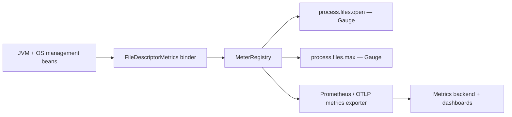
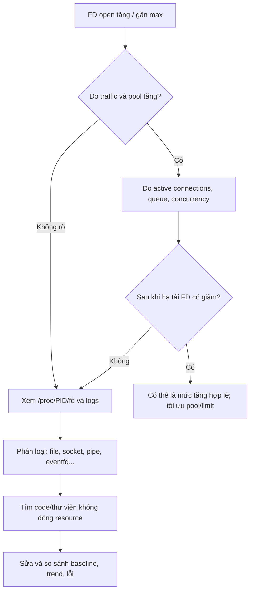

# File descriptor metrics trong Spring Boot

## 1. Mục tiêu học tập

Một dịch vụ Spring Boot có thể còn nhiều heap trống, CPU thấp nhưng vẫn không mở được kết nối TCP, file log hay file cấu hình mới. Nguyên nhân thường nằm ở **file descriptors (FD)**: tài nguyên hữu hạn mà hệ điều hành cấp cho tiến trình khi mở file, socket, pipe và các đối tượng I/O khác.

Trong chương **Application metrics** của module **SPRING_BOOT_OBSERVABILITY**, bài này giải thích cách sử dụng hai metric của Micrometer:

- `process.files.open`: số file descriptor đang mở của **tiến trình Java**.
- `process.files.max`: số file descriptor tối đa tiến trình có thể mở theo nguồn dữ liệu JVM/hệ điều hành.

Sau bài học, bạn sẽ có thể:

1. Giải thích FD là gì, tại sao một ứng dụng Spring Boot có thể gặp lỗi `Too many open files`.
2. Nhận biết file descriptor metrics là **gauge cấp process** chứ không phải counter hoặc latency metric.
3. Đọc `process.files.open` và `process.files.max` qua Spring Boot Actuator, Prometheus và Micrometer.
4. Tính tỷ lệ sử dụng FD, thiết kế dashboard và alert có kiểm tra dữ liệu thiếu/không hợp lệ.
5. Phân biệt rò rỉ FD, số kết nối tăng hợp lệ, thay đổi giới hạn hệ điều hành và sai lệch do môi trường container.
6. Sử dụng thông tin từ metrics, logs, traces và công cụ Linux để khoanh vùng lỗi.
7. Tránh những lỗi về tag cardinality, sampling, exporter và duplicate instrumentation khi triển khai.

Ví dụ cấu hình hướng tới **Spring Boot 3.5.x, Java 17+, Linux**. Spring Boot 4.x và JVM/OS khác có thể khác ở cách tự cấu hình hoặc khả năng công bố meter; luôn kiểm tra runtime và tài liệu phiên bản đang dùng.

## 2. File descriptor là gì?

Trên các hệ điều hành kiểu Unix, mỗi tiến trình duy trì một bảng các số nguyên nhỏ (FD) đại diện cho tài nguyên I/O mà tiến trình đã mở. Ví dụ:

| Tài nguyên | Có thể chiếm FD? | Tình huống trong Spring Boot |
| --- | --- | --- |
| File thông thường | Có | Đọc file cấu hình, CSV, upload tạm, log |
| TCP socket | Có | Kết nối đến PostgreSQL, Redis, HTTP service khác |
| Unix-domain socket | Có | Giao tiếp với dịch vụ trên cùng host |
| Pipe | Có | Giao tiếp với tiến trình con |
| File log/stdout/stderr | Có | Stream log ứng dụng |
| epoll/eventfd và I/O nội bộ | Có thể | Event loop của Netty và các thư viện nền tảng |
| Bộ nhớ heap Java | Không phải FD | Bộ nhớ đối tượng, cache |
| CPU thread | Không phải một FD theo mặc định | Thread riêng không đồng nghĩa mở thêm file |

Mỗi socket đang mở có thể tiêu thụ một FD, kể cả khi socket chưa trao đổi dữ liệu. Một ứng dụng có thể mở nhiều socket do HTTP connection pool, database pool, retry hoặc kết nối tồn tại lâu như WebSocket.

**FD không đồng nghĩa với file vật lý trên đĩa.** Vì vậy `disk.free`, `jvm.memory.used`, `process.cpu.usage` và `process.files.open` đo các thứ hoàn toàn khác nhau. Không thể suy số FD còn lại từ dung lượng đĩa hay heap.

### 2.1. Giới hạn FD và lỗi thường gặp

Trên Linux, giới hạn số FD của tiến trình liên quan đến **RLIMIT_NOFILE** (soft/hard limits). Ứng dụng thường không thể mở thêm FD khi đạt giới hạn hiệu dụng, dẫn tới lỗi ở API hệ điều hành; phía Java có thể thấy:

```text
java.net.SocketException: Too many open files
java.io.FileNotFoundException: ... (Too many open files)
java.nio.file.FileSystemException: ... Too many open files
```

Thông điệp thực tế còn tùy loại I/O, JVM và OS. Lỗi `EMFILE` phản ánh giới hạn FD **của tiến trình**; lỗi tài nguyên cấp hệ thống như `ENFILE` có ngữ nghĩa khác và cần xem xét toàn host.

Hậu quả có thể bao gồm: không chấp nhận kết nối HTTP mới, thất bại khi tạo kết nối outbound, truy cập file lỗi, health check chập chờn hoặc quá trình ghi log bị gián đoạn. **Tăng giới hạn FD mà không sửa nguyên nhân rò rỉ** thường chỉ trì hoãn sự cố.

## 3. Hai metric `process.files.*` đo gì?

Micrometer Core cung cấp `io.micrometer.core.instrument.binder.system.FileDescriptorMetrics`. Trên môi trường JVM/hệ điều hành hỗ trợ, binder sử dụng thông tin hệ thống quản lý của JVM để đăng ký hai **Gauge**:

| Tên Micrometer | Loại | Đơn vị | Ý nghĩa |
| --- | --- | --- | --- |
| `process.files.open` | Gauge | Số FD | FD đang mở, tại thời điểm đo, của tiến trình JVM |
| `process.files.max` | Gauge | Số FD | Giới hạn FD tối đa được báo cho tiến trình |

**Gauge** phản ánh giá trị hiện thời. Khi mở thêm kết nối, `process.files.open` có thể tăng; sau khi đóng kết nối, nó có thể giảm. Nó không phải Counter nên **không** dùng `rate(process_files_open[5m])` như với số request tích lũy.



Khi hệ điều hành/JVM **không cung cấp** API tương thích, các meter có thể vắng mặt. Đây không phải mặc nhiên là lỗi Spring Boot; đặc biệt phải chú ý khi chạy trên Windows hoặc một JVM không hỗ trợ giao diện Unix tương ứng.

### 3.1. Giá trị đến từ đâu?

Trên JVM hỗ trợ `com.sun.management.UnixOperatingSystemMXBean`, hai phương thức liên quan là:

```java
long open = unixMxBean.getOpenFileDescriptorCount();
long max = unixMxBean.getMaxFileDescriptorCount();
```

Chúng báo thông tin về **tiến trình đang chạy**, không phải tổng số file/socket đang mở của toàn bộ node, container namespace hoặc Kubernetes cluster. Trên Linux, giới hạn đọc được thường liên quan đến giới hạn `nofile` của chính process. Khi đổi cấu hình OS/container, kiểm tra lại giá trị thực thay vì giả định nó giống `ulimit -n` của một shell khác.

Ví dụ minh họa tại một thời điểm:

```text
process.files.open = 768
process.files.max  = 1024
```

Tỷ lệ sử dụng:

\[
\text{FD utilization} = \frac{\text{open}}{\text{max}} \times 100\%
= \frac{768}{1024}\times100\%=75\%
\]

Đây là phép đo **mức sử dụng giới hạn** tại một thời điểm, không phải error rate hoặc phần trăm CPU. Nếu `max` vắng, bằng 0 hoặc là giá trị sentinel không hợp lệ, không được tính tỷ lệ một cách mù quáng.

### 3.2. Không phải mọi trường hợp open tăng đều là leak

FD tăng có thể hoàn toàn bình thường khi:

- HTTP server đang phục vụ nhiều kết nối đồng thời.
- Connection pool JDBC/Redis/HTTP mở rộng do lưu lượng tăng.
- Ứng dụng khởi tạo lần đầu các file/socket, framework hoặc exporter.
- Tác vụ batch đang mở nhiều file hợp lệ rồi đóng sau khi hoàn thành.

Dấu hiệu đáng nghi về **FD leak** là mức `open` tiếp tục tăng qua nhiều chu kỳ tải và **không trở lại baseline** sau khi công việc kết thúc, nhất là khi lưu lượng, số kết nối đang dùng và số tác vụ thực tế đã giảm. Một đường metric tăng đơn lẻ chưa đủ kết luận leak.

## 4. Bật file descriptor metrics trong Spring Boot

Spring Boot Actuator tự cấu hình nhiều **system metrics**, bao gồm file descriptor metrics, thông qua Micrometer khi môi trường hỗ trợ. Với Spring Boot **3.5.x**, dùng Spring Boot parent/BOM để quản lý version Maven:

```xml
<dependencies>
    <dependency>
        <groupId>org.springframework.boot</groupId>
        <artifactId>spring-boot-starter-actuator</artifactId>
    </dependency>
    <dependency>
        <groupId>io.micrometer</groupId>
        <artifactId>micrometer-registry-prometheus</artifactId>
    </dependency>
</dependencies>
```

Nếu đây là ứng dụng web MVC thì dự án thường đã có `spring-boot-starter-web`, nhưng nó **không bắt buộc** cho chính binder FD. Registry Prometheus chỉ cần khi bạn muốn expose ở định dạng Prometheus; Actuator có thể hiển thị metrics từ registry khác phù hợp.

`application.yml` minh họa:

```yaml
spring:
  application:
    name: checkout-service

management:
  endpoints:
    web:
      exposure:
        include: health,info,metrics,prometheus
  metrics:
    tags:
      application: checkout-service
      environment: local
```

Khi chạy ở máy phát triển, có thể kiểm tra:

```bash
curl -s http://localhost:8080/actuator/metrics
curl -s http://localhost:8080/actuator/metrics/process.files.open
curl -s http://localhost:8080/actuator/metrics/process.files.max
curl -s http://localhost:8080/actuator/prometheus
```

**Tại endpoint Actuator, dùng tên Micrometer chứa dấu chấm**: `process.files.open`. Tên xuất cho Prometheus thường được chuẩn hóa thành `process_files_open` và `process_files_max`, chưa kể các nhãn theo registry/scrape.

Các endpoint này phải được bảo vệ theo chính sách mạng và quyền truy cập trên môi trường thực. Không expose toàn bộ Actuator ra Internet chỉ để theo dõi FD.

### 4.1. Ví dụ phản hồi Actuator

Một phản hồi minh họa cho `/actuator/metrics/process.files.open`:

```json
{
  "name": "process.files.open",
  "description": "The open file descriptor count",
  "baseUnit": "files",
  "measurements": [
    { "statistic": "VALUE", "value": 768.0 }
  ],
  "availableTags": [
    { "tag": "application", "values": ["checkout-service"] },
    { "tag": "environment", "values": ["local"] }
  ]
}
```

Đây là **ví dụ cấu trúc JSON**, không phải kết quả thực tế trên một JVM cụ thể: description, baseUnit và tập tag có thể khác tùy Micrometer/registry/version. Trường `VALUE` thể hiện giá trị gauge hiện thời. Với metric `process.files.max`, bạn đọc giá trị theo cách tương tự.

### 4.2. Vì sao metric không xuất hiện?

Kiểm tra theo thứ tự:

1. Actuator đã nằm trong classpath và endpoint `metrics` đã expose chưa?
2. `/actuator/metrics` có liệt kê `process.files.open`, `process.files.max` không?
3. JVM/OS có hỗ trợ thông tin FD tương ứng không? Trên Linux với JDK phù hợp thường có.
4. Có `MeterFilter` hay `management.metrics.enable.process.files=false` chặn tên meter không?
5. Có tự cấu hình registry riêng hoặc tắt system metrics binder khiến Actuator không ghi nhận không?
6. Nếu chỉ vắng trong Prometheus: có `micrometer-registry-prometheus` và endpoint `prometheus` đã expose chưa, Prometheus đã scrape thành công chưa?

**Tránh nhầm thuộc tính cũ.** Một số tài liệu Spring Boot 2.x đời đầu có `management.metrics.binders.files.enabled`; không nên chép thuộc tính đó sang Boot 3.5 mà không kiểm tra metadata/tài liệu của đúng phiên bản. Khi muốn **ẩn meter khỏi registry**, có thể dùng thuộc tính per-meter được tài liệu Boot 3.5 hỗ trợ:

```properties
management.metrics.enable.process.files=false
```

Quy tắc trên chặn metric với tiền tố tên `process.files` trong registry chịu cấu hình. Nó làm mất tín hiệu giám sát FD; không được coi là cách khắc phục tình trạng cạn FD.

## 5. Đọc gauge bằng Java khi cần chẩn đoán

Trong **ứng dụng Spring Boot có Actuator**, hãy ưu tiên `MeterRegistry` và các meter đã được Boot đăng ký. Bạn có thể đọc gauge hiện có từ registry được inject mà không tự tạo binder:

```java
import io.micrometer.core.instrument.Gauge;
import io.micrometer.core.instrument.MeterRegistry;
import org.springframework.stereotype.Component;

import java.util.OptionalDouble;

@Component
public class FileDescriptorSnapshot {
    private final MeterRegistry registry;

    public FileDescriptorSnapshot(MeterRegistry registry) {
        this.registry = registry;
    }

    public OptionalDouble utilization() {
        Gauge openGauge = registry.find("process.files.open").gauge();
        Gauge maxGauge = registry.find("process.files.max").gauge();

        if (openGauge == null || maxGauge == null) {
            return OptionalDouble.empty(); // Không có số đo trên OS/JVM này.
        }

        double open = openGauge.value();
        double max = maxGauge.value();
        if (!Double.isFinite(open) || !Double.isFinite(max) || max <= 0) {
            return OptionalDouble.empty();
        }
        return OptionalDouble.of(open / max);
    }
}
```

`utilization()` trả phần số trong khoảng thông thường `0.0`–`1.0`, không nhân với 100. Ở ứng dụng có nhiều tag series trùng tên metric, `find(...).gauge()` có thể không xác định series bạn muốn; cần lọc theo các tag của đúng process/registry. Đừng expose endpoint tự viết này khi Actuator/dashboards đã đáp ứng nhu cầu.

### 5.1. Nếu dùng Micrometer thuần, không có Spring Boot

Micrometer có binder công khai `FileDescriptorMetrics`:

```java
import io.micrometer.core.instrument.Gauge;
import io.micrometer.core.instrument.Tags;
import io.micrometer.core.instrument.binder.system.FileDescriptorMetrics;
import io.micrometer.core.instrument.simple.SimpleMeterRegistry;

public class StandaloneFdMetrics {
    public static void main(String[] args) {
        SimpleMeterRegistry registry = new SimpleMeterRegistry();
        try {
            new FileDescriptorMetrics(Tags.of("source", "manual"))
                    .bindTo(registry);

            Gauge open = registry.find("process.files.open")
                    .tags("source", "manual").gauge();
            Gauge max = registry.find("process.files.max")
                    .tags("source", "manual").gauge();

            if (open == null || max == null) {
                System.out.println("FD metrics are unavailable");
            } else {
                System.out.printf("open=%s max=%s%n",
                        open.value(), max.value());
            }
        } finally {
            registry.close();
        }
    }
}
```

Đây là ví dụ **Micrometer standalone** để hiểu binder, không phải bean bạn cần thêm vào Spring Boot đã tự instrument. Nếu đăng ký binder lần nữa trong cùng registry và cùng tên/tags, có thể xảy ra trùng lặp hoặc meter đã tồn tại được tái sử dụng; điều đó không tạo giá trị giám sát mới.

### 5.2. Đối chiếu trực tiếp với JDK

Nếu cần xác minh nguồn dữ liệu bên dưới, trên một JVM Java 17+ hỗ trợ Unix MXBean có thể kiểm tra:

```java
import java.lang.management.ManagementFactory;
import com.sun.management.UnixOperatingSystemMXBean;

var osBean = ManagementFactory.getOperatingSystemMXBean();

if (osBean instanceof UnixOperatingSystemMXBean unix) {
    System.out.println("open=" + unix.getOpenFileDescriptorCount());
    System.out.println("max=" + unix.getMaxFileDescriptorCount());
} else {
    System.out.println("Unix file descriptor MXBean not available");
}
```

Ví dụ trên dựa vào `jdk.management` và không áp dụng nguyên xi với mọi JVM/OS. Số đo từ JDK và từ Micrometer có thể lệch nhẹ do lấy mẫu tại hai thời điểm khác nhau.

## 6. Dashboard và PromQL với FD metrics

Giả sử `/actuator/prometheus` xuất được:

```text
process_files_open{application="checkout-service",instance="10.0.0.5:8080"} 768
process_files_max{application="checkout-service",instance="10.0.0.5:8080"} 1024
```

Dữ liệu chỉ mang tính minh họa. Các nhãn thực tế như `job`, `instance`, `pod`, `service` do exporter/Prometheus/OTLP backend bổ sung tùy pipeline.

### 6.1. Số FD đang mở

```promql
process_files_open
```

Nên xem biểu đồ **theo từng instance/pod**. Một tổng `sum(process_files_open)` của cả cluster có ích để biết quy mô, nhưng không cho biết *một tiến trình cụ thể* có sắp vượt giới hạn của chính nó hay không.

### 6.2. Tỷ lệ sử dụng

```promql
100 * (process_files_open / process_files_max)
```

Kết quả là phần trăm, khi hai metric tồn tại với tập label tương thích và `process_files_max > 0`. Để bỏ những series có giá trị max không hợp lệ trong truy vấn cảnh báo:

```promql
(100 * process_files_open / process_files_max)
  and (process_files_max > 0)
```

Nếu exporter thay đổi label giữa open và max, cần điều chỉnh phép matching (`on(...)` hoặc `ignoring(...)`) theo đúng schema. Không dùng một giá trị `max` toàn cluster để chia cho tổng số FD đang mở nếu mục tiêu là cảnh báo vượt giới hạn **mỗi tiến trình**.

### 6.3. Phân tích xu hướng, không dùng `rate` như Counter

Do `process_files_open` là gauge, `rate()` của Prometheus (được thiết kế cho counter) không phải cách phù hợp để giải thích FD đang mở. Thay vào đó:

```promql
max_over_time(process_files_open[15m])
```

Trả về mức FD cao nhất **trong những mẫu đã được scrape** trong 15 phút; spike giữa các kỳ scrape có thể bị bỏ lỡ.

```promql
deriv(process_files_open[30m])
```

Ước lượng độ dốc tuyến tính của gauge theo thời gian (FD/giây) trong cửa sổ 30 phút. Đường xu hướng dương kéo dài trong điều kiện tải ổn định là dấu hiệu nên điều tra, **không đủ một mình chứng minh leak**: số kết nối hoạt động có thể tăng hợp lệ.

### 6.4. Quy tắc alert minh họa

```yaml
groups:
  - name: spring-boot-file-descriptors
    rules:
      - alert: SpringBootFDCapacityHigh
        expr: (process_files_open / process_files_max > 0.8) and (process_files_max > 0)
        for: 10m
        labels:
          severity: warning
        annotations:
          summary: "File descriptors above 80% of process limit"
          description: "Investigate FD use on {{ $labels.instance }}"
```

Alert trên chỉ là **mẫu cấu hình Prometheus**, ngưỡng 80% và thời gian 10 phút là điểm khởi đầu cần hiệu chỉnh bằng baseline/lưu lượng thực tế. Nếu `max` rất cao nhưng FD leak tăng đều, chỉ theo dõi phần trăm có thể báo quá muộn; nên thêm cảnh báo **xu hướng open tăng bất thường** và cảnh báo lỗi I/O thực tế.

Nếu không có `process_files_max`, alert tỷ lệ không hoạt động. Cần một alert khác phát hiện **mất dữ liệu telemetry**, chẳng hạn truy vấn `absent(process_files_open{job="checkout"})` có scope chính xác, kết hợp kiểm tra `up` và availability của application target.

## 7. Quy trình chẩn đoán FD leak trên Linux

Giả sử dashboard cho thấy `process_files_open` tăng từ 350 lên 900 trong khi `process_files_max` là 1024. Đầu tiên cần xác minh đó là **tăng số FD của đúng process**, rồi phân loại tài nguyên.



### 7.1. Xác định PID của tiến trình Java

Bên trong host/container nơi Java thực sự chạy, xác định PID của ứng dụng bằng công cụ phù hợp (ví dụ `ps`, `jcmd -l` khi có JDK). Khi dùng Kubernetes, PID trong container và PID nhìn từ host có thể khác nhau. Các ví dụ dưới đây giả định bạn **đã xác định đúng** biến `PID`.

```bash
# Chạy trên Linux; thay giá trị 12345 bằng PID thực tế.
PID=12345

# Đếm các mục trong bảng FD hiện thời (cần quyền đọc phù hợp).
ls -1 "/proc/$PID/fd" | wc -l

# Xem giới hạn process nhận từ OS.
grep 'Max open files' "/proc/$PID/limits"

# Tham khảo một số loại FD (không in toàn bộ khi có quá nhiều).
ls -l "/proc/$PID/fd" | head -n 30

# Nếu có lsof, xem loại và đích FD; không coi số dòng
# của lsof là số FD tuyệt đối vì output có các entry khác.
lsof -nP -p "$PID" | head -n 40
```

`/proc/<pid>/fd` là giao diện Linux; quyền truy cập phụ thuộc user, procfs mount và chính sách bảo mật. Việc xem bằng `ls` hoặc `lsof` cũng tạo một số FD của **chính tiến trình công cụ quan sát**, nhưng không trực tiếp làm tăng FD lâu dài của JVM.

Trên Kubernetes, có thể dùng `kubectl exec` vào container ứng dụng để quan sát từ trong container nếu image có công cụ và bạn được cấp quyền. Nhiều image tối giản không có `lsof`, `ps` hoặc shell; khi đó dùng công cụ chẩn đoán phù hợp thay vì cài thêm package vào production container tùy tiện.

### 7.2. Phân loại dấu hiệu

| Kết quả quan sát | Giả thuyết cần kiểm chứng |
| --- | --- |
| Nhiều `socket:[inode]` | HTTP keep-alive, pool JDBC/Redis/HTTP, connections chưa đóng hoặc tải tăng |
| Nhiều đường dẫn file | Stream/reader chưa đóng, xử lý log/file upload, stream đọc directory |
| Nhiều `pipe:[inode]` | Tiến trình con hoặc stream IPC chưa thu hồi |
| Nhiều `anon_inode` (eventpoll/eventfd...) | Event loop, thư viện native, resource nội bộ chưa cleanup |
| FD giảm mạnh khi hạ traffic | Có thể là pool/concurrency hợp lệ |
| FD tăng qua nhiều giờ kể cả sau khi traffic hạ | Đáng nghi leak hoặc giữ tài nguyên lâu quá mức |
| `process.files.max` giảm sau deploy | Có thể thay đổi limit từ runtime/container/service manager |

Chỉ thấy `socket` nhiều chưa chứng minh HTTP client leak: connection pool được thiết kế giữ socket mở để tái sử dụng. Cần đối chiếu metrics pool như số active/idle, `ESTABLISHED`/`CLOSE_WAIT` socket, request rate, timeout và lifecycle ứng dụng.

### 7.3. Ví dụ Java nên dùng để tránh FD leak

**Sai về mặt quản lý tài nguyên:** mở stream rồi trả về mà không đóng:

```java
// Phản ví dụ: khi ném lỗi trước close(), stream có thể bị giữ mở.
InputStream in = Files.newInputStream(path);
byte[] bytes = in.readAllBytes();
in.close();
return bytes;
```

Cách xử lý có cleanup kể cả khi đọc thất bại:

```java
import java.io.IOException;
import java.io.InputStream;
import java.nio.file.Files;
import java.nio.file.Path;

public byte[] loadFile(Path path) throws IOException {
    try (InputStream in = Files.newInputStream(path)) {
        return in.readAllBytes();
    }
}
```

Tương tự, những API trả về `Stream<Path>` hoặc `Stream<String>` có thể giữ tài nguyên I/O:

```java
import java.io.IOException;
import java.nio.file.Files;
import java.nio.file.Path;
import java.util.stream.Stream;

public long countRegularFiles(Path directory) throws IOException {
    try (Stream<Path> paths = Files.list(directory)) {
        return paths.filter(Files::isRegularFile).count();
    }
}
```

Với HTTP client, database driver, Reactor Netty hoặc connection pool, **không tự đóng socket bằng tay sau mọi request** nếu thư viện quản lý pool. Thay vào đó phải dùng đúng lifecycle/API close/release response của thư viện, cấu hình pool phù hợp và bảo đảm shutdown resource khi ứng dụng dừng.

## 8. Khác biệt giữa host, container và Kubernetes

Một dịch vụ Spring Boot có thể chạy trên Linux host, trong Docker hoặc Kubernetes. Các giới hạn FD có thể chịu ảnh hưởng từ:

- `RLIMIT_NOFILE` mà process **thừa hưởng** từ shell, service manager (systemd) hoặc container runtime.
- Cấu hình `ulimit` khi tạo container, chính sách runtime và quyền nâng giới hạn.
- Số kết nối mạng, số file log/temporary file, số sidecar/tiến trình khác.
- Trạng thái thực của `/proc/<pid>/limits` trong namespace/cgroup thích hợp.

Các điểm dễ nhầm:

1. `ulimit -n` trong terminal ngoài host **không nhất thiết bằng** giới hạn của process Java trong container hoặc service do systemd quản lý.
2. `process.files.max` thường phản ánh giới hạn của **tiến trình JVM**, còn OS host có giới hạn tài nguyên khác. Nó không đo tổng FD của toàn bộ pod/cluster.
3. Khi triển khai nhiều pod, **mỗi pod/instance** có gauge riêng. Cộng `open` của các pod rồi so với một `max` của pod bất kỳ sẽ tạo tỷ lệ sai.
4. Các image JRE khác nhau hoặc môi trường Windows có thể không có binder/gauge như trên; cần xác minh availability.
5. Khi cấu hình số FD tối đa tăng lên rất lớn, ngưỡng phần trăm cố định trở nên kém nhạy với sự cố leak chậm; cần kết hợp xu hướng và các lỗi I/O.

Đổi giới hạn FD có thể giúp khi ứng dụng có mức concurrency **hợp lệ** vượt giới hạn cũ. Nhưng phải kiểm tra thêm giới hạn memory, connection pool, backend DB và số lượng socket thực; nâng `nofile` mà không có capacity planning có thể chuyển nghẽn sang tầng khác.

## 9. Metrics FD và logs/traces nên phối hợp như thế nào?

File descriptor metrics là **chỉ số tài nguyên tổng hợp của process**. Nó không nói FD số 82 thuộc request nào hay dòng code nào đang giữ file mở. Khi có sự cố:

1. **Metrics**: phát hiện `process.files.open` tăng, so với `max`, timeline deploy, request count, active connections và error rate.
2. **Logs**: tìm `Too many open files`, `SocketException`, `FileSystemException`, connection pool exhaustion, retry và cảnh báo event loop.
3. **Traces**: nếu tracing/sampling/exporter đã bật, xem request/span nào kéo dài, gọi backend nào, timeout ở bước nào. Phân tích nhiều trace; một trace lỗi không chứng minh FD leak.
4. **OS/JVM**: dùng `/proc/<pid>/fd`, `/proc/<pid>/limits`, `lsof` và metrics pool để xác định nhóm tài nguyên tăng.
5. **Sửa nguyên nhân**: đóng I/O đúng cách, chỉnh timeout/pool hoặc sửa retry; kiểm tra FD trở lại baseline sau tải.

Ví dụ, người dùng báo lỗi thanh toán; chart `process_files_open` gần giới hạn, log có `Too many open files`, trace outbound `payment.authorize` thất bại. Kết luận phù hợp là **cần điều tra cạn FD khiến thao tác I/O thất bại**, chưa đủ để khẳng định `payment.authorize` làm rò rỉ FD. Vùng mã mở/giữ resource thực tế có thể nằm ở chỗ khác.

### 9.1. Sampling và exporter không thay thế FD metrics

- `process.files.open` và `process.files.max` là gauge system metrics; chúng **không phụ thuộc** vào việc một request được chọn để trace hay không.
- Giảm `management.tracing.sampling.probability` không trực tiếp giảm số FD đang mở và không làm gauge bị sample 10% theo tracing.
- Prometheus cần scrape `/actuator/prometheus`; OTLP Metrics cần exporter/collector. Tracing spans có pipeline khác.
- `traceparent` giúp nối trace qua services; nó không truyền bảng FD của process và không gán một FD cụ thể cho request.
- Logs có `traceId`/`spanId` phụ thuộc tracing context và cấu hình logging; để tìm FD leak vẫn cần số liệu process và resource ownership.

Có thể dùng **exemplars** trên histogram latency để mở trace tương ứng khi backend và tracing hỗ trợ. Tuy nhiên gauge FD tự nó không chỉ ra một request cụ thể; kết nối giữa FD pressure và trace thường được thực hiện bằng **thời gian, service, instance/pod** và các dấu hiệu lỗi khác.

## 10. Nhãn metric và cardinality

Hai meter FD có cardinality tự nhiên thấp. Chúng đo **mỗi tiến trình**, không cần tạo nhãn theo:

- tên file đang mở,
- số FD,
- đường dẫn file đầy đủ,
- URL, user ID, order ID hoặc trace ID,
- địa chỉ IP remote của từng kết nối.

Ví dụ **không nên** tạo metric:

```java
// Phản ví dụ: thay đổi tag theo từng socket/file => nhiều time series.
Gauge.builder("process.files.by.path", holder, ValueHolder::count)
        .tag("path", filePathFromRequest)
        .register(meterRegistry);
```

`holder` và `ValueHolder` chỉ minh họa phản ví dụ, không phải những lớp của Micrometer. Dù đường dẫn có vẻ hữu ích, số giá trị gần như không giới hạn sẽ làm registry và backend tốn tài nguyên. Hơn nữa, thông tin path có thể tiết lộ dữ liệu nhạy cảm.

Một số nhãn phù hợp để phân nhóm FD metrics: `application`, `environment`, `region` hoặc `instance`/ `pod` do backend gán. Giữ chúng ổn định và nhất quán. Nếu cần thống kê FD theo loại tài nguyên (socket/file), thường phải dùng **công cụ hệ điều hành hoặc instrumentation chuyên dụng**; hai gauge chuẩn không có nhãn `fdType` mặc định.

## 11. Troubleshooting theo triệu chứng

| Triệu chứng | Nguyên nhân có thể | Hành động xác minh |
| --- | --- | --- |
| Không có `process.files.open` ở Actuator | OS/JVM không hỗ trợ, meter bị tắt, registry khác | Kiểm tra runtime và `management.metrics.enable.*` |
| Có ở Actuator, không có ở Prometheus | Registry Prometheus/exposure/scrape/network/auth | Đọc `/actuator/prometheus`, kiểm tra target `up` |
| Gauge `open` tăng theo traffic rồi giảm | Pool/concurrency hoạt động bình thường | So sánh baseline sau khi hạ tải |
| Gauge `open` tăng mãi, không giảm | Leak hoặc tài nguyên sống lâu bất thường | Kiểm tra `/proc/<pid>/fd`, lsof, lifecycle resource |
| `max` khác giá trị shell `ulimit -n` | Process limit khác shell/container/session | Xem `/proc/<pid>/limits` của đúng PID |
| Alert không kích hoạt dù log có `Too many open files` | Max metric thiếu, scrape mất mẫu, surge giữa scrapes, lỗi không phải EMFILE | Kiểm tra logs, uptime/scrape và giới hạn đúng process |
| CPU/heap bình thường nhưng HTTP timeout | Socket/file FD, pool, backend hoặc network lỗi | Phân tích open/max cùng HTTP, pool và logs |
| `rate(process_files_open[5m])` cho số kỳ lạ | Áp dụng hàm counter cho gauge | Dùng giá trị hiện thời, `deriv`/range functions theo nhu cầu |
| Nhiều pod healthy nhưng một pod lỗi | Chỉ một JVM chạm giới hạn FD | Dùng panel/cảnh báo theo `instance` hoặc `pod` |
| Sau deploy open FD giảm đột ngột | Process restart, pool reset hoặc leak tạm che | So sánh `process.start.time`, thời điểm restart |
| Traces không thấy request gây leak | Sampling, thiếu propagation hoặc leak không gắn một request | Dùng logs, OS/JVM và metrics pool để lần theo resource |
| Có nhiều label `path`/ID | Custom metric thêm cardinality cao | Bỏ tags động, dùng tool chẩn đoán chuyên biệt |

## 12. Thực hành và tiêu chí kiểm tra

Bài thực hành nên thực hiện trên ứng dụng thử nghiệm **được phép chỉnh**, không cố làm cạn FD trên production:

1. **Baseline**: khởi chạy Spring Boot Actuator trên Linux, đọc `process.files.open` và `process.files.max`, ghi lại mức sử dụng khi chưa có traffic.
2. **Tải hợp lệ**: gửi một lượng request vừa phải vào endpoint dùng HTTP/database, quan sát `open` tăng hoặc giữ ổn định và trở lại baseline sau tải.
3. **Kiểm tra OS**: trong cùng container/process namespace, xem `/proc/<pid>/fd` và `/proc/<pid>/limits`, giải thích vì sao kết quả có thể lệch nhẹ với gauge do thời điểm đo.
4. **Phân loại**: quan sát một số FD bằng `ls -l /proc/<pid>/fd` hoặc `lsof -p`; phân loại socket/file/pipe.
5. **Dữ liệu backend**: nếu có Prometheus, kiểm tra `process_files_open`, `process_files_max`, tỷ lệ phần trăm và `max_over_time`.
6. **Phòng ngừa**: rà soát thao tác `Files.lines`, `Files.list`, `InputStream`, outbound HTTP và connection pool; bảo đảm cleanup đúng đường lỗi/timeout.
7. **Liên kết tín hiệu**: tạo một lỗi I/O thử nghiệm có kiểm soát (không làm cạn quota hệ thống), xem log exception và trace của request nếu có; giải thích phạm vi thông tin của gauge FD.

Một checklist vận hành ngắn:

- [ ] Có đủ hai gauge cho **đúng process/instance** và có dữ liệu gần đây.
- [ ] Đã xác minh `max > 0` trước khi tính tỷ lệ.
- [ ] Dashboard hiển thị riêng từng pod, không che pod gần giới hạn bằng aggregate toàn cluster.
- [ ] Có baseline khi idle và khi peak traffic; nhận biết thay đổi sau deploy/restart.
- [ ] Cảnh báo kết hợp utilization, xu hướng và lỗi I/O; ngưỡng dựa vào tải thực tế.
- [ ] Có khả năng xác định PID, kiểm tra `/proc/<pid>/fd` và limits khi sự cố.
- [ ] Code quản lý resource đúng lifecycle và không đưa path/ID động vào metric tags.
- [ ] Metrics, logs và tracing có đường export/retention độc lập được kiểm chứng.

## 13. Câu hỏi tự luyện

1. Một service có heap còn 70% trống nhưng log ghi `Too many open files`. Vì sao chỉ tăng `-Xmx` không giải quyết được?
2. `process.files.open` khác `process.files.max` thế nào? Cả hai là Counter hay Gauge?
3. Với `open=768`, `max=1024`, mức sử dụng FD là bao nhiêu phần trăm?
4. Vì sao `rate(process_files_open[5m])` không phải cách đo phù hợp cho số FD đang mở?
5. Một pod có `open/max=950/1024`, pod khác `100/1024`. Vì sao tỷ lệ trung bình cluster có thể che pod nguy hiểm?
6. Nếu `process.files.open` liên tục tăng dù traffic đã giảm, cần kiểm tra những loại FD và resource lifecycle nào?
7. Trên Linux container, vì sao `ulimit -n` của shell ngoài host có thể khác `process.files.max`?
8. Lý do hai gauge FD có thể không xuất hiện trên Windows là gì?
9. Nếu code tạo metric với `path` của từng file làm tag, hậu quả cardinality ra sao?
10. Sampling 10% distributed traces có làm metric `process.files.open` chỉ ghi nhận 10% FD không? Vì sao?
11. `process_files_open` tăng đúng lúc `http.server.requests` latency tăng và log báo `SocketException`. Những bằng chứng nào còn thiếu trước khi kết luận leak?
12. Nếu Prometheus target vẫn `up=1` nhưng `process_files_max` biến mất, alert tỷ lệ có thể hoạt động thế nào và nên bổ sung kiểm tra gì?

## Tài liệu tham khảo

- [Spring Boot 3.5 — Metrics, System Metrics](https://docs.spring.io/spring-boot/3.5/reference/actuator/metrics.html)
- [Spring Boot 3.5 — Common Application Properties](https://docs.spring.io/spring-boot/3.5/appendix/application-properties/index.html)
- [Micrometer — System File Descriptor Metrics](https://docs.micrometer.io/micrometer/reference/reference/system.html)
- [Micrometer — Gauges](https://docs.micrometer.io/micrometer/reference/concepts/gauges.html)
- [Java Platform — UnixOperatingSystemMXBean](https://docs.oracle.com/en/java/javase/25/docs/api/jdk.management/com/sun/management/UnixOperatingSystemMXBean.html)
- [Linux — /proc/pid/fd](https://man7.org/linux/man-pages/man5/proc_pid_fd.5.html)
- [Linux — getrlimit / RLIMIT_NOFILE](https://man7.org/linux/man-pages/man2/getrlimit.2.html)
- [Prometheus — Querying Functions](https://prometheus.io/docs/prometheus/latest/querying/functions/)
