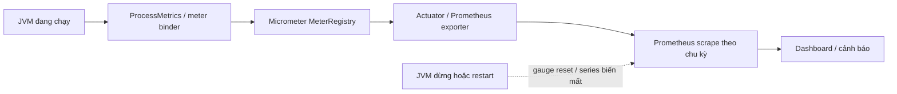
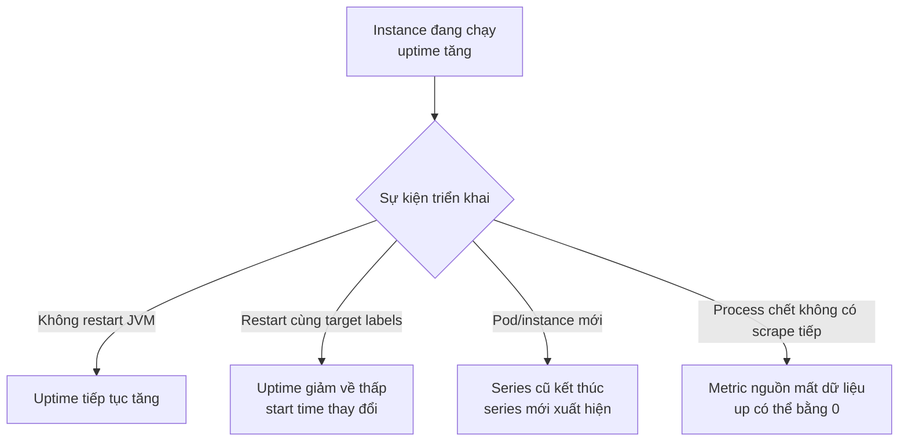

# Process uptime metrics trong Spring Boot

Một ứng dụng Spring Boot vừa được khởi động lại do hết bộ nhớ, một container liên tục thay thế process, hoặc một service đã chạy nhiều ngày nhưng khách hàng vẫn gặp HTTP 503. Các tình huống này đặt ra hai câu hỏi khác nhau: **tiến trình đã chạy được bao lâu?** và **dịch vụ có thực sự phục vụ yêu cầu thành công hay không?** Trong Micrometer Metrics, nhóm **process uptime metrics** giúp trả lời câu hỏi thứ nhất và cung cấp dữ liệu nền để điều tra câu hỏi thứ hai.

Đây là bài **Process uptime metrics** thuộc chương **Application metrics** của module **SPRING_BOOT_OBSERVABILITY**. Phạm vi module là thiết lập observability cho Spring Boot bằng Micrometer Observation, metrics, logs và distributed tracing; học propagation ngữ cảnh, tag/cardinality, exporter, sampling và liên kết tín hiệu để điều tra lỗi, độ trễ, hành vi ứng dụng trong môi trường thực. Bài học tập trung vào ý nghĩa, cách thu thập và cách diễn giải **thời gian sống của tiến trình ứng dụng** cùng với các tín hiệu vận hành khác.

## 1. Mục tiêu học tập

Sau bài học, bạn có thể:

- Giải thích ý nghĩa của `process.uptime` và `process.start.time` trong Micrometer/Spring Boot.
- Phân biệt **process uptime**, **application readiness**, **scrape availability**, **service availability** và thời gian sống của container/pod.
- Bật và xem metrics của tiến trình qua Spring Boot Actuator và Prometheus.
- Đọc đúng đơn vị đo, bản chất Gauge, trạng thái trước/sau khi restart và giới hạn của các phép suy luận từ uptime.
- Viết các truy vấn PromQL cơ bản để tìm tiến trình mới khởi động và so sánh giữa các instance.
- Nhận biết hệ quả của tag/cardinality, exporter, scrape interval và churn khi triển khai nhiều pod.
- Kết hợp uptime metrics với logs, distributed tracing và metrics lỗi/độ trễ để điều tra sự cố production.

## 2. Process uptime thực sự đo điều gì?

**Uptime của process** là khoảng thời gian tiến trình đang được theo dõi đã chạy kể từ lúc nó khởi động. Với ứng dụng Spring Boot chạy trên JVM, thông tin thường được lấy từ runtime/JVM và đăng ký vào Micrometer dưới dạng metrics.

Hai tên meter quan trọng:

| Meter Micrometer | Ý nghĩa | Đặc tính |
| --- | --- | --- |
| `process.uptime` | Số giây tiến trình đã chạy tính tại thời điểm đọc | Thường là **Gauge**: tăng theo thời gian khi process còn sống và trở về thấp sau khi process mới khởi động |
| `process.start.time` | Thời điểm khởi động tiến trình, biểu diễn bằng timestamp tính từ Unix epoch | Thường là **Gauge**: gần như cố định trong vòng đời một process, thay đổi khi process mới thay thế |

Với registry Prometheus phổ biến, các tên trên thường được chuyển thành **`process_uptime_seconds`** và **`process_start_time_seconds`**. Tên cuối cùng phụ thuộc Micrometer, registry, phiên bản và naming convention; luôn kiểm tra output thực tế thay vì giả định.

### Ví dụ diễn giải

Giả sử một JVM khởi động lúc 10:00:00 UTC:

| Thời điểm lấy mẫu | `process.uptime` (giây) | `process.start.time` (epoch seconds) |
| --- | ---: | --- |
| 10:00:30 | khoảng 30 | Gần như không đổi |
| 10:05:00 | khoảng 300 | Gần như không đổi |
| 10:30:00 | khoảng 1.800 | Gần như không đổi |
| Sau khi **JVM mới** khởi động | Gần 0 | Chuyển sang thời điểm khởi động mới |

**Uptime không phải số giây ứng dụng sẵn sàng nhận traffic.** JVM có thể chạy một lúc trước khi Spring context hoàn thành initialization và readiness probe chuyển thành công. Tương tự, JVM có thể tiếp tục tồn tại trong khi thread pool, database connection hoặc dependency đang gặp sự cố.

### Process, ứng dụng, container và pod

Một container thông thường chạy một JVM chính, nên process uptime có thể tương quan mạnh với container uptime. Tuy vậy, hai khái niệm không đồng nhất:

- **Process:** thời điểm khởi động và tuổi thọ của JVM cụ thể mà Micrometer đang đo.
- **Spring ApplicationContext:** có thể khởi tạo/refresh lại mà không thay thế toàn bộ JVM; lúc đó process uptime không nhất thiết reset.
- **Container:** có thể bị restart, thay thế hoặc chạy thêm process khác; số lần restart nằm ở dữ liệu runtime/orchestrator.
- **Pod/instance:** có thể được tạo mới khi rolling deployment hoặc autoscaling. Uptime của từng JVM không mô tả toàn bộ vòng đời một service nhiều bản sao.
- **Dịch vụ đối với người dùng:** có thể khả dụng nhờ các instance khác dù một JVM vừa restart; cũng có thể không khả dụng dù tất cả process vẫn chạy.

Không dùng một uptime gauge duy nhất để tuyên bố thời gian hoạt động cam kết của hệ thống.

## 3. Uptime metric thuộc loại Gauge

`Gauge` phản ánh giá trị tại **thời điểm đọc**. Khác với `Counter`, Gauge có thể tăng hoặc giảm, và biến mất khỏi kết quả scrape khi đối tượng hoặc tiến trình nguồn không còn được thu thập.



**Các hệ quả vận hành:**

1. Khi process tồn tại, `process.uptime` thường tăng theo thời gian.
2. Khi JVM restart, một **process mới** có uptime nhỏ trở lại; nếu các label giữ nguyên, đồ thị có thể xuất hiện cú giảm đột ngột.
3. Nếu pod mới có label `instance` hoặc `pod` khác, Prometheus có thể tạo **series mới**. Lúc này series cũ kết thúc và series mới bắt đầu, chứ không nhất thiết có một đường liên tục giảm về 0.
4. Khi ứng dụng chết và endpoint ngừng đáp ứng, không còn dữ liệu uptime mới; hệ thống scrape có thể ghi trạng thái thất bại cho target.
5. Các điểm đo được thu theo chu kỳ, nên restart rất ngắn hoặc process chết trước lần scrape kế tiếp có thể không hiện rõ trong đồ thị uptime.

**Không dùng `rate(process_uptime_seconds[5m])` để tính số request/giây hoặc “tỷ lệ uptime”.** Mặc dù uptime tăng gần một giây mỗi giây khi process sống, đây vẫn là Gauge biểu diễn thời lượng, không phải counter sự kiện. Việc áp dụng `increase` hay `rate` theo cách dùng cho Counter có thể tạo kết quả sai hoặc khó diễn giải khi restart.

## 4. Process uptime khác availability như thế nào?

| Tín hiệu | Câu hỏi nó trả lời | Không chứng minh được |
| --- | --- | --- |
| `process.uptime` | JVM hiện tại đã sống bao lâu? | API có phục vụ thành công không? |
| `process.start.time` | JVM hiện tại bắt đầu lúc nào? | Dịch vụ đã đạt readiness từ lúc nào? |
| Prometheus `up` | Target scrape có thành công ở thời điểm đo không? | Nghiệp vụ của người dùng có thành công không? |
| Liveness probe | Có nên giữ/restart container theo kiểm tra sống hay không? | Service đã sẵn sàng nhận traffic không? |
| Readiness probe | Instance đang được đánh giá sẵn sàng nhận traffic theo chính sách probe chưa? | Mọi đường đi nghiệp vụ đều hoạt động tốt không? |
| HTTP 5xx / success rate | Request được ghi nhận có thất bại hoặc thành công theo hợp đồng không? | Tại sao lỗi xảy ra nếu chỉ xem giá trị tổng hợp? |
| Synthetic check | Hành trình thử nghiệm từ bên ngoài có hoạt động không? | Tất cả khách hàng ở mọi vùng đều có trải nghiệm giống nhau không? |

Prometheus `up=1` nghĩa là một target được scrape thành công, **không phải** cam kết 100% availability của API. Tương tự, `process.uptime=86400` nghĩa là JVM khoảng một ngày tuổi; ứng dụng vẫn có thể trả 500 trong suốt một phần ngày đó.

### Uptime percentage không thể lấy trực tiếp từ Gauge

Nếu cần một SLI về availability, phải định nghĩa rõ **thế nào là thành công** và **mẫu nào được tính vào mẫu số**. Ví dụ:

\[
\text{Request availability} =
\frac{\text{số request hợp lệ thành công}}
{\text{tổng số request hợp lệ}}
\]

SLI dựa trên probe bên ngoài có thể có công thức khác, ví dụ tỷ lệ probe thành công trong một cửa sổ. Không lấy `process.uptime / 86400` để kết luận availability của ngày: phép chia đó không tính những lần process đã chết, những khoảng mất metric, request bị lỗi hay khả năng hệ thống được các replica khác duy trì.

## 5. Bật process uptime metrics với Spring Boot Actuator

Trong Spring Boot 3.x có Actuator và Micrometer phù hợp, hệ thống thường tự đăng ký các meter về JVM/process thông qua những meter binder được auto-configure. Đối với dự án dùng Gradle Kotlin DSL:

```kotlin
dependencies {
    implementation("org.springframework.boot:spring-boot-starter-actuator")
    runtimeOnly("io.micrometer:micrometer-registry-prometheus")
}
```

`spring-boot-starter-actuator` cung cấp cơ chế quản trị/metrics, còn `micrometer-registry-prometheus` cho phép xuất dữ liệu sang định dạng Prometheus. Quản lý version qua Spring Boot BOM phù hợp để tránh lệch thư viện.

Ví dụ cấu hình `application.yml`:

```yaml
spring:
  application:
    name: order-service

management:
  endpoints:
    web:
      exposure:
        include: health,info,metrics,prometheus
  metrics:
    tags:
      application: ${spring.application.name}
      environment: ${APP_ENV:local}
```

Ý nghĩa:

- `/actuator/metrics` dùng để xem các meter mà ứng dụng đã đăng ký và thông tin đo.
- `/actuator/prometheus` cung cấp dữ liệu dạng scrape khi registry Prometheus có mặt và endpoint được phép truy cập.
- `application` và `environment` là **common metrics tags** để lọc metrics từ nhiều service hoặc môi trường. Các giá trị phải được quản lý ở cấp triển khai, không theo từng request.

Trong production, cần áp dụng xác thực, phân quyền hoặc giới hạn mạng phù hợp cho endpoint quản trị. Việc **mở endpoint** không tự cấu hình Prometheus scrape; Prometheus hoặc collector vẫn phải được chỉ định target và có thể truy cập endpoint.

### Vì sao không cần tạo custom Gauge trong ví dụ này?

Micrometer đã có cơ chế chuẩn để thu thập process uptime. Nếu Spring Boot đã đăng ký `process.uptime` và `process.start.time`, việc tự tạo Gauge cùng ý nghĩa có thể:

- Tạo metric trùng tên và gây xung đột đăng ký meter.
- Đo thời gian sống của **Spring bean** hoặc workflow trong khi đặt tên là process uptime.
- Làm dashboard khó biết giá trị nào đang đại diện cho JVM đang chạy.

Chỉ tự bổ sung meter khi bạn cần đo **một vòng đời khác**, chẳng hạn thời gian từ lần đồng bộ dữ liệu cuối cùng, và đặt tên khác rõ ràng như `business.sync.last.success.time`.

## 6. Kiểm tra qua Actuator

Sau khi chạy ứng dụng và cấu hình Actuator, có thể dùng HTTP:

```http
GET /actuator/metrics
GET /actuator/metrics/process.uptime
GET /actuator/metrics/process.start.time
```

Ví dụ response *minh họa* của endpoint `process.uptime`:

```json
{
  "name": "process.uptime",
  "description": "The uptime of the Java virtual machine",
  "baseUnit": "seconds",
  "measurements": [
    { "statistic": "VALUE", "value": 542.3 }
  ],
  "availableTags": [
    { "tag": "application", "values": ["order-service"] },
    { "tag": "environment", "values": ["local"] }
  ]
}
```

Trên instance minh họa, giá trị khoảng **542,3 giây** nghĩa là JVM đã chạy xấp xỉ 9 phút 2 giây tại thời điểm đọc. Description, độ chính xác, tên trường và tags có thể khác theo phiên bản/config; đây không phải output đã kiểm tra từ một ứng dụng cụ thể.

Nếu endpoint không trả ra `process.uptime`, hãy kiểm tra:

1. Ứng dụng đã thêm Actuator và metrics auto-configuration chưa?
2. Process binder đã được bật hay bị loại trừ/tắt thông qua cấu hình?
3. `/actuator/metrics` có khả dụng và tên meter thực tế là gì?
4. Các meter có bị `MeterFilter` từ chối hoặc registry khác quản lý không?
5. Metric có tồn tại trong registry nhưng bị endpoint exposure, security hoặc pipeline làm không hiển thị không?

### Đọc uptime bằng Java khi cần chẩn đoán

Có thể xem giá trị Gauge đã được registry đăng ký qua API Micrometer, **không cần tự tạo Gauge mới**:

```java
import io.micrometer.core.instrument.Gauge;
import io.micrometer.core.instrument.MeterRegistry;
import java.util.OptionalDouble;
import org.springframework.stereotype.Component;

@Component
public class ProcessUptimeReader {

    private final MeterRegistry registry;

    public ProcessUptimeReader(MeterRegistry registry) {
        this.registry = registry;
    }

    public OptionalDouble uptimeSeconds() {
        Gauge gauge = registry.find("process.uptime").gauge();
        if (gauge == null) {
            return OptionalDouble.empty();
        }
        return OptionalDouble.of(gauge.value());
    }
}
```

Nếu Gauge chưa đăng ký, phương thức trả `OptionalDouble.empty()`; ứng dụng không nên coi 0 giây là dấu hiệu mặc định của “không có metric”. Với pipeline bị lỗi, giá trị trong registry và dữ liệu ở backend có thể khác nhau.

## 7. Xem dữ liệu trong Prometheus

Khi dùng Prometheus registry của Micrometer, `/actuator/prometheus` thường có dạng:

```text
# HELP process_uptime_seconds The uptime of the Java virtual machine
# TYPE process_uptime_seconds gauge
process_uptime_seconds{application="order-service",environment="prod"} 542.3

# HELP process_start_time_seconds Start time of the process since unix epoch
# TYPE process_start_time_seconds gauge
process_start_time_seconds{application="order-service",environment="prod"} 1.7953266E9
```

Các dòng trên **chỉ minh họa định dạng và ý nghĩa**, không phải số liệu đang chạy. Timestamp epoch trong mẫu chỉ là số giả định. Metric có thể mang thêm label như `job`, `instance` hoặc `pod` khi được Prometheus/collector thu thập. Tên metric, kiểu và cách exporter format phụ thuộc registry/phiên bản; hãy xác minh trực tiếp trên endpoint của ứng dụng.

### Phân biệt meter name với exported metric name

| API/điểm xem | Ví dụ tên | Ý nghĩa |
| --- | --- | --- |
| Micrometer Java/Actuator | `process.uptime` | Tên meter trong ứng dụng |
| Micrometer Java/Actuator | `process.start.time` | Tên meter trong ứng dụng |
| Prometheus classic text | `process_uptime_seconds` | Tên xuất sau naming convention và đơn vị thời gian |
| Prometheus classic text | `process_start_time_seconds` | Tên xuất cho timestamp khởi động |

Không dùng trực tiếp dấu chấm trong PromQL khi metric đã được chuyển tên. Trước khi viết truy vấn hoặc alert, xác định **tên series thực tế** và kiểm tra nhãn instance để tránh trộn nhiều JVM.

## 8. Truy vấn PromQL hữu ích

Các truy vấn dưới đây giả định Prometheus thu thập `process_uptime_seconds` và `process_start_time_seconds`, đồng thời có các nhãn `application`, `environment` và `instance`. Nếu backend dùng tên khác, cần thay theo dữ liệu scrape.

### 8.1. Uptime hiện tại của từng instance

```promql
process_uptime_seconds{application="order-service", environment="prod"}
```

Mỗi series tương ứng với một bộ label. Khi có nhiều replicas, nên hiển thị từng `instance` hoặc `pod` nếu có, vì một con số tổng cho toàn service có thể che mất tình trạng restart của một replica.

### 8.2. Tìm các process mới chạy dưới 5 phút

```promql
process_uptime_seconds{application="order-service", environment="prod"} < 300
```

Truy vấn này giữ lại những series có uptime dưới 300 giây tại thời điểm đánh giá. Nó hữu ích để xác định process vừa khởi động **khi đang còn được scrape**, nhưng không chứng minh rằng quá trình restart là bất thường. Rolling deployment và autoscaling cũng tạo process mới một cách hợp lệ.

### 8.3. Uptime nhỏ nhất của các replica

```promql
min by (application, environment) (
  process_uptime_seconds{application="order-service", environment="prod"}
)
```

Metric nhỏ nhất cho biết **replica trẻ nhất trong tập series còn được thu thập**. Nếu có một pod mới khởi động, giá trị này sẽ nhỏ; nếu một pod chết và biến mất khỏi scrape, min chỉ tính các series vẫn còn trong tập truy vấn. Không nên xem nó là uptime của toàn service.

### 8.4. Đối chiếu với thời điểm bắt đầu

```promql
time() - process_start_time_seconds{
  application="order-service",
  environment="prod"
}
```

Vì `time()` là thời gian đánh giá theo epoch seconds và `process_start_time_seconds` cũng là timestamp epoch, phép trừ cho ra **tuổi process xấp xỉ tính theo giây**. Kết quả có thể lệch với `process_uptime_seconds` do thời điểm lấy mẫu, độ trễ scrape, đồng hồ hoặc cách binder đo uptime.

Không dùng phép tính này làm bằng chứng độc lập tuyệt đối khi đang có vấn đề đồng bộ đồng hồ giữa các máy.

### 8.5. Kiểm tra scrape target

```promql
up{job="order-service"}
```

`up` là metric do **Prometheus** tạo cho từng target scrape, không phải meter `process.uptime` do Spring Boot phát. `up=0` thể hiện lần scrape của target không thành công; nguyên nhân có thể là process chết, lỗi mạng, authentication, service discovery hoặc collector. `up=1` cũng chưa chứng minh ứng dụng đã sẵn sàng phục vụ nghiệp vụ.

Trong thực tế, một alert về “instance liên tục restart” cần kết hợp thêm metadata từ orchestrator hoặc dữ liệu lịch sử được giữ đủ lâu. Một uptime thấp đơn lẻ không đủ để phân biệt restart bất thường với triển khai mới.

## 9. Xác định restart từ uptime và start time

Khi JVM thay thế bằng process mới, người vận hành có thể nhìn thấy một trong những hình thái sau:



### Một phép kiểm tra tham khảo với start time

Khi **cùng một bộ label** được giữ qua các lần restart và có scrape trước/sau, ta có thể quan sát sự thay đổi của timestamp khởi động:

```promql
changes(process_start_time_seconds{application="order-service"}[1h])
```

`changes` đếm số lần giá trị mẫu thay đổi trong cửa sổ theo **từng series**. Nó có thể giúp phát hiện process start time đã đổi khi series giữ nguyên label và các mẫu được thu đầy đủ.

Tuy nhiên, truy vấn **không phải bộ đếm restart chính xác cho mọi môi trường**:

- Nếu pod mới có nhãn `pod` hoặc `instance` khác, series mới không có “lần thay đổi” nối tiếp series cũ.
- Nếu nhiều lần restart xảy ra giữa hai lần scrape, một số lần có thể bị bỏ sót.
- Series mới hoặc mất dữ liệu do collector/network có thể làm lịch sử không đầy đủ.
- Cùng label bị tái sử dụng có thể gây hiểu lầm nếu tập target thay đổi.

Nếu cần **số lần container restart** đáng tin cậy trong Kubernetes, nên kết hợp metric từ kube-state-metrics hoặc nguồn orchestrator tương ứng, chẳng hạn `kube_pod_container_status_restarts_total` khi hệ thống có cung cấp metric này. Cần gắn các pod/container đúng với deployment và kiểm tra metric có thực sự được thu thập.

### Tình huống rolling deployment

Một deployment có 6 replicas; khi rollout phiên bản mới, 2 pod mới được tạo với `process.uptime` còn dưới 2 phút, trong khi 4 pod cũ đã chạy nhiều giờ. Đây có thể là **hành vi bình thường** nếu service duy trì đủ replica sẵn sàng và tỷ lệ lỗi không tăng.

Ngược lại, một pod liên tục có uptime thấp, container restart count tăng, readiness fail và HTTP 5xx tăng là tín hiệu đáng điều tra. Kết luận phải dựa trên nhiều chỉ số cùng khoảng thời gian.

## 10. Uptime và các tín hiệu logs, tracing, metrics khác

Process uptime là một **application metric** về vòng đời của JVM. Nó không nói rõ nguyên nhân lỗi, nhưng có thể đặt sự cố vào bối cảnh thời gian.

| Dữ liệu | Câu hỏi vận hành | Ví dụ |
| --- | --- | --- |
| Process uptime/start time | Process vừa khởi động hay đã sống lâu? | `process.uptime < 300` |
| JVM memory/GC | JVM có đang chịu áp lực tài nguyên? | Heap sử dụng cao, GC pause tăng |
| HTTP metrics | Tỷ lệ 5xx/latency có thay đổi không? | `http.server.requests` |
| Container/orchestrator | Có OOM kill, restart, liveness failure không? | Container restart reason |
| Logs | Exception hoặc startup/shutdown event nào đã xảy ra? | `OutOfMemoryError`, connection pool timeout |
| Distributed traces | Request chậm ở bước gọi nào? | HTTP → payment → database |

### Ví dụ điều tra: dịch vụ bị restart trong giờ cao điểm

Giả sử dashboard cho thấy trong 10 phút vừa qua, một số instance của `order-service` có uptime thấp, HTTP 5xx tăng và p95 latency xấu đi.

**Bước 1 — Xác nhận mẫu restart.** Xem từng series `process_uptime_seconds`, `process_start_time_seconds` và trạng thái `up`; đối chiếu labels để phân biệt pod mới với process restart trong cùng pod.

**Bước 2 — Kiểm tra dữ liệu hạ tầng.** Xem số lần container restart, OOM kill, CPU throttling, memory limits, readiness/liveness probe và sự kiện rollout. Process uptime thấp sau deploy không đủ để kết luận lỗi JVM.

**Bước 3 — Khoanh vùng tác động người dùng bằng metrics.** Lọc HTTP throughput, tỷ lệ 5xx, latency và queue backlog trong đúng khoảng thời gian. So sánh số replica healthy và mức tải trên các instance còn lại.

**Bước 4 — Đọc logs.** Tìm sự kiện shutdown, startup, lỗi tạo bean, lỗi kết nối database hoặc exception trước thời điểm process biến mất. Nếu stdout/log pipeline chưa kịp flush trước khi process chết, có thể thiếu log cuối cùng.

**Bước 5 — Tra traces được sampling.** Một trace chậm có thể cho thấy request bị kẹt ở dependency hoặc thread pool. Không phải mọi trace đều được lưu; exporter hoặc collector cũng có thể gián đoạn khi process restart.

**Bước 6 — Xác minh khắc phục.** Sau khi sửa nguyên nhân gốc, kiểm tra restart count không tiếp tục tăng ngoài chu kỳ deploy, readiness ổn định, HTTP error rate giảm, latency trở về mức chấp nhận được.

**Kết luận điều tra chỉ nên được đưa ra sau khi các tín hiệu khớp nhau.** “Uptime bị reset” chỉ là bằng chứng process mới đã bắt đầu, không tự giải thích nguyên nhân hay mức ảnh hưởng.

### Context propagation có liên quan gì?

`process.uptime` không mang context request, `traceId` hay `spanId`. Việc truyền trace context qua HTTP, queue hoặc executor thuộc **Micrometer Tracing/Context Propagation** và instrumentation tương ứng. Common metric tags như `application` hay `environment` hỗ trợ lọc metrics theo service, còn trace ID trong logs/traces giúp tìm một yêu cầu cụ thể. Không đưa trace ID vào metric label để nối trực tiếp từng request với uptime; điều đó sẽ gây cardinality rất cao.

## 11. Cardinality, labels và sự thay đổi của instance

Nhóm process metrics được phát ra bởi **mỗi tiến trình đang chạy**. Khi nhiều JVM xuất dữ liệu, cần giữ được sự phân biệt giữa các instance nhưng không tạo nhãn động không kiểm soát.

| Tag/label | Thường nên quản lý ở đâu? | Lưu ý |
| --- | --- | --- |
| `application` | Common tags từ Spring Boot hoặc label backend | Tập tên service ổn định |
| `environment` | Common tags hoặc metadata triển khai | Chuẩn hóa `dev`, `staging`, `prod` |
| `region` | Hạ tầng hoặc common tags có kiểm soát | Tránh hai nguồn gắn giá trị mâu thuẫn |
| `instance` / `pod` | Prometheus service discovery/orchestrator | Giúp phân biệt replicas; thay đổi khi rollout là điều bình thường |
| `version` | Deployment/resource label nếu cần | Thay đổi theo release; cân nhắc churn khi rollout thường xuyên |
| `requestId`, `userId`, `traceId` | Log/trace context khi phù hợp | Không gắn vào process uptime metrics |

Với một Gauge cho mỗi process, số series có thể xấp xỉ số instance cho từng bộ nhãn triển khai, rồi tăng theo các chiều không cần thiết nếu gắn thêm common tags quá chi tiết.

**Cardinality** và **churn** đều quan trọng: cardinality là số bộ nhãn khác nhau, còn churn là tốc độ series mới xuất hiện và series cũ biến mất. Autoscaling, rolling deployment và label chứa ID thay đổi nhanh có thể làm churn tăng mạnh dù số instance đang hoạt động không quá lớn.

### Không tổng hợp sai uptime

Lấy `sum(process_uptime_seconds)` của 10 replicas không tạo ra một định nghĩa có ý nghĩa về “service đã chạy bao lâu”. Tương tự, `avg(process_uptime_seconds)` chỉ là **tuổi trung bình của các process đang được quan sát**, không phải tỷ lệ thành công của người dùng.

Nếu muốn nhận biết một replica vừa khởi động, dùng series từng instance hoặc `min by (...)` với định nghĩa rõ. Nếu muốn availability tổng thể, dùng metrics thành công/thất bại, synthetic probes và chính sách SLI/SLO phù hợp.

## 12. Alert: dùng uptime đúng vai trò

Một cảnh báo tốt cần phân biệt **tín hiệu nguyên nhân**, **tín hiệu triệu chứng** và **tín hiệu tác động người dùng**.

| Tình huống | Tín hiệu có thể dùng | Lưu ý |
| --- | --- | --- |
| Một process mới vừa khởi động | `process_uptime_seconds < 300` | Thông tin hỗ trợ, không tự là sự cố |
| Target scrape thất bại | `up == 0` | Có thể do mạng/collector, không nhất thiết app chết |
| Restart lặp đi lặp lại | Orchestrator restart counter + process start time | Cần phân biệt rollout |
| Instance không sẵn sàng | Readiness probe / availability state | Process vẫn có thể đang chạy |
| Người dùng bị ảnh hưởng | HTTP error rate, request latency, synthetic checks | Ưu tiên cho alert về SLO/availability |

Ví dụ PromQL lọc instance uptime dưới 5 phút:

```promql
process_uptime_seconds{environment="prod"} < 300
```

Nên dùng kết quả này làm **điều kiện hỗ trợ điều tra hoặc dashboard**, vì trong một deployment bình thường nó sẽ xuất hiện hàng loạt. Nếu cần cảnh báo restart liên tục, kết hợp restart counter, trạng thái pod và khoảng thời gian không có rollout hợp lệ.

Một alert `up == 0` cũng cần có chính sách **for duration** và điều kiện loại trừ target đã bị gỡ đúng quy trình, phù hợp với cách Prometheus phát hiện service. Nếu series biến mất hoàn toàn khi target không còn được khai báo, biểu thức `up == 0` có thể **không** thấy series đó; cần theo dõi desired vs available replicas hoặc dùng các phép kiểm tra hiện diện phù hợp.

## 13. Bài thực hành có thể tự kiểm chứng

**Bài toán:** triển khai một ứng dụng Spring Boot nhỏ có Actuator và Prometheus registry. Chạy ứng dụng, quan sát uptime, restart có chủ đích, so sánh giá trị và phân biệt những dấu hiệu thông thường với sự cố vận hành.

### Phần A — Thu thập process metrics

1. Thêm starter Actuator và Prometheus registry tương thích với Spring Boot BOM.
2. Cấu hình endpoint `metrics` và `prometheus`; giữ quyền truy cập phù hợp.
3. Khởi chạy ứng dụng với `spring.application.name=order-service`.
4. Gọi `/actuator/metrics/process.uptime` hai lần cách nhau một khoảng thời gian và xem giá trị tăng.
5. Gọi `/actuator/metrics/process.start.time`; kiểm tra timestamp gần như không đổi trong cùng vòng đời process.
6. Kiểm tra `/actuator/prometheus` để xem tên series, đơn vị và labels thực tế.

### Phần B — Mô phỏng restart

1. Ghi lại uptime và start time ở instance đang chạy.
2. Dừng JVM theo quy trình phát triển bình thường, rồi khởi động lại.
3. Quan sát uptime mới nhỏ và start time được cập nhật.
4. So sánh dữ liệu ở Prometheus: target có giữ nguyên labels hay được gắn `instance`/`pod` mới?
5. Nếu chạy nhiều replicas, xác minh một replica restart không đồng nghĩa toàn service ngừng hoạt động.

### Phần C — Bảng kỳ vọng

| Ca | Hiện tượng mô phỏng | Dữ liệu kỳ vọng |
| --- | --- | --- |
| A — Chạy liên tục | Không restart JVM | `process.uptime` tăng qua các lần đọc |
| B — Restart cùng process endpoint | JVM dừng rồi chạy mới | Uptime về thấp, start time thay đổi |
| C — Rolling deployment | Pod cũ thay bằng pod mới | Có thể xuất hiện series mới do labels đổi |
| D — Network tới Actuator lỗi | Process vẫn chạy nhưng scrape thất bại | `up` có thể bằng 0, backend thiếu uptime mới |
| E — Service unready | JVM còn sống, readiness fail | Uptime vẫn tăng; readiness phản ánh trạng thái khác |
| F — 500 tăng nhưng process không chết | Lỗi dependency hoặc logic nghiệp vụ | Uptime vẫn tăng; cần HTTP metrics/logs/traces |

### Phần D — Câu hỏi tự đánh giá

1. Một JVM có `process.uptime=604800` thì có thể khẳng định ứng dụng đạt availability 100% trong 7 ngày không? Vì sao?
2. Tại sao `process.start.time` thường ổn định, trong khi `process.uptime` tăng dần?
3. Khi pod mới được tạo sau rollout, vì sao đồ thị có thể bắt đầu một series mới thay vì biểu diễn một lần reset?
4. `up=1` trong Prometheus có bảo đảm checkout API hoạt động không?
5. Khi một request có trace ID nhưng uptime metric không có trace ID, đây có phải lỗi instrumentation không?
6. Vì sao `changes(process_start_time_seconds[1h])` có thể bỏ sót restart trong Kubernetes?
7. Nếu muốn biết số lần container bị OOM kill, metrics nào từ orchestrator và những logs/sự kiện nào bạn cần kiểm tra?
8. Trong một service có 10 replicas, tại sao cộng uptime của cả 10 process không tạo ra uptime của service?

## 14. Ghi nhớ

**Process uptime metrics** mô tả tuổi đời của tiến trình ứng dụng: `process.uptime` là thời lượng process đã chạy, còn `process.start.time` ghi nhận thời điểm process khởi động. Trong Spring Boot, chúng thường được thu thập qua các meter binder của Micrometer và kiểm tra bằng Actuator/Prometheus. Đây là các **Gauge**, nên cách đọc, việc reset sau restart và các series mới khi rollout khác với một Counter.

Uptime thấp có thể gợi ý process vừa restart nhưng không tự chứng minh có lỗi; uptime cao cũng không bảo đảm dịch vụ sẵn sàng hoặc request thành công. Hãy kết hợp process metrics với readiness, scrape status, container restart count, HTTP error rate/latency, logs và distributed tracing. Đồng thời quản lý common tags/cardinality, exporter, sampling và context propagation theo đúng vai trò từng tín hiệu để điều tra sự cố Spring Boot trên môi trường thực.
