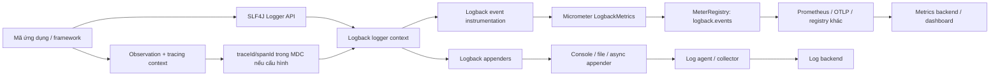

# Logback metrics

Một dịch vụ Spring Boot đang nhận traffic bình thường nhưng dashboard đột nhiên xuất hiện nhiều sự kiện `ERROR`. Đội vận hành cần biết tốc độ phát sinh log lỗi tăng từ lúc nào, có liên quan đến bản triển khai mới không, và sự cố có ảnh hưởng người dùng hay chỉ là một dependency đang retry. **Logback metrics** giúp định lượng **bao nhiêu sự kiện log được phát ra theo mức độ**, từ đó chọn khoảng thời gian và thành phần cần điều tra sâu hơn bằng logs và distributed tracing.

Bài **Logback metrics** thuộc chương **Application metrics** trong module **SPRING_BOOT_OBSERVABILITY**. Module hướng đến thiết lập observability trong Spring Boot bằng **Micrometer Observation, metrics, logs và distributed tracing**, hiểu propagation ngữ cảnh, tag/cardinality, exporter, sampling và liên kết tín hiệu để điều tra lỗi, độ trễ, hành vi ứng dụng trên môi trường thực. Trọng tâm ở đây là một loại application metric đặc thù: **đếm sự kiện logging của Logback**, phân biệt nó với log record chi tiết, tỷ lệ HTTP 5xx và kết quả nghiệp vụ.

> **Cần nhớ ngay:** Khi Spring Boot dùng Logback cùng Micrometer/Actuator phù hợp, auto-configuration có thể đăng ký metric **`logback.events`** với tag **`level`**. Metric cho biết **số log events** theo cấp độ, không cho biết trực tiếp số exception khác nhau, số request lỗi, số user bị ảnh hưởng, hay dữ liệu đã được log collector lưu thành công.

## 1. Mục tiêu học tập

Sau bài học, bạn có thể:

1. Giải thích cách Logback, SLF4J, Micrometer `LogbackMetrics`, `MeterRegistry` và Spring Boot Actuator phối hợp.
2. Phân biệt **log event count** với HTTP error rate, business failure rate, exception count và số bản ghi đã được vận chuyển tới backend.
3. Đọc và diễn giải `logback.events` theo các giá trị `level=trace/debug/info/warn/error`.
4. Cấu hình logging level và metrics endpoint phù hợp, kiểm tra metric qua Actuator và Prometheus.
5. Viết PromQL tính tốc độ log `WARN/ERROR`, chọn ngưỡng cảnh báo theo baseline và đối chiếu traffic.
6. Tránh đăng ký `LogbackMetrics` trùng lặp, tránh gắn ID có cardinality cao và tránh rò rỉ thông tin nhạy cảm qua logging.
7. Phân biệt trường hợp Logback, Log4j2 và các cơ chế logging khác để không tìm sai tên metric.
8. Điều tra một đợt tăng log `ERROR` bằng cách kết hợp metrics, logs, traces, dependencies và tình trạng exporter/collector.

## 2. Logback metrics nằm ở đâu trong luồng logging?



Có **hai nhánh kết quả** từ cùng hoạt động logging:

- **Nhánh metrics:** instrumentation đếm sự kiện log theo level và lưu vào `MeterRegistry`. Backend metrics cho phép xem tổng, rate và xu hướng.
- **Nhánh logs:** Logback appender định dạng và ghi nội dung event; collector hoặc agent có thể chuyển bản ghi tới log backend để tra cứu theo timestamp, service, trace ID và message.

Sự hiện diện của số đếm `logback.events{level="error"}` **không chứng minh** log backend đã nhận đúng bản ghi ấy. Collector có thể thất bại, async buffer có thể tràn, file có thể bị rotation sai, hoặc bản ghi đã hết retention.

Ngược lại, không thấy metric cũng không chứng minh không có log: registry có thể chưa instrument, metrics endpoint bị tắt, hoặc exporter không thành công. Cần kiểm tra độc lập từng nhánh.

### 2.1 Vai trò của các thành phần

| Thành phần | Vai trò | Chú ý |
|---|---|---|
| **SLF4J** | API logging mà code ứng dụng thường gọi. | Không phải metrics registry. |
| **Logback** | Logging implementation thường dùng trong Spring Boot khi giữ cấu hình logging mặc định. | Có logger hierarchy, effective level, filters và appenders. |
| **`LogbackMetrics`** | Micrometer binder quan sát và đếm các sự kiện Logback. | Được Spring Boot auto-configure khi điều kiện phù hợp. |
| **`MeterRegistry`** | Quản lý metric `logback.events` và đưa nó tới exporter. | Không lưu message hay stack trace từng event. |
| **Actuator `metrics`** | Endpoint chẩn đoán meter name và measurement trong ứng dụng. | Phải được expose và bảo vệ. |
| **Prometheus/metrics backend** | Lấy mẫu/lưu chuỗi thời gian để tính rate và alert. | Có thể thiếu dữ liệu nếu scrape thất bại. |
| **Log collector/backend** | Lưu và tìm các log records chi tiết. | Đường vận chuyển độc lập với Prometheus. |

## 3. Chính xác thì `logback.events` đếm gì?

`logback.events` thể hiện **số log events đi qua cơ chế instrumentation của Logback** được Micrometer đo, phân nhóm theo `level`. Những mức thông dụng của Logback gồm:

| Level | Ý nghĩa thường dùng | Khi nào hữu ích? |
|---|---|---|
| `TRACE` | Dữ liệu chẩn đoán rất chi tiết. | Tái hiện vấn đề trong môi trường kiểm soát. |
| `DEBUG` | Thông tin hỗ trợ phát triển/điều tra chi tiết. | Kiểm tra nhánh xử lý hoặc tương tác dependency. |
| `INFO` | Các sự kiện vận hành bình thường, đáng theo dõi. | Startup, shutdown, kết quả job hoặc thay đổi trạng thái có ý nghĩa. |
| `WARN` | Điều kiện bất thường, retry, fallback hoặc nguy cơ cần theo dõi. | Phát hiện hệ thống đang suy giảm trước khi có lỗi lớn. |
| `ERROR` | Lỗi đáng chú ý mà mã hoặc framework ghi nhận. | Chọn thời điểm/nguồn log để điều tra exception, dependency failure. |

**Logback không có level `FATAL` riêng như Log4j2**. Khi ứng dụng sử dụng Log4j2, metric auto-instrumentation thường có tên `log4j2.events` thay vì `logback.events` và có thể có tập level khác. Đừng dựa vào tên dependency web để suy đoán chắc chắn logging implementation; kiểm tra classpath và runtime.

### 3.1 Effective logging level quyết định sự kiện nào được tạo

Giả sử package `com.example.checkout` có effective level `INFO`:

```java
logger.trace("trace details");        // Không được bật ở mức INFO.
logger.debug("debug details");        // Không được bật ở mức INFO.
logger.info("checkout started");      // Có thể được ghi nhận.
logger.warn("payment is slow");       // Có thể được ghi nhận.
logger.error("payment failed");      // Có thể được ghi nhận.
```

Theo tài liệu Micrometer, khi Logback logger ở `INFO`, log `WARN` và `ERROR` được đếm, còn `DEBUG` bị loại bởi cấu hình level nên không làm counter tương ứng tăng. Kết quả thực tế cũng có thể bị ảnh hưởng bởi cách logger, filters và instrumentation được cấu hình trong từng phiên bản.

**Không so sánh số events giữa hai phiên bản nếu log level thay đổi mà không ghi chú.** Chỉ cần bật `DEBUG` đã có thể làm tổng log tăng mạnh, dù business traffic và error rate không thay đổi.

### 3.2 Một request có thể phát nhiều log events

Một request HTTP thất bại có thể ghi:

```text
WARN  - Retrying payment authorization after timeout
WARN  - Retrying payment authorization after timeout
ERROR - Payment provider unavailable after all retries
ERROR - Checkout operation failed
```

Với một request này, instrumentation có thể tăng **2 WARN + 2 ERROR**. Như vậy:

- **4 log events** không đồng nghĩa 4 request lỗi.
- **2 ERROR events** không đồng nghĩa 2 exception độc lập.
- Nếu lỗi được log lại ở nhiều tầng, số đếm có thể tăng hơn số transaction ảnh hưởng.

Ngược lại, một service có thể trả HTTP 500 nhưng không ghi `ERROR` nếu handler/framework cấu hình khác, hoặc một nghiệp vụ bị từ chối hợp lệ mà không hề có exception. Vì thế, `logback.events` nên được coi là **tín hiệu bổ trợ**.

### 3.3 Counter không lưu message hoặc stack trace

`logback.events` không chứa:

- Nội dung message, stack trace, tham số method hoặc request body.
- Dịch vụ downstream nào thực sự gây lỗi.
- `traceId`, `spanId` hoặc danh tính một giao dịch riêng.
- Số lượng log đã được Elasticsearch/Loki/OTLP collector nhận.
- Thời gian xử lý request hoặc thời lượng span.

Muốn trả lời những câu hỏi ấy, phải dùng đúng hệ thống logging/tracing/metrics khác tương ứng.

## 4. Micrometer `LogbackMetrics` và kiểu meter

Micrometer có binder `io.micrometer.core.instrument.binder.logging.LogbackMetrics`. Khi gọi `bindTo(MeterRegistry)`, nó tích hợp Logback logging events với registry metrics.

Theo API/tài liệu Micrometer hiện hành, các measurements của `logback.events` có thể được đọc qua **`FunctionCounter`**:

```java
double warn = registry.get("logback.events")
        .tag("level", "warn")
        .functionCounter()
        .count();
```

Một số tài liệu/version cũ minh họa việc tra cứu qua `counter()`. Chọn API phù hợp với **phiên bản dependency thực tế** của ứng dụng; không đăng ký một Counter mới tên `logback.events` chỉ để làm cho lookup bằng `counter()` thành công. Trước hết hãy kiểm tra meter type.

**Vì sao FunctionCounter hợp lý?** Nó đọc một hàm lấy số đếm tích lũy từ đối tượng đang được instrument. Micrometer chuyển dạng measurement này tới backend theo cách phù hợp, ví dụ counter cumulative cho Prometheus. Nó khác `Gauge` đọc trạng thái có thể tăng/giảm, và khác `Timer` đo duration.

### 4.1 LogbackMetrics là MeterBinder có vòng đời

`LogbackMetrics` triển khai cơ chế `MeterBinder` và hỗ trợ lifecycle cleanup. Theo tài liệu Micrometer, binder có thể được tạo trong môi trường độc lập:

```java
LogbackMetrics logbackMetrics = new LogbackMetrics();
logbackMetrics.bindTo(registry);
```

Nếu code tự quản lý binder ngoài Spring lifecycle, cần gọi `close()` khi không dùng nữa để tháo tài nguyên/listener/đăng ký liên quan. **Không nên thêm đoạn tạo binder thủ công này vào ứng dụng Spring Boot đã có auto-configuration Logback metrics.**

Trong Spring Boot, binder thường được tạo và quản lý theo application context, nên ưu tiên cấu hình và sử dụng metric mặc định trước. Nếu gắn binder hai lần trên cùng logger context, có nguy cơ ghi trùng số lần hoặc tạo trạng thái khó dự đoán giữa các registries.

### 4.2 Tag mặc định thường là `level`

Một meter name `logback.events` có thể có các series theo những giá trị level:

```text
logback.events{level="trace"}
logback.events{level="debug"}
logback.events{level="info"}
logback.events{level="warn"}
logback.events{level="error"}
```

Logback level/tag names trong Micrometer thường được đưa về dạng chữ thường. Một số mức có thể có `count=0` hoặc không xuất hiện tùy thời điểm, backend và phiên bản. Hãy lấy **`availableTags` thực tế** từ Actuator thay vì giả định mọi series luôn được tạo.

Mặc định `logback.events` **không phải một counter riêng cho từng logger class, request, user hoặc trace ID**. Điều này giúp số lượng series có thể kiểm soát được. Nếu muốn phân tích log của một package cụ thể, nên tìm log records theo logger name trong log backend hoặc thiết kế một metric nghiệp vụ khác, thay vì tùy tiện thêm `loggerName` động vào toàn bộ counters.

## 5. Kích hoạt Logback metrics trong Spring Boot

Spring Boot Actuator có khả năng **auto-configure logger event metrics** cho Logback hoặc Log4j2 khi framework và dependency cần thiết có sẵn. Trong một ứng dụng Spring Boot dùng Logback và Micrometer mặc định, thông thường **không cần viết `LogbackMetrics` bean thủ công**.

### 5.1 Gradle dependencies

Nếu dự án đã có Spring Boot plugin, dependency management và web starter thích hợp:

```groovy
dependencies {
    implementation 'org.springframework.boot:spring-boot-starter-actuator'
    runtimeOnly 'io.micrometer:micrometer-registry-prometheus'
}
```

- Actuator/Micrometer cung cấp instrumentation và `MeterRegistry`.
- Prometheus registry cung cấp cách xuất metrics qua `/actuator/prometheus`.
- Spring Boot thường dùng Logback khi giữ logging starter mặc định; nếu dự án thay bằng Log4j2 hoặc backend logging khác thì tên metric và binder sẽ khác.
- Dependencies trên **không tự tạo trace backend hoặc log collector**.

Các starter web/tracing có thể khác giữa Spring Boot 3.x và 4.x; phần này chỉ tập trung vào những dependency liên quan metrics và giả định ứng dụng cơ bản đã tồn tại.

### 5.2 Cấu hình dành cho môi trường học tập

```yaml
spring:
  application:
    name: checkout-service

logging:
  level:
    root: INFO
    com.example.checkout: INFO

management:
  endpoints:
    web:
      exposure:
        include: "health,info,metrics,prometheus,loggers"
  metrics:
    tags:
      application: checkout-service
      environment: local
```

Trong môi trường thực, chỉ expose `health`, `metrics`, `prometheus` và `loggers` khi thật sự cần. Đặc biệt, `/actuator/loggers` có khả năng thay đổi cấu hình logging runtime nếu được cấp quyền ghi; cần bảo vệ bằng mạng và phân quyền phù hợp, không công khai endpoint điều khiển này.

`management.metrics.tags.*` giúp bổ sung nhãn ổn định như application/region/environment. Không gắn `traceId`, `userId`, `orderId` hoặc raw URL vào common tags.

### 5.3 Actuator metrics endpoint

Khi ứng dụng đã chạy:

```bash
# Kiểm tra danh sách meter names.
curl http://localhost:8080/actuator/metrics

# Xem tổng measurements và availableTags của Logback.
curl http://localhost:8080/actuator/metrics/logback.events

# Lọc riêng level WARN và ERROR.
curl "http://localhost:8080/actuator/metrics/logback.events?tag=level:warn"
curl "http://localhost:8080/actuator/metrics/logback.events?tag=level:error"

# Xem series sau khi exporter áp dụng naming convention.
curl http://localhost:8080/actuator/prometheus
```

`/actuator/metrics` dùng tên meter Micrometer **`logback.events`**. Prometheus có thể hiển thị series với tên chuyển đổi dạng **`logback_events_total`**, nhưng phải xác minh trực tiếp từ output exporter vì tên/hậu tố phụ thuộc phiên bản và implementation.

### 5.4 Một kết quả Actuator minh họa

```json
{
  "name": "logback.events",
  "measurements": [
    { "statistic": "COUNT", "value": 123.0 }
  ],
  "availableTags": [
    {
      "tag": "level",
      "values": ["info", "warn", "error", "debug", "trace"]
    }
  ]
}
```

Đây là **JSON minh họa về ý nghĩa dữ liệu**, không phải output đã chạy trên dự án. Các tags, measurement và count thực tế tùy registry, version và số sự kiện được phát sinh. Khi query thêm `tag=level:error`, Actuator sẽ trả về số đo tương ứng cho nhóm đã lọc.

## 6. Ví dụ logging trong nghiệp vụ Spring Boot

Một service thanh toán có thể log các mốc và nhánh lỗi như sau:

```java
import org.slf4j.Logger;
import org.slf4j.LoggerFactory;
import org.springframework.stereotype.Service;

@Service
public class PaymentApplicationService {

    private static final Logger log =
            LoggerFactory.getLogger(PaymentApplicationService.class);

    private final PaymentGateway gateway;

    public PaymentApplicationService(PaymentGateway gateway) {
        this.gateway = gateway;
    }

    public boolean authorize(PaymentRequest request) {
        log.debug("Starting provider authorization");

        try {
            boolean accepted = gateway.authorize(request);
            if (!accepted) {
                log.info("Authorization declined by provider");
            }
            return accepted;

        } catch (ProviderTemporarilyUnavailableException failure) {
            log.warn("Provider temporarily unavailable; request may retry");
            throw failure;

        } catch (RuntimeException failure) {
            log.error("Unexpected authorization failure", failure);
            throw failure;
        }
    }
}

// Những kiểu dưới đây chỉ là hợp đồng minh họa cho ví dụ.
interface PaymentGateway {
    boolean authorize(PaymentRequest request);
}

record PaymentRequest(String orderReference) {}

class ProviderTemporarilyUnavailableException extends RuntimeException {
    ProviderTemporarilyUnavailableException(String message) {
        super(message);
    }
}
```

Khi effective level là `INFO`:

- `log.debug(...)` thông thường không phát event, nên không làm tăng đếm `level=debug`.
- Từ chối thanh toán theo hợp đồng nghiệp vụ có thể tạo `INFO`, **không nhất thiết là ERROR**.
- Exception `ProviderTemporarilyUnavailableException` tạo `WARN` vì dịch vụ dự kiến sẽ retry hoặc xử lý theo chính sách đã định.
- Những lỗi bất ngờ tạo `ERROR`; nếu caller phía trên cũng log cùng exception ở level ERROR, một request có thể tăng nhiều error events.

Mẫu code không ghi `request.orderReference()` vào log vì đây có thể là định danh nghiệp vụ cần kiểm soát. Muốn liên kết một sự cố, dựa trên trace context và logging policy, chỉ thu thập dữ liệu được phép.

**Vận hành:** Không nên chủ động ném exception giả hoặc ghi ERROR hàng loạt trên production chỉ để “thử metric”. Hãy thử trên môi trường local hoặc qua test bảo đảm phạm vi ảnh hưởng nhỏ.

## 7. Thí nghiệm độc lập với `LogbackMetrics`

Để thấy rõ binder và `FunctionCounter` hoạt động, có thể dùng `SimpleMeterRegistry` trong một **chương trình thử riêng**, không chạy cùng auto-configuration của Spring Boot.

Đoạn code sau được thiết kế cho JVM chỉ có một binder LogbackMetrics đang hoạt động trong test:

```java
import ch.qos.logback.classic.Level;
import ch.qos.logback.classic.Logger;
import io.micrometer.core.instrument.binder.logging.LogbackMetrics;
import io.micrometer.core.instrument.simple.SimpleMeterRegistry;
import org.slf4j.LoggerFactory;

public final class LogbackMetricsDemo {

    public static void main(String[] args) {
        try (SimpleMeterRegistry registry = new SimpleMeterRegistry();
             LogbackMetrics binder = new LogbackMetrics()) {

            binder.bindTo(registry);

            Logger logger = (Logger) LoggerFactory.getLogger(
                    "sample.logback.metrics");
            Level previous = logger.getLevel();
            logger.setLevel(Level.INFO);

            try {
                double before = registry.get("logback.events")
                        .tag("level", "warn")
                        .functionCounter()
                        .count();

                logger.debug("This is below INFO");
                logger.warn("One demonstration warning");

                double after = registry.get("logback.events")
                        .tag("level", "warn")
                        .functionCounter()
                        .count();

                System.out.println("New WARN events: " + (after - before));
                // Trong môi trường test cô lập, kỳ vọng tăng khoảng 1.
            } finally {
                logger.setLevel(previous);
            }
        }
    }
}
```

**Ý nghĩa:**

1. `LogbackMetrics` đăng ký các meter theo level với `SimpleMeterRegistry`.
2. Code đọc hiệu số `after - before` thay vì giả định counter phải bắt đầu bằng 0 trong một logger context có thể đã ghi events trước đó.
3. `DEBUG` bị loại vì logger đang ở `INFO`; `WARN` được ghi nhận.
4. `close()` của binder và registry được gọi ở cuối `try-with-resources`.
5. Trong môi trường có thread khác đồng thời ghi `WARN`, hiệu số có thể lớn hơn 1; cần cô lập logging context khi kiểm thử chính xác.

**Lưu ý phiên bản:** Tài liệu Micrometer gần đây minh họa `logback.events` bằng `functionCounter()`; một số ví dụ cũ dùng `counter()`. Code này nhắm API binder/FunctionCounter hiện hành. Không ép kiểu hoặc đăng ký counter trùng trong ứng dụng chỉ để thích ứng với test.

## 8. Đọc xu hướng qua Prometheus và PromQL

Giả sử exporter hiện có series `logback_events_total` với tag `level`. Đây là một **counter tích lũy**; khi ứng dụng restart, counter có thể reset. Nên dùng `rate(...)` hoặc `increase(...)` thay cho trừ hai giá trị bất kỳ.

### 8.1 Tốc độ phát sinh WARN/ERROR

```promql
# Sự kiện ERROR/giây trên toàn bộ các instances được chọn.
sum(rate(logback_events_total{level="error"}[5m]))

# Sự kiện WARN/giây.
sum(rate(logback_events_total{level="warn"}[5m]))

# Số sự kiện ERROR ước lượng trong 10 phút.
sum(increase(logback_events_total{level="error"}[10m]))

# Tốc độ ERROR theo application, khi tag application tồn tại.
sum by (application) (
  rate(logback_events_total{level="error"}[5m])
)
```

Tên `logback_events_total` là **tên minh họa theo Prometheus convention**: trước khi dùng trên production, tìm series thật trong `/actuator/prometheus`. Nếu backend đang xuất `log4j2.events`, query này sẽ trống dù logging vẫn hoạt động.

### 8.2 Tỷ trọng ERROR trong toàn bộ log events

```promql
sum(rate(logback_events_total{level="error"}[5m]))
/
sum(rate(logback_events_total[5m]))
```

Đây là **tỷ trọng ERROR events trong số log events**, **không** phải HTTP error rate hay business failure rate. Nó có thể tăng khi:

- Ứng dụng giảm bớt INFO/DEBUG logs mà số ERROR giữ nguyên.
- Một lỗi duy nhất được ghi lại nhiều lần do retry.
- Log levels thay đổi khiến tổng số sự kiện thay đổi.
- Một thư viện bên ngoài bất ngờ ghi ERROR nhiều hơn.

Vì thế, tỷ trọng này chỉ nên dùng để quan sát cơ cấu logging hoặc phụ trợ điều tra, không phải làm SLO mặc định cho người dùng. Khi mẫu số bằng 0 hoặc rất nhỏ, ratio không ổn định; cần kiểm tra số sự kiện tuyệt đối và lưu lượng.

### 8.3 Đối chiếu HTTP 5xx và ERROR logs

Với HTTP server metrics theo convention Micrometer, các series có thể mang tên `http_server_requests_seconds_count`:

```promql
# Tốc độ request HTTP 5xx.
sum(rate(http_server_requests_seconds_count{status=~"5.."}[5m]))

# Tỷ lệ HTTP 5xx trên toàn bộ request.
sum(rate(http_server_requests_seconds_count{status=~"5.."}[5m]))
/
sum(rate(http_server_requests_seconds_count[5m]))
```

**Hai biểu đồ trả lời hai câu hỏi khác nhau.** Nếu log `ERROR` tăng nhưng HTTP 5xx không tăng, có thể đó là background job, message consumer, retry được xử lý thành công, hoặc logging mới được bổ sung. Nếu HTTP 5xx tăng nhưng Logback ERROR không đổi, ứng dụng có thể chưa log lỗi tại tầng quan sát hoặc framework xử lý exception theo chính sách khác.

Không dùng phép chia “ERROR logs / HTTP requests” như một error ratio chuẩn nếu chưa xác định một request tạo bao nhiêu ERROR events.

## 9. Cảnh báo: khi nào tốc độ log đáng báo động?

Một alert chỉ dựa vào `logback_events_total{level="error"} > 0` thường quá nhạy. Nhiều hệ thống có lỗi vận hành đã biết, retry hoặc log của thư viện thứ ba. Hãy xác định **baseline**, cửa sổ thời gian và hậu quả mong muốn.

Ví dụ một biểu thức cảnh báo trên **tốc độ ERROR events**:

```promql
# Ví dụ: > 2 ERROR events/giây trong cửa sổ 5 phút.
sum by (application) (
  rate(logback_events_total{level="error"}[5m])
) > 2
```

Ngưỡng `2` **chỉ minh họa**, không phải ngưỡng chuẩn cho mọi ứng dụng. Một dịch vụ xử lý 100.000 requests/giây có số log và yêu cầu khác hoàn toàn dịch vụ xử lý 5 requests/phút.

Thiết kế alert tốt thường xem cùng lúc:

- **Tốc độ và mức tăng tuyệt đối:** WARN/ERROR rate có vượt baseline không?
- **Phạm vi ảnh hưởng:** chỉ một instance hay toàn service? Có trùng thời điểm rollout không?
- **Chất lượng dịch vụ:** 5xx, latency p95/p99, queue backlog, timeout hoặc error budget có bị ảnh hưởng không?
- **Tín hiệu nghiệp vụ:** tỷ lệ payment declined, job failures, message dead-letter hoặc transaction success có biến động?
- **Sức khỏe telemetry:** collector/scraper có đang ghi nhận đúng không, hay số liệu mất vì pipeline gặp lỗi?

Một đội có thể dùng WARNING khi log events bất thường nhưng chưa ảnh hưởng SLO; escalation mạnh hơn khi cùng lúc có triệu chứng HTTP 5xx/latency/business failure. Đây là chính sách vận hành cần tùy chỉnh.

### 9.1 Tăng DEBUG/INFO không nên kích hoạt incident ERROR

Khi đổi `logging.level` từ INFO sang DEBUG để điều tra, tổng lượng log tăng không nhất thiết là sự cố. Nếu alert dựa vào tỷ lệ ERROR trên **tổng log events**, lượng DEBUG tăng có thể khiến tỷ lệ lỗi log giảm giả tạo dù số ERROR không thay đổi. Theo dõi ERROR rate tuyệt đối cùng traffic để có ngữ cảnh.

## 10. Log level, Logback filter và khả năng đếm

Logback logging chịu ảnh hưởng của nhiều lớp cấu hình:

1. Logger hierarchy và **effective logging level**.
2. SLF4J API và logic tạo logging event.
3. Các TurboFilter / filter khác nếu ứng dụng cấu hình.
4. Appender và async appender với khả năng lọc, discard hoặc buffer.
5. Collector/agent và chính sách ingest/retention.

**Không đồng nhất event được đếm với bản ghi đã lưu.** Một appender có thể không gửi tiếp một event đã được instrumentation nhìn thấy. Ngược lại, một collector có thể ingest lại/duplicate bản ghi do retry, khiến số log records ở backend lớn hơn số sự kiện thực được ghi trong tiến trình.

### 10.1 Cấu hình level qua `application.yml`

```yaml
logging:
  level:
    root: INFO
    com.example.checkout: DEBUG
    org.springframework.web: WARN
```

- Root `INFO` làm nhiều DEBUG logs bị tắt.
- Package `com.example.checkout` bật DEBUG cho mục tiêu điều tra.
- Loggers thuộc `org.springframework.web` có thể chỉ phát các sự kiện WARN trở lên theo cấu hình cụ thể.

Không bật DEBUG/TRACE vô thời hạn ở production vì có thể tăng chi phí I/O, CPU, network, ingestion và rủi ro log lộ thông tin nhạy cảm.

### 10.2 Actuator `loggers` khác `metrics`

`/actuator/loggers` giúp xem **configured level** và **effective level** của loggers, có thể thay đổi logging level tại runtime nếu quyền ghi được mở:

```bash
# Kiểm tra loggers (khi endpoint được expose và bạn có quyền).
curl http://localhost:8080/actuator/loggers

# Kiểm tra logger/package cụ thể.
curl http://localhost:8080/actuator/loggers/com.example.checkout
```

`/actuator/loggers` không phải nơi đọc `logback.events`; nó dùng để xác định vì sao DEBUG không tạo events hoặc vì sao nhiều log hơn sau thay đổi. Endpoint điều khiển loggers cần được bảo vệ đặc biệt, vì tăng DEBUG có thể phát sinh dữ liệu nội bộ nhạy cảm.

### 10.3 Async appender và discard

Logback `AsyncAppender` có buffer, ngưỡng/chiến lược loại bỏ sự kiện và ứng xử khác nhau tùy cấu hình. Logback metrics **không phải acknowledgment** rằng record đã được ghi bền vững hoặc đến backend tập trung. Khi nghi ngờ mất logs:

- Kiểm tra buffer pressure, chính sách discard của appender.
- Kiểm tra disk/stdout và file rotation.
- Kiểm tra collector queue, lỗi parsing, retry, export status.
- Đối chiếu mốc thời gian và số liệu ingress/egress nếu pipeline có metrics riêng.

Nếu chỉ dựa vào `logback.events` để tuyên bố “không mất log”, kết luận sẽ thiếu bằng chứng.

## 11. Logback metrics, logs và traces bổ sung nhau ra sao?

Giả sử checkout trả nhiều lỗi sau rollout:

```text
Metrics:
  logback.events{level="error"} tăng lúc 10:05
  http.server.requests{status="500"} tăng cùng thời điểm
  hikaricp.connections.pending cũng tăng

Logs:
  ERROR - SQLTransientConnectionException: connection unavailable
  traceId=4bf92f3577b34da6a3ce929d0e0e4736

Trace:
  HTTP POST /checkout
    └── inventory.reserve
         └── JDBC request / database access
```

Cách kết hợp:

1. **Logback metrics** chỉ ra giai đoạn số log lỗi tăng.
2. **HTTP/connection pool metrics** cho biết ảnh hưởng có gắn với API và tài nguyên nào.
3. **Logs** cung cấp exception và message cụ thể, nếu đã được thu thập.
4. **Distributed tracing** cho thấy đường đi và các span chậm/không hoàn tất, nếu có tracing instrumentation và trace được sampling giữ lại.
5. **Metrics sau khắc phục** xác nhận error/latency/pool pressure trở về mức chấp nhận được.

`traceId` có thể đi vào log khi ứng dụng có Micrometer Tracing và correlation MDC được cấu hình, nhưng `logback.events` **không tự mang trace ID**; không thêm trace ID làm tag để cố liên kết một event đơn lẻ, vì cardinality quá lớn.

### 11.1 Sampling không làm log event counter giảm theo cùng tỷ lệ

Giả sử trace sampling là 10%: chỉ một phần traces được giữ lại. Logback metrics vẫn đếm những logging events đi qua instrumentation theo điều kiện logging, không bị rút xuống 10% chỉ vì tracing sampler. Tuy nhiên, các chính sách **logging sampling/rate limiting** riêng của ứng dụng hoặc collector có thể ảnh hưởng số events/records ở những tầng khác nhau.

### 11.2 Logback counter không phải business exception counter

Một exception được ném nhưng catch không log sẽ không tạo ERROR event. Một business rejection không ném exception có thể chỉ tạo INFO, hoặc không log gì. Muốn đo business failure theo hợp đồng, tạo Counter hoặc Observation riêng:

```java
Counter.builder("checkout.authorization.result")
        .tag("outcome", "declined")
        .register(meterRegistry)
        .increment();
```

Cách này đo **đúng event nghiệp vụ**, trong khi `logback.events` chỉ đo sự kiện logging. Hai metrics có thể hỗ trợ điều tra cùng sự cố nhưng không thay thế lẫn nhau.

## 12. Kiểm soát cardinality và bảo mật

Mặc định phân nhóm `logback.events` theo `level` là tập giá trị nhỏ, hữu ích cho metrics. Rủi ro xuất hiện khi đội tự mở rộng metrics theo các chiều tùy ý.

| Metadata | Có nên gắn vào metrics? | Ghi chú |
|---|---|---|
| `level=warn/error/info` | Có | Tập nhỏ, ổn định. |
| `application=checkout-service` | Có khi dùng chung | Giúp phân biệt dịch vụ. |
| `environment=prod/staging` | Có | Tập hữu hạn. |
| `region=ap-southeast-1` | Có khi cần | Chọn tập vùng có kiểm soát. |
| `logger=...` | Cẩn trọng | Số logger classes có thể lớn và thay đổi theo dependency. |
| `exception.class` | Cẩn trọng | Có thể tăng cardinality; không phải tag mặc định của Logback metrics. |
| `traceId` / `spanId` | Không | Gần như duy nhất trên từng request. |
| `userId` / `orderId` | Không | Tăng series, có thể nhạy cảm. |
| Raw `message` / exception string | Không | Có thể chứa dữ liệu cá nhân hoặc ID động. |

Không tự đưa message text, stack trace hoặc raw exception message vào metric name/tags. Nếu muốn thống kê số lỗi theo nhóm nguyên nhân, thiết kế một **business counter có tập `reason` hữu hạn** như `db_unavailable`, `timeout`, `validation`; dữ kiện chi tiết ở logs/traces với quyền truy cập phù hợp.

### 12.1 Dữ liệu nhạy cảm trong logs vẫn là rủi ro riêng

Việc Logback metric chỉ đếm sự kiện **không bảo vệ** phần nội dung của logs. Không ghi:

- Password, access token, API key, session cookie.
- Số thẻ thanh toán, thông tin định danh cá nhân không có nhu cầu hợp lệ.
- Toàn bộ request/response body nhạy cảm.
- Query string/URL chứa secret.

Thiết kế log masking, retention, quyền truy cập và phân loại dữ liệu riêng. Metrics là phép đo tổng hợp; logs là dữ liệu có thể chứa thông tin cụ thể nên cần kiểm soát độc lập.

## 13. Tránh tự tạo lại `logback.events` và tránh vòng lặp logging

Spring Boot đã có binder cho Logback khi auto-configuration phù hợp. Đừng tạo thêm:

```java
// Không làm như sau trong ứng dụng đã auto-instrument Logback.
registry.counter("logback.events", "level", "error").increment();
```

vì:

- Đây không còn là counter từ Logback binder mà là phép đếm tự tạo; có thể xung đột meter ID/type.
- Nếu cả binder và custom counter cùng ghi cho một event, dashboard có thể đếm trùng.
- Code nghiệp vụ không thể đảm bảo thống kê mọi logger của framework/thư viện.

Nếu muốn đếm lỗi nghiệp vụ có tên riêng, hãy dùng `checkout.authorization.failure` hoặc `order.processing.result` với semantics rõ ràng.

### 13.1 Phân biệt `LoggingMeterRegistry` với `LogbackMetrics`

Hai khái niệm gần tên nhưng **chức năng ngược nhau**:

| Thành phần | Dòng dữ liệu | Công dụng |
|---|---|---|
| **`LogbackMetrics`** | **Logging events → metrics** | Đếm số event Logback theo level. |
| **`LoggingMeterRegistry`** | **Metrics → logger output** | Định kỳ ghi giá trị metrics ra logger, có ích cho debugging/local nếu chưa có backend. |

Nếu ghép chúng mà không hiểu chu trình, các bản ghi do `LoggingMeterRegistry` phát ra cũng có thể ảnh hưởng số log events được LogbackMetrics đếm, gây nhiễu thống kê. Với production, nên dùng exporter metrics đúng nghĩa thay vì gửi tất cả số liệu metrics trở lại logs rồi lại thống kê logs.

### 13.2 Auto-configuration và custom binder

Nếu bạn cần thay cách instrument Logback ở một ứng dụng đặc biệt, hãy kiểm tra:

1. Spring Boot có đăng ký `LogbackMetrics` binder bean chưa?
2. Logger backend runtime thực sự là Logback hay Log4j2?
3. Có binder thủ công từ thư viện chung hoặc test config không?
4. Các registries có cùng logging context và cùng meter IDs không?
5. Việc đóng lifecycle binder có được quản lý đúng không?

Không xóa auto-instrumentation hoặc tạo bean trùng khi chưa có bằng chứng rằng cấu hình mặc định không đáp ứng nhu cầu.

## 14. Quy trình điều tra “ERROR logs tăng sau deploy”

**Tình huống:** Sau deploy lúc 14:00, ERROR rate tăng gấp 8 lần. HTTP 5xx gần như không thay đổi.

### Bước 1 — Xác nhận đây là tăng rate thật

Truy vấn `sum(rate(logback_events_total{level="error"}[5m]))` và so với ít nhất một cửa sổ baseline cùng loại tải. Kiểm tra việc đổi log level, logging implementation, tên metric và instance count; không coi một điểm dữ liệu đơn lẻ là xu hướng.

### Bước 2 — Khoanh vùng service và deployment

Nếu có tags `application`, `environment`, `region`, phiên bản hoặc instance được backend gắn, xác định nhóm nào tăng. Đối chiếu với thời gian rollout; tránh nhầm tăng số instance với tăng ERROR rate trên một request.

### Bước 3 — Xác định loại log trong log backend

Tìm `ERROR` trong cùng time window; phân nhóm theo exception class/message template có kiểm soát hoặc logger class. Cần đọc **nội dung** để biết đó là retry, timeout, validation, cache miss hay database exception. `logback.events` tự nó không phân loại được nguyên nhân.

### Bước 4 — Đối chiếu với quality metrics

Kiểm tra 5xx, request rate, p95/p99, HTTP client duration, pool pending, queue backlog và metrics nghiệp vụ. Nếu tất cả ổn, có thể warning/error noise tăng do logging mới hoặc retry đã được xử lý. Nếu chúng cũng suy giảm, cần ưu tiên tác động đến người dùng.

### Bước 5 — Truy vết execution cụ thể

Khi có `traceId` trong logs, mở trace tương ứng nếu exporter và sampling giữ được. Theo dõi span chậm/lỗi và kiểm tra propagation qua HTTP client, executor hoặc messaging; một trace không tìm thấy chưa đủ chứng minh request chưa tồn tại.

### Bước 6 — Kiểm tra pipeline logs và metrics

Khi số metric ERROR tăng nhưng search không thấy logs, kiểm tra Logback appender, async queue, file/stdout, collector parsing/ingestion và retention. Nếu logs có nhưng metric không tăng, kiểm tra binder, effective level, meter filters và metrics exporter.

### Bước 7 — Xác minh sau khi xử lý

Sau rollback/sửa mã/cấu hình, theo dõi ERROR rate, HTTP errors, latency, business outcome và saturation trên cùng phạm vi. Đừng tuyên bố phục hồi chỉ vì DEBUG/ERROR logs giảm do logging level bị tắt.

## 15. Bảng xử lý lỗi thường gặp

| Hiện tượng | Nguyên nhân cần kiểm tra | Hành động |
|---|---|---|
| `/actuator/metrics/logback.events` 404 | Không dùng Logback, binder không đăng ký, endpoint không expose, metric bị filter. | Kiểm tra logging backend, Actuator, registry, filters và security. |
| Chỉ có `log4j2.events` | Ứng dụng chạy Log4j2. | Dùng đúng tên meter của implementation thực tế. |
| `level=debug` luôn bằng 0 | Effective level đang INFO/WARN/ERROR. | Kiểm tra `logging.level.*` và `/actuator/loggers`. |
| ERROR rate tăng sau bật DEBUG | Log level thay đổi nhưng số ERROR có thể không đổi. | Xem ERROR rate tuyệt đối và traffic, không chỉ tỷ trọng. |
| Có error logs nhưng không có ERROR metrics | Binder thiếu, exporter lỗi, log từ tiến trình khác hoặc đo không cùng phạm vi. | Kiểm tra cùng instance, binder, endpoint và time range. |
| Metric ERROR tăng mà logs không tìm thấy | Appender/collector bị mất dữ liệu, filter, retention hoặc query sai. | Kiểm tra log pipeline độc lập. |
| Actuator có `logback.events`, Prometheus không có | Registry/prometheus exposure/scrape target/query sai tên. | Kiểm tra `/actuator/prometheus` rồi Prometheus target. |
| Cùng sự kiện bị đếm nhiều lần | Binder trùng hoặc nhiều logger layers ghi cùng lỗi. | Kiểm tra binder ownership, stack logging và double logging. |
| Log ERROR tăng nhưng HTTP 5xx không tăng | Background jobs, retries, handled exceptions hoặc log policy thay đổi. | Đối chiếu logs/trace và nghiệp vụ thay vì suy ra lỗi HTTP. |
| Log metric nhiều series | Custom tags chứa IDs, logger/message động, common tags không kiểm soát. | Chuẩn hóa tag hữu hạn, bỏ ID khỏi metrics. |
| PromQL không có `logback_events_total` | Naming convention/exporter khác hoặc backend khác. | Xem tên thực trong exposition, không đoán. |
| Counter giảm khi restart | Counter trong tiến trình reset. | Dùng `rate`/`increase`, chú ý labels theo instance. |
| Logs có trace ID nhưng trace backend không tìm thấy | Sampling, exporter, retention, propagation hoặc query. | Kiểm tra tracing pipeline; Logback metric không giải quyết vấn đề này. |

## 16. Kiểm tra và bài tập thực hành

### 16.1 Kiểm tra local có kiểm soát

1. Chạy ứng dụng Spring Boot dùng Logback và Actuator.
2. Kiểm tra `/actuator/metrics/logback.events` trước khi phát event.
3. Trong môi trường local/test, gọi code phát một `log.warn(...)` và một `log.error(...)` có chủ đích.
4. Gọi lại endpoint với `tag=level:warn`, `tag=level:error` để kiểm tra count tăng.
5. Đổi effective level từ INFO sang WARN trong test, thử `log.info(...)` và `log.warn(...)`; quan sát sự khác biệt.
6. Mở `/actuator/prometheus` xác nhận series thực, rồi tính `rate` khi đã có nhiều lần scrape.
7. Tạo lỗi nghiệp vụ có mã trace trong môi trường test và đối chiếu log message/trace để hiểu việc metrics không chứa chi tiết.

**Khi thử:** mức đếm Logback có thể bao gồm events từ Spring/framework khác đang chạy đồng thời. Vì vậy không yêu cầu tổng count tăng **chính xác một** trong một ứng dụng đang phục vụ nhiều request; sử dụng test context cô lập hoặc đo hiệu số có ngữ cảnh.

### 16.2 Bài tập

**Bài 1 — Đếm cái gì?** Một request ghi 2 `WARN` và 3 `ERROR`, nhưng kết quả HTTP cuối cùng là 200. Giá trị `logback.events` thay đổi thế nào? HTTP success/error rate có bắt buộc tăng không?

**Bài 2 — Effective level.** Logger ở `INFO`. Code gọi `debug`, `info`, `warn`, `error` đúng một lần mỗi loại. Sự kiện nào có thể được đếm? Vì sao?

**Bài 3 — Tên metric.** Ứng dụng có Spring Boot Actuator nhưng đã thay Logback bằng Log4j2. Bạn sẽ tìm `logback.events` hay `log4j2.events`? Nếu cả hai vắng mặt, kiểm tra gì tiếp theo?

**Bài 4 — PromQL.** Viết truy vấn tính ERROR events/giây và ERROR events trong 15 phút, giả sử `logback_events_total` tồn tại. Giải thích vì sao dùng `rate/increase` thay vì trừ trực tiếp giá trị counter qua restart.

**Bài 5 — Logs và requests.** ERROR rate tăng, nhưng tỷ lệ HTTP 5xx ổn định. Nêu ít nhất bốn giả thuyết, và cách kiểm chứng bằng log records, metrics nghiệp vụ hoặc tracing.

**Bài 6 — Cardinality.** Developer muốn thêm tag `traceId` vào `logback.events` để tìm mọi log lỗi tương ứng request. Vì sao đây là cách nguy hiểm? Kỹ thuật liên kết nào hợp lý hơn?

**Bài 7 — Log delivery.** Micrometer đếm thêm 100 ERROR events nhưng log backend chỉ tìm thấy 70 dòng. Có thể kết luận Micrometer sai không? Những thành phần trong log transport cần kiểm tra?

**Bài 8 — Binder ownership.** Spring Boot đã có auto-configured `LogbackMetrics`, nhưng một shared library cũng tạo `new LogbackMetrics().bindTo(registry)`. Điều gì có thể xảy ra, và cách tổ chức ownership nào tốt hơn?

### 16.3 Gợi ý trả lời

- Bài 1: tăng 2 WARN và 3 ERROR events theo instrumentation; HTTP 200 vẫn có thể thành công về HTTP.
- Bài 2: INFO/WARN/ERROR được phép phát, DEBUG bị loại bởi effective level.
- Bài 3: tìm Log4j2 metrics; kiểm tra Actuator, registry, logger implementation, security, exporters, filters.
- Bài 4: `sum(rate(logback_events_total{level="error"}[5m]))` và `sum(increase(logback_events_total{level="error"}[15m]))`.
- Bài 5: background jobs, retry được xử lý, thay đổi log policy, double logging, lỗi thư viện không tác động HTTP, traffic khác thời điểm.
- Bài 6: trace ID gần như duy nhất gây cardinality khổng lồ; tra log backend bằng MDC trace ID, và trace backend theo trace ID khi có.
- Bài 7: không, vì metric đếm logging events chứ không xác nhận pipeline nhận và lưu bản ghi; kiểm tra appender, buffer, collector, parsing, retention và time range.
- Bài 8: có nguy cơ instrumentation trùng; để Spring Boot sở hữu binder trong application context hoặc cấu hình custom rõ ràng mà không đồng thời giữ auto-binding.

## 17. Tài liệu tham khảo

- [Spring Boot — Metrics / Logger Metrics](https://docs.spring.io/spring-boot/reference/actuator/metrics.html): auto-configuration logger event metrics, `logback.events` và `log4j2.events`.
- [Micrometer — Logging Metrics Instrumentation](https://docs.micrometer.io/micrometer/reference/reference/logging.html): `LogbackMetrics`, `Log4j2Metrics`, levels, `FunctionCounter` và lifecycle.
- [Micrometer — Counters](https://docs.micrometer.io/micrometer/reference/concepts/counters.html): semantics counter, rate và function-tracking counters.
- [Micrometer — Registry](https://docs.micrometer.io/micrometer/reference/concepts/registry.html): `MeterRegistry`, simple/composite registry và export.
- [Micrometer — Logging Meter Registry](https://docs.micrometer.io/micrometer/reference/implementations/logging.html): phân biệt `LoggingMeterRegistry` với `LogbackMetrics`.
- [Spring Boot — Loggers Endpoint](https://docs.spring.io/spring-boot/reference/actuator/loggers.html): xem và quản lý configured/effective log levels.
- [Spring Boot — Logging](https://docs.spring.io/spring-boot/reference/features/logging.html): logging system, mức log, cấu hình Logback và structured logging.
- [Spring Boot — Actuator Endpoints](https://docs.spring.io/spring-boot/reference/actuator/endpoints.html): exposure và bảo vệ endpoints.
- [Prometheus — Query Functions](https://prometheus.io/docs/prometheus/latest/querying/functions/): `rate`, `increase` và thao tác với counters.

**Ghi nhớ:** `logback.events` trả lời **“ứng dụng đã phát bao nhiêu sự kiện Logback theo level?”**. Nó không trả lời trực tiếp “bao nhiêu request lỗi?”, “exception nào gây ra?”, hay “log collector đã lưu thành công bao nhiêu dòng?”. Dùng log event metrics để phát hiện xu hướng, đối chiếu với HTTP/business metrics để đánh giá tác động, rồi mở logs và traces để hiểu nguyên nhân. Kiểm soát logging level, tránh binder trùng, giữ tags có cardinality nhỏ và giám sát cả đường xuất metrics lẫn đường vận chuyển logs.
