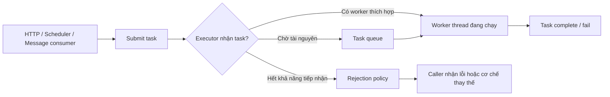
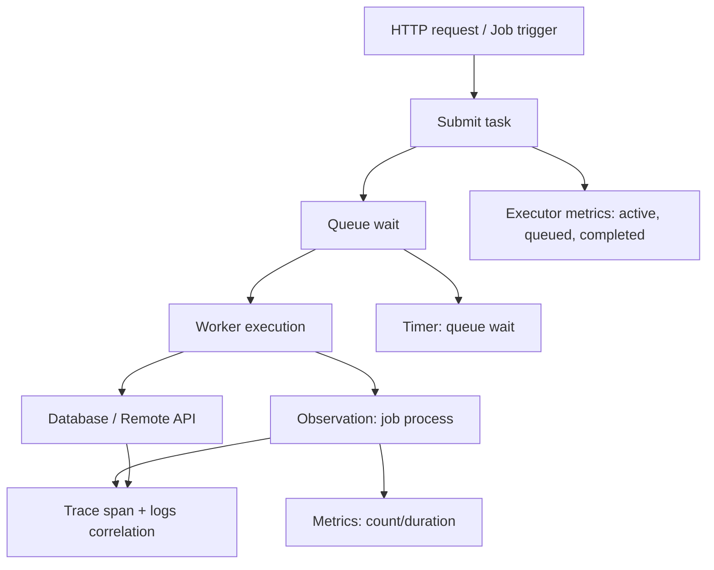

# Executor metrics

Một API Spring Boot nhận yêu cầu tạo báo cáo và chuyển công việc sang `@Async`. Ban đầu API phản hồi nhanh, nhưng sau khi tăng traffic, hàng đợi dài ra, một số job mất hàng phút mới bắt đầu và cuối cùng xuất hiện `TaskRejectedException`. Dashboard chỉ cho thấy CPU khoảng 45%, khiến nhóm vận hành nghĩ rằng máy chủ vẫn còn nhiều tài nguyên. Thực tế, nút thắt có thể nằm ở **thread pool và hàng đợi của executor**, chứ không nhất thiết ở CPU.

**Executor metrics** cho phép quan sát mức bận của worker threads, số task đã hoàn tất, số task đang xếp hàng và cấu hình/sức chứa của pool. Trong chương **Application metrics** thuộc module **SPRING_BOOT_OBSERVABILITY**, chúng giúp bổ sung một lớp quan sát quan trọng bên cạnh HTTP metrics, logs và distributed tracing. Dữ liệu executor đặc biệt hữu ích để phân biệt **thời gian chờ được chạy** với **thời gian thực thi**, khoanh vùng các vấn đề saturation, rejection, deadlock, timeout và context propagation khi ứng dụng vận hành thực tế.

Sau bài học, bạn có thể:

1. Giải thích các chỉ số thường gặp như `executor.active`, `executor.queued`, `executor.completed`, `executor.pool.size`, `executor.pool.core`, `executor.pool.max` và `executor.queue.remaining`.
2. Hiểu lúc nào Spring Boot Actuator có thể tự instrument một `ThreadPoolTaskExecutor`; khi nào cần gắn metrics thủ công cho `ExecutorService` khác.
3. Tạo một executor có tên rõ ràng, giới hạn thread và queue, sau đó xem metrics tại Actuator hoặc Prometheus.
4. Đo riêng **queue wait time**, **execution time** và **rejected tasks** khi metrics mặc định chưa trả lời đủ câu hỏi.
5. Viết truy vấn và thiết kế dashboard/cảnh báo có xét đến pool size, queue capacity, throughput và loại workload.
6. Tránh sai lầm với `@Async`, unbounded queue, `CallerRunsPolicy`, virtual threads và trace context bị mất qua thread.
7. Liên kết executor metrics với HTTP metrics, logs và traces để điều tra độ trễ từ góc nhìn người dùng.

## 1. Executor là gì và vì sao cần theo dõi?

Trong Java, **executor** là cơ chế nhận một đơn vị công việc (task) và quyết định nơi/khi nào thực thi nó. `ExecutorService` có các khả năng quản lý vòng đời, gửi task và lấy kết quả; `ThreadPoolExecutor` là một implementation sử dụng một tập worker threads và một hàng đợi.

Trong Spring, `ThreadPoolTaskExecutor` là adapter phổ biến để dùng `ThreadPoolExecutor` trong ứng dụng. `@Async` có thể gửi method invocation tới một executor, nhưng chỉ khi phần async được cấu hình và lời gọi đi qua cơ chế proxy phù hợp.

Luồng thực thi khái niệm:



Với `ThreadPoolExecutor` có hàng đợi hữu hạn, dòng chảy thường là:

1. Khi số worker ít hơn `corePoolSize`, pool có thể tạo worker để thực hiện task.
2. Khi đã có số worker core, task mới thường được đưa vào queue.
3. Khi queue đầy, pool có thể tăng worker tới `maximumPoolSize`.
4. Khi cả queue và khả năng tạo worker đều đã hết, **rejection policy** quyết định điều gì xảy ra.

Đây là mô hình cơ bản của `ThreadPoolExecutor`; chi tiết thay đổi theo loại queue, cấu hình và executor implementation. Đặc biệt, **`maxPoolSize` không có nghĩa pool sẽ chủ động tạo ngay ngần ấy threads dưới tải**. Nếu queue còn nhận được task, pool có thể không vượt quá core size. Điều này lý giải vì sao `maxPoolSize=32` nhưng `pool.size=4` và hàng đợi liên tục tăng.

### 1.1. Executor metrics trả lời câu hỏi nào?

| Câu hỏi vận hành | Metric hữu ích | Ý nghĩa |
| --- | --- | --- |
| Bao nhiêu task đang chạy? | `executor.active` | Mức bận tại thời điểm đo |
| Bao nhiêu task đang chờ? | `executor.queued` | Áp lực tích lũy trong queue |
| Pool hiện có bao nhiêu worker? | `executor.pool.size` | Quy mô thực tế, có thể co giãn |
| Số worker core/tối đa là bao nhiêu? | `executor.pool.core` / `executor.pool.max` | Cấu hình/sức chứa |
| Queue còn nhận thêm được bao nhiêu task? | `executor.queue.remaining` | Dung lượng hàng đợi còn lại, nếu có ý nghĩa với loại queue |
| Bao nhiêu task đã hoàn tất? | `executor.completed` | Tổng số hoàn tất tích lũy; xem tốc độ tăng để ước lượng throughput |
| Task phải đợi bao lâu trước khi chạy? | **Custom queue-wait Timer** | Thời gian xếp hàng; không mặc định có ở mọi executor |
| Bao nhiêu task bị từ chối? | **Custom rejection Counter** | Tác động thực của chính sách quá tải; không nên suy từ queue đầy |

Không nên coi các tên trên là một danh sách tuyệt đối áp dụng cho mọi `Executor`. Chúng là **các tên thường gặp** khi binder của Micrometer instrument những implementation thích hợp. Tên, tags và cách xuất sang Prometheus phụ thuộc phiên bản, loại executor, registry và cấu hình.

## 2. Phân biệt Gauge, Counter và Timer trong executor metrics

Không phải tất cả chỉ số executor đều có cùng bản chất.

| Metric | Loại đo thường dùng | Đọc như thế nào? | Cạm bẫy |
| --- | --- | --- | --- |
| `executor.active` | Gauge | Worker threads đang thực thi ở thời điểm scrape | Chỉ là ảnh chụp tức thời, có thể bỏ lỡ burst |
| `executor.queued` | Gauge | Tasks đang chờ trong queue | Không tự cho biết mỗi task đã chờ bao lâu |
| `executor.pool.size` | Gauge | Số worker hiện tồn tại | Không phải số worker đang làm việc |
| `executor.pool.core` | Gauge hoặc cấu hình được đo | Mức core threads | Không phải số task thực thi |
| `executor.pool.max` | Gauge hoặc cấu hình được đo | Giới hạn maximum threads | Không phải năng lực thông lượng bảo đảm |
| `executor.queue.remaining` | Gauge | Số vị trí còn lại trong bounded queue | Có thể không hữu ích với queue unbounded |
| `executor.completed` | Counter/FunctionCounter | Số tasks hoàn tất tích lũy | Không dùng nguyên giá trị làm throughput |
| `orders.task.queue.wait` | Timer tùy biến | Phân phối thời gian chờ trước khi bắt đầu | Chỉ đo các task có đi tới điểm bắt đầu thực thi |
| `orders.task.execution` | Timer tùy biến | Thời gian thực thi `Runnable` được bọc | Không bao gồm thời gian chờ nếu bắt đầu đo sau dequeue |
| `orders.task.rejected` | Counter tùy biến | Số lần submit bị từ chối theo logic xác định | `CallerRunsPolicy` có thể không ném rejection exception |

### 2.1. Gauge là ảnh chụp, không phải lịch sử của từng task

`executor.queued=20` tại một thời điểm nghĩa là có khoảng 20 tasks đang chờ lúc hệ thống đọc queue. Nó không cho biết chúng đã chờ 5 ms hay 30 giây. Nếu task được thêm và xử lý giữa hai lần scrape, bạn có thể **không thấy** đỉnh queue trong đồ thị.

Vì vậy, chỉ nhìn queue depth bằng 0 không chứng minh **không từng có queueing**. Với các yêu cầu latency nhạy cảm, hãy đo thêm queue-wait distribution bằng Timer hoặc histogram tại ranh giới submit/start.

### 2.2. Completed không đồng nghĩa successful

`executor.completed` thường đếm số tasks đã hoàn tất vòng chạy theo semantics của executor, bao gồm cả task kết thúc bằng lỗi tùy cách executor ghi nhận. Nó không đại diện cho **số đơn hàng thành công**.

Muốn có business success rate, hãy tạo một tín hiệu có ngữ nghĩa riêng như `orders.processing.outcome` qua Micrometer Observation hoặc Counter/Timer được phân nhóm bằng `outcome=success|failure|rejected`. Không dùng `completed` làm tử số SLO thành công nếu chưa kiểm chứng định nghĩa.

### 2.3. Đừng dùng Counter để đo queue depth

Queue depth có thể lên/xuống, vì thế dùng Gauge. Counter thích hợp cho tổng số sự kiện chỉ tăng lên, chẳng hạn tasks submitted hoặc tasks rejected. Với tổng số hoàn tất, phân tích `rate(...)` trên counter có thể cho số tasks/giây trong một cửa sổ — nhưng chỉ khi metric được export với semantics counter đúng.

## 3. Cấu hình một executor rõ ràng trong Spring Boot

Ví dụ này áp dụng cho **Spring Boot 3.x** sử dụng Java 17+, ứng dụng đã có Spring AOP/async infrastructure tương ứng và `spring-boot-starter-actuator`.

### 3.1. Tạo `ThreadPoolTaskExecutor` có tên

```java
import java.util.concurrent.ThreadPoolExecutor;
import org.springframework.context.annotation.Bean;
import org.springframework.context.annotation.Configuration;
import org.springframework.scheduling.annotation.EnableAsync;
import org.springframework.scheduling.concurrent.ThreadPoolTaskExecutor;

@Configuration
@EnableAsync
public class AsyncExecutorConfig {

    @Bean("ordersExecutor")
    public ThreadPoolTaskExecutor ordersExecutor() {
        ThreadPoolTaskExecutor executor = new ThreadPoolTaskExecutor();
        executor.setThreadNamePrefix("orders-");

        executor.setCorePoolSize(4);
        executor.setMaxPoolSize(8);
        executor.setQueueCapacity(50);
        executor.setKeepAliveSeconds(30);

        executor.setRejectedExecutionHandler(
                new ThreadPoolExecutor.AbortPolicy());

        return executor;
    }
}
```

Những tham số này là **ví dụ cho môi trường lab**, không phải bộ giá trị tối ưu cho mọi production system.

- `corePoolSize=4`: pool duy trì/khởi tạo workers theo chính sách core.
- `maxPoolSize=8`: mức worker tối đa trong cấu hình pool này.
- `queueCapacity=50`: có giới hạn cho số tasks chờ; giúp hệ thống thể hiện quá tải thay vì tích lũy hàng đợi vô hạn.
- `AbortPolicy`: khi không nhận thêm task được, thao tác submit thường bị từ chối bằng exception; cần xử lý ở ranh giới gọi.
- `ordersExecutor`: tên bean ổn định, hữu ích cho việc nhận diện executor trong metrics.
- `orders-`: prefix thread giúp đọc thread dump và logs dễ hơn.

Khi dùng `ThreadPoolTaskExecutor`, một điểm quan trọng là queue được ưu tiên sau khi đủ core threads. Nếu queue chưa đầy, `pool.size` có thể không tăng tới `maxPoolSize` dù `queued` đang tăng. Đừng diễn giải đó là lỗi metrics.

### 3.2. Dùng trong một service `@Async`

```java
import java.util.concurrent.CompletableFuture;
import org.springframework.scheduling.annotation.Async;
import org.springframework.stereotype.Service;

@Service
public class OrderExportService {

    private final OrderExportGateway gateway;

    public OrderExportService(OrderExportGateway gateway) {
        this.gateway = gateway;
    }

    @Async("ordersExecutor")
    public CompletableFuture<String> export(String orderType) {
        String location = gateway.generateExport(orderType);
        return CompletableFuture.completedFuture(location);
    }
}

interface OrderExportGateway {
    String generateExport(String orderType);
}
```

Lời gọi `export(...)` đi qua Spring proxy phù hợp sẽ được đưa tới `ordersExecutor`. Phần `gateway.generateExport(...)` chạy trong worker của executor.

Chú ý:

1. Có `@EnableAsync` và bean executor được đặt tên đúng; chỉ viết `@Async` chưa chắc đã bật cơ chế bất đồng bộ.
2. Gọi nội bộ `this.export(...)` trong cùng class có thể **bỏ qua proxy**, khiến mã chạy đồng bộ và metrics executor không tăng như mong đợi.
3. `CompletableFuture.completedFuture(...)` trong ví dụ đại diện kết quả đã tính **bên trong async method**, không có nghĩa toàn bộ lời gọi từ phía caller được thực thi đồng bộ.
4. Không phụ thuộc hoàn toàn vào `@Async` để xử lý backpressure. Nếu queue đầy, API gọi có thể bị từ chối khi submit.
5. Task error, cancellation và timeout cần được xử lý ở tầng nghiệp vụ/caller, không thể suy hoàn toàn từ metric `executor.completed`.

## 4. Spring Boot Actuator thu thập executor metrics như thế nào?

Khi có Micrometer/Actuator, Spring Boot có thể tự động bind metrics cho những bean executor thuộc các loại được hỗ trợ, như `ThreadPoolTaskExecutor` hoặc `ThreadPoolTaskScheduler`. Trong tình huống này, **tên bean** thường được dùng để phân biệt executor bằng tag.

Các điều kiện thực tế cần xác minh:

- Bean executor tồn tại và được Spring quản lý.
- Loại executor có metrics instrumentation tương ứng trong phiên bản đang dùng.
- Micrometer MeterRegistry và các auto-configurations có mặt.
- Meter không bị `MeterFilter` loại bỏ hoặc đổi tên.
- Endpoint metrics/scrape được bật và được phép truy cập.

**Không mặc định mọi đối tượng `ExecutorService` tạo bằng `Executors.newFixedThreadPool(...)` đều được Boot tự instrument**, đặc biệt khi được tạo thẳng trong business method bằng `new` hoặc không được đăng ký theo cách mà auto-configuration nhận diện.

### 4.1. Dependency và cấu hình đo trong Spring Boot 3.x

Maven, khi dự án đã sử dụng dependency management của Spring Boot:

```xml
<!-- Actuator, Micrometer metrics và các endpoint vận hành -->
<dependency>
    <groupId>org.springframework.boot</groupId>
    <artifactId>spring-boot-starter-actuator</artifactId>
</dependency>

<!-- Chỉ thêm khi cần xuất metrics cho Prometheus -->
<dependency>
    <groupId>io.micrometer</groupId>
    <artifactId>micrometer-registry-prometheus</artifactId>
</dependency>
```

Ví dụ `application.yml`:

```yaml
management:
  endpoints:
    web:
      exposure:
        include: health,info,metrics,prometheus
  metrics:
    tags:
      application: order-service
      environment: lab
```

Đây là cấu hình **lab**. Spring Boot tự tạo/instrument executor phù hợp khi các điều kiện cần thiết được thỏa, nhưng danh sách meter cụ thể còn phụ thuộc implementation và phiên bản Micrometer. Exporter Prometheus chỉ xuất dữ liệu; cần Prometheus server hoặc backend thích hợp để scrape và lưu giữ lịch sử.

Nếu service sử dụng Spring Boot 4.x, hãy xem reference documentation đúng phiên bản: một số starter, auto-configuration và property có thay đổi so với 3.x.

### 4.2. Kiểm tra tên meter bằng Actuator

Sau khi chạy ứng dụng và gửi vài công việc:

```bash
curl -fsS http://localhost:8080/actuator/metrics
curl -fsS http://localhost:8080/actuator/metrics/executor.active
curl -fsS http://localhost:8080/actuator/metrics/executor.queued
curl -fsS http://localhost:8080/actuator/metrics/executor.completed
curl -fsS http://localhost:8080/actuator/prometheus
```

Ở đây giả định Actuator chạy trên cổng `8080` và các endpoint được expose. Nếu các meter tồn tại, response `/actuator/metrics/executor.active` có thể cho biết measurements và available tags, qua đó tìm đúng tag nhận dạng pool (ví dụ tên executor). Kiểm tra chính xác tag key/value từ response, **không đoán**.

`/actuator/metrics` sử dụng **tên meter Micrometer**; `/actuator/prometheus` xuất tên/đơn vị theo naming convention của Prometheus. Ví dụ `executor.active` có thể được chuyển sang tên Prometheus phù hợp như `executor_active_threads` khi mang base unit threads; tên thực tế phải được đọc từ raw output.

**Bảo mật:** Endpoint vận hành có thể tiết lộ cấu hình và mức tải của hệ thống; giới hạn network exposure, xác thực và phân quyền trong production thay vì công khai toàn bộ metrics ra Internet.

## 5. Gắn metrics thủ công cho một `ExecutorService`

Nếu bạn tạo `ThreadPoolExecutor` độc lập, có thể dùng **Micrometer `ExecutorServiceMetrics`** để theo dõi nó. Không cần tạo lại từng Gauge nếu binder đã hỗ trợ implementation.

Ví dụ:

```java
import io.micrometer.core.instrument.MeterRegistry;
import io.micrometer.core.instrument.binder.jvm.ExecutorServiceMetrics;
import java.util.concurrent.ArrayBlockingQueue;
import java.util.concurrent.ExecutorService;
import java.util.concurrent.ThreadPoolExecutor;
import java.util.concurrent.TimeUnit;
import org.springframework.context.annotation.Bean;
import org.springframework.context.annotation.Configuration;

@Configuration
public class BackgroundExecutorConfig {

    @Bean(destroyMethod = "shutdown")
    public ExecutorService indexingExecutor(MeterRegistry registry) {
        ThreadPoolExecutor delegate = new ThreadPoolExecutor(
                4,
                8,
                30,
                TimeUnit.SECONDS,
                new ArrayBlockingQueue<>(50)
        );

        return ExecutorServiceMetrics.monitor(
                registry, delegate, "indexingExecutor");
    }
}
```

Ý nghĩa:

- Tạo một `ThreadPoolExecutor` với bounded queue để có giới hạn tài nguyên rõ ràng.
- `ExecutorServiceMetrics.monitor(...)` instrument executor phù hợp và trả về executor để caller sử dụng.
- Tên `indexingExecutor` giúp phân biệt nó với `ordersExecutor`.
- Bean có `destroyMethod="shutdown"` để ngừng nhận task khi Spring context đóng theo lifecycle do container điều phối.

**Chỉ instrument một executor một lần.** Nếu Spring Boot đã bind metrics cho bean đó, việc thêm binder thủ công với tên/tag khác có thể tạo metrics trùng và khiến dashboard đếm sai. Với những implementation đặc biệt, chỉ số nào có thể được trích xuất sẽ khác nhau; không thể giả định mọi executor đều có queue hay pool size.

### 5.1. ThreadPoolExecutor và scheduler không có cùng semantics

`ScheduledThreadPoolExecutor` ưu tiên task lên lịch theo thời điểm, và `ScheduledExecutorService` có thể tự gửi task định kỳ. Queue depth của scheduler không nhất thiết tương đương “bao nhiêu request nghiệp vụ đang bị tắc nghẽn”; nó còn có thể chứa các task **đang chờ đến lịch chạy**.

Một `ForkJoinPool` có mô hình work-stealing khác với `ThreadPoolExecutor`. Các gauges về active, queued và pool size nếu được instrument cần được diễn giải theo đúng implementation. Đừng xây một dashboard dùng chung một công thức utilization mà coi mọi executor đều giống nhau.

## 6. Đọc executor metrics thành câu chuyện vận hành

Giả sử một executor có cấu hình core=4, max=8, queue capacity=50. Dashboard ghi:

| Quan sát | Giá trị minh họa |
| --- | ---: |
| `executor.pool.core` | 4 |
| `executor.pool.max` | 8 |
| `executor.pool.size` | 8 |
| `executor.active` | 8 |
| `executor.queued` | 48 |
| `executor.queue.remaining` | 2 |
| `executor.completed` | Tiếp tục tăng chậm |

Đây là **dấu hiệu đáng nghi của saturation**: tất cả workers hiện có đều bận, queue gần đầy và throughput có thể không theo kịp tốc độ submit.

Tuy nhiên, không nên kết luận chỉ từ một ảnh chụp. Cần hỏi thêm:

- Trạng thái kéo dài bao lâu? Có phải spike ngắn trong vài giây không?
- Input rate có lớn hơn completion rate trong cùng cửa sổ không?
- Task đang thực thi lâu do CPU, I/O, lock, connection pool hay dependency timeout?
- Có task bị reject, client timeout hoặc latency SLO vi phạm không?
- Có thay đổi deployment, cấu hình thread/queue, connection pool hoặc giới hạn tài nguyên không?
- Pool có sử dụng `CallerRunsPolicy` khiến caller xử lý công việc ngay trên HTTP thread không?

### 6.1. Active/pool size không phải “CPU utilization”

Với một pool có 8 active threads, cả 8 có thể đang chờ kết nối database hoặc blocking network I/O. CPU tổng 45% không bác bỏ sự bão hòa thread pool.

Một tỷ lệ tham khảo:

```text
worker occupancy ≈ active threads / current pool size
```

Nếu `active=8` và `pool.size=8`, tỷ lệ là 100% ở thời điểm đo. Nhưng nó **không** là CPU utilization, cũng không trực tiếp là “100% capacity của business service”.

Tỷ lệ `active / maxPoolSize` đôi khi được dùng để phát hiện gần giới hạn tối đa, nhưng **không đủ** nếu pool còn tăng được hoặc queue đang nghẽn. Phải xem đồng thời queue depth, remaining capacity, throughput và queue-wait latency.

### 6.2. Quan hệ giữa tốc độ vào, tốc độ ra và queue

Trong một khoảng thời gian đủ dài, nếu tốc độ submit trung bình lớn hơn tốc độ hoàn tất trung bình, lượng task chờ có xu hướng tăng (bỏ qua các trường hợp task bị từ chối, bị hủy hoặc chuyển sang nơi khác).

Ví dụ:

```text
Input rate        = 100 tasks/s
Completion rate   = 80 tasks/s
Chênh lệch        = 20 tasks/s
Sau khoảng 2 giây = thêm ~40 tasks đang chờ
```

Đây là phép tính minh họa đơn giản, không phải công thức tuyệt đối cho mọi executor. Cần tính đến task cancellation, rejection, thay đổi độ dài task, batch, shutdown và sampling của metrics.

Sự tăng đều của `executor.queued` là tín hiệu cảnh báo sớm, trong khi `rejected` có thể chỉ tăng khi queue đã đầy và policy không còn nhận task. Đến lúc thấy nhiều rejection, trải nghiệm người dùng có thể đã xấu từ trước.

### 6.3. Thời gian chờ có thể là phần lớn end-to-end latency

Một HTTP request có thể mất:

```text
Total request latency ≈
    HTTP processing
  + task queue wait
  + actual task execution
  + downstream waits
  + serialization / response overhead
```

Các thành phần có thể chồng lấp nếu chạy song song, nên công thức chỉ là cách phân rã trực quan, không phải đẳng thức cộng thời gian cho mọi chương trình.

Nếu bạn đặt Timer **bên trong** `Runnable.run()`, nó thường chỉ đo execution duration, không gồm thời gian nằm trong queue. Khi p95 HTTP tăng còn timer thực thi task vẫn ổn định, **queue wait** là một giả thuyết quan trọng cần kiểm chứng.

## 7. Đo queue wait và execution time riêng bằng Micrometer

Metrics executor mặc định thường cho biết **số task chờ**, nhưng không nhất thiết cho biết **mỗi task chờ bao lâu**. Để đo chính xác hơn, ghi timestamp khi submit và khi worker thật sự bắt đầu.

Ví dụ một dispatcher nhận `ThreadPoolTaskExecutor` đã khai báo ở phần 3. Đo ba đại lượng:

- `orders.task.queue.wait`: duration từ submit đến lúc wrapper `Runnable` bắt đầu chạy.
- `orders.task.execution`: duration bên trong `Runnable`.
- `orders.task.rejected`: số lần submit bị từ chối theo `AbortPolicy` đang dùng.

```java
import io.micrometer.core.instrument.Counter;
import io.micrometer.core.instrument.MeterRegistry;
import io.micrometer.core.instrument.Timer;
import java.time.Duration;
import java.util.concurrent.TimeUnit;
import org.springframework.beans.factory.annotation.Qualifier;
import org.springframework.core.task.TaskRejectedException;
import org.springframework.scheduling.concurrent.ThreadPoolTaskExecutor;
import org.springframework.stereotype.Component;

@Component
public class MeasuredOrderDispatcher {
    private final ThreadPoolTaskExecutor executor;
    private final Timer queueWaitTimer;
    private final Timer executionTimer;
    private final Counter rejectedCounter;

    public MeasuredOrderDispatcher(
            @Qualifier("ordersExecutor") ThreadPoolTaskExecutor executor,
            MeterRegistry registry) {

        this.executor = executor;

        this.queueWaitTimer = Timer.builder("orders.task.queue.wait")
                .description("Time spent waiting in the executor queue")
                .publishPercentileHistogram()
                .serviceLevelObjectives(
                        Duration.ofMillis(50),
                        Duration.ofMillis(200))
                .register(registry);

        this.executionTimer = Timer.builder("orders.task.execution")
                .description("Time spent executing an order task")
                .register(registry);

        this.rejectedCounter = Counter.builder("orders.task.rejected")
                .description("Order tasks rejected during submission")
                .register(registry);
    }

    public void dispatch(Runnable task) {
        long submittedAtNanos = System.nanoTime();

        try {
            executor.execute(() -> {
                long waitingNanos =
                        System.nanoTime() - submittedAtNanos;
                queueWaitTimer.record(
                        waitingNanos, TimeUnit.NANOSECONDS);

                long startedAtNanos = System.nanoTime();
                try {
                    task.run();
                } finally {
                    executionTimer.record(
                            System.nanoTime() - startedAtNanos,
                            TimeUnit.NANOSECONDS);
                }
            });
        } catch (TaskRejectedException rejected) {
            rejectedCounter.increment();
            throw rejected;
        }
    }
}
```

**Phân tích nhánh:**

1. Khi submit thành công, task mang theo mốc thời gian ban đầu. Tới lúc worker thực thi, Timer đo quãng chờ.
2. Wrapper bắt đầu đo execution ngay trước `task.run()`, rồi ghi nhận duration trong `finally` ngay cả khi task ném exception.
3. Nếu `ThreadPoolTaskExecutor` từ chối submit bằng `TaskRejectedException` theo policy đã chọn, Counter tăng và exception vẫn được truyền cho caller.
4. `System.nanoTime()` phù hợp để đo thời gian đã trôi qua; không dùng `System.currentTimeMillis()` làm đồng hồ đo duration chính vì wall-clock có thể bị điều chỉnh.

**Ranh giới của ví dụ:**

- Queue-wait Timer chỉ có dữ liệu với **task đã bắt đầu chạy**. Task bị reject không có queue-wait sample; vì thế cần Counter rejection riêng.
- `TaskRejectedException` là loại exception ở tầng Spring TaskExecutor. Nếu dùng executor thuần Java hoặc policy khác, cần bắt kiểu ngoại lệ phù hợp và định nghĩa rõ rejection.
- Với `CallerRunsPolicy`, task có thể chạy ngay trên thread của người submit; Timer queue wait gần bằng 0 và không có exception rejection. Điều đó không có nghĩa hệ thống không quá tải.
- Ví dụ đếm duration cả task thất bại nhưng **chưa đếm task failure**. Nếu cần tỷ lệ lỗi, thêm business outcome có tập giá trị hữu hạn qua Observation/Counter riêng.
- Với task được tiếp tục bằng các future/chains khác, wrapper chỉ đo **thời gian chạy của Runnable được gửi**, không nhất thiết toàn bộ công việc bất đồng bộ bên dưới. Hãy chọn ranh giới instrument đúng nhu cầu.
- Không thêm `orderId`, `userId` hoặc traceId làm metric tag chỉ để debug từng task.

### 7.1. Tại sao cần histogram cho queue wait?

Nếu đa số task chờ 2 ms nhưng 1% phải chờ 3 giây, average queue wait có thể vẫn thấp. Histogram cho phép xem p95/p99 và tỷ lệ task vượt ngưỡng như 200 ms.

Bucket `50ms`/`200ms` phù hợp khi chúng liên quan tới budget latency của workload; còn trong hệ thống batch kéo dài hàng phút, các ngưỡng ấy có thể không có ý nghĩa. Chọn buckets theo trải nghiệm thực tế và chi phí series.

Nếu dùng Prometheus classic histogram, các series ví dụ có thể mang tên `orders_task_queue_wait_seconds_bucket`, `_sum` và `_count`. Xem raw `/actuator/prometheus` để xác minh tên và bucket boundaries thực sự, vì exporter có thể chuẩn hóa tên khác nhau.

## 8. Executor metrics trong Prometheus và dashboard

Với registry Prometheus, Micrometer chuyển canonical meter names và base units theo naming convention phù hợp. Các tên bên dưới **minh họa** một dạng export thường gặp; phải xem raw series thật trước khi viết dashboard.

Ví dụ có thể gặp:

```text
executor_active_threads{name="ordersExecutor", ...}
executor_queued_tasks{name="ordersExecutor", ...}
executor_pool_size_threads{name="ordersExecutor", ...}
executor_completed_tasks_total{name="ordersExecutor", ...}
```

Tên label để phân biệt executor có thể khác theo cấu hình/phiên bản. Nếu endpoint `/actuator/metrics/executor.active` cho biết tag `name=ordersExecutor`, hãy so tiếp với label thực sự trong output Prometheus.

### 8.1. Dashboard tối thiểu

Một dashboard executor nên hiển thị cùng một cửa sổ:

| Nhóm | Biểu đồ | Mục tiêu |
| --- | --- | --- |
| **Capacity** | Core, max, current pool size | Hiểu năng lực cấu hình và mức mở rộng thực tế |
| **Concurrency** | Active threads và tỉ lệ active/pool size | Xem mức bận tại thời điểm đo |
| **Backlog** | Queued tasks, queue remaining | Phát hiện tích tụ công việc |
| **Throughput** | Tốc độ completed tasks nếu là counter | So sánh với tốc độ vào |
| **Saturation** | Rejected tasks/giây | Biết thời điểm không nhận thêm được task |
| **Latency** | p50/p95/p99 queue wait và execution time | Phân biệt chờ với thực thi |
| **Service impact** | HTTP latency, `5xx`/timeout, business failure rate | Biết tải executor đã ảnh hưởng người dùng chưa |

### 8.2. Truy vấn PromQL minh họa

**Active workers của pool** khi series thực tế tên `executor_active_threads`:

```promql
executor_active_threads{name="ordersExecutor"}
```

**Tốc độ hoàn tất**, nếu series `executor_completed_tasks_total` tồn tại với semantics counter:

```promql
sum(
  rate(
    executor_completed_tasks_total{name="ordersExecutor"}[5m]
  )
)
```

**Tốc độ task bị từ chối** khi custom counter được export thành `orders_task_rejected_total`:

```promql
sum(rate(orders_task_rejected_total[5m]))
```

**p95 queue wait** nếu Timer có classic histogram:

```promql
histogram_quantile(
  0.95,
  sum by (le) (
    rate(orders_task_queue_wait_seconds_bucket[5m])
  )
)
```

Đơn vị kết quả của timer dạng này thường là **giây**. Đừng quên filter theo `application`, `environment`, pool và workload nếu một Prometheus server scrape nhiều services. Ví dụ gộp các môi trường hoặc các pool khác nhau có thể tạo một p95 không còn đúng phạm vi cần quan sát.

**Lưu ý phân phối:** không lấy trung bình p95 đã được tính riêng của từng pod. Nếu các instances xuất histogram bucket compatible, hãy **gộp bucket rates trước**, rồi mới dùng `histogram_quantile()` để ước lượng p95 của toàn nhóm.

## 9. Khi nào executor thực sự bị quá tải?

Một executor không nên được đánh giá chỉ qua một ngưỡng số worker. Cần kết hợp **saturation, backlog, latency và tác động người dùng**.

### 9.1. Bốn tình huống điển hình

| Hiện tượng | Giả thuyết cần kiểm chứng | Kiểm tra tiếp |
| --- | --- | --- |
| Active cao, queued cao và tăng, rejection tăng | Saturation rõ rệt | Tốc độ submit/completed, task duration, rejection policy |
| Active cao, CPU thấp, task duration cao | Threads đang chờ I/O/lock/dependency | Traces, DB connection pool, HTTP client timeouts, thread dump |
| Active thấp, queued vẫn cao | Pool không mở rộng như mong đợi hoặc scheduling/queue behavior khác | Core/max, queue type, thread factory, worker states |
| Active thấp, queued thấp, request vẫn chậm | Nút thắt có thể nằm ngoài pool này | Gateway, network, DB, HTTP client, GC, các executor khác |

Đây là các **giả thuyết**, không phải kết luận tự động. Trong hệ thống thật có nhiều thread pools, một pool có thể hoàn toàn khỏe trong khi pool khác đang nghẽn.

### 9.2. Backpressure và rejection policy

Khi queue đầy, `ThreadPoolExecutor` dùng `RejectedExecutionHandler`. Một vài lựa chọn quen thuộc:

- **`AbortPolicy`:** từ chối bằng exception. Dễ phát hiện và có thể đếm rõ nếu caller xử lý đúng.
- **`CallerRunsPolicy`:** bên gửi task tự chạy task khi executor còn hoạt động. Nó tạo dạng backpressure nhưng có thể kéo dài thời gian của HTTP request thread hoặc message consumer thread; không nhất thiết tạo rejection exception.
- **`DiscardPolicy` / `DiscardOldestPolicy`:** có nguy cơ làm mất công việc. Tránh dùng cho nghiệp vụ cần bảo đảm xử lý nếu chưa có cơ chế bù trừ/độ tin cậy cụ thể.

Không nên chữa mọi dạng overload bằng cách tăng `maxPoolSize`. Nếu task chờ database pool có 10 connections, tăng worker lên 200 có thể chỉ làm 190 thread cùng chờ database và tăng memory/GC/context switching.

### 9.3. Queue không giới hạn làm che dấu giới hạn thật

Nếu một executor dùng queue gần như unbounded, nó có thể tiếp tục nhận task dù throughput không đáp ứng. Khi đó:

- Rejection có thể không xuất hiện sớm.
- `executor.queued` tăng theo thời gian.
- Queue wait tăng trước khi thấy thất bại rõ ràng.
- Bộ nhớ có thể cạn vì task objects và payload bị giữ lâu trong queue.

Trong production, nên xác định queue capacity, timeout, retry/backoff, cơ chế từ chối và backpressure theo **năng lực downstream** và chi phí của task. Không dùng “queue rất lớn” như một chiến lược thay thế capacity planning.

## 10. Liên kết executor metrics với Micrometer Observation và tracing

Executor metrics mô tả **sức khỏe của pool**, trong khi Micrometer Observation giúp mô tả **một lần thực hiện công việc**. Hai loại dữ liệu bổ trợ nhau.



Giả sử p95 HTTP latency tăng từ 300 ms lên 2 giây. Một khả năng là:

1. `executor.queued` tăng cùng thời điểm.
2. `orders.task.queue.wait` p95 tăng lên 1,4 giây.
3. `orders.task.execution` p95 vẫn quanh 200 ms.
4. Trace của một request mẫu cho thấy phần chờ trước lúc task được thực thi kéo dài.
5. Khi giảm input rate hoặc khắc phục nút thắt downstream, queue wait và HTTP latency cùng hồi phục.

Chuỗi bằng chứng giúp **khoanh vùng nguyên nhân khả dĩ**: thay vì tối ưu hàm xử lý 200 ms, cần xem nguồn backpressure hoặc capacity của executor. Tuy nhiên, trace sẽ chỉ có đủ ngữ cảnh khi instrumentation được thiết lập đúng qua ranh giới thread.

### 10.1. Trace context không tự đi theo task sang worker thread

Một `Observation.Scope` hoặc trace/span context đang hoạt động tại HTTP thread **không mặc nhiên** có mặt trong executor thread. Nếu không propagate, logs trong worker có thể thiếu `traceId`; custom span của task có thể trở thành một trace mới, không nối với HTTP span ban đầu.

Với Spring Framework 6.1+ (phù hợp các phiên bản Spring Boot 3.2+ tương ứng), có thể cân nhắc `ContextPropagatingTaskDecorator` cùng dependency context propagation thích hợp:

```java
import org.springframework.core.task.support.ContextPropagatingTaskDecorator;
import org.springframework.scheduling.concurrent.ThreadPoolTaskExecutor;

ThreadPoolTaskExecutor executor = new ThreadPoolTaskExecutor();
executor.setCorePoolSize(4);
executor.setMaxPoolSize(8);
executor.setQueueCapacity(50);
executor.setTaskDecorator(new ContextPropagatingTaskDecorator());
```

Đây là đoạn minh họa phần cấu hình TaskDecorator, không phải một bean độc lập hoàn chỉnh. TaskDecorator có overhead; chỉ dùng khi bạn cần truyền context và đã kiểm tra integration tương thích. Với các framework stack/phiên bản khác, cần cơ chế tương ứng của Micrometer Context Propagation, Reactor Context hoặc instrumentation đã có sẵn.

**Lưu ý:** Truyền trace context đúng **không** làm executor nhanh hơn; nó giúp quan sát đúng quan hệ cha–con giữa spans và log correlation. Không truyền token hay toàn bộ domain object vào baggage chỉ để “giữ context”.

### 10.2. Custom Observation nên đo ranh giới nào?

Có hai phép đo khác nhau:

- **Thời gian chờ trong executor queue:** bắt đầu khi submit, kết thúc khi worker bắt đầu. Dùng Timer queue wait riêng nếu cần.
- **Thời gian thực thi nghiệp vụ:** bắt đầu khi task thực sự chạy, kết thúc khi công việc được định nghĩa hoàn tất. Có thể tạo Observation `orders.export.process` và dùng `observe(...)` cho phần đồng bộ bên trong worker.

Ví dụ:

```java
Observation.createNotStarted("orders.export.process", observationRegistry)
        .lowCardinalityKeyValue("job.type", "order-export")
        .observe(() -> exportGateway.generate());
```

Đây là ví dụ cho một task **đồng bộ bên trong worker**. Nếu `generate()` lại trả về `CompletableFuture` hoặc `Mono`, `observe(...)` có thể kết thúc ngay lúc future/publisher được tạo chứ không đo toàn bộ công việc bên dưới. Hãy đặt điểm stop tại completion/cancellation thực sự theo ranh giới đã xác định.

Nếu Spring Boot/framework đã instrument HTTP request và HTTP client, đừng tạo thêm một observation bọc trùng đúng ranh giới đó chỉ để “có nhiều spans”. Chọn business step có ý nghĩa, tên và low-cardinality key-values ổn định.

## 11. Virtual threads và các executor không có pool size cố định

Trong Java 21, **virtual threads** cho phép mô hình thực thi rất khác traditional fixed thread pool. Ví dụ `Executors.newVirtualThreadPerTaskExecutor()` có thể tạo virtual thread riêng cho từng task, thay vì giới hạn concurrency bằng số platform worker threads của một `ThreadPoolExecutor` quen thuộc.

Với Spring Boot 3.2+ và Java 21, cấu hình:

```yaml
spring:
  threads:
    virtual:
      enabled: true
```

có thể thay đổi một số executor/scheduler được Spring Boot auto-configure để sử dụng virtual threads. Điều này phụ thuộc stack, phiên bản và bean override hiện có.

**Không áp dụng máy móc các thước đo `executor.pool.core`, `executor.pool.max` và `executor.queued` của thread pool truyền thống cho virtual-thread-per-task executor.** Không có một pool worker hữu hạn theo đúng semantics cũ để những metrics đó diễn tả.

Nếu dùng virtual threads, hãy chọn những chỉ số phản ánh **giới hạn thật của tài nguyên**:

- Số công việc đang chạy (`inflight`), queue ở tầng application/transport nếu có.
- Tỷ lệ success/failure/rejection ở các ranh giới thực tế.
- Độ trễ từ lúc nhận yêu cầu tới lúc hoàn tất.
- Connection pool usage, DB/HTTP client saturation, lock contention và tài nguyên bị giới hạn.
- Những chỉ số Java virtual-thread/runtime được hỗ trợ ở JDK/instrumentation đang triển khai.

Virtual threads có thể giúp tránh chi phí chặn platform thread cho nhiều tác vụ I/O phù hợp, nhưng **không làm database, API downstream hoặc memory trở thành vô hạn**. Cần có concurrency limit, timeout và backpressure ở đúng tài nguyên.

## 12. Thiết kế cảnh báo có ích

Một cảnh báo chỉ dựa vào `executor.active > 5` thường tạo nhiễu: pool có thể xử lý burst bình thường rồi phục hồi. Nên kết hợp **thời gian duy trì áp lực**, **queue wait** và **tác động dịch vụ**.

Ví dụ chiến lược:

| Mục tiêu cảnh báo | Điều kiện minh họa | Hành động |
| --- | --- | --- |
| Backlog kéo dài | `queued` tăng liên tục trong 10 phút | Kiểm tra input rate, completion rate và downstream |
| Pool gần hết sức chứa | `active` gần `pool.size/max`, queue còn rất ít chỗ | Kiểm tra mức bận, thread dump, capacity |
| Rejection thực sự | Rejected rate lớn hơn 0 theo cửa sổ ngắn, đúng pool quan trọng | Xác định policy và ảnh hưởng caller |
| Latency user-facing | Queue-wait p95 tăng và HTTP latency SLO vi phạm | Ưu tiên điều tra vì có ảnh hưởng khách hàng |
| Executor không tiến triển | Queue > 0 trong thời gian dài nhưng completed rate gần 0 | Kiểm tra deadlock, dependency, thread liveness |

Ngưỡng phù hợp phụ thuộc workload. Một batch executor phục vụ job dài vài phút không thể dùng cùng p95 queue-wait threshold với payment request cần đáp ứng trong 500 ms.

Các lưu ý khác:

1. Cảnh báo theo **tên pool và application/environment** để tránh gộp các executor khác nhiệm vụ.
2. Kiểm tra `rate(...)` chỉ trên metrics có semantics counter; không dùng `rate` lên Gauge queue depth.
3. Chống nhiễu với cửa sổ đánh giá phù hợp, nhưng đừng để cửa sổ dài tới mức phản ứng quá muộn với overload.
4. Có alert cho **metrics pipeline missing/stale**; không nhầm thiếu series vì scrape lỗi với pool đang idle.
5. Kèm liên kết tới dashboard, trace/logs và runbook giải quyết sự cố.

## 13. Quy trình điều tra một sự cố executor bị nghẽn

**Tình huống giả định:** Sau khi triển khai tính năng export báo cáo, p99 của API `POST /reports/export` tăng từ 400 ms lên 4 giây. Người dùng báo job bị chậm, trong khi CPU chỉ khoảng 40%.

### Bước 1 — Xác minh tác động từ bên ngoài

Xem gateway/HTTP server latency, request rate, timeout và error rate. Không dựa vào executor metrics một mình để kết luận trải nghiệm người dùng đã bị ảnh hưởng.

Nếu endpoint chỉ **trả ngay job ID**, HTTP latency có thể vẫn thấp dù job ở queue lâu; khi đó phải xem cả **thời gian từ lúc nhận job tới khi hoàn thành**, không chỉ thời gian xử lý HTTP.

### Bước 2 — Chọn đúng executor

Liệt kê executor beans trong kiến trúc hoặc dashboard, sau đó tìm `ordersExecutor` hoặc pool chịu trách nhiệm export. Không gộp mọi `executor.*` vào một series tổng nếu các pool có cấu hình và nghĩa khác nhau.

Kiểm tra:

- `pool.core`, `pool.max`, `pool.size`.
- `active` và `queued`.
- `queue.remaining` nếu queue hữu hạn.
- `completed` rate và custom rejection rate.

### Bước 3 — Phân biệt chờ và chạy

Nếu queue-wait p95 = 3 giây, execution p95 = 200 ms, ưu tiên kiểm tra tốc độ submit, capacity và cơ chế backpressure. Nếu queue-wait thấp nhưng execution p95 = 3 giây, ưu tiên xem dependency, lock, blocking I/O, GC hoặc CPU.

Đối chiếu với trace của job được lưu và log có correlation. Nếu trace không có quan hệ với HTTP request, xem lại task context propagation.

### Bước 4 — Kiểm tra downstream và chính sách reject

Một HTTP client connection pool thiếu connections hoặc database pool bị bão hòa có thể giữ các executor threads trong trạng thái chờ. Tăng kích thước executor có thể không giải quyết nút thắt.

Nếu `CallerRunsPolicy` đang dùng, một phần công việc có thể chạy ngay ở thread nhận request, làm HTTP latency xấu đi mà không có `TaskRejectedException`. Nếu `AbortPolicy` dùng, kiểm tra caller có retry quá nhanh tạo **retry storm** hay không.

### Bước 5 — Kiểm chứng sau điều chỉnh

Sau khi giới hạn input, tối ưu downstream, sửa timeout hoặc điều chỉnh pool/queue có kiểm soát, cần xác minh:

- Queue wait và queue depth giảm.
- Rejection rate trở về mức cho phép.
- Completion throughput phù hợp với input.
- HTTP/job end-to-end latency cải thiện.
- Business success/error SLI và synthetic checks ổn định.

Đây là quá trình xác nhận **theo nhiều tín hiệu**, không đơn thuần là “active threads nhỏ hơn trước”.

## 14. Bài thực hành: gây tải có kiểm soát trong lab

Dùng một Spring Boot ứng dụng có `ordersExecutor` như ví dụ. Không thử tạo overload trên production hoặc hệ thống dùng chung không có kiểm soát.

### Các bước

1. **Chuẩn bị:** Thêm Actuator và Prometheus registry; expose endpoints trong môi trường lab an toàn. Xác nhận `executor.*` có tên/tag tương ứng với bean `ordersExecutor`.
2. **Làm quen:** Gửi vài task nhỏ. Xem `active`, `queued`, `pool.size` và `completed`; ghi lại giá trị khi idle và khi đang chạy.
3. **Tạo queue:** Gửi một burst task I/O giả lập có sleep ngắn trong lab, lớn hơn core size và queue capacity. Quan sát pool mở rộng và queue depth.
4. **Thử rejection:** Dùng `AbortPolicy`, gửi nhiều tasks hơn sức chứa để xem exception và Counter `orders.task.rejected` tăng, nếu có wrapper đo như phần 7.
5. **Đo queue wait:** So sánh `orders.task.queue.wait` p95 với `orders.task.execution` p95. Giải thích vì sao chúng tăng khác nhau.
6. **Thử policy:** Thay `AbortPolicy` bằng `CallerRunsPolicy` trong lab, kiểm tra rejection exception có thể biến mất nhưng thread của caller bị kéo dài thời gian xử lý.
7. **Kiểm chứng context:** Gọi qua HTTP request có tracing, gửi task sang executor và xem logs trong worker có traceId/spanId hay không; nếu không, kiểm tra TaskDecorator/context propagation.
8. **Thử bottleneck downstream:** Giới hạn pool kết nối của một dependency giả lập, quan sát active cao và CPU không nhất thiết cao.
9. **So sánh lựa chọn pool:** Thử tăng max size khi queue chưa đầy; giải thích vì sao không thể giả định pool sẽ tăng ngay tới max. Thử thay đổi bounded queue capacity và quan sát hệ quả.
10. **Dựng dashboard:** Tạo các panel capacity, concurrency, backlog, throughput, rejection và queue-wait p95; thêm HTTP latency/error để có góc nhìn người dùng.

### Bài tập phân tích ngắn

Giả sử dashboard trong 5 phút ghi:

```text
executor.pool.core     = 4
executor.pool.max      = 8
executor.pool.size     = 8
executor.active        = 8
executor.queued        = 50
executor.queue.remaining = 0
executor.completed rate  = 40 tasks/s
input rate               = 60 tasks/s
orders.task.rejected rate = 12 tasks/s
orders.task.queue.wait p95 = 2.5 seconds
CPU                     = 38%
```

**Câu hỏi:** Có thể kết luận “CPU thấp nên chỉ cần tăng threads” không?

**Trả lời:** Không. Pool đầy, queue đầy, rejection tăng và queue wait lớn cho thấy hệ thống **không theo kịp lượng task được gửi**. CPU thấp có thể vì worker đang chờ I/O, lock hoặc dependency. Cần xem thread dump, tracing, downstream connection pools, timeout và chính sách retry trước khi chọn biện pháp. Tăng threads có thể làm tải lên dependency nặng hơn.

**Câu hỏi:** Vì sao `executor.completed` vẫn tăng khi người dùng thấy nhiều lỗi?

**Trả lời:** Hoàn tất task ở executor không đồng nghĩa giao dịch nghiệp vụ thành công. Task có thể kết thúc bằng exception hoặc fallback. Cần đo success/error rate riêng theo semantics nghiệp vụ.

**Câu hỏi:** Vì sao `executor.queued` có thể bằng 0 trên dashboard dù thỉnh thoảng có request chờ lâu?

**Trả lời:** Gauge là ảnh chụp tại thời điểm scrape, có thể bỏ lỡ burst. Cần xem queue-wait Timer/histogram, tần suất scrape và độ trễ của request ở đúng ranh giới.

**Câu hỏi:** Nếu application sử dụng virtual-thread-per-task executor, nên theo dõi những gì?

**Trả lời:** Không áp dụng trực tiếp core/max/pool-size metrics của `ThreadPoolExecutor`. Nên đo inflight work, throughput, độ trễ, error/backpressure và các giới hạn tài nguyên thật như connection pools, CPU và memory.

## 15. Những nguyên tắc cần nhớ

- **Executor metrics là tín hiệu sức khỏe của nơi chạy task**, bổ sung cho HTTP request metrics và business metrics.
- **`active`, `queued`, `pool.size` và `queue.remaining` chủ yếu là snapshot**; đọc cùng time window, completed rate và rejection để hiểu xu hướng.
- **Queue depth không cho biết queue wait time.** Nếu latency quan trọng, đo duration từ submit tới start và từ start tới completion bằng Timer riêng.
- **Không nhầm completed với success.** Số task hoàn tất khác số giao dịch thành công; ghi outcome nghiệp vụ riêng.
- **Spring Boot có thể tự instrument `ThreadPoolTaskExecutor` phù hợp**, còn executor độc lập có thể cần `ExecutorServiceMetrics`. Tránh instrument một pool hai lần.
- **Core/max và loại queue quyết định hành vi mở rộng.** Không coi max pool là số worker luôn được tạo hoặc là cách chữa mọi bottleneck.
- **Rejection policy ảnh hưởng dấu hiệu quá tải.** `CallerRunsPolicy` làm chậm caller; `AbortPolicy` có rejection exception; cả hai cần được quan sát đúng.
- **Trace context phải được propagate sang worker.** Mở scope ở request thread không tự bảo đảm span và log correlation ở executor thread.
- **Dùng tags hữu hạn, không gắn IDs/PII/secrets vào metrics.** Xuất dữ liệu qua Actuator/Prometheus/OTLP phải đi kèm chính sách bảo mật.
- **Không áp mô hình pool cũ cho virtual threads.** Đo giới hạn tài nguyên và workload thực tế của executor đang dùng.
- **Kiểm chứng bằng nhiều tín hiệu:** executor queue, task timers, HTTP latency, dependency metrics, logs và distributed tracing giúp phân biệt nguyên nhân và triệu chứng.

### Tài liệu tham khảo

- [Spring Boot — Metrics (Actuator Reference)](https://docs.spring.io/spring-boot/reference/actuator/metrics.html)
- [Spring Boot — Observability](https://docs.spring.io/spring-boot/reference/actuator/observability.html)
- [Spring Framework — Task Execution and Scheduling](https://docs.spring.io/spring-framework/reference/integration/scheduling.html)
- [Micrometer — JVM and executor metrics](https://docs.micrometer.io/micrometer/reference/reference/jvm.html)
- [Micrometer — Timers](https://docs.micrometer.io/micrometer/reference/concepts/timers.html)
- [Micrometer Context Propagation — Reference](https://docs.micrometer.io/context-propagation/reference/)
- [Java SE — ThreadPoolExecutor](https://docs.oracle.com/en/java/javase/21/docs/api/java.base/java/util/concurrent/ThreadPoolExecutor.html)
- [Prometheus — Querying Functions](https://prometheus.io/docs/prometheus/latest/querying/functions/)

