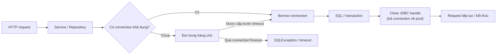
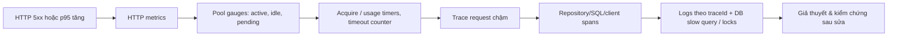
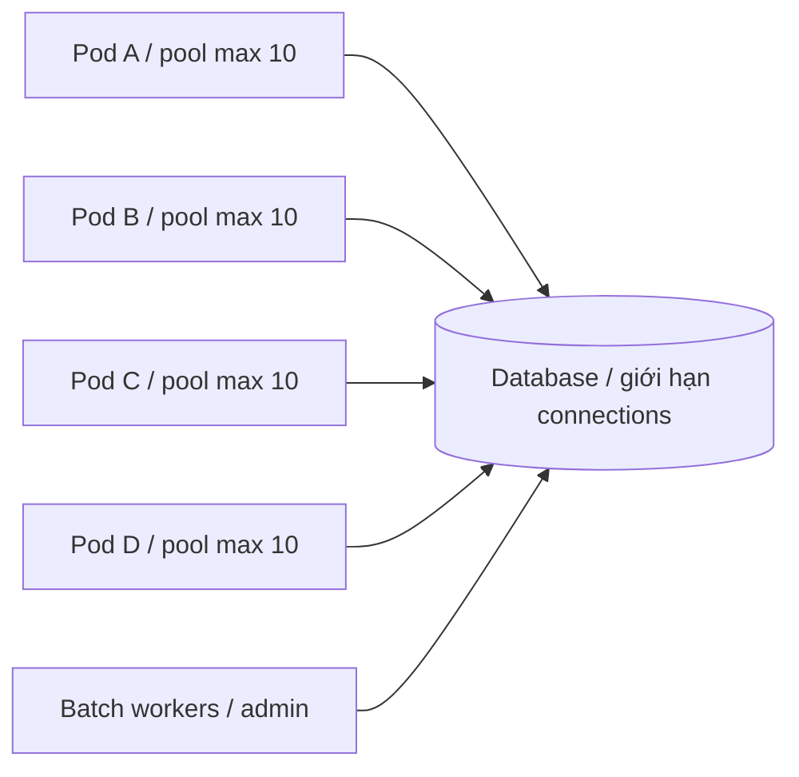

# Data source pool metrics trong Spring Boot

> **Chương:** Application metrics  
> **Module:** `SPRING_BOOT_OBSERVABILITY` — thiết lập observability cho Spring Boot bằng Micrometer Observation, metrics, logs và distributed tracing; thực hành propagation ngữ cảnh, tag/cardinality, exporter, sampling và cách liên kết tín hiệu để điều tra lỗi, độ trễ, hành vi ứng dụng trong môi trường thực.  
> **Trọng tâm:** Đo và diễn giải **connection pool của JDBC DataSource**, đặc biệt HikariCP: số kết nối đang dùng, nhàn rỗi, đang chờ, giới hạn pool, thời gian lấy/trả kết nối và số lần timeout; dùng Actuator, Prometheus, tracing và logs để phân biệt nghẽn pool với nghẽn database.

## 1. Mục tiêu học tập

Sau bài này, bạn có thể:

1. Mô tả vai trò của JDBC `DataSource` và connection pool trong ứng dụng Spring Boot; phân biệt kết nối **active**, **idle**, **total**, **pending**, **maximum** và **minimum**.
2. Nhận diện các meter `jdbc.connections.*` và `hikaricp.connections.*` thường gặp; phân biệt **Gauge**, **Timer** và **Counter** cùng ý nghĩa đơn vị.
3. Bật Actuator và Prometheus, đặt tên pool ổn định, kiểm tra endpoint `/actuator/metrics` và `/actuator/prometheus` để xác nhận meter thực tế.
4. Viết PromQL cho tỷ lệ sử dụng pool, số thread chờ kết nối, tốc độ timeout và thời gian acquire trung bình/p95 khi có histogram.
5. Phân biệt chờ mượn connection, thời gian giữ connection, thời gian tạo connection và độ trễ SQL/database; không coi một metric đơn lẻ là bằng chứng kết luận nguyên nhân.
6. Tính ngân sách kết nối khi tăng số replica; xử lý những tình huống thường gặp như pool exhaustion, connection leak, transaction dài, lock contention, DB giới hạn connections và các vấn đề network.
7. Kết nối pool metrics với HTTP latency/error, traces, logs và database metrics để lập giả thuyết, kiểm tra và xác nhận sau sửa lỗi.

## 2. Vì sao cần giám sát DataSource connection pool?

Ứng dụng Spring Boot dùng JDBC, `JdbcTemplate` hoặc JPA/Hibernate thường truy cập database thông qua một `DataSource`. Khi DataSource dùng pool, ứng dụng **tái sử dụng** một số JDBC connections thay vì mở kết nối TCP, xác thực và khởi tạo session mới cho mọi query.

Một request cần database thường trải qua:



**Pool đầy** không nhất thiết có nghĩa database đang dùng hết CPU. Một connection có thể bị giữ vì query chậm, lock, transaction dài, code chờ remote API trong transaction hoặc lỗi không trả connection. Ngược lại, số active connections cao có thể bình thường nếu traffic tăng và các thao tác database đều ngắn.

Giám sát pool giúp trả lời:

- Bao nhiêu connection đang được mượn và còn bao nhiêu connection sẵn sàng?
- Có request/thread đang đợi để mượn connection không?
- Thời gian mượn connection tăng, hay connection được mượn nhanh nhưng bị giữ quá lâu?
- Có trường hợp vượt `connectionTimeout`, khiến tác vụ thất bại trước khi kịp chạy SQL?
- Sau khi tăng replicas, tổng số connections tối đa có vượt giới hạn DB?
- Dấu hiệu nghẽn xuất hiện cùng khoảng thời gian p95 HTTP, SQL latency và số lỗi tăng hay không?

### 2.1. Pool là tài nguyên có giới hạn, không phải queue vô hạn

HikariCP thường duy trì một số connection không vượt `maximumPoolSize`. Khi tất cả connections đều đang được mượn, các thread khác muốn lấy connection có thể phải chờ. Nếu hết khoảng `connectionTimeout` mà vẫn chưa có connection, thao tác lấy connection thất bại.

**Các mốc khác nhau:**

| Mốc | Việc diễn ra | Có thể đo bằng |
|---|---|---|
| Trước khi mượn | Business code chuẩn bị truy cập DB | HTTP/application observation |
| Chờ pool cấp connection | Pool có thể đã đầy hoặc đang tạo/kiểm tra connection | Connection acquisition timer, pending connections |
| Đang giữ connection | JDBC code/transaction sử dụng hoặc giữ connection | Active connections, connection usage timer |
| Thực thi SQL | DB thực hiện query/transaction/lock | DB query metrics, SQL instrumentation, traces, slow query logs |
| Trả connection | Code gọi `close()` trên pooled JDBC handle, pool nhận lại | Active giảm, idle có thể tăng |
| Không lấy được connection | Thời gian chờ vượt `connectionTimeout` | Hikari timeout counter, exception/logs |

Trong pool, `Connection.close()` trên proxy thông thường **trả kết nối về pool**, không nhất thiết đóng TCP connection vật lý. Sự phân biệt này quan trọng khi điều tra connection leak và khi viết ví dụ Java có `try-with-resources`.

## 3. Những loại metric cần phân biệt

Không phải mọi pool metric đều có cùng kiểu. Một dashboard đúng phải chọn phép tính phù hợp với meter type.

| Loại | Phản ánh | Ví dụ pool | PromQL thường dùng |
|---|---|---|---|
| **Gauge** | Trạng thái tại thời điểm lấy mẫu; có thể tăng/giảm | `active`, `idle`, `pending`, `max` | Giá trị hiện tại, `avg_over_time`, `max_over_time` |
| **Counter** | Số sự kiện tích lũy, thông thường tăng theo thời gian rồi reset khi process restart | `hikaricp.connections.timeout` | `rate()`, `increase()` |
| **Timer** | Phân phối thời lượng và số lần đo | `hikaricp.connections.acquire`, `.usage`, `.creation` | `rate(_sum) / rate(_count)`, histogram p95 nếu có |
| **Application Timer** | Thời gian một operation nghiệp vụ | `http.server.requests` hoặc custom `Observation` | HTTP/app p95, error/route dimensions |

Một **Timer đã có count**; không cần tạo Counter trùng ý nghĩa chỉ để đếm số lần acquire. Một Gauge hiện tại không phải Counter nên không dùng `rate(active)` để suy ra request/giây.

## 4. Các gauges của connection pool

Đối với HikariCP, các meter Micrometer phổ biến có prefix `hikaricp.connections`. Spring Boot cũng có thể expose các meter JDBC pool tổng quát có prefix `jdbc.connections`. **Tập meter có mặt phụ thuộc phiên bản Spring Boot/Micrometer, DataSource implementation, cấu hình và quyền truy cập platform.**

### 4.1. Bảng ánh xạ ngữ nghĩa

| Micrometer meter thường gặp | Loại | Ý nghĩa |
|---|---|---|
| `hikaricp.connections.active` | Gauge | Số connection **đang được mượn** bởi application |
| `hikaricp.connections.idle` | Gauge | Số connection có sẵn, chưa được mượn |
| `hikaricp.connections` | Gauge | Tổng số connection pool đang quản lý ở thời điểm đo |
| `hikaricp.connections.pending` | Gauge | Số thread đang chờ lấy connection |
| `hikaricp.connections.max` | Gauge | Giới hạn connection tối đa mà pool báo cáo |
| `hikaricp.connections.min` | Gauge | Mức connection nhàn rỗi tối thiểu mà pool được cấu hình hướng tới |
| `jdbc.connections.active` | Gauge, nếu binder hỗ trợ | Chỉ số active theo abstraction DataSource pool |
| `jdbc.connections.idle` | Gauge, nếu binder hỗ trợ | Chỉ số idle theo abstraction DataSource pool |
| `jdbc.connections.max` | Gauge, nếu binder hỗ trợ | Giới hạn tối đa theo abstraction DataSource pool |
| `jdbc.connections.min` | Gauge, nếu binder hỗ trợ | Mức tối thiểu theo abstraction DataSource pool |

**Lưu ý quan trọng:** `hikaricp.connections` là *tổng connections hiện có*, không phải lúc nào cũng bằng `maximumPoolSize`. Khi pool mới khởi động, giảm idle hoặc đang khởi tạo thêm connections, tổng thực tế có thể thấp hơn mức tối đa.

Ở một thời điểm gần như đồng nhất:

\[
\text{total connections} \approx \text{active connections} + \text{idle connections}
\]

Dấu `≈` nhắc rằng Gauges được lấy mẫu tại những thời điểm hơi khác nhau, pool có thể thay đổi đồng thời và một số backend scrape có độ trễ. Đừng tạo alert cứng chỉ vì hai vế chênh nhau đúng một connection trong một mẫu.

### 4.2. Active: đang mượn không đồng nghĩa đang chạy SQL

`active=8` cho biết tám connection đã được mượn khỏi pool; nó không chứng minh DB đang xử lý tám query cùng lúc. Một request có thể mở transaction rồi chờ remote API, giữ kết nối trong toàn bộ thời gian chờ. Một connection cũng có thể đang chờ lock, network hoặc I/O.

Nếu active thường xuyên gần max, cần đối chiếu:

- `pending` có tăng hay không?
- Thời gian `acquire` có tăng không?
- Thời gian `usage` có dài bất thường không?
- DB có long-running queries, locks hoặc pool waits không?
- Traffic/replicas thay đổi thế nào?

### 4.3. Idle: zero không mặc định là lỗi

`idle=0` có thể xuất hiện trong một đợt burst ngắn. Đây là dấu hiệu pool đang sử dụng hết connection hiện có; chỉ trở thành áp lực cần xử lý khi kết hợp với `pending` tăng, acquisition latency tăng, timeout hoặc p95/error rate bị ảnh hưởng.

Ngược lại, `idle=max` lâu dài có thể nghĩa pool dư capacity hoặc traffic thấp; cần đánh giá chi phí connections với giới hạn DB và khả năng scale. Không tối ưu pool chỉ dựa vào một ảnh chụp các gauges.

### 4.4. Pending: hàng chờ trước pool

`hikaricp.connections.pending` thường là chỉ số trực quan nhất khi muốn tìm **contention tại pool**. Nếu `pending=12`, có 12 thread đang chờ được cấp connection tại thời điểm đo; nhưng một lần scrape không đủ để biết chúng chờ bao lâu.

Đánh giá cùng `acquire` duration và `timeout`:

- Pending tăng thoáng qua khi burst nhưng không có timeout: pool có thể vẫn đáp ứng được.
- Pending liên tục lớn, acquire p95 tăng: có pressure tại điểm cấp connection.
- Pending tăng rồi timeout counter tăng: một phần tác vụ đã không lấy được connection đúng hạn.

### 4.5. Min và max là cấu hình, không phải số lần mượn

`min` và `max` phản ánh capacity/mức hướng tới của pool. Chúng không phải số kết nối đang dùng. Đối với HikariCP, `minimumIdle` thường được dùng để điều khiển số idle connections; nếu không cấu hình riêng, mặc định có thể hướng đến pool kích thước cố định tùy version/defaults.

Một `maximumPoolSize` lớn hơn chưa chắc cải thiện throughput: quá nhiều concurrent queries có thể làm DB contention, memory và locks tăng, kéo dài thời gian sử dụng connection và làm **toàn hệ thống chậm hơn**.

## 5. Connection acquisition, usage, creation và timeout

HikariCP có thêm timers/counter để hiểu **quá trình mượn/trả connection**, ngoài các gauges.

| Micrometer meter thường gặp | Loại | Bắt/đếm điều gì? | Điều dễ hiểu sai |
|---|---|---|---|
| `hikaricp.connections.acquire` | Timer | Thời gian lấy được connection từ pool | Không phải SQL latency |
| `hikaricp.connections.usage` | Timer | Khoảng thời gian connection được application giữ trước khi trả | Có thể gồm cả thời gian code chờ ngoài SQL |
| `hikaricp.connections.creation` | Timer | Thời gian tạo connection vật lý mới | Không phải mỗi request đều tạo connection |
| `hikaricp.connections.timeout` | Counter | Số lần không lấy được connection trong giới hạn thời gian chờ | Không đồng nghĩa JDBC query timeout hoặc socket timeout |

### 5.1. Acquire latency

Khi request gọi `dataSource.getConnection()`, pool có thể trả ngay một idle connection hoặc phải chờ. Thời gian acquire cao thường gợi ý pool contention, nhưng cũng có thể do tạo connection mới, kiểm tra connection, tình trạng network/DB hoặc hành vi instrumentation.

**Phân biệt hai hiện tượng:**

- `acquire p95` cao, `pending` tăng: nhiều lời gọi phải đợi pool cấp connection.
- `acquire p95` cao nhưng `pending` thấp: cần xem mẫu traffic, connection creation, DB/network handshake và khoảng lấy mẫu; không kết luận chắc chắn pool đã đầy.

### 5.2. Usage latency

Usage timer mô tả thời gian **application giữ một connection**. Nó thường bắt đầu khi mượn connection thành công và kết thúc lúc connection được trả về pool.

Usage dài có thể do:

- SQL/query chậm.
- Chờ lock hoặc transaction contention.
- Gọi remote service trong transaction đang giữ connection.
- Xử lý dữ liệu lớn trong khi chưa đóng JDBC resources.
- Code quên hoặc quá chậm trả connection.
- Một transaction business kéo dài hợp lệ.

**Usage không phải thời gian thực thi SQL thuần túy.** Để phân tích query latency, cần thêm spans/metrics ở JDBC, repository hoặc DB; slow query log và database wait events có thể là bằng chứng mạnh hơn.

### 5.3. Creation latency

Khi pool cần mở connection vật lý, hoạt động này có thể gồm network connect, TLS handshake, xác thực, khởi tạo session và validation. Creation chậm có thể xuất hiện sau restart/warm-up, khi pool scale, hoặc do DB/network.

Tăng `maximumPoolSize` không tự giải quyết nếu chính việc mở connection mới đang thất bại do DB connection limit, DNS, TLS, credentials hoặc network.

### 5.4. Timeout counter

Nếu không mượn được connection trong `connectionTimeout`, Hikari có thể ghi nhận timeout và throw một `SQLException` thích hợp.

Phân biệt:

| Loại timeout | Xảy ra ở đâu | Ý nghĩa |
|---|---|---|
| **Pool connection timeout** | Chờ `getConnection()` | Không mượn được connection kịp hạn |
| **SQL query timeout** | Thực thi statement/database | Query chạy quá thời hạn chính sách |
| **Network/socket timeout** | Truyền nhận với DB | Kết nối hoặc I/O mạng mất quá lâu |
| **HTTP request timeout** | API/gateway/client | Toàn bộ xử lý request vượt deadline |

Một lỗi HTTP 500 có thể do connection timeout, nhưng chỉ nhìn 500 không thể xác định đó là loại timeout nào. Cần kết hợp log exception, pool metrics và tracing.

## 6. Tích hợp trong Spring Boot 3.x

Ví dụ dùng **Spring Boot 3.x, Java 17+, Maven parent/BOM của Spring Boot**. Những tên starter hoặc property có thể thay đổi ở các major version khác; hãy dùng đúng version đang triển khai để xác minh.

### 6.1. Dependencies

Với Spring JDBC, HikariCP thường được cung cấp qua `spring-boot-starter-jdbc`; Spring Data JPA starter cũng thường kéo theo hạ tầng datasource tương ứng.

```xml
<dependencies>
    <dependency>
        <groupId>org.springframework.boot</groupId>
        <artifactId>spring-boot-starter-jdbc</artifactId>
    </dependency>

    <dependency>
        <groupId>org.springframework.boot</groupId>
        <artifactId>spring-boot-starter-actuator</artifactId>
    </dependency>

    <dependency>
        <groupId>io.micrometer</groupId>
        <artifactId>micrometer-registry-prometheus</artifactId>
    </dependency>

    <!-- Chỉ để chạy ví dụ local bằng database in-memory. -->
    <dependency>
        <groupId>com.h2database</groupId>
        <artifactId>h2</artifactId>
        <scope>runtime</scope>
    </dependency>
</dependencies>
```

Khi dùng PostgreSQL, MySQL hoặc một DB thật, thêm JDBC driver đúng loại và cấu hình URL/credential tương ứng thay cho H2. Dùng BOM của Spring Boot để quản lý version tương thích; tránh thêm Micrometer binder hai lần nếu Actuator đã cấu hình.

### 6.2. Cấu hình local có tên pool cố định

Ví dụ `application-local.yml`:

```yaml
spring:
  datasource:
    url: jdbc:h2:mem:observability_demo;DB_CLOSE_DELAY=-1
    username: sa
    password: ""
    driver-class-name: org.h2.Driver
    hikari:
      pool-name: checkout-primary
      maximum-pool-size: 8
      minimum-idle: 2
      connection-timeout: 2500
      validation-timeout: 1000
      max-lifetime: 1800000

management:
  endpoints:
    web:
      exposure:
        include: health,info,metrics,prometheus
  metrics:
    tags:
      application: checkout-service
      environment: local
```

Các giá trị ở đây dùng **cho bài thực hành**, không phải cấu hình tối ưu mặc định của production:

- `pool-name: checkout-primary`: đặt tên pool dễ nhận biết, ổn định; tránh tên động chứa pod ID, request ID hoặc thời điểm khởi động.
- `maximum-pool-size: 8`: tối đa tám connections pool quản lý theo chính sách Hikari.
- `minimum-idle: 2`: hướng tới duy trì hai idle connections theo chính sách pool; không bảo đảm ngay lập tức luôn có đúng hai.
- `connection-timeout: 2500`: thời gian chờ tối đa để mượn connection, **mili giây**, ví dụ 2,5 giây.
- `validation-timeout: 1000`: giới hạn thời gian kiểm tra connection, cũng theo mili giây.
- `max-lifetime: 1800000`: tuổi thọ connection vật lý theo mili giây, cần đặt phù hợp lifetime của DB/proxy; không hiểu là thời gian SQL query được phép chạy.
- `management.endpoints.web.exposure.include` expose những endpoint đã có; không tự tạo authentication.

**Không đặt `connection-timeout` bằng một giá trị cực ngắn chỉ để “phát hiện lỗi nhanh” khi chưa có SLO và kế hoạch capacity.** Một timeout quá thấp có thể biến burst bình thường thành lỗi hàng loạt.

Chạy app với profile local:

```bash
./mvnw spring-boot:run -Dspring-boot.run.profiles=local
```

Nếu ứng dụng đã có JAR:

```bash
java -jar app.jar --spring.profiles.active=local
```

Nếu app dùng cổng HTTP khác mặc định `8080` hoặc management server port riêng, điều chỉnh các URL kiểm tra theo cấu hình thực tế.

### 6.3. Khi nào metrics được đăng ký?

Với Spring Boot Actuator và HikariCP được auto-configure, ứng dụng thường expose các gauges JDBC và HikariCP-specific metrics khi pool/metrics tracker đã được khởi tạo. Tên/tag cụ thể phụ thuộc vào instance và cách binder được đăng ký.

Đôi khi pool chỉ khởi tạo đầy đủ sau **lần dùng đầu tiên**. Vì vậy nếu `/actuator/metrics` chưa thấy `hikaricp.*` ngay sau startup, hãy thực hiện một lần mượn/trả connection hoặc gọi API dùng DB, rồi kiểm tra lại. Điều đó khác với việc bỏ qua lỗi dependency/registry khi cả sau traffic metrics vẫn không có.

Không tự tạo một `MeterRegistry` rời trong service chỉ để đo pool. Một registry không gắn với exporter của Spring Boot có thể khiến dữ liệu không đến Prometheus.

## 7. Tạo API demo để thấy pool thay đổi

Ví dụ sau chỉ phục vụ **thử nghiệm local**. Nó cố ý giữ một connection trong vài trăm mili giây để dễ quan sát `active` và `pending`. **Không triển khai endpoint gây trì hoãn connection này lên production.**

```java
package com.example.observability;

import java.sql.Connection;
import java.sql.SQLException;
import javax.sql.DataSource;

import org.springframework.web.bind.annotation.GetMapping;
import org.springframework.web.bind.annotation.RequestParam;
import org.springframework.web.bind.annotation.RestController;

@RestController
public class PoolDemoController {

    private final DataSource dataSource;

    public PoolDemoController(DataSource dataSource) {
        this.dataSource = dataSource;
    }

    @GetMapping("/demo/db-pool")
    public String usePool(
            @RequestParam(defaultValue = "150") long holdMillis)
            throws SQLException {

        long delay = Math.max(0, Math.min(holdMillis, 1000));

        try (Connection connection = dataSource.getConnection()) {
            try {
                // Chỉ để mô phỏng giữ connection trong môi trường local.
                Thread.sleep(delay);
            } catch (InterruptedException exception) {
                Thread.currentThread().interrupt();
                throw new IllegalStateException(
                        "Interrupted while simulating pool usage", exception);
            }

            return connection.isValid(1) ? "OK" : "UNAVAILABLE";
        }
    }
}
```

Ví dụ dùng Spring MVC, do đó ứng dụng cần web starter tương thích nếu chưa có (ví dụ `spring-boot-starter-web`). H2 driver đến từ `com.h2database:h2` trong dependency mẫu. Cách tiếp cận `try (Connection connection = ...)` bảo đảm handle được đóng/trả về pool kể cả khi có exception.

**Quan sát:** gửi một request sẽ làm active tăng trong chốc lát. Nếu bắn nhiều request đồng thời hơn số connections tối đa, `pending` có thể tăng; một số request có thể timeout nếu chờ lâu hơn `connection-timeout`.

Công cụ phát tải tùy môi trường; nếu đã có công cụ `hey`, có thể thử **chỉ ở máy local**:

```bash
hey -n 80 -c 16 "http://localhost:8080/demo/db-pool?holdMillis=700"
```

Trong lúc có traffic, xem pool metrics qua Actuator hoặc Prometheus. Với 8 connections, 16 concurrent requests và mỗi request giữ connection đến 700 ms, bạn có thể thấy một số thread chờ. Kết quả thực phụ thuộc scheduling, số request thực sự vào app, cấu hình pool và chu kỳ scrape; đừng coi giá trị pending phải đúng 8.

**Giới hạn thí nghiệm:** `Thread.sleep` ở đây mô phỏng connection bị giữ lâu; nó không mô phỏng DB CPU, locks hay latency query thực. Dùng nó để hiểu cơ chế queue/pool, sau đó chuyển sang workload database có kiểm soát nếu muốn kiểm tra nguyên nhân SQL thật.

## 8. Kiểm tra metrics với Actuator

Sau khi app chạy và pool được sử dụng:

```bash
curl -s http://localhost:8080/actuator/metrics
curl -s http://localhost:8080/actuator/metrics/jdbc.connections.active
curl -s http://localhost:8080/actuator/metrics/hikaricp.connections.active
curl -s http://localhost:8080/actuator/metrics/hikaricp.connections.pending
curl -s http://localhost:8080/actuator/metrics/hikaricp.connections.acquire
curl -s http://localhost:8080/actuator/prometheus
```

Trước hết mở `/actuator/metrics` để xem **meter names thực tế có trong phiên bản của bạn**. Sau đó mới dùng URL của từng meter; một số tên có thể thiếu nếu không dùng HikariCP, có cấu hình disable metric hoặc binder chưa hoạt động.

Một phản hồi Actuator minh họa cho gauge:

```json
{
  "name": "hikaricp.connections.active",
  "measurements": [
    {
      "statistic": "VALUE",
      "value": 3.0
    }
  ],
  "availableTags": [
    {
      "tag": "pool",
      "values": ["checkout-primary"]
    }
  ]
}
```

Một timer như `hikaricp.connections.acquire` thường có count, total time và max hoặc histogram tùy cấu hình. **Đừng so `VALUE` của Gauge với `COUNT` của Timer**; chúng có đơn vị và ý nghĩa khác nhau.

### 8.1. Lọc đúng pool

Khi có nhiều DataSource hoặc nhiều pool, một endpoint có thể trả aggregate từ nhiều meter cùng tên. Để lọc riêng pool khi meter có tag `pool`:

```bash
curl -G http://localhost:8080/actuator/metrics/hikaricp.connections.active --data-urlencode "tag=pool:checkout-primary"
```

Với JDBC generic binder, tag có thể tên `name` (ví dụ bean name của DataSource) thay vì `pool`. Không giả định `name=dataSource` và `pool=checkout-primary` tự động là cùng label để join trong PromQL.

### 8.2. Dùng những meter có sẵn trước khi tự thêm instrumentation

Các pool meters thường đã được auto-configured. Không tự viết Counter `db.connections.active` tăng khi `getConnection()` rồi giảm khi `close()`: Counter không giảm được; còn tự bọc mọi connection có thể tạo double accounting và làm thay đổi hành vi JDBC. Nếu cần số connection đang mượn, **dùng Gauge có sẵn**. Khi cần đo bước nghiệp vụ liên quan DB, tạo Observation/Timer riêng cho operation thay vì nhân bản pool metrics.

## 9. Prometheus: tên series và đơn vị

Khi dùng Micrometer Prometheus registry, tên kỹ thuật có dấu chấm thường được chuẩn hóa sang dấu gạch dưới; timer có suffix như `_seconds_count`, `_seconds_sum`, và `_seconds_bucket` nếu histogram có xuất. Counter thường có `_total`. **Tên cuối cùng phụ thuộc version registry/naming convention và export format thực tế.**

Ví dụ *minh họa*, không phải dữ liệu lấy từ ứng dụng cụ thể:

```text
hikaricp_connections_active{pool="checkout-primary",application="checkout-service"} 7
hikaricp_connections_idle{pool="checkout-primary",application="checkout-service"} 1
hikaricp_connections_pending{pool="checkout-primary",application="checkout-service"} 5
hikaricp_connections_max{pool="checkout-primary",application="checkout-service"} 8
hikaricp_connections_acquire_seconds_count{pool="checkout-primary"} 437
hikaricp_connections_acquire_seconds_sum{pool="checkout-primary"} 12.6
hikaricp_connections_timeout_total{pool="checkout-primary"} 3
```

Prometheus sẽ thường bổ sung những labels như `job`, `instance`, `namespace` và `pod` ở quá trình scrape; application common tags có thể xuất hiện hoặc khác theo cấu hình.

Các ví dụ PromQL tiếp theo dùng tên series và label `pool` ở bảng trên. **Trước khi sao chép, tìm đúng tên series trong `/actuator/prometheus` hoặc trình khám phá Prometheus.** Nếu có nhiều application cùng tên pool, luôn lọc `job`, `namespace` hoặc `application` phù hợp.

### 9.1. Tỷ lệ pool đang được mượn

```promql
100 *
hikaricp_connections_active{
  job="checkout-service",
  pool="checkout-primary"
}
/
clamp_min(
  hikaricp_connections_max{
    job="checkout-service",
    pool="checkout-primary"
  },
  1
)
```

Đây là **phần trăm connections active so với maximum** của từng series tương ứng. Query trả giá trị theo instance nếu còn label instance. Không lấy trung bình phần trăm của các pool có quy mô khác nhau rồi coi đó là mức sử dụng tổng công suất; khi muốn tỷ lệ tổng hợp cần có phép tính có trọng số và tương thích labels.

### 9.2. Chờ connection trong 5 phút

Giá trị hiện tại:

```promql
hikaricp_connections_pending{
  job="checkout-service",
  pool="checkout-primary"
}
```

Đỉnh pending trong 5 phút:

```promql
max_over_time(
  hikaricp_connections_pending{
    job="checkout-service",
    pool="checkout-primary"
  }[5m]
)
```

Trung bình pending trong 5 phút:

```promql
avg_over_time(
  hikaricp_connections_pending{
    job="checkout-service",
    pool="checkout-primary"
  }[5m]
)
```

Vì `pending` là Gauge, **không dùng `rate(pending[5m])` làm số request đang chờ mỗi giây**. Gauge có thể tăng/giảm và không đại diện counter sự kiện.

### 9.3. Tốc độ connection timeout

```promql
sum by (pool) (
  rate(hikaricp_connections_timeout_total{
    job="checkout-service"
  }[5m])
)
```

Kết quả là số lần pool timeout trung bình **mỗi giây** trên các instances được lọc. Để ước lượng số timeout trong 15 phút:

```promql
sum by (pool) (
  increase(hikaricp_connections_timeout_total{
    job="checkout-service"
  }[15m])
)
```

Counter có thể reset khi JVM/pool restart. `rate` và `increase` có xử lý reset theo mẫu đã scrape; khi thiếu samples hoặc target biến mất, vẫn có thể mất thông tin. Dùng database/business logs nếu cần lịch sử lỗi tuyệt đối chính xác.

### 9.4. Thời gian chờ lấy connection trung bình

Nếu timer `hikaricp.connections.acquire` được xuất với `_seconds_sum` và `_seconds_count`:

```promql
sum by (pool) (
  rate(hikaricp_connections_acquire_seconds_sum{
    job="checkout-service"
  }[5m])
)
/
clamp_min(
  sum by (pool) (
    rate(hikaricp_connections_acquire_seconds_count{
      job="checkout-service"
    }[5m])
  ),
  1e-9
)
```

Kết quả là **mean acquisition time** theo giây, không phải p95. Nhân 1000 nếu dashboard muốn đơn vị milliseconds.

Nếu một pool có số lần acquire quá thấp, mean có thể biến động lớn; hiển thị thêm count/rate để biết mức độ đại diện. Nếu không có observations trong khoảng đo, biểu thức có thể trả 0 hoặc no data tùy hiện diện series; không coi 0 chắc chắn chứng minh “không có contention”.

### 9.5. p95 acquisition latency khi đã bật histogram

Timer mặc định không nhất thiết expose histogram buckets. Trong môi trường có ngân sách series phù hợp, có thể cấu hình histogram cho meter cần thiết, ví dụ trong Spring Boot 3.x:

```yaml
management:
  metrics:
    distribution:
      percentiles-histogram:
        hikaricp.connections.acquire: true
```

Sau khi xác minh có series `hikaricp_connections_acquire_seconds_bucket`:

```promql
histogram_quantile(
  0.95,
  sum by (le, pool) (
    rate(hikaricp_connections_acquire_seconds_bucket{
      job="checkout-service"
    }[5m])
  )
)
```

**Điều kiện:** histogram buckets có tồn tại và đủ samples. Việc bật histogram làm tăng số time series, nhất là khi có nhiều pool, pod và tags. Không tính p95 toàn cluster bằng cách lấy trung bình p95 của từng replica. Aggregate theo `le` và những labels cần giữ lại trước khi gọi `histogram_quantile`.

### 9.6. Đối chiếu thời gian giữ connection

Nếu timer `hikaricp.connections.usage` tồn tại:

```promql
sum by (pool) (
  rate(hikaricp_connections_usage_seconds_sum{
    job="checkout-service"
  }[5m])
)
/
clamp_min(
  sum by (pool) (
    rate(hikaricp_connections_usage_seconds_count{
      job="checkout-service"
    }[5m])
  ),
  1e-9
)
```

Mean usage tăng có thể là tín hiệu của transaction dài hoặc query chậm. Nó không tự xác định được SQL statement nào. Khi thấy hiện tượng này, đọc tracing của transaction/repository, DB execution metrics, lock waits và logs để khoanh vùng.

### 9.7. Không trộn hai binder mà chưa kiểm tra

Một ứng dụng có thể expose cả `jdbc_connections_active` và `hikaricp_connections_active`. Chúng có thể đang phản ánh **cùng một pool** theo hai lớp đo khác nhau. Không cộng chúng để có “tổng active connections” vì có thể đếm hai lần. Hãy chọn một dòng meter nhất quán cho dashboard và dùng dòng còn lại để đối chiếu khi cần.

## 10. Dashboard tối thiểu cho một DataSource pool

Một dashboard hữu ích nên hiển thị **quy mô**, **áp lực** và **tác động lên request** cùng một time window:

| Panel | Meter | Cách đọc |
|---|---|---|
| Active / max theo instance | `hikaricp.connections.active` / `.max` | Công suất pool đang bị chiếm bao nhiêu? |
| Idle / total | `.idle` / `hikaricp.connections` | Pool hiện có bao nhiêu connections, bao nhiêu sẵn sàng? |
| Pending hiện tại/đỉnh 5 phút | `.pending` | Có hàng chờ cấp connection không? |
| Acquire mean/p95 | `.acquire` Timer | Mượn connection có bị chậm không? |
| Usage mean/p95 | `.usage` Timer | Connection bị giữ bao lâu? |
| Connection creation latency | `.creation` Timer | Kết nối mới có được tạo nhanh không? |
| Pool timeout rate | `.timeout` Counter | Có sự kiện mượn connection thất bại không? |
| HTTP RPS, error ratio, p95 | HTTP server metrics | Người dùng có bị ảnh hưởng không? |
| DB latency, active sessions, locks | DB exporter/SQL instrumentation | Database có bị nghẽn không? |
| JVM GC/threads và container CPU | JVM/container metrics | Áp lực pool có liên quan GC, executor hay tài nguyên khác không? |
| Scrape/telemetry pipeline health | `up` và exporter metrics | Có đang mất dữ liệu quan sát không? |

**Thiết kế dashboard theo pool và instance.** Nếu hiển thị trung bình trên tất cả pods, một pod rất tệ có thể bị che bởi các pods còn lại. Dùng cả biểu đồ theo replica và tổng hợp có mục đích.

### 10.1. Một quy tắc cảnh báo tham khảo

Ví dụ nghi ngờ nghẽn pool khi active gần max **và** có pending liên tục:

```promql
(
  hikaricp_connections_active{
    job="checkout-service",
    pool="checkout-primary"
  }
  /
  clamp_min(
    hikaricp_connections_max{
      job="checkout-service",
      pool="checkout-primary"
    },
    1
  ) > 0.9
)
and on (job, instance, pool)
(
  hikaricp_connections_pending{
    job="checkout-service",
    pool="checkout-primary"
  } > 0
)
```

Lệnh này là **ví dụ**; Prometheus vector matching phải khớp labels thực tế, nhất là khi có `namespace`/`pod` và custom tags. Production alert thường cần thêm khoảng duy trì (chẳng hạn `for: 5m`), đo timeout rate, HTTP impact và chính sách giảm noise. Pool bận ngắn hạn không nhất thiết là sự cố.

Không đặt mọi alert theo “active > 80%”: nhiều workload sử dụng gần hết pool ổn định nhưng không có pending/timeout và vẫn đạt latency SLO.

## 11. Đặt kích thước pool theo nhu cầu và ngân sách database

### 11.1. Tổng số connection có thể lớn hơn tưởng tượng

Giả sử checkout service có:

- 6 replicas;
- mỗi replica có Hikari `maximumPoolSize=12`;
- một database còn nhận kết nối từ job định kỳ, migration tool, admin console và services khác.

Số connection tối đa chỉ riêng checkout có thể đến:

\[
6 \times 12 = 72
\]

Con số 72 chưa tính những client khác, pool ở DataSource khác hoặc số connection đã tồn tại khi đang rolling deployment. Nếu DB giới hạn 80 sessions, thiết kế này có thể rất rủi ro ngay cả khi một pod đơn lẻ vẫn báo `active/max` chưa cao.

Với rolling update, có thể có **pods cũ và mới đồng thời tồn tại**. Cần tính capacity cho tình huống triển khai, autoscaling và dự phòng, không chỉ lấy `replicas` ở trạng thái ổn định.

### 11.2. Little's Law: một cách suy nghĩ về concurrency

Với một giai đoạn ổn định, Little's Law cho biết:

\[
L = \lambda W
\]

Trong đó:

- \(L\): số tác vụ trung bình đang ở trong giai đoạn xét;
- \(\lambda\): throughput trung bình (tác vụ/giây);
- \(W\): thời gian trung bình của giai đoạn (giây).

Nếu một service thực hiện 80 DB operations/giây và mỗi operation **giữ connection** trung bình 100 ms, số connections active trung bình có thể xấp xỉ:

\[
80 \times 0{,}1 = 8
\]

Đây là phép ước lượng giáo dục để hình dung concurrency, **không phải công thức trực tiếp quyết định `maximumPoolSize=8`**. Burst, phân phối latency dài đuôi, connection creation, transaction nesting, parallel queries, replica-level traffic skew và giới hạn DB có thể đòi hỏi sizing khác.

Một pool lớn hơn có thể giảm pending khi DB còn dư capacity, nhưng cũng có thể làm tăng query concurrency, lock contention và resource pressure ở database. Khi pool chậm, kiểm tra **vì sao connection bị giữ lâu** trước khi tăng max.

### 11.3. Những thông số cần xem cùng nhau

| Hikari property | Tác động | Điều cần cân nhắc |
|---|---|---|
| `maximumPoolSize` | Số connection vật lý tối đa của pool | DB capacity, replicas, burst, contention |
| `minimumIdle` | Mức idle mà pool hướng tới | Startup/warm-up, chi phí giữ connections |
| `connectionTimeout` | Thời gian đợi mượn connection | Deadline end-to-end, hàng chờ, lỗi quá hạn |
| `idleTimeout` | Thời gian idle trước khi có thể thu hồi trong một số điều kiện | Chỉ có ý nghĩa tùy `minimumIdle` và cấu hình pool |
| `maxLifetime` | Tuổi thọ tối đa của connection trong pool | Đặt dưới lifetime của DB/proxy khi thích hợp |
| `keepaliveTime` | Kiểm tra/duy trì connection idle khi được cấu hình | Tương thích cấu hình `maxLifetime` và network |
| `validationTimeout` | Thời gian cho kiểm tra connection | Không phải timeout SQL toàn bộ |
| `leakDetectionThreshold` | Ngưỡng ghi log cảnh báo khi connection bị giữ lâu | Công cụ chẩn đoán, không tự sửa leak |

**Tuning theo bằng chứng:** xem acquire/usage timers, pending, timeout, DB max connections, CPU/IO/locks và HTTP SLO. Mỗi thay đổi nên được đo trước/sau dưới traffic đại diện. Tăng kích thước pool mà không kiểm tra DB có thể chỉ chuyển nghẽn từ application sang database.

## 12. Những tình huống thường gặp và cách phân biệt nguyên nhân

### 12.1. Pool hết connection vì transaction quá dài

Giả sử `active≈max`, `idle≈0`, `pending` tăng và `usage p95` tăng.

Một anti-pattern:

```java
@Transactional
public void payAndNotify(PaymentRequest request) {
    jdbcTemplate.update("UPDATE orders SET status=? WHERE id=?",
            "PAID", request.orderId());

    // Ví dụ anti-pattern: gọi HTTP ra ngoài trong transaction DB.
    // Nếu remote call chậm, transaction có thể giữ connection.
    notificationClient.send(request.orderId());
}
```

Đoạn trên còn lược bỏ xử lý lỗi; mục đích là minh họa boundary của transaction. Nếu JDBC connection đã được mượn trong transaction, chờ HTTP remote có thể kéo dài thời gian giữ connection.

**Hướng khắc phục:** rút ngắn transaction khi đúng về mặt nghiệp vụ; dùng outbox/event hoặc gửi thông báo sau commit theo thiết kế nhất quán; đặt timeout cho downstream; xem lại thread pool và retry. Không tự ý đưa side effect ra ngoài transaction nếu làm hỏng tính nhất quán nghiệp vụ — cần thiết kế rõ semantics giao dịch.

### 12.2. Connection leak hoặc JDBC resources không được đóng

Một code path tự lấy connection mà không trả lại:

```java
// KHÔNG NÊN: không bảo đảm đóng handle khi có exception.
Connection connection = dataSource.getConnection();
PreparedStatement statement = connection.prepareStatement(
        "SELECT status FROM orders WHERE id = ?");
statement.setLong(1, orderId);
ResultSet rows = statement.executeQuery();
// Thiếu close cho ResultSet, Statement, Connection.
```

Cách làm đúng khi dùng JDBC trực tiếp:

```java
try (Connection connection = dataSource.getConnection();
     PreparedStatement statement = connection.prepareStatement(
             "SELECT status FROM orders WHERE id = ?")) {

    statement.setLong(1, orderId);

    try (ResultSet rows = statement.executeQuery()) {
        if (rows.next()) {
            return rows.getString("status");
        }
        return null;
    }
}
```

**Chú ý:** nếu dùng `JdbcTemplate`, Spring transaction management hoặc ORM, hãy để framework quản lý acquisition/release theo lifecycle của nó. Không tự đóng connection bên trong một transaction đang được Spring quản lý nếu framework đang sở hữu connection.

Hikari `leakDetectionThreshold` có thể log cảnh báo khi connection được giữ quá lâu; điều đó **không chứng minh có leak** vì một transaction hợp lệ nhưng dài cũng có thể kích hoạt cảnh báo. Ngược lại, không có warning cũng không chứng minh không có leak nếu cấu hình không bật hoặc threshold không phù hợp.

### 12.3. Database query hoặc lock chậm

Quan sát:

- `usage` tăng mạnh;
- active gần max;
- pending/acquire tăng sau đó;
- timeout có thể xuất hiện ở giai đoạn cuối;
- traces chỉ ra một hoặc vài SQL calls chiếm nhiều thời gian.

Khả năng: query plan xấu, lock contention, thiếu index, DB CPU/IO pressure, transaction rollback/commit chậm.

Kiểm tra DB wait events, active sessions, slow query logs, query plan và pool timings. **Không kết luận pool là nguyên nhân gốc chỉ vì request hết connection**; pool có thể là nơi áp lực được phát hiện đầu tiên.

### 12.4. DB từ chối connection mới

Quan sát:

- `creation` latency tăng hoặc connection creation thất bại;
- logs có SQLState/exception liên quan max connections, authentication, network;
- total connections không tăng tới max dù có nhu cầu;
- pending và acquire latency có thể tăng.

Kiểm tra DB max sessions, credential/TLS, network, proxy, DNS, readiness của DB và pool sizes trên **mọi** replicas/services.

### 12.5. Quá nhiều thread tranh một pool quá nhỏ

Traffic tăng nhanh, mỗi query vẫn ngắn, DB còn capacity, nhưng active thường xuyên max và pending tăng. Khi đó capacity của pool có thể là nút thắt.

Cần đo concurrency thực, acquisition p95, usage duration và DB headroom trước khi tăng max. Đặt thêm queue/limit ở request/job layer có thể hữu ích khi load đột biến. Không để thread/request queue tăng vô hạn và chuyển thành lỗi timeout dây chuyền.

### 12.6. Timeout không đi cùng pending

Nếu Hikari timeout counter tăng nhưng pending Gauge hiếm khi vượt 0, có thể do scrape interval dài bỏ lỡ những burst ngắn, pool không khởi tạo connection, network hoặc DB unreachable, hoặc tập instance/labels được xem khác với nơi phát sinh lỗi. Hãy kiểm tra acquisition/creation times, per-instance logs và backend scrape resolution trước khi kết luận metrics mâu thuẫn.

## 13. Liên kết pool metrics với Observation, traces và logs

Pool metrics là **aggregate theo pool/instance**, không tự chứa trace ID của từng request. Để xác định request nào giữ connection lâu, cần dùng tracing/logs của application và DB instrumentation đúng chỗ.



### 13.1. Ví dụ custom Observation quanh bước nghiệp vụ

Khi một bước thanh toán có thể gọi database, tạo Observation riêng để nối phần nghiệp vụ với HTTP trace:

```java
import io.micrometer.observation.Observation;
import io.micrometer.observation.ObservationRegistry;
import org.springframework.stereotype.Service;

@Service
public class CheckoutLookupService {
    private final ObservationRegistry observations;
    private final OrderRepository repository;

    public CheckoutLookupService(
            ObservationRegistry observations, OrderRepository repository) {
        this.observations = observations;
        this.repository = repository;
    }

    public OrderSummary load(long orderId) {
        return Observation
                .createNotStarted("checkout.order.lookup", observations)
                .contextualName("load order")
                .lowCardinalityKeyValue("operation", "lookup")
                .observe(() -> repository.findSummary(orderId));
    }
}
```

`OrderRepository` và `OrderSummary` là các kiểu nghiệp vụ minh họa. Không đưa `orderId` thành low-cardinality tag vì mỗi order có thể khác nhau. Với tracing bridge và exporter, span nghiệp vụ có thể xuất hiện trong trace cha; muốn có span SQL chi tiết phải có instrumentation JDBC/ORM phù hợp với framework và phiên bản đang chạy.

**Không tạo Observation thủ công mỗi lần Hikari mượn connection nếu pool đã được instrument.** Điều đó dễ nhân đôi số lượng sự kiện và tăng overhead. Tạo spans ở các ranh giới có ý nghĩa như service/repository/dependency, và dùng pool metrics chuẩn để quan sát áp lực tổng hợp.

### 13.2. Trace ID trong logs giúp gì?

Một trace chậm có thể chỉ ra một service method mất 1,8 giây. Logs của cùng `traceId` có thể chứa thông tin:

- `SQLTransientConnectionException` khi không mượn được connection;
- timeout khi query chạy;
- retry hoặc rollback;
- một business fallback sau khi DB unavailable.

Nhưng MDC correlation chỉ có khi tracing context và logging layout hỗ trợ; pool metric Gauge tự thân không tạo MDC. Không gắn `traceId`, `userId` hay `orderId` vào tag `pool`/meter labels.

### 13.3. Phân biệt các dạng latency

| Tín hiệu | Đo gì? | Một kết luận hợp lý |
|---|---|---|
| HTTP p95 tăng | Thời gian end-to-end request tăng | Người dùng bị chậm |
| Pool acquire p95 tăng | Chờ lấy connection tăng | Có pressure ở đường mượn connection |
| Pool usage p95 tăng | Connection được giữ lâu hơn | Có hoạt động giữ connection dài |
| SQL span duration tăng | Bước DB instrumented dài hơn | Phải xem query, locks, network và instrumentation details |
| DB active sessions/lock waits tăng | DB đang xử lý/chờ tài nguyên nhiều hơn | Có thể là nút thắt database |
| Timeout counter tăng | Một số lần mượn connection thất bại | Sự cố có ảnh hưởng trực tiếp tới callers |

Một request có thể tạo nhiều DB operations và mỗi operation có acquisition riêng. Vì vậy số acquire events không luôn bằng số HTTP requests. Số trace tìm thấy cũng có thể thấp hơn số requests do **sampling**. Hãy so sánh các đại lượng theo đúng ngữ nghĩa.

## 14. Multi-DataSource và nhiều pool trong một ứng dụng

Một ứng dụng có thể dùng:

- `ordersDataSource` cho cơ sở dữ liệu giao dịch;
- `reportingDataSource` cho truy vấn tổng hợp;
- `auditDataSource` cho ghi nhật ký nghiệp vụ.

Khi đó mỗi pool nên có tên cố định khác nhau, ví dụ `orders-primary`, `reporting-read`, `audit-write`. Điều này cho phép dashboard lọc đúng pool.

**Điểm cần kiểm tra:**

1. Mỗi DataSource thực tế có phải HikariCP không? Nếu dùng pool khác, `hikaricp.*` không phải tên meter của nó.
2. Có bean `MeterRegistry` được auto-configured và metrics tracker gắn vào từng pool không?
3. Pool đã được khởi tạo/đã nhận traffic chưa?
4. `jdbc.connections.*` có tag `name` nào, còn `hikaricp.*` có `pool` nào? Chúng không nhất thiết trùng.
5. Một request có thể dùng **hai DataSources** và giữ hai connections đồng thời không? Nếu có, áp lực DB có thể đến từ cả hai pool.
6. Khi release, thay tên bean/pool có khiến dashboards hoặc alerts mất series không?

Không gắn tên pool từ user input, tenant ID hay URL chứa credential. Tên pool phải được quản lý từ cấu hình và có số giá trị dự đoán được. Trường hợp mỗi tenant một DataSource/pool cần thiết kế quan sát và capacity riêng; số pool có thể tăng rất nhanh.

## 15. Container/Kubernetes: pool capacity theo replica

Trong Kubernetes, pool tồn tại **bên trong từng JVM/pod**, còn database có giới hạn session ở mức cluster/instance.



Nếu 4 pods × max 10, riêng service có thể đạt **40 connections**, chưa kể batch workers, admin tools và những services khác. Khi HPA tăng từ 4 lên 12 replicas, giới hạn lý thuyết thành **120 connections**, dù cấu hình `maximumPoolSize` của mỗi pod không đổi.

Cần phối hợp ba giới hạn:

- **Ứng dụng:** pool size, request concurrency, transaction duration.
- **Triển khai:** số pod/replica tối đa, rolling update surge, batch jobs, rollout overlap.
- **Database:** max connections, CPU/IO, memory mỗi session, connection proxies và giới hạn tenant/role.

Các hệ thống lớn có thể dùng DB connection proxy/pooler phù hợp kiến trúc để tách phần lớn connections từ ứng dụng khỏi backend sessions; tuy vậy phải kiểm tra semantic của transaction, prepared statements, session state và compatibility của pooler. Đừng mặc định một proxy sẽ giải quyết mọi vấn đề.

### 15.1. Những nhãn nên giữ khi scrape

`job`, `application`, `environment`, `namespace`, `pod`, `instance` và `pool` có thể cần để điều tra. Nhưng mỗi nhãn làm tăng số series theo số giá trị kết hợp.

- Dùng `pool` với tên logical cố định.
- Dùng `pod`/`instance` từ service discovery để phân biệt replicas.
- Giữ `environment`/`namespace` có tập giá trị quản lý được.
- Không đưa tên transaction, SQL raw, request ID hoặc user ID vào pool metric tags.
- Xem series count trước/sau autoscaling và triển khai.

## 16. Bảo mật và độ tin cậy pipeline

Pool metrics có thể tiết lộ tên database roles/pool, capacity và đặc điểm tải; không nên expose Actuator công khai.

- Chỉ cho Prometheus hoặc agent được phép truy cập `/actuator/prometheus`, qua network và xác thực phù hợp.
- Không bật các Actuator endpoint nhạy cảm (`env`, `heapdump`, `configprops`...) công khai chỉ vì muốn xem pool.
- Không log JDBC password, URL có credential, SQL parameters nhạy cảm hoặc toàn bộ request body vào trace/log.
- Giám sát `up` và scrape failures; Gauge thiếu mẫu không phải `0`.
- Khi Collector hoặc metrics backend lỗi, ứng dụng vẫn cần xử lý nghiệp vụ theo thiết kế; tránh tự làm network I/O đồng bộ trong callback metrics.
- Nếu bật leak detection/debug logging, đặt thời gian và phạm vi có kiểm soát; log ở mức quá chi tiết có thể tăng I/O và chi phí.

Một trace/pool dashboard cần có owner, retention, hướng dẫn tìm metric và lộ trình kiểm tra từ alert sang logs/DB diagnostics.

## 17. Kiểm thử metrics cho HikariCP

### 17.1. Kiểm tra integration trong Spring Boot context

Nếu project test đã cấu hình H2 và Spring Boot Actuator, một bài test có thể xác nhận việc borrow connection kích hoạt pool và các meters cần thiết đã được đăng ký.

```java
import io.micrometer.core.instrument.MeterRegistry;
import java.sql.Connection;
import java.sql.SQLException;
import javax.sql.DataSource;
import org.junit.jupiter.api.Test;
import org.springframework.beans.factory.annotation.Autowired;
import org.springframework.boot.test.context.SpringBootTest;

import static org.junit.jupiter.api.Assertions.assertNotNull;

@SpringBootTest
class HikariPoolMetricsIntegrationTest {

    @Autowired
    private DataSource dataSource;

    @Autowired
    private MeterRegistry meterRegistry;

    @Test
    void poolMetricsAreRegisteredAfterBorrowingConnection()
            throws SQLException {

        try (Connection ignored = dataSource.getConnection()) {
            assertNotNull(
                    meterRegistry.find("hikaricp.connections.active")
                            .gauge());
        }
    }
}
```

Test này giả định DataSource thực sự là HikariCP và auto-configuration metrics đã có trong test context. Trong nhiều kiểu test, observability hoặc exporters có thể bị vô hiệu hóa theo mặc định; để kiểm tra wiring thật cần cấu hình test phù hợp version. Nếu test context không bật Hikari metrics, test thất bại **không tự động chứng minh production cũng thiếu**.

**Không assertion `active == 1` trong mọi tình huống**: pool/health/other test threads cũng có thể mượn connection; gauge được đọc theo thời điểm và khả năng lấy mẫu. Kiểm tra meter đã được đăng ký và có thể quan sát là mức xác minh phù hợp cho bài test wiring đơn giản.

### 17.2. Kiểm tra end-to-end tại local

Thực hiện theo thứ tự:

1. Khởi chạy app với JDBC/HikariCP, Actuator, Prometheus registry và datasource hợp lệ.
2. Gọi một API sử dụng DB để pool được khởi tạo.
3. Xem `/actuator/metrics` và ghi lại tên `jdbc.*`/`hikaricp.*` thực tế.
4. Gọi lần lượt `active`, `idle`, `pending`, `acquire`/`usage` và `timeout`; kiểm tra tag `pool` hoặc `name`.
5. Gây burst bằng công cụ phát tải local; theo dõi pending/acquire tăng (nếu đủ áp lực).
6. Kiểm tra `/actuator/prometheus` có series và đơn vị phù hợp.
7. Cấu hình Prometheus scrape; dùng query `up` xác nhận target UP.
8. Khi có tracing, chọn request chậm và đối chiếu application span/SQL span/logs với pool metrics theo thời gian.

**Không thử làm nghẽn pool trên production.** Những thử nghiệm giữ connection và đặt timeout rất ngắn chỉ nên thực hiện trong môi trường cô lập, có thể khôi phục.

## 18. Troubleshooting theo biểu hiện

| Biểu hiện | Nguyên nhân cần kiểm tra | Cách xác minh |
|---|---|---|
| `/actuator/metrics` hoặc `/actuator/prometheus` 404 | Thiếu Actuator/registry, endpoint chưa expose, base path/management port khác | Kiểm tra dependencies, properties, access |
| Không thấy `hikaricp.*` | App không dùng Hikari, pool chưa khởi tạo, tracker chưa gắn, metrics bị disable | Kiểm tra DataSource type và một DB call thực, registry/binders |
| Có `jdbc.*` nhưng thiếu `hikaricp.*` | Generic binder có nhưng Hikari-specific instrumentation chưa hoạt động | Kiểm tra version/auto-configuration và pool metrics tracker |
| Active gần max, pending = 0 | Pool bận nhưng chưa có callers chờ tại lúc scrape | Xem acquisition latency, burst và traffic window |
| Pending tăng, acquisition p95 tăng | Thread đợi cấp connection | Xem usage, DB query/locks, pool size, backlog |
| Timeout tăng nhưng DB CPU thấp | Connection bị giữ lâu hoặc network/creation/locks, không nhất thiết DB CPU cao | Traces, DB sessions, locks, usage timer và logs |
| Usage timer tăng | Transaction dài, query chậm, code giữ connection | SQL spans/slow queries, transaction boundary |
| Creation timer tăng hoặc có lỗi mở connection | DB max sessions, DNS/TLS/network/auth | DB logs, pool logs, connection limit, network |
| Tăng maxPoolSize nhưng throughput không tăng | DB contention hoặc bottleneck ở tầng khác | DB CPU/locks/IO, saturation, response time |
| Sau deploy không thấy tags cũ | Đổi `pool-name`/bean name, relabel, query sai | So sánh names/tags trước và sau |
| Số connections toàn DB lớn hơn dự kiến | Có nhiều replicas, surge hoặc services khác | Tính budgets theo toàn cluster và DB sessions |
| Alert timeout không khớp HTTP 5xx | Exception có thể được xử lý/fallback hoặc nhiều attempts trong request | Xem nghiệp vụ, logs và tracing |
| Metrics thiếu khi vẫn có lỗi | Prometheus target DOWN, scrape interval bỏ lỡ trạng thái ngắn hoặc exporter lỗi | Kiểm tra `up`, scrape errors, time range |

### 18.1. Trình tự điều tra một incident

Giả sử lúc 14:05, error ratio của checkout tăng và logs xuất hiện lỗi “connection is not available”.

1. **Xác định ảnh hưởng:** xem HTTP RPS, 5xx, p95 theo route và instance trong khoảng 14:00–14:15.
2. **Xác nhận pool:** xem `active/max`, `idle`, `pending`, `timeout_total` và `acquire` duration theo từng `pool`/`pod`.
3. **Phân loại nút thắt:** nếu `usage` tăng, xem long transactions/queries; nếu `creation` tăng, xem DB/network/auth; nếu pending tăng với usage ngắn, xem concurrency và sizing.
4. **Đối chiếu DB:** kiểm tra active sessions, locks, query latency, CPU/IO, DB connection limit và các applications khác dùng chung DB.
5. **Theo một trace:** tìm một request chậm/lỗi cùng thời gian; đọc span của repository/downstream, trace ID trong logs, exception và retry behavior.
6. **Xác minh thay đổi:** sau khi sửa SQL, thu ngắn transaction hoặc điều chỉnh pool, đối chiếu p95, pending, acquisition time, timeout rate, DB health và throughput dưới traffic tương đương.

Khi một tín hiệu thay đổi, đó là cơ sở đặt giả thuyết. Kết luận cần bằng chứng ở ít nhất hai tầng liên quan, đặc biệt khi tài nguyên chung là database.

## 19. Bài thực hành tổng hợp

**Tình huống:** checkout service có 4 replicas, mỗi replica đặt `maximumPoolSize=10`. Sau khi deploy, traffic tăng. Một pod báo `active=10`, `idle=0`, `pending=6`, acquisition p95 tăng lên 900 ms và timeout counter tăng. Một trace cho thấy `checkout.order.lookup` mất 1,5 giây.

### Phần A — Đọc số liệu

1. Giải thích ý nghĩa của từng gauge `active`, `idle` và `pending`.
2. Vì sao `active=10` không chứng minh database có đúng 10 SQL statements đang chạy?
3. Số connections tối đa từ 4 replicas của service này là bao nhiêu? Tại sao phải tính thêm rolling deployment và services khác?
4. Có thể kết luận root cause là “pool quá nhỏ” chỉ từ các số trên không? Cần thêm những bằng chứng nào?

### Phần B — Dùng PromQL

1. Viết query hiển thị tỷ lệ active/max theo từng `instance`.
2. Viết query lấy `max_over_time` cho pending trên 5 phút.
3. Viết query tính `rate` của `hikaricp_connections_timeout_total`.
4. Viết query tính mean acquisition latency từ `_seconds_sum` và `_seconds_count`.
5. Nếu đã bật histogram, viết `histogram_quantile(0.95, ...)` cho `hikaricp_connections_acquire_seconds_bucket`.
6. Giải thích vì sao không thể dùng `rate(hikaricp_connections_active[5m])` để đo số request lấy connection/giây.

### Phần C — Truy nguyên nhân

Giả sử tracing cho thấy `repository.findOrder` dài 1,2 giây; DB logs có lock wait lớn. Hãy đề xuất thứ tự:

- Xem query plan/lock contention và transaction boundary.
- Kiểm tra connection usage duration có tăng theo SQL latency không.
- Đánh giá việc rút ngắn transaction hoặc sửa contention.
- Chỉ cân nhắc tăng pool size sau khi có bằng chứng DB còn capacity.
- Dùng HTTP p95/error, acquisition latency và timeout rate để xác nhận trước/sau.

**Tình huống thay thế:** SQL nhanh, usage ngắn, DB dư năng lực nhưng pending kéo dài do burst. Hãy giải thích khi nào tuning pool/concurrency/rate limit có thể hợp lý và vì sao cần test tải đại diện.

### Tiêu chí hoàn thành

Bạn hoàn thành bài học khi có thể:

- Chỉ rõ meter và đơn vị đang dùng, không nhầm Gauge, Timer và Counter.
- Đọc đúng pool/tag/instance, tính áp lực pool và timeout rate.
- Giải thích được sự khác nhau giữa acquisition time, usage time và SQL duration.
- Tính được connection budget theo replicas và DB capacity.
- Dùng một chuỗi bằng chứng **HTTP metrics → pool metrics → traces/logs → DB metrics** để đưa ra nguyên nhân và kiểm chứng kết quả khắc phục.

## 20. Checklist khi đưa DataSource pool metrics lên production

- [ ] DataSource thực sự sử dụng pool mong muốn và có tên ổn định, không chứa dữ liệu động.
- [ ] Actuator, MeterRegistry và Prometheus endpoint được cấu hình, giới hạn truy cập phù hợp.
- [ ] Đã xác minh tên meter/labels thực tế (`jdbc.*`/`hikaricp.*`, `name`/`pool`).
- [ ] Dashboard có active/max, idle, pending, acquire/usage durations và timeout rate.
- [ ] Có HTTP traffic/latency/error và DB query/lock/sessions metrics để đối chiếu.
- [ ] Đã tính ngân sách connections theo replicas, autoscaling, rolling surge và các clients khác.
- [ ] Pool sizing và timeouts có cơ sở từ traffic/SLO, DB capacity và transaction duration.
- [ ] Không có high-cardinality request IDs hoặc bí mật trong pool metric tags/logs.
- [ ] Có kiểm tra connection leak/long transactions bằng logs và tracing khi cần.
- [ ] Đã test tác động của burst, timeout, DB unavailable trong môi trường kiểm soát.
- [ ] Có alert/runbook cho pending kéo dài, acquire p95 và timeout tăng.
- [ ] Giám sát `up`/scrape failures và biết phân biệt “không có dữ liệu” với giá trị 0.

---

## Ghi nhớ

**Data source pool metrics giúp thấy áp lực mượn và giữ kết nối, không tự thay thế DB query metrics.** Trong Spring Boot dùng JDBC/HikariCP, `active`, `idle`, `total`, `pending` và `max` thường là Gauges; `acquire`, `usage` và `creation` là Timers; `timeout` là Counter. Với Prometheus, dùng giá trị Gauge và hàm over-time, dùng `rate/increase` cho Counter, dùng histogram hoặc `rate(_sum)/rate(_count)` cho Timer theo đúng mục đích.

Khi gặp pool exhaustion, hãy nhìn đồng thời **pending, acquisition duration, usage duration, timeout rate, DB sessions/locks, request p95 và logs/traces theo cùng cửa sổ thời gian**. Connection trong pool có thể bị giữ lâu vì DB chậm, transaction dài hoặc resource leak. Tăng `maximumPoolSize` chỉ có ích khi database và toàn hệ thống còn khả năng xử lý. Đặt tên/tag ổn định, tính connection budget theo replicas và xác minh pipeline telemetry để điều tra lỗi, độ trễ và hành vi Spring Boot trong production.
