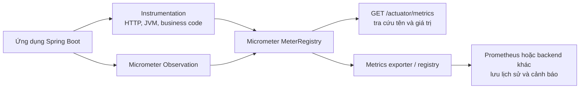

# Endpoint /actuator/metrics

> **Chương:** Actuator metrics endpoint  
> **Module:** `SPRING_BOOT_OBSERVABILITY` — thiết lập observability cho Spring Boot bằng Micrometer Observation, metrics, logs và distributed tracing; hiểu context propagation, tags/cardinality, exporter, sampling và cách liên kết tín hiệu để điều tra lỗi, độ trễ, hành vi ứng dụng.

## Mục tiêu bài học

Sau bài học, bạn có thể:

- Giải thích `/actuator/metrics` là gì, dữ liệu lấy từ đâu và điểm khác biệt giữa **metric name** trong Micrometer và tên series của exporter.
- Cấu hình Spring Boot Actuator để truy cập endpoint theo chính sách bảo mật; sử dụng HTTP request để **liệt kê**, **xem chi tiết** và **lọc theo tags**.
- Đọc các trường JSON `name`, `description`, `baseUnit`, `measurements` và `availableTags`; diễn giải `COUNT`, `TOTAL_TIME`, `MAX` và `VALUE` đúng ngữ nghĩa.
- Tạo counter và timer trong Spring Boot, rồi kiểm tra dữ liệu qua endpoint mà không nhúng ID động vào tên hoặc labels.
- Phân biệt `/actuator/metrics` với `/actuator/prometheus`; biết giới hạn khi cần time series lịch sử, histogram, cảnh báo và truy vết request.
- Chẩn đoán lỗi không thấy meter, endpoint trả 404/403, tags không khớp hoặc metrics có cardinality quá cao.

## 1. `/actuator/metrics` là gì?

Trong ứng dụng Spring Boot, **Spring Boot Actuator** cung cấp các endpoint vận hành. Khi phần metrics được cấu hình, endpoint `/actuator/metrics` cho phép **tra cứu các meter đang được đăng ký trong hệ thống Micrometer**.

Ví dụ, đội vận hành muốn biết:

- Ứng dụng có ghi HTTP request metrics hay không?
- Timer `http.server.requests` có số lượt, tổng thời gian và những tags nào?
- Có thể lọc số đo theo `method=POST` hoặc `status=500` không?
- Một counter do nhóm phát triển thêm vào có thực sự được ghi nhận không?

`/actuator/metrics` là một **API chẩn đoán và khám phá meter**, không phải một cơ sở dữ liệu time series lịch sử. Nó trả về **ảnh chụp số đo tổng hợp hiện tại** và metadata từ meter registry, thay vì một chuỗi dữ liệu theo từng thời điểm.

Cần phân biệt ba tầng:



Sơ đồ diễn giải luồng khái niệm: `ObservationRegistry` có thể có handler ghi metrics vào `MeterRegistry`, chứ không phải mọi observation đều tự tạo meter. Instrumentation cũng có thể dùng trực tiếp `MeterRegistry`.

**Điểm mấu chốt:** nhìn thấy meter qua `/actuator/metrics` chứng tỏ dữ liệu đo có mặt trong registry mà endpoint đọc được; điều đó **chưa bảo đảm** metrics exporter hoặc backend bên ngoài đã nhận được dữ liệu.

## 2. Điều kiện để endpoint hoạt động

### 2.1. Dependency

Một ứng dụng Spring Boot thông thường cần Actuator. Ví dụ với Gradle khi đã có Spring Boot dependency management:

```groovy
dependencies {
    implementation 'org.springframework.boot:spring-boot-starter-web'
    implementation 'org.springframework.boot:spring-boot-starter-actuator'
}
```

`spring-boot-starter-web` chỉ đại diện cho ứng dụng HTTP dùng Spring MVC trong ví dụ. Nếu ứng dụng sử dụng WebFlux thì chọn web stack phù hợp, không thêm MVC starter chỉ để bật metrics.

Actuator cùng các tích hợp Micrometer tương thích thường cung cấp `MeterRegistry` và những metrics mặc định như JVM/process/system/HTTP khi các binder hoặc instrumentation tương ứng có hiệu lực.

**Không phải mọi meter đều xuất hiện ngay lúc khởi động.** Một meter do code nghiệp vụ đăng ký khi request chạy lần đầu có thể chưa có trước khi endpoint được gọi. Tên và số lượng meter cũng thay đổi tùy Spring Boot, Micrometer, runtime và dependency.

### 2.2. Expose endpoint qua HTTP

Một cấu hình `application.yml` điển hình:

```yaml
management:
  endpoints:
    web:
      exposure:
        include: health,info,metrics
```

Trong nhiều cấu hình Spring Boot, base path của Actuator là `/actuator`, nên endpoint HTTP tương ứng là:

```http
GET /actuator/metrics
```

**Exposure không đồng nghĩa authorization.** Cấu hình `include` quy định endpoint nào được đưa ra qua HTTP; quyền truy cập còn phụ thuộc cấu hình Spring Security, thiết lập endpoint access và lớp mạng. Khi người dùng không có quyền, endpoint có thể trả 401 hoặc 403.

Cấu hình minh họa trên không mặc nhiên làm endpoint an toàn trước Internet. Trong production, chỉ expose những endpoint cần thiết, giới hạn mạng truy cập, sử dụng xác thực/phân quyền thích hợp và tránh lộ dữ liệu vận hành giữa các tenant.

### 2.3. Khi URL không phải `/actuator/metrics`

Đường dẫn có thể thay đổi nếu ứng dụng tùy biến base path hoặc dùng management server riêng:

```yaml
management:
  endpoints:
    web:
      base-path: /manage
  server:
    port: 9001
```

Ở cấu hình minh họa này, với một ứng dụng chạy trên máy local và không có context-path phụ khác, URL thường là:

```text
http://localhost:9001/manage/metrics
```

Nếu còn cấu hình management context path, reverse proxy, routing hoặc web application context path, đường dẫn thực tế phải được xác minh trong môi trường đó. Không kết luận endpoint bị lỗi chỉ vì URL mặc định trả 404.

## 3. Liệt kê các metric names

Gọi:

```bash
curl -i http://localhost:8080/actuator/metrics
```

Với endpoint có quyền truy cập và các meter tương ứng đã được đăng ký, nội dung JSON có thể giống:

```json
{
  "names": [
    "application.ready.time",
    "http.server.requests",
    "jvm.memory.used",
    "jvm.threads.live",
    "process.cpu.usage",
    "system.cpu.usage"
  ]
}
```

Đây là **ví dụ minh họa**, không phải danh sách mặc định bắt buộc. Mỗi ứng dụng và phiên bản có thể có các tên khác, thêm một số meter hoặc không có `http.server.requests` trước khi phục vụ request.

Ý nghĩa:

- `names` là danh sách **tên logic của meters** mà Micrometer/Actuator biết đến.
- Mỗi tên có thể đại diện cho **nhiều meter IDs** với các tổ hợp tags khác nhau.
- `names` chưa có giá trị đo, mô tả, đơn vị hoặc chi tiết các tag values.
- Một tên có thể được đăng ký khi có traffic hoặc khi thành phần tạo meter lần đầu.

Bạn có thể dùng danh sách này để kiểm tra nhanh việc instrumentation có hoạt động không. Nếu muốn xem HTTP timer, lấy tên chính xác từ danh sách rồi gọi endpoint chi tiết.

## 4. Xem chi tiết một metric

Mẫu URL:

```http
GET /actuator/metrics/{metricName}
```

Ví dụ:

```bash
curl -s http://localhost:8080/actuator/metrics/http.server.requests
```

Giả sử ứng dụng đã phục vụ nhiều HTTP requests, JSON trả về có thể như sau:

```json
{
  "name": "http.server.requests",
  "description": null,
  "baseUnit": "seconds",
  "measurements": [
    { "statistic": "COUNT", "value": 240.0 },
    { "statistic": "TOTAL_TIME", "value": 62.5 },
    { "statistic": "MAX", "value": 1.34 }
  ],
  "availableTags": [
    { "tag": "method", "values": ["GET", "POST"] },
    { "tag": "status", "values": ["200", "500"] },
    { "tag": "uri", "values": ["/orders", "/orders/{id}"] }
  ]
}
```

**Toàn bộ tên tags và số liệu trên là giả định để đọc cấu trúc JSON.** Trong môi trường thật, response phụ thuộc những meter được ghi nhận, tags thực tế, phiên bản Spring Boot và cách các handlers/conventions tạo số đo.

| Trường JSON | Ý nghĩa | Cách dùng |
| --- | --- | --- |
| `name` | Tên logic được yêu cầu | Đối chiếu với tên meter trong code hoặc danh sách `names` |
| `description` | Mô tả meter nếu có | Hiểu metric đo gì; có thể `null` |
| `baseUnit` | Đơn vị cơ sở nếu có | Đọc `TOTAL_TIME` đúng đơn vị; có thể `null` |
| `measurements` | Danh sách thống kê và giá trị tương ứng | Đọc count, sum, max hoặc giá trị hiện tại tùy loại meter |
| `availableTags` | Các tag keys và giá trị hiện diện trong các meters phù hợp | Tìm các chiều có thể lọc và phát hiện nhãn bất thường |

Trong ví dụ, `COUNT=240` là 240 lần được timer ghi nhận, còn `TOTAL_TIME=62.5` là tổng 62,5 giây của những lần đo đó. **Thời gian trung bình minh họa** là:

\[
\frac{62.5}{240} \approx 0.2604\ \text{giây/lần}
\]

`MAX=1.34` biểu thị giá trị lớn nhất mà timer đang báo theo cửa sổ/thống kê tương ứng. Với các timer dùng time-window maxima, `MAX` không nhất thiết là giá trị lớn nhất kể từ lúc process khởi động; nó có thể hết hạn hoặc thay đổi theo chu kỳ. Không dùng một giá trị `MAX` đơn lẻ để suy ra p95/p99.

### 4.1. Endpoint chi tiết có thể tổng hợp nhiều meter IDs

Ví dụ cùng tên `http.server.requests` có hai tổ hợp:

```text
{method=GET,  status=200, uri=/orders}
{method=POST, status=500, uri=/orders}
```

Khi gọi `GET /actuator/metrics/http.server.requests` không có tag filters, endpoint thường **tổng hợp measurements** của các meter IDs cùng tên phù hợp với truy vấn. Vì vậy `COUNT` trả về là tổng số lần của những nhóm đang được gộp, không phải số lượt của riêng `GET /orders`.

`availableTags` giúp biết những giá trị hiện có để thu hẹp truy vấn. Các mục trong mảng này không mô tả đầy đủ mọi **tổ hợp** tags đã xảy ra; không thể suy ra chắc chắn rằng bất kỳ cách ghép giá trị nào cũng tồn tại.

## 5. Lọc theo tags trong `/actuator/metrics/{name}`

Truy vấn chi tiết hỗ trợ tham số `tag` có dạng:

```text
tag=<key>:<value>
```

Ví dụ chỉ xem requests GET:

```http
GET /actuator/metrics/http.server.requests?tag=method:GET
```

Kết hợp nhiều điều kiện, lặp lại tham số `tag`:

```http
GET /actuator/metrics/http.server.requests?tag=method:GET&tag=status:200
```

Nếu cần lọc giá trị phức tạp như route template có dấu `/`, `{` hoặc `}`, hãy để HTTP client **URL-encode** tham số. Ví dụ:

```bash
curl -G "http://localhost:8080/actuator/metrics/http.server.requests" \
  --data-urlencode "tag=method:GET" \
  --data-urlencode "tag=uri:/orders/{id}"
```

Đây là cú pháp dành cho shell hỗ trợ backslash xuống dòng; trên PowerShell/Windows, có thể nhập lệnh trên **một dòng** hoặc dùng cách xuống dòng phù hợp với shell hiện tại.

**Những điều nên kiểm tra:**

1. `tag` phải khớp **tên key thực tế**. Không tự suy ra `route` thay cho `uri` hoặc `http.method` thay cho `method` nếu endpoint đang phát key khác.
2. Giá trị phải khớp convention/normalization của meter. Route có thể được lưu dạng `/orders/{id}`, không phải raw URL `/orders/42`.
3. Khi dùng nhiều điều kiện, chỉ những meter IDs thỏa mãn các điều kiện có thể đóng góp số đo vào kết quả.
4. Khi không có meter phù hợp, response có thể không có dữ liệu mong muốn hoặc trả lỗi tùy cách API/phiên bản xử lý. Hãy quay lại `availableTags` và kiểm tra dữ liệu đã được ghi nhận.
5. Endpoint không hỗ trợ truy vấn lịch sử theo `from`/`to` hoặc cú pháp tổng hợp giống PromQL; tag filter chỉ giúp chọn dữ liệu **hiện tại** từ registry.

### 5.1. Chỉ lọc theo các chiều có ý nghĩa

Chẳng hạn `http.server.requests` có các tags `method`, `status`, `uri` và `outcome`. Bạn có thể xem số lượt `POST /checkout` trả HTTP 5xx bằng tag filter phù hợp.

Không bổ sung `traceId`, `requestId`, `orderId` hay `tenantId` vào metric tags chỉ để có thể lọc tại endpoint. Những giá trị riêng từng request tạo cardinality cao, làm tăng số meter IDs và time series; truy tìm một request cụ thể nên dựa vào logs/traces theo cơ chế tương quan phù hợp.

## 6. Diễn giải `measurements` theo loại meter

`/actuator/metrics` không có một cấu trúc value duy nhất cho mọi phép đo. Trường `measurements` chứa nhiều loại `statistic` tùy meter type.

| Meter type | Statistic thường gặp | Cách hiểu |
| --- | --- | --- |
| **Counter** | `COUNT` | Giá trị đếm tích lũy trong vòng đời meter; không phải requests/giây. |
| **Timer** | `COUNT`, `TOTAL_TIME`, `MAX` | Số lần đo, tổng duration và giá trị max theo semantics của timer. |
| **Gauge** | `VALUE` | Giá trị tại thời điểm đo, có thể tăng/giảm; có thể không khả dụng khi đối tượng quan sát mất tham chiếu. |
| **DistributionSummary** | `COUNT`, `TOTAL`, `MAX` | Số mẫu, tổng giá trị và max của những phép đo không nhất thiết là thời gian. |
| **LongTaskTimer** | Các số đo về tác vụ đang hoạt động và thời lượng, tùy registry | Thích hợp theo dõi những công việc đang chạy lâu, không phải một HTTP request count thông thường. |

Một số implementation hoặc phiên bản có thể trả các statistic khác. Đừng viết parser cứng chỉ dựa vào vị trí của phần tử đầu tiên trong `measurements`; nên đọc bằng tên `statistic`.

### 6.1. Phân biệt `COUNT` và rate

Nếu counter đang trả `COUNT=10_000`, con số đó chỉ cho biết số đếm ở thời điểm truy vấn. Muốn tính **tốc độ mỗi giây**, cần hai hoặc nhiều mẫu theo thời gian hoặc dùng một backend time series tính `rate`/`increase`.

Ví dụ hai lần đọc cùng một counter:

```text
12:00:00  COUNT = 10,000
12:01:00  COUNT = 10,120
```

Khi **không có process restart/reset** và cùng phạm vi tags, tốc độ trung bình gần đúng trong một phút là:

\[
\frac{10{,}120-10{,}000}{60}=2\ \text{sự kiện/giây}
\]

Nhưng đây chỉ là tính tay từ hai ảnh chụp. Trong production, một backend như Prometheus thường phù hợp hơn vì quản lý nhiều mẫu, tính đến counter resets và hỗ trợ rate/increase theo cửa sổ.

### 6.2. Phân biệt mean và p95

Một timer có `COUNT` và `TOTAL_TIME` cho phép tính **mean duration**. Nó **không đủ để suy ra p95**. Muốn xem phân vị, cần dữ liệu phân phối (histogram buckets, hoặc cơ chế phân vị phù hợp trong registry/backend). Đừng gọi `MAX` là p95 hoặc trung bình.

Nếu muốn tìm “5% request chậm nhất mất bao lâu”, dùng histogram hoặc phân phối phù hợp trên một backend có khả năng truy vấn theo thời gian; `/actuator/metrics` không thay thế chức năng đó.

### 6.3. Ý nghĩa của `Gauge.VALUE`

Một gauge có thể phản ánh số luồng đang sống hoặc độ sâu queue **ngay tại lúc đọc**. Nếu giá trị giảm sau một lần request, không có nghĩa có sự kiện “âm” cần cộng vào counter. Đối với một số gauge theo dõi đối tượng qua tham chiếu yếu, nếu đối tượng không còn được giữ đúng cách, giá trị có thể không còn như mong đợi.

Vì thế cần xác định meter type trước khi diễn giải giá trị đo từ endpoint.

## 7. Ví dụ Spring Boot: tạo metric để tra cứu

Đoạn code sau cho phép bạn thấy một **Counter** và **Timer** trên `/actuator/metrics` sau khi có hoạt động nghiệp vụ. Nó dành cho một thao tác **đồng bộ**, dùng tập giá trị tags hữu hạn.

```java
package example.observability;

import java.util.function.Supplier;

import io.micrometer.core.instrument.MeterRegistry;
import io.micrometer.core.instrument.Timer;
import org.springframework.stereotype.Service;

@Service
public class CheckoutMeterService {
    private final MeterRegistry registry;

    public CheckoutMeterService(MeterRegistry registry) {
        this.registry = registry;
    }

    public <T> T measure(String clientChannel, Supplier<T> action) {
        String channel = normalizeChannel(clientChannel);

        Timer timer = Timer.builder("checkout.processing")
                .description("Duration of synchronous checkout processing")
                .tag("channel", channel)
                .register(registry);

        try {
            T result = timer.record(action);

            registry.counter(
                    "checkout.attempts",
                    "channel", channel,
                    "result", "success"
            ).increment();

            return result;
        } catch (RuntimeException | Error failure) {
            registry.counter(
                    "checkout.attempts",
                    "channel", channel,
                    "result", "error"
            ).increment();
            throw failure;
        }
    }

    private static String normalizeChannel(String value) {
        return "web".equals(value) || "mobile".equals(value)
                ? value
                : "other";
    }
}
```

Giải thích:

- `checkout.processing` là **tên timer logic**, đo duration đồng bộ của `action`, gồm cả ca ném exception trong cách hoạt động của `Timer.record(...)`.
- `checkout.attempts` là counter **đếm số lần nghiệp vụ kết thúc và được phân loại** thành `success` hoặc `error` trong ví dụ; ý nghĩa này cần được giữ nhất quán.
- `channel` chỉ có ba giá trị `web`, `mobile` và `other`, không phát sinh thêm nhãn theo đầu vào tùy ý.
- `result` có hai giá trị cố định cho counter, phục vụ phân tích thành công/thất bại.
- Nếu `action` trả về `CompletableFuture` chưa hoàn thành, timer chỉ đo thời gian tạo/trả future, **không** tự đo đến khi xử lý async hoàn tất.
- `MeterRegistry` là bean do hệ thống metrics của Spring Boot cung cấp khi cấu hình phù hợp. Đoạn code không yêu cầu bạn tự tạo registry thứ hai.

Phần code này không tự đảm bảo kết quả nghiệp vụ đã **commit database transaction**. Nếu cần đếm những lần thanh toán hoặc đơn hàng hoàn tất sau commit, phải chọn điểm ghi counter theo định nghĩa kinh doanh.

### 7.1. Gọi nghiệp vụ thử nghiệm

Ví dụ sử dụng trong một controller hoặc test driver của ứng dụng:

```java
String response = checkoutMeterService.measure("web", () -> "ok");

try {
    checkoutMeterService.measure("mobile", () -> {
        throw new IllegalStateException("Payment service unavailable");
    });
} catch (IllegalStateException expected) {
    // Kịch bản lỗi thử nghiệm, không phải cách xử lý HTTP bắt buộc.
}
```

Sau khi các câu lệnh chạy và meter được ghi nhận, thử truy vấn:

```http
GET /actuator/metrics/checkout.processing
GET /actuator/metrics/checkout.attempts
GET /actuator/metrics/checkout.attempts?tag=result:error
GET /actuator/metrics/checkout.processing?tag=channel:web
```

Với `checkout.processing`, dự kiến có `COUNT`, `TOTAL_TIME` và có thể `MAX` theo cách timer được biểu diễn. Với `checkout.attempts`, dự kiến counter có `COUNT` và `availableTags` cho `channel`/`result`, nếu các meters đó đã được đăng ký và không bị filter/điều kiện hệ thống loại bỏ.

Không nên đòi endpoint trả số liệu giống hệt từng request nếu nhiều instance chạy song song. `/actuator/metrics` phản ánh **MeterRegistry của process đang được truy vấn**, không tự tổng hợp tất cả replicas của dịch vụ.

## 8. Từ Micrometer Observation đến `/actuator/metrics`

Một ứng dụng observability có thể sử dụng `Micrometer Observation` thay vì đăng ký riêng từng timer. Ví dụ:

```java
import java.util.function.Supplier;

import io.micrometer.observation.Observation;
import io.micrometer.observation.ObservationRegistry;

public class ObservedCheckout {
    private final ObservationRegistry registry;

    public ObservedCheckout(ObservationRegistry registry) {
        this.registry = registry;
    }

    public <T> T submit(Supplier<T> action) {
        return Observation.createNotStarted("checkout.submit", registry)
                .lowCardinalityKeyValue("operation", "submit")
                .observe(action);
    }
}
```

Nếu `ObservationRegistry` có **metrics ObservationHandler** thích hợp, observation có thể đóng góp một timer với tên logic liên quan tới `checkout.submit`. Nếu không có handler hoặc meter bị filter, bạn sẽ không thấy metric chỉ vì đã tạo observation.

Phân biệt:

- `ObservationRegistry` điều phối vòng đời observation và handlers.
- `MeterRegistry` lưu/đăng ký meters và được Actuator metrics endpoint truy vấn.
- `ObservationHandler` có thể chuyển một observation thành measurement như timer, khi handler đó được cấu hình.
- **Tracing handler** có thể tạo span tương ứng; nhưng việc endpoint metrics nhìn thấy observation không chứng minh tracing đã bật hay trace đã được export.

Trong code thực tế, tránh vô tình đo cùng một hoạt động bằng **hai timer trùng ý nghĩa**: một lần đăng ký thủ công ở `MeterRegistry` và một lần thông qua ObservationHandler mà không có chủ đích. Điều đó có thể làm dashboards đếm trùng hoặc gây hiểu nhầm.

## 9. `/actuator/metrics` khác `/actuator/prometheus` như thế nào?

Hai endpoint liên quan nhưng **không thay thế nhau**.

| Thuộc tính | `/actuator/metrics` | `/actuator/prometheus` |
| --- | --- | --- |
| Mục đích | Khám phá và xem trạng thái các meter đang được đăng ký | Xuất metric exposition phù hợp để Prometheus scrape |
| Dạng dữ liệu | JSON của Actuator: `names`, `measurements`, `availableTags` | Văn bản exposition format của Prometheus/OpenMetrics, tùy cấu hình và negotiation |
| Tên metric | Tên logic như `http.server.requests` | Tên series đã đổi quy ước/đơn vị, ví dụ `http_server_requests_seconds_count` |
| Lọc | `?tag=key:value` trên endpoint chi tiết | Thông thường thu thập series theo format xuất; lọc/phân tích tại backend bằng PromQL |
| Lịch sử nhiều thời điểm | Không | Endpoint scrape cũng chỉ là ảnh chụp; **Prometheus backend** lưu lịch sử |
| Histogram/phân vị | Trả các statistic mà Actuator trình bày, không phải API truy vấn histogram lịch sử | Có thể xuất buckets/series phân phối nếu registry và distribution được cấu hình |
| Dependency | Actuator và Micrometer metrics infrastructure | Cần thêm Prometheus registry/endpoint phù hợp |
| Dùng cho | Debug meter existence, metadata, tags, current values | Thu thập time series cho dashboards, SLOs và alerts |

Ví dụ muốn bật Prometheus registry (với Spring Boot dependency management):

```groovy
dependencies {
    implementation 'org.springframework.boot:spring-boot-starter-actuator'
    runtimeOnly 'io.micrometer:micrometer-registry-prometheus'
}
```

Và expose endpoint tương ứng theo chính sách môi trường:

```yaml
management:
  endpoints:
    web:
      exposure:
        include: health,info,metrics,prometheus
```

**Chỉ thêm `prometheus` vào danh sách exposure không tạo Prometheus endpoint nếu registry dependency chưa có.** Hơn nữa, việc endpoint trả dữ liệu còn khác với việc một Prometheus server đã scrape và lưu time series thành công.

### 9.1. Ví dụ tên logic và tên physical series

Micrometer Timer:

```text
http.server.requests
```

Trong một Prometheus exporter phù hợp, có thể thấy:

```text
http_server_requests_seconds_count
http_server_requests_seconds_sum
http_server_requests_seconds_bucket
```

`_bucket` chỉ tồn tại khi có dữ liệu histogram phù hợp và export hỗ trợ; không phải timer nào cũng có bucket series. Đừng dùng chuỗi `http_server_requests_seconds_count` làm path cho `/actuator/metrics/{name}` nếu tên logic thực sự ở registry là `http.server.requests`.

Khi cần rate, latency lịch sử hoặc p95, backend time series với PromQL phù hợp hơn:

```promql
sum(rate(http_server_requests_seconds_count[5m]))
```

Và khi có classic histogram buckets:

```promql
histogram_quantile(
  0.95,
  sum by (le) (rate(http_server_requests_seconds_bucket[5m]))
)
```

Đây là truy vấn minh họa; cần kiểm tra series name, label keys, histogram format và dữ liệu thật trước khi dùng cho alerts trong production.

## 10. Bảo mật: endpoint vận hành không phải API công khai

`/actuator/metrics` có thể làm lộ tên dependencies, cấu trúc route, tên client pools, phiên bản runtime gián tiếp hoặc sự tồn tại của các nhóm khách hàng qua labels.

Để vận hành an toàn:

1. **Chỉ expose endpoint cần thiết.** Đừng dùng `include: "*"` mặc định cho production nếu không có đánh giá bảo mật đầy đủ.
2. **Phân quyền.** Áp dụng Spring Security/management authorization và giới hạn mạng phù hợp; người truy cập không có quyền không nên xem cấu trúc nội bộ.
3. **Tách management network/port** khi kiến trúc cho phép; tránh nhầm “khác port” với “tự động an toàn”.
4. **Kiểm soát tags.** Không đưa email, token, raw URL query string, order ID, user ID, tenant ID hoặc trace ID vào metric labels/names vì rủi ro cardinality và lộ dữ liệu.
5. **Đối chiếu cấu hình bảo mật tùy phiên bản.** Trong Spring Boot, endpoint exposure, endpoint access và Spring Security authorization có thể là các lớp cấu hình khác nhau.
6. **Không dùng metric labels để ra quyết định phân quyền.** Metric phục vụ quan sát, không phải nguồn chứng thực tenant hay principal.

Một `HTTP 403` khi gọi `/actuator/metrics` không phải lỗi Micrometer; trước tiên cần kiểm tra quyền truy cập và chính sách bảo vệ endpoint.

## 11. Quy trình điều tra HTTP 5xx và latency tăng

**Tình huống:** người dùng báo `POST /orders` chậm và thỉnh thoảng nhận `500`.

Một quy trình thực tế sử dụng `/actuator/metrics`:

### Bước 1 — Xác minh endpoint và meter

Truy cập `GET /actuator/metrics`, xác định `http.server.requests` có trong `names` không. Nếu không, kiểm tra ứng dụng đã có traffic và instrumentation phù hợp chưa; sau đó kiểm tra cấu hình actuator/metrics.

### Bước 2 — Kiểm tra phép đo tổng hợp

Gọi `GET /actuator/metrics/http.server.requests`. Xem `measurements`, `baseUnit` và các `availableTags`; hiểu rằng các số đo có thể đang gộp mọi routes/status.

### Bước 3 — Thu hẹp phạm vi theo tags

Dựa trên giá trị `availableTags` thực tế, lọc `method=POST`, `uri=/orders` và `status=500` nếu key/value tồn tại. Với dữ liệu ít, `COUNT` thấp không đủ chứng minh đã tìm ra vấn đề hệ thống.

### Bước 4 — Đối chiếu metrics lịch sử

Tại Prometheus/backend, xem HTTP error rate, request rate, latency p95 nếu có histogram và các dependency metrics. `/actuator/metrics` không lưu time series để so sánh “trước và sau deploy”.

### Bước 5 — Dùng traces để tìm điểm chậm

Từ khoảng thời gian và route bị ảnh hưởng, tìm các distributed traces được lấy mẫu trong tracing backend. Kiểm tra spans DB, HTTP client, thread pool hoặc thao tác nghiệp vụ. Nếu trace sampling bỏ qua request, việc không thấy trace **không chứng minh** request chưa xảy ra.

### Bước 6 — Dùng logs để kiểm chứng lỗi

Xem logs có timestamp, service, trace ID và span ID (khi logging correlation đã cấu hình). Tìm timeout, exception, retry và kết quả HTTP tương ứng. Endpoint `/actuator/metrics` **không trả trace ID của từng request**; hãy dùng tracing/logging context và, nếu backend hỗ trợ, metric exemplars để chuyển từ metrics sang traces.

### Bước 7 — Kiểm chứng sau khắc phục

Kiểm tra error rate và latency trở lại mức mong muốn, các meter vẫn giữ tên/tags ổn định và exporter/collector đang gửi dữ liệu. Nếu có nhiều replicas, phải xem dữ liệu trên toàn dịch vụ, không chỉ một instance mà Actuator endpoint tình cờ trỏ tới.

## 12. Những lỗi thường gặp khi sử dụng endpoint

| Hiện tượng | Nguyên nhân có thể | Cách kiểm tra |
| --- | --- | --- |
| `GET /actuator/metrics` trả 404 | Endpoint chưa expose, bị vô hiệu hóa, base path/management port khác hoặc reverse proxy route sai | Kiểm tra `management.endpoints.web.exposure`, endpoint access, base path và cổng thực |
| Trả 401 hoặc 403 | Có cơ chế authentication/authorization bảo vệ management endpoint | Kiểm tra Spring Security/management access; không vô hiệu hóa bảo mật để “thử nhanh” trên production |
| Danh sách `names` không có custom metric | Meter chưa được đăng ký hoặc code chưa chạy; registry khác với registry Actuator đọc | Gọi thao tác nghiệp vụ, kiểm tra `MeterRegistry` được inject và filters |
| Không thấy `http.server.requests` | Chưa có traffic, instrumentation chưa hoạt động hoặc meter bị filter/đổi tên | Kiểm tra Actuator, stack runtime, version và HTTP instrumentation |
| Filter `tag=method:POST` không trả số đo mong muốn | Sai tag key/value, chưa có request khớp hoặc route/status khác dự kiến | Xem `availableTags` rồi lọc bằng giá trị thực |
| `COUNT` không tăng như mong đợi | Đang xem instance khác, tag filters khác, counter reset do restart hoặc số đo không được ghi ở nhánh lỗi | Kiểm tra instance, vòng đời meter và điểm instrument |
| Timer có `MAX=0` dù trước đó từng chậm | MAX có thể là time-window statistic đã hết hạn | Kiểm tra thời điểm đọc và dữ liệu histogram/backend lịch sử |
| Cần p95 nhưng chỉ có `COUNT/TOTAL_TIME` | Endpoint không cung cấp phân phối đủ để tính p95 | Bật histogram phù hợp và truy vấn exporter/backend |
| Prometheus name khác Actuator metrics name | Naming convention, suffix loại metric và đơn vị được exporter áp dụng | So sánh `/actuator/metrics` với `/actuator/prometheus` |
| Backend không có dữ liệu dù Actuator có | Exporter/collector/scrape cấu hình sai hoặc lỗi mạng/quota | Kiểm tra exporter, scrape targets, pipelines và retention |
| Số lượng meters tăng mạnh | Metric name hoặc tags chứa ID động/URL raw | Chuẩn hóa tags, tránh high cardinality và dùng logs/traces cho ID cụ thể |
| Metrics có nhưng logs/traces không liên kết | Thiếu tracing bridge, mất context qua async hoặc logging MDC chưa cấu hình | Kiểm tra ObservationRegistry handlers, propagation, sampler và logging pipeline |

### 12.1. Không đánh đồng lỗi truy cập endpoint với lỗi ghi metric

HTTP 404 từ `/actuator/metrics` có thể do đường dẫn hoặc exposure; còn HTTP 404 từ `/actuator/metrics/my.metric` có thể do **tên meter chưa tồn tại**. Hai tình huống có cách xử lý khác nhau.

Tương tự, HTTP 403 nói về **quyền truy cập**, không cho biết `MeterRegistry` có dữ liệu hay không. Trước khi sửa code instrumentation, kiểm tra HTTP status và nội dung phản hồi.

## 13. Bài thực hành: khám phá meter và phân tích tags

Trong một ứng dụng Spring Boot thử nghiệm, làm lần lượt:

1. Thêm Actuator và expose `metrics` qua HTTP **chỉ trên môi trường được bảo vệ**. Gọi `GET /actuator/metrics`, xác nhận nhận được JSON `names`.
2. Tạo ít nhất một HTTP request vào ứng dụng; mở `/actuator/metrics/http.server.requests` nếu meter này tồn tại. Ghi lại `name`, `baseUnit`, `measurements` và `availableTags` thực tế.
3. Lọc theo `method=GET` và một tag key khác có trong response. Ghi nhận `COUNT` khác nhau thế nào giữa truy vấn tổng và truy vấn đã lọc.
4. Chạy ví dụ `CheckoutMeterService` cho hai channel `web` và `mobile`; gọi `GET /actuator/metrics/checkout.processing` và `GET /actuator/metrics/checkout.attempts`. Kiểm tra count, total time, tags.
5. Gửi một input channel bất kỳ như `partner-987`; xác minh mã chuẩn hóa nó thành `other` thay vì tạo tag mới có cardinality cao.
6. Tạo một ca exception trong `action`; xem counter `checkout.attempts` có `result=error` và timer có ghi thời gian thất bại không.
7. Nếu đã cài Prometheus registry, so sánh tên meter logic với tên series tại `/actuator/prometheus`. Thử một truy vấn `rate` tại backend, không nhầm count tích lũy thành requests/giây.
8. Kiểm tra phản hồi khi gọi sai tên metric, sai tag value và khi chưa có quyền truy cập. Phân biệt lỗi 404, 401, 403 với meter có giá trị bằng 0.
9. Nếu đã có Micrometer Tracing, ghi log trong nghiệp vụ với trace ID, mở một trace đã được thu thập và giải thích vì sao `/actuator/metrics` không thể liệt kê các trace IDs.
10. Tự viết ghi chú ngắn cho từng metric: **định nghĩa, type, unit, tags được phép, nơi phát sinh và câu hỏi vận hành được giải đáp**.

**Tiêu chí đạt:** Bạn có thể dùng endpoint để chứng minh một meter tồn tại, đọc đúng statistics, lọc tags theo tên/giá trị thực, chỉ ra giới hạn về time series lịch sử và liên kết được tình huống metric bất thường với logs/traces qua pipeline tương ứng.

## 14. Tự kiểm tra

**Câu 1.** `GET /actuator/metrics` trả về toàn bộ dữ liệu lịch sử của hệ thống không?  
**Gợi ý:** Không. Nó liệt kê tên meters trong registry mà endpoint đang đọc; thông tin chi tiết là các số đo tổng hợp ở thời điểm tra cứu, không phải time series history.

**Câu 2.** Vì sao `GET /actuator/metrics/http.server.requests` có thể có `COUNT` lớn hơn khi lọc `tag=method:GET`?  
**Gợi ý:** Truy vấn không lọc tổng hợp nhiều tổ hợp tags; sau khi lọc chỉ còn các meter IDs khớp điều kiện.

**Câu 3.** `availableTags` có đảm bảo mọi tổ hợp giá trị tag đều đã xuất hiện không?  
**Gợi ý:** Không. Mỗi key hiển thị các giá trị hiện diện; không nhất thiết mọi cách ghép giữa các key đều có meter.

**Câu 4.** Có thể tính p95 chỉ từ `COUNT` và `TOTAL_TIME` không?  
**Gợi ý:** Không. Có thể tính mean, không thể suy ra phân vị p95 nếu thiếu dữ liệu phân phối phù hợp.

**Câu 5.** Counter trả `COUNT=1200` có phải là 1200 request/giây không?  
**Gợi ý:** Không. Nó là giá trị đếm tích lũy trong ngữ nghĩa của counter; rate cần các mẫu theo thời gian.

**Câu 6.** `/actuator/prometheus` và `/actuator/metrics` khác nhau chủ yếu ở đâu?  
**Gợi ý:** Một endpoint cung cấp JSON tra cứu meter names/measurements/tags; endpoint còn lại xuất dữ liệu ở format phục vụ Prometheus scrape, dùng tên đã áp dụng naming convention.

**Câu 7.** Nếu `/actuator/metrics` trả 403, có nên sửa code tạo counter ngay không?  
**Gợi ý:** Không. Trước hết kiểm tra quyền truy cập và exposure/management security.

**Câu 8.** Tại sao không thêm `traceId` vào metric tag để tìm một request trên `/actuator/metrics`?  
**Gợi ý:** Trace ID có cardinality rất cao; dùng logs/traces và exemplars nếu backend hỗ trợ, thay vì tạo hàng loạt meter IDs.

**Câu 9.** Tại sao một meter chưa xuất hiện ngay sau khi ứng dụng khởi động?  
**Gợi ý:** Có thể được đăng ký khi code instrument được gọi hoặc traffic đầu tiên đến, hay cần binder/instrumentation tương ứng.

**Câu 10.** Nếu một ứng dụng chạy nhiều replicas, endpoint `/actuator/metrics` trên một replica có đại diện cho toàn dịch vụ không?  
**Gợi ý:** Không. Nó phản ánh registry của instance được truy vấn; muốn thống kê toàn dịch vụ cần exporter/backend thu thập tất cả replicas và tổng hợp đúng ngữ nghĩa.

**Điểm cần nhớ:** `/actuator/metrics` là **cửa sổ khám phá và chẩn đoán Micrometer meters trong Spring Boot**: liệt kê tên, xem measurements, kiểm tra tags và lọc theo key/value. Muốn phân tích lịch sử, rates, p95/SLO hoặc cảnh báo, cần metrics exporter và time-series backend phù hợp. Khi điều tra sự cố, đọc đúng type/đơn vị, giới hạn cardinality, bảo vệ endpoint và kết hợp metrics với logs, distributed traces, context propagation, sampling để tìm nguyên nhân có căn cứ.
