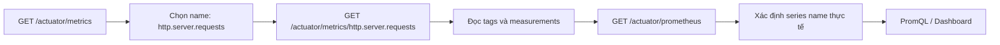
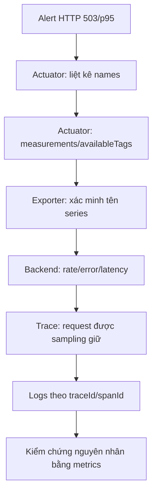
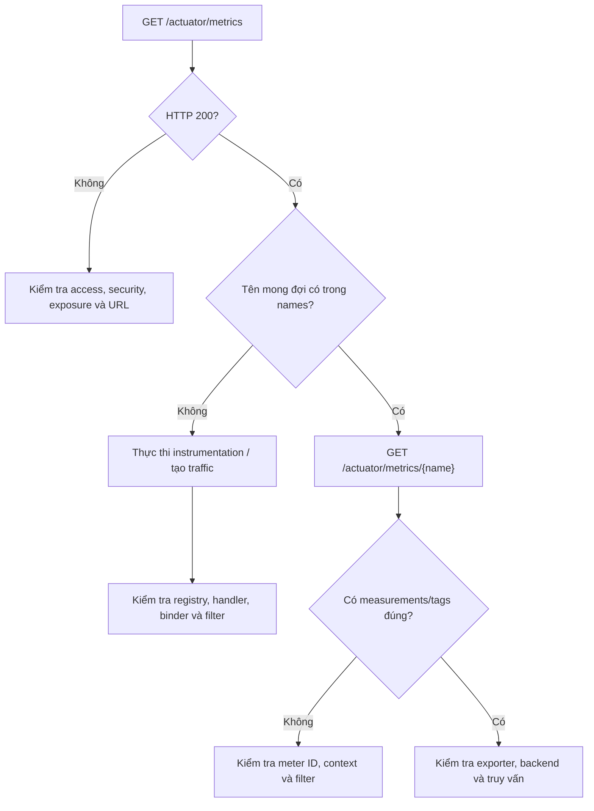

# Liệt kê metric names bằng Spring Boot Actuator

Khi ứng dụng Spring Boot đã chạy nhưng dashboard không có dữ liệu về request, bộ nhớ JVM hay một thao tác nghiệp vụ, câu hỏi đầu tiên là **ứng dụng đã đăng ký những metric nào?** Endpoint `GET /actuator/metrics` của Spring Boot Actuator giúp liệt kê **metric names** đang được Micrometer quản lý. Từ danh sách này, người vận hành có thể kiểm tra một tên cụ thể, xem các phép đo và tags, rồi mới truy tìm dữ liệu ở exporter hoặc backend.

Bài **“Liệt kê metric names”** thuộc chương **Actuator metrics endpoint** trong module **SPRING_BOOT_OBSERVABILITY**. Mục tiêu của module là thiết lập observability cho Spring Boot với Micrometer Observation, metrics, logs và distributed tracing; bài này dùng chức năng liệt kê tên làm điểm bắt đầu để xác minh instrumentation, tag/cardinality, exporter, sampling, propagation và mối liên hệ giữa các tín hiệu khi điều tra lỗi, độ trễ trong thực tế.

## 1. Metric name không phải là một sample hay một chuỗi thời gian

Micrometer quản lý những đối tượng **Meter** như `Counter`, `Timer`, `Gauge` và `DistributionSummary`. Mỗi meter có một `Meter.Id`, bao gồm tên, loại, tags và các metadata liên quan.

Ví dụ:

```text
Meter A:
  name   = http.server.requests
  type   = TIMER
  tags   = method=GET, uri=/orders/{id}, status=200

Meter B:
  name   = http.server.requests
  type   = TIMER
  tags   = method=GET, uri=/orders/{id}, status=404

Meter C:
  name   = jvm.memory.used
  type   = GAUGE
  tags   = area=heap, id=G1 Eden Space
```

Ở đây, A và B có **cùng một tên** nhưng **khác tổ hợp tags**. Danh sách metric names chỉ cần liệt kê `http.server.requests` **một lần**.

| Khái niệm | Ví dụ | Vai trò |
| --- | --- | --- |
| Meter name | `http.server.requests` | Xác định phép đo nào |
| Tag key | `method`, `uri`, `status` | Xác định chiều phân nhóm |
| Tag value | `GET`, `/orders/{id}`, `404` | Xác định nhóm cụ thể |
| Measurement | `COUNT=10` hoặc `TOTAL_TIME=0.8` | Giá trị đo |
| Time series | Giá trị theo thời gian cho tên và tập labels | Dùng để phân tích xu hướng ở backend |

**Tên meter không cho biết có bao nhiêu tổ hợp tag, bao nhiêu request đã xảy ra, hoặc một timer có histogram hay chưa.** Đây là những câu hỏi cần kiểm tra ở bước tiếp theo.

## 2. `GET /actuator/metrics` trả về gì?

Với Actuator được bật và được expose phù hợp:

```http
GET /actuator/metrics HTTP/1.1
Host: localhost:8080
Accept: application/json
```

Phản hồi minh họa:

```json
{
  "names": [
    "http.server.requests",
    "jvm.memory.used",
    "jvm.threads.live",
    "process.cpu.usage",
    "process.uptime"
  ]
}
```

JSON có một mảng `names` liệt kê các tên meter đang được metrics endpoint nhìn thấy tại thời điểm yêu cầu. **Đây là dữ liệu minh họa**; một ứng dụng khác có thể thiếu một số tên hoặc có thêm hàng trăm tên từ thư viện, binder, datasource và instrumentation tùy chỉnh.

Cần phân biệt:

| URL | Công dụng | Đầu ra |
| --- | --- | --- |
| `/actuator/metrics` | Liệt kê metric names | JSON `{"names":[...]}` |
| `/actuator/metrics/{name}` | Xem một meter name cụ thể | Measurements và available tags |
| `/actuator/prometheus` | Expose dữ liệu theo định dạng Prometheus, khi có registry tương ứng | Các series/samples dạng text |
| Metrics backend / dashboard | Truy vấn lịch sử metric đã được thu thập | Đồ thị, rate, phân vị, cảnh báo |

Endpoint `/actuator/metrics` **không phải endpoint scrape của Prometheus**, và không thể chạy PromQL trực tiếp trên nó.

## 3. Điều kiện để endpoint hoạt động

Ví dụ Gradle Groovy cho một ứng dụng Spring MVC:

```groovy
dependencies {
    implementation 'org.springframework.boot:spring-boot-starter-web'
    implementation 'org.springframework.boot:spring-boot-starter-actuator'
}
```

Actuator cung cấp chức năng khám phá/kiểm tra metrics khi Micrometer và MeterRegistry tương ứng được cấu hình. Để xuất dữ liệu cho Prometheus, thêm dependency phù hợp:

```groovy
runtimeOnly 'io.micrometer:micrometer-registry-prometheus'
```

Không bắt buộc có Prometheus registry **chỉ để xem JSON names của Actuator**, nếu ứng dụng đã có registry/metrics endpoint phù hợp. Các dependency cần dùng phiên bản tương thích với Spring Boot; ưu tiên BOM hoặc cơ chế dependency management của dự án.

### Expose `metrics` qua HTTP

Trong `application.yml` cho môi trường thử nghiệm:

```yaml
spring:
  application:
    name: order-service

management:
  endpoints:
    web:
      exposure:
        include: health,info,metrics
  metrics:
    tags:
      application: order-service
      environment: local
```

Cấu hình trên làm `metrics` được expose qua HTTP, nếu endpoint enabled/available và các điều kiện auto-configuration được đáp ứng.

Phân biệt ba trạng thái:

1. **Endpoint khả dụng:** dependency và cấu hình tạo được endpoint.
2. **Endpoint được expose:** HTTP/JMX cho phép truy cập endpoint đó.
3. **Caller được cấp quyền:** Spring Security, proxy và chính sách mạng cho phép truy cập.

`exposure.include` không tự bypass authorization. Trong production, không mở Actuator metrics công khai chỉ để dễ debug.

### Port và base path có thể khác

URL mặc định thường là `/actuator/metrics` trên cổng ứng dụng. Tuy nhiên:

- `server.port` có thể đổi cổng ứng dụng.
- `management.server.port` có thể đặt Actuator ở cổng quản trị riêng.
- `management.endpoints.web.base-path` có thể thay `/actuator`.
- Reverse proxy/ingress có thể rewrite path hoặc giới hạn truy cập.

Vì vậy, khi gặp 404, trước hết xác minh **đúng management context và URL thực tế**.

## 4. Liệt kê names bằng curl và PowerShell

Khi ứng dụng chạy local tại `localhost:8080`:

```bash
curl -i http://localhost:8080/actuator/metrics
```

Chỉ in JSON:

```bash
curl -sS http://localhost:8080/actuator/metrics
```

Nếu có `jq`, in mỗi tên một dòng:

```bash
curl -sS http://localhost:8080/actuator/metrics | jq -r '.names[]'
```

Trên Windows PowerShell, có thể dùng `Invoke-RestMethod`:

```powershell
$response = Invoke-RestMethod -Uri "http://localhost:8080/actuator/metrics"
$response.names | Sort-Object
```

Ví dụ đầu ra:

```text
http.server.requests
jvm.memory.used
jvm.threads.live
process.uptime
```

Thứ tự trong `names` không phải tín hiệu vận hành. Khi so sánh hai môi trường, nên sắp xếp và tính phần giao/khác nhau thay vì so thứ tự.

Nếu endpoint yêu cầu xác thực, hãy dùng credential và công cụ quản trị được phép. Tránh ghi thông tin xác thực vào lịch sử terminal, ví dụ command line chứa password hoặc token không được che giấu.

## 5. Từ name đến measurements và availableTags

Khi danh sách có `jvm.memory.used`, truy vấn:

```bash
curl -sS http://localhost:8080/actuator/metrics/jvm.memory.used
```

JSON minh họa:

```json
{
  "name": "jvm.memory.used",
  "description": "The amount of used memory",
  "baseUnit": "bytes",
  "measurements": [
    { "statistic": "VALUE", "value": 25165824.0 }
  ],
  "availableTags": [
    { "tag": "area", "values": ["heap", "nonheap"] },
    { "tag": "id", "values": ["G1 Eden Space", "G1 Old Gen"] }
  ]
}
```

Phản hồi thực tế tùy JVM, registry, binder và phiên bản. Ý nghĩa:

- `name`: tên meter trong Micrometer.
- `description` và `baseUnit`: metadata nếu meter cung cấp.
- `measurements`: các giá trị đã được tổng hợp tương ứng với phép đo.
- `availableTags`: các tag values có thể dùng để lọc các meter cùng tên.

**Đây không phải lịch sử từng sample kèm timestamp**. Để tính RPS qua một cửa sổ hoặc p95 trong 5 phút, cần backend lưu time series và exporter hỗ trợ.

### Lọc theo tag

Actuator metrics endpoint hỗ trợ tham số `tag=key:value`, ví dụ:

```bash
curl -sS 'http://localhost:8080/actuator/metrics/jvm.memory.used?tag=area:heap'
```

Hoặc lọc HTTP request metrics bằng nhiều tag:

```bash
curl -sS 'http://localhost:8080/actuator/metrics/http.server.requests?tag=method:GET&tag=status:404'
```

Nếu tag value có ký tự đặc biệt, hãy URL-encode. Ví dụ route template `/orders/{id}` có thể dùng chuỗi query mã hóa:

```text
/actuator/metrics/http.server.requests?tag=uri:%2Forders%2F%7Bid%7D
```

Nên truy vấn chi tiết **không có filter** trước để xem `availableTags`. Không phải mọi ứng dụng đều dùng cùng key hoặc value cho method, status, uri hay outcome.

### Cách diễn giải số đo Timer

Với HTTP server Timer, phản hồi có thể có:

- `COUNT`: tổng số lần đo được ghi vào tập meter đang chọn.
- `TOTAL_TIME`: tổng thời lượng.
- `MAX`: giá trị lớn nhất theo cách registry quản lý, có thể nằm trong time window.

Thêm `tag=status:404` thường làm phép tổng hợp chỉ bao gồm meter có `status=404`. Đừng suy `TOTAL_TIME/COUNT` là p95: đó là **trung bình** nếu count khác 0. Đừng xem `MAX` là max lịch sử vĩnh viễn hoặc một phân vị.

## 6. Tên metric chỉ xuất hiện khi đã được đăng ký

Một số meters, nhất là custom Counters/Timers, chỉ được đăng ký **khi luồng code tương ứng chạy**. Vì vậy sau khởi động, danh sách names có thể nhiều JVM/process metrics nhưng chưa có một custom business metric.

Đối với HTTP, sau request server hoàn tất, HTTP instrumentation có thể ghi Timer `http.server.requests`. Nếu chưa có request hoặc đang dùng registry/handler không phù hợp, tên đó có thể chưa xuất hiện.

Ví dụ controller Spring MVC:

```java
import org.springframework.http.ResponseEntity;
import org.springframework.web.bind.annotation.GetMapping;
import org.springframework.web.bind.annotation.PathVariable;
import org.springframework.web.bind.annotation.RequestMapping;
import org.springframework.web.bind.annotation.RestController;

@RestController
@RequestMapping("/orders")
public class OrderController {

    @GetMapping("/{id}")
    public ResponseEntity<String> find(@PathVariable long id) {
        if (id == 42L) {
            return ResponseEntity.ok("paid");
        }
        return ResponseEntity.notFound().build();
    }
}
```

Gửi hai request thử:

```bash
curl -i http://localhost:8080/orders/42
curl -i http://localhost:8080/orders/43
curl -sS http://localhost:8080/actuator/metrics
curl -sS http://localhost:8080/actuator/metrics/http.server.requests
```

Với instrumentation hợp lệ, ta kỳ vọng meter HTTP có hai nhóm status 200/404, thường chia sẻ route tag `uri=/orders/{id}`. Việc dùng **route template** rất quan trọng: nếu lấy raw path, mỗi order ID có thể tạo thêm series.

Không phải mọi meter đều chờ request mới xuất hiện. JVM/process binders có thể đăng ký từ startup. Kết luận đúng là: **names tại một thời điểm chỉ phản ánh các meters đã có tại thời điểm đó**.

### Ba tình huống cần phân biệt

| Hiện tượng | Ý nghĩa có thể |
| --- | --- |
| Name không tồn tại trong danh sách | Meter chưa được đăng ký, bị lọc/disable, hoặc nằm ở registry khác |
| Name tồn tại, COUNT = 0 | Meter đã được đăng ký nhưng chưa được ghi lần đo theo tổ hợp đó |
| Name có ở Actuator nhưng backend không thấy | Có thể mất dữ liệu ở exporter, scrape, relabel hoặc truy vấn backend |

Không kết luận lỗi instrumentation chỉ từ một phản hồi names rỗng hoặc thiếu tên, nhất là ngay sau startup.

## 7. Liệt kê một custom metric name

Một metric nghiệp vụ dùng để đếm retry có thể được đăng ký trong service:

```java
import io.micrometer.core.instrument.Counter;
import io.micrometer.core.instrument.MeterRegistry;
import org.springframework.stereotype.Service;

@Service
public class PaymentRetryMetrics {
    private final MeterRegistry meterRegistry;

    public PaymentRetryMetrics(MeterRegistry meterRegistry) {
        this.meterRegistry = meterRegistry;
    }

    public void recordRetry(String reason) {
        String safeReason;
        if ("timeout".equals(reason)) {
            safeReason = "timeout";
        } else if ("unavailable".equals(reason)) {
            safeReason = "unavailable";
        } else {
            safeReason = "other";
        }

        Counter.builder("payment.gateway.retries")
                .description("Payment gateway retry attempts")
                .tag("reason", safeReason)
                .register(meterRegistry)
                .increment();
    }
}
```

Khi `recordRetry("timeout")` thực thi trên MeterRegistry mà Actuator đang đọc, tên `payment.gateway.retries` có thể xuất hiện:

```bash
curl -sS http://localhost:8080/actuator/metrics/payment.gateway.retries
```

Tập giá trị `reason` được giới hạn thành ba nhóm. Đừng gắn retry ID hoặc user ID trực tiếp thành label vì có thể tạo rất nhiều series và làm lộ metadata.

### Liệt kê names qua Java khi cần đối chiếu registry

Nếu đang debug một registry cụ thể:

```java
import io.micrometer.core.instrument.Meter;
import io.micrometer.core.instrument.MeterRegistry;
import java.util.List;

public final class MetricNames {
    public static List<String> list(MeterRegistry registry) {
        return registry.getMeters().stream()
                .map(Meter::getId)
                .map(Meter.Id::getName)
                .distinct()
                .sorted()
                .toList();
    }
}
```

Đoạn mã dùng Java 16+ cho `Stream.toList()`. Nó liệt kê tên từ **registry được truyền vào**. Nếu ứng dụng có nhiều MeterRegistry hoặc một `CompositeMeterRegistry`, danh sách của một registry con có thể khác danh sách ở Actuator. Hãy xác minh code custom và Actuator cùng đi qua đường đăng ký meter đúng.

Đừng tạo endpoint public mới chỉ để in toàn bộ registry nếu Actuator đã cung cấp cơ chế truy cập được bảo vệ.

## 8. Tên Micrometer khác tên series của Prometheus

Một nhầm lẫn thường gặp: trong Actuator thấy `http.server.requests` nhưng ở Prometheus lại tìm `http_server_requests_seconds_count`.

| Nơi xem | Tên minh họa | Ý nghĩa |
| --- | --- | --- |
| Micrometer / Actuator | `http.server.requests` | Timer name |
| Prometheus | `http_server_requests_seconds_count` | Count của Timer trong giây |
| Prometheus | `http_server_requests_seconds_sum` | Tổng duration được chuẩn hóa |
| Prometheus khi có histogram | `http_server_requests_seconds_bucket` | Bucket series cho histogram |
| Micrometer / Actuator | `jvm.memory.used` | Gauge name |
| Prometheus | `jvm_memory_used_bytes` | Gauge được chuẩn hóa theo đơn vị |

Tên cụ thể phụ thuộc loại meter, naming convention, registry và phiên bản exporter. Có registry khác không dùng cùng tên series với Prometheus.

**Không dùng tên Prometheus series để gọi trực tiếp `/actuator/metrics/{name}` nếu name trong Actuator vẫn là tên Micrometer có dấu chấm.** Ngược lại, không viết PromQL theo tên Micrometer mà chưa kiểm tra exporter chuyển đổi ra sao.

Quy trình kiểm tra đúng:



Endpoint `/actuator/prometheus` chỉ sẵn có khi đã cấu hình registry Prometheus, endpoint và quyền truy cập tương ứng. Một tên meter ở Actuator không bảo đảm exporter đang gửi nó hoặc Prometheus đã scrape được.

## 9. Những nhóm metric names thường gặp

| Nhóm | Tên Micrometer ví dụ | Điều kiện chính |
| --- | --- | --- |
| JVM memory | `jvm.memory.used` | Memory binder có mặt |
| JVM threads | `jvm.threads.live` | Thread binder |
| JVM garbage collection | `jvm.gc.pause` | GC instrumentation/binder |
| Process | `process.uptime`, `process.cpu.usage` | Process binder |
| HTTP server | `http.server.requests` | HTTP observation/metrics handler |
| HTTP client | `http.client.requests` | HTTP client instrumentation tương ứng và đã chạy |
| Connection pool | `hikaricp.connections.active` | Có HikariCP và metrics binder |
| Business Counter | `payment.gateway.retries` | Code tự đăng ký Counter |
| Business Observation | `checkout.process` | Observation đi qua metrics handler phù hợp |

Đây là các ví dụ điển hình chứ không phải danh sách bắt buộc. Tên cụ thể và việc meter xuất hiện phụ thuộc phiên bản, cấu hình, dependency, workload và filters.

Ví dụ, thiếu `http.client.requests` có thể do outbound client chưa được instrument, chưa có request, hoặc tên meter bị custom convention đổi. Thiếu `hikaricp.connections.active` có thể do không dùng HikariCP hay không có binder tương ứng.

## 10. Một name vẫn có thể chứa rất nhiều series: cardinality

Giả sử `http.server.requests` có các chiều nhãn:

| Tag | Số giá trị giả định |
| --- | ---: |
| `method` | 4 |
| `uri` route template | 20 |
| `status` | 6 |
| `environment` | 2 |

Số tổ hợp tối đa theo mô hình đơn giản:

\[
4 \times 20 \times 6 \times 2 = 960
\]

Đây chỉ là số tổ hợp lý thuyết; không phải tất cả tổ hợp đều xuất hiện. Nếu thêm `user.id` với 10.000 giá trị, số tổ hợp lý thuyết trở thành:

\[
960 \times 10\,000 = 9\,600\,000
\]

Trong `GET /actuator/metrics`, dù có nhiều series, tên `http.server.requests` vẫn chỉ xuất hiện **một lần**. Vì vậy **đếm số metric names không đo được cardinality**, không đánh giá được số samples hay chi phí backend.

### Tags nên dùng

- Các giá trị hữu hạn: `method`, `status`, `outcome` và `http.route` ở dạng template.
- Common tags ổn định: `application`, `environment` hoặc `region` khi có ý nghĩa.
- Nhóm nghiệp vụ được chuẩn hóa: `payment.method=card|wallet|bank_transfer|other`.

### Tags nên tránh

- `user.id`, `order.id`, `session.id`, `traceId` hoặc `spanId`.
- Full URL có path ID và query string, raw IP, email, token hoặc exception message không kiểm soát.
- Bất kỳ giá trị tùy ý nào có thể sinh hàng nghìn hoặc hàng triệu labels.

Khi cần truy tìm một giao dịch cụ thể, dùng nguồn dữ liệu nghiệp vụ/audit, logs và traces có kiểm soát truy cập, thay vì tạo metric series theo từng user hoặc request.

## 11. Liệt kê names trong hệ thống dùng Micrometer Observation

Micrometer Observation diễn tả vòng đời một hoạt động, còn các handler quyết định tín hiệu nào được tạo.

```java
import io.micrometer.observation.Observation;
import io.micrometer.observation.ObservationRegistry;

public final class CheckoutOperation {
    private final ObservationRegistry registry;

    public CheckoutOperation(ObservationRegistry registry) {
        this.registry = registry;
    }

    public void execute(Runnable work) {
        Observation.createNotStarted("checkout.process", registry)
                .lowCardinalityKeyValue("checkout.channel", "web")
                .observe(work);
    }
}
```

Khi `execute(...)` chạy:

- Registry có **metrics ObservationHandler** phù hợp: có thể tạo Timer `checkout.process` và làm tên này xuất hiện trong Actuator.
- Registry chỉ có **tracing handler**: có thể tạo span nhưng không nhất thiết có custom metric.
- Registry thiếu handler: business code vẫn chạy, nhưng có thể không phát metric/span.
- Dùng `ObservationRegistry.NOOP`: callback vẫn chạy, nhưng đường Observation no-op không tạo metric/span.

Tạo một `ObservationRegistry.create()` mới không tự kế thừa handler, convention, filter và cấu hình của registry do Spring Boot quản lý. Nếu custom name không có, phải kiểm tra registry thực sự được inject.

### Trace sampling không quyết định mảng names

Một HTTP metric `http.server.requests` có thể tồn tại dù không có trace tương ứng ở backend. Tracing bridge, sampler, exporter và collector hoạt động độc lập với đường metrics. Sampling 10% traces không có nghĩa Timer HTTP chỉ đo 10% requests trong cấu hình thông thường.

Dữ liệu high-cardinality ở Observation như business reference có thể trở thành span attribute nếu được phép và tracing được cấu hình. Nó không tự biến thành metric label, không tự xuất hiện trong log và không tự propagate qua header `traceparent`.

## 12. Từ danh sách names đến điều tra lỗi/độ trễ

Giả sử alert báo HTTP 503 và p95 của `POST /checkout` tăng cao.

1. **Kiểm tra ứng dụng:** gọi `/actuator/metrics` để xác minh có `http.server.requests` và custom names liên quan checkout/payment.
2. **Xem meter:** gọi `/actuator/metrics/http.server.requests` để đọc `availableTags`, biết tên `uri`/`status` thực tế.
3. **Lọc:** thử `tag=method:POST` và `tag=status:503` để xác nhận meter của nhóm lỗi có phép đo.
4. **Kiểm tra exporter/backend:** xác minh tên series Prometheus hoặc tương đương, scrape job, relabeling, sampling khác metrics, và dữ liệu theo khoảng thời gian.
5. **Truy vấn time-series:** tính throughput, HTTP 5xx rate, latency trung bình hoặc p95 nếu có histogram bucket.
6. **Tìm distributed trace:** xem một request lỗi/chậm nếu tracing đã được instrument và sampler giữ trace.
7. **Tìm logs bằng trace ID:** đối chiếu exception, retry và timeout khi log correlation/MDC đã cấu hình.
8. **Quay lại metrics:** kiểm chứng giả thuyết với xu hướng toàn service/route, không suy rộng từ một trace riêng lẻ.

Sơ đồ:



Ví dụ PromQL **chỉ chạy ở Prometheus/backend tương thích**, không chạy trên Actuator:

```promql
sum by (uri) (
  rate(http_server_requests_seconds_count{status=~"5.."}[5m])
)
```

Nếu histogram buckets của HTTP Timer thực sự được bật:

```promql
histogram_quantile(
  0.95,
  sum by (uri, le) (
    rate(http_server_requests_seconds_bucket[5m])
  )
)
```

Từ Count và Total Time chỉ tính được **trung bình**, không thể suy ra p95. Tracing sampling có thể làm span vắng mặt dù metric Count tăng; không được coi việc không có trace là bằng chứng request chưa xảy ra.

## 13. Chẩn đoán khi danh sách names không như mong đợi

| Hiện tượng | Khả năng cần kiểm tra | Hành động |
| --- | --- | --- |
| `404` tại `/actuator/metrics` | Sai port/path, không expose, endpoint không available | Kiểm tra dependency, management port/base-path, exposure và access |
| `401` hoặc `403` | Bị security từ chối | Dùng danh tính được cấp phép, xem security chain |
| Không kết nối được | Service/port/proxy/network | Xác minh service, route ingress và management server |
| JSON trả danh sách ít tên | Chưa có traffic, meter chưa đăng ký hoặc bị filter | Chạy request test, kiểm tra registry/binder |
| Không thấy custom name | Code chưa instrument hoặc dùng registry khác | Kiểm tra đường thực thi và dependency injection |
| Có name nhưng tags thiếu | Instrumentation/convention/filter hoặc tag values chưa xuất hiện | Xem `availableTags` và runtime meter IDs |
| Có name ở Actuator, backend không có | Exporter/scrape/relabel/ingestion | Kiểm tra `/actuator/prometheus` và backend |
| Có metric nhưng không có trace | Chỉ metrics handler, sampling hoặc tracing pipeline lỗi | Kiểm tra tracing độc lập |

### Cây quyết định



Mỗi tầng có đầu ra khác nhau. Tránh đổi code instrument khi meter đã đúng trong Actuator nhưng vấn đề lại nằm ở scraper, exporter hoặc backend.

## 14. Bảo mật khi sử dụng Actuator metrics endpoint

`/actuator/metrics` tiết lộ metadata của hệ thống: tên service, queue, pool, cache, routes hoặc job nội bộ. Do đó:

- Chỉ expose các endpoint vận hành thực sự cần.
- Dùng Spring Security, mạng quản trị, mTLS hoặc chính sách truy cập tương đương nếu phù hợp.
- Không đưa access token/password vào URL, metric name hoặc tags.
- Hạn chế quyền của công cụ hỗ trợ và người vận hành theo nhu cầu.
- Dùng các đường kiểm tra được cấp phép, không tắt bảo mật production để debug.
- Nếu có nhiều instances, kiểm tra đúng instance; instance vừa khởi động có thể có danh sách khác instance đã chạy nhiều luồng nghiệp vụ.
- Không tự viết endpoint public liệt kê toàn bộ registry nếu không có yêu cầu và biện pháp bảo vệ tương xứng.

`/actuator/health` và `/actuator/metrics` phục vụ hai mục đích khác nhau. Một ứng dụng healthy chưa chắc đã instrument đầy đủ; một meter xuất hiện chưa chứng minh exporter/tracing hoạt động.

## 15. Thực hành: so sánh names trước và sau traffic

### Bước 1 — Liệt kê ban đầu

Expose `metrics` trong môi trường local/test. Dùng PowerShell lưu danh sách:

```powershell
$before = (Invoke-RestMethod -Uri "http://localhost:8080/actuator/metrics").names | Sort-Object
$before
```

### Bước 2 — Tạo traffic

Gọi `/orders/42` và `/orders/43` với controller ở mục 6. Nếu có `PaymentRetryMetrics`, gọi `recordRetry("timeout")` qua test thích hợp để tạo custom meter.

### Bước 3 — So sánh

```powershell
$after = (Invoke-RestMethod -Uri "http://localhost:8080/actuator/metrics").names | Sort-Object
Compare-Object -ReferenceObject $before -DifferenceObject $after
```

Một số name có thể mới xuất hiện, nhưng không bảo đảm HTTP metric luôn chỉ xuất hiện sau lần gọi test đầu: điều này phụ thuộc request đã có trước đó và instrumentation.

### Bước 4 — Khám phá tags

Gọi `/actuator/metrics/http.server.requests`. Xem `availableTags` và lọc theo `status:404`, `method:GET`. Tự hỏi vì sao **COUNT có thể thay đổi nhưng tên metric không đổi**.

### Bước 5 — Đối chiếu exporter

Nếu có Prometheus registry, kiểm tra `/actuator/prometheus`. Xác nhận các tên `http_server_requests_seconds_count`/`_sum` nếu exporter sử dụng quy ước đó. Chỉ dùng truy vấn histogram khi `_bucket` thực sự tồn tại.

### Bước 6 — Thử lỗi missing metric

Tạo một Counter chỉ được đăng ký khi vào nhánh retry. Khởi động lại ứng dụng, xem `names` trước và sau khi nhánh retry chạy. Trình bày khác biệt giữa meter chưa đăng ký và meter đã đăng ký nhưng Count=0.

## 16. Câu hỏi tự kiểm tra

1. `GET /actuator/metrics` trả về gì, và không trả về gì?
2. Nếu `http.server.requests` có 20 tổ hợp tags, nó xuất hiện bao nhiêu lần trong `names`?
3. Vì sao phải dùng `/actuator/metrics/{name}` khi muốn biết Count hoặc available tags?
4. Một name có mặt trong Actuator có bảo đảm Prometheus đã scrape được không?
5. Vì sao tên `http.server.requests` có thể thành `http_server_requests_seconds_count` ở Prometheus?
6. Name không có ngay sau startup có chứng minh thiếu instrumentation không?
7. Sự khác nhau giữa endpoint 404, endpoint 403 và JSON names không chứa meter cần tìm?
8. Làm sao lọc HTTP Timer theo `method=GET` và `status=404`?
9. Vì sao đếm số names không đủ để đánh giá cardinality?
10. Nếu có MeterRegistry tự tạo, liệu custom meter có xuất hiện trong Actuator đang đọc registry khác?
11. Vì sao HTTP metric có thể tồn tại khi trace đã bị sampling loại bỏ?
12. Common tag `application` có tự tạo `service.name` trong trace backend hay log MDC không?
13. Có thể tính p95 từ Count/Total Time của Actuator metrics detail không?
14. Cần những bước nào để xác nhận lỗi nằm ở exporter/backend thay vì trong code?
15. Vì sao endpoint metrics nên được bảo vệ trong production?

## Kết luận

**`GET /actuator/metrics` là điểm khởi đầu đơn giản để liệt kê những metric names đang được Micrometer đăng ký và Actuator nhìn thấy.** Sau khi biết tên, dùng `GET /actuator/metrics/{name}` để xem measurements và tags, rồi xác minh exporter/backend nhằm truy vấn chuỗi thời gian. Tên có mặt không đồng nghĩa mọi request đều đã đo; tên chưa xuất hiện không tự chứng minh code instrument bị lỗi.

Trong Spring Boot, metrics giúp nhận diện xu hướng và quy mô sự cố; distributed tracing cho thấy đường đi của những request được ghi nhận; logs bổ sung ngữ cảnh lỗi. Registry, handler, cardinality, exporter, sampling, context propagation và bảo mật Actuator đều cần được kiểm tra để biến thao tác liệt kê names thành một bước điều tra có giá trị.

