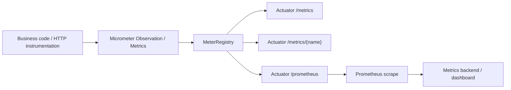
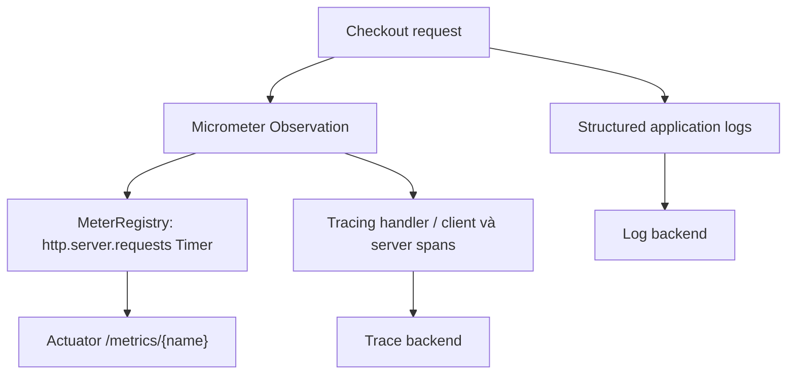

# Đọc một metric qua Spring Boot Actuator Metrics Endpoint

Khi vận hành một ứng dụng Spring Boot, bạn thấy dashboard báo API `/checkout` chậm hoặc số lần thanh toán thất bại tăng. Trước khi điều tra Prometheus, exporter hay tracing collector, một câu hỏi hữu ích là: **ứng dụng có đang ghi nhận metric mong đợi ngay trong `MeterRegistry` không?** Spring Boot Actuator cung cấp endpoint `/actuator/metrics/{metricName}` để tra cứu một metric theo tên, xem giá trị đo và các nhóm tag có sẵn.

Bài **Đọc một metric** thuộc chương **Actuator metrics endpoint** của module **SPRING_BOOT_OBSERVABILITY**. Trong hệ thống này, Micrometer Observation ghi nhận hoạt động, metrics tổng hợp lưu lượng và độ trễ, logs cung cấp sự kiện, distributed tracing liên kết đường đi request; context propagation, tag/cardinality, exporter và sampling quyết định chất lượng dữ liệu ở các tầng khác nhau.

**Mục tiêu bài học:** biết mở endpoint để xem *một* metric, giải thích đúng JSON trả về, lọc theo tag, hiểu giới hạn của giá trị snapshot, phân biệt Actuator Metrics Endpoint với endpoint Prometheus, xử lý lỗi thường gặp và giữ các endpoint quản trị an toàn.

## 1. Hai đường dẫn dễ nhầm

Trong cấu hình Actuator web thông thường, có hai URL quan trọng:

| URL | Chức năng | Dữ liệu nhận được |
| --- | --- | --- |
| `GET /actuator/metrics` | Liệt kê tên metric hiện có trong registry | JSON chứa `names` |
| `GET /actuator/metrics/{metricName}` | Đọc thông tin về **một** metric có tên cụ thể | JSON gồm tên, mô tả, đơn vị, `measurements` và `availableTags` |

Một endpoint khác là `GET /actuator/prometheus`: nó phục vụ định dạng **scrape Prometheus** khi Prometheus registry được cài đặt và endpoint được expose. Endpoint này không giống `/actuator/metrics/{name}` và không phải cách mặc định để lọc một metric bằng tham số `tag`.

Luồng cơ bản:



**Đọc được metric qua Actuator chưa chứng minh nó đã đến backend.** Một phép đo có thể tồn tại trong JVM nhưng endpoint Prometheus chưa bật, scrape target gặp lỗi hoặc collector/exporter không gửi được dữ liệu.

## 2. Chuẩn bị Actuator và truy cập endpoint

Trong Spring Boot 3.x, cách bắt đầu phổ biến là sử dụng Spring Boot Actuator:

```groovy
dependencies {
    implementation 'org.springframework.boot:spring-boot-starter-actuator'
}
```

Cấu hình ví dụ trong `application.yml`:

```yaml
management:
  endpoints:
    web:
      exposure:
        include: health,info,metrics
```

Khi được cấu hình và cho phép truy cập, ứng dụng ở cổng 8080 có thể phục vụ:

```text
http://localhost:8080/actuator/metrics
http://localhost:8080/actuator/metrics/jvm.memory.used
```

Đây là **đường dẫn và cổng minh họa**. Kết quả thực tế phụ thuộc phiên bản Spring Boot, quyền truy cập endpoint, Spring Security, `management.server.port`, `management.endpoints.web.base-path`, reverse proxy và cấu hình deployment.

**Phân biệt ba khái niệm:**

1. **Endpoint có sẵn:** Actuator và auto-configuration tạo endpoint.
2. **Endpoint được expose qua HTTP:** `management.endpoints.web.exposure.include` cho phép định tuyến web.
3. **Người gọi được phép đọc:** lớp xác thực/ủy quyền hoặc giới hạn mạng vẫn có thể trả `401` hay `403`.

Không nên giải quyết lỗi `403` bằng cách mở mọi actuator endpoint công khai. Trong production, giới hạn endpoint quản trị ở mạng nội bộ hoặc management interface, bật xác thực/ủy quyền phù hợp, chỉ cấp quyền đọc cần thiết và ghi nhận truy cập khi cần. Các phiên bản Spring Boot mới hơn có thể hỗ trợ thêm chính sách access ở lớp Actuator; hãy kiểm tra cấu hình đúng phiên bản.

## 3. Bước đầu tiên: tìm tên metric

Để biết ứng dụng hiện có những metric nào, gọi:

```bash
curl --fail-with-body http://localhost:8080/actuator/metrics
```

Phản hồi minh họa, rút gọn:

```json
{
  "names": [
    "application.ready.time",
    "http.server.requests",
    "jvm.memory.used",
    "process.cpu.usage",
    "system.cpu.usage"
  ]
}
```

`names` chỉ là **danh sách tên meter mà endpoint nhìn thấy**. Đây không phải catalog cố định: binder, dependency, JVM, traffic, cấu hình Metrics và phiên bản framework ảnh hưởng tới danh sách.

Một số metric được đăng ký ngay khi ứng dụng khởi động; một số khác chỉ xuất hiện sau khi có hoạt động thực tế. Ví dụ `http.server.requests` có thể chưa tồn tại ở thời điểm chưa có HTTP request nào được ghi nhận hoặc instrumentation chưa được bật.

Nếu danh sách không có tên bạn cần, chưa nên kết luận exporter bị hỏng. Trước tiên phải kiểm tra meter đã được đăng ký chưa, code có chạy nhánh ghi phép đo không, ứng dụng có dùng đúng `MeterRegistry` không và có bộ lọc nào từ chối meter không.

## 4. Đọc một metric cụ thể

Giả sử danh sách có `jvm.memory.used`. Gọi:

```bash
curl --fail-with-body http://localhost:8080/actuator/metrics/jvm.memory.used
```

Phản hồi **minh họa**, không phải số đo JVM thực:

```json
{
  "name": "jvm.memory.used",
  "description": "The amount of used memory",
  "baseUnit": "bytes",
  "measurements": [
    {
      "statistic": "VALUE",
      "value": 184549376.0
    }
  ],
  "availableTags": [
    {
      "tag": "area",
      "values": ["heap", "nonheap"]
    },
    {
      "tag": "id",
      "values": ["G1 Eden Space", "G1 Old Gen", "Metaspace"]
    }
  ]
}
```

Phản hồi trên được **rút gọn và dựng giả định** để giải thích định dạng. Các memory pool trong trường `id` khác nhau theo JVM/GC đang chạy; tập giá trị thực có thể nhiều hơn, khác tên hoặc không đúng như ví dụ.

### Diễn giải các trường trong JSON

| Trường | Ý nghĩa | Cách đọc đúng |
| --- | --- | --- |
| `name` | Tên logic của meter/metric trong Micrometer | Tên dùng để truy vấn qua Actuator |
| `description` | Mô tả định nghĩa phép đo, nếu có | Giúp biết đang đo điều gì, không phải dữ liệu động |
| `baseUnit` | Đơn vị gốc, nếu meter khai báo | Ví dụ `bytes`, `seconds`, hoặc `null` |
| `measurements` | Các giá trị thống kê mà meter cung cấp | Đọc `statistic` cùng `value`; không đoán nghĩa theo số |
| `availableTags` | Các tên tag và giá trị có thể dùng để lọc theo registry hiện có | Hỗ trợ khám phá dimension, **không phải bảng các bản ghi riêng lẻ** |

Điểm đặc biệt: nếu nhiều meter có cùng tên nhưng khác tags, endpoint có thể trả một kết quả **tổng hợp các phép đo** khi chưa lọc tag. Đọc `jvm.memory.used` không tag có thể cộng giá trị từ nhiều vùng/pool, tùy metric và phép đo. Vì vậy câu “JVM đang dùng 184 MB heap” sẽ **không chính xác** nếu số đó gồm cả nonheap hoặc được tổng hợp từ nhiều vùng.

Đọc một metric phải gắn với câu hỏi: **“Tôi muốn giá trị của toàn bộ metric hay của một nhóm tag cụ thể?”**

## 5. `measurements` không phải mọi metric đều giống nhau

Các statistic thường gặp:

| Meter | Statistic thường thấy | Cách diễn giải |
| --- | --- | --- |
| **Gauge** | `VALUE` | Giá trị hiện tại tại lúc endpoint đọc, có thể tăng hoặc giảm |
| **Counter** | `COUNT` | Số sự kiện tích lũy theo vòng đời meter/registry |
| **Timer** | `COUNT`, `TOTAL_TIME`, `MAX` | Số lần ghi, tổng duration và thời lượng lớn nhất theo cơ chế time window của timer |
| **DistributionSummary** | `COUNT`, `TOTAL`, `MAX` | Số lần ghi, tổng lượng đo và giá trị lớn nhất |
| **LongTaskTimer** | Các thống kê cho tác vụ đang chạy như active tasks/duration | Không nên giải thích giống một Timer của thao tác đã kết thúc |

Không phải mọi meter đều xuất đầy đủ mọi statistic. Những statistic có thể thay đổi theo meter implementation, histogram/percentile configuration và phiên bản Micrometer.

Với Timer, ví dụ response có:

```json
{
  "name": "http.server.requests",
  "description": null,
  "baseUnit": "seconds",
  "measurements": [
    {"statistic": "COUNT", "value": 80.0},
    {"statistic": "TOTAL_TIME", "value": 12.0},
    {"statistic": "MAX", "value": 0.7}
  ],
  "availableTags": []
}
```

Số liệu là giả định. Nếu trong cùng tập quan sát `COUNT = 80` và `TOTAL_TIME = 12 giây`, thời gian trung bình **trên toàn bộ tập đã ghi** xấp xỉ:

\[
\frac{12}{80} = 0{,}15 \text{ giây/lần}
\]

Tuy nhiên:

- Đây là phép tính từ **snapshot tích lũy hiện tại**, không phải latency trung bình trong 5 phút gần nhất.
- `MAX` thường chịu semantics của **time-window maximum** và có thể về 0 sau khoảng không có dữ liệu; không suy rằng nó là request chậm nhất từ lúc khởi động.
- `COUNT` không nói lên tốc độ request/giây nếu chỉ đọc một mẫu. Cần các mẫu theo thời gian và biết xử lý counter reset.
- `TOTAL_TIME / COUNT` không phải **p95** hoặc p99.
- Nếu endpoint gộp nhiều tag, giá trị có thể là tổng của nhiều meter. Một `MAX` sau tổng hợp không mặc nhiên là cực đại của toàn bộ hệ thống.

Để có p95/p99 đáng tin cậy trên nhiều instance, cần cấu hình histogram/timer phù hợp và truy vấn histogram qua backend hỗ trợ, không cố suy p95 từ `COUNT`, `TOTAL_TIME` và `MAX` trên một JSON snapshot.

## 6. Lọc theo tag để đọc đúng nhóm dữ liệu

Endpoint hỗ trợ query parameter theo dạng:

```text
GET /actuator/metrics/{metricName}?tag=key:value
```

Ví dụ chỉ xem **heap memory**:

```bash
curl --get \
  --data-urlencode 'tag=area:heap' \
  http://localhost:8080/actuator/metrics/jvm.memory.used
```

Với nhiều điều kiện, truyền **nhiều tham số `tag`**:

```bash
curl --get \
  --data-urlencode 'tag=method:GET' \
  --data-urlencode 'tag=status:200' \
  http://localhost:8080/actuator/metrics/http.server.requests
```

Ở đây các điều kiện là **lọc chính xác** theo cặp tag/value. Hai điều kiện tương đương “method là GET **và** status là 200”, không phải OR, wildcard hay biểu thức chính quy. Đừng cho rằng `tag=status:5xx` sẽ tự khớp mọi status 5xx; muốn nhóm 5xx theo thời gian thường dùng truy vấn ở backend như PromQL.

Nếu giá trị chứa dấu cách, dấu ngoặc nhọn, dấu `:` hoặc ký tự đặc biệt, dùng URL encoding thay vì ghép chuỗi thủ công. Ví dụ muốn tìm đúng URI template:

```bash
curl --get \
  --data-urlencode 'tag=uri:/orders/{id}' \
  --data-urlencode 'tag=method:GET' \
  http://localhost:8080/actuator/metrics/http.server.requests
```

`curl --data-urlencode` giúp mã hóa từng query parameter an toàn về mặt cú pháp URL. Nó **không thay thế chính sách bảo mật dữ liệu**: không đưa secrets hoặc thông tin nhận dạng vào URL, vì access logs và proxy có thể ghi lại query string.

### Ví dụ phản hồi sau khi lọc

```json
{
  "name": "http.server.requests",
  "baseUnit": "seconds",
  "measurements": [
    {"statistic": "COUNT", "value": 28.0},
    {"statistic": "TOTAL_TIME", "value": 4.2},
    {"statistic": "MAX", "value": 0.35}
  ],
  "availableTags": [
    {"tag": "uri", "values": ["/orders/{id}", "/health"]}
  ]
}
```

Đây cũng là ví dụ giản lược. Những tag còn lại trong `availableTags`, tên và giá trị cụ thể phụ thuộc meter được đăng ký và những điều kiện đã lọc. `availableTags` giúp khám phá tập tag có thể chọn, **không có nghĩa kết quả là danh sách 28 request** hoặc 28 trace.

Khi bộ lọc không khớp, endpoint có thể không tìm thấy meter phù hợp và trả lỗi (thường là `404`); phải xác minh tên tag và giá trị thực tế thay vì đoán.

## 7. Thử bằng PowerShell trên Windows

Trong PowerShell, tên lệnh `curl` trên một số môi trường có thể là alias của `Invoke-WebRequest`, nên cú pháp flag không luôn giống lệnh curl thực. Có thể dùng `Invoke-RestMethod`:

```powershell
$base = "http://localhost:8080"

# Liệt kê tên:
Invoke-RestMethod -Uri "$base/actuator/metrics"

# Đọc đúng một metric:
Invoke-RestMethod -Uri "$base/actuator/metrics/jvm.memory.used"

# Lọc area=heap:
Invoke-RestMethod -Uri "$base/actuator/metrics/jvm.memory.used?tag=area%3Aheap"
```

Nếu dùng `curl.exe` trên Windows, có thể dùng flag `--get` và `--data-urlencode` như ví dụ Bash. Những lệnh chỉ dùng để kiểm chứng trên môi trường được cho phép; với endpoint quản trị production phải sử dụng giao thức bảo mật và quyền truy cập hợp lệ.

## 8. Tạo một metric nghiệp vụ và đọc nó qua Actuator

Để thấy toàn bộ quá trình, ta tự tạo counter đếm số checkout đã được xử lý theo `outcome`. Cần phân biệt **đăng ký meter** và **tăng giá trị**.

```java
import io.micrometer.core.instrument.Counter;
import io.micrometer.core.instrument.MeterRegistry;
import org.springframework.stereotype.Service;

@Service
public class CheckoutMetrics {
    private final Counter accepted;
    private final Counter rejected;

    public CheckoutMetrics(MeterRegistry registry) {
        accepted = Counter.builder("checkout.orders.processed")
            .description("Completed checkout operations by outcome")
            .baseUnit("orders")
            .tag("outcome", "accepted")
            .register(registry);

        rejected = Counter.builder("checkout.orders.processed")
            .description("Completed checkout operations by outcome")
            .baseUnit("orders")
            .tag("outcome", "rejected")
            .register(registry);
    }

    public void recordAccepted() {
        accepted.increment();
    }

    public void recordRejected() {
        rejected.increment();
    }
}
```

Đây là class instrumentation, chưa phải API hoàn chỉnh. Ở tầng xử lý nghiệp vụ, gọi `recordAccepted()` hoặc `recordRejected()` **đúng một lần khi kết quả cuối cùng được xác định**. Không đếm cả một lần retry và một lần thành công cuối cùng nếu mục tiêu là “số checkout được xử lý”. Nếu có xử lý đồng thời hoặc giao dịch cần tính nhất quán cao, meter không thể thay cơ sở dữ liệu nghiệp vụ.

Vì hai Counter được đăng ký với hai giá trị tag khác nhau, chúng là hai meter phân biệt trong registry:

```text
checkout.orders.processed{outcome="accepted"}
checkout.orders.processed{outcome="rejected"}
```

Sau ba lượt `recordAccepted()` và một lượt `recordRejected()`, truy vấn:

```bash
curl http://localhost:8080/actuator/metrics/checkout.orders.processed
```

Ví dụ kết quả:

```json
{
  "name": "checkout.orders.processed",
  "description": "Completed checkout operations by outcome",
  "baseUnit": "orders",
  "measurements": [
    {"statistic": "COUNT", "value": 4.0}
  ],
  "availableTags": [
    {"tag": "outcome", "values": ["accepted", "rejected"]}
  ]
}
```

**`COUNT = 4` là tổng** từ hai meter theo hai outcome trong ví dụ này. Muốn biết số checkout thành công:

```bash
curl --get \
  --data-urlencode 'tag=outcome:accepted' \
  http://localhost:8080/actuator/metrics/checkout.orders.processed
```

Khi đó `COUNT` sẽ là 3 nếu chưa có lượt gọi mới và registry chưa reset. Kết quả 4 hay 3 chỉ mô tả trạng thái của registry/ứng dụng hiện tại; restart thường khiến counter tích lũy bắt đầu lại.

**Thiết kế tag:** `outcome` chỉ có hai giá trị đã biết, phù hợp low cardinality. Không thêm `orderId`, `customerEmail` hoặc `traceId` vào Counter vì chúng có thể tạo rất nhiều time series và gây rò dữ liệu.

## 9. Kiểm thử trước khi đọc endpoint thật

Khi cần xác minh code `CheckoutMetrics` hoạt động mà không chạy Spring Boot web server, dùng `SimpleMeterRegistry`:

```java
import io.micrometer.core.instrument.Counter;
import io.micrometer.core.instrument.simple.SimpleMeterRegistry;
import org.junit.jupiter.api.Test;
import static org.junit.jupiter.api.Assertions.*;

class CheckoutMetricsTest {
    @Test
    void recordsAcceptedAndRejectedCounts() {
        try (SimpleMeterRegistry registry = new SimpleMeterRegistry()) {
            CheckoutMetrics metrics = new CheckoutMetrics(registry);

            metrics.recordAccepted();
            metrics.recordAccepted();
            metrics.recordRejected();

            Counter accepted = registry.find("checkout.orders.processed")
                .tag("outcome", "accepted").counter();
            Counter rejected = registry.find("checkout.orders.processed")
                .tag("outcome", "rejected").counter();

            assertNotNull(accepted);
            assertNotNull(rejected);
            assertEquals(2.0, accepted.count());
            assertEquals(1.0, rejected.count());
        }
    }
}
```

Test trên chứng minh code đăng ký và ghi Counter vào `MeterRegistry` đúng cách. Nó **không chứng minh** Actuator đã expose endpoint, security cho phép truy cập, Prometheus scrape được hay exporter đã gửi số liệu đến collector. Muốn xác minh những điều đó, cần test trong Spring context hoặc integration test với các thành phần tương ứng.

Một bước integration test tối thiểu là khởi chạy ứng dụng ở một môi trường kiểm thử, kích hoạt thao tác tạo metric, rồi đọc `/actuator/metrics/checkout.orders.processed` và xác minh `COUNT` cùng `availableTags`. Nếu Spring Boot test tắt tự động observability trong test context theo cấu hình/version, phải bật đúng phần cần thử; với Counter nghiệp vụ được đăng ký trực tiếp như ở đây, vẫn cần bean/registry và đường thực thi chính xác.

## 10. HTTP request metric: đọc đúng method, URI và status

Một metric thường gặp trong Spring Boot là `http.server.requests`, đại diện cho Timer đo request HTTP **đầu vào**. Khi xử lý `GET /orders/123`, tên tag `uri` nên là template dạng `/orders/{id}` nếu framework nhận diện được route, thay vì path thực `/orders/123`.

Ví dụ kiểm chứng sau khi tạo request:

```bash
curl --get \
  --data-urlencode 'tag=method:GET' \
  --data-urlencode 'tag=uri:/orders/{id}' \
  --data-urlencode 'tag=status:200' \
  http://localhost:8080/actuator/metrics/http.server.requests
```

Những tên tag như `method`, `uri`, `status`, `outcome` và `exception` thường thấy trong instrumentation HTTP server của Spring, **nhưng không phải hợp đồng bất biến qua mọi phiên bản**. Trước khi dùng, đọc metric không có filter để xem `availableTags` thực.

Từ response có thể biết:

- `COUNT`: bao nhiêu HTTP requests **đã được Timer ghi nhận** với các tags đang lọc.
- `TOTAL_TIME`: tổng duration của nhóm đó theo đơn vị `baseUnit`.
- `MAX`: số đo maximum theo semantics của meter/time window.
- `availableTags`: các nhóm khác có thể kiểm tra thêm, ví dụ status 4xx/5xx, method khác.

Không nên đọc `COUNT` rồi coi đó là số *người dùng*, *đơn hàng* hoặc *lượt thành công nghiệp vụ*. HTTP metric đếm HTTP requests, gồm cả retries, lỗi và những response không làm phát sinh giao dịch.

Nếu dự án dùng convention hoặc instrumentation khác, tên `http.server.requests` cũng có thể khác. Metric HTTP client **đầu ra** thường sử dụng tên `http.client.requests`; hai loại đo những ranh giới khác nhau.

## 11. Đọc metric không phải truy vấn dữ liệu theo thời gian

`GET /actuator/metrics/{name}` là công cụ **diagnostic** để đọc snapshot hiện tại trong ứng dụng. Nó không trả biểu đồ nhiều phút, không lưu lịch sử và không tính các phân vị tổng hợp cho toàn bộ cluster.

| Muốn biết | Actuator Metrics Endpoint có phù hợp? | Cách làm khi cần sâu hơn |
| --- | --- | --- |
| Meter có tồn tại không? | Rất phù hợp | `GET /actuator/metrics` rồi chọn tên |
| Giá trị Counter hiện tại của instance | Phù hợp | `GET /actuator/metrics/{name}` |
| Những giá trị tag đang có | Phù hợp | Xem `availableTags` |
| Count theo một route và status | Phù hợp nếu các tags có sẵn | Thêm nhiều query parameters `tag` |
| Error rate trong 5 phút | **Không đủ từ một snapshot** | Dùng backend có lịch sử, ví dụ PromQL `rate(...)` |
| p95 latency của nhiều instance | **Không đủ chỉ từ COUNT/TOTAL_TIME/MAX** | Histogram buckets và truy vấn tổng hợp |
| Request nào bị timeout | Không có chi tiết từng request | Trace + logs có correlation |
| Phân tích xu hướng trong tháng | Không phải mục đích endpoint này | Backend metrics với retention và dashboard |

Nếu cần **RPS** và tỷ lệ lỗi theo thời gian, một đường triển khai phổ biến là Prometheus registry + scrape + PromQL. Ví dụ với metric Timer được xuất như `http_server_requests_seconds_count`:

```promql
sum(rate(http_server_requests_seconds_count[5m]))
```

Tỷ lệ requests có status 5xx:

```promql
sum(rate(http_server_requests_seconds_count{status=~"5.."}[5m]))
/
sum(rate(http_server_requests_seconds_count[5m]))
```

Những query này là **minh họa**: tên metric đã export, nhãn và encoding phụ thuộc registry, phiên bản và instrumentation. Một tỷ lệ chỉ lọc HTTP 5xx không bao trùm mọi lỗi nghiệp vụ, connection errors hoặc cancellation.

Trong Prometheus, counter có thể reset khi ứng dụng restart; dùng `rate` hoặc `increase` để xử lý counter reset theo cách thích hợp. Nếu chỉ lấy hai snapshot bằng tay, việc trừ trực tiếp không đủ tin cậy khi có restart, missed samples hoặc nhiều instance.

## 12. Khác biệt với `/actuator/prometheus`

Sau khi bổ sung Prometheus registry và expose endpoint thích hợp:

```groovy
dependencies {
    implementation 'org.springframework.boot:spring-boot-starter-actuator'
    runtimeOnly 'io.micrometer:micrometer-registry-prometheus'
}
```

```yaml
management:
  endpoints:
    web:
      exposure:
        include: health,info,metrics,prometheus
```

So sánh hai kiểu kết quả:

| Thuộc tính | `/actuator/metrics/{name}` | `/actuator/prometheus` |
| --- | --- | --- |
| Định dạng | JSON thân thiện để kiểm tra một metric | Prometheus exposition format |
| Lựa chọn metric | Theo tên ở đường dẫn và các `tag` | Thường trả toàn bộ các series được registry export |
| Tên metric | Tên logic Micrometer như `http.server.requests` | Tên Prometheus chuẩn hóa, ví dụ `http_server_requests_seconds_count` |
| Giá trị | Tổng hợp statistics như `COUNT`, `TOTAL_TIME`, `MAX` | Các time series/samples và histogram buckets nếu có |
| Mục đích | Debug tại instance, xác minh tên/tag | Scrape tự động và lưu trữ theo thời gian |
| Điều kiện | Actuator metrics endpoint được bật, expose và có quyền | Thêm Prometheus registry, expose endpoint, cấu hình scrape/permission |

**Không nên diễn giải việc khác số giữa JSON Actuator và Prometheus là lỗi ngay.** Các đường đi có thể dùng quy tắc naming, thời điểm thu thập, time-window, histogram và lọc registry khác nhau. Hãy so sánh cùng instance, cùng tập tags và cùng thời điểm khi cần xác minh.

## 13. Khi gặp 404, 401, 403 hoặc JSON không như mong đợi

| Hiện tượng | Nguyên nhân có thể | Cách kiểm tra |
| --- | --- | --- |
| `GET /actuator/metrics` trả 404 | Endpoint chưa expose, base path/port khác, bị vô hiệu hoặc không có Actuator | Kiểm tra dependencies, cấu hình web exposure, management port/base path |
| Danh sách metric có nhưng đọc một tên trả 404 | Sai tên, chưa đăng ký, meter bị lọc hoặc chưa có traffic | Lấy đúng tên từ `names`, kích hoạt code và đọc lại |
| Đọc với `tag` trả 404 | Không có meter cùng tên phù hợp mọi điều kiện | Kiểm tra `availableTags`, tên, giá trị và URL encoding |
| Trả 401 hoặc 403 | Xác thực/ủy quyền không cho phép | Kiểm tra access policy; không tắt security bừa bãi |
| `COUNT=0` | Counter chưa tăng, Timer chưa ghi hoặc sau restart | Kiểm tra điểm instrument, lần gọi và lifecycle |
| `availableTags` trống | Không có dimension khác để liệt kê ở kết quả đó hoặc đã lọc | Xem registry, filter và mục đích meter |
| `MAX` bằng 0 dù trước đó có request chậm | Maximum theo time window hết hạn hoặc khác registry | Xem cấu hình Timer, time window và dữ liệu lịch sử |
| Không thấy p95 | Endpoint chỉ trả một số statistics, histogram chưa bật | Xem metrics distribution config và backend histogram |
| Metric có trên Actuator nhưng không có ở backend | Registry/exporter/scrape/collector gặp lỗi | Kiểm tra `/actuator/prometheus`, target và pipeline |
| Giá trị lớn hơn số request kỳ vọng | Gộp nhiều tags, đếm attempts/retries, metric đo khác nghiệp vụ | Lọc cụ thể tag, xem định nghĩa meter |

Hãy xử lý lỗi theo thứ tự **đường dẫn → quyền truy cập → metric name → tags → registry/handler → export/backend**. Chuyển ngay sang sửa dashboard mà chưa xác minh endpoint gốc thường mất thời gian và dễ bỏ sót nguyên nhân.

### Tránh bẫy “đọc endpoint làm thay đổi metric”

Một request gọi Actuator cũng là HTTP request tới ứng dụng/management server; tùy instrumentation, nó có thể được tính trong HTTP server metrics. Vì Timer thường ghi khi request hoàn tất, số tại đúng thời điểm đọc có thể **chưa bao gồm lần đọc hiện tại**. Trong test, nên đo counter/Timer nghiệp vụ cụ thể thay vì kỳ vọng metric HTTP tổng thể tăng chính xác theo từng lần gọi endpoint quản trị.

## 14. Metric là dữ liệu tổng hợp, không phải trace hoặc log

Một request `POST /checkout` có thể tạo:



Khi truy vấn `/actuator/metrics/http.server.requests`, bạn thấy số **đã được tổng hợp**, chẳng hạn COUNT và TOTAL_TIME. Bạn **không thấy** body request, exception chi tiết, stack trace, thời điểm từng request hoặc trace ID riêng. Đó là giới hạn được thiết kế để metrics có thể gom nhóm với cardinality hữu hạn.

Để truy tìm nguyên nhân một request chậm:

1. Dùng metrics để xác định **route/status/khung thời gian** đang có latency hoặc error rate bất thường.
2. Dùng distributed tracing để xem **client/server spans** và dependency nào mất thời gian.
3. Dùng logs có correlation `traceId`/`spanId` để đọc mã lỗi, retry hoặc sự kiện nghiệp vụ.
4. Đối chiếu nhiều request và metric downstream trước khi kết luận nguyên nhân gốc.

**Sampling:** trace không được sample hoặc export vẫn có thể đóng góp vào metric. Do đó từ COUNT của Timer không thể suy ra số traces có trong backend. **Propagation:** tracing chỉ nối đúng các spans qua HTTP/async/message khi context được truyền và nhận đúng; truy vấn metric không sửa được đứt propagation.

Không đưa `traceId`, `userId`, token, email hoặc order ID vào metric tags. Nếu cần correlation từng request, sử dụng tracing/logging an toàn, không tạo một time series riêng cho mỗi người hoặc giao dịch.

## 15. Quy tắc cardinality và bảo mật khi đọc endpoint

Việc `availableTags` hiển thị giá trị nào phụ thuộc **những tags instrumentation đã tạo**. Nếu trong đó có URL thô, ID khách hàng hoặc giá trị exception message tùy ý, vấn đề nằm ở chính thiết kế telemetry, không phải ở câu lệnh đọc.

Các quy tắc nên áp dụng:

- **Dùng route template** như `/orders/{id}` thay vì `/orders/92817` để giữ cardinality thấp.
- **Giữ tập giá trị hữu hạn** cho `outcome`, `status`, `method`, `region` và nhóm nghiệp vụ.
- **Không đưa dữ liệu nhạy cảm** vào metric name, tag key/value hoặc request query để debug endpoint.
- **Không coi high-cardinality tags là được phép ghi PII**: logs/traces cũng cần chính sách tương ứng.
- **Hạn chế truy cập endpoint quản trị**, vì ngay cả dữ liệu không phải secret cũng có thể tiết lộ topology, hành vi người dùng tổng hợp hoặc hoạt động của dịch vụ.
- **Đánh giá quy mô:** mỗi tổ hợp tags có thể tạo meter/time series riêng. Ví dụ 3 outcomes × 4 regions × 5 methods là tối đa 60 tổ hợp chỉ từ ba nhãn đó.

Nếu chỉ muốn kiểm tra outcome của checkout, hãy dùng `tag=outcome:accepted`; đừng thêm `orderId` vào metric để tra một đơn hàng riêng. Dữ liệu nghiệp vụ riêng cần cơ chế truy vấn/ủy quyền khác.

## 16. Tình huống minh họa: p95 checkout tăng nhưng dashboard trống

**Bối cảnh giả định:** sau deploy, người dùng báo `POST /checkout` chậm. Dashboard Prometheus không cập nhật từ một instance mới, trong khi đội phát triển cho rằng đã bật Actuator.

Một quy trình kiểm tra hợp lý:

1. **Đúng địa chỉ chưa?** Tìm management port và base path thực, xác nhận quyền truy cập `/actuator/metrics`.
2. **Có metric không?** Danh sách `names` có `http.server.requests`? Nếu chưa, tạo một request checkout có kiểm soát và kiểm tra instrumentation.
3. **Đọc một metric:** gọi `/actuator/metrics/http.server.requests` để xem `COUNT`, `TOTAL_TIME`, `MAX` và `availableTags`.
4. **Lọc đúng route:** dùng `tag=uri:/checkout` và `tag=method:POST`, kiểm tra count có tăng sau các request thử không. Nhãn route cụ thể phải lấy từ `availableTags`.
5. **Kiểm tra xuất metrics:** nếu Actuator có dữ liệu mà Prometheus trống, kiểm tra Prometheus registry, `/actuator/prometheus`, scrape target, mạng, TLS/authentication, relabeling và collector nếu có.
6. **Phân tích xu hướng:** khi dữ liệu đến backend, dùng rate và histogram để tính throughput, error ratio, p95 trong cửa sổ phù hợp; không tính p95 từ một JSON snapshot.
7. **Tìm nguyên nhân ứng dụng:** nếu p95 thật sự tăng, mở trace đã được sample và logs có cùng trace ID để xác định payment timeout, inventory chậm hoặc retry.

Nếu bước 3 hiển thị giá trị tốt nhưng bước 5 thất bại, điều đó hướng điều tra vào **pipeline export/scrape**, không phải khẳng định ứng dụng thiếu instrumentation. Nếu metric không tồn tại ở bước 2, cần xem registry và code trước khi thay dashboard.

## 17. Bài tập tự kiểm tra

**Bài 1.** `GET /actuator/metrics` trả danh sách có `jvm.memory.used`. Muốn chỉ xem heap, bạn gọi gì?

*Gợi ý:* `GET /actuator/metrics/jvm.memory.used?tag=area:heap`, URL encode dấu đặc biệt khi viết request thực.

**Bài 2.** `/actuator/metrics/http.server.requests` trả `COUNT=200` và `TOTAL_TIME=40` (baseUnit seconds). Có thể kết luận p95 là 200 ms không?

*Gợi ý:* Không. `40/200=0,2s` chỉ là mean trên tập được đo. p95 cần phân bố/histogram phù hợp, và snapshot không phản ánh mặc nhiên cửa sổ 5 phút.

**Bài 3.** Bạn thêm `tag=status:500` nhưng nhận 404. Từ đó suy ra cả ứng dụng không còn metric `http.server.requests` được không?

*Gợi ý:* Không. Có thể metric tồn tại nhưng chưa có request khớp chính xác điều kiện đó. Đọc không tag và xem `availableTags`.

**Bài 4.** Một Counter `checkout.orders.processed` có hai outcome: accepted 7 và rejected 3. Đọc không tag sẽ thấy gì?

*Gợi ý:* Thông thường COUNT tổng hợp là 10. Thêm `tag=outcome:accepted` để chỉ lấy số lần accepted, nếu không có thay đổi giữa hai lần đọc.

**Bài 5.** Một instance có metric trên Actuator nhưng Prometheus không nhận. Bạn kiểm tra những gì?

*Gợi ý:* Prometheus registry, `/actuator/prometheus`, target scrape, endpoint security, networking, relabeling và collector/exporter; Actuator JSON không chứng minh đường xuất thành công.

**Bài 6.** Tại sao không nên đặt `traceId` hoặc `orderId` vào low-cardinality tag chỉ để truy vấn một request?

*Gợi ý:* ID gần như duy nhất tạo nhiều time series và có thể lộ dữ liệu; dùng tracing/log correlation hoặc hệ thống dữ liệu nghiệp vụ có phân quyền.

**Bài 7.** Metric có COUNT của 500 requests nhưng trace backend chỉ có 20 traces. Dữ liệu có mâu thuẫn không?

*Gợi ý:* Không nhất thiết. Metric và tracing sampling/exporter khác nhau. Một request có thể đóng góp metric dù trace không được sample hoặc lưu.

**Bài 8.** Một số request tới `/actuator/metrics` làm giá trị `http.server.requests` thay đổi. Điều đó có thể xảy ra không?

*Gợi ý:* Có, nếu endpoint quản trị được HTTP instrumentation ghi nhận. Cần xác định route/tags và chú ý phép đo thường hoàn thành sau response.

## 18. Ghi nhớ

- **`GET /actuator/metrics`** liệt kê tên metrics; **`GET /actuator/metrics/{name}`** đọc **một** metric và các thống kê/tags hiện có.
- JSON chứa `name`, `description`, `baseUnit`, `measurements` và `availableTags`. Phải đọc `statistic` cùng `value` và kiểm tra khi nào các meter bị tổng hợp.
- Dùng **`tag=key:value`** để lọc; gửi lặp `tag` cho nhiều điều kiện và URL encode các giá trị đặc biệt. Không nhầm tag filter chính xác với regex/wildcard.
- Snapshot Actuator **không thay thế** dữ liệu lịch sử: không suy ra RPS theo cửa sổ hay p95 từ `COUNT`, `TOTAL_TIME`, `MAX` của một lần đọc.
- `/actuator/prometheus` phục vụ định dạng scrape Prometheus và cần registry tương ứng; có metric trong JVM **không bảo đảm** exporter/backend đã nhận.
- Bảo vệ Actuator endpoints và **giữ metric tags low cardinality, không chứa secrets/PII**. Khi có vấn đề, kiểm tra từ registry tới exporter/backend rồi kết hợp metrics với logs và traces để điều tra nguyên nhân.
