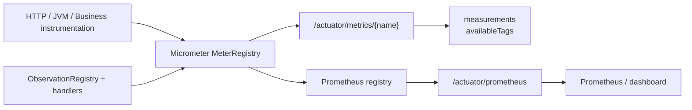
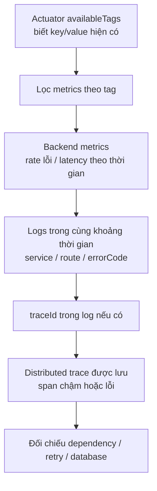

# Danh sách available tags trong Spring Boot Actuator Metrics Endpoint

Giả sử hệ thống Spring Boot trả HTTP 5xx tăng bất thường và nhóm vận hành muốn biết lỗi xuất hiện ở **phương thức HTTP nào, route nào và trạng thái nào**. Trên ứng dụng đã bật Actuator, endpoint `/actuator/metrics/http.server.requests` có thể trả về danh sách **`availableTags`**: những tên tag và giá trị tag đang hiện diện trong các meter cùng tên. Đây là điểm khởi đầu rất tiện để xác định có thể lọc dữ liệu theo chiều nào trước khi xây dashboard hoặc truy vấn Prometheus.

Bài **Danh sách available tags** thuộc chương **Actuator metrics endpoint** của module **SPRING_BOOT_OBSERVABILITY**. Module hướng tới thiết lập observability cho Spring Boot bằng Micrometer Observation, metrics, logs và distributed tracing; hiểu context propagation, tag/cardinality, exporter, sampling và cách liên kết tín hiệu để điều tra lỗi, độ trễ, hành vi ứng dụng trên môi trường thực. Bài này tập trung vào **cấu trúc `availableTags`, cách lọc theo tag và cách diễn giải kết quả** để tránh những kết luận sai về dữ liệu metrics.

## 1. Mục tiêu học tập

Sau bài học, bạn có thể:

- Phân biệt endpoint liệt kê **tên meter** với endpoint trả về **measurements và available tags** của một meter cụ thể.
- Giải thích chính xác ý nghĩa của `availableTags[].tag` và `availableTags[].values`.
- Dùng truy vấn `tag=key:value`, bao gồm nhiều điều kiện tag, để lọc measurements.
- Đọc JSON response của Actuator cho `Timer`, `Counter` và phân biệt các statistic như `COUNT`, `TOTAL_TIME`, `MAX`.
- Tạo một custom metric đơn giản có tags hữu hạn, sau đó quan sát các giá trị xuất hiện trong `availableTags`.
- Nhận biết giới hạn: danh sách giá trị không chứng minh mọi tổ hợp nhãn tồn tại, không chứa lịch sử thời gian và không phải công cụ thay thế PromQL.
- Xác định vì sao endpoint có thể thiếu tag, thiếu meter hoặc hiển thị các giá trị bất thường; xử lý vấn đề cardinality và bảo mật.
- Liên hệ tags metrics với logs, distributed tracing và trace context trong quá trình điều tra lỗi.

## 2. Hai endpoint Actuator cần phân biệt

Spring Boot Actuator cung cấp một giao diện HTTP để kiểm tra các meter đã được đăng ký trong `MeterRegistry`. Đường dẫn mặc định ở ứng dụng web là:

| Endpoint | Chức năng | Ví dụ |
| --- | --- | --- |
| `GET /actuator/metrics` | Liệt kê **tên các meter** hiện có | `http.server.requests`, `jvm.memory.used`, `process.uptime` |
| `GET /actuator/metrics/{metricName}` | Xem measurements và **availableTags** cho một tên meter | `/actuator/metrics/http.server.requests` |
| `GET /actuator/metrics/{metricName}?tag=key:value` | Lọc measurements theo một tag cụ thể | `?tag=method:POST` |
| `GET /actuator/prometheus` | Xuất dữ liệu metrics ở định dạng scrape Prometheus nếu có registry tương ứng | `http_server_requests_seconds_count` và các label của chúng |

**Quan trọng:** `/actuator/metrics` là giao diện **kiểm tra metrics của ứng dụng**. `/actuator/prometheus` phục vụ hệ thống scrape/exporter. Hai endpoint có cấu trúc dữ liệu và cách đặt tên khác nhau. Một tên meter Micrometer như `http.server.requests` có thể được xuất sang Prometheus thành các tên series như `http_server_requests_seconds_count` hoặc `http_server_requests_seconds_sum` tùy phiên bản, cấu hình và loại meter.

Endpoint `/actuator/metrics/{metricName}` sử dụng **tên meter ở phía Micrometer**, ví dụ `http.server.requests`, chứ không dùng tên series đã chuyển đổi sang Prometheus.

### Luồng dữ liệu



Danh sách `availableTags` phản ánh những meter **đang được registry biết đến tại thời điểm truy vấn**. Nó không phải danh mục tổng hợp từ tất cả backend, cũng không tự truy vấn dữ liệu lịch sử đã được Prometheus lưu.

## 3. Cấu trúc response JSON

Ví dụ truy vấn:

```http
GET /actuator/metrics/http.server.requests
```

Giả sử ứng dụng đã nhận vài request HTTP, response **minh họa** có dạng:

```json
{
  "name": "http.server.requests",
  "description": "Duration of HTTP server requests",
  "baseUnit": "seconds",
  "measurements": [
    { "statistic": "COUNT", "value": 48.0 },
    { "statistic": "TOTAL_TIME", "value": 7.2 },
    { "statistic": "MAX", "value": 0.85 }
  ],
  "availableTags": [
    { "tag": "method", "values": ["GET", "POST"] },
    { "tag": "status", "values": ["200", "400", "500"] },
    { "tag": "uri", "values": ["/orders", "/orders/{id}"] },
    { "tag": "exception", "values": ["None", "IllegalStateException"] }
  ]
}
```

Đây là **dữ liệu giả định để học cách đọc JSON**, không phải kết quả bảo đảm trên mọi ứng dụng Spring Boot. Các tên tag như `method`, `status`, `uri`, `exception`, cách biểu diễn giá trị “không có lỗi”, tên meter và các measurements thực tế phụ thuộc phiên bản, framework instrumentation, ObservationConvention/MeterFilter và những request đã được ghi nhận.

### Giải thích từng trường

| Trường | Ý nghĩa |
| --- | --- |
| `name` | Tên meter Micrometer được yêu cầu |
| `description` | Mô tả meter, nếu có |
| `baseUnit` | Đơn vị cơ sở, ví dụ `seconds` đối với timer |
| `measurements` | Các statistic và giá trị được tổng hợp cho những meter matching |
| `availableTags` | Danh sách **tên tag** và các **giá trị có sẵn/đã quan sát** trong tập meter matching |
| `availableTags[].tag` | Tên một chiều phân loại, như `method` |
| `availableTags[].values` | Các giá trị phân biệt được biết cho chiều đó, như `GET`, `POST` |

Với dữ liệu mẫu, `method` có hai giá trị `GET` và `POST`. Điều đó **không nói rằng mỗi phương thức có 24 request** và cũng không chứng minh cả hai đều xuất hiện trên mọi route. Tương tự, `status` chứa `500` không có nghĩa mọi method hoặc uri đều từng trả 500.

### Phân biệt available tags và số lượng request

Trong response trên:

- `COUNT=48`: số lần timer được ghi nhận theo tập meter đang xem, không phải số lượng tag values.
- `TOTAL_TIME=7.2` giây: tổng duration của các bản ghi được đưa vào phép tổng hợp.
- `MAX=0.85` giây: cực đại theo cửa sổ thống kê/triển khai timer; không nhất thiết là giá trị lớn nhất từ lúc ứng dụng khởi động.
- `availableTags[].values`: tập **giá trị phân biệt**, không mang count tương ứng cho từng giá trị.

Muốn biết riêng số lần request `POST`, phải **lọc theo tag**. Muốn xem xu hướng số request/giây trong 5 phút, cần dữ liệu time series của backend, không chỉ một snapshot Actuator.

## 4. Vì sao availableTags không cho biết mọi tổ hợp nhãn?

Giả sử registry có ba bộ tag thực tế:

| Method | Status | URI | Count |
| --- | --- | --- | ---: |
| `GET` | `200` | `/orders` | 20 |
| `POST` | `200` | `/orders` | 10 |
| `POST` | `500` | `/orders` | 2 |

Danh sách giá trị phân biệt là:

- `method`: `GET`, `POST`.
- `status`: `200`, `500`.
- `uri`: `/orders`.

Nếu lấy tích các giá trị, bạn có thể tưởng có trường hợp `GET + 500 + /orders`, nhưng ví dụ **không tồn tại bộ nhãn đó**. `availableTags` chỉ trình bày các tập giá trị theo từng chiều; nó không nhất thiết biểu diễn quan hệ chính xác giữa mọi chiều.

Muốn biết một tổ hợp có dữ liệu hay không, dùng truy vấn với **nhiều tag filters**:

```http
GET /actuator/metrics/http.server.requests?tag=method:GET&tag=status:500
```

Truy vấn ví dụ chỉ có cơ hội trả measurements cho những meter khớp **đồng thời cả hai điều kiện**. Không nên suy đoán từ sự hiện diện độc lập của `GET` và `500` trong danh sách available tags. Hành vi cụ thể khi không có meter phù hợp phụ thuộc phiên bản endpoint; hãy kiểm tra response/status và phân biệt với lỗi truy cập.

## 5. Lọc metrics bằng `tag=key:value`

Actuator Metrics endpoint cho phép truyền query parameter dạng:

```text
/actuator/metrics/{metricName}?tag=<tag-name>:<tag-value>
```

Ví dụ lọc HTTP server timer theo phương thức:

```http
GET /actuator/metrics/http.server.requests?tag=method:POST
```

Chỉ những meter có `method=POST` mới được xét trong phép tổng hợp measurement của kết quả lọc.

### 5.1. Nhiều điều kiện: lặp lại tham số tag

```http
GET /actuator/metrics/http.server.requests?tag=method:POST&tag=status:500
```

Các điều kiện của dạng thông dụng được dùng để thu hẹp tập meter theo **phép AND**: cùng một meter phải khớp phương thức `POST` và trạng thái `500`. Với tag thứ ba:

```http
GET /actuator/metrics/http.server.requests?tag=method:POST&tag=status:500&tag=uri:/orders
```

Tập kết quả là các measurements của những meter match cả ba điều kiện, không có nghĩa endpoint trả log hay danh sách request riêng lẻ.

### 5.2. Phân biệt chữ hoa, chữ thường và giá trị chính xác

Giá trị tag có thể phân biệt chữ hoa/thường. Chẳng hạn `method=POST` thường không tương đương `method=post`. Nếu hệ thống ghi `status=500`, đừng tìm `status=5xx` trừ khi instrumentation thực sự tạo tag `5xx`. Nếu route được ghi dưới dạng template `uri=/orders/{id}`, dùng đúng giá trị template thay cho URL cụ thể `/orders/123`.

Để tránh nhầm, hãy **xem `availableTags` trước**, sau đó sử dụng chính xác các giá trị trong response cho những filter cần thiết.

### 5.3. URL encoding và ký tự đặc biệt

Giá trị tag có thể chứa dấu cách, `&`, `#`, `/` hoặc dấu `:`. Khi gửi URL, hãy URL-encode query parameter đúng cách. Dùng `curl -G --data-urlencode` sẽ giảm lỗi:

```bash
curl -sG 'http://localhost:8080/actuator/metrics/http.server.requests' \
  --data-urlencode 'tag=method:POST' \
  --data-urlencode 'tag=uri:/orders/{id}'
```

Trong PowerShell, có thể dùng `curl.exe` thay vì alias `curl` của `Invoke-WebRequest` ở một số phiên bản:

```powershell
curl.exe -sG 'http://localhost:8080/actuator/metrics/http.server.requests' --data-urlencode 'tag=method:POST' --data-urlencode 'tag=status:500'
```

Các URL trên giả định ứng dụng chạy cục bộ ở cổng 8080, endpoint chưa bị đổi base path và người gọi có quyền truy cập. Trong production, đường dẫn, cổng management và authentication có thể khác.

## 6. Chuẩn bị Spring Boot Actuator

Với dự án Spring Boot 3.x dùng Gradle Kotlin DSL, dependency tối thiểu để có metrics endpoint:

```kotlin
dependencies {
    implementation("org.springframework.boot:spring-boot-starter-actuator")
}
```

Nếu muốn chạy ví dụ REST Controller ở phần tiếp theo, ứng dụng còn cần starter web:

```kotlin
dependencies {
    implementation("org.springframework.boot:spring-boot-starter-web")
}
```

Nên để Spring Boot BOM quản lý phiên bản các dependency phù hợp. Actuator/Micrometer có thể cung cấp `/actuator/metrics` mà **không cần** Prometheus registry. Chỉ khi cần `/actuator/prometheus` mới bổ sung registry xuất Prometheus, ví dụ:

```kotlin
dependencies {
    runtimeOnly("io.micrometer:micrometer-registry-prometheus")
}
```

### Bật metrics endpoint

`application.yml` ví dụ:

```yaml
spring:
  application:
    name: order-service

management:
  endpoints:
    web:
      exposure:
        include: health,info,metrics
  metrics:
    tags:
      application: ${spring.application.name}
      environment: ${APP_ENV:local}
```

Lưu ý:

1. `management.endpoints.web.exposure.include` quyết định những endpoint được phép **expose qua HTTP**. Trong nhiều cấu hình mặc định, `metrics` chưa được expose ra web nên cần khai báo khi muốn gọi từ bên ngoài.
2. `management.metrics.tags` bổ sung **common tags** cho các meter mà registry của Spring Boot quản lý. Các tag `application` và `environment` mô tả nguồn metrics.
3. Actuator endpoint có thể bị bảo vệ bởi Spring Security hoặc cấu hình an ninh của tổ chức; endpoint có được expose cũng không có nghĩa là mọi người được truy cập.
4. Cấu hình management server port hoặc base path có thể thay đổi URL thực tế; xem cấu hình triển khai trước khi thử.

Ví dụ `APP_ENV=prod` tạo tag `environment=prod`; nếu biến môi trường chưa có thì fallback là `local`. Đội vận hành cần chuẩn hóa các giá trị, tránh để `prod`, `production` và `prd` cùng chỉ một môi trường.

## 7. Ví dụ tạo meter có availableTags dễ kiểm chứng

Để chủ động tạo vài giá trị tag, ta xây dựng endpoint demo ghi một `Counter` cho các lần thử checkout. Mục đích là **làm quen với `availableTags`**; logic “success/error” giả lập bằng tham số, không phải cách xác định kết quả thanh toán trong sản phẩm thật.

### 7.1. REST Controller và Counter

```java
import io.micrometer.core.instrument.MeterRegistry;
import org.springframework.http.ResponseEntity;
import org.springframework.web.bind.annotation.PostMapping;
import org.springframework.web.bind.annotation.RequestMapping;
import org.springframework.web.bind.annotation.RequestParam;
import org.springframework.web.bind.annotation.RestController;

@RestController
@RequestMapping("/demo/checkouts")
public class CheckoutDemoController {

    private final MeterRegistry registry;

    public CheckoutDemoController(MeterRegistry registry) {
        this.registry = registry;
    }

    @PostMapping
    public ResponseEntity<String> checkout(
            @RequestParam(defaultValue = "web") String channel,
            @RequestParam(defaultValue = "success") String result) {

        String safeChannel = switch (channel) {
            case "web", "mobile", "partner" -> channel;
            default -> "unknown";
        };
        String outcome = "error".equals(result) ? "error" : "success";

        registry.counter(
            "business.checkout.attempts",
            "channel", safeChannel,
            "outcome", outcome
        ).increment();

        if ("error".equals(outcome)) {
            return ResponseEntity.status(503).body("simulated failure");
        }
        return ResponseEntity.ok("simulated success");
    }
}
```

Giải thích:

- Counter `business.checkout.attempts` đếm số lần demo xử lý thao tác; `channel` và `outcome` là tag **riêng của meter**.
- Giá trị `channel` được ánh xạ về tập hữu hạn `web`, `mobile`, `partner`, `unknown`.
- Giá trị `outcome` chỉ nhận `success` hoặc `error` trong ví dụ. Điều này giúp không tạo một meter mới cho từng chuỗi input tùy ý.
- Không đưa request ID, email, `orderId` hay payload vào metric label vì chúng có cardinality rất cao và có thể nhạy cảm.
- Nếu đã cấu hình `management.metrics.tags.application` và `environment`, common tags được áp dụng bên cạnh `channel`, `outcome` trên registry do Boot cấu hình.

### 7.2. Tạo dữ liệu

Gọi endpoint demo vài lần:

```bash
curl -s -X POST 'http://localhost:8080/demo/checkouts?channel=web&result=success'
curl -s -X POST 'http://localhost:8080/demo/checkouts?channel=web&result=success'
curl -s -X POST 'http://localhost:8080/demo/checkouts?channel=mobile&result=error'
```

Sau ba request trên, nếu ứng dụng mới khởi động, không có request demo nào trước đó và mọi lần đều đến được Controller, Counter có tổng `COUNT=3`; tag `channel` có `web` và `mobile`, còn `outcome` có `success` và `error`.

### 7.3. Đọc danh sách available tags

```http
GET /actuator/metrics/business.checkout.attempts
```

Response minh họa:

```json
{
  "name": "business.checkout.attempts",
  "measurements": [
    { "statistic": "COUNT", "value": 3.0 }
  ],
  "availableTags": [
    { "tag": "channel", "values": ["web", "mobile"] },
    { "tag": "outcome", "values": ["success", "error"] },
    { "tag": "application", "values": ["order-service"] },
    { "tag": "environment", "values": ["local"] }
  ]
}
```

Thứ tự của phần tử và các giá trị trong `availableTags` **không cần giống** ví dụ. Một số trường như `description` hoặc `baseUnit` có thể vắng mặt nếu meter không cung cấp chúng. Nếu chạy thêm yêu cầu `channel=partner`, giá trị `partner` có thể xuất hiện trong `availableTags` sau khi Counter được ghi nhận với tổ hợp tag mới.

Đừng suy luận từ hai tập giá trị rằng `mobile + success` chắc chắn từng xảy ra: trong các request mô phỏng trên chỉ có `mobile + error`.

### 7.4. Lọc đúng một tổ hợp

```http
GET /actuator/metrics/business.checkout.attempts?tag=channel:web
GET /actuator/metrics/business.checkout.attempts?tag=channel:mobile&tag=outcome:error
```

Với dữ liệu demo sạch, filter `channel=web` có `COUNT=2`; filter `channel=mobile AND outcome=error` có `COUNT=1`. Đây là **count tích lũy của counter trong process**, không phải request rate theo phút và không cung cấp lịch sử sau khi process restart.

Nếu lần lọc không khớp meter nào, kết quả có thể khác theo phiên bản endpoint. Hãy xem status HTTP và JSON thực tế; không nên coi việc không thấy số liệu là bằng chứng chắc chắn ứng dụng chưa từng xử lý request tương ứng.

## 8. Các giá trị availableTags được hình thành ở đâu?

Một meter có thể được gắn tags từ nhiều tầng. Khi quan sát `availableTags`, cần hiểu **nguồn gốc mỗi tag**:

| Nguồn | Ví dụ tag | Đặc điểm |
| --- | --- | --- |
| Meter do ứng dụng viết | `channel=web`, `outcome=error` | Được code truyền khi tạo/register Counter, Timer, Gauge |
| Spring HTTP instrumentation | `method=POST`, `status=503`, `uri=/demo/checkouts` | Framework tạo theo quy ước, tùy phiên bản |
| Micrometer Observation | `operation=reserve`, `outcome=success` | Low-cardinality key-values có thể trở thành meter tags thông qua handler |
| Common tags | `application=order-service`, `environment=prod` | Cấu hình trên `MeterRegistry`, áp dụng rộng |
| `MeterFilter` | Đổi tên, bỏ, giới hạn meter hoặc tag | Có thể thay đổi những gì registry thực sự đăng ký |
| Exporter/Prometheus labels | `job`, `instance`, `pod` | Có thể xuất hiện **sau** bước Actuator qua scrape/collector |

**Không phải mọi label trong Prometheus đều xuất hiện trong Actuator `availableTags`.** Prometheus có thể thêm `job` và `instance` khi scrape, còn Micrometer trong ứng dụng không biết các label này. Ngược lại, một tag có mặt trong Actuator chưa chắc giữ nguyên tên ở backend sau bước mapping, relabeling hoặc lọc.

### Tag conventions và đường dẫn HTTP

Với HTTP server metrics, `uri` thường nên là **route template** có tập giá trị giới hạn, ví dụ `/orders/{id}`. Nếu tự gắn URL thực tế như `/orders/123456` hoặc query string chứa request ID vào low-cardinality tag, mỗi đơn hàng có thể tạo giá trị mới.

Khi `availableTags` cho thấy hàng nghìn giá trị `uri` khác nhau, đây có thể là dấu hiệu:

1. URL cụ thể đã bị đưa vào metrics thay cho template.
2. Route không được nhận diện bởi instrumentation nên xuất ra một dạng nhãn không mong muốn.
3. ObservationConvention/custom meter đang thêm tag động.
4. Framework hoặc instrumentation version thay đổi cách chuẩn hóa.

Cần tìm nguồn tạo tag và sửa ngay từ nguồn thay vì chỉ ẩn giá trị trong dashboard.

## 9. Available tags và cardinality

**Cardinality** là số giá trị phân biệt của một chiều tag. Một tag có 3 giá trị `outcome` nghe rất nhỏ; nhưng số bộ nhãn có thể tăng theo tích của nhiều chiều.

Giả sử một Timer có:

| Tag | Số giá trị |
| --- | ---: |
| `method` | 4 |
| `uri` | 20 |
| `status` | 5 |
| `region` | 3 |
| `application` | 2 |

Trong giả định **mọi tổ hợp đều xuất hiện**, số bộ nhãn tiềm năng:

\[
4 \times 20 \times 5 \times 3 \times 2 = 1\,200
\]

Nếu tự thêm `userId` với 100.000 giá trị, con số lý thuyết tăng thành **120 triệu tổ hợp**. Trên thực tế, số meter đã xuất hiện phụ thuộc tổ hợp request thật, số instance và cách exporter hoạt động; phép nhân trên là cách **đánh giá rủi ro**, không phải số series chắc chắn đang tồn tại.

Với Timer histogram, mỗi bộ nhãn có thể tạo thêm series cho bucket, count và sum. Một tag cardinality cao có thể gây chi phí lưu trữ và xử lý lớn ngay cả khi chỉ một họ metric bị ảnh hưởng.

### AvailableTags giúp kiểm tra cardinality thế nào?

`availableTags` giúp phát hiện sơ bộ: tag nào có nhiều giá trị, giá trị nào bất ngờ, nhóm giá trị nào chưa được chuẩn hóa. Tuy nhiên, nó **không cho biết đầy đủ**:

- Số tổ hợp tags thực sự đang tồn tại nếu chỉ xem từng danh sách values.
- Số time series sau khi exporter thêm instance/pod labels và histogram buckets.
- Churn theo thời gian khi series mới xuất hiện và series cũ biến mất.
- Số request của từng giá trị tag nếu chưa lọc measurements tương ứng.
- Dữ liệu lịch sử sau khi process restart hoặc không còn được scrape.

Để quản trị cardinality production, cần kết hợp kiểm tra tags tại nguồn với thống kê số series, metadata và retention từ backend metrics.

## 10. So sánh Actuator availableTags với Prometheus

| Nhu cầu | Công cụ gần nhất |
| --- | --- |
| Trong process đang có những tên meter nào? | `GET /actuator/metrics` |
| Một meter có những tên tag và giá trị quan sát nào? | `GET /actuator/metrics/{name}` và `availableTags` |
| Đọc count/tổng thời lượng hiện tại khi lọc theo tag | `GET /actuator/metrics/{name}?tag=...` |
| Xem dữ liệu dạng scrape và tên series export | `GET /actuator/prometheus` |
| Tính rate/throughput trong 5 phút | PromQL `rate(...)` |
| Xem error rate hoặc p95 trong 1 giờ | Prometheus/metrics backend với dữ liệu lịch sử, histogram nếu cần |
| Biết series nào mất đi sau restart/scale | Backend time series và metadata từ hạ tầng |

### Ví dụ truy vấn PromQL từ cùng counter demo

Giả sử metric `business.checkout.attempts` được xuất thành counter series `business_checkout_attempts_total` trong registry Prometheus đang dùng. Sau khi xác nhận tên thực tế tại `/actuator/prometheus`, có thể tính throughput theo channel và outcome:

```promql
sum by (channel, outcome) (
  rate(business_checkout_attempts_total[5m])
)
```

Tỷ lệ lỗi kỹ thuật của demo:

```promql
sum(rate(business_checkout_attempts_total{outcome="error"}[5m]))
/
sum(rate(business_checkout_attempts_total[5m]))
```

Những truy vấn này cần backend có **nhiều mẫu theo thời gian**; `/actuator/metrics/business.checkout.attempts` chỉ trả một snapshot tại thời điểm gọi. Mẫu số bằng 0 khi không có request cần được xử lý rõ trong dashboard.

### Một lỗi suy luận thường gặp

`availableTags` có `status=500` không chứng minh 5xx đang tăng **lúc này**: đó có thể là tag của một meter đã từng được ghi từ khi process khởi động. Muốn biết lỗi tăng trong 5 phút gần đây, phải nhìn mức tăng của counter hoặc metric thời gian tương ứng trong backend.

## 11. Bảo mật khi expose availableTags

Endpoint metrics có thể tiết lộ **tên dịch vụ, route, tag và những giá trị được quan sát**, đôi khi bao gồm thông tin triển khai nội bộ. Nếu instrumentation vô tình ghi `userId`, email hay path chứa ID làm tag, danh sách `availableTags` có thể cho người truy cập thấy trực tiếp các giá trị đó.

Các nguyên tắc thực hành:

1. Expose những endpoint thực sự cần; sử dụng xác thực/phân quyền hoặc giới hạn mạng cho Actuator.
2. Giữ common tags ở tập giá trị ổn định; không đặt token, secret hoặc ID từng request làm metrics tags.
3. Sửa các tag động tại code hoặc observation convention, không dựa vào việc endpoint không công khai để bỏ qua vấn đề dữ liệu.
4. Tránh cho người dùng công khai khả năng truy vấn tùy ý `/actuator/metrics/{name}` nếu hệ thống có dữ liệu nhạy cảm.
5. Kiểm tra cả đường xuất `/actuator/prometheus`, collector và backend vì một tag nhạy cảm có thể đi qua nhiều hệ thống khác nhau.

**Bảo mật endpoint không thay thế kiểm soát cardinality.** Một tag có hàng triệu giá trị vẫn có thể gây áp lực lên registry/backend ngay cả khi Actuator chỉ cho phép người quản trị truy cập.

## 12. Troubleshooting khi availableTags không như mong đợi

| Triệu chứng | Nguyên nhân cần kiểm tra | Cách xác minh |
| --- | --- | --- |
| `GET /actuator/metrics` trả 404 | Endpoint chưa expose, dependency thiếu hoặc base path khác | Kiểm tra Actuator, exposure, URL quản trị |
| Trả 401/403 | Security policy yêu cầu xác thực/quyền | Dùng danh tính được phép, kiểm tra cấu hình bảo mật |
| `http.server.requests` chưa có trong danh sách | HTTP instrumentation chưa bật, chưa có request hoặc tên đã đổi | Gửi request hợp lệ, xem tên meter thực tế |
| Counter nghiệp vụ không xuất hiện | Code chưa gọi `increment()`, registry khác hoặc meter bị lọc | Kiểm tra đường code và `MeterRegistry` đã inject |
| Tag `application` bị thiếu | Common tags chưa cấu hình hoặc meter đăng ký ở registry khác | Kiểm tra `management.metrics.tags`/customizer |
| Lọc `method:POST` ra tập rỗng | Thực tế chưa có POST, tag tên khác hoặc chữ hoa/thường sai | Đọc `availableTags` trước khi lọc |
| Không thấy một giá trị `uri` mong đợi | Instrumentation dùng route template hoặc thay đổi convention | Kiểm tra giá trị `uri` thực tế |
| `availableTags` có quá nhiều giá trị `uri` | Có thể log route thật thay vì template, tag động | Tìm nguồn tạo tags và normalize |
| Một tag có mặt trong Prometheus nhưng không có ở Actuator | Label do scrape/collector thêm sau registry | So sánh Actuator với scrape target/relabel config |
| Tag trong Actuator không có ở Prometheus | Exporter đổi tên/drop label, filter hoặc scrape lỗi | Đọc `/actuator/prometheus` và pipeline |
| Count từ Actuator khác PromQL | Snapshot tại process khác với rate/lịch sử gộp theo instance | So sánh phạm vi, thời gian và tập label |
| `/actuator/prometheus` không khả dụng | Thiếu Prometheus registry, chưa expose hoặc bị security chặn | Kiểm tra dependency và endpoint config |

### Trình tự xử lý sự cố

1. **Xác nhận endpoint:** URL, management port, base path, bảo mật và trạng thái HTTP.
2. **Xác nhận tên meter:** xem `/actuator/metrics`, tìm đúng tên trong ứng dụng.
3. **Xem `availableTags` chưa lọc:** xác định key/value nào **thật sự có**.
4. **Lọc từng điều kiện:** bắt đầu một `tag=...` rồi thêm điều kiện tiếp theo để tìm sự khác biệt.
5. **Xác định nguồn tag:** framework convention, business code, common tags, `MeterFilter` hoặc exporter.
6. **Đối chiếu backend:** kiểm tra tên series Prometheus, labels bổ sung và dữ liệu theo thời gian nếu mục tiêu là dashboard/alert.

Quy trình trên giúp tránh việc sửa business logic khi nguyên nhân chỉ là **truy vấn sai tên tag**, dùng tên series Prometheus thay tên meter Micrometer hoặc thiếu quyền truy cập endpoint.

## 13. Liên kết available tags với logs và distributed tracing

`availableTags` giải thích **những chiều phân nhóm metrics**. Khi metrics cho thấy `http.server.requests` với `method=POST` và `status=500` có count tăng, ta vẫn cần tìm **request nào bị ảnh hưởng và bước nào lỗi**.

Một quy trình điều tra hợp lý:



**Trace ID không phải là một low-cardinality metric tag.** Mỗi request hoặc trace có thể có ID khác nhau; đưa `traceId` vào metrics sẽ làm số time series tăng rất lớn. Trace context đi qua HTTP hoặc messaging bằng cơ chế propagation khi instrumentation hỗ trợ; nó không tự xuất hiện trong `availableTags`.

Micrometer Observation có thể tạo metrics và tracing spans qua các handler khác nhau, nhưng logs cần logger/structured logging và MDC được cấu hình. Tracing exporter hoặc sampling có thể làm một số traces không xuất hiện trong backend. `availableTags` vẫn hữu ích để tìm nhóm request cần điều tra, ngay cả khi không tìm thấy trace tương ứng.

### Tình huống production

**Triệu chứng:** checkout API tăng lỗi ở vùng `ap-southeast-1`, còn vùng khác ổn định.

1. Mở `/actuator/metrics/http.server.requests` trên instance liên quan, xác minh có tag `method`, `status`, `uri` và common tag `region` nếu ứng dụng cấu hình.
2. Lọc `method=POST`, `status=500`, `uri=/api/checkout` theo **giá trị đã quan sát** để xác định meter tương ứng trên instance đó.
3. Dùng backend metrics tính rate 5xx và latency theo `region` trên một cửa sổ thời gian; Actuator snapshot không đủ để kết luận xu hướng.
4. Tìm log ứng dụng trong cùng khoảng thời gian, đọc `errorCode` và `traceId` khi có.
5. Mở trace đã được lưu để xác định độ trễ hoặc exception ở lời gọi payment, inventory hay database; đối chiếu trạng thái hệ thống phụ thuộc.

Nếu Actuator chỉ ra tag `uri` quá nhiều giá trị do ID động, cần sửa convention trước khi tiếp tục mở rộng dashboard; điều này vừa ảnh hưởng tính ổn định của metrics, vừa có thể bộc lộ dữ liệu.

## 14. Bài thực hành kiểm chứng

**Mục tiêu:** đọc được danh sách available tags, lọc bằng một và nhiều tag, phát hiện cách hiểu sai về tổ hợp tag và xác minh khác biệt giữa Actuator với Prometheus.

### Các bước

1. Chuẩn bị ứng dụng Spring Boot có `spring-boot-starter-actuator` và web starter; expose endpoint `metrics`.
2. Chạy `CheckoutDemoController` từ phần 7; gửi hai request success ở channel web và một request error ở channel mobile.
3. Gọi `/actuator/metrics` để tìm tên `business.checkout.attempts`; xác nhận đó là tên meter Micrometer.
4. Gọi `/actuator/metrics/business.checkout.attempts` và ghi lại từng `availableTags[].tag`, `values`.
5. Thêm `?tag=channel:web` và đọc `COUNT`; tiếp tục thêm `?tag=outcome:success` rồi kiểm tra kết quả.
6. Thử `?tag=channel:mobile&tag=outcome:success`. Quan sát phản hồi thực tế để kiểm chứng rằng sự hiện diện độc lập của hai giá trị không có nghĩa tổ hợp này đã được ghi nhận.
7. Bật common tag `application=order-service`, khởi động lại và tạo dữ liệu mới; kiểm tra tag này xuất hiện trong response của meter.
8. Nếu có Prometheus registry, xem `/actuator/prometheus`, so sánh tên meter, tên series, các nhãn bổ sung; dùng PromQL để tính rate.
9. Thử truyền channel lạ, ví dụ `channel=anything`, và xác minh chỉ có giá trị `unknown` xuất hiện trong meter, không có tag động từ request.

### Bảng kết quả kỳ vọng

| Ca | Truy vấn/thao tác | Điều cần kiểm chứng |
| --- | --- | --- |
| A | `GET /actuator/metrics` | Có tên meter đã đăng ký |
| B | `GET /actuator/metrics/business.checkout.attempts` | Có `measurements` và `availableTags` |
| C | `?tag=channel:web` | Count chỉ cho channel web |
| D | `?tag=channel:mobile&tag=outcome:error` | Count của tổ hợp vừa khớp |
| E | `?tag=channel:mobile&tag=outcome:success` | Không suy luận sai về tổ hợp không có dữ liệu |
| F | Thêm common tag ứng dụng | Có `application` trong tag values sau khi tạo meter mới |
| G | Gửi channel bất kỳ | Chỉ tạo `channel=unknown` đã chuẩn hóa |
| H | Xem Prometheus series | Phân biệt tên meter, label ứng dụng và label scrape |

### Câu hỏi tự đánh giá

1. `GET /actuator/metrics` và `GET /actuator/metrics/http.server.requests` trả loại thông tin khác nhau như thế nào?
2. Nếu `availableTags` có `method=POST`, `status=500`, có thể khẳng định tồn tại request `POST 500` không? Vì sao?
3. Muốn đo riêng `POST 500`, bạn phải thêm query parameters gì?
4. Vì sao `availableTags[].values` không cho biết số request theo từng giá trị?
5. Trong trường hợp nào `job` hoặc `instance` có trong Prometheus nhưng không có ở Actuator?
6. Vì sao tag `uri=/orders/123456` có thể gây nguy cơ cardinality, còn `uri=/orders/{id}` thường an toàn hơn?
7. Một giá trị `status=500` xuất hiện trong available tags có đồng nghĩa error rate đang tăng trong 5 phút gần đây không?
8. Nếu metrics cho thấy nhiều lỗi mà không tìm thấy trace tương ứng, cần kiểm tra sampling, exporter, logs và context propagation ra sao?

## 15. Ghi nhớ

**`availableTags`** trong `/actuator/metrics/{metricName}` cho biết những **tên tag** và **giá trị tag phân biệt** mà registry đang biết đối với meter được truy vấn. Dùng `?tag=key:value` và lặp lại tham số `tag` để thu hẹp measurements theo những điều kiện cần phân tích. Không coi mỗi giá trị là một request, không suy ra mọi tổ hợp tag đều có dữ liệu và không dùng snapshot Actuator thay cho time series của Prometheus.

Trong Spring Boot, available tags hữu ích để kiểm tra instrumentation, common tags và các low-cardinality key-values do Micrometer Observation tạo ra. Hãy chuẩn hóa route, channel, outcome và các nhãn khác để tránh cardinality cao; bảo vệ Actuator endpoint vì danh sách tag có thể bộc lộ metadata nội bộ. Khi điều tra lỗi thực tế, kết hợp dữ liệu tags/metrics với logs và distributed tracing, đồng thời hiểu rõ giới hạn của exporter, sampling và context propagation.
