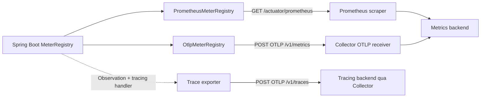

# Content type của metrics API trong Spring Boot Actuator

Khi xây dựng hệ thống observability cho Spring Boot, lập trình viên thường bắt đầu với `GET /actuator/metrics`. Endpoint này cung cấp dữ liệu metrics ở dạng JSON để **kiểm tra và chẩn đoán**. Nhưng khi cấu hình Prometheus, cùng ứng dụng lại xuất metrics qua `GET /actuator/prometheus` ở **định dạng văn bản exposition**, không phải JSON. Nếu sử dụng OTLP, ứng dụng có thể **gửi** metrics đến Collector qua HTTP với payload protobuf hoặc JSON theo giao thức được cấu hình.

Sự khác biệt nằm ở **media type (MIME type)** và hợp đồng API. Hiểu đúng `Content-Type` và `Accept` giúp tránh các lỗi phổ biến như cố parse text Prometheus thành JSON, cấu hình scraper trỏ nhầm endpoint hoặc nhầm dữ liệu hiển thị ở Actuator với dữ liệu đã được backend lưu trữ.

Bài học thuộc chương **Actuator metrics endpoint** của module **SPRING_BOOT_OBSERVABILITY**. Nội dung tập trung vào *content type của metrics API*, có liên hệ tới Micrometer Observation, MeterRegistry, tags/cardinality, exporters, sampling và cách kết hợp metrics, logs, distributed traces để điều tra lỗi và độ trễ trên môi trường thực tế.

## 1. Content type là gì, và tại sao quan trọng?

Trong HTTP, **media type** cho biết biểu diễn dữ liệu của một request hoặc response. Một body chứa JSON cần được xử lý khác với văn bản Prometheus hay payload protobuf dạng nhị phân.

Ví dụ hai response cùng trả HTTP 200:

```http
HTTP/1.1 200 OK
Content-Type: application/vnd.spring-boot.actuator.v3+json

{"names":["jvm.memory.used","jvm.threads.live"]}
```

```http
HTTP/1.1 200 OK
Content-Type: text/plain;version=0.0.4;charset=utf-8

# HELP jvm_threads_live_threads The current number of live threads
# TYPE jvm_threads_live_threads gauge
jvm_threads_live_threads 42.0
```

Cả hai đều mô tả metrics nhưng có cấu trúc và mục đích khác nhau. Những giá trị header và số đo ở trên là **minh họa cho một cấu hình tương thích**, không phải lời khẳng định mọi bản Spring Boot/registry luôn trả đúng các byte đó.

| Đường dữ liệu | Endpoint hoặc đích | Media type thường gặp | Mục đích |
| --- | --- | --- | --- |
| Spring Boot Actuator metrics | `GET /actuator/metrics` | `application/vnd.spring-boot.actuator.v3+json` hoặc JSON tương thích | Liệt kê các meter đã biết |
| Chi tiết một meter | `GET /actuator/metrics/{name}` | JSON | Xem measurements và available tags |
| Prometheus exposition | `GET /actuator/prometheus` | `text/plain;version=0.0.4` hoặc media type tương thích khác | Để scraper lấy time series |
| OpenMetrics exposition nếu hỗ trợ và thương lượng thành công | `GET /actuator/prometheus` | `application/openmetrics-text;version=1.0.0` | Biểu diễn OpenMetrics text |
| OTLP/HTTP metrics export | `POST /v1/metrics` tới Collector | `application/x-protobuf` hoặc `application/json` tùy encoding | Gửi metrics theo OTLP |
| OTLP/gRPC metrics export | RPC tới Collector | Giao thức gRPC, thường `application/grpc` | Gửi metrics qua HTTP/2 + gRPC |

**Không thể đổi JSON thành Prometheus text chỉ bằng cách đặt header tùy ý.** Server phải hỗ trợ kiểu biểu diễn đó trên endpoint được gọi. Tương tự, `/v1/metrics` của OTLP receiver là **đích nhận dữ liệu**, không phải đường GET mặc định của Spring Boot Actuator.

## 2. Phân biệt Accept và Content-Type

Hai HTTP headers có vai trò khác nhau:

- **`Accept`** nằm trong **request**, nói rằng client chấp nhận những media types nào ở **response**.
- **`Content-Type`** mô tả media type của **body đang gửi**. Khi xem response, đó là kiểu dữ liệu server thực sự trả về. Với POST có body, request `Content-Type` cho biết định dạng payload client gửi đến server.

Ví dụ một HTTP GET:

```http
GET /actuator/metrics HTTP/1.1
Host: localhost:8080
Accept: application/json
```

Một server hỗ trợ có thể trả:

```http
HTTP/1.1 200 OK
Content-Type: application/vnd.spring-boot.actuator.v3+json

{"names":["jvm.memory.used","jvm.threads.live"]}
```

Client nên **đọc Content-Type thực tế** và hiểu rằng subtype có hậu tố `+json` là biểu diễn JSON, thay vì chỉ so sánh cứng với chuỗi `application/json`.

### Những hiểu lầm thường gặp

| Hiểu lầm | Cách hiểu đúng |
| --- | --- |
| “GET metrics phải gửi `Content-Type: application/json`.” | GET không có request body thường không cần request Content-Type; dùng `Accept` để thương lượng response. |
| “Có `Accept: application/json` là mọi endpoint sẽ trả JSON.” | Chỉ khi endpoint hỗ trợ và thương lượng phù hợp. |
| “Actuator v3 JSON là Prometheus format v3.” | `v3+json` là phiên bản biểu diễn Actuator; Prometheus/OpenMetrics có media type/version riêng. |
| “`text/plain` là lỗi vì dữ liệu metrics phải là JSON.” | Prometheus exposition thường chính là văn bản có format chuyên dụng. |
| “HTTP 200 nghĩa là payload có đúng định dạng để parser dùng.” | Phải kiểm tra Content-Type và hợp đồng response. |
| “Thêm header Accept sẽ bật Prometheus.” | Cần dependency registry, endpoint exposure và đúng URL. |

### Media type có parameters và hậu tố

Một header có thể gồm **type/subtype** và các tham số ngăn bằng dấu chấm phẩy:

```text
application/vnd.spring-boot.actuator.v3+json
text/plain;version=0.0.4;charset=utf-8
application/openmetrics-text;version=1.0.0;charset=utf-8
```

- `application` hoặc `text`: top-level type.
- `vnd.spring-boot.actuator.v3+json`: vendor subtype, có hậu tố cấu trúc `+json`.
- `version=...`: tham số phiên bản của **định dạng tương ứng**, không nhất thiết là phiên bản thư viện Spring Boot.
- `charset=utf-8`: khai báo bộ mã ký tự khi có tham số đó.

Không kiểm tra đúng từng chuỗi header gồm cả khoảng trắng, thứ tự tham số và chữ hoa/thường. Media type có quy tắc phân tích riêng; parser hợp lệ nên tách thành phần hoặc dùng thư viện HTTP hỗ trợ.

## 3. Content type của GET /actuator/metrics

`/actuator/metrics` là endpoint **chẩn đoán của Spring Boot Actuator**. Nó liệt kê tên những meter mà ứng dụng đã đăng ký trong MeterRegistry; không phải một time-series API đầy đủ như Prometheus query API.

Ví dụ:

```bash
curl -i -H 'Accept: application/json' \
  http://localhost:8080/actuator/metrics
```

Response body minh họa:

```json
{
  "names": [
    "http.server.requests",
    "jvm.memory.used",
    "jvm.threads.live",
    "process.cpu.usage",
    "orders.completed"
  ]
}
```

Ở Spring Boot 3.x, response Actuator thường dùng media type vendor **`application/vnd.spring-boot.actuator.v3+json`**. Cách negotiation với `application/json` và media types được chấp nhận phụ thuộc phiên bản và cấu hình endpoint. Vì vậy, khi cần chính xác, hãy xem response headers tại runtime.

### 3.1. “v3” ở đây có ý nghĩa gì?

Dấu `v3` thuộc **hợp đồng biểu diễn HTTP của Actuator**, không phải tên chỉ số, schema Prometheus, hay version của OpenTelemetry. Khi sử dụng các phiên bản Spring Boot có Actuator representation khác, header có thể thay đổi. Các client tích hợp dài hạn cần quản lý khả năng tương thích theo phiên bản ứng dụng thay vì mặc định mọi môi trường trả cùng một media type.

Client JSON có thể nhận ra:

- `application/json`.
- Media type ứng dụng với structured suffix `+json`, nếu client và chính sách API cho phép.

Nhưng việc có thể parse JSON **không có nghĩa mọi phiên bản có schema tương thích tuyệt đối**. Vẫn cần xác minh các field/measurement statistics có ý nghĩa như kỳ vọng.

### 3.2. Những meter nào xuất hiện?

Danh sách phụ thuộc vào:

1. Dependencies và auto-configuration của Spring Boot/Micrometer.
2. Các meter binders có mặt (JVM, CPU, HTTP, connection pool...).
3. Các meter mà business code hoặc Observation handler đã tạo.
4. `MeterFilter` có từ chối hoặc đổi tên meter hay không.
5. Hoạt động đã xảy ra chưa; một số meters chỉ được đăng ký khi request/job tương ứng được thực thi.

Nếu một meter tùy biến chưa hiện ra, **không nên kết luận do Content-Type** trước khi kiểm tra instrumentation và lifecycle của nó.

## 4. Content type của GET /actuator/metrics/{name}

Endpoint chi tiết một meter trả về **JSON**, thường có những field như `name`, `description`, `baseUnit`, `measurements` và `availableTags`.

Ví dụ:

```bash
curl -i -H 'Accept: application/json' \
  http://localhost:8080/actuator/metrics/http.server.requests
```

Body minh họa sau khi ứng dụng đã xử lý request:

```json
{
  "name": "http.server.requests",
  "description": null,
  "baseUnit": "seconds",
  "measurements": [
    { "statistic": "COUNT", "value": 12.0 },
    { "statistic": "TOTAL_TIME", "value": 2.7 },
    { "statistic": "MAX", "value": 0.55 }
  ],
  "availableTags": [
    { "tag": "method", "values": ["GET", "POST"] },
    { "tag": "status", "values": ["200", "500"] },
    { "tag": "uri", "values": ["/orders", "/orders/{id}"] }
  ]
}
```

JSON trên là **ví dụ được tạo để giải thích cấu trúc**, không phải kết quả đo thật. Tập statistics, units và tags có thể khác tùy loại meter và phiên bản.

### 4.1. Các field quan trọng

| Field | Ý nghĩa | Lưu ý |
| --- | --- | --- |
| `name` | Tên meter theo Micrometer | Chưa chắc giống tên series sau Prometheus naming convention |
| `description` | Mô tả của meter, có thể null | Không nên dùng làm khóa logic |
| `baseUnit` | Đơn vị cơ bản, có thể null | Timer thường trả giá trị thời lượng theo đơn vị tương ứng |
| `measurements` | Các phép đo hiện tại/tổng hợp | Không phải một chuỗi mẫu theo thời gian |
| `statistic` | Loại measurement như COUNT, TOTAL_TIME, MAX, VALUE | Phụ thuộc loại meter |
| `availableTags` | Các tên và giá trị tag đang có | Có ích để biết có thể lọc theo chiều nào |

**Ranh giới quan trọng:** JSON của `/actuator/metrics/http.server.requests` không phải định dạng histogram buckets Prometheus và không phải tập các spans. Nếu muốn p95 của toàn hệ thống trong 30 phút, cần backend metrics với dữ liệu phân phối/histogram và truy vấn phù hợp; một response JSON Actuator không thay thế được hệ thống time-series storage.

### 4.2. COUNT, TOTAL_TIME và MAX có nghĩa gì?

Với một Timer HTTP:

- **COUNT:** số lần được timer ghi nhận, trong phạm vi dữ liệu registry đang quan sát.
- **TOTAL_TIME:** tổng thời lượng đo được.
- **MAX:** giá trị cực đại theo cơ chế đo và cửa sổ thống kê của registry; không nhất thiết là cực đại “từ khi ứng dụng khởi động”.

Một `Gauge` như `jvm.threads.live` có thể dùng thống kê `VALUE` để biểu diễn snapshot. Không được suy ra event rate bằng cách lấy chênh lệch hai Gauge rồi xem như Counter.

## 5. Lọc theo tags không làm đổi content type

Endpoint chi tiết hỗ trợ tham số `tag=key:value` để lọc những meter measurements theo nhãn. Có thể truyền nhiều `tag`, ví dụ muốn xem riêng GET requests có status 200.

```bash
curl -i --get \
  --data-urlencode 'tag=method:GET' \
  --data-urlencode 'tag=status:200' \
  http://localhost:8080/actuator/metrics/http.server.requests
```

Đầu ra vẫn là **JSON Actuator**. Truy vấn lọc theo tag không tự biến response thành Prometheus, và không tạo time series mới trong MeterRegistry.

Một tình huống khác, nếu tag `uri` có giá trị route template `/orders/{id}`:

```bash
curl -i --get \
  --data-urlencode 'tag=uri:/orders/{id}' \
  http://localhost:8080/actuator/metrics/http.server.requests
```

Dùng `--data-urlencode` để tránh lỗi khi tag value có dấu cách, dấu ngoặc nhọn hoặc ký tự đặc biệt. **Cú pháp shell trên dành cho Bash/Unix-like terminal**; trong PowerShell, cần dùng công cụ hoặc cách escape URL/header tương ứng.

### 5.1. Tại sao phải kiểm tra availableTags?

Những giá trị như `uri`, `method`, `outcome`, `status` có thể thay đổi theo loại instrumentation hoặc version. Không đặt query theo tag mà ứng dụng không tạo rồi kết luận metric bị mất. Hãy đọc `availableTags` của response không lọc trước.

Khi lập dashboard cho toàn bộ dịch vụ, việc truy vấn lặp lại endpoint Actuator bằng cách duyệt tất cả tag values không hiệu quả bằng một metrics backend chuyên dụng; endpoint này được thiết kế cho chẩn đoán.

## 6. Content type của /actuator/prometheus

Endpoint `GET /actuator/prometheus` xuất dữ liệu của **PrometheusMeterRegistry** theo dạng exposition được Prometheus hỗ trợ. Định dạng này có thể là Prometheus text format hoặc OpenMetrics text khi các thành phần và thương lượng nội dung hỗ trợ.

### 6.1. Prometheus text format

Ví dụ:

```bash
curl -i http://localhost:8080/actuator/prometheus
```

Các header thường gặp ở một cấu hình xuất text:

```http
HTTP/1.1 200 OK
Content-Type: text/plain;version=0.0.4;charset=utf-8
```

Body ví dụ:

```text
# HELP http_server_requests_seconds HTTP request duration
# TYPE http_server_requests_seconds summary
http_server_requests_seconds_count{method="GET",status="200",uri="/orders"} 12.0
http_server_requests_seconds_sum{method="GET",status="200",uri="/orders"} 2.7

# HELP jvm_threads_live_threads The current number of live threads
# TYPE jvm_threads_live_threads gauge
jvm_threads_live_threads 42.0
```

Ví dụ mang tính minh họa. Tên, units, loại metric, các tag có mặt và HELP text thực tế phụ thuộc Micrometer, registry, distribution configuration và những MeterFilter đã áp dụng.

Các dòng:

- **`# HELP`**: mô tả metric family.
- **`# TYPE`**: loại metric family trong exposition.
- **Các sample lines**: tên time series, labels và giá trị.
- Với histogram, có thể có các series `_bucket`, `_count` và `_sum`, tùy cấu hình.

**Không parse output này bằng JSON parser.** Một body văn bản hợp lệ thường bắt đầu bằng `# HELP` hoặc sample name, không bắt đầu bằng dấu ngoặc nhọn.

### 6.2. OpenMetrics text format

Một số phiên bản Prometheus client/registry hỗ trợ thương lượng định dạng OpenMetrics text. Một request thử nghiệm có thể là:

```bash
curl -i \
  -H 'Accept: application/openmetrics-text;version=1.0.0' \
  http://localhost:8080/actuator/prometheus
```

Nếu server hỗ trợ biểu diễn này và negotiation thành công, response có thể có media type:

```text
application/openmetrics-text;version=1.0.0;charset=utf-8
```

Trong OpenMetrics text, một dấu hiệu dễ nhận biết là dòng kết thúc:

```text
# EOF
```

**Không phải mọi cấu hình Spring Boot/Micrometer đều hỗ trợ OpenMetrics theo cùng một cách.** Nếu response không có media type này, hãy kiểm tra khả năng thực tế của exporter; không tự giả định đổi `Accept` luôn tạo OpenMetrics. Tham số `version=1.0.0` ở đây là phiên bản định dạng OpenMetrics, không phải Spring Boot 1.0.0.

### 6.3. Khi một scraper gọi sai endpoint

Nếu Prometheus được cấu hình scrape `/actuator/metrics` thay vì `/actuator/prometheus`, nó nhận một JSON object thay vì các sample lines hợp lệ. Scraper có thể không phân tích được dữ liệu, ngay cả khi server trả HTTP 200.

Do đó, khi thấy lỗi parse exposition hoặc lỗi content type, hãy kiểm tra **URL trước**, rồi tới response status, Content-Type, body và registry.

## 7. So sánh /actuator/metrics và /actuator/prometheus

| Đặc điểm | `/actuator/metrics` | `/actuator/prometheus` |
| --- | --- | --- |
| Mục đích | Khám phá/kiểm tra meter trong ứng dụng | Xuất time series để Prometheus scrape |
| Dạng response | JSON Actuator | Prometheus/OpenMetrics exposition |
| Cần thêm dependency gì? | Actuator và Micrometer tương ứng | Prometheus MeterRegistry |
| Có thể xem availableTags? | Có trên endpoint chi tiết | Không theo schema JSON này |
| Dùng để scrape production? | Không phải target scrape Prometheus tiêu chuẩn | Có, khi thiết lập đúng |
| Tên meter | Tên Micrometer, thường dấu chấm | Được chuẩn hóa theo naming convention exporter |
| Histogram | JSON measurements tương ứng, không đầy đủ time series | Có thể xuất buckets/count/sum theo format |
| Điều kiện xuất hiện | Meter đã đăng ký và không bị lọc | Meter có trong registry Prometheus, endpoint/export hợp lệ |
| Client phù hợp | HTTP/JSON client, script chẩn đoán | Prometheus scraper/OpenMetrics parser |

**Một phép đo có thể xuất hiện ở Actuator nhưng chưa được Prometheus thu thập.** Điều đó thường liên quan tới scrape target, port, service discovery, authentication, firewall hoặc đường dẫn, chứ không nhất thiết do Micrometer Observation tạo thiếu metric.

Ngược lại, nếu Actuator không thấy tên metric, cần kiểm tra code instrumentation, registry, MeterFilter và hoạt động đã thực thi trước khi truy lỗi Content-Type.

## 8. Dependencies và cấu hình thực hành với Spring Boot 3.x

Các ví dụ dưới đây áp dụng cho **Spring Boot 3.x** có Spring Boot BOM/parent quản lý dependency versions. Với phiên bản lớn khác, tên starter hoặc properties có thể thay đổi.

### 8.1. Maven

```xml
<dependencies>
    <dependency>
        <groupId>org.springframework.boot</groupId>
        <artifactId>spring-boot-starter-actuator</artifactId>
    </dependency>

    <!-- Dùng khi cần /actuator/prometheus -->
    <dependency>
        <groupId>io.micrometer</groupId>
        <artifactId>micrometer-registry-prometheus</artifactId>
    </dependency>
</dependencies>
```

Nếu cần nhận HTTP request metrics, ứng dụng còn phải có web stack và instrumentation phù hợp. Không cần tự tạo `MeterRegistry` mới trong controller để nhận một định dạng khác; Spring Boot có thể tự cấu hình PrometheusMeterRegistry khi dependency có mặt.

### 8.2. application.yml

```yaml
spring:
  application:
    name: order-service

management:
  endpoints:
    web:
      exposure:
        include: health,info,metrics,prometheus
  metrics:
    tags:
      application: order-service
      environment: development
```

Khi chạy trong môi trường lab, kiểm tra:

```bash
curl -i http://localhost:8080/actuator/metrics
curl -i http://localhost:8080/actuator/metrics/jvm.memory.used
curl -i http://localhost:8080/actuator/prometheus
```

Các ví dụ giả định management port mặc định trùng với application port 8080 và Actuator base path là `/actuator`. Đường dẫn thực tế có thể khác nếu cấu hình management server port, context path hoặc base path.

### 8.3. Cấu hình port và base path

Ví dụ chủ động đưa Actuator lên port riêng để quản lý:

```yaml
management:
  server:
    port: 9090
  endpoints:
    web:
      base-path: /manage
      exposure:
        include: health,info,metrics,prometheus
```

Trong cấu hình minh họa này, các URL quản lý sẽ có dạng `http://localhost:9090/manage/metrics` và `http://localhost:9090/manage/prometheus`, nếu không có cấu hình đường dẫn khác hoặc security rules thay đổi.

**Lỗi 404 trên `/actuator/metrics` không nhất thiết là thiếu dependency**; có thể request đang gọi nhầm port/base path.

## 9. Kiểm tra Content-Type bằng curl đúng cách

Để chẩn đoán HTTP API, cần đọc **status line và response headers**, không chỉ body.

### 9.1. Xem cả headers và body

```bash
curl -i -H 'Accept: application/json' \
  http://localhost:8080/actuator/metrics
```

`-i` cho thấy status, Content-Type và các headers khác.

### 9.2. Xem chỉ response headers

```bash
curl -sS -D - -o /dev/null \
  http://localhost:8080/actuator/prometheus
```

Ví dụ dành cho terminal Unix-like. Khi dùng Windows PowerShell, có thể gọi `curl.exe` hoặc dùng `Invoke-WebRequest`, tùy môi trường.

### 9.3. Thử một media type được hỗ trợ

```bash
curl -i \
  -H 'Accept: application/vnd.spring-boot.actuator.v3+json' \
  http://localhost:8080/actuator/metrics
```

Với Spring Boot 3.x, đây là một media type thường được Actuator hỗ trợ. Đối chiếu kết quả với yêu cầu `Accept: application/json` để biết lựa chọn negotiation thực tế.

### 9.4. Khi nào xuất hiện 406 Not Acceptable?

Nếu client chỉ chấp nhận một media type mà endpoint không thể tạo, server **có thể** trả 406 theo cơ chế content negotiation. Ví dụ nếu ép một JSON-only endpoint phải trả `application/openmetrics-text`, request có thể không được đáp ứng.

Không phải mọi server/library trả cùng một status cho mọi cấu hình không khớp. Hãy dùng status thực tế, response Content-Type và logs cấu hình để kết luận.

**Không trông chờ `Content-Type: application/json` trong request GET sẽ khắc phục 406.** Header cần kiểm tra trước là `Accept`.

## 10. Content type của OTLP metrics không phải Actuator JSON

Ngoài Prometheus pull/scrape, Spring Boot có thể export metrics qua **OTLP** đến OpenTelemetry Collector hoặc một backend tương thích.

Dòng dữ liệu điển hình:



Với **OTLP/HTTP**, exporter thường POST metrics tới `/v1/metrics`:

- Nếu dùng encoding protobuf, request Content-Type thường là **`application/x-protobuf`**.
- Nếu dùng encoding JSON theo OTLP, request Content-Type thường là **`application/json`**.
- Với **OTLP/gRPC**, giao thức dùng gRPC/HTTP2 và content type liên quan `application/grpc`, không phải một GET JSON API.

Không mở `http://collector:4318/v1/metrics` trong browser rồi mong thấy danh sách metrics. Đó thường là **receiver endpoint cho POST**, không phải trang xem dữ liệu. Khi exporter nhận 404/405/415, hãy kiểm tra HTTP method, path, protocol, encoding và receiver config.

### Cấu hình OTLP/HTTP metrics minh họa

Thêm registry tương ứng:

```xml
<dependency>
    <groupId>io.micrometer</groupId>
    <artifactId>micrometer-registry-otlp</artifactId>
</dependency>
```

Cấu hình ví dụ cho Spring Boot 3.x:

```yaml
management:
  otlp:
    metrics:
      export:
        enabled: true
        url: http://collector:4318/v1/metrics
        step: 30s
```

Cổng `4318` thường dùng OTLP/HTTP; `4317` thường dùng OTLP/gRPC. Collector có thể dùng cổng tùy biến. Trong container, `collector` phải là hostname có thể truy cập; `localhost` chỉ container ứng dụng.

Cấu hình này chỉ trình bày **metrics export**. Với traces, Micrometer Tracing bridge và exporter là nhánh riêng; đối với Spring Boot 3.x có thể dùng property `management.otlp.tracing.endpoint` trong cấu hình thích hợp. **Không dùng nhầm URL metrics cho tracing**.

## 11. Mối quan hệ với Micrometer Observation

Trong Spring Boot, có hai lối tạo metrics:

1. Dùng Micrometer `MeterRegistry` trực tiếp, ví dụ Counter/Timer/Gauge.
2. Tạo một **Observation** đại diện cho thao tác nghiệp vụ; metrics observation handler có thể ghi Timer tương ứng, còn tracing handler có thể tạo span.

Ví dụ:

```java
import io.micrometer.observation.Observation;
import io.micrometer.observation.ObservationRegistry;
import org.springframework.stereotype.Service;

@Service
public class CheckoutService {

    private final ObservationRegistry registry;

    public CheckoutService(ObservationRegistry registry) {
        this.registry = registry;
    }

    public void checkout(String channel, Runnable action) {
        String channelGroup = "mobile".equals(channel)
                ? "mobile"
                : "web";

        Observation.createNotStarted("checkout.process", registry)
                .lowCardinalityKeyValue("channel", channelGroup)
                .observe(action);
    }
}
```

Khi những handlers/registry phù hợp tồn tại, Observation này có thể đóng góp Timer `checkout.process` cho metrics và span cho traces. Nhưng **định dạng response** vẫn do endpoint và exporter quyết định:

- Trên `/actuator/metrics/checkout.process`: Actuator JSON.
- Trên `/actuator/prometheus`: Prometheus/OpenMetrics exposition theo backend.
- Qua OTLP metrics exporter: OTLP payload theo encoding được cấu hình.
- Qua tracing exporter: span data, không phải JSON schema của `/actuator/metrics`.

### Content type không quy định sampling

Nếu tracing sampling là 10%, các spans chỉ được lưu cho một phần yêu cầu theo chính sách tracer, nhưng Timer metrics vẫn có thể ghi nhận mọi hoạt động được metrics handler xử lý. Thay `Accept: application/json` hoặc chuyển format Prometheus/OpenMetrics **không làm tăng tỉ lệ tracing sampling**.

Tương tự, dùng Micrometer Observation **không tự bảo đảm trace context propagation** qua HTTP, async hoặc messaging. Để nối trace xuyên dịch vụ, cần tracing instrumentation và các headers phù hợp như W3C `traceparent`.

## 12. Tags, cardinality và schema khi parse metrics API

JSON Actuator trả về danh sách `availableTags`; Prometheus exposition trả về các labels cho từng time series. Hai biểu diễn khác nhau nhưng đều có thể phản ánh metadata của meter.

Ví dụ một timer `checkout.process` có:

- `channel=web/mobile`.
- `outcome=success/error`.

Số tổ hợp hai tag này tối đa là:

\[
2 \times 2 = 4
\]

Nếu thêm `request.id` với hàng nghìn giá trị, số series có thể tăng theo số request. **Content type không bảo vệ hệ thống khỏi high cardinality**: JSON, Prometheus text và OTLP đều có thể chứa những dimension có chi phí lớn hoặc nhạy cảm.

### 12.1. Không suy ra mọi tag trong JSON đều tồn tại trong Prometheus

Một số thông tin chỉ có ở tầng Actuator; Prometheus registry và các bộ lọc có thể đặt lại tên metric/tag hoặc thêm suffix đơn vị. Ngoài ra, scrape target có thể thêm `job`, `instance` và các labels hạ tầng.

Vì thế, với một truy vấn PromQL production:

1. Kiểm tra tên series **thực sự xuất**.
2. Xác minh nhãn trong output, không sao chép cứng từ JSON.
3. Nhóm theo số chiều hữu ích, tránh ID động.
4. Kiểm tra các đường relabeling và Collector nếu dữ liệu bị đổi nhãn sau export.

### 12.2. Không đưa thông tin nhạy cảm vào mọi định dạng

Không lưu password, access token, email, số thẻ hoặc raw payload trong metric tags, logs, span attributes hay baggage. Việc chuyển từ JSON sang protobuf **không làm dữ liệu được mã hóa theo nghĩa bảo mật**; protobuf chỉ là format serialization. Bảo vệ dữ liệu còn cần TLS, xác thực, phân quyền, giới hạn truy cập, lọc dữ liệu và retention.

## 13. Tích hợp client đọc metrics JSON

Một client Java muốn kiểm tra Actuator có thể đọc response thành chuỗi và xem Content-Type trước khi parse JSON. Ví dụ sử dụng `RestClient` trong Spring Framework 6.1+ / Spring Boot 3.2+:

```java
import org.springframework.http.MediaType;
import org.springframework.http.ResponseEntity;
import org.springframework.web.client.RestClient;

public class ActuatorMetricsClient {

    private final RestClient client;

    public ActuatorMetricsClient(String baseUrl) {
        this.client = RestClient.builder()
                .baseUrl(baseUrl)
                .build();
    }

    public String readJvmLiveMetric() {
        ResponseEntity<String> response = client.get()
                .uri("/actuator/metrics/jvm.threads.live")
                .accept(MediaType.APPLICATION_JSON)
                .retrieve()
                .toEntity(String.class);

        MediaType type = response.getHeaders().getContentType();

        if (type == null ||
            !("application".equalsIgnoreCase(type.getType()) &&
              ("json".equalsIgnoreCase(type.getSubtype()) ||
               type.getSubtype().endsWith("+json")))) {
            throw new IllegalStateException(
                    "Unexpected Content-Type: " + type);
        }

        return response.getBody();
    }
}
```

Đoạn code này minh họa kiểm tra media type, **không phải client production hoàn chỉnh**. Với dịch vụ thực tế, cần xử lý timeout, authentication, HTTP errors, response body null, JSON schema/version và các tình huống endpoint bị tắt. Nếu endpoint dùng vendor JSON với subtype hậu tố `+json`, ví dụ trên vẫn chấp nhận.

**Không dùng client JSON này để gọi `/actuator/prometheus`.** Đó là text exposition với parser riêng. Nếu muốn lấy metrics liên tục phục vụ monitoring, ưu tiên dùng hệ scrape/export được thiết kế cho backend thay vì một ứng dụng tự polling Actuator JSON rồi tự xây kho time-series.

## 14. Bảo mật endpoint và content negotiation

Các endpoint quản trị có thể tiết lộ tên operation, cấu trúc route, tên pool, thông tin hạ tầng và mức sử dụng tài nguyên. Không mở toàn bộ Actuator endpoints ra Internet chỉ để thuận tiện cho việc kiểm tra Content-Type.

Các nguyên tắc:

- Chỉ expose những endpoint cần thiết. Với ứng dụng production, thiết lập `management.endpoints.web.exposure.include` theo chính sách bảo mật.
- Sử dụng Spring Security, mạng nội bộ, service identity, TLS hoặc reverse proxy phù hợp.
- Nếu Prometheus cần scrape, cho phép đúng scraper truy cập endpoint; không đồng nghĩa phải public endpoint.
- Hạn chế CORS, logging raw responses và chia sẻ diagnostic snapshots ra bên ngoài.
- Không coi `Accept` hay `Content-Type` là cơ chế authentication.
- Kiểm tra reverse proxy/gateway có làm thay đổi response Content-Type, chuyển hướng login hoặc cache sai dữ liệu metrics không.
- Duy trì ngân sách cardinality và chính sách dữ liệu trên cả ba tín hiệu metrics, logs và traces.

Với những API bị yêu cầu authentication, HTTP response có thể là `401 Unauthorized` hoặc `403 Forbidden`, **không phải lỗi JSON serialization**.

## 15. Troubleshooting khi Content-Type hoặc body không như mong đợi

| Triệu chứng | Nguyên nhân có thể | Bước xử lý |
| --- | --- | --- |
| `/actuator/metrics` trả JSON, Prometheus parser báo lỗi | Scrape nhầm Actuator JSON | Dùng `/actuator/prometheus` với registry Prometheus |
| `/actuator/prometheus` trả 404 | Thiếu registry, chưa expose, sai management port/base path | Kiểm tra dependency, config và URL |
| Header có `application/vnd...+json` thay vì `application/json` | Actuator dùng vendor JSON | Parser cần hỗ trợ JSON-compatible media types |
| HTTP 406 khi ép `Accept` | Endpoint không hỗ trợ kiểu response yêu cầu | Dùng media type được endpoint hỗ trợ |
| Response là HTML login | Security/reverse proxy chuyển hướng hoặc trang lỗi | Kiểm tra HTTP status/Location/authentication |
| `/actuator/metrics/{name}` báo không tìm thấy meter | Meter chưa được tạo, bị filter hoặc sai tên | Gọi `/actuator/metrics` và tạo hoạt động tương ứng |
| JSON có COUNT/TOTAL_TIME nhưng không có histogram | Endpoint JSON không phải exposition histogram/time-series backend | Kiểm tra distribution settings và registry/exporter |
| Prometheus scrape báo malformed exposition | Body/format không khớp, proxy hoặc registry xuất dữ liệu lỗi | Kiểm tra response thật với curl và exporter version |
| Prometheus có series nhưng dashboard trống | Sai PromQL, labels hoặc scrape window | Xem metadata/series thực, target health |
| Trên OTLP receiver GET bị 405 | Receiver mong chờ POST | Kiểm tra method và exporter; không mở như trang web |
| OTLP/HTTP trả 415 | Payload encoding/Content-Type không khớp receiver | Xem cấu hình OTLP HTTP protobuf/JSON |
| OTLP metrics URL trỏ `/v1/traces` | Nhầm tín hiệu/endpoint | Phân biệt `/v1/metrics` và `/v1/traces` |
| JSON endpoint hoạt động nhưng Collector không có metrics | OTLP exporter là pipeline khác | Kiểm tra OtlpMeterRegistry, URL, push step, Collector |
| Metrics có nhưng traces thiếu | Sampling/bridge/exporter/tracing context khác | Chẩn đoán tracing riêng, không sửa response media type |
| Series quá nhiều | Nhãn ID động/high cardinality | Sửa naming/tags tại nguồn, xem MeterFilter |

### 15.1. Checklist kiểm tra một response

Khi một endpoint không làm việc đúng, hãy ghi lại đầy đủ:

1. **URL thực:** host, port, base path, endpoint và metric name.
2. **HTTP method:** GET để đọc Actuator, còn OTLP receiver thường nhận POST.
3. **Request Accept:** client mong kiểu response nào?
4. **Response status:** 200, 401, 403, 404, 406, 415 hay 5xx?
5. **Response Content-Type:** JSON, Prometheus text, OpenMetrics hay binary?
6. **Body thực:** có đúng schema/format của Content-Type không?
7. **Instrumentation:** meter đã được đăng ký và có data chưa?
8. **Exporter/backend:** scrape/push, Collector và truy vấn có nhận dữ liệu chưa?

Không khắc phục một lỗi nội dung API bằng cách chỉ thay `management.tracing.sampling.probability`: tracing sampling không có trách nhiệm với JSON representation của Actuator.

## 16. Bài thực hành: kiểm chứng media type từ Actuator tới backend

Mục tiêu là quan sát được **ít nhất hai định dạng HTTP metrics**, hiểu sự khác biệt và chỉ ra vai trò của exporter.

### Bước 1 — Chuẩn bị dự án

Dùng một Spring Boot 3.x web application có Actuator và Prometheus registry ở phần 8. Trong môi trường thử nghiệm, expose `metrics` và `prometheus`.

### Bước 2 — Quan sát response JSON

Gọi `/actuator/metrics` và ghi lại:

- Status code.
- Content-Type.
- Body có field `names`.

Thử `Accept: application/json` và media type vendor Actuator nếu môi trường hỗ trợ; so sánh response headers.

### Bước 3 — Xem một Timer

Gửi vài request HTTP tới endpoint nghiệp vụ của ứng dụng rồi gọi:

```bash
curl -i http://localhost:8080/actuator/metrics/http.server.requests
```

Ghi `COUNT`, `TOTAL_TIME` và các availableTags nếu chúng có mặt. Đừng ngạc nhiên nếu tên meter chỉ xuất hiện sau khi request đầu tiên đã hoàn tất.

### Bước 4 — Lọc tags

Dùng `curl --get --data-urlencode` lọc `method=GET` hoặc `status=200`. Xác nhận **body vẫn là JSON**, chỉ phạm vi measurements thay đổi.

### Bước 5 — So sánh Prometheus exposition

Gọi:

```bash
curl -i http://localhost:8080/actuator/prometheus
```

Ghi Content-Type và tìm series đại diện cho HTTP timer hoặc JVM metric. So sánh tên dấu chấm trong Micrometer với tên gạch dưới của exporter. Xác định vì sao Prometheus scraper cần endpoint này.

### Bước 6 — Thử Accept OpenMetrics

Gửi request với media type `application/openmetrics-text;version=1.0.0`. Nếu hệ thống hỗ trợ, kiểm tra Content-Type và dòng `# EOF`. Nếu không hỗ trợ, ghi rõ giới hạn đó mà không cố sửa thành dữ liệu giả.

### Bước 7 — Thử một đường xuất OTLP có sẵn

Nếu môi trường lab có OpenTelemetry Collector, cấu hình `micrometer-registry-otlp` và xác nhận Collector nhận metrics. Phân biệt request **POST** của exporter với các request **GET** dùng để khám phá metrics trong Actuator.

### Bước 8 — Kiểm tra tính độc lập với traces

Nếu có Micrometer Tracing bridge và exporter, tạo một Observation nghiệp vụ, quan sát Timer trên Actuator và span trên tracing backend. Giảm tracing sampling trong lab rồi xác nhận thay đổi đó không làm response của `/actuator/metrics` biến thành định dạng khác.

### Bước 9 — Đánh giá security và cardinality

Kiểm tra endpoint không public ngoài phạm vi cho phép. Đảm bảo labels có tập giá trị hữu hạn, không chứa mã người dùng/request, token hoặc thông tin nhạy cảm. Với các ví dụ route có ID, dùng route template khi instrumentation hỗ trợ.

### Checklist nghiệm thu

| Điều cần xác minh | Kết quả mong đợi |
| --- | --- |
| HTTP negotiation | Phân biệt được request Accept và response Content-Type |
| Actuator JSON | `/actuator/metrics` trả schema JSON có `names` |
| Meter detail JSON | `/actuator/metrics/{name}` có measurements/availableTags phù hợp |
| Tag filtering | Query `tag=...` không đổi media type của endpoint |
| Prometheus format | `/actuator/prometheus` xuất text exposition hợp lệ |
| OpenMetrics | Biết kiểm tra khả năng hỗ trợ và content negotiation |
| OTLP | Phân biệt HTTP POST/payload của exporter với GET Actuator |
| Security | Endpoint chỉ truy cập từ các client được phép |
| Tính thống nhất | Tên/tags sau export được kiểm tra trên backend thực tế |
| Traces/logs | Hiểu chúng liên kết qua context/IDs nhưng không dùng JSON Actuator làm trace API |

## 17. Những nguyên tắc cần nhớ

1. **Content-Type mô tả body đang được trả hoặc gửi; Accept mô tả các response formats client chấp nhận.**
2. **`/actuator/metrics` và `/actuator/metrics/{name}` là API chẩn đoán dạng JSON**, thường dùng vendor media type có hậu tố `+json` trong Spring Boot 3.x.
3. **`/actuator/prometheus` dành cho scrape metrics**, thường dùng Prometheus text hoặc OpenMetrics text khi exporter và negotiation hỗ trợ; không phải JSON.
4. **OTLP metrics là pipeline export riêng**, thường là POST theo OTLP/HTTP hoặc gRPC, không phải trình bày JSON Actuator qua GET.
5. **Không hardcode mọi header và tên series.** Phiên bản, registry, MeterFilter và proxy có thể ảnh hưởng tới media type, tags và naming.
6. **Kiểm tra status, URL, Accept, Content-Type và body trước khi debug sâu.** Lỗi parser rất thường xuất phát từ việc gọi sai endpoint.
7. **Content type không thay thế bảo mật hay cardinality control.** Mọi định dạng đều cần giới hạn tags và tránh dữ liệu nhạy cảm.
8. **Liên kết metrics với logs/traces bằng ngữ cảnh**, không đưa Trace ID vào metric labels; tracing sampling và propagation là những cơ chế độc lập.

Khi hiểu đúng hợp đồng media type của từng metrics API, người phát triển có thể tích hợp Spring Boot Actuator với công cụ giám sát mà không nhầm representation, tránh lỗi parser và nhanh chóng xác định sự cố nằm ở instrumentation, exporter, HTTP negotiation hay backend. Đây là bước nền tảng để vận hành một hệ thống Spring Boot observability có metrics, logs và distributed tracing đáng tin cậy.
