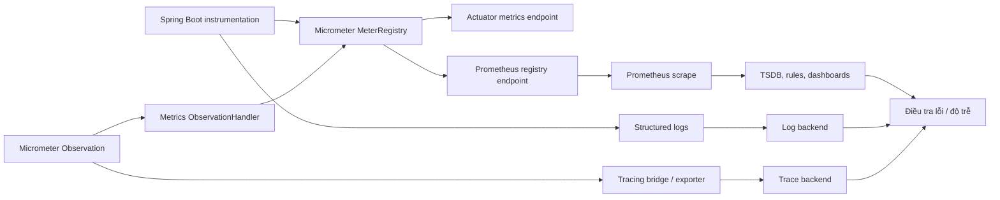

# Metric endpoint trong production

Một ứng dụng Spring Boot chạy ổn định trên môi trường phát triển. Lập trình viên mở `/actuator/metrics` và nhìn thấy `http.server.requests`, `jvm.memory.used`, `process.cpu.usage`. Sau khi triển khai lên production, nhóm vận hành muốn Prometheus thu thập dữ liệu, dựng cảnh báo và xem tỷ lệ lỗi của từng service. Cách đơn giản nhất có phải là mở toàn bộ `/actuator/**` ra Internet và dùng lại endpoint `/actuator/metrics` để scrape liên tục?

**Không.** Trong Spring Boot, **`/actuator/metrics` chủ yếu là endpoint chẩn đoán để xem các meter và phép đo hiện có**, còn **`/actuator/prometheus`** là endpoint dành cho Prometheus scrape khi có registry tương ứng. Quan trọng hơn, endpoint quan sát trên production cần được quản lý như một **bề mặt vận hành có quyền truy cập, đường mạng, tải và dữ liệu cần bảo vệ**, không phải API công khai cho mọi người dùng.

Bài học thuộc chương **Actuator metrics endpoint** của module **SPRING_BOOT_OBSERVABILITY**. Module xây dựng observability cho Spring Boot với Micrometer Observation, metrics, logs và distributed tracing; đi sâu vào context propagation, tag/cardinality, exporter, sampling và liên kết tín hiệu để điều tra lỗi, độ trễ và hành vi ứng dụng thực tế. Bài này tập trung vào cách **triển khai, bảo vệ, truy vấn và vận hành metric endpoints trong production**.

## Mục tiêu học tập

Sau bài này, bạn có thể:

1. Phân biệt vai trò của `/actuator/metrics`, `/actuator/metrics/{name}` và `/actuator/prometheus`.
2. Hiểu ba lớp cần thiết: **meter đã được tạo**, **endpoint đã bật/expose**, **đường mạng và quyền truy cập đã được phép**.
3. Thiết lập cấu hình Actuator/Prometheus phù hợp cho môi trường production, tách quản trị khỏi traffic người dùng.
4. Truy vấn một metric theo tag và diễn giải `COUNT`, `TOTAL_TIME`, `VALUE`, `MAX` đúng ngữ nghĩa.
5. Hiểu khác biệt giữa **ảnh chụp meter hiện tại** và **chuỗi thời gian đã được backend thu thập**.
6. Phòng ngừa rò rỉ thông tin, metric cardinality cao, endpoint bị lạm dụng và chi phí thu thập quá lớn.
7. Chẩn đoán các lỗi 401/403/404, endpoint không có metric, scrape thất bại hoặc dashboard mất dữ liệu.
8. Kết hợp metrics với structured logs, distributed traces và sự kiện triển khai để xử lý sự cố có bằng chứng.

## 1. Metric endpoint phục vụ hai mục đích khác nhau

### 1.1. `/actuator/metrics`: khám phá meter trong ứng dụng

`/actuator/metrics` là endpoint của Spring Boot Actuator để xem **tên các meter mà registry đang quản lý**. Nó rất hữu ích khi muốn biết ứng dụng đã instrument một HTTP route, JVM hoặc operation nghiệp vụ hay chưa.

Ví dụ lời gọi trong môi trường đã cho phép truy cập:

```bash
curl -fsS 'http://127.0.0.1:9001/actuator/metrics'
```

Phản hồi JSON mang tính minh họa:

```json
{
  "names": [
    "http.server.requests",
    "jvm.memory.used",
    "jvm.threads.live",
    "process.cpu.usage",
    "checkout.orders.accepted"
  ]
}
```

Danh sách thực tế phụ thuộc dependency, binder, cấu hình registry và những thao tác đã phát sinh. Một metric nghiệp vụ chỉ được đăng ký khi code tương ứng chạy hoặc khi nó được tạo trong quá trình khởi tạo; **không tìm thấy tên metric chưa đủ chứng minh ứng dụng không chạy nghiệp vụ**.

### 1.2. `/actuator/metrics/{name}`: xem một meter và lọc theo tag

Ví dụ:

```bash
curl -fsS \
  'http://127.0.0.1:9001/actuator/metrics/http.server.requests'
```

Một phản hồi mẫu:

```json
{
  "name": "http.server.requests",
  "description": null,
  "baseUnit": "seconds",
  "measurements": [
    { "statistic": "COUNT", "value": 1520.0 },
    { "statistic": "TOTAL_TIME", "value": 293.14 },
    { "statistic": "MAX", "value": 0.82 }
  ],
  "availableTags": [
    { "tag": "method", "values": ["GET", "POST"] },
    { "tag": "status", "values": ["200", "500"] },
    { "tag": "uri", "values": ["/checkout", "/actuator/health"] }
  ]
}
```

Đây là dữ liệu giả định minh họa cấu trúc response; các `statistic`, giá trị `baseUnit` và tag có thể khác giữa các meter và phiên bản. Với `http.server.requests`, nhiều hệ thống ghi đơn vị thời lượng qua `Timer`; một metric dạng gauge lại có thể chỉ trả `VALUE`.

Có thể lọc theo những tag đã tồn tại:

```bash
curl -fsS \
  'http://127.0.0.1:9001/actuator/metrics/http.server.requests?tag=method:POST&tag=status:500'
```

Mỗi tham số `tag=key:value` thêm một điều kiện lọc. Khi thêm nhiều `tag`, kết quả chỉ xét meter khớp những điều kiện tương ứng. Cần dùng đúng tên tag và giá trị từ `availableTags`; tên tag `uri` thường nên là route mẫu `/orders/{id}`, không phải raw URL của từng request.

**Giới hạn:** endpoint trả các measurements theo ngữ nghĩa hiện tại của registry; nó **không phải hệ thống lưu lịch sử** theo cửa sổ 5 phút, 1 giờ hay 7 ngày. Muốn biết biến động theo thời gian, cần hệ thống thu thập/lưu chuỗi thời gian.

### 1.3. `/actuator/prometheus`: đầu ra cho Prometheus scrape

Khi Micrometer Prometheus registry được tích hợp, `/actuator/prometheus` cung cấp dữ liệu dạng Prometheus/OpenMetrics phù hợp với registry và content negotiation. Prometheus định kỳ **scrape** endpoint này để xây time series.

```bash
curl -fsS 'http://127.0.0.1:9001/actuator/prometheus'
```

Các dòng minh họa:

```text
# TYPE http_server_requests_seconds_count counter
http_server_requests_seconds_count{application="checkout-service",method="POST",status="200",uri="/checkout"} 1020.0

# TYPE jvm_memory_used_bytes gauge
jvm_memory_used_bytes{application="checkout-service",area="heap",id="G1 Old Gen"} 3.1e+08
```

Đây là ví dụ định dạng, **không phải cam kết tên/label chính xác**. Micrometer và exporter có thể đổi tên từ dấu chấm sang gạch dưới, thêm đơn vị hoặc suffix, và số liệu sẽ phụ thuộc registry/phiên bản.

Prometheus có thể thu thập `/actuator/prometheus` mà **không cần expose `/actuator/metrics`** cho bên thu thập. Ngược lại, chỉ có `/actuator/metrics` không biến nó thành endpoint Prometheus scrape đúng định dạng.

### So sánh nhanh

| Endpoint | Mục đích | Định dạng phổ biến | Nên dùng trong production |
|---|---|---|---|
| `/actuator/metrics` | Liệt kê tên meter | JSON | Chẩn đoán có kiểm soát, không dùng làm scrape target Prometheus |
| `/actuator/metrics/{name}` | Xem measurements, tags của một meter | JSON | Điều tra có xác thực/giới hạn truy cập |
| `/actuator/prometheus` | Xuất dữ liệu để Prometheus scrape | Text exposition | Chỉ mở trên mạng quản trị/monitoring và bảo vệ phù hợp |
| `/actuator/health` | Tín hiệu health/readiness tùy cấu hình | JSON | Chính sách exposure riêng; không thay thế metrics |

## 2. Từ meter đến dashboard: đủ điều kiện mới có dữ liệu

Đường đi tổng quát:



Để một metric xuất hiện trên dashboard Prometheus, cần kiểm tra từng điều kiện:

1. **Instrumentation:** ứng dụng thực sự tạo meter và ghi mẫu. HTTP metrics, JVM metrics và metrics nghiệp vụ có nguồn khác nhau.
2. **Registry:** meter được đăng ký đúng `MeterRegistry`; không bị filter chặn hoặc tạo ở registry thủ công không được export.
3. **Endpoint:** Actuator và endpoint `prometheus` có dependency, enable/exposure phù hợp.
4. **Mạng/quyền truy cập:** Prometheus có thể kết nối tới management endpoint qua TLS và cơ chế authentication được chọn.
5. **Scrape:** target được cấu hình, scrape thành công đủ đều, response không bị proxy cắt hoặc timeout.
6. **Backend:** time series được ingest/lưu đủ lâu; recording rules, dashboards và alerts dùng đúng tên/tag/đơn vị.

Một lỗi ở bất kỳ lớp nào đều có thể khiến biểu đồ trống. Không sửa code instrumentation trước khi biết dữ liệu mất ở bước nào.

## 3. Cấu hình Spring Boot cho môi trường production

### 3.1. Dependencies

Với Spring Boot 3.x và Gradle, một cấu hình điển hình:

```groovy
dependencies {
    implementation 'org.springframework.boot:spring-boot-starter-actuator'
    runtimeOnly 'io.micrometer:micrometer-registry-prometheus'
}
```

Dependency Prometheus registry dùng khi chọn mô hình **scrape Prometheus**. Nếu kiến trúc dùng OTLP metrics exporter gửi tới OpenTelemetry Collector hoặc backend khác, cấu hình exporter/transport sẽ khác và không nhất thiết cần `/actuator/prometheus`.

Không bật đồng thời mọi exporter chỉ vì chúng có sẵn. Hãy xác định nơi chứa dữ liệu, yêu cầu scrape/push, retention và trách nhiệm vận hành.

### 3.2. Bật những endpoint thật sự cần thiết

Ví dụ cấu hình cho **management endpoint phục vụ mạng giám sát nội bộ**:

```yaml
spring:
  application:
    name: checkout-service

management:
  server:
    port: 9001
  endpoints:
    web:
      exposure:
        include: health,info,metrics,prometheus
  metrics:
    tags:
      application: checkout-service
      environment: production
```

Cấu hình này minh họa việc đưa management HTTP server sang **cổng riêng**. **Cổng riêng không phải lớp bảo mật:** nếu port 9001 được public, endpoints vẫn có thể bị truy cập từ bên ngoài. Cần giới hạn listener/routing, firewall hoặc network policy và áp dụng xác thực/ủy quyền thích hợp.

Trong production, có thể chọn **không expose `metrics`** thường xuyên, chỉ expose `health` và `prometheus` trên mạng quan sát nội bộ. Khi cần chẩn đoán, cho phép `metrics` theo quy trình truy cập vận hành, không mở công khai.

**Cảnh báo về cấu hình:** đừng sao chép trực tiếp ví dụ này vào môi trường thật khi chưa thiết lập network isolation và security. Spring Boot thay đổi chi tiết về `access`/`enabled` của endpoint theo phiên bản; cần kiểm tra cấu hình tương ứng và thứ tự auto-configuration trong stack đang chạy.

### 3.3. Cổng management riêng và địa chỉ bind

Nếu muốn chỉ truy cập management endpoint từ bên trong chính máy/pod, trong một số mô hình có thể cấu hình địa chỉ bind riêng, ví dụ:

```yaml
management:
  server:
    port: 9001
    address: 127.0.0.1
```

Ý nghĩa: management listener chỉ gắn vào loopback của process/network namespace. Cách này có thể **chặn Prometheus ở pod/host khác** vì không thể kết nối qua network. Chỉ dùng nếu kiến trúc có agent/sidecar hoặc proxy an toàn cùng network namespace phù hợp. Không đặt `address: 127.0.0.1` rồi kỳ vọng Prometheus bên ngoài node vẫn scrape được.

Với Kubernetes, thường dùng management port và **Service/ServiceMonitor/PodMonitor nội bộ**, giới hạn bằng NetworkPolicy, xác thực và chính sách ingress; không route management port qua public ingress. Cách triển khai cụ thể còn phụ thuộc Prometheus Operator, CNI và chính sách bảo mật của cluster.

### 3.4. Tách quyền truy cập health, metrics và prometheus

Health check dùng bởi orchestrator thường cần chính sách khác endpoint chứa metrics chi tiết:

- `health`/liveness/readiness: có thể truy cập từ control plane hoặc load balancer theo yêu cầu, chỉ công bố mức chi tiết cần thiết.
- `prometheus`: cho phép **chỉ** scraper/agent đáng tin cậy; có thể dùng mạng riêng kết hợp TLS/mTLS hoặc authentication phù hợp.
- `metrics`: giới hạn cho người vận hành/diagnostics; nó có thể cho biết tên operations và giá trị tag không nên để lộ ra ngoài.
- Các Actuator endpoints khác như environment, configprops, mappings, heapdump, loggers, shutdown có mức nhạy cảm rất khác nhau; **không dùng `include: '*'` trên public endpoint**.

Trong ứng dụng có Spring Security, khi tự khai báo `SecurityFilterChain`, Spring Boot có thể không còn áp dụng các quy tắc bảo vệ actuator mặc định như trước. Phải kiểm tra security matchers và thứ tự các chain cho cả **management** lẫn **application** endpoints; đừng tạo một chain chỉ match `/actuator/**` rồi vô tình bỏ quên các route nghiệp vụ.

Cơ chế bảo vệ cụ thể phụ thuộc việc management dùng cùng hay khác port/context, proxy/ingress và phiên bản Spring Security. **Bật exposure không đồng nghĩa đã cấp quyền an toàn; yêu cầu xác thực từ Prometheus phải kiểm thử thật.**

## 4. Đọc `/actuator/metrics` đúng ngữ nghĩa trên production

Một response từ `/actuator/metrics/http.server.requests` có thể chứa các statistic sau:

| Statistic | Ví dụ meter | Ý nghĩa | Cảnh báo |
|---|---|---|---|
| `COUNT` | Timer, DistributionSummary | Số mẫu/sự kiện đã ghi | Có thể tích lũy từ lúc process chạy; reset khi restart |
| `TOTAL_TIME` | Timer | Tổng thời lượng đã ghi | Đơn vị do meter/registry quy định; không phải request latency của một lần gọi |
| `MAX` | Timer/summary | Giá trị tối đa trong cửa sổ thống kê phù hợp | Có thể reset/expire; không luôn là max mọi thời điểm |
| `VALUE` | Gauge | Giá trị tức thời của một đại lượng | Không phải counter; có thể tăng hoặc giảm |
| `TOTAL`/`TOTAL_AMOUNT` (tùy meter/API) | Summary/counter | Tổng lượng đã ghi, tùy phép đo và phiên bản | Không suy ra percentile từ tổng lượng |

Nếu HTTP Timer có `COUNT=1000` và `TOTAL_TIME=300` giây, trung bình tích lũy trên các mẫu liên quan khoảng `300/1000 = 0,3` giây. Tuy nhiên, **con số này không cho biết p95** và không phải độ trễ “trong 5 phút gần nhất” nếu số liệu không được lấy hiệu theo cùng khoảng thời gian. Muốn thấy tốc độ lỗi, mức thay đổi và phân bố trong một cửa sổ thời gian, backend time series phù hợp hơn.

### Truy vấn một nhóm tag không phải truy vấn lịch sử

```bash
curl -fsS \
  'http://127.0.0.1:9001/actuator/metrics/http.server.requests?tag=uri:/checkout&tag=method:POST'
```

Kết quả giúp xem measurements của những meters có `uri=/checkout` và `method=POST`. Nó **không** trả danh sách từng request, từng trace ID hoặc khoảng thời gian giữa các request.

Các lưu ý:

- Nếu URL/tag value chứa ký tự đặc biệt, phải URL-encode đúng để tránh proxy/client cắt tham số.
- Không query theo raw order ID hoặc user ID vì metric labels vốn không nên có các giá trị cardinality cao đó.
- Cần biết cấu hình nào tạo được `http.server.requests`: meter có thể chưa được đăng ký do chưa có traffic hoặc instrumentation bị tắt.
- Đối với HTTP metrics, `uri` thường là **route template** hoặc nhãn chuẩn hóa, không phải raw path; có thể có các giá trị như `UNKNOWN` hoặc `NOT_FOUND` tùy phiên bản và tình huống.

## 5. Prometheus scrape production: cấu hình, tải và truy vấn

### 5.1. Mẫu cấu hình scraper

Một cấu hình Prometheus đơn giản để minh họa ý tưởng:

```yaml
scrape_configs:
  - job_name: checkout-service
    scheme: http
    metrics_path: /actuator/prometheus
    scrape_interval: 30s
    static_configs:
      - targets:
          - checkout-management.internal:9001
```

Đây là ví dụ **mạng nội bộ giả định**. Trong production, thường dùng service discovery, TLS/mTLS hoặc xác thực, chính sách mạng và cấu hình target riêng cho từng instance. Khi bật HTTPS, phải đổi `scheme` và thiết lập trust/authentication đúng. Không xem ví dụ `http` như khuyến nghị dùng plaintext trên mạng không tin cậy.

Scrape thường trả **toàn bộ series mà registry xuất**, không phải một query chọn riêng metric. Vì vậy các yếu tố sau ảnh hưởng trực tiếp tới tải:

- Số meter và số tổ hợp tag.
- Số buckets khi bật histogram/percentile.
- Kích thước response và tần suất scrape.
- Khả năng phục vụ HTTP của management endpoint.
- Chi phí lưu time series và retention ở Prometheus/backend.

Một scrape interval ngắn không làm metric “chính xác vô hạn”; nó chỉ lấy mẫu thường xuyên hơn và tăng số data points. Gauge có thể bỏ lỡ đỉnh xảy ra giữa hai lần scrape. Counter cần được xử lý reset khi process restart.

### 5.2. Query throughput và error rate

Nếu exporter trong hệ thống tạo series timer HTTP theo dạng `http_server_requests_seconds_count`, có thể dùng PromQL:

```promql
sum(
  rate(http_server_requests_seconds_count{
    application="checkout-service",
    uri="/checkout"
  }[5m])
)
```

Kết quả là request/giây được ước lượng trên cửa sổ 5 phút, không phải số request của đúng một giây. Phải kiểm tra tên series và labels ở backend trước khi áp dụng.

Tỷ lệ HTTP 5xx của endpoint trên cùng cửa sổ:

```promql
sum(
  rate(http_server_requests_seconds_count{
    application="checkout-service",
    uri="/checkout",
    status=~"5.."
  }[5m])
)
/
sum(
  rate(http_server_requests_seconds_count{
    application="checkout-service",
    uri="/checkout"
  }[5m])
)
```

Biểu thức chỉ có ý nghĩa khi mẫu số có lưu lượng. Khi không có request, tỷ lệ có thể không được xác định; quy tắc alert cần xử lý trường hợp thiếu/không đủ dữ liệu thay vì mặc định “0% lỗi”. Định nghĩa SLI phải làm rõ HTTP 4xx có tính lỗi hay không, có loại probe/internal traffic hay không, và khi retry sẽ đếm request hay giao dịch nghiệp vụ.

### 5.3. p95 latency khi có histogram

Khi timer có histogram buckets tương thích:

```promql
histogram_quantile(
  0.95,
  sum by (le) (
    rate(http_server_requests_seconds_bucket{
      application="checkout-service",
      uri="/checkout"
    }[5m])
  )
)
```

Đây là **ước lượng p95** từ buckets. Nó chỉ hoạt động khi exporter có `_bucket` phù hợp và các bucket boundaries có thể gộp. Không phải mọi Spring Boot HTTP timer đều bật histogram mặc định; không thấy series `_bucket` không có nghĩa endpoint `/actuator/metrics` bị hỏng.

**Không lấy trung bình p95 của từng pod** rồi coi đó là p95 toàn dịch vụ. Dùng histogram đã cấu hình/được backend hỗ trợ hoặc một phương pháp thống kê có tính đến phân bố và lượng mẫu.

### 5.4. Thời gian và retention

`/actuator/metrics` chỉ cho thấy measurements hiện tại; Prometheus hoặc backend mới lưu chuỗi thời gian. Khi cần hỏi “trước deploy 30 phút tình hình thế nào?”, phải có:

1. Scrape đã diễn ra trong thời gian đó.
2. Time series còn nằm trong retention.
3. Labels/metric name không bị đổi schema làm query bỏ sót.
4. Target không bị mất một phần instance hoặc ngắt scrape.
5. Quy tắc recording/downsampling không làm mất độ phân giải cần thiết.

Một endpoint đáp ứng 200 tại thời điểm hiện tại **không chứng minh** dữ liệu lịch sử đã được lưu đầy đủ.

## 6. Bảo mật metric endpoint trong production

Metrics có vẻ chỉ là các con số, nhưng tên meter, tags và giá trị của chúng có thể tiết lộ kiến trúc và trạng thái hệ thống:

- Tên service, phiên bản, host/instance hoặc environment.
- Tên HTTP routes, component, database pool và dependency.
- Số lượng request, tỷ lệ lỗi, các đỉnh lưu lượng, thời gian phản hồi.
- Tên operation nghiệp vụ hoặc trạng thái của hệ thống xử lý dữ liệu.
- Dữ liệu nhạy cảm vô tình được đưa thành tag, ví dụ email, user ID, raw URL/query.

Vì vậy, việc triển khai production cần áp dụng **defense in depth**:

1. **Không public exposure:** quản lý ingress, load balancer, Service và firewall để management endpoint chỉ nằm trên mạng được phép.
2. **Authentication/authorization:** chỉ crawler/agent và người vận hành được quyền đọc những endpoint cần thiết.
3. **TLS:** bảo vệ đường truyền ở các ranh giới không tin cậy và xác minh chứng chỉ.
4. **Least privilege:** health cho probe khác quyền scrape và quyền xem chi tiết metrics.
5. **Không tiết lộ ID nhạy cảm:** dùng route template, common tags hữu hạn; tránh `userId`, `orderId`, `traceId` như metric labels.
6. **Kiểm tra rate và tải:** giới hạn những truy cập ngoài scraper được phép, kiểm soát timeout/concurrency nếu cần.
7. **Audit/cấu hình:** quản lý thay đổi exposure, credential rotation, chính sách truy cập và tình trạng target.

**Không coi `management.server.port` là tường lửa**, và cũng không coi việc một endpoint trả 401/403 từ máy phát triển là bằng chứng duy nhất rằng nó an toàn trên toàn bộ đường mạng production.

### Dữ liệu không nên đưa vào metric tags

```text
Nên dùng:
  application=checkout-service
  environment=production
  method=POST
  uri=/orders/{id}
  status=500

Không nên dùng:
  uri=/orders/9328471?token=...
  userId=283714
  email=customer@example.test
  traceId=...
  sessionToken=...
```

Tổng số time series thường tăng theo tổ hợp giá trị tags. Với ví dụ 5 methods × 30 routes × 6 status groups × 10 instances, về mặt tổ hợp đã có thể có **9.000 series** cho một metric, chưa tính histogram buckets và tags bổ sung. Gắn ID của mỗi request làm label khiến số series khó kiểm soát. Việc lọc tags phải bắt đầu ở instrumentation/convention, không chỉ dựa vào bộ lọc ở backend.

## 7. Thiết kế quan sát chính endpoint giám sát

Telemetry pipeline cũng cần được giám sát. Một ứng dụng còn chạy nhưng metrics mất hoàn toàn vẫn có thể khiến SLO và alerts sai.

Những tín hiệu nên theo dõi:

| Tín hiệu | Câu hỏi trả lời | Dấu hiệu bất thường |
|---|---|---|
| Prometheus target `up` | Scraper có thu được dữ liệu từ target không? | `up=0` hoặc target biến mất khỏi service discovery |
| Scrape duration | Lấy toàn bộ metrics có tốn thời gian không? | Gần hoặc vượt scrape timeout |
| Scrape samples / series | Có bao nhiêu time series được nhận? | Tăng đột biến hoặc giảm bất thường sau deploy |
| Response size và HTTP status | Endpoint có trả dữ liệu đầy đủ và được phép truy cập không? | 401, 403, 404, 5xx, response bị cắt |
| Registry meter count / cardinality | Có thêm tags/meter ngoài dự kiến không? | Số series tăng sau đổi schema |
| Exporter/collector health | Có lỗi gửi, queue đầy hay dropped data không? | Có traffic ứng dụng nhưng tín hiệu downstream thiếu |
| Target version và deployment | Dữ liệu thuộc bản phát hành nào? | Một nhóm instance mất tag, query lọc sai version |

**`up=1` chưa đủ chứng minh mọi metric đều đúng.** Một target có thể scrape thành công nhưng thiếu riêng meter nghiệp vụ, ghi sai đơn vị hoặc bị `MeterFilter` chặn. Ngược lại, một service có thể trả request bình thường dù `up=0` vì lỗi đường mạng monitoring.

Nên có cảnh báo khi một target giám sát quan trọng biến mất hoặc số series thay đổi bất thường. Cần xác định tính chất từng service và tránh alert spam khi scaling/rolling deployment làm thay đổi số instance hợp lệ.

## 8. Các lỗi thường gặp khi triển khai production

### 8.1. `/actuator/metrics` trả 404

Các nguyên nhân có thể gồm:

- Chưa có Actuator dependency/endpoint.
- Endpoint không được enable hoặc không nằm trong danh sách web exposure.
- Base path của Actuator hoặc port management đã thay đổi.
- Reverse proxy/ingress chỉ route một số path.
- Security/proxy cố tình che endpoint không được phép truy cập bằng 404.

**Cách điều tra:** xác minh đúng host/port/path và cấu hình Actuator, kiểm tra route từ bên trong network được phép; không khắc phục bằng `include: '*'` trên public ingress.

### 8.2. Endpoint trả 401 hoặc 403

401 thường cho biết chưa xác thực phù hợp; 403 thường liên quan quyền bị từ chối. Khi có reverse proxy và security chain, ý nghĩa cụ thể còn phụ thuộc nơi phát sinh response.

**Cách điều tra:** xác minh identity của scraper, credential, TLS, Spring Security filter chain, network policy và authorization của từng endpoint. **Không tắt authentication ở production chỉ để cho scrape thành công.**

### 8.3. Có `/actuator/metrics` nhưng không có `/actuator/prometheus`

Không phải lỗi của HTTP meter. Có thể Prometheus registry chưa có dependency, endpoint chưa expose, registry đã bị thay thế hoặc auto-configuration bị vô hiệu.

**Cách điều tra:** kiểm tra registry được tạo, cấu hình web exposure, trạng thái security và endpoint path. Nếu kiến trúc thật sự dùng OTLP push, có thể **không cần** endpoint Prometheus.

### 8.4. `metrics` có tên, nhưng `measurements` trống hoặc thiếu tag

Một số meter được tạo nhưng chưa ghi sample; một số loại meter chỉ công bố các statistic phù hợp ngữ nghĩa. Tags có thể khác do customizer/filter hoặc registration chưa đồng nhất giữa các instance.

**Cách điều tra:** phát sinh một request hợp lệ có kiểm soát, kiểm tra nơi code đăng ký meter, kiểu meter, tag policy và `MeterRegistry` thực tế.

### 8.5. Prometheus scrape thành công nhưng dashboard không có dữ liệu

Có thể query dùng sai tên/suffix metric, sai label, time window quá ngắn, series chưa có mẫu hoặc dashboard lọc mất instance/version. Cũng có thể target scrape được nhưng ingestion/rule pipeline bị lỗi.

**Cách điều tra:** tìm series trực tiếp trong Prometheus, kiểm tra `up`, tên metric từ exporter, label values, timestamps, recording rules và retention. Đừng tự đổi tên meter trước khi biết layer nào đang sai.

### 8.6. Sau deploy số series tăng rất nhanh

Có thể đã thêm `userId`/`orderId`/raw URL vào tags, bật nhiều histogram buckets hoặc thay một common tag theo request. Một ứng dụng có cùng lượng traffic nhưng số series tăng mạnh sẽ gây tăng chi phí backend.

**Cách điều tra:** so sánh schema tags và distinct values trước/sau deploy; chuẩn hóa URL/labels, điều chỉnh `MeterFilter` như guardrail có ý thức, không dựa vào việc lọc sau khi dữ liệu đã bị tạo tràn lan.

### 8.7. Có metric HTTP latency nhưng không tìm được trace chậm

Metrics và traces có pipeline riêng. Traces có thể bị head/tail sampling, context propagation đứt, collector drop hoặc retention hết. **Không thêm trace ID vào metric tag** để tìm trace. Xem xét exemplar nếu stack hỗ trợ; đối chiếu logs theo trace ID và chọn trace mẫu phù hợp.

## 9. Triển khai nhiều instance, Kubernetes và proxy

Một hệ thống production thường có nhiều replica, rolling deployment và các lớp proxy/ingress. Một URL `/actuator/prometheus` trỏ vào **load balancer phân phối ngẫu nhiên tới nhiều pod** không tương đương scrape từng JVM.

Vì sao?

- Prometheus thường kỳ vọng một **target nhận diện một tập metrics ổn định**.
- Nếu các lần scrape lần lượt tới các pod khác nhau dưới **cùng một label set**, counter có thể nhảy lùi/xuất hiện reset giả; histogram và gauge có thể phản ánh dữ liệu của các JVM khác nhau.
- Khi scaling, pod mới/cũ có version, uptime và tag schema khác nhau.

**Thiết kế đúng:** service discovery để scrape từng instance/pod với identity ổn định trong phạm vi đời target; gắn labels phù hợp để gộp theo service/environment ở query, nhưng vẫn giữ khả năng phân tích từng instance khi cần.

### Những điều phải xác nhận trong Kubernetes

1. Management port được khai báo đúng ở Pod/Service/PodMonitor/ServiceMonitor theo triển khai.
2. Probe và scraping không bắt buộc dùng chung URL hoặc cùng quyền truy cập.
3. NetworkPolicy chỉ cho phép monitoring namespace/agent liên quan.
4. Public Ingress không route quản trị endpoint ngoài yêu cầu.
5. Scrape không chạy qua một service load-balanced làm mất identity pod.
6. Labels `pod`, `instance`, `namespace`, `service` không xung đột với common tags do ứng dụng tự thêm.
7. Rolling deployment không làm dashboard trộn các phiên bản mà không có khả năng phân biệt.
8. Prometheus và ứng dụng thống nhất đường dẫn, port, scheme và authentication.

Khi dùng ServiceMonitor hoặc PodMonitor, cấu trúc CRD phụ thuộc phiên bản/operator và cấu hình tổ chức; cần kiểm chứng trên cluster thật, không suy diễn từ ví dụ `static_configs` đơn giản ở trên.

## 10. Metric endpoint trong mối quan hệ với logs và traces

Metrics rất phù hợp để biết **quy mô, xu hướng và SLO**, nhưng không mô tả toàn bộ chuỗi sự kiện của một request. Một metric HTTP báo p95 tăng không cho biết request chậm vì DB, hàng đợi, mạng hay nhà cung cấp thanh toán. Để đi từ biểu đồ sang nguyên nhân:

- **Metrics:** xác định lúc nào sự cố bắt đầu, route nào, tỷ lệ lỗi và phân bố latency.
- **Logs:** tìm error event, stack trace hoặc quyết định nghiệp vụ, nếu logging được thiết kế phù hợp.
- **Traces:** xem đường đi của những request đã được instrument và lưu theo sampling.
- **Deployment events và dữ liệu nghiệp vụ:** xem thay đổi code/config, lưu lượng, retry hoặc các điều kiện bên ngoài.

Trong Spring Boot, `ObservationRegistry` và các handlers có thể tạo ra metrics/traces từ cùng observation. Nhưng `/actuator/metrics` chỉ thể hiện **đường metrics**; nó không phải giao diện truy vấn trace hoặc log backend.

Để tương quan:

1. Dùng tên service/environment/route/tag có cardinality thấp cho metrics.
2. Thiết lập log correlation `traceId`/`spanId` nếu Micrometer Tracing và logging hỗ trợ.
3. Bảo đảm propagation qua HTTP client, messaging và các ranh giới async.
4. Hiểu sampling: metric có thể ghi tất cả request được instrument, trong khi backend trace chỉ giữ một phần.
5. Nếu backend hỗ trợ **exemplar**, dùng nó để mở trace từ một điểm metric mà không đưa `traceId` thành label của mọi time series.

Không tìm thấy trace của một request có lỗi **không chứng minh request đó không tồn tại**. Hãy kiểm tra sampler, exporter/collector, TTL/retention và propagation trước khi kết luận.

## 11. Tình huống thực tế: scrape vẫn thành công nhưng cảnh báo 5xx biến mất

Một ứng dụng checkout chạy trên bốn pod. Sau khi thêm một custom `MeterRegistry` trong module thanh toán, SLO dashboard cho thấy tỷ lệ 5xx về 0%, trong khi người dùng báo lỗi và log có `payment_provider_timeout`.

Dữ liệu ban đầu:

- Prometheus hiển thị `up=1` đối với các target.
- `/actuator/prometheus` trả dữ liệu JVM.
- Một số pod có metric `http.server.requests` với các tags như trước; một số pod không còn series tương ứng trong dashboard.
- Structured logs và traces mẫu xác nhận request vẫn đi vào service.

### Quy trình điều tra

**Bước 1 — Xác nhận biểu đồ phản ánh đúng hay không.** Kiểm tra numerator, denominator, label selectors và cửa sổ query. Nếu mẫu số bằng 0 hoặc series không tồn tại, một panel có thể hiển thị “0” do biểu thức xử lý dữ liệu thiếu; đó không phải bằng chứng không có lỗi.

**Bước 2 — Kiểm tra target và metric gốc.** Với từng pod, xem `up`, `/actuator/metrics/http.server.requests` và các series thực tế ở `/actuator/prometheus`. Xác định metric mất tại app/registry hay chỉ bị query lọc ra.

**Bước 3 — Kiểm tra registry và tag policy.** Nếu metrics HTTP hoặc nghiệp vụ đi vào registry mới không được exporter quản lý, chúng có thể không hiện ở Prometheus. Một `MeterRegistryCustomizer` hoặc common tag chỉ áp dụng trên các registry phù hợp; không mặc định mọi registry tạo thủ công đều nhận.

**Bước 4 — Kiểm tra rolling deployment.** Các instance có cùng `application` và `environment` không? Label `uri` hoặc `status` có đổi tên/schema theo version không? Có pod mới dùng registry/handler khác không?

**Bước 5 — Liên kết tín hiệu.** Dùng log timeout và trace của những request được lưu để khoanh vùng dependency; metric 5xx cho biết quy mô lỗi sau khi series được khôi phục, không lấy số log ERROR thay cho request count vì retry có thể sinh nhiều log cho một request.

**Bước 6 — Khôi phục và xác nhận.** Sửa wiring registry/exporter hoặc dashboard selector phù hợp; kiểm tra lại target-by-target, request count, tỷ lệ 5xx, SLI/SLO và cảnh báo khi phát sinh lỗi kiểm thử có kiểm soát.

**Kết luận:** “Scrape thành công” chỉ có nghĩa đường thu thập hoạt động đến một mức độ nhất định. Nó không chứng minh **từng meter cần cho SLO** đã được đăng ký, xuất và truy vấn đúng.

## 12. Checklist đưa metric endpoint vào production

Trước khi phát hành hoặc thay đổi cấu hình, hãy kiểm tra:

1. **Mục đích:** cần `/actuator/metrics` để chẩn đoán hay `/actuator/prometheus` để scrape? Có thật sự cần cả hai expose thường trực không?
2. **Dependency:** có Actuator và registry/exporter đúng với kiến trúc Prometheus hoặc OTLP không?
3. **Registry:** HTTP/JVM/business meters đang được tạo trên đúng `MeterRegistry` không? Có filter/registries phụ gây mất dữ liệu không?
4. **Exposure:** chỉ bật các endpoint cần thiết; quản lý base path, port và access theo version Spring Boot.
5. **Mạng:** management port không public, target discovery theo từng instance/pod, không scrape qua LB ngẫu nhiên.
6. **Security:** TLS/authentication/authorization, SecurityFilterChain và proxy/network policy được kiểm tra end-to-end.
7. **Privacy:** không có token, email, user/order ID hoặc raw URL/query trong tags.
8. **Cardinality:** có ngân sách số meter, tổ hợp tag, histogram buckets, response size và ingestion không?
9. **Scrape:** có timeout, interval, target status, `up`, duration và dropped-series monitoring không?
10. **PromQL:** queries dùng đúng tên, tag, unit, counter/gauge type, reset và sampling window không?
11. **SLO:** request/error/latency có định nghĩa đo chính xác, mẫu số hợp lệ và xử lý no-data không?
12. **Observability pipeline:** khi backend trống, có cách phân biệt meter không được tạo, endpoint bị chặn và ingestion lỗi không?
13. **Cross-signal:** có logs/trace context, sampling, propagation và sự kiện deploy để điều tra nguyên nhân không?
14. **Thay đổi schema:** đã rà soát dashboards, alerts, recording rules, retention khi đổi tên/tag/route chưa?
15. **Kiểm chứng:** đã tạo request thành công, lỗi và chậm có kiểm soát; kiểm tra data point, alert và quyền truy cập thực tế chưa?

## 13. Các anti-pattern cần tránh

| Anti-pattern | Vấn đề | Cách cải thiện |
|---|---|---|
| Public `/actuator/**` để tiện giám sát | Lộ endpoint quản trị và metadata nhạy cảm | Chỉ expose tối thiểu, dùng mạng và quyền truy cập riêng |
| Scrape `/actuator/metrics` như Prometheus exposition | Sai định dạng/ngữ nghĩa, không có lịch sử theo API đó | Scrape `/actuator/prometheus` khi dùng Prometheus registry |
| Coi management port riêng đã đủ bảo mật | Port vẫn có thể public | Network isolation + TLS/authentication/authorization |
| Chỉ dùng `up=1` để chứng minh SLO metrics đầy đủ | Target còn chạy nhưng meter riêng có thể mất | Kiểm tra các series quan trọng và no-data alerts |
| Gắn `traceId`/`userId` vào metric tags | Tăng cardinality và rủi ro thông tin | Tag hữu hạn, trace/log correlation riêng |
| Scrape qua load balancer tới pod ngẫu nhiên | Counter/gauge trộn JVM, reset giả | Service discovery theo từng pod/instance |
| Dùng `rate()` cho gauge `jvm.memory.used` | Sai kiểu phép đo | Dùng gauge trực tiếp hoặc phép biến động phù hợp |
| Dùng `COUNT` tại một thời điểm làm “request 5 phút” | Không có cửa sổ lịch sử | Sử dụng backend `rate/increase` đúng ngữ nghĩa |
| Tính trung bình p95 của các pod | Không phải percentile toàn hệ thống | Dùng histogram có thể tổng hợp đúng |
| Mở `include: '*'` khi thấy 404 | Mở rộng bề mặt tấn công không cần thiết | Kiểm tra dependency, endpoint access/exposure và proxy |
| Tắt Spring Security để sửa 403 | Mất bảo vệ endpoints | Sửa credential/quyền và cấu hình security chain |
| Xem dashboard lỗi về 0% khi không có mẫu số | Có thể là no-data giả dạng 0 | Phân biệt no-data, zero traffic và zero errors |

## 14. Câu hỏi tự đánh giá

**Câu 1.** Tại sao Prometheus nên scrape `/actuator/prometheus` thay vì `/actuator/metrics`?

**Gợi ý:** `metrics` trả JSON chẩn đoán tên meter và measurements; `prometheus` là endpoint xuất metrics theo định dạng phù hợp cho Prometheus khi có registry tương ứng. Lịch sử nằm ở backend sau các lần scrape.

**Câu 2.** Có thể xem `COUNT` của `http.server.requests` trong `/actuator/metrics` và kết luận đó là số request trong 5 phút gần nhất không?

**Gợi ý:** Không. Count thường có ngữ nghĩa tích lũy theo meter/process. Cần chuỗi thời gian ở backend và query theo cửa sổ để tính lượng request trong 5 phút.

**Câu 3.** Bật `management.server.port: 9001` đã bảo đảm endpoint an toàn trong production chưa?

**Gợi ý:** Chưa. Port riêng chỉ tách listener; vẫn cần mạng riêng, firewall/network policy và xác thực/ủy quyền/TLS phù hợp.

**Câu 4.** Prometheus có `up=1` nhưng dashboard HTTP 5xx không có dữ liệu. Có thể kết luận service không có lỗi không?

**Gợi ý:** Không. Kiểm tra xem metric có được đăng ký và xuất không, label selectors có lọc mất series không và mẫu số SLI có tồn tại không.

**Câu 5.** Tại sao không nên scrape management endpoint qua một load balancer phân phối tới nhiều pod?

**Gợi ý:** Mỗi lần scrape có thể lấy số liệu của JVM khác dưới cùng một identity target, khiến counter reset giả, gauge dao động và tổng hợp sai. Scrape từng instance/pod.

**Câu 6.** Metric HTTP báo latency tăng nhưng trace backend không tìm được request chậm cụ thể. Có nên thêm `traceId` vào metric label không?

**Gợi ý:** Không. Trace ID có cardinality rất cao. Kiểm tra tracing sampling, propagation, exporter và log correlation; dùng exemplar nếu hạ tầng hỗ trợ.

**Câu 7.** `/actuator/prometheus` trả 404 sau một deploy, trong khi `/actuator/health` vẫn chạy. Nên kiểm tra gì?

**Gợi ý:** Kiểm tra dependency Prometheus registry, trạng thái endpoint, web exposure, base path, management port, security và proxy routing. Health không chứng minh Prometheus endpoint đã được bật.

## Kết luận

**Metric endpoint trong production phải được thiết kế như một phần của hệ thống giám sát có bảo vệ**, không đơn thuần là đường URL để đọc vài con số. `/actuator/metrics` thích hợp cho chẩn đoán meter; `/actuator/prometheus` phục vụ Prometheus scrape khi có registry tương ứng. Để dữ liệu đáng tin, cần tạo meter đúng cách, bảo đảm exporter/scraper/backend hoạt động, tách quyền truy cập quản trị, kiểm soát cardinality và đọc đúng counter, gauge, histogram, percentile trong cửa sổ thời gian. Cuối cùng, metrics cần được liên kết với structured logs, distributed traces, sampling, context propagation và sự kiện triển khai để biến một biểu đồ bất thường thành kết luận có bằng chứng.
