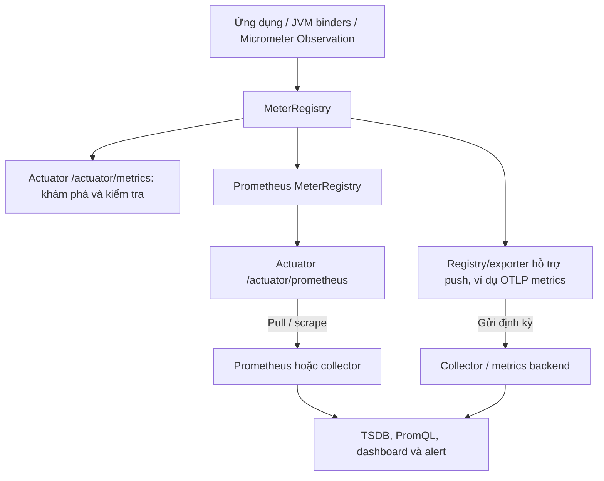
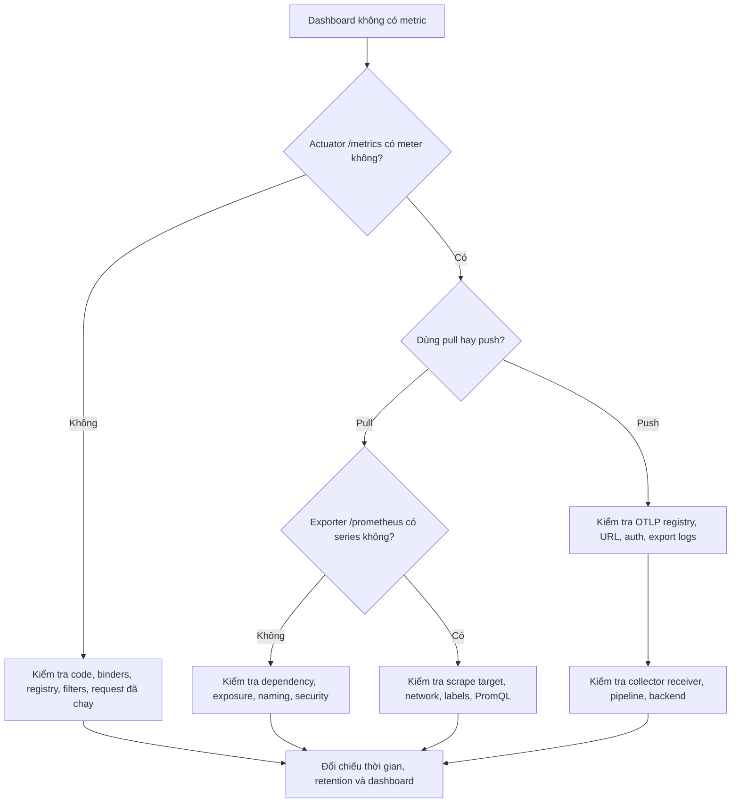

# Khác biệt metrics endpoint và exporter trong Spring Boot Actuator

Một ứng dụng Spring Boot nhận nhiều request và đã ghi nhận metric `http.server.requests`. Lập trình viên mở `http://localhost:8080/actuator/metrics/http.server.requests` thì thấy bộ đếm request tăng lên. Nhưng khi mở Grafana, dashboard vẫn trống. Trường hợp ngược lại cũng xảy ra: Prometheus có dữ liệu lịch sử HTTP request, song một người truy cập `/actuator/metrics` lại nhận HTTP 404 hoặc 403.

Hai tình huống này **không mâu thuẫn** vì **Actuator metrics endpoint** và **metrics exporter** đảm nhiệm những công việc khác nhau. Endpoint hỗ trợ khám phá và kiểm tra meter bên trong một instance; exporter đưa dữ liệu theo một giao thức/định dạng phù hợp tới hệ thống giám sát bên ngoài. Để có biểu đồ theo thời gian, thông thường còn cần một hệ thống thu thập và lưu trữ dữ liệu.

Đây là bài **“Khác biệt metrics endpoint và exporter”** thuộc chương **Actuator metrics endpoint** của module `SPRING_BOOT_OBSERVABILITY`. Phạm vi module bao gồm Micrometer Observation, metrics, logs, distributed tracing, context propagation, tag/cardinality, exporter và sampling, nhằm điều tra lỗi, độ trễ cùng hành vi ứng dụng trên môi trường thực.

## 1. Phân biệt nhanh: metrics endpoint, exporter và backend

| Thành phần | Chức năng chính | Người dùng/đối tượng sử dụng | Ví dụ |
| --- | --- | --- | --- |
| **Meter/MeterRegistry** | Đăng ký và lưu trạng thái metric trong tiến trình JVM | Ứng dụng, Micrometer binder và handler | `Counter`, `Timer`, `Gauge`, `MeterRegistry` |
| **Actuator metrics endpoint** | Khám phá tên meter, phép đo và tag trong instance hiện tại | Developer, người vận hành, công cụ chẩn đoán | `GET /actuator/metrics`, `GET /actuator/metrics/{name}` |
| **Metrics exporter/registry integration** | Chuyển metric sang định dạng/giao thức đích để thu thập từ bên ngoài | Collector, metrics backend, monitoring agent | Prometheus registry, OTLP metrics registry, các registry của vendor |
| **Prometheus Actuator endpoint** | Công bố định dạng exposition để Prometheus hoặc agent scrape | Prometheus/collector ở chế độ pull | `GET /actuator/prometheus` |
| **Collector/backend** | Thu thập, lưu thời gian, truy vấn, tổng hợp, tính rate và hỗ trợ alert | SRE, dashboard, alerting | Prometheus, dịch vụ metrics tương thích hoặc nền tảng giám sát khác |

**Kết luận cốt lõi:** `/actuator/metrics` **không phải** Prometheus exporter, không phải kho dữ liệu lịch sử và không tự biến dữ liệu thành dashboard. Ngược lại, một metrics exporter **không nhất thiết là HTTP endpoint**; exporter có thể gửi dữ liệu chủ động theo chu kỳ đến nơi nhận.

### Hai đường đi thường gặp



Sơ đồ mang tính logic: các registry được cấu hình và ghép với ứng dụng theo cơ chế Spring Boot/Micrometer; không hàm ý một registry nhất thiết chuyển dữ liệu trực tiếp sang registry khác. Nếu sử dụng nhiều registry, Spring Boot có thể cấu hình composite registry hoặc cơ chế gắn meter tương ứng.

## 2. Actuator `/actuator/metrics` dùng để làm gì?

Trong Spring Boot Actuator, endpoint có ID `metrics` cung cấp giao diện kiểm tra các meter đã đăng ký trong `MeterRegistry`. Khi truy cập:

```bash
curl -s http://localhost:8080/actuator/metrics
```

Ứng dụng thường trả danh sách tên meter hiện có. Ví dụ phản hồi **minh họa**:

```json
{
  "names": [
    "http.server.requests",
    "jvm.memory.used",
    "jvm.gc.pause",
    "process.cpu.usage",
    "orders.confirmed"
  ]
}
```

Danh sách thực tế thay đổi theo dependency, phiên bản Spring Boot, JDK, loại server, cấu hình registry và những thao tác đã xảy ra. Một custom meter chưa từng được đăng ký sẽ không tự xuất hiện chỉ vì có endpoint `metrics`.

Để xem một tên meter:

```bash
curl -s http://localhost:8080/actuator/metrics/http.server.requests
```

Phản hồi thường gồm `name`, `description`, `baseUnit` nếu có, `measurements` và `availableTags`. Ví dụ cấu trúc **giả định**:

```json
{
  "name": "http.server.requests",
  "description": null,
  "baseUnit": "seconds",
  "measurements": [
    { "statistic": "COUNT", "value": 3.0 },
    { "statistic": "TOTAL_TIME", "value": 0.42 }
  ],
  "availableTags": [
    { "tag": "method", "values": ["GET", "POST"] },
    { "tag": "status", "values": ["200", "201"] },
    { "tag": "uri", "values": ["/api/orders/{id}", "/api/orders"] }
  ]
}
```

Đừng suy ra mọi máy đều trả đúng các trường, đơn vị hoặc giá trị trong JSON này. Với Timer, duration qua Actuator thường được biểu diễn theo đơn vị do endpoint/registry cung cấp; cần đọc phản hồi thực tế và hiểu ý nghĩa của statistic.

### 2.1. Lọc theo tag

Endpoint cho phép chỉ định một hoặc nhiều query param `tag=key:value`. Khi lọc theo `method` và route template:

```bash
curl -G 'http://localhost:8080/actuator/metrics/http.server.requests' \
  --data-urlencode 'tag=method:GET' \
  --data-urlencode 'tag=uri:/api/orders/{id}'
```

Dùng `--data-urlencode` thay vì tự ghép query string khi route template chứa dấu ngoặc nhọn hoặc ký tự đặc biệt. Các giá trị `uri` phải đúng tag thực tế; chúng có thể khác ở request không match route hoặc ở stack/phiên bản khác.

Khi nhiều meter có cùng tên nhưng bộ tags khác nhau, metrics endpoint có thể tổng hợp các phép đo cùng loại tương ứng bộ lọc. Ví dụ `COUNT` của Timer có thể là số lần ghi nhận; nhưng không được tự xem mọi statistic của mọi loại meter như nhau. `VALUE` của một Gauge phản ánh giá trị quan sát, còn `TOTAL_TIME` của Timer là tổng thời lượng.

### 2.2. Endpoint không làm những gì?

- Không lưu **lịch sử metric theo phút, giờ hoặc ngày** như time-series database.
- Không có chức năng mặc định để chạy PromQL, `rate()`, `histogram_quantile()` hay tạo alert.
- Không tự xuất từng metric sang Prometheus chỉ vì `/actuator/metrics` trả JSON.
- Không tự tạo span tracing, ghi log correlation hoặc quyết định trace sampling.
- Không đảm bảo một metric chưa tồn tại sẽ xuất hiện; dữ liệu phải được binder/code/handler tạo ra và đăng ký trước.

Endpoint thường cho biết **trạng thái ở một instance đang chạy**. Khi ứng dụng restart, các meter lưu trong bộ nhớ tiến trình có thể reset; dữ liệu lịch sử muốn giữ cần được backend thu thập và lưu bên ngoài.

## 3. Exporter là gì và tại sao cần nó?

Một exporter hoặc registry integration đảm nhiệm việc làm cho dữ liệu Micrometer **đọc được bởi hệ thu thập bên ngoài**, theo định dạng và chu kỳ phù hợp. Có hai mô hình phổ biến:

| Kiểu | Cách thu thập | Thành phần giữ lịch thu thập | Ví dụ |
| --- | --- | --- | --- |
| **Pull/scrape** | Backend hoặc agent gọi vào endpoint ứng dụng để lấy toàn bộ mẫu hiện tại | Prometheus hoặc collector | `/actuator/prometheus` do Prometheus registry hỗ trợ |
| **Push/export** | Ứng dụng/registry định kỳ gửi dữ liệu đến endpoint nhận | Registry/exporter ở phía ứng dụng; receiver nhận | OTLP metrics qua HTTP tới OpenTelemetry Collector |

Một hệ backend có thể nhận nhiều nguồn hoặc có collector chuyển từ pull sang push. “Push hay pull” nói đến **một đoạn đường truyền cụ thể**, không nhất thiết mô tả toàn bộ kiến trúc end-to-end.

### 3.1. Prometheus exporter và `/actuator/prometheus`

Với dependency Prometheus registry và endpoint được công bố, `/actuator/prometheus` có thể trả dữ liệu theo định dạng exposition của Prometheus. Ví dụ:

```text
# HELP orders_confirmed_total Number of confirmed orders
# TYPE orders_confirmed_total counter
orders_confirmed_total{channel="web"} 14.0
orders_confirmed_total{channel="mobile"} 7.0
```

Đây là **ví dụ minh họa định dạng**, không phải dữ liệu đã đo hay cam kết tên xuất giống hệt mọi phiên bản. Exporter có thể thay tên logic, áp dụng naming convention, hậu tố đơn vị và nhãn theo loại meter.

Prometheus thực hiện scrape theo chu kỳ và giữ mẫu với timestamp trong kho dữ liệu; nhờ đó mới tính được tốc độ tăng, xu hướng, mức p95 trên histogram hoặc tỷ lệ lỗi theo thời gian.

Quan trọng: `/actuator/prometheus` là **endpoint thuộc Actuator dành cho dạng xuất của Prometheus**, còn `/actuator/metrics` là endpoint chẩn đoán meter. Cả hai có thể dùng chung nguồn metric của ứng dụng nhưng **trả định dạng, phạm vi sử dụng và cơ chế truy vấn khác nhau**.

### 3.2. Exporter push, ví dụ OTLP metrics

Với Micrometer OTLP registry tương thích, ứng dụng có thể **gửi metric chủ động** tới receiver, chẳng hạn OpenTelemetry Collector. Khi đó backend không nhất thiết phải gọi một HTTP endpoint trên ứng dụng để scrape:

```text
Spring Boot + MeterRegistry
  └── OTLP metrics registry / exporter
        └── HTTP OTLP /v1/metrics
              └── OpenTelemetry Collector
                    └── metrics backend
```

Phải phân biệt **OTLP metrics** với **OTLP tracing**: metric registry xuất metric, còn Micrometer Tracing bridge và tracing exporter xử lý span. Chỉ cấu hình tracing OTLP không đồng nghĩa tự động xuất được Micrometer metrics, và ngược lại.

Exporter push có vấn đề vận hành riêng như đường truyền, timeout, retry, backlog, khoảng gửi và quyền truy cập receiver. Các lựa chọn cụ thể phụ thuộc phiên bản Micrometer/Spring Boot và hệ thống collector.

## 4. Cấu hình ứng dụng Spring Boot có cả metrics endpoint và Prometheus

Ví dụ dùng **Spring Boot 3.x, Java 17+ và Maven** với Spring Boot parent/BOM quản lý dependency versions.

```xml
<dependencies>
    <dependency>
        <groupId>org.springframework.boot</groupId>
        <artifactId>spring-boot-starter-web</artifactId>
    </dependency>
    <dependency>
        <groupId>org.springframework.boot</groupId>
        <artifactId>spring-boot-starter-actuator</artifactId>
    </dependency>
    <dependency>
        <groupId>io.micrometer</groupId>
        <artifactId>micrometer-registry-prometheus</artifactId>
    </dependency>
</dependencies>
```

File `application.yml`:

```yaml
spring:
  application:
    name: order-service

management:
  endpoints:
    web:
      exposure:
        include: health,metrics,prometheus
  metrics:
    tags:
      application: order-service
```

Ba mục `health`, `metrics` và `prometheus` thể hiện **các endpoint được phép công bố qua HTTP**. Việc một endpoint thực sự hoạt động còn phụ thuộc dependency, việc endpoint có được bật và chính sách bảo mật. Trên nhiều cấu hình Spring Boot, mặc định web exposure chỉ bao gồm một tập endpoint nhỏ; vì thế cần khai báo rõ các endpoint muốn sử dụng.

Sau khi khởi động ứng dụng, kiểm tra:

```bash
# 1. Health: ứng dụng có phản hồi không?
curl -i http://localhost:8080/actuator/health

# 2. Metrics: có những meter nào?
curl -i http://localhost:8080/actuator/metrics

# 3. Prometheus: có exposition format để scrape không?
curl -i http://localhost:8080/actuator/prometheus
```

Nếu Actuator chạy trên một management port hoặc base path khác, thay URL theo cấu hình thực tế. Các lệnh trên minh họa truy cập không cần token **chỉ trong môi trường thử nghiệm**; môi trường vận hành cần auth/network policy theo thiết kế.

### 4.1. Tạo metric nghiệp vụ để quan sát sự khác biệt

Ví dụ service ghi số đơn xác nhận theo hai kênh hữu hạn `web` và `mobile`:

```java
import io.micrometer.core.instrument.Counter;
import io.micrometer.core.instrument.MeterRegistry;
import org.springframework.stereotype.Service;

@Service
public class OrderMetricService {
    private final MeterRegistry meterRegistry;

    public OrderMetricService(MeterRegistry meterRegistry) {
        this.meterRegistry = meterRegistry;
    }

    public void orderConfirmed(String rawChannel) {
        String channel = "mobile".equals(rawChannel) ? "mobile" : "web";

        Counter.builder("orders.confirmed")
            .description("Number of successfully confirmed orders")
            .tag("channel", channel)
            .register(meterRegistry)
            .increment();
    }
}
```

Đoạn code chỉ dùng một số lượng nhỏ giá trị `channel`, thay vì đưa mã đơn hàng hoặc user ID vào tag. Việc gọi `register(... )` nhiều lần với cùng tên và tag sẽ tìm/đăng ký meter thích hợp trong registry; trong code nóng, có thể giữ `Counter` theo tập tag hữu hạn để giảm chi phí tra cứu.

Giả sử một controller đã gọi `orderConfirmed("web")` ba lần và `orderConfirmed("mobile")` hai lần. Bạn có thể kiểm tra bằng hai cách:

```bash
curl -s http://localhost:8080/actuator/metrics/orders.confirmed
curl -G 'http://localhost:8080/actuator/metrics/orders.confirmed' \
  --data-urlencode 'tag=channel:web'

curl -s http://localhost:8080/actuator/prometheus
```

Tại `/actuator/metrics/orders.confirmed`, phản hồi hướng đến việc giải thích meter, statistic và các tag hiện có. Tại `/actuator/prometheus`, hãy tìm **tên series thực tế** mà Prometheus registry công bố, thường mang dạng counter có hậu tố `_total`. Chúng biểu diễn cùng nguồn dữ liệu nhưng được trình bày theo hai giao diện khác nhau.

### 4.2. Dòng dữ liệu có thể khác sau khi khởi động

Không phải tất cả meter đều có giá trị ngay lúc startup:

- JVM binders thường cung cấp nhiều gauge/counter ngay sau khi cấu hình.
- HTTP server Timer chỉ có dữ liệu sau khi request được quan sát và phép đo hoàn tất.
- Một custom Counter được tạo bên trong method có thể chỉ xuất hiện sau lời gọi đầu tiên.
- Một metric có thể bị `MeterFilter` hoặc `ObservationPredicate` phù hợp loại bỏ; cần biết cơ chế lọc nào đang tác động.

Việc tên custom metric không nằm trong danh sách ngay lúc startup **không đủ kết luận exporter lỗi**.

## 5. Cấu hình Prometheus scrape: bước mà metrics endpoint không làm thay

Prometheus hoặc agent tương đương phải có cấu hình để biết **địa chỉ nào cần scrape**. Một ví dụ đơn giản của cấu hình Prometheus:

```yaml
scrape_configs:
  - job_name: order-service
    metrics_path: /actuator/prometheus
    scrape_interval: 15s
    static_configs:
      - targets:
          - order-service:8080
```

Ở ví dụ này, tên host `order-service` phải được DNS/network của môi trường Prometheus phân giải được, và Prometheus phải có quyền kết nối. Trong Kubernetes hoặc hệ discovery động, không nên giả định một static target là đủ cho mọi pod; sử dụng service discovery hoặc hệ operator tương ứng.

Nếu exporter yêu cầu xác thực/TLS, Prometheus phải được cấu hình credentials/certificates đúng chính sách. Không nên mở công khai management endpoint chỉ để scrape được.

Vòng đời dữ liệu:

1. Micrometer tạo và duy trì meter bên trong JVM.
2. Prometheus gọi `/actuator/prometheus` theo khoảng scrape.
3. Prometheus lưu mẫu gắn timestamp và labels.
4. PromQL tính rate, increase, histogram quantile, so sánh theo thời gian.
5. Grafana hoặc dashboard có thể hiển thị các truy vấn đó; alerting đánh giá các quy tắc theo SLO.

Điểm quan trọng: **một lần `curl /actuator/prometheus` thành công vẫn chưa chứng minh Prometheus đã scrape thành công**. Cần kiểm tra target status, thông tin scrape và series thực tế trong backend.

## 6. Khi nào dùng `/actuator/metrics`, khi nào dùng exporter/backend?

| Tình huống | Cách làm phù hợp | Lý do |
| --- | --- | --- |
| Vừa thêm một Timer và muốn biết đã đăng ký chưa | `/actuator/metrics` | Xem danh sách meter của instance |
| Muốn biết `order.channel` có giá trị nào | `/actuator/metrics/{name}` | Đọc `availableTags` |
| Debug sai `baseUnit` hoặc `COUNT` của meter | `/actuator/metrics/{name}` | Kiểm tra metadata/measurement hiện tại |
| Kiểm tra Prometheus exporter có xuất không | `/actuator/prometheus` | Xem exposition và tên series |
| Theo dõi HTTP request rate 5 phút | Prometheus/backend time series | Cần dữ liệu từ nhiều mẫu theo thời gian |
| Tính p95 độ trễ theo route | Backend có histogram và PromQL phù hợp | Cần phân bố theo cửa sổ, không chỉ một snapshot |
| So sánh trước và sau release trong 24 giờ | Backend/dashboards | Cần lịch sử và nhãn deployment |
| Xem nhiều replica/pod | Backend tổng hợp labels | Một endpoint metrics chỉ mô tả instance của nó |
| Debug vì sao không có trace | Tracing bridge/exporter/collector và logs | Trace pipeline khác metrics endpoint |
| Giảm chi phí nhãn cardinality cao | Thiết kế convention/tags, meter filter và kiểm tra backend | Không giải quyết chỉ bằng thay endpoint |

Không dùng `/actuator/metrics` làm một “API thống kê lịch sử” tự chế bằng cách polling từng metric. Nó hữu ích cho chẩn đoán, nhưng không được thiết kế thay thế các tính năng time-series ingestion, retention, query và alert của backend.

## 7. Tên metric, tags và đơn vị có thể khác giữa hai giao diện

Tên **logic** dùng trong Micrometer, ví dụ `http.server.requests` hoặc `orders.confirmed`, có thể được biến đổi khi đi vào registry đích. Prometheus thường đổi dấu chấm thành dấu gạch dưới, chuẩn hóa hậu tố đơn vị và phân biệt cách xuất Counter, Gauge hoặc Timer.

| Trong Micrometer/Actuator | Trong Prometheus thường gặp | Ý nghĩa |
| --- | --- | --- |
| `http.server.requests` | `http_server_requests_seconds_count` | Số request được Timer ghi nhận |
| `http.server.requests` | `http_server_requests_seconds_sum` | Tổng duration theo giây |
| `http.server.requests` | `http_server_requests_seconds_bucket` khi có histogram phù hợp | Số mẫu không vượt ngưỡng bucket |
| `jvm.memory.used` | `jvm_memory_used_bytes` | JVM memory used theo đơn vị byte |
| `orders.confirmed` | Counter dạng `orders_confirmed_total` theo quy ước phù hợp | Số đơn đã xác nhận tích lũy |

Tên trên là **ví dụ theo quy ước thường gặp**, không cam kết xuất hiện nguyên vẹn với mọi phiên bản. Luôn xem `/actuator/prometheus` hoặc khám phá series từ backend khi viết query. Không tạo thêm hậu tố `.seconds` hay `.total` tùy tiện ở meter name nếu exporter dự kiến bổ sung tên tương ứng, bởi có thể tạo metric khó nhất quán.

### 7.1. Phân biệt đơn vị và statistic

Timer có hai phần quan trọng: **số lần ghi nhận** và **tổng duration**. Nếu dùng Prometheus Timer có `_seconds_count` và `_seconds_sum`, độ trễ trung bình theo cửa sổ có thể tính bằng:

```promql
sum(rate(http_server_requests_seconds_sum{
  application="order-service"
}[5m]))
/
sum(rate(http_server_requests_seconds_count{
  application="order-service"
}[5m]))
```

Kết quả mang đơn vị giây/request. Đây là **trung bình**, không phải p95. Dùng `COUNT` từ một lần gọi metrics endpoint để tính “request/giây” mà không biết khoảng thời gian lấy mẫu là sai về đơn vị.

### 7.2. Tỷ lệ 5xx theo endpoint

Nếu meter HTTP có nhãn `status`, một truy vấn Prometheus thường dùng là:

```promql
sum by (method, uri) (
  rate(http_server_requests_seconds_count{
    application="order-service", status=~"5.."
  }[5m])
)
/
sum by (method, uri) (
  rate(http_server_requests_seconds_count{
    application="order-service"
  }[5m])
)
```

Đây là tỷ lệ request HTTP 5xx theo method và route, không phải tỷ lệ thất bại nghiệp vụ tùy ý. Khi mẫu số bằng 0 hoặc không có dữ liệu, dashboard cần tránh diễn giải sai.

### 7.3. p95 khi có histogram

Nếu đã bật histogram cho Timer HTTP và Prometheus có series bucket:

```promql
histogram_quantile(
  0.95,
  sum by (le, method, uri) (
    rate(http_server_requests_seconds_bucket{
      application="order-service"
    }[5m])
  )
)
```

Ví dụ Spring Boot 3.x thường có thể cấu hình:

```yaml
management:
  metrics:
    distribution:
      percentiles-histogram:
        http.server.requests: true
```

**Không phải mọi Timer tự có histogram.** Cần kiểm tra `_bucket` được exporter công bố, bucket boundaries và volume mẫu. Histogram tăng số time series, nhất là khi phối hợp với nhiều tags, nên cần cân đối chi phí.

## 8. Cardinality: vì sao xuất metric đúng vẫn có thể làm backend quá tải?

Micrometer meter có thể gắn low-cardinality tags để phân tích, chẳng hạn `method=GET`, `uri=/api/orders/{id}`, `status=200` và `application=order-service`. Khi exporter gửi/scrape, mỗi tổ hợp tags thường tạo ra một hoặc nhiều series.

Ví dụ tối đa về mặt lý thuyết: 20 route templates × 4 HTTP methods × 5 status × 3 replicas = **1.200 tổ hợp**. Bật histogram với nhiều bucket sẽ tạo thêm các series cho từng tổ hợp. Số thực tế phụ thuộc nhãn và các mẫu có tồn tại; công thức giúp nhìn được mức tăng khi thêm chiều.

**Không nên dùng** các giá trị có cardinality cao làm metric tag: `orderId`, `userId`, `traceId`, raw URL có ID, query string, token hoặc exception message tùy biến.

| Dữ liệu | Nơi phù hợp hơn | Tại sao |
| --- | --- | --- |
| HTTP route template | Metric `uri` | Số route có thể kiểm soát |
| HTTP status hoặc outcome hữu hạn | Metric tag | Hữu ích để tính lỗi và phân nhóm |
| Request ID/trace ID | Tracing/log correlation | Phân biệt từng request, quá nhiều giá trị để làm metric tag |
| Mã đơn hàng | Log/trace khi chính sách cho phép | Có cardinality cao, có thể nhạy cảm |
| Raw payload/token | Không ghi vào telemetry không kiểm soát | Rủi ro bảo mật và quyền riêng tư |

**Cả metrics endpoint và exporter đều nhìn thấy hậu quả của việc thiết kế tag sai**, nhưng chỉ thay endpoint không thể sửa cardinality. Cần chuẩn hóa từ lúc tạo Observation/meter, sử dụng convention, filter hoặc meter filter phù hợp; đồng thời theo dõi số series tại backend.

## 9. Exporter OTLP metrics: ví dụ thay vì scrape

Nếu môi trường sử dụng một collector hỗ trợ OTLP, Spring Boot 3.x có thể tích hợp `micrometer-registry-otlp` để gửi dữ liệu metric theo giao thức OTLP, với cấu hình tương ứng phiên bản:

```xml
<dependency>
    <groupId>io.micrometer</groupId>
    <artifactId>micrometer-registry-otlp</artifactId>
</dependency>
```

Ví dụ cấu hình **một đường push metrics**:

```yaml
management:
  otlp:
    metrics:
      export:
        url: http://otel-collector:4318/v1/metrics
        step: 30s
```

Đây là mẫu thuộc nhóm cấu hình `management.otlp.metrics.export.*` được dùng ở các phiên bản Spring Boot 3.x hỗ trợ OTLP metrics registry. Hãy đối chiếu property, giao thức, authentication, header và retry/export semantics theo đúng phiên bản dự án và collector. Ví dụ yêu cầu receiver OTLP HTTP tương thích trên endpoint đó.

**Không nhầm với OTLP tracing:** cấu hình tracing có thể thuộc nhóm `management.otlp.tracing.*` và cần tracing bridge/exporter thích hợp. Một trace sampler chọn 10% trace **không có nghĩa chỉ 10% mẫu metric được xuất**; chúng là các pipeline và chính sách riêng.

Khi ứng dụng chỉ có push exporter, `/actuator/prometheus` có thể không tồn tại nếu không cài Prometheus registry; trong khi `/actuator/metrics` vẫn có thể hoạt động nếu Actuator và endpoint đó được bật. Đây là một ví dụ cho thấy metrics endpoint **không phụ thuộc bắt buộc vào Prometheus exporter**.

## 10. Bảo mật và vận hành: không để endpoint chẩn đoán thành lỗ hổng

Có ba câu hỏi khác nhau khi công bố telemetry:

1. **Endpoint có tồn tại và được enabled không?** Tùy dependency và endpoint configuration.
2. **Endpoint có được web exposure không?** Phụ thuộc `management.endpoints.web.exposure.include` hoặc cấu hình tương ứng.
3. **Đối tượng nào được phép truy cập?** Do Spring Security, gateway, network policy, firewall hoặc mTLS đảm nhiệm.

**Được expose không có nghĩa được bảo vệ tự động bằng một chính sách phù hợp mọi môi trường.** Nếu thêm Spring Security, cần hiểu auto-configuration và tự định nghĩa authorization rõ ràng cho management endpoints. Không giả định rằng `/actuator/prometheus` luôn nên công khai vì “chỉ là metric”.

Các thực hành đề xuất:

- Ưu tiên management interface nội bộ; cân nhắc management port riêng và policy network rõ ràng.
- Chỉ công bố endpoint thực sự cần; nhiều hệ thống chỉ cần `prometheus` cho scraper và giới hạn `metrics` cho người debug.
- Nếu exporter push ra collector, sử dụng TLS/auth phù hợp và xác minh đường gửi.
- Tránh ghi identifier nhạy cảm, secrets hoặc payload vào tags, dù backend metrics không trực tiếp hiển thị cho người dùng.
- Cấu hình scrape interval, timeout, retention và số series theo tải/chi phí.
- Theo dõi trạng thái scrape/export, lỗi kết nối và mức độ trễ giữa thời điểm ghi metric với dashboard.
- Không chia sẻ credentials của scraper trong tài liệu, log hoặc URL.

### Endpoint `metrics` được bật còn Prometheus không?

Có thể. Ví dụ ứng dụng có Actuator và web exposure cho `metrics`, nhưng không thêm Prometheus registry thì endpoint `/actuator/metrics` vẫn phục vụ chẩn đoán các meter đã được đăng ký, còn `/actuator/prometheus` có thể không tồn tại. Nếu chỉ thêm Prometheus registry nhưng quên expose `prometheus`, metric vẫn tồn tại trong registry nhưng scraper không thể truy cập URL mặc định qua web.

Một trường hợp khác: Prometheus đang thu thập được metrics từ endpoint nhưng request trực tiếp tới `/actuator/metrics` bị 403 vì quyền khác nhau. Khác biệt truy cập không phản ánh dữ liệu đã biến mất.

## 11. Chẩn đoán: có metric local nhưng dashboard trống

Khi gặp sự cố, đừng kiểm tra mọi thành phần cùng một lúc. Dùng trình tự từ nguồn tới đích:



| Hiện tượng | Nguyên nhân có thể | Hướng xác minh |
| --- | --- | --- |
| `/actuator/metrics` trả 404 | Endpoint không expose, không enabled, đổi base path/port, thiếu Actuator | Kiểm tra cấu hình và URL management |
| `/actuator/metrics` trả 401/403 | Chính sách authentication/authorization | Kiểm tra SecurityFilterChain, credentials, network |
| Có Actuator nhưng thiếu custom meter | Code chưa được gọi, meter chưa đăng ký, filter từ chối | Gọi nghiệp vụ mẫu rồi kiểm tra lại |
| `/actuator/prometheus` trả 404 | Thiếu registry Prometheus, endpoint không được bật/expose | Kiểm tra dependency và `management.endpoints.web.exposure` |
| Prometheus endpoint có dữ liệu nhưng backend trống | Scrape thất bại, sai target/port/path/TLS/auth | Kiểm tra target status và scrape errors |
| Backend có series nhưng query trống | Dùng nhầm tên metric sau rename, sai label hoặc time range | Xem exposition thực tế và thử query rộng hơn |
| PromQL p95 trả rỗng | Timer chưa xuất histogram bucket | Kiểm tra `_bucket` và distribution config |
| Metric xuất sai đơn vị | Tên và base unit không thống nhất, dashboard đổi đơn vị sai | So meter metadata, exporter suffix và phép tính |
| Backend quá nhiều time series | Raw ID/URL/tag có cardinality cao, histogram quá rộng | Thống kê series và chuẩn hóa tags |
| Metrics có nhưng tracing trống | Thiếu tracing bridge, sampling, OTLP tracing exporter hoặc propagation | Kiểm tra pipeline tracing độc lập |
| Dữ liệu chỉ mất sau restart | Counter local reset, scrape bị gián đoạn, backend retention | Kiểm tra restart timestamp và lịch sử scrape |

### 11.1. Ba phép kiểm tra có giá trị cao

**Kiểm tra 1 — meter đã được tạo chưa?**

```bash
curl -s http://localhost:8080/actuator/metrics
curl -s http://localhost:8080/actuator/metrics/orders.confirmed
```

**Kiểm tra 2 — exporter có công bố được không?**

```bash
curl -s http://localhost:8080/actuator/prometheus
```

**Kiểm tra 3 — backend có thu thập thành công không?** Với Prometheus, xem trạng thái target trong giao diện của Prometheus và thử truy vấn metric đã xác định từ exposition. Với OTLP push, kiểm tra trạng thái registry/export, kết nối collector, receiver và backend. Không chỉ dựa vào một lệnh curl để kết luận pipeline end-to-end đã hoạt động.

## 12. Metrics endpoint không thay thế logs và tracing

Micrometer Observation có thể điều phối các handler:

```java
Observation.createNotStarted("payment.authorize", observationRegistry)
    .lowCardinalityKeyValue("payment.channel", "card")
    .observe(() -> paymentGateway.authorize());
```

Đoạn minh họa giả định các biến `observationRegistry` và `paymentGateway` đã tồn tại, cùng một phương thức `authorize()` đồng bộ. Khi có metrics handler phù hợp, Observation có thể tạo Timer theo thời gian thao tác. Khi có tracing handler và exporter, Observation cũng có thể tạo span. Log correlation cần cấu hình logging và tracing tương ứng.

| Tín hiệu | Dữ liệu tiêu biểu | Nơi điều tra |
| --- | --- | --- |
| Metrics | Rate, lỗi, duration tổng hợp theo tags hữu hạn | Prometheus/metrics backend |
| Traces | Một lần request, các span và quan hệ cha–con | Tracing backend |
| Logs | Thông báo, error code, exception, traceId/spanId | Log backend |

Nếu p95 của `POST /orders` tăng:

1. Dùng PromQL/dashboard xác định endpoint và thời gian xảy ra.
2. Tìm một trace tương ứng trong khoảng thời gian đó nếu được sampling giữ lại.
3. Kiểm tra span chậm ở service, HTTP client hoặc tác vụ nghiệp vụ nào.
4. Dùng traceId để tìm log liên quan khi correlation đã cấu hình.
5. Dùng JVM/CPU/GC metrics xác minh có áp lực runtime hay không.

**Không đưa traceId hoặc orderId vào low-cardinality metric tags** để cố nối dữ liệu; chúng làm số series tăng theo từng request. Việc nối metric với trace thường dựa vào service, route, timestamp và cơ chế exemplar nếu hệ thống có hỗ trợ, chứ không phải gắn một ID duy nhất lên mọi sample metric.

Với công việc qua executor, `CompletableFuture` hoặc Reactor, context propagation cần được cấu hình để trace/span và MDC không đứt; chỉ có metrics exporter hoạt động không bảo đảm propagation. Sampling chủ yếu ảnh hưởng trace nào được giữ, còn metric aggregation có thể hoạt động độc lập.

## 13. Bài thực hành: từ Actuator tới dashboard

Hãy tạo một ứng dụng Spring Boot thử nghiệm có controller xử lý đơn hàng và một metric nghiệp vụ `orders.confirmed` như mục 4.

1. **Khởi chạy ứng dụng:** thêm Actuator và Prometheus registry, cấu hình web exposure cho `health`, `metrics`, `prometheus` trong môi trường kiểm thử.
2. **Tạo dữ liệu:** gọi endpoint nghiệp vụ vài lần cho mỗi `channel=web/mobile`; xác nhận `orders.confirmed` được đăng ký.
3. **Kiểm tra metrics endpoint:** truy cập `/actuator/metrics` và `/actuator/metrics/orders.confirmed`; lọc theo `tag=channel:web`, ghi lại statistic và `availableTags`.
4. **Kiểm tra exporter:** truy cập `/actuator/prometheus`, tìm tên Prometheus thực tế của Counter và HTTP Timer; so sánh định dạng với phản hồi JSON từ metrics endpoint.
5. **Bật scrape:** cấu hình Prometheus hoặc collector có thể kết nối tới ứng dụng, xác minh target thành công và dữ liệu được lưu liên tục.
6. **Truy vấn lịch sử:** dùng `rate(...[5m])` cho request throughput và Counter nghiệp vụ; thử HTTP 5xx rate. Nếu có histogram, tính p95 bằng `histogram_quantile()`.
7. **Thử lỗi có kiểm soát:** ngừng scrape một khoảng rồi khôi phục; quan sát sự khác nhau giữa giá trị còn hiện ở Actuator và khoảng trống dữ liệu trên backend.
8. **So sánh push:** nếu có collector OTLP, thử cấu hình OTLP metrics registry ở một môi trường riêng; xác minh dữ liệu đến backend mà không cần `/actuator/prometheus`.
9. **Thêm tracing:** instrument một thao tác nghiệp vụ với Observation, cấu hình tracing bridge và logging correlation để điều tra một request chậm. Giải thích vì sao exporter metrics không tự xuất span.
10. **Rà soát an toàn:** giới hạn endpoint bằng mạng/auth, kiểm tra tag cardinality, data retention và tính nhất quán của đơn vị/tên metric.

### Câu hỏi tự kiểm tra

1. Vì sao `/actuator/metrics/http.server.requests` hiển thị `COUNT` nhưng không trực tiếp trả được “request rate trong 5 phút”?
2. `/actuator/metrics` khác `/actuator/prometheus` ở định dạng và đối tượng tiêu thụ như thế nào?
3. Nếu `/actuator/prometheus` có dữ liệu nhưng Grafana trống, cần kiểm tra bước nào trước?
4. Một ứng dụng có OTLP metrics push nhưng không cài Prometheus registry có bắt buộc có `/actuator/prometheus` không?
5. Vì sao một Timer chưa chắc có series bucket để tính p95?
6. Chỉ có exporter metrics có đủ cho distributed tracing và log correlation không? Vì sao?
7. Vì sao không nên gắn mã đơn hàng làm metric label để truy vết một lỗi riêng lẻ?

## 14. Checklist triển khai production

- Phân biệt rõ **giao diện chẩn đoán trong ứng dụng** với **đường xuất metrics đến backend**.
- Có `MeterRegistry`/binder/ObservationHandler thích hợp và xác minh meter đã đăng ký.
- Với Prometheus pull, cấu hình registry, endpoint, exposure và scrape target/credentials đầy đủ.
- Với OTLP push, cấu hình đúng registry/export URL/receiver/auth và theo dõi lỗi gửi.
- Kiểm tra tên metric và đơn vị sau exporter; không giả định tên Micrometer giữ nguyên trên backend.
- Dùng backend time series để tính rate, histogram quantile, alert và so sánh nhiều instance.
- Quản lý tag/cardinality, route templates và histogram series để kiểm soát chi phí.
- Theo dõi scrape failure, exporter error, restart, gap dữ liệu và retention.
- Bảo vệ endpoint management; chỉ công bố đúng những endpoint cần thiết.
- Liên kết metrics với logs/traces theo service, timestamp, trace context và chính sách sampling/propagation.
- Đánh giá độ đúng của dashboard bằng request thử, lỗi thử và kiểm tra dữ liệu end-to-end.

## Kết luận

**Actuator `/actuator/metrics`** là cửa sổ nhìn vào các meter đang có trong một instance Spring Boot: nó giúp khám phá tên, phép đo, base unit và tags, nhưng không lưu lịch sử hay tự tính toán những truy vấn theo thời gian. **Metrics exporter** là cầu nối sang hệ thu thập bên ngoài: Prometheus thường scrape `/actuator/prometheus`, trong khi những registry khác có thể push dữ liệu tới collector qua OTLP hoặc giao thức tương ứng. Dashboard và alert chỉ đáng tin khi dữ liệu thực sự đến backend, có timestamps, units và cardinality phù hợp. Kết hợp pipeline metrics chính xác với Micrometer Observation, logs, tracing, context propagation và sampling sẽ giúp điều tra lỗi, độ trễ và hành vi ứng dụng trên production bằng những bằng chứng đối chiếu được.
