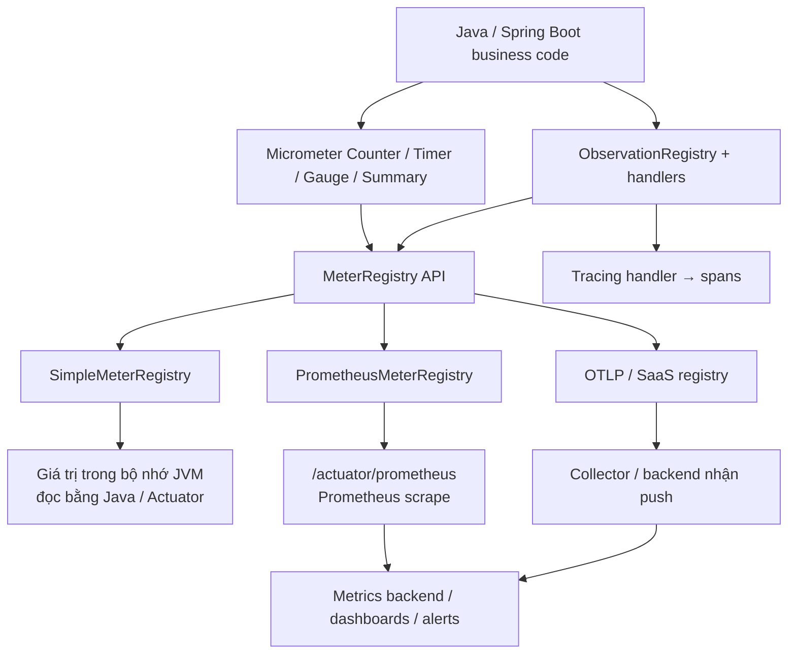
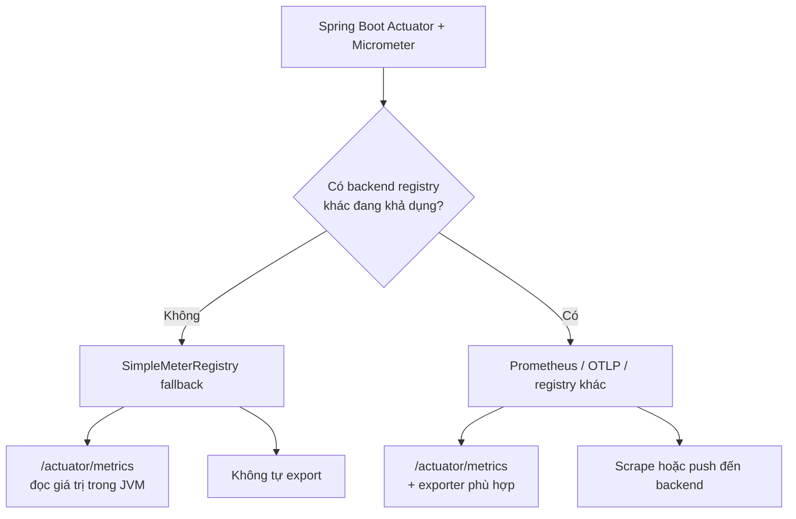
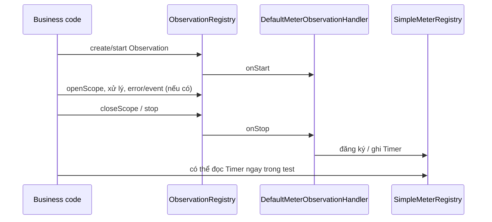

# SimpleMeterRegistry

Một nhóm phát triển muốn đo số lần đặt hàng thất bại và độ trễ xử lý trong ứng dụng Spring Boot, nhưng chưa có Prometheus, OpenTelemetry Collector hay dịch vụ metrics trả phí. Họ vẫn có thể viết instrumentation, chạy thử và kiểm tra từng meter ngay trong JVM nhờ **`SimpleMeterRegistry`**. Khi hệ thống chuyển sang production, cùng phần lớn code đo đạc có thể được kết nối với registry xuất metrics phù hợp mà không phải viết lại logic nghiệp vụ.

Bài **SimpleMeterRegistry** thuộc chương **Meter registry và exporter** của module **SPRING_BOOT_OBSERVABILITY**. Mục tiêu xuyên suốt module là thiết lập observability cho Spring Boot bằng Micrometer Observation, metrics, logs và distributed tracing; hiểu propagation ngữ cảnh, tag/cardinality, exporter, sampling và liên kết tín hiệu để điều tra lỗi, độ trễ và hành vi ứng dụng trên môi trường thực. Ở đây, ta tập trung vào **registry metrics đơn giản nhất**, nơi nó phát huy giá trị, những giới hạn của dữ liệu in-memory, và cách tránh nhầm kết quả local với telemetry đã được xuất sang backend.

> **Định nghĩa:** `SimpleMeterRegistry` là một implementation của `MeterRegistry` trong Micrometer Core. Nó giữ các giá trị measurement hiện tại của meter trong **bộ nhớ tiến trình**, cho phép đọc trực tiếp bằng Java hoặc qua cơ chế Actuator thích hợp. **Nó không tự gửi metrics tới Prometheus, OTLP hay bất kỳ backend bên ngoài nào.** Đây là công cụ rất tốt để học và kiểm thử, nhưng không phải hệ thống giám sát tập trung.

## 1. Mục tiêu học tập

Sau bài này, bạn có thể:

1. Giải thích `SimpleMeterRegistry` là gì, quan hệ với `MeterRegistry`, `Meter`, `Meter.Id` và backend/exporter.
2. Tạo `SimpleMeterRegistry` độc lập, ghi và đọc `Counter`, `Timer`, `Gauge`, `DistributionSummary`.
3. Phân biệt dữ liệu **tích lũy trong JVM** với một chuỗi thời gian bền vững được lưu ở hệ thống giám sát.
4. Viết unit test deterministic cho metrics bằng `SimpleMeterRegistry` và `MockClock`.
5. Hiểu cách Spring Boot Actuator chọn simple registry làm **fallback** và vì sao fallback có thể biến mất khi thêm Prometheus hoặc OTLP registry.
6. Sử dụng `CompositeMeterRegistry` đúng cách mà không tưởng rằng các measurement trước khi gắn registry con sẽ được phát bù.
7. Giới hạn cardinality, bảo vệ vòng đời của Gauge, không dùng dữ liệu cá nhân hoặc ID từng request làm metric tags.
8. Lập quy trình kiểm chứng từ Simple registry, Actuator, exporter tới backend metrics; kết hợp với logs và traces khi điều tra sự cố.

## 2. MeterRegistry và SimpleMeterRegistry đứng ở đâu?

Trong Micrometer, một `MeterRegistry` đăng ký và quản lý các meters. Tùy implementation, những meters này có thể được lưu trong bộ nhớ, chuyển đổi sang định dạng Prometheus hoặc xuất định kỳ đến hệ thống khác.



Điểm cần phân biệt: **MeterRegistry là giao diện/điểm tích hợp**, còn `SimpleMeterRegistry` là **một cách triển khai cụ thể**. Code nghiệp vụ tốt nên nhận `MeterRegistry`, không tự tạo một Simple registry ở mỗi controller để tự đo. Nhờ vậy ứng dụng có thể đổi backend theo môi trường mà không đổi business code.

| Thành phần | Vai trò | Giới hạn |
|---|---|---|
| `MeterRegistry` | Đăng ký, tra cứu và quản lý meters. | Không quyết định nội dung nghiệp vụ cần đo. |
| `SimpleMeterRegistry` | Giữ các phép đo hiện tại trong memory để đọc/test. | Không tự export hoặc lưu lịch sử qua restart. |
| `PrometheusMeterRegistry` | Chuẩn bị metrics theo cách Prometheus scrape. | Cần endpoint/target và quá trình scrape hoạt động. |
| OTLP hoặc push registry | Định dạng và gửi metrics tới receiver/backend. | Cần cấu hình network, endpoint, auth và pipeline. |
| `CompositeMeterRegistry` | Phối hợp nhiều registries con. | Không lưu bù giá trị đã ghi khi chưa có registry con. |
| `ObservationRegistry` | Quản lý vòng đời observation và chuyển callback tới handlers. | Không thay `MeterRegistry`; metrics handler có thể ghi vào meter registry. |

### 2.1 Tại sao dùng Simple trước khi cấu hình exporter?

Một nhóm có thể xác minh instrumentation từ sớm:

- Một giao dịch thành công làm Counter `outcome=success` tăng đúng một đơn vị.
- Một lời gọi được đo bằng Timer có `count=1` và duration phù hợp.
- Một Gauge đọc đúng queue depth tại thời điểm kiểm tra.
- Không có meter mới cho từng `orderId` hoặc `traceId`.
- Khi exception xảy ra, Timer vẫn được ghi bởi `finally` hoặc vòng đời Observation.

Những kết quả này kiểm chứng **đầu vào telemetry trong ứng dụng**; chúng chưa kiểm chứng **quá trình export**, lưu trữ, alert hoặc khả năng truy vấn từ nhiều instances.

## 3. Tạo một SimpleMeterRegistry độc lập

`SimpleMeterRegistry` thuộc artifact `io.micrometer:micrometer-core`. Trong ứng dụng Spring Boot đã có Actuator, Micrometer Core thường đã có nhờ dependency management. Nếu làm chương trình Java riêng, khai báo Micrometer Core ở phiên bản tương thích.

```groovy
dependencies {
    implementation 'io.micrometer:micrometer-core'
}
```

Ví dụ Java tối thiểu:

```java
import io.micrometer.core.instrument.Counter;
import io.micrometer.core.instrument.simple.SimpleMeterRegistry;

public class SimpleRegistryHello {
    public static void main(String[] args) {
        try (SimpleMeterRegistry registry = new SimpleMeterRegistry()) {
            Counter requests = Counter.builder("demo.requests")
                    .description("Total demonstration requests")
                    .tag("result", "ok")
                    .register(registry);

            requests.increment();
            requests.increment();

            double count = registry.get("demo.requests")
                    .tag("result", "ok")
                    .counter()
                    .count();

            System.out.println("Requests = " + count); // 2.0
        }
    }
}
```

**Giải thích:**

1. `new SimpleMeterRegistry()` tạo registry **cục bộ** trong JVM.
2. `Counter.builder(...).register(registry)` tạo hoặc lấy Counter có meter ID xác định.
3. `increment()` cập nhật số liệu hiện tại, không thực hiện HTTP push.
4. `registry.get(...).counter().count()` đọc lại dữ liệu ngay từ registry.
5. `try-with-resources` gọi `close()` khi ví dụ kết thúc. Trong ứng dụng Spring Boot, để container quản lý bean và vòng đời của registry.

Không gọi `new SimpleMeterRegistry()` cho mỗi request. Mỗi registry riêng có tập meter và số liệu riêng; nếu tạo registry mới từng lần, dashboard/endpoint chính không tự biết những giá trị đó.

### 3.1 Lưu một meter bằng field hay tra cứu mỗi lần?

Ví dụ trên dùng registry lookup để cho thấy cách đọc; trong hot path, thường giữ tham chiếu Counter/Timer trong field:

```java
public final class ReservationMetrics {
    private final Counter rejected;

    public ReservationMetrics(MeterRegistry registry) {
        this.rejected = Counter.builder("inventory.reservation.rejected")
                .tag("reason", "out_of_stock")
                .register(registry);
    }

    public void outOfStock() {
        rejected.increment();
    }
}
```

Với code thực tế, thêm import `Counter` và `MeterRegistry` tương ứng. Registry có thể cache meters theo ID, nhưng giữ tham chiếu giúp giảm lookup lặp lại ở đường gọi thường xuyên. Nếu tag values chỉ biết lúc xử lý, cần lookup meter theo nhóm tag đã được chuẩn hóa.

## 4. Đọc Counter, Timer và DistributionSummary

Các meters là dữ liệu có ngữ nghĩa khác nhau; Simple registry giữ những measurement tương ứng theo API Micrometer.

### 4.1 Counter: số sự kiện đã xảy ra

```java
Counter approved = registry.counter(
        "checkout.authorization.result", "outcome", "approved");
Counter declined = registry.counter(
        "checkout.authorization.result", "outcome", "declined");

approved.increment();
approved.increment();
declined.increment();

System.out.println(approved.count()); // 2
System.out.println(declined.count()); // 1
```

`Counter` chỉ tăng trong vòng đời meter. Nếu toàn bộ registry/tiến trình bị hủy, số đếm tích lũy không được lưu bền vững; một registry mới bắt đầu từ bộ đếm mới. Trong production, rate/counter reset cần được diễn giải ở backend theo đúng semantics.

**Chú ý:** `Counter` không thích hợp để biểu diễn trạng thái queue hiện tại vì queue có thể tăng/giảm. Dùng Gauge cho giá trị trạng thái.

### 4.2 Timer: số lần, tổng thời gian và thống kê liên quan

```java
import java.time.Duration;
import java.util.concurrent.TimeUnit;
import io.micrometer.core.instrument.Timer;

Timer latency = Timer.builder("checkout.authorization.duration")
        .description("Time spent authorizing payment")
        .register(registry);

latency.record(Duration.ofMillis(120));
latency.record(Duration.ofMillis(280));

System.out.println(latency.count());                  // 2
System.out.println(latency.totalTime(TimeUnit.MILLISECONDS)); // 400.0
```

**Timer count** và **total time** cho phép xác nhận số lần hoàn tất và tổng duration. Độ trễ trung bình của hai lần trong ví dụ là 200 ms. Một số thống kê như max/percentile/histogram có đặc tính cửa sổ và cấu hình riêng; không mặc định mọi percentile hoặc bucket luôn có sẵn.

Nếu muốn đo khối code thay vì tự tạo `Duration`, dùng:

```java
Timer.Sample sample = Timer.start(registry);
try {
    performCheckout();
} finally {
    sample.stop(latency);
}
```

`Timer.Sample` đo dựa trên clock của registry. Nó cho phép chọn Timer cuối cùng tại thời điểm `stop`, ví dụ phân nhóm `outcome` sau khi đã biết kết quả. Trường hợp exception cũng phải gọi `stop` theo hợp đồng đo của ứng dụng. Trong chương trình async, không nên stop ngay khi method trả về `Future` nếu công việc vẫn đang chạy.

### 4.3 DistributionSummary: phân phối đại lượng không phải thời gian

```java
import io.micrometer.core.instrument.DistributionSummary;

DistributionSummary batchSize =
        DistributionSummary.builder("orders.batch.size")
                .baseUnit("items")
                .description("Items in each order-processing batch")
                .register(registry);

batchSize.record(10);
batchSize.record(25);

System.out.println(batchSize.count());       // 2
System.out.println(batchSize.totalAmount()); // 35
```

`DistributionSummary` phù hợp với bytes, item counts hoặc kích thước batch. Timer phù hợp với thời lượng vì Micrometer biết cách quy đổi đơn vị thời gian cho backend. Khi bật histogram cho summary, chọn khoảng giá trị và bucket phù hợp; Simple registry không tự tạo một time-series database để lưu trữ lịch sử phân phối.

### 4.4 Một đoạn mã thử đầy đủ

```java
import java.time.Duration;
import java.util.concurrent.TimeUnit;

import io.micrometer.core.instrument.Counter;
import io.micrometer.core.instrument.DistributionSummary;
import io.micrometer.core.instrument.Timer;
import io.micrometer.core.instrument.simple.SimpleMeterRegistry;

public final class CheckoutMetricDemo {
    public static void main(String[] args) {
        try (SimpleMeterRegistry registry = new SimpleMeterRegistry()) {
            Counter result = Counter.builder("checkout.result")
                    .tag("outcome", "approved")
                    .register(registry);
            Timer latency = Timer.builder("checkout.latency")
                    .register(registry);
            DistributionSummary size = DistributionSummary
                    .builder("checkout.batch.items")
                    .register(registry);

            result.increment();
            latency.record(Duration.ofMillis(150));
            size.record(5);

            System.out.printf("approved=%s, count=%d, latency=%.0fms, items=%.0f%n",
                    result.count(),
                    latency.count(),
                    latency.totalTime(TimeUnit.MILLISECONDS),
                    size.totalAmount());
        }
    }
}
```

Các giá trị được in ra từ memory của tiến trình Java. Đoạn mã không tạo endpoint `/actuator/prometheus` và không gửi dữ liệu tới dịch vụ giám sát.

## 5. Gauge: một trường hợp dễ sai ngay cả với Simple registry

Một `Gauge` đọc **trạng thái hiện tại** của một đối tượng, không phải số lần một sự kiện xảy ra.

Ví dụ đo số tác vụ đang chờ:

```java
import java.util.concurrent.atomic.AtomicInteger;
import io.micrometer.core.instrument.Gauge;

AtomicInteger queued = new AtomicInteger(0);

Gauge.builder("orders.queue.pending", queued, AtomicInteger::get)
        .description("Current number of pending order jobs")
        .register(registry);

queued.set(7);

double pending = registry.get("orders.queue.pending")
        .gauge()
        .value(); // 7.0
```

### 5.1 Bẫy weak reference

Micrometer thường giữ weak reference đến đối tượng được Gauge quan sát. Nếu bạn đăng ký Gauge với một `new AtomicInteger(...)` chỉ tồn tại trong biến cục bộ rồi để biến đó mất tham chiếu, garbage collector có thể thu hồi đối tượng. Khi đó measurement có thể trở thành `NaN` hoặc không còn hữu ích.

Đối với Spring Boot, nên lưu đối tượng trong field của bean:

```java
@Component
public final class QueueMetrics {
    private final AtomicInteger pending = new AtomicInteger();

    public QueueMetrics(MeterRegistry registry) {
        Gauge.builder("orders.queue.pending", pending, AtomicInteger::get)
                .register(registry);
    }

    public void setPending(int amount) {
        pending.set(Math.max(0, amount));
    }
}
```

Đây là snippet minh họa; import `Component`, `AtomicInteger`, `Gauge` và `MeterRegistry` trong ứng dụng thật. Nếu đã có queue thực, **đọc trực tiếp queue** sẽ chính xác hơn lưu một bản sao trạng thái có thể bị lệch.

### 5.2 Không “cập nhật Gauge” bằng cách đăng ký lại

Sai:

```java
void queueChanged(MeterRegistry registry, int newSize) {
    AtomicInteger value = new AtomicInteger(newSize);
    Gauge.builder("orders.queue.pending", value, AtomicInteger::get)
            .register(registry);
}
```

Registry thường trả lại meter với ID đã tồn tại, chứ không thay đối tượng đo mỗi lần gọi. Hơn nữa đối tượng vừa tạo có thể không còn strong reference. Cách đúng là **đăng ký một lần** và thay đổi nguồn dữ liệu thật, hoặc đọc trực tiếp queue.

Simple registry có thể cho bạn thấy những lỗi đó ngay trong unit test; việc dùng registry khác không tự chữa các sai sót Gauge.

## 6. SimpleMeterRegistry không lưu lịch sử time series

Một sự khác biệt then chốt giữa **giá trị hiện tại của meter** và **chuỗi thời gian được lưu ở backend**:

```text
Trong SimpleMeterRegistry:
  checkout.result{outcome="approved"} = 25 tại thời điểm đọc
  checkout.latency count = 25, totalTime = ...
  orders.queue.pending = 6 tại thời điểm đọc

Trong metrics backend:
  10:00  checkout.result = 10
  10:01  checkout.result = 15
  10:02  checkout.result = 25
  có thể tính rate, increase, alert và so sánh lịch sử
```

Simple registry **không tự ghi dãy giá trị theo từng phút** và không tự cung cấp các khả năng:

- Lưu lịch sử qua restart của tiến trình.
- So sánh tuần này và tuần trước trên nhiều instances.
- Alert tập trung khi một instance mất khả năng phục vụ.
- PromQL ở một hệ thống bên ngoài.
- Bảo đảm telemetry đã rời khỏi JVM khi ứng dụng gặp sự cố.
- Truy vấn toàn bộ cụm theo service, region hoặc deployment.

Bạn có thể tự chụp mẫu từ Simple registry hoặc để Spring Boot Actuator đọc giá trị của nó, nhưng **phần ghi lịch sử và hệ thống cảnh báo sẽ là trách nhiệm của một pipeline khác**. Khi cần production observability, nên dùng backend exporter/collector tương ứng.

### 6.1 Có thể dùng Simple registry để tính rate không?

Nếu muốn đo số lần một sự kiện xảy ra trong một khoảng cụ thể của **một bài test**, bạn có thể tự lấy hiệu số `Counter.count()` trước và sau rồi chia cho duration của bài test. Nhưng đây không phải một hệ thống rate/aggregation chịu được restart, nhiều instance, scrape gap hoặc retention. Với production, dùng backend và hàm phù hợp như `rate(...)` trên counter được export.

## 7. Tại sao Spring Boot có Simple registry mà không phải lúc nào cũng dùng nó?

Spring Boot Actuator tự cấu hình Micrometer và các backend registry có trên runtime classpath. Theo tài liệu Spring Boot, **Simple in-memory registry được dùng như fallback nếu không có backend registry khác được cấu hình**. Khi một backend khác khả dụng, fallback simple thường được tự động vô hiệu.



Ví dụ:

| Classpath / cấu hình | Kết quả có thể xảy ra | Điều cần nhớ |
|---|---|---|
| Có Actuator, không thêm registry backend | Spring Boot dùng Simple fallback. | Xem được meters tại `/actuator/metrics` nếu expose. |
| Thêm Prometheus registry | Prometheus registry được auto-configure; Simple fallback thường tắt. | `/actuator/prometheus` có thể xuất scrape format khi endpoint được bật. |
| Thêm OTLP registry | OTLP metrics exporter có thể được cấu hình theo điều kiện dependency/property. | Cần receiver/collector thật; thiếu pipeline thì backend không có dữ liệu. |
| Nhiều registry implementations | Có thể dùng composite registry chứa các registry con. | Không mặc định Simple cũng là một con khi fallback đã tắt. |
| Tắt Simple bằng property | Nếu không có registry phù hợp khác, metrics có thể không có backend lưu. | Cần biết lý do và phạm vi cấu hình. |

### 7.1 Property tắt fallback simple

Theo Spring Boot reference hiện hành, có thể dùng:

```yaml
management:
  simple:
    metrics:
      export:
        enabled: false
```

Tương đương `management.simple.metrics.export.enabled=false`.

Đây là cấu hình của **Spring Boot auto-configuration**, không phải tham số truyền cho `new SimpleMeterRegistry()` trong code độc lập. Các phiên bản Spring Boot cũ có thể dùng tiền tố property khác (chẳng hạn `management.metrics.export.simple.enabled`); hãy đối chiếu reference guide theo **đúng major/minor version** của dự án.

**Không tắt Simple registry chỉ vì muốn “nâng hiệu năng”** khi chưa có backend metrics khác: nếu ứng dụng không còn registry xuất/sẵn có, bạn có thể mất luôn cách quan sát metrics qua Actuator.

### 7.2 Spring Boot inject kiểu gì?

Ưu tiên viết:

```java
@Service
public class BusinessService {
    private final MeterRegistry meterRegistry;

    public BusinessService(MeterRegistry meterRegistry) {
        this.meterRegistry = meterRegistry;
    }
}
```

Đừng ép kiểu:

```java
// Nguy hiểm: không bảo đảm bean luôn là SimpleMeterRegistry.
SimpleMeterRegistry simple = (SimpleMeterRegistry) meterRegistry;
```

Spring Boot có thể inject một `CompositeMeterRegistry` hoặc backend-specific registry. Unit test muốn dùng Simple có thể tạo nó trực tiếp và truyền qua constructor, còn business service vẫn chỉ phụ thuộc `MeterRegistry`.

### 7.3 `/actuator/metrics` không có nghĩa là đang dùng Simple

Actuator metrics endpoint đọc các meter được registry hiện hành quản lý. Nó hoạt động với nhiều registry types. Nếu `/actuator/metrics` trả số liệu, **không được suy ra** ứng dụng đang dùng Simple registry. Cần kiểm tra dependencies, bean registry thực và auto-configuration khi có nghi ngờ.

## 8. Từ Simple registry tới Prometheus exporter

Giả sử code business đang ghi vào `MeterRegistry` được inject. Việc đổi môi trường quan sát có thể chỉ yêu cầu thêm backend dependency và cấu hình.

### 8.1 Dependencies minh họa

```groovy
dependencies {
    implementation 'org.springframework.boot:spring-boot-starter-actuator'
    runtimeOnly 'io.micrometer:micrometer-registry-prometheus'
}
```

Ví dụ dành cho dự án đã có Spring Boot plugin và dependency management phù hợp. Với môi trường chỉ học Simple, không cần thêm Prometheus registry; khi thêm dependency này, Spring Boot có thể chuyển từ simple fallback sang Prometheus registry.

### 8.2 Cấu hình Actuator cho local

```yaml
spring:
  application:
    name: order-service

management:
  endpoints:
    web:
      exposure:
        include: "health,metrics,prometheus"
  metrics:
    tags:
      application: order-service
      environment: local
```

Sau khi chạy ít nhất một nghiệp vụ có meter:

```bash
# Danh sách tên Micrometer meters.
curl http://localhost:8080/actuator/metrics

# Một meter nghiệp vụ nếu code đã gọi increment().
curl http://localhost:8080/actuator/metrics/checkout.result

# Endpoint scrape khi Prometheus registry có mặt và đã expose.
curl http://localhost:8080/actuator/prometheus
```

**Phân biệt kết quả:**

- `/actuator/metrics`: JSON chẩn đoán theo meter name của Micrometer.
- `/actuator/prometheus`: Prometheus exposition format, chỉ có khi registry/endpoint phù hợp.
- Có output ở `/actuator/prometheus` **chưa chứng minh** Prometheus server đã scrape thành công.
- Prometheus scrape thành công **chưa chứng minh** dashboard query đúng tên/labels hoặc alert đã cấu hình.

### 8.3 Prometheus scrape

Một cấu hình `prometheus.yml` mẫu:

```yaml
scrape_configs:
  - job_name: "order-service"
    metrics_path: "/actuator/prometheus"
    scrape_interval: 15s
    static_configs:
      - targets:
          - "order-service:8080"
```

Tên `order-service:8080` là host minh họa, phải thay bằng target thực có thể truy cập từ Prometheus. Production thường dùng service discovery, authentication, network policy và phân quyền tương ứng.

Không mở management endpoint công khai trên internet chỉ vì muốn thu metrics. Xác minh cả `up` của scrape target, thời gian scrape, labels và tên metric đã được exporter đổi từ dot notation sang conventions của Prometheus.

## 9. CompositeMeterRegistry: kiểm thử nhiều backend và bẫy dữ liệu trước khi add

`CompositeMeterRegistry` cho phép một meter được phát tới nhiều registry con:

```java
import io.micrometer.core.instrument.Counter;
import io.micrometer.core.instrument.composite.CompositeMeterRegistry;
import io.micrometer.core.instrument.simple.SimpleMeterRegistry;

public class CompositeDemo {
    public static void main(String[] args) {
        try (CompositeMeterRegistry composite = new CompositeMeterRegistry();
             SimpleMeterRegistry simple = new SimpleMeterRegistry()) {

            Counter events = composite.counter("demo.events");
            events.increment();  // Chưa có child registry.

            composite.add(simple);
            events.increment();  // Child registry nhận lần này.

            double observed = simple.get("demo.events")
                    .counter().count();
            System.out.println(observed); // 1.0
        }
    }
}
```

**Vì sao chỉ có 1?** Theo Micrometer, một composite chưa có registry con sẽ no-op measurements. Sau khi `add(simple)`, meter tương ứng được tạo trong registry con nhưng **lần increment trước đó không được phát bù**.

Các lưu ý khác:

- Với nhiều child registries, mỗi child có cách hiển thị/expose riêng; không cộng kết quả của hai backend như thể là hai bộ request khác nhau.
- Khi thêm registry con giữa lúc ứng dụng đang chạy, giá trị lịch sử từ lúc chưa có con không tự chuyển.
- Composite không thay thế chức năng của exporter, dù nó tạo một điểm viết chung.
- Nếu Spring Boot đã auto-configure composite, không tạo một composite thủ công khác mà không có lý do rõ ràng.

### 9.1 Tại sao không đăng ký đồng thời Simple và Prometheus bằng tay trong mọi app?

Có thể cần kiểm thử/cấu hình nâng cao muốn quan sát một bản copy in-memory, nhưng thường không cần registry trùng. Spring Boot đã có auto-configured registries; một composite tùy chỉnh không đúng vòng đời có thể gây trùng meter, mất dữ liệu hoặc khó đoán bean nào được inject. Đối với unit tests, tạo Simple riêng; đối với production, ưu tiên exporter/backend chính thức.

## 10. Unit test metrics với SimpleMeterRegistry

Đây là **một trong những giá trị thực tế lớn nhất** của Simple: thay một exporter cần network bằng bộ đo có thể đọc đồng bộ ngay trong bộ test.

### 10.1 Test kết quả nghiệp vụ bằng JUnit 5

Một service mẫu phụ thuộc `MeterRegistry`:

```java
import io.micrometer.core.instrument.Counter;
import io.micrometer.core.instrument.MeterRegistry;

public final class PaymentResultMetrics {
    private final Counter approved;
    private final Counter declined;

    public PaymentResultMetrics(MeterRegistry registry) {
        approved = Counter.builder("payment.authorization.result")
                .tag("outcome", "approved")
                .register(registry);
        declined = Counter.builder("payment.authorization.result")
                .tag("outcome", "declined")
                .register(registry);
    }

    public void approved() {
        approved.increment();
    }

    public void declined() {
        declined.increment();
    }
}
```

Và test:

```java
import static org.junit.jupiter.api.Assertions.assertEquals;
import io.micrometer.core.instrument.simple.SimpleMeterRegistry;
import org.junit.jupiter.api.Test;

class PaymentResultMetricsTest {
    @Test
    void countsApprovedAndDeclinedSeparately() {
        try (SimpleMeterRegistry registry = new SimpleMeterRegistry()) {
            PaymentResultMetrics metrics = new PaymentResultMetrics(registry);

            metrics.approved();
            metrics.approved();
            metrics.declined();

            double approved = registry.get("payment.authorization.result")
                    .tag("outcome", "approved")
                    .counter()
                    .count();
            double declined = registry.get("payment.authorization.result")
                    .tag("outcome", "declined")
                    .counter()
                    .count();

            assertEquals(2.0, approved);
            assertEquals(1.0, declined);
        }
    }
}
```

Test không cần Prometheus, Collector hay trace backend. Nó kiểm tra đúng **semantic của instrumentation** và phân loại outcome; chưa kiểm tra output exporter và khả năng scrape.

### 10.2 Test Timer không phụ thuộc thời gian chạy máy

Nếu test dùng `Thread.sleep` để xác nhận duration, kết quả có thể dao động trên CI. Micrometer cung cấp `MockClock`:

```java
import static org.junit.jupiter.api.Assertions.assertEquals;

import java.time.Duration;
import java.util.concurrent.TimeUnit;

import io.micrometer.core.instrument.MockClock;
import io.micrometer.core.instrument.Timer;
import io.micrometer.core.instrument.simple.SimpleConfig;
import io.micrometer.core.instrument.simple.SimpleMeterRegistry;
import org.junit.jupiter.api.Test;

class TimerMetricTest {

    @Test
    void recordsExactly250Milliseconds() {
        MockClock clock = new MockClock();

        try (SimpleMeterRegistry registry =
                     new SimpleMeterRegistry(SimpleConfig.DEFAULT, clock)) {

            Timer timer = registry.timer("payment.provider.duration");
            Timer.Sample sample = Timer.start(registry);

            clock.add(Duration.ofMillis(250));
            sample.stop(timer);

            assertEquals(1L, timer.count());
            assertEquals(250.0,
                    timer.totalTime(TimeUnit.MILLISECONDS),
                    0.0001);
        }
    }
}
```

Ở đây `MockClock` điều khiển thời gian mà timer dùng, giúp kiểm thử deterministic và nhanh hơn dùng sleep. Khi test histogram hoặc time-window statistics, cần hiểu cả cơ chế expiry/rolling windows thay vì kiểm tra chỉ một số đo cố định.

### 10.3 Test việc ghi metric khi xảy ra lỗi

Với service xử lý request:

```java
Timer.Sample sample = Timer.start(registry);
try {
    operation.run();
} catch (RuntimeException failure) {
    registry.counter("orders.processing.result",
            "outcome", "error").increment();
    throw failure;
} finally {
    sample.stop(registry.timer("orders.processing.duration"));
}
```

Nếu test ném exception, cần xác nhận counter lỗi tăng **một lần** và Timer count cũng tăng một lần; không nhầm hai giá trị này thành hai requests. Cách quản lý lifecycle được đo phải bao phủ cả success, failure, timeout và cancellation theo quy ước nghiệp vụ.

### 10.4 Test có ý nghĩa hơn việc tìm literal trong code

Một test chỉ kiểm tra source có chuỗi `"payment.authorization.result"` không phát hiện được tag sai hoặc code không gọi `increment()` ở một nhánh. Dùng Simple registry thực sự giúp kiểm tra **meter ID và measurements** mà instrumentation tạo ra.

Với các metrics quan trọng, nên có test cho:

- Tên và tag keys cố định, không chứa ID riêng lẻ.
- Cùng một event được đếm đúng một lần.
- Timer kết thúc sau khi công việc thực sự kết thúc.
- Gauge còn strong reference và đọc đúng giá trị.
- Khi error xảy ra, kết quả measurement phản ánh policy đã định.

## 11. MeterFilter và cardinality vẫn quan trọng với Simple registry

Simple registry không export nhưng vẫn giữ meters trong **bộ nhớ của tiến trình**. Nếu mỗi request tạo một meter name/tag tổ hợp mới, bộ nhớ có thể tăng rất nhanh và thậm chí ảnh hưởng ứng dụng ngay cả khi không kết nối backend.

Ví dụ:

```java
// Sai: orderId thay đổi theo từng đơn hàng.
registry.counter("checkout.orders", "orderId", orderId).increment();
```

Cách đúng hơn:

```java
// Đúng hơn: kết quả thuộc tập giá trị đã chuẩn hóa.
registry.counter("checkout.orders", "outcome", "approved").increment();
```

Tính cardinality giả định:

| Tag | Số giá trị dự kiến |
|---|---:|
| `outcome` | 3 |
| `channel` | 3 |
| `region` | 4 |
| Tổ hợp tối đa | 3 × 3 × 4 = **36** |
| Thêm `orderId` với 100.000 giá trị | Tối đa **3.600.000** tổ hợp tiềm năng |

Các tổ hợp thực tế phụ thuộc dữ liệu nhưng rủi ro rất đáng kể. **Tên động** cũng gây số meter IDs lớn tương tự tag động. Không dùng email, customer ID, session ID, trace ID, token hoặc raw URL chứa định danh làm metric name/tag.

### 11.1 Guard bằng MeterFilter

Có thể bảo vệ registry bằng `MeterFilter` trong một test hoặc Spring Boot configuration:

```java
import io.micrometer.core.instrument.config.MeterFilter;

registry.config().meterFilter(
        MeterFilter.maximumAllowableTags(
                "checkout.orders",
                "outcome",
                4,
                MeterFilter.deny()));
```

Cấu hình này giới hạn số giá trị `outcome` cho meters mang tiền tố tên tương ứng. Các meters bị từ chối có thể không ghi measurement; **guard không thay thế việc sửa code tạo tags sai**. Áp dụng filters trước khi đăng ký meter, không kỳ vọng chúng sửa ID đã được tạo.

### 11.2 Simple registry không tự “dọn” meter theo request

Một `Counter` hoặc `Timer` có ID động có thể còn tồn tại trong registry, dù request tạo ra nó đã kết thúc. Simple registry không phải cache có TTL mặc định cho mọi meter. Vì thế cần giới hạn số meter IDs từ thiết kế; đừng tạo tên dựa trên timestamp rồi kỳ vọng JVM tự giải phóng tất cả.

### 11.3 Bảo mật telemetry

Dù metrics chỉ nằm trong memory, việc expose chúng qua `/actuator/metrics` vẫn có thể làm lộ tên và tags cho người truy cập. Bảo vệ Actuator endpoints, không thu thập secrets/PII; khi đưa metrics sang backend, áp dụng chính sách truy cập và retention phù hợp.

## 12. SimpleMeterRegistry và Micrometer Observation

`ObservationRegistry` quản lý vòng đời observation; `MeterRegistry` quản lý meters. Metrics được tạo từ Observation khi có `ObservationHandler` thích hợp, ví dụ `DefaultMeterObservationHandler`.



Đây là sơ đồ logic rút gọn; chính xác cách handlers đọc context và tạo meters tùy vào Micrometer version/configuration.

### 12.1 Quan sát một đoạn nghiệp vụ

```java
Observation.createNotStarted("inventory.reserve", observationRegistry)
        .contextualName("reserve inventory")
        .lowCardinalityKeyValue("operation", "reserve")
        .observe(() -> {
            reserveInventory();
        });
```

Nếu registry observation đã được cấu hình metrics handler trỏ đến `SimpleMeterRegistry`, Timer `inventory.reserve` có thể được ghi khi công việc kết thúc. Trong Spring Boot, các handler thường được auto-configure; trong **unit test dùng ObservationRegistry.create() độc lập**, bạn phải tự đăng ký handler phù hợp. Việc chỉ tạo một `SimpleMeterRegistry` riêng chưa làm Observation tự gửi dữ liệu vào nó.

### 12.2 Đăng ký handler trong test độc lập

```java
import io.micrometer.core.instrument.simple.SimpleMeterRegistry;
import io.micrometer.core.instrument.observation.DefaultMeterObservationHandler;
import io.micrometer.observation.Observation;
import io.micrometer.observation.ObservationRegistry;

try (SimpleMeterRegistry metrics = new SimpleMeterRegistry()) {
    ObservationRegistry observations = ObservationRegistry.create();
    observations.observationConfig()
            .observationHandler(new DefaultMeterObservationHandler(metrics));

    Observation.createNotStarted("inventory.reserve", observations)
            .lowCardinalityKeyValue("operation", "reserve")
            .observe(() -> { /* work */ });

    long count = metrics.get("inventory.reserve")
            .tag("operation", "reserve")
            .timer()
            .count(); // 1
}
```

Lưu ý API constructor/handler có thể khác ở một số phiên bản Micrometer; hãy khóa dependency và xác minh chữ ký của phiên bản được dùng. Về nguyên tắc, điều quan trọng là **ObservationRegistry cần một metrics handler đã liên kết MeterRegistry**, không phải chỉ có hai registry tồn tại cạnh nhau.

### 12.3 Sampling traces và số đếm metrics

Nếu ứng dụng có tracing sampler giữ lại 10% traces, metrics qua Simple registry vẫn có thể đếm đầy đủ các lần instrumentation xảy ra. **Trace sampling không phải sampling metrics**. Nếu không thấy span nhưng Timer tăng, hãy kiểm tra tracing handler, exporter, sampling và propagation; không vội kết luận Simple registry bị lỗi.

## 13. Giới hạn của Simple đối với histogram, percentile và production SLO

Đọc `Timer.count()` và `Timer.totalTime(...)` từ Simple registry đủ để xác nhận một phép đo duration đã được ghi. Tuy nhiên:

- **Percentile** như p95 không thể suy từ count và totalTime.
- Histogram/percentile được tính theo cơ chế cấu hình và time-window/expiry của Micrometer; không nên giả định luôn có sẵn chỉ vì dùng Timer.
- Simple registry không tự xuất `_bucket` series cho Prometheus hoặc giữ một database thời gian nhiều ngày.
- Để tính SLO trên nhiều instances, cần backend hỗ trợ phân phối/histogram phù hợp và cấu hình buckets/units tương thích.
- Nếu một test cần kiểm tra histogram, hãy kiểm tra API snapshot/distribution statistics với cấu hình phù hợp, không chỉ Timer count.

Ví dụ khi chuyển sang Prometheus:

```yaml
management:
  metrics:
    distribution:
      percentiles-histogram:
        checkout.authorization.duration: true
```

Với Prometheus classic histogram tương ứng, khi exporter phát bucket series bạn có thể dùng:

```promql
histogram_quantile(
  0.95,
  sum by (le) (
    rate(checkout_authorization_duration_seconds_bucket[5m])
  )
)
```

Đoạn PromQL **không chạy trên SimpleMeterRegistry**. Nó chạy trên Prometheus/backend sau khi đã có scraper, các series `_bucket`, và thống kê histogram hợp lệ. Đừng lấy trung bình p95 của các instances, bởi quantile không cộng/tính trung bình tuyến tính.

## 14. Những lỗi thường gặp

| Triệu chứng | Nguyên nhân có thể | Hành động đề xuất |
|---|---|---|
| Counter trong test luôn bằng 0 | Code nghiệp vụ không gọi `increment()` hoặc dùng registry khác. | Inject đúng instance Simple và assert meter ID/tags. |
| `registry.get(...)` báo không có meter | Meter chưa đăng ký, tên/tag sai hoặc bị filter. | Dùng `find(...)` để chẩn đoán; chạy đúng nhánh nghiệp vụ. |
| Test Gauge đôi khi thành `NaN` | Đối tượng được quan sát đã mất strong reference. | Giữ nguồn trong field/fixture, đăng ký một lần. |
| `/actuator/metrics` 404 | Chưa có Actuator, endpoint chưa expose hoặc security. | Xem dependency, base path/cổng, quyền truy cập. |
| Spring Boot có metrics nhưng bean không phải Simple | Có backend khác hoặc composite. | Inject `MeterRegistry`; kiểm tra auto-configuration, không ép kiểu. |
| Có `/actuator/metrics` nhưng không có `/actuator/prometheus` | Đang dùng Simple hoặc thiếu Prometheus exporter/exposure. | Bổ sung registry Prometheus và cấu hình endpoint nếu cần. |
| Tạo Simple trong controller nhưng Actuator không thấy | Controller dùng registry riêng, không thuộc Spring context/composite. | Dùng Spring-managed registry. |
| Composite tăng counter trước khi thêm con | Lần đo ban đầu no-op. | Gắn child registry trước khi ghi, không mong chờ replay. |
| Giá trị Count mất sau restart | Simple giữ dữ liệu in-memory. | Dùng exporter/backend nếu cần lịch sử. |
| Số meter IDs tăng không giới hạn | Name/tag chứa request ID hoặc ID nghiệp vụ. | Chuẩn hóa name/tags, kiểm tra cardinality và thêm guard. |
| Đã có Timer nhưng p95 không hiện | Chưa bật phân phối/histogram; Simple không có PromQL. | Cấu hình histogram phù hợp và backend query. |
| Có metrics nhưng không có traces | Chưa có tracer, tracing handler/exporter hoặc bị sampling. | Kiểm tra tracing pipeline riêng. |
| Double count khi bổ sung instrumentation | Timer thủ công trùng với Observation/HTTP auto-timer. | Đo một ranh giới bằng một owner rõ ràng. |
| Test qua sleep không ổn định | Phụ thuộc scheduler/CPU của CI. | Dùng `MockClock` cho timer tests deterministic. |

## 15. Quy trình chuyển từ local test tới vận hành thực

**Tình huống:** `CheckoutService` đã có Counter và Timer được xác minh bằng Simple registry. Đội muốn thấy rate, p95 và alert trên production.

### Giai đoạn A — Xác minh instrumentation

1. Chạy unit tests với Simple registry: thành công và thất bại tạo số đếm đúng.
2. Kiểm tra tên meter và các key-values không đổi theo request.
3. Test Timer dừng đúng sau đoạn xử lý, không stop quá sớm ở async jobs.
4. Test Gauge có đối tượng sống đủ lâu.
5. Kiểm tra không instrument cùng một hoạt động hai lần.

### Giai đoạn B — Bổ sung exporter và backend

1. Chọn Prometheus scrape hoặc exporter push như OTLP phù hợp hạ tầng.
2. Bổ sung dependency/configuration cho registry chính xác; không tự giả định Simple cũng được export.
3. Cấu hình endpoint, network/auth, service discovery và giới hạn quyền truy cập.
4. Cho ứng dụng phát sinh traffic thực trong môi trường staging.
5. Xác minh `/actuator/metrics`, sau đó `/actuator/prometheus` hoặc collector và metrics backend.
6. So sánh count/rate giữa instrumentation và backend khi có đủ thời gian scrape, biết rằng step và scrape intervals gây độ trễ.

### Giai đoạn C — Xây dashboards và alerts

1. Dùng `rate` cho Counters, không trừ tuyệt đối qua restart.
2. Dùng histogram buckets cho p95 khi đã cấu hình; tránh average of p95.
3. Chọn các nhãn giúp phân nhóm có giới hạn, chẳng hạn `service`, `route template`, `status`, `region`.
4. Đặt ngưỡng alert dựa trên service SLO/SLI và baseline, không lấy một con số chung cho mọi dịch vụ.
5. Theo dõi sức khỏe scraper/collector để phân biệt “không có dữ liệu” và “giá trị bằng 0”.

### Giai đoạn D — Liên kết metrics với logs/traces

Một metric cho thấy `checkout.authorization.duration` tăng có thể chỉ ra cần điều tra, nhưng không biết cụ thể request nào chờ lâu. Nếu hệ thống có tracing/propagation đúng, hãy mở trace của request chậm, kiểm tra span của HTTP client/DB và log theo trace ID. Không gắn trace ID vào metric tag vì cardinality rất cao.

## 16. Bài tập tự kiểm tra

### Bài 1 — Simple có phải exporter không?

Một dịch vụ chỉ có `SimpleMeterRegistry`, không cấu hình Prometheus/OTLP. Code gọi Counter increment 10 lần. Có thể đọc `count=10` trong JVM không? Vì sao hệ thống Prometheus bên ngoài không tự nhận 10 sự kiện ấy?

### Bài 2 — Registry scope

Mỗi lần một controller được gọi, nó tạo `new SimpleMeterRegistry()`, tạo Counter rồi increment. Actuator được cấu hình dùng registry do Spring quản lý. Vì sao `/actuator/metrics` có thể không hiển thị đúng Counter từ controller? Hãy sửa thiết kế qua constructor injection.

### Bài 3 — Gauge bị mất giá trị

Một lập trình viên đăng ký `Gauge.builder("jobs.pending", new AtomicInteger(5), AtomicInteger::get)`. Sau một thời gian, test đọc được `NaN`. Nguyên nhân có thể là gì và cách sửa?

### Bài 4 — Test duration không sleep

Hãy tạo `SimpleMeterRegistry(SimpleConfig.DEFAULT, MockClock)`, bắt đầu Timer.Sample, tăng clock 300 ms rồi stop; assert count và totalTime. Vì sao cách này ổn định hơn `Thread.sleep(300)`?

### Bài 5 — Composite không replay

Bạn tạo `CompositeMeterRegistry`, gọi increment 5 lần khi chưa có registry con, sau đó `add(new SimpleMeterRegistry())` và increment 3 lần. Simple registry thường thấy count bao nhiêu? Giải thích cơ chế no-op trước lúc add.

### Bài 6 — Cardinality

Một metric `payment.result` có 3 `outcome`, 4 `channel` và 100.000 `orderId`. Tối đa có bao nhiêu tổ hợp ID tiềm năng? Làm sao vẫn điều tra được một order cụ thể mà không dùng order ID làm metric tag?

### Bài 7 — Exporter debugging

`/actuator/metrics/checkout.result` có dữ liệu, nhưng `/actuator/prometheus` trả 404. Nêu bốn nguyên nhân khác nhau cần kiểm tra và làm rõ trường hợp Simple fallback.

### Bài 8 — Metrics và tracing

Unit test ghi `inventory.reserve` Timer qua Simple registry. Tại sao trace backend không nhất thiết có span? Những thành phần nào còn thiếu để có distributed tracing?

### Gợi ý đáp án

- Bài 1: Có thể đọc trong JVM; Simple không tự export.
- Bài 2: Controller đang ghi vào registry khác với registry Actuator sử dụng; inject Spring-managed `MeterRegistry`.
- Bài 3: Object được quan sát có thể bị garbage collected vì thiếu strong reference; giữ nó trong field hoặc đọc queue thật.
- Bài 4: `MockClock` kiểm soát chính xác thời gian của Micrometer, không phụ thuộc scheduler.
- Bài 5: Thường là **3**, vì các increment trước khi add registry con không được phát bù.
- Bài 6: 3 × 4 × 100.000 = **1.200.000** tổ hợp; bỏ order ID khỏi metrics và dùng logs/traces được phép để tra cứu.
- Bài 7: Thiếu Prometheus registry, endpoint chưa expose, endpoint bị security/base path chặn, hoặc Simple-only không có exporter.
- Bài 8: Cần tracer bridge/handler, tracing/exporter/backend, propagation và sampling phù hợp; Simple chỉ là registry metrics.

## 17. Tài liệu tham khảo chính thức

- [Micrometer — Registry](https://docs.micrometer.io/micrometer/reference/concepts/registry.html): `SimpleMeterRegistry`, composite và global registry.
- [Micrometer — Counters](https://docs.micrometer.io/micrometer/reference/concepts/counters.html): counter và cách diễn giải event rate.
- [Micrometer — Gauges](https://docs.micrometer.io/micrometer/reference/concepts/gauges.html): weak references, trạng thái hiện tại.
- [Micrometer — Timers](https://docs.micrometer.io/micrometer/reference/concepts/timers.html): Timer.Sample, count, total duration.
- [Micrometer — Distribution Summaries](https://docs.micrometer.io/micrometer/reference/concepts/distribution-summaries.html): đo giá trị không phải thời gian.
- [Micrometer — Meter Filters](https://docs.micrometer.io/micrometer/reference/concepts/meter-filters.html): accept/deny, giới hạn tag cardinality.
- [Micrometer — Histograms and Percentiles](https://docs.micrometer.io/micrometer/reference/concepts/histogram-quantiles.html): histogram, percentile và cửa sổ phân phối.
- [Micrometer — Observation](https://docs.micrometer.io/micrometer/reference/observation/introduction.html): ObservationRegistry, handlers và tích hợp metrics/tracing.
- [Spring Boot — Metrics](https://docs.spring.io/spring-boot/reference/actuator/metrics.html): auto-configured registries, Simple fallback, exporter/Actuator.
- [Spring Boot — Actuator Endpoints](https://docs.spring.io/spring-boot/reference/actuator/endpoints.html): exposure và bảo vệ metrics endpoints.
- [Prometheus — Query Functions](https://prometheus.io/docs/prometheus/latest/querying/functions/): rate, increase, histogram_quantile.

**Ghi nhớ:** `SimpleMeterRegistry` là **phòng thí nghiệm in-memory** cho metrics Micrometer: rất hữu ích để hiểu meter semantics, viết unit test và gỡ lỗi instrumentation mà không cần backend. Nó **không tự export, không giữ lịch sử qua restart và không thay thế hệ thống giám sát production**. Trong Spring Boot, Simple thường là fallback khi không có backend khác; khi chuyển sang Prometheus hoặc OTLP, hãy giữ business code phụ thuộc `MeterRegistry`, kiểm tra đường export từ đầu đến cuối, bảo vệ cardinality và kết hợp metrics với logs/traces khi cần giải thích hành vi của một request.
