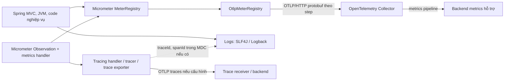

# OTLP Meter Registry trong Spring Boot: cấu hình và xuất metrics

## 1. Mục tiêu học tập

Một ứng dụng Spring Boot có thể ghi nhận **request count, latency, JVM metrics và số giao dịch nghiệp vụ** bằng Micrometer. Nhưng dữ liệu nằm trong tiến trình chỉ có ích cho vận hành khi được chuyển đúng đến hệ thống giám sát. **OTLP Meter Registry** là một cách làm việc đó: nó chuyển các meter của Micrometer thành dữ liệu **OpenTelemetry Protocol (OTLP) Metrics** và định kỳ gửi tới OpenTelemetry Collector hoặc backend tương thích.

Bài thuộc chương **Meter registry và exporter** trong module **SPRING_BOOT_OBSERVABILITY**. Sau bài học, bạn có thể:

- Phân biệt `MeterRegistry`, `OtlpMeterRegistry`, `ObservationRegistry`, OTLP exporter và OpenTelemetry Collector.
- Thêm dependency `micrometer-registry-otlp` vào Spring Boot và dùng `management.otlp.metrics.export.*` để cấu hình URL, chu kỳ, timeout và headers.
- Gửi `Counter`, `Gauge`, `Timer` và metric phát sinh từ `Observation` tới receiver OTLP/HTTP.
- Giải thích **cumulative** và **delta** temporality, histogram, SLO bucket, resource attributes và các hệ quả khi tiến trình khởi động lại.
- Đọc dấu hiệu thành công/thất bại của quá trình export thay vì chỉ kiểm tra `/actuator/metrics`.
- Kiểm soát tag/cardinality, xác định nguyên nhân thiếu metrics, và liên kết metrics với logs/traces để điều tra lỗi hoặc độ trễ.

**Phiên bản chính cho ví dụ:** Spring Boot 3.5.x, Java 17+, Micrometer do Spring Boot BOM quản lý. Phần cuối trình bày điểm cần xác minh khi dùng Spring Boot 4.x. `SPECIAL_NOTE` của bài không đặt ra ràng buộc bổ sung.

## 2. Kiến trúc: ai tạo, ai gửi, ai lưu metrics?



Mỗi lớp giải quyết một trách nhiệm riêng:

| Thành phần | Chức năng | Điều **không** tự làm |
| --- | --- | --- |
| `MeterRegistry` | Đăng ký, đo và đọc các `Counter`, `Timer`, `Gauge`... | Không mặc nhiên đẩy dữ liệu qua mạng nếu chỉ dùng simple registry |
| `OtlpMeterRegistry` | Registry Micrometer biết mã hóa metrics thành OTLP và gửi theo chu kỳ | Không lưu metrics dài hạn hoặc tạo dashboard |
| `ObservationRegistry` | Điều phối vòng đời observation và handlers | Không phải registry exporter cho mọi OTLP signal |
| `OtlpMetricsSender` | Thành phần transport gửi payload OTLP Metrics của registry | Không quyết định nghiệp vụ nào cần instrument |
| OpenTelemetry Collector | Nhận, xử lý, định tuyến dữ liệu qua pipeline | Không mặc nhiên là database lưu trữ dài hạn |
| Metrics backend | Lưu, truy vấn, vẽ biểu đồ và cảnh báo | Không tự chữa tag cardinality sai từ ứng dụng |

**Điểm khác với Prometheus:** `OtlpMeterRegistry` thường **push định kỳ** qua HTTP, còn registry Prometheus hỗ trợ endpoint để Prometheus **scrape**. Spring Boot có thể tự cấu hình nhiều registry cùng lúc thành composite registry khi có đủ dependency, nhưng điều đó cũng làm dữ liệu được phát đến nhiều đích.

### 2.1. OTLP không đồng nghĩa OpenTelemetry SDK Metrics

Spring Boot sử dụng Micrometer làm façade metrics chính. Với `micrometer-registry-otlp`, ứng dụng xuất OTLP **trực tiếp từ Micrometer registry**; bạn không cần tự tạo `SdkMeterProvider` của OpenTelemetry để xuất những meter này.

Nếu một thư viện khác chỉ ghi metrics vào **OpenTelemetry `MeterProvider`**, các meter đó không tự xuất hiện trong Micrometer `OtlpMeterRegistry`. Việc dùng cùng chuẩn OTLP ở đầu ra không có nghĩa hai API instrumentation dùng chung một registry.

Tương tự, thêm OTLP Metrics registry **không tự bật distributed tracing**. Traces cần tracing bridge/tracer, exporter và sampler tương ứng; logs có pipeline riêng. Các tín hiệu chỉ liên kết được khi context, service identity và backend được cấu hình phù hợp.

## 3. Dependency và tự cấu hình trên Spring Boot 3.5

Với Maven và Spring Boot parent hoặc BOM đang quản lý phiên bản, thêm:

```xml
<dependencies>
    <dependency>
        <groupId>org.springframework.boot</groupId>
        <artifactId>spring-boot-starter-web</artifactId>
    </dependency>
    <dependency>
        <groupId>org.springframework.boot</groupId>
        <artifactId>spring-boot-starter-actuator</artifactId>
    </dependency>
    <dependency>
        <groupId>io.micrometer</groupId>
        <artifactId>micrometer-registry-otlp</artifactId>
    </dependency>
</dependencies>
```

Hoặc trong Gradle khi đã áp dụng dependency management của Spring Boot:

```gradle
dependencies {
    implementation 'org.springframework.boot:spring-boot-starter-web'
    implementation 'org.springframework.boot:spring-boot-starter-actuator'
    runtimeOnly 'io.micrometer:micrometer-registry-otlp'
}
```

`starter-web` phục vụ ví dụ API HTTP; `starter-actuator` tích hợp Micrometer và các system/application metrics. Dependency quan trọng để xuất OTLP là **`io.micrometer:micrometer-registry-otlp`**. Không tự ghim phiên bản Micrometer khác BOM nếu không có lý do tương thích cụ thể.

Khi có registry trong classpath và export được bật, Spring Boot tự cấu hình `OtlpMeterRegistry`. Code nghiệp vụ thường chỉ inject `MeterRegistry` hoặc `ObservationRegistry`; không cần tự tạo `OtlpMeterRegistry` trong mỗi service.

### Khi nào cần khởi tạo thủ công?

Nếu **không dùng Spring Boot auto-configuration**, Micrometer cung cấp API:

```java
import io.micrometer.core.instrument.Clock;
import io.micrometer.registry.otlp.OtlpConfig;
import io.micrometer.registry.otlp.OtlpMeterRegistry;

OtlpConfig config = OtlpConfig.DEFAULT;
OtlpMeterRegistry registry = new OtlpMeterRegistry(config, Clock.SYSTEM);
try {
    registry.counter("demo.events", "kind", "example").increment();
    // Registry xuất metrics theo chu kỳ cấu hình.
} finally {
    registry.close();
}
```

Đây là mẫu **standalone minh họa API**: vòng đời thực tế phải kéo dài đủ để có kỳ export; không kết luận backend nhận được metrics chỉ vì `increment()` đã chạy. Trong ứng dụng Spring Boot, ưu tiên registry do Boot quản lý để có common tags, filters, endpoint Actuator và shutdown nhất quán.

## 4. Cấu hình `management.otlp.metrics.export`

Ví dụ `application.yml` cho môi trường thực hành có Collector OTLP/HTTP:

```yaml
spring:
  application:
    name: checkout-service

management:
  endpoints:
    web:
      exposure:
        include: health,info,metrics
  metrics:
    tags:
      application: checkout-service
      environment: local
  otlp:
    metrics:
      export:
        enabled: true
        url: http://localhost:4318/v1/metrics
        step: 10s
        batch-size: 1000
        aggregation-temporality: cumulative
        connect-timeout: 2s
        read-timeout: 5s
```

**`step: 10s` chỉ để thực hành**; trong Spring Boot 3.5, mặc định của OTLP exporter là khoảng **1 phút**. Chu kỳ quá ngắn làm tăng số lần request và chi phí backend; quá dài làm giảm độ chi tiết và tăng độ trễ hiển thị.

Các thuộc tính quan trọng:

| Thuộc tính | Vai trò | Điều cần nhớ |
| --- | --- | --- |
| `management.otlp.metrics.export.enabled` | Bật/tắt export qua OTLP registry | Tắt export khác với tắt instrumentation hoặc Actuator |
| `...url` | Địa chỉ **OTLP Metrics HTTP** | Ví dụ `http://collector:4318/v1/metrics` trong mạng container |
| `...step` | Chu kỳ publish metrics | Không phải `management.tracing.sampling` |
| `...batch-size` | Số meter/measurement được chia thành các batch publish | Không phải số HTTP request nghiệp vụ |
| `...aggregation-temporality` | Cách biểu diễn các tổng cộng dồn | `cumulative` hoặc `delta`; backend phải hỗ trợ |
| `...connect-timeout` | Giới hạn thời gian thiết lập kết nối | Cân theo mạng và collector |
| `...read-timeout` | Giới hạn đọc phản hồi của collector | Tránh worker export chờ vô hạn |
| `...headers.*` | Header của request gửi metrics | Hữu ích cho token nhưng phải quản lý bí mật an toàn |
| `...histogram-flavor` | Kiểu histogram mặc định khi bật percentile histogram | Phụ thuộc Micrometer/OTLP receiver |
| `...max-bucket-count`, `...max-scale` | Giới hạn histogram exponential | Không ảnh hưởng tương tự lên explicit buckets |

Dùng **đúng prefix `management.otlp.metrics.export`**. Một số nhóm dễ nhầm:

- `management.metrics.*`: cấu hình meter name, tags, filters, distribution.
- `management.otlp.metrics.export.*`: **export metrics** bằng OTLP.
- `management.otlp.tracing.*` ở Boot 3.5: cấu hình **trace export** qua OTLP.
- `management.endpoints.web.exposure.*`: hiển thị **Actuator HTTP endpoint** phục vụ quan sát/thử nghiệm.

`/actuator/prometheus` **không phải** endpoint nhận OTLP Metrics; không cần expose nó chỉ để `OtlpMeterRegistry` push. `/actuator/metrics` cũng không phải OTLP receiver: đó là giao diện đọc meters trong ứng dụng.

### 4.1. Endpoint, cổng và protocol

OTLP có các chế độ transport khác nhau. Với Micrometer `OtlpMeterRegistry` mặc định, metrics được gửi dưới dạng **OTLP protobuf qua HTTP** tới URL được cấu hình, thường dùng:

```text
http://localhost:4318/v1/metrics
```

Trong cấu hình Collector phổ biến:
- **4318**: cổng OTLP/HTTP.
- **4317**: cổng OTLP/gRPC.

**Không đổi URL mặc định thành `http://collector:4317` chỉ vì backend cũng hỗ trợ OTLP.** Micrometer không cung cấp sẵn một `OtlpMetricsSender` gRPC trong phiên bản được mô tả ở tài liệu Micrometer OTLP; muốn dùng gRPC cần sender tương thích được triển khai riêng hoặc một pipeline khác phù hợp. Một endpoint trả 404/415 thường gợi ý sai đường dẫn, protocol hoặc content type.

Trong Docker/Kubernetes, `localhost` trỏ về chính network namespace/container đang chạy ứng dụng (trừ trường hợp chia sẻ network). Vì vậy cần dùng service DNS hoặc địa chỉ thực sự kết nối được từ ứng dụng.

### 4.2. Xác thực và cấu hình môi trường

Nếu backend yêu cầu token, cung cấp header tương ứng, ví dụ:

```yaml
management:
  otlp:
    metrics:
      export:
        url: https://metrics.example.net/v1/metrics
        headers:
          Authorization: Bearer-REPLACE-IN-SECURE-CONFIG
```

Giá trị ở đây chỉ là **placeholder**, không phải credential thật. Trong production, lấy token từ secret store/biến môi trường thông qua cơ chế cấu hình Spring phù hợp; không commit token vào source control, không ghi token vào logs khi debug. Bật TLS và xác minh chứng chỉ khi gửi qua mạng không tin cậy.

Các biến môi trường như `OTEL_EXPORTER_OTLP_METRICS_ENDPOINT`, `OTEL_EXPORTER_OTLP_ENDPOINT`, `OTEL_METRIC_EXPORT_INTERVAL` có thể được Micrometer hỗ trợ ở tầng `OtlpConfig`. Khi đồng thời đặt Spring Boot property và biến môi trường, phải kiểm tra giá trị **thực sự được bind** và quy tắc ưu tiên tại phiên bản cụ thể, tránh đoán.

## 5. OpenTelemetry Collector mẫu để kiểm chứng

Một cấu hình tối thiểu cho **Collector chạy trong môi trường thử nghiệm**:

```yaml
receivers:
  otlp:
    protocols:
      http:
        endpoint: 0.0.0.0:4318

processors:
  batch: {}

exporters:
  debug:
    verbosity: detailed

service:
  pipelines:
    metrics:
      receivers: [otlp]
      processors: [batch]
      exporters: [debug]
```

Các lưu ý:

- Receiver `otlp` nhận request metrics trên HTTP 4318, với đường dẫn tiêu chuẩn `/v1/metrics`. Cấu hình dùng `0.0.0.0` để minh họa container/namespace; **giới hạn mạng** để receiver thử nghiệm không công khai ra Internet.
- Processor `batch` gom dữ liệu trước khi xuất; exporter `debug` ghi tín hiệu vào **log Collector** để quan sát. Nó **không lưu metrics dài hạn**.
- Khi dùng Collector ở production, thay/ bổ sung exporter tới hệ thống metrics thật, thiết lập authentication, TLS, retries, queue và tài nguyên phù hợp.
- Nếu backend chỉ hỗ trợ Prometheus scrape hoặc Prometheus Remote Write, cần Collector exporter/pipeline chuyển đổi tương thích; không giả định backend trực tiếp hiểu OTLP Metrics.
- Trước khi dùng một phiên bản Collector cụ thể, xem tài liệu cấu hình của **chính phiên bản đó**; các component có thể thay đổi tên/khả năng theo bản phát hành.

Bạn có thể dán YAML này vào **cấu hình Collector riêng** trong môi trường thực hành. Bài học này không yêu cầu tạo file cấu hình Collector ở repository hiện tại.

### 5.1. Quy trình thử end-to-end

1. Chạy Collector có receiver OTLP/HTTP đang lắng nghe cổng 4318.
2. Chạy Spring Boot với `micrometer-registry-otlp` và `management.otlp.metrics.export.url` trỏ đúng địa chỉ Collector.
3. Gửi request vào API có metric nghiệp vụ hoặc quan sát metrics JVM mà Actuator đăng ký.
4. Xem `GET /actuator/metrics` (nếu đã expose) để xác nhận ứng dụng có meter.
5. Đợi ít nhất **một kỳ publish** của OTLP exporter và kiểm tra log `debug` của Collector có metric tương ứng, tên/tags và `service.name`.
6. Nếu dùng backend thật, xác nhận thêm rằng metrics được **export từ Collector tới backend**, đã được ingest và có thể truy vấn. Hai bước nhận và lưu trữ là khác nhau.

Đừng kiểm tra ngay sau một request rồi kết luận export hỏng: `OtlpMeterRegistry` làm việc theo chu kỳ `step`, không gửi một HTTP request metrics cho mỗi `counter.increment()`.

## 6. Thực hành Spring Boot: Counter, Gauge và Timer qua OTLP

Ví dụ controller dùng **Spring Boot 3.5.x và Actuator**; chỉ cần dependency ở mục 3. Nó tạo metric nhỏ với tags hữu hạn để dễ nhận diện ở Collector.

```java
package com.example.checkout;

import io.micrometer.core.instrument.Counter;
import io.micrometer.core.instrument.Gauge;
import io.micrometer.core.instrument.MeterRegistry;
import io.micrometer.core.instrument.Timer;
import java.util.concurrent.atomic.AtomicInteger;
import org.springframework.web.bind.annotation.GetMapping;
import org.springframework.web.bind.annotation.RequestParam;
import org.springframework.web.bind.annotation.RestController;

@RestController
public class CheckoutMetricsDemoController {
    private final MeterRegistry registry;
    private final AtomicInteger pending = new AtomicInteger();

    public CheckoutMetricsDemoController(MeterRegistry registry) {
        this.registry = registry;
        Gauge.builder("checkout.pending", pending, AtomicInteger::get)
                .description("Number of pending checkout operations")
                .register(registry);
    }

    @GetMapping("/demo/checkout")
    public String checkout(
            @RequestParam(defaultValue = "false") boolean fail) {

        // Tên/tags của meter ổn định qua mọi request.
        String outcome = fail ? "failure" : "success";
        Counter attempts = registry.counter(
                "checkout.attempts", "outcome", outcome);

        Timer timer = registry.timer("checkout.duration", "channel", "web");
        pending.incrementAndGet();
        try {
            return timer.record(() -> {
                if (fail) {
                    throw new IllegalStateException("Simulated checkout error");
                }
                return "ok";
            });
        } finally {
            attempts.increment();
            pending.decrementAndGet();
        }
    }
}
```

Phân tích từng meter:

| Meter | Giá trị đo | Dạng OTLP data point thường gặp |
| --- | --- | --- |
| `checkout.attempts` (Counter) | Tổng số lượt checkout theo `outcome` | **Sum**, monotonic |
| `checkout.pending` (Gauge) | Số checkout đang xử lý tại thời điểm lấy mẫu | **Gauge** |
| `checkout.duration` (Timer) | Số lượt xử lý và thời gian, có thể mở rộng bucket | **Histogram** hoặc cấu hình tương ứng |

`Timer.record(Supplier<T>)` cũng ghi duration khi code ném exception. Trong ví dụ, `finally` tăng counter bất kể kết quả để không bỏ sót lượt lỗi; `pending` được giảm dù xử lý thất bại. Việc đặt `Gauge` trên `AtomicInteger` sống cùng controller giúp tránh vấn đề weak reference khiến đối tượng được đo bị thu gom bộ nhớ.

Khi gọi:

```text
GET /demo/checkout
GET /demo/checkout?fail=true
```

Spring MVC còn có thể tạo HTTP server metrics tự động. Không thêm `orderId`, customer email, URL thực hoặc `traceId` vào `outcome` hay `channel`: các giá trị này dễ làm số tổ hợp time series tăng không giới hạn.

### 6.1. Kết hợp với Micrometer Observation

Nếu mục đích là quan sát một bước nghiệp vụ vừa có **duration metric** vừa có thể có **span**, dùng `ObservationRegistry`:

```java
import io.micrometer.observation.Observation;
import io.micrometer.observation.ObservationRegistry;

String result = Observation.createNotStarted(
                "checkout.process", observationRegistry)
        .contextualName("process checkout")
        .lowCardinalityKeyValue("channel", "web")
        .observe(() -> performCheckout());
```

Ở đây `observationRegistry` được Spring inject và `performCheckout()` là logic nghiệp vụ trong ứng dụng thật. Handler metrics của Spring Boot có thể tạo Timer trong `MeterRegistry` rồi `OtlpMeterRegistry` xuất nó. **Nếu đồng thời gọi `Timer.record()` cho chính cùng thao tác**, sẽ có hai phép đo thời gian với ngữ nghĩa trùng nhau; hãy chủ động chọn ranh giới và tên để dashboard không đếm lặp.

Khi có tracing bridge/tracer và exporter riêng, observation này còn có thể xuất span. OTLP Metrics registry chỉ nhận dữ liệu **metrics**; một tên observation có mặt trong metrics không chứng minh trace của nó đã đến backend.

## 7. OTLP data points và các metric type

Bản đồ khái niệm theo Micrometer OTLP:

| Micrometer meter | OTLP data point | Điểm cần chú ý |
| --- | --- | --- |
| `Counter`, `FunctionCounter` | Sum | Có thể phát biểu diễn cumulative hoặc delta |
| `Gauge`, `TimeGauge` | Gauge | Giá trị tức thời tại kỳ lấy mẫu |
| `Timer`, `DistributionSummary` | Histogram hoặc Summary theo cấu hình | Có count, sum, có thể có buckets |
| `LongTaskTimer` | Histogram/Summary theo hỗ trợ | Phù hợp tác vụ đang chạy; đọc đúng semantics |
| Timer có `publishPercentileHistogram` | Explicit hoặc exponential Histogram theo cấu hình | Chi phí bucket và khả năng backend |
| Timer chỉ có client-side `publishPercentiles` | Summary | Percentiles cục bộ không tổng hợp trực tiếp được qua instances |

Các điểm dễ hiểu sai:

- **Counter** đếm số sự kiện; không chia nhỏ thời gian bằng cách đo một sample cho mỗi lần push. Registry tổng hợp trong tiến trình, exporter lấy snapshot theo chu kỳ.
- **Gauge** là snapshot; nếu `checkout.pending` tăng rồi giảm giữa hai lần publish, backend có thể không nhìn thấy đỉnh ngắn đó. Với queue depth hoặc active operations, cần cân nhắc độ phân giải và metrics bổ sung.
- **Timer** đo thời gian; OTLP receiver có thể nhận dữ liệu dưới dạng Histogram ngay cả khi không cấu hình thêm percentile histogram. Số ranh giới bucket có ý nghĩa phụ thuộc cấu hình và implementation.
- **Summary** chứa quantiles tính trong tiến trình, không nên lấy trung bình p95 của các pod để ra p95 toàn hệ thống.
- Các metric metadata (type, unit, description), resource attributes và data point attributes là những tầng thông tin khác nhau; tên hiển thị trong backend có thể được quy đổi theo naming conventions.

## 8. Aggregation temporality: cumulative và delta

`management.otlp.metrics.export.aggregation-temporality` quyết định cách biểu diễn dữ liệu cộng dồn, đặc biệt với Sum/Histogram:

| Chế độ | Diễn giải cho Counter | Ví dụ qua ba kỳ publish |
| --- | --- | --- |
| `cumulative` | Tổng kể từ thời điểm bắt đầu vòng tích lũy của process | 5 → 12 → 20 |
| `delta` | Số tăng thêm trong **mỗi khoảng xuất** | 5 → 7 → 8 |

Cả hai có thể mô tả **20 sự kiện** trong ví dụ, nhưng backend phải hiểu đúng temporality. Đừng lấy giá trị `delta=8` ở kỳ cuối rồi coi đó là tổng từ khi start.

### 8.1. Chọn chế độ theo backend

- Micrometer OTLP mặc định dùng `cumulative` trong cấu hình được tài liệu mô tả.
- Một số backend hoặc pipeline hỗ trợ tốt một temporality cụ thể. Xác minh tài liệu collector/backend trước khi chuyển sang `delta`.
- Khi pod restart, cumulative series bắt đầu một vòng tích lũy mới. Data point OTLP có thông tin thời gian bắt đầu/ghi nhận; hệ thống ingest phải xử lý reset, không nối thẳng hai giá trị cumulative khác vòng đời.
- Delta liên quan chặt tới độ tin cậy của việc nhận đủ các khoảng export. Nếu mất một batch, không thể đơn giản cộng các batch còn lại để khôi phục chính xác tổng.
- Không suy từ `step=10s` rằng mỗi data point đại diện cho một request: đó chỉ là nhịp publish của registry.

### 8.2. Ví dụ cấu hình delta để thử nghiệm

```yaml
management:
  otlp:
    metrics:
      export:
        aggregation-temporality: delta
        step: 30s
```

Đổi mode rồi so sánh counter tăng dần với kết quả ở Collector. Khi môi trường thật có receiver/backends và dashboard đang hoạt động, xem xét rủi ro thay đổi ngữ nghĩa của time series và truy vấn trước khi đổi.

## 9. Histogram và SLO khi xuất OTLP

Để điều tra độ trễ checkout, chỉ có trung bình duration thường không đủ. Với `Timer` hoặc observation Timer, cấu hình bucket theo các ngưỡng có ý nghĩa:

```yaml
management:
  metrics:
    distribution:
      slo:
        "[checkout.duration]":
          - 100ms
          - 300ms
          - 1s
```

Dấu ngoặc vuông được đặt trong dấu nháy để Spring Binder giữ nguyên dấu chấm của tên meter làm map key.

Các bucket SLO này giúp thống kê tỷ lệ thao tác dưới 100/300/1000 ms qua **explicit bucket histogram**, nếu registry/receiver/backend hỗ trợ. Nếu cần histogram theo các bucket Micrometer sinh ra, có thể cấu hình phương án khác:

```yaml
management:
  metrics:
    distribution:
      percentiles-histogram:
        "[checkout.duration]": true
      minimum-expected-value:
        "[checkout.duration]": 10ms
      maximum-expected-value:
        "[checkout.duration]": 3s
```

`OtlpMeterRegistry` có thể dùng **explicit-bucket histogram** hoặc **exponential histogram** khi bật percentile histogram. Loại histogram và ngưỡng/chi phí được điều khiển qua cấu hình exporter và meter. Khi có ranh giới **SLO tùy chỉnh**, explicit bucket được sử dụng vì exponential histogram không đại diện trực tiếp các ranh giới SLO tùy ý theo cách này.

### 9.1. Không nhầm histogram với percentile tính sẵn

| Cấu hình | OTLP thường xuất | Tổng hợp p95 nhiều pod? |
| --- | --- | --- |
| Timer thường | Histogram (có thể không có bucket chi tiết) | Cần đủ bucket và backend phù hợp |
| `percentiles-histogram` | Histogram/Exponential Histogram | Có thể ước lượng với phương pháp của backend |
| `slo` buckets | Explicit Histogram | Theo ranh giới SLO; p95 ước lượng bị giới hạn bởi độ phân giải buckets |
| Chỉ `percentiles` | Summary chứa quantile tính ở client | **Không** lấy trung bình p95 của các pod |

Nếu backend sử dụng PromQL sau khi đã chuyển OTLP Metrics sang dạng tương thích Prometheus, **tên metric và label có thể được chuyển đổi**. Ví dụ `checkout.duration` không nhất thiết hiển thị nguyên tên đó ở backend. Trước khi sao chép truy vấn `histogram_quantile(...)`, hãy xem schema thực tế và loại histogram (classic hay native/exponential) của backend.

### 9.2. Chi phí của buckets và tags

Giả sử một timer có:
- 3 `channel`,
- 2 `outcome`,
- 6 instance.

Giới hạn lý thuyết là `3 × 2 × 6 = 36` tổ hợp nhãn **trước** các chiều khác. Nếu histogram có nhiều bucket cho mỗi tổ hợp, khối lượng dữ liệu OTLP và backend tăng tương ứng. Thêm `orderId` vào metric tag có thể nhân số series lên hàng nghìn hoặc hàng triệu, dù `step` giữ nguyên.

Để kiểm soát:
- Dùng tên meter ổn định và tập tag hữu hạn.
- Không gắn raw URI, trace ID, user ID, exception message hoặc SQL text vào tags.
- Chọn bucket phù hợp với SLO thực tế, hạn chế tạo histogram cho mọi meter.
- Dùng `MeterFilter.maximumAllowableTags(...)` như biện pháp phòng vệ, hiểu rằng meter bị từ chối có thể làm thiếu số liệu.

## 10. Resource attributes khác metric tags như thế nào?

OTLP có khái niệm **Resource** mô tả thực thể đang phát telemetry, chẳng hạn service, phiên bản, môi trường và instance. Đây là dữ liệu dùng chung cho nhiều metric. Mỗi OTLP metric data point có thể mang **attributes** của meter/tag như `channel=web` hoặc `outcome=failure`.

| Tầng | Ví dụ | Cách nghĩ |
| --- | --- | --- |
| Resource attributes | `service.name=checkout-service`, `deployment.environment=staging` | Metrics này đến từ dịch vụ/môi trường nào? |
| Metric data point attributes | `channel=web`, `outcome=success` | Nhóm phép đo này thuộc loại nghiệp vụ nào? |
| Tracing span attributes | `http.request.method`, `error.type` theo semantic conventions | Một lần thực thi/span có đặc điểm gì? |
| Correlation IDs | `traceId`, `spanId` | Liên kết một lần điều tra; **không** dùng làm metric tags |

Theo tài liệu Micrometer, nếu không định danh rõ, `service.name` có thể rơi về giá trị kiểu **`unknown_service`**. Đừng giả định `spring.application.name` luôn trở thành OTLP `service.name` trên mọi phiên bản/cấu hình.

Với môi trường Spring Boot/Micrometer phù hợp, có thể đặt biến môi trường:

```text
OTEL_SERVICE_NAME=checkout-service
OTEL_RESOURCE_ATTRIBUTES=deployment.environment=staging,service.namespace=payments
```

`OTEL_SERVICE_NAME` dùng để xác định tên dịch vụ và có độ ưu tiên theo logic `OtlpConfig`; dữ liệu `OTEL_RESOURCE_ATTRIBUTES` có thể được đọc khi không có cấu hình resource attributes tương ứng. Kiểm tra **payload thực tại Collector** để xác nhận service name và resource attributes, vì sự ưu tiên giữa property, môi trường và phần tự cấu hình có thể khác theo phiên bản.

Trong một tổ chức, nên thống nhất service identity giữa metrics, traces và logs để dễ correlation. Tuy vậy, **OTLP Metrics registry không tự hợp nhất thông tin Resource với mọi pipeline log/trace**. Những pipeline ấy cần cấu hình riêng.

## 11. `OtlpMetricsSender` và tùy biến transport

Mặc định `OtlpMeterRegistry` gửi OTLP/HTTP qua một HTTP sender. Micrometer cung cấp abstraction `OtlpMetricsSender` để thay transport khi có yêu cầu đặc biệt (proxy, HTTP client, cơ chế xác thực, khả năng kiểm thử).

Trong **Spring Boot 3.5**, nếu bạn khai báo một bean `OtlpMetricsSender`, Boot có thể gắn sender đó vào `OtlpMeterRegistry` do Boot tự cấu hình. Đây là điểm mở rộng của transport; người học thường **không cần tự viết sender** nếu OTLP/HTTP mặc định đáp ứng nhu cầu.

Micrometer cũng cung cấp builder ở mức standalone:

```java
OtlpConfig config = OtlpConfig.DEFAULT;
OtlpMeterRegistry registry = OtlpMeterRegistry.builder(config)
        .metricsSender(customSender)
        .build();
```

`customSender` trong ví dụ là một implementation **do bạn cung cấp** của `OtlpMetricsSender`, không phải biến hay bean có sẵn. Không sử dụng đoạn này nguyên xi trong Spring Boot khi Boot đã auto-configure registry; làm vậy có thể tạo registry thứ hai, trùng export hoặc bỏ qua common tags và filters của Boot.

Nếu chỉ cần chỉnh URL, step, timeout hoặc header, hãy dùng `management.otlp.metrics.export.*` và tránh code tùy biến không cần thiết.

## 12. Kiểm chứng và troubleshooting theo từng tầng

Một dữ liệu metric phải đi qua các bước:

```text
Code/Instrumentation
  → MeterRegistry đăng ký meter
  → OtlpMeterRegistry snapshot/publish theo step
  → OTLP/HTTP request và status
  → Collector OTLP receiver
  → Collector metrics pipeline/exporter
  → Metrics backend ingest và query/dashboard
```

Kiểm tra từng lớp sẽ nhanh hơn so với chỉ nhìn một dashboard trống.

### 12.1. Có meter trong ứng dụng, nhưng không thấy ở Collector

- Xem `/actuator/metrics` để xác minh meter có mặt, nhưng nhớ rằng **endpoint metrics không phải bằng chứng OTLP export thành công**.
- Xác minh classpath có `micrometer-registry-otlp` và `management.otlp.metrics.export.enabled` không bị tắt.
- Xác minh `management.otlp.metrics.export.url` dùng đúng **HTTP 4318 /v1/metrics** và địa chỉ truy cập được từ container của ứng dụng.
- Kiểm tra cổng listener, DNS, firewall, TLS, xác thực và response HTTP. 401/403 gợi ý auth; 404/415 gợi ý sai endpoint/protocol; connection refused/timeout gợi ý mạng hoặc receiver chưa chạy.
- Chờ ít nhất một kỳ `step`, xem log ứng dụng/Collector để xác nhận đã publish và nhận metric. Không hạ `step` xuống cực ngắn trên production để debug.
- Kiểm tra dữ liệu ở **pipeline metrics** của Collector; cấu hình chỉ có pipeline traces sẽ không chuyển tiếp metrics.

### 12.2. Collector nhận được, nhưng dashboard vẫn trống

- Debug exporter của Collector có thể xác nhận đã **nhận**, nhưng nó không lưu số liệu. Kiểm tra exporter thật, cấu hình pipeline và lỗi ingest của backend.
- So sánh tên metric thực tế, Resource attributes, data point attributes, đơn vị và temporality mà backend sử dụng; không mặc định tên giống Prometheus.
- Kiểm tra độ trễ pipeline, aggregation/temporality support, retention, giới hạn ingest và bộ lọc nhãn.
- Với backend Prometheus-compatible, xem liệu OTLP Metrics đã được chuyển thành time series và có được gán service/instance labels đúng kỳ vọng hay chưa.
- Nếu sau restart thấy counter tụt rồi tăng lại, xem liệu backend nhận diện reset/start time đúng không; tránh hiểu reset là số giao dịch âm.

### 12.3. Cùng metric bị ghi trùng

Spring Boot có thể cấu hình nhiều registry khi nhiều dependency hiện diện. Nếu vừa bật OTLP push vừa giữ Prometheus scrape, có thể backend cuối nhận **hai bản cùng một metric** từ hai pipeline. Kiểm tra route và nguồn ingest trước khi cộng dữ liệu.

Ngoài ra, nếu cùng thao tác được đo bằng `Timer.record` và một `Observation` tạo Timer cùng tên nhưng ngữ nghĩa tương đương, biểu đồ sẽ bị đếm trùng ở tầng instrumentation. Sửa tại nguồn thay vì cố sửa ở dashboard.

### 12.4. Bảng sự cố nhanh

| Dấu hiệu | Nguồn gốc có thể | Hành động |
| --- | --- | --- |
| Có `/actuator/metrics`, Collector không thấy metrics | OTLP registry vắng/bị tắt, sai URL, chưa tới step | Kiểm tra dependency, enabled, URL, logs publish |
| HTTP 404 hoặc 415 lúc gửi | Sai `/v1/metrics`, sai HTTP/gRPC protocol | Trỏ đúng OTLP/HTTP receiver |
| HTTP 401/403 | Thiếu/sai header hoặc token | Kiểm tra secret, header và policy ingress |
| Connection refused / timeout | Collector chưa chạy, DNS/network/container localhost | Kiểm tra listener, service DNS, firewall, timeout |
| Collector nhận nhưng backend không có | Chưa có metrics exporter, lỗi ingest hoặc filter | Xem pipeline, exporter logs và query schema |
| Metric hiển thị với service lạ | Thiếu `service.name` resource attribute | Xác minh `OTEL_SERVICE_NAME` và collector output |
| Counter sai sau restart | Temporality/reset không được diễn giải đúng | Kiểm tra start time, `cumulative`/ `delta` và backend |
| Gauge bỏ qua đỉnh ngắn | Step/publish lấy snapshot quá thưa | Chọn cadence và metric bổ sung phù hợp |
| Histogram không có bucket cần dùng | Chưa bật SLO/histogram hoặc backend không hỗ trợ | Xem cấu hình distribution và loại OTLP point |
| Số series hoặc chi phí tăng đột biến | Tag/Resource attributes động hoặc quá nhiều bucket | Chuẩn hóa labels, kiểm tra cardinality/budget |
| Metrics có, traces/logs không có | Pipeline tracing/logging tách biệt | Kiểm tra bridge/exporter, sampler, MDC và Collector pipelines |

## 13. Kết hợp metrics, traces và logs để điều tra lỗi thật

Giả sử `checkout.duration` tăng và `checkout.attempts{outcome=failure}` xuất hiện nhiều hơn. Một lộ trình điều tra đúng:

1. **Metrics:** xác định khoảng thời gian, service, instance, channel và tỷ lệ lỗi/latency. OTLP push cho biết xu hướng tổng hợp theo các nhãn hữu hạn.
2. **Traces:** nếu đã cấu hình Micrometer Tracing và trace exporter, mở các request được sample gần thời điểm đó; xem span `checkout.process`, HTTP client và payment service để tìm bước chậm.
3. **Logs:** dùng `traceId`/`spanId` từ trace để tìm exception, timeout, retry hoặc kết quả fallback; logging pipeline phải giữ lại các trường tương ứng.
4. **Đối chiếu:** metric phản ánh toàn bộ các lần instrument được ghi nhận (trong giới hạn export), còn trace có thể được lấy mẫu. Một trace chậm không chứng minh mọi request đều chậm.
5. **Sửa và đo lại:** điều chỉnh logic hoặc dependency, xác nhận error rate/latency cải thiện và trace/log minh chứng cho nguyên nhân đã được xử lý.

Trên Micrometer OTLP phiên bản có hỗ trợ **exemplars**, một số Counter/Timer/DistributionSummary có thể gắn tham chiếu trace/span vào sample. Muốn có exemplar cần `ExemplarContextProvider` phù hợp, span đang hoạt động/được sample và backend có khả năng hiển thị. **Exemplar khác metric tag**: nó gắn tham chiếu với sample chứ không tạo một time series riêng cho mỗi trace ID.

Không thêm `traceId` hoặc `spanId` làm metric data point attributes để “kết nối” dữ liệu; điều này gây cardinality cực cao. Cũng không biến `OTEL_RESOURCE_ATTRIBUTES` thành nơi lưu giá trị thay đổi theo từng request.

## 14. Spring Boot 4.x: những điều phải kiểm tra

Spring Boot 4.x tiếp tục có tích hợp `OtlpMeterRegistry` và property nền tảng `management.otlp.metrics.export.url`. Tuy nhiên, starter, auto-configuration package, tài nguyên OpenTelemetry và một số thuộc tính metrics/tracing có thể được tổ chức lại. Khi chuyển từ Boot 3.5 sang Boot 4.x:

| Mục | Kiểm tra |
| --- | --- |
| Dependency | Có đúng `micrometer-registry-otlp` và Actuator/starter tương ứng với phiên bản mới |
| Registry bean | `OtlpMeterRegistry` có thực sự được auto-configure và nhận đúng customizers |
| Endpoint | `management.otlp.metrics.export.url` trỏ tới OTLP/HTTP receiver |
| Export step/temporality | Collector/backend có nhận dữ liệu như trước hay không |
| Resource attributes | `service.name`, environment, namespace có đúng và không xung đột |
| Histogram | Loại bucket/data point có tương thích backend, SLO có hiệu lực |
| Tracing | Bridge/exporter và sampling cấu hình theo Boot 4, không sao chép mù cấu hình tracing 3.5 |
| Dữ liệu hiện có | Dashboard, alerts, queries tương thích với tên/unit/labels thực nhận |

Boot 4 có thêm cách tích hợp thông tin resource ở tầng OpenTelemetry. Không dựa vào một property của nhánh khác để khẳng định nó thay thế được mọi cấu hình `OtlpConfig`; hãy xác minh tại Collector sau khi nâng cấp.

## 15. Checklist triển khai thực tế

- [ ] Đã chọn nguồn chuẩn cho mỗi metric, tránh export trùng từ nhiều pipeline.
- [ ] `micrometer-registry-otlp` có mặt và registry được Spring Boot quản lý.
- [ ] OTLP **Metrics** dùng đúng URL/transport; phân biệt 4318 HTTP và 4317 gRPC.
- [ ] Step, timeout, batch size và temporality phù hợp với backend và lưu lượng.
- [ ] Secret/TLS và quyền nhận telemetry được cấu hình an toàn, không lưu token trong mã nguồn.
- [ ] Collector có pipeline `metrics`, exporter tới backend và giám sát lỗi ingest.
- [ ] `service.name` và các Resource attributes có giá trị rõ ràng, thống nhất giữa môi trường.
- [ ] Metric name/tags ổn định, tránh ID động; histogram chỉ bật nơi có nhu cầu.
- [ ] Đã kiểm chứng một Counter, Gauge và Timer từ ứng dụng qua Collector tới backend.
- [ ] Traces/logs có pipeline riêng; correlation được kiểm chứng nếu yêu cầu điều tra phân tán.
- [ ] Đã thử restart ứng dụng và xác nhận backend hiểu counter temporality/reset.
- [ ] Đã đối chiếu version Spring Boot/Micrometer của ứng dụng với tài liệu phù hợp.

## 16. Câu hỏi tự luyện

1. Vì sao có `/actuator/metrics/checkout.attempts` nhưng chưa đủ để nói OTLP backend đã nhận metric?
2. Khi ứng dụng chạy trong container, `http://localhost:4318/v1/metrics` đang trỏ đến đâu? Khi nào cần đổi thành service DNS?
3. Vì sao gửi tới cổng 4317 theo HTTP mặc định có thể thất bại?
4. Với các kỳ export có 5, 12, 20 lượt checkout, hãy mô tả data points cumulative và delta.
5. Trong thử nghiệm `checkout.pending` tăng rồi giảm hết trong 2 giây, tại sao exporter step 1 phút có thể không quan sát được đỉnh?
6. `OTEL_SERVICE_NAME` khác tag `channel=web` như thế nào?
7. Một Timer không có bucket chi tiết ở backend. Bạn cần kiểm tra những cấu hình nào trước khi tính p95?
8. Có thể tính p95 đa instance bằng cách lấy trung bình các p95 client-side không? Giải thích.
9. Khi Collector nhận metric nhưng dashboard trống, bạn kiểm tra những bước nào từ pipeline đến query?
10. Nếu cùng một Counter được ingest qua OTLP và Prometheus scrape vào cùng backend, lỗi phân tích có thể xảy ra thế nào?
11. Vì sao sampling 10% traces không khiến `checkout.attempts` chỉ tăng 10% số lần?
12. Muốn đi từ biểu đồ latency sang một trace cụ thể, exemplar có thể giúp gì và cần những điều kiện nào?

## Tài liệu tham khảo

- [Micrometer — OTLP Registry](https://docs.micrometer.io/micrometer/reference/implementations/otlp.html)
- [Micrometer — Meters and Registry](https://docs.micrometer.io/micrometer/reference/concepts/registry.html)
- [Micrometer — Histograms and Percentiles](https://docs.micrometer.io/micrometer/reference/concepts/histogram-quantiles.html)
- [Spring Boot 3.5 — Metrics / OTLP](https://docs.spring.io/spring-boot/3.5/reference/actuator/metrics.html)
- [Spring Boot 3.5 — Common Application Properties](https://docs.spring.io/spring-boot/3.5/appendix/application-properties/index.html)
- [Spring Boot 4.0 — Metrics / OTLP](https://docs.spring.io/spring-boot/4.0/reference/actuator/metrics.html)
- [Spring Boot — Observability and Micrometer OTLP](https://docs.spring.io/spring-boot/reference/actuator/observability.html)
- [OpenTelemetry — Collector Configuration](https://opentelemetry.io/docs/collector/configuration/)
- [OpenTelemetry — OTLP Specification](https://opentelemetry.io/docs/specs/otlp/)
