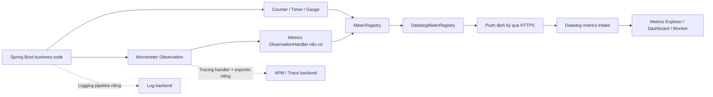
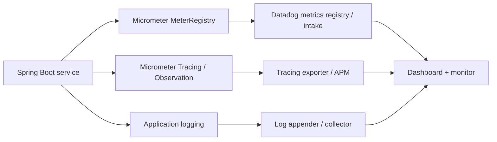

# Datadog registry

> **Chương:** Meter registry và exporter  
> **Module:** `SPRING_BOOT_OBSERVABILITY` — xây dựng observability trong Spring Boot bằng Micrometer Observation, metrics, logs và distributed tracing, với trọng tâm là exporter, context propagation, tags/cardinality và liên kết tín hiệu để điều tra độ trễ, lỗi và hành vi ứng dụng.

## Mục tiêu học tập

Sau bài này, bạn có thể:

- Giải thích vai trò của **`DatadogMeterRegistry`** trong Micrometer và sự khác biệt giữa **push** metrics theo chu kỳ với **pull** metrics bằng Prometheus.
- Cấu hình Spring Boot gửi metrics qua Datadog registry, quản lý API key bằng secrets, chọn đúng Datadog site và kiểm tra luồng dữ liệu.
- Tạo counter/timer và observation nghiệp vụ, chọn names/tags có cardinality thấp, hiểu ý nghĩa của chu kỳ `step`.
- Phân biệt Datadog **metrics intake** với Datadog **APM tracing** và log collection: thêm registry metrics không tự thu thập traces hoặc logs.
- Xử lý các tình huống metric hiện trong ứng dụng nhưng chưa thấy trên Datadog, endpoint sai, thiếu credential, mất mạng, trùng exporter hoặc không đúng tags.
- Liên kết metrics, logs và distributed traces để điều tra một sự cố thực tế trên môi trường production.

## 1. Vai trò của Datadog registry

Micrometer là một lớp API đo lường trong Java. Code ứng dụng ghi dữ liệu qua `MeterRegistry` với những loại meter như `Counter`, `Timer`, `Gauge` và `DistributionSummary`. Registry cụ thể quyết định dữ liệu được tổ chức và xuất tới backend như thế nào.

**`DatadogMeterRegistry`** là triển khai Micrometer dành cho việc đưa metrics tới **Datadog**. Với tích hợp registry trực tiếp, ứng dụng gom phép đo theo khoảng thời gian rồi **push** chúng đến Datadog metrics API qua HTTPS. Đây không phải là một endpoint Prometheus để Datadog tự kéo dữ liệu.

Ví dụ hệ thống checkout cần theo dõi:

- Số đơn hàng được commit, theo `channel=web|mobile`.
- Thời gian xử lý checkout theo nhóm kết quả.
- Số lần timeout khi gọi nhà cung cấp thanh toán.
- HTTP request rate, HTTP 5xx, JVM memory/GC và connection pool metrics nếu instrumentation tương ứng có sẵn.
- Xu hướng thay đổi sau khi triển khai một release.

Để dữ liệu trở nên hữu ích, cần **cả hai phía**: công việc instrument đúng ở ứng dụng, và công việc export/ingest đúng ở hạ tầng. Một metric có thể đã tồn tại trong process nhưng chưa được Datadog thu nhận.

### 1.1. Cấu trúc tổng quát



Vai trò từng thành phần:

| Thành phần | Nhiệm vụ |
| --- | --- |
| `MeterRegistry` | Đăng ký và ghi meters theo name, tags và loại meter. |
| `DatadogMeterRegistry` | Publish measurements đã tổng hợp theo cơ chế Datadog registry. |
| `ObservationRegistry` | Quản lý vòng đời observation; khi có metrics handler, observation có thể đóng góp metric. |
| `DatadogConfig` | Cấu hình đặc thù như API key, URI và thời lượng step khi thiết lập registry thủ công. |
| Datadog metrics intake | Nhận metrics đã gửi, kiểm tra và đưa vào hệ thống dữ liệu. |
| Tracing bridge/exporter | Chuyển spans tới tracing backend; **không** phải Datadog metrics registry. |
| Log appender/collector | Vận chuyển bản ghi log; **không** tự phát sinh từ một metric. |

Một kiến trúc có thể sử dụng nhiều registries thông qua cơ chế composite registry, nhưng cần kiểm tra đúng registry được Spring Boot quản lý. Nếu tạo `SimpleMeterRegistry` riêng rồi chỉ ghi vào đó, dữ liệu không mặc nhiên xuất qua Datadog registry của ứng dụng.

## 2. Push registry so với pull registry

| Tiêu chí | Datadog registry trực tiếp | Prometheus registry với scrape thông thường |
| --- | --- | --- |
| Hướng trao đổi | Ứng dụng **push** dữ liệu đến Datadog API. | Prometheus server **pull** dữ liệu tại endpoint của ứng dụng. |
| Chu kỳ vận chuyển | `step`/publish interval. | `scrape_interval` của Prometheus server. |
| Authentication từ ứng dụng | Thường cần Datadog API key. | Ứng dụng không cần Datadog API key; bảo mật endpoint scrape được cấu hình riêng. |
| Network | Workload cần outbound HTTPS tới metrics intake. | Prometheus cần kết nối đến endpoint của workload. |
| Khắc phục thiếu dữ liệu | Xem credential, region, URI, DNS/TLS và exporter logs. | Xem scrape target, endpoint và Prometheus logs. |
| Reliability | Mất một lần publish có thể tạo khoảng trống dữ liệu. | Mất một lần scrape có thể tạo khoảng trống dữ liệu. |

Datadog cũng hỗ trợ **Datadog Agent/DogStatsD**. Khi ứng dụng gửi dữ liệu đến Agent qua DogStatsD, Micrometer thường dùng **`micrometer-registry-statsd`** hoặc một integration tương ứng. Đó là một **đường xuất khác** với việc dùng `DatadogMeterRegistry` trực tiếp tới HTTPS API. Không trộn các khái niệm này khi thiết kế pipeline.

### 2.1. Vì sao registry có `step`?

Một **step registry** gom dữ liệu trong một khoảng thời gian trước khi publish. Ví dụ step 30 giây:

```text
12:00:00 - 12:00:30   180 sự kiện checkout
12:00:30 - 12:01:00   220 sự kiện checkout
12:01:00 - 12:01:30   150 sự kiện checkout
```

Không có nghĩa ứng dụng gọi Datadog API 180 lần ở cửa sổ đầu tiên. Nó ghi nhận measurements rồi exporter xử lý theo chu kỳ. Giá trị Datadog thể hiện dạng **count, rate, gauge hoặc phân phối** sẽ phụ thuộc meter type, cách registry chuyển đổi và quy tắc query/rollup của backend.

**Không so sánh máy móc** một `COUNT` tích lũy trong Actuator với một điểm trên biểu đồ Datadog: hai bên có thể khác khung thời gian, đơn vị, phương pháp tổng hợp hoặc số replicas.

Step ngắn giúp dữ liệu xuất hiện gần thời gian thực hơn nhưng tăng nhịp publish và overhead. Step dài có thể tiết kiệm số lần gửi nhưng làm giảm độ chi tiết theo thời gian và tăng độ trễ quan sát. Chọn theo SLO, đặc điểm tải, giới hạn backend và chuẩn vận hành tổ chức.

### 2.2. Khi restart và mất mạng

Khi process bị kill hoặc restart, trạng thái chưa publish có thể bị mất. Khi mạng/Datadog API không sẵn sàng, exporter có thể ghi nhận lỗi. Chính sách retry/buffer phụ thuộc triển khai và phiên bản, nên **không coi direct push registry là hàng đợi bền vững bảo đảm giao hàng mọi measurement**.

Nếu cần số liệu kế toán chính xác, lưu vào cơ sở dữ liệu nghiệp vụ có cơ chế commit và kiểm toán. Dùng metrics để phát hiện xu hướng, cảnh báo và điều tra; không dùng nó làm sổ cái thanh toán.

## 3. Cấu hình Datadog registry trong Spring Boot

### 3.1. Dependency

Ví dụ Gradle với Spring Boot dependency management:

```groovy
dependencies {
    implementation 'org.springframework.boot:spring-boot-starter-actuator'
    runtimeOnly 'io.micrometer:micrometer-registry-datadog'
}
```

Nếu ứng dụng có HTTP API thì bổ sung web starter tương ứng với MVC hoặc WebFlux. Một Spring Batch worker không cần bổ sung HTTP web starter chỉ để instrument các job bằng Micrometer.

Các dependencies nên dùng phiên bản được Spring Boot BOM quản lý. Không tùy ý kết hợp Micrometer Core, Datadog registry và Spring Boot không tương thích.

### 3.2. Cấu hình `application.yml`

Ví dụ cho nhánh cấu hình Spring Boot 3.x phổ biến:

```yaml
spring:
  application:
    name: checkout-service

management:
  datadog:
    metrics:
      export:
        enabled: true
        api-key: ${DATADOG_API_KEY}
        step: 30s
  metrics:
    tags:
      application: ${spring.application.name}
      environment: ${APP_ENV:dev}
```

Giải thích:

1. `management.datadog.metrics.export.enabled` bật tích hợp khi registry dependency có mặt và autoconfiguration hỗ trợ.
2. `api-key` lấy từ **biến môi trường**, không đặt literal secret trong Git.
3. `step: 30s` minh họa chu kỳ tổng hợp và push; giá trị thực tế nên theo chính sách nền tảng.
4. `management.metrics.tags.*` là **common tags ổn định theo process**, giúp lọc số liệu của service và môi trường.
5. Cấu hình này không tự bật APM tracing/log intake và cũng không bảo đảm HTTPS exporter kết nối thành công.

**Tính tương thích:** nhóm `management.datadog.metrics.export.*` thường dùng ở Spring Boot 3.x. Với Spring Boot 2.x, một số cấu hình dùng prefix `management.metrics.export.datadog.*`. Phải kiểm tra configuration metadata/tài liệu **đúng phiên bản đang chạy**; không sao chép cả hai prefix và kỳ vọng giống nhau.

### 3.3. Datadog site và URI

Datadog có các site/region khác nhau. API key chỉ hợp lệ đối với organization/site liên quan; exporter cũng phải gửi đến đúng **metrics intake endpoint**.

Có thể tách URI thành biến môi trường, ví dụ:

```yaml
management:
  datadog:
    metrics:
      export:
        api-key: ${DATADOG_API_KEY}
        uri: ${DATADOG_METRICS_URI}
        step: 30s
```

Ở đây `DATADOG_METRICS_URI` là biến do deployment của bạn định nghĩa. Giá trị của nó phải là URI đầy đủ đúng chuẩn API và phiên bản registry, **không phải URL giao diện web**. Nếu dùng site mặc định tương thích, có thể để registry sử dụng default URI, nhưng luôn xác minh endpoint thực tế trước production.

Đừng đoán endpoint bằng cách thay ngẫu nhiên hostname. Cấu hình theo Datadog site mà tài khoản thực sử dụng và đường dẫn API được Datadog/Micrometer hỗ trợ.

### 3.4. Quản lý credentials

Trong cách tích hợp direct metrics, thường cần **Datadog API key** để submit dữ liệu. **Application key** thường phục vụ API quản lý/truy vấn khác, không phải yêu cầu mặc định để push metrics bằng Datadog registry.

Các thực hành tối thiểu:

- Inject API key qua secret manager/runtime environment có giới hạn quyền.
- Không hardcode key trong YAML đã commit, thông báo lỗi hoặc ví dụ công khai.
- Không ghi key vào tags, logs, traces hoặc health response.
- Có cơ chế rotation và thu hồi key theo chính sách.
- Xác minh workload có thể truy cập secret mà không in giá trị bí mật ra console.
- Khi gặp lỗi 401/403, điều tra credential, site, permission và endpoint; tránh kết luận bằng một status code đơn lẻ.

## 4. Ghi metrics qua `MeterRegistry`

Business code nên phụ thuộc vào **`MeterRegistry`** thay vì lớp Datadog cụ thể, để dễ kiểm thử và thay backend mà không sửa nghiệp vụ.

### 4.1. Counter và Timer

```java
package example.observability;

import java.util.function.Supplier;

import io.micrometer.core.instrument.Counter;
import io.micrometer.core.instrument.MeterRegistry;
import io.micrometer.core.instrument.Timer;
import org.springframework.stereotype.Service;

@Service
public class CheckoutMetrics {
    private final MeterRegistry registry;

    public CheckoutMetrics(MeterRegistry registry) {
        this.registry = registry;
    }

    public <T> T measure(String inputChannel, Supplier<T> action) {
        String channel = normalize(inputChannel);

        Timer timer = Timer.builder("checkout.processing")
                .description("Duration of synchronous checkout processing")
                .tag("channel", channel)
                .register(registry);

        return timer.record(action);
    }

    public void orderCommitted(String inputChannel) {
        Counter.builder("checkout.orders.committed")
                .description("Number of committed orders")
                .tag("channel", normalize(inputChannel))
                .register(registry)
                .increment();
    }

    private static String normalize(String input) {
        return "web".equals(input) || "mobile".equals(input)
                ? input : "other";
    }
}
```

Ý nghĩa:

- `checkout.processing` là Timer; `Timer.record(...)` đo thời gian thực thi **đồng bộ** của Supplier. Nếu Supplier chỉ trả một future chưa hoàn tất, Timer **không tự chờ** tới khi async work xong.
- `checkout.orders.committed` là Counter; để đúng nghĩa, ứng dụng phải tăng counter **sau thời điểm commit thật sự**, không trước một transaction có thể rollback.
- `channel` chỉ nhận `web`, `mobile`, `other` nên cardinality được giới hạn.
- Registry dùng lại meter khi đăng ký cùng name/tags tương thích, nhưng **tags động** vẫn có thể tạo ra vô số meter IDs.

Ví dụ gọi trong service nghiệp vụ, giả định `Order`, `request` và `checkoutService` là thành phần đã có:

```java
Order order = checkoutMetrics.measure(
        request.channel(),
        () -> checkoutService.createOrder(request)
);

// Chỉ đặt tại mốc giao dịch thực sự hoàn tất:
checkoutMetrics.orderCommitted(request.channel());
```

Dữ liệu có thể được đo trước khi Datadog exporter tới kỳ publish. Không cần chờ Datadog trong luồng request để xác nhận số đo.

### 4.2. Không nhúng giá trị riêng của request

Sai:

```java
// Mỗi order ID tạo tên metric riêng.
registry.counter("checkout.order." + orderId).increment();

// Tên ổn định nhưng mỗi order lại tạo một bộ tags mới.
registry.counter("checkout.orders", "orderId", orderId).increment();
```

Đúng hơn là tên ổn định và tập tag values hữu hạn:

```text
checkout.orders.committed{channel=web}
checkout.orders.committed{channel=mobile}
checkout.processing{channel=web}
```

Những giá trị riêng như `orderId`, `userId`, `tenantId`, `traceId` và `spanId` nên được quản lý trong logs/traces khi có nhu cầu truy vết hợp lệ, không dùng làm metric tags chỉ vì Datadog cho phép tìm kiếm.

## 5. Micrometer Observation và Datadog registry

Micrometer Observation mô tả một operation và chuyển sự kiện vòng đời cho các `ObservationHandler`.

```java
package example.observability;

import java.util.function.Supplier;

import io.micrometer.observation.Observation;
import io.micrometer.observation.ObservationRegistry;

public class CheckoutObservationService {
    private final ObservationRegistry observations;

    public CheckoutObservationService(ObservationRegistry observations) {
        this.observations = observations;
    }

    public <T> T submit(Supplier<T> action) {
        return Observation.createNotStarted("checkout.submit", observations)
                .contextualName("submit checkout")
                .lowCardinalityKeyValue("channel", "web")
                .observe(action);
    }
}
```

Khi có **metrics ObservationHandler** gắn với `MeterRegistry` đang dùng, observation có thể tạo ra timer/measurements. `DatadogMeterRegistry` nhận metric qua MeterRegistry rồi xuất theo cơ chế step. Nếu không có handler metrics, tạo observation không đủ để xuất metric.

Khi có **tracing handler** riêng, operation còn có thể trở thành span tương quan với HTTP request parent, nhưng phải cấu hình Micrometer Tracing bridge và exporter thích hợp. Datadog metrics registry **không tự tạo traces**.

**Low-cardinality key values** như `channel=web` hoặc `outcome=error` thường phù hợp cho metrics. **High-cardinality key values** như `orderId` có thể hữu ích trong tracing có kiểm soát, nhưng không nên chuyển vào metric labels.

Với các thuộc tính chỉ biết sau khi xử lý, phải đặt đúng lúc và theo ngữ nghĩa lỗi/thành công. Không cố định `outcome=success` rồi dùng cùng observation cho cả exception path. Việc handlers đọc key-values ở những giai đoạn khác nhau cũng cần được kiểm tra trên stack thực tế.

## 6. Metric names, types và đơn vị khi đến Datadog

Một tên logic của Micrometer không nhất thiết xuất hiện nguyên vẹn ở backend. Registry có thể áp dụng **naming convention**, chuyển đổi đơn vị hoặc cách biểu diễn metric type.

| Meter trong Micrometer | Dữ liệu ghi | Điều cần kiểm tra tại Datadog |
| --- | --- | --- |
| `Counter` | Số sự kiện tích lũy trong process | Loại count/rate và ý nghĩa khoảng thời gian, đặc biệt với step. |
| `Timer` | Count và tổng/thống kê duration | Đơn vị thời gian; cách biểu diễn và tính phân vị/phân phối nếu bật. |
| `Gauge` | Giá trị hiện tại như pool depth | Giá trị tại thời điểm quan sát; có thể tăng và giảm. |
| `DistributionSummary` | Số lượng, tổng và phân bố các samples | Unit, bounds/histogram nếu được cấu hình, chi phí tags. |
| `LongTaskTimer` | Số tác vụ đang chạy và thời lượng | Phân biệt với duration của tasks đã hoàn thành. |

Đừng tự coi metric `checkout.processing` trong Java nhất thiết là một series Datadog có tên giống hệt và đơn vị milliseconds. Hãy kiểm tra tên thực, loại dữ liệu, tags và rollup trong Metrics Explorer.

Một counter trong `/actuator/metrics` có thể hiển thị tổng từ lúc process bắt đầu, còn Datadog thể hiện dữ liệu theo time buckets/rollups. **So sánh phải cùng ngữ nghĩa và cùng time window**, không chỉ so một điểm số thô từ hai UI.

### 6.1. Step, aggregation và độ trễ hiển thị

Bản ghi có thể xuất hiện sau khi:

1. Ứng dụng đã tạo meter và nhận measurement.
2. Kỳ step/publish đã đến.
3. HTTPS push thành công.
4. Datadog ingest/xử lý dữ liệu.
5. Dashboard query đúng site, khoảng thời gian, tags và rollup.

Vì vậy một phép đo vừa ghi có thể chưa nhìn thấy ngay. Nếu ứng dụng mới chạy chưa đủ một step, hãy xác minh thời gian và tình trạng exporter trước khi thay đổi logic nghiệp vụ.

## 7. Cardinality và chi phí metrics

Mỗi tổ hợp metric name và tags làm tăng số chiều quan sát. Với 10 route templates × 4 methods × 5 status groups × 3 regions, có thể có tối đa **600 tổ hợp** cho một loại phép đo trong giả định này. Thêm 20.000 tenant IDs có thể đẩy lên **12 triệu tổ hợp tiềm năng** trước khi tính các nhãn instance và histogram.

Các tags nên ưu tiên:

| Tag | Ví dụ | Đánh giá |
| --- | --- | --- |
| `application` | `checkout-service` | Thường tốt; ổn định theo process. |
| `environment` | `prod`, `staging` | Tốt nếu được chuẩn hóa. |
| `region` | `ap_southeast`, `eu_west` | Tốt khi thật sự cần phân nhóm. |
| `channel` | `web`, `mobile`, `other` | Tốt; tập hữu hạn. |
| `provider` | `provider_a`, `provider_b` | Tốt nếu danh sách kiểm soát. |
| `status` / `outcome` | `success`, `error` | Tốt; theo hợp đồng đo. |
| `tenantId` / `orderId` / `userId` | ID riêng từng thực thể | Thường không phù hợp metric tags. |
| `traceId` / `spanId` | ID truy vết | Không dùng làm metric tags. |
| Raw URL / query string | `/orders/1234?token=...` | Không; cardinality và nguy cơ lộ dữ liệu. |

Một cách kiểm tra trước khi bổ sung tag: “Tag này phục vụ dashboard/monitor nào, có tối đa bao nhiêu giá trị, và những nhãn khác nào đã có trên cùng metric?” Nếu không trả lời được, chưa nên thêm.

**Common tags** `management.metrics.tags.*` diễn đạt thuộc tính ổn định của ứng dụng. Chúng không phù hợp với `tenantId` thay đổi theo từng HTTP request trong một process dùng chung nhiều tenant.

### 7.1. Kiểm soát nhãn bằng `MeterFilter`

`MeterFilter` ở tầng metrics có thể giới hạn hoặc từ chối meters có tags vượt ngân sách. Tuy nhiên, việc từ chối meter đồng nghĩa dữ liệu của nhóm đó có thể không còn được ghi, làm dashboard mất một phần traffic. Hãy xem nó như **hàng rào bảo vệ**, không phải giải pháp thay thế thiết kế tag hợp lý.

Cần giám sát số meter IDs, tăng trưởng cardinality, ingestion limits/quota và chi phí backend sau deploy.

## 8. Datadog registry trực tiếp so với Datadog Agent/DogStatsD

Hai kiểu vận chuyển phổ biến:

| Tiêu chí | `DatadogMeterRegistry` trực tiếp | Datadog Agent / DogStatsD |
| --- | --- | --- |
| Đường đi | App → HTTPS Datadog metrics intake | App → Agent → Datadog |
| Registry Micrometer thường dùng | `micrometer-registry-datadog` | `micrometer-registry-statsd` hoặc integration tương ứng |
| API key ở ứng dụng | Thường cần | Thường được quản lý tại Agent thay vì từng ứng dụng |
| Egress Internet từ app | Cần kết nối tới intake | Có thể chỉ kết nối tới Agent nội bộ |
| Giám sát đường truyền | HTTPS, URI/site, auth, publish | Client-to-Agent, health của Agent, Agent-to-Datadog |
| Vận hành | Ít thành phần cục bộ hơn | Có thể tập trung quản lý credentials và forwarding |

Chọn theo mạng, chuẩn platform, yêu cầu bảo mật và reliability; không mặc định một cách luôn tốt hơn.

Nếu cả direct registry và Agent cùng gửi một metric theo cùng tag identity, dữ liệu có thể bị **trùng hoặc sai tổng**. Cần thống nhất ownership của từng đường export. Không tự chạy song song hai exporter chỉ để “tăng độ tin cậy” khi chưa thiết kế cách nhận biết duplicates.

## 9. Metrics không đồng nghĩa với APM traces và logs

Một hệ thống observability hoàn chỉnh thường có ba pipeline khác nhau:



- **Metrics**: cho biết tần suất và xu hướng lỗi/độ trễ theo nhóm tags hữu hạn.
- **Traces**: cho biết đường đi và thời lượng của các bước trong một request; trace ID/span ID là định danh riêng của luồng thực thi.
- **Logs**: cung cấp exception, timeout, retry và các sự kiện cụ thể, có thể chứa trace/correlation ID khi đã cấu hình logging context.

Thêm `micrometer-registry-datadog` chỉ xử lý **metrics export**. Muốn có APM tracing, cần tracing bridge/instrumentation, context propagation qua HTTP/queue/async và trace exporter phù hợp. Muốn logs, cần logging/collector riêng.

### 9.1. Sampling và correlation

Tracing sampler có thể chỉ giữ một tỷ lệ traces; metrics vẫn có thể ghi nhận tất cả requests được instrument ngay cả khi một request không có trace trong APM. Vì thế:

1. Dùng metrics để phát hiện “p95 cao và HTTP 5xx tăng”.
2. Tìm traces được lấy mẫu trong cùng khoảng thời gian, route/service có liên quan.
3. Tìm logs theo `traceId`/`spanId` hoặc correlation ID khi có logging MDC/structured logging.
4. Đối chiếu dependency metrics, deployment metadata và dấu hiệu nghẽn ở DB/HTTP client.

**Không đưa trace ID vào metric tags** để biến mọi request thành một time series riêng. Nếu backend hỗ trợ exemplars hoặc liên kết tín hiệu, chỉ sử dụng khi tính năng đó được cấu hình và kiểm chứng.

### 9.2. Context propagation

Việc metrics đã được gửi vào Datadog **không chứng minh** trace context đi đúng qua các dịch vụ. Tracing context như W3C `traceparent` cần được inject/extract bởi HTTP client/server hoặc messaging instrumentation. Với `@Async`, executor và Reactor, cần kiểm tra capture/restore context phù hợp. Logging MDC trong thread ban đầu không mặc nhiên xuất hiện trên thread xử lý khác.

## 10. Xác minh metrics đã đến Datadog

Để biết lỗi nằm ở instrumentation hay exporter, hãy kiểm tra theo từng tầng.

### Bước 1 — Xác nhận meter có dữ liệu ở ứng dụng

Expose Actuator metrics endpoint **chỉ trong môi trường được bảo vệ**:

```yaml
management:
  endpoints:
    web:
      exposure:
        include: health,info,metrics
```

Khi ứng dụng có HTTP management endpoint, thử:

```http
GET /actuator/metrics
GET /actuator/metrics/checkout.processing
GET /actuator/metrics/checkout.orders.committed
```

`/actuator/metrics` trả metadata và measurements của MeterRegistry đang được Actuator truy vấn; nó không chứng minh Datadog đã nhận dữ liệu. Nếu metric chưa có, có thể code chưa được gọi, meter bị lọc, registry đang dùng sai hoặc instrumentation chưa bật.

### Bước 2 — Xác nhận Datadog registry và exporter

Kiểm tra:

- Dependency Datadog registry có trong runtime.
- Spring Boot tạo và dùng registry phù hợp, không chỉ `SimpleMeterRegistry` riêng.
- API key được inject đúng (không in giá trị).
- URI/site đúng với tài khoản.
- Workload có egress HTTPS, DNS, proxy và TLS phù hợp.
- Không có lỗi auth, 4xx/5xx hoặc network trong exporter logs đã redacted.
- Đã qua ít nhất một số khoảng `step` để dữ liệu có cơ hội được publish.

Các lỗi 401/403 thường liên quan tới credentials, permission hoặc endpoint; lỗi 429/quota cần xem giới hạn và chính sách từ backend; lỗi 5xx/network có thể là tạm thời. **Không kết luận tuyệt đối từ status code** khi chưa xem thông tin lỗi và site/API thực tế.

### Bước 3 — Tìm ở Datadog

Trong giao diện Metrics Explorer hoặc công cụ tìm metrics tương ứng:

1. Chọn đúng organization/site.
2. Tìm tên metric thực tế sau naming convention, tránh đoán tên chỉ từ Java.
3. Lọc `application`/`environment` và tags đã cấu hình.
4. Mở khoảng thời gian bao phủ nhiều chu kỳ publish và tính cả ingestion delay.
5. Xem đúng loại metric, đơn vị và quy tắc rollup.
6. So sánh với một số phép đo thử nghiệm có kiểm soát.

Nếu không tìm thấy dữ liệu, đừng đổi metric name tùy tiện. Hãy truy từ nguồn: có meter → có Datadog registry → push thành công → ingest đúng site → query đúng tên/tags/time window.

### Bước 4 — Phân biệt single instance và toàn dịch vụ

Một pod có `checkout.orders.committed` tăng 100 không nhất thiết khiến tổng Datadog chỉ tăng 100: nhiều replicas có thể cùng gửi dữ liệu. Phải xác định rõ đang dùng `sum`/`avg`/`rate` hay một phép rollup khác. Nếu application/environment tags bị đổi sau deploy, dữ liệu có thể đang nằm dưới một nhóm tag mới.

## 11. Những lỗi vận hành thường gặp

| Triệu chứng | Nguyên nhân có thể | Kiểm tra/khắc phục |
| --- | --- | --- |
| Actuator thấy meter nhưng Datadog không thấy | Exporter chưa chạy, sai key/URI, mất egress hoặc chưa đến step | Kiểm tra Datadog registry, secret, site và publish logs |
| Metric xuất hiện ở sai organization/site | Key hoặc intake endpoint thuộc nơi khác | Xác minh organization/site và cấu hình môi trường |
| Lỗi authentication khi push | API key bị thiếu, sai, thu hồi hoặc URI không khớp | Kiểm tra secret injection, site và key rotation |
| Lỗi network hoặc TLS | DNS/proxy/firewall/certificate | Kiểm tra egress tới intake và TLS policy |
| Dữ liệu đến chậm | Step dài, ingestion lag hoặc query time window nhỏ | Kiểm tra chu kỳ publish và khoảng thời gian hiển thị |
| Counts khác Actuator | Step aggregation, rollup, restart hoặc nhiều instances | So sánh cùng đơn vị, cùng time window và metric type |
| Dữ liệu biến mất sau deploy | Tên/tag đổi, exporter đổi hoặc Autoconfiguration khác | So sánh release, meter identity và config |
| Số time series tăng đột biến | Thêm order ID, tenant ID, URL raw vào tags | Chuẩn hóa tags; dùng logs/traces cho request ID |
| Metrics trùng hoặc bị phóng đại | Hai exporter cùng gửi một nhóm metrics | Kiểm tra Agent/direct pipeline và ownership |
| Metrics có nhưng không có trace | Tracing bridge/exporter thiếu hoặc trace bị sampling | Kiểm tra APM và context propagation riêng |
| Metrics có nhưng logs thiếu trace ID | MDC/structured logging hoặc async context chưa đúng | Kiểm tra log correlation và worker boundaries |
| Khoảng trống khi shutdown | Process dừng trước kỳ publish | Đánh giá graceful shutdown và reliability; không coi metrics là dữ liệu giao dịch bền vững |

**Lưu ý:** thêm một registry hoặc đổi cấu hình egress không thay đổi ngữ nghĩa nghiệp vụ của phép đo. Trước khi sửa exporter, bảo đảm tên metrics, loại meter, tags và thời điểm tăng counter là chính xác.

## 12. Điều tra sự cố checkout chậm bằng Datadog metrics

**Tình huống:** sau deploy, latency checkout tăng, số đơn hoàn tất giảm và một số request timeout.

1. Xác minh Datadog vẫn nhận metrics sau deploy; nếu không, phân biệt **outage của exporter** với **outage của ứng dụng**.
2. Lọc metrics theo đúng `application`, `environment` và khoảng thời gian. Đối chiếu request rate, HTTP 5xx và duration.
3. Kiểm tra `channel=web/mobile`, provider và các nhãn hữu hạn khác xem lỗi tập trung ở nhóm nào.
4. Kiểm tra metrics dependencies: DB pool, Tomcat busy threads, Reactor Netty outbound pool, HTTP client timeouts hoặc queue depth khi có instrumentation.
5. Mở traces đã được thu thập trong cùng khoảng thời gian nếu APM được cấu hình. Tìm span nào chiếm phần lớn thời lượng.
6. Tìm logs theo `traceId`/correlation ID và xem exception, timeout, retries.
7. Kiểm chứng giả thuyết với cấu hình, deploy changes và thực nghiệm có kiểm soát; tránh quy nguyên nhân chỉ từ một biểu đồ.
8. Sau sửa, kiểm tra error rate/latency và sự liên tục của pipeline metrics.

Một kết luận có bằng chứng nên có dạng: “HTTP error rate tăng cùng thời điểm outbound payment latency tăng; các traces được lấy mẫu cho thấy đa số thời gian ở payment call, logs liên quan ghi timeout; cần kiểm chứng downstream và retry policy.” Đây là cách **liên kết nhiều tín hiệu**, không nhầm exporter metrics với tracing pipeline.

## 13. Bài thực hành

Chuẩn bị ứng dụng Spring Boot có Actuator, Datadog registry và môi trường Datadog test được cấp phép. Không dùng API key sản xuất trong bài nộp hoặc ví dụ công khai.

1. Thêm `micrometer-registry-datadog`, cấu hình API key bằng biến môi trường và step.
2. Xác minh Datadog site/URI, chính sách egress và autoconfiguration đúng phiên bản Spring Boot.
3. Tạo `checkout.processing` và `checkout.orders.committed` bằng `MeterRegistry`; ghi dữ liệu thử với `channel=web` và `mobile`.
4. Xem `/actuator/metrics` để xác định tên và tags đã được ghi. Giải thích vì sao endpoint này không phải bằng chứng Datadog đã ingest.
5. Sau khi đủ chu kỳ publish, tìm các metric tương ứng trong Datadog bằng application/environment, so sánh loại dữ liệu và rollup.
6. Gửi các request có ID riêng khác nhau nhưng cùng channel; xác minh không tăng số tag values ngoài tập `web/mobile/other`.
7. Trong **môi trường cô lập**, thử cấu hình URI không truy cập được hoặc key không hợp lệ, xác minh exporter báo lỗi; khôi phục cấu hình đúng. Không làm gián đoạn production.
8. Vẽ hai sơ đồ đường dữ liệu: direct Datadog registry và StatsD qua Datadog Agent; chỉ ra ai quản lý API key và egress.
9. Nếu có APM, kiểm tra một span và log được liên kết với request, giải thích vì sao trace có thể bị sampling dù metric vẫn được ghi.
10. Thử restart ứng dụng có kiểm soát, xem các step quanh thời điểm restart và rút ra giới hạn về độ bền của phép đo.

**Tiêu chí đạt:** bạn xác định được nơi meter được tạo, registry được sử dụng, chu kỳ xuất, Datadog site, tập tags hợp lệ và cách điều tra khi metric bị thiếu mà không nhầm với lỗi APM hoặc logs.

## 14. Tự kiểm tra

**Câu 1.** `DatadogMeterRegistry` là push hay pull registry?  
**Đáp án:** Với tích hợp trực tiếp, registry **push** metrics tới Datadog API theo step.

**Câu 2.** `step: 30s` có nghĩa ứng dụng gửi một request Datadog mỗi khi gọi `Counter.increment()` không?  
**Đáp án:** Không. Registry gom dữ liệu, sau đó publish theo chu kỳ.

**Câu 3.** Thêm Datadog registry có đủ để xuất distributed traces và logs không?  
**Đáp án:** Không. Cần tracing bridge/exporter và logging pipeline riêng.

**Câu 4.** Vì sao `/actuator/metrics` thấy counter nhưng Datadog chưa có?  
**Đáp án:** Có thể chưa tới kỳ publish, thiếu key, sai URI/site, lỗi network hoặc backend ingestion/query; cần kiểm tra từng tầng.

**Câu 5.** Datadog API key có nên ghi trực tiếp trong source YAML rồi commit?  
**Đáp án:** Không. Inject qua secret manager/env và có chính sách rotation, redaction.

**Câu 6.** Có nên gắn `traceId`, `orderId` hoặc `tenantId` vào metric tags?  
**Đáp án:** Thường không, vì cardinality rất cao và rủi ro dữ liệu; truy tìm request ở logs/traces phù hợp hơn.

**Câu 7.** Khi thấy 100 orders ở Actuator nhưng 20 trên một điểm biểu đồ Datadog, kết luận exporter làm mất 80 orders được không?  
**Đáp án:** Chưa. Phải xem step, time window, rollup, đơn vị, restart và cách tổng hợp nhiều instances.

**Câu 8.** Đường Datadog Agent/DogStatsD có giống dùng `micrometer-registry-datadog` trực tiếp không?  
**Đáp án:** Không. Thường dùng `micrometer-registry-statsd` hoặc integration riêng, gửi dữ liệu qua Agent.

**Câu 9.** Không thấy trace ở APM có nghĩa checkout không chạy?  
**Đáp án:** Không. Trace có thể bị sampling hoặc tracing exporter lỗi; metrics và logs cung cấp thêm bằng chứng.

**Câu 10.** Direct push registry có thay thế hệ thống lưu trữ nghiệp vụ chính xác không?  
**Đáp án:** Không. Nó phục vụ quan sát; có thể mất dữ liệu khi process/network gặp sự cố và không mặc định bảo đảm giao hàng bền vững.

**Ghi nhớ:** Datadog registry giúp Spring Boot gửi Micrometer metrics đến Datadog qua **chu kỳ push**. Để vận hành hiệu quả, cần cấu hình đúng registry, API key, site/URI, step, tên và tags có cardinality thấp; kiểm tra cả điểm phát lẫn điểm nhận. Muốn điều tra sự cố xuyên dịch vụ, vẫn cần tracing/logging pipelines và context propagation độc lập để liên kết các tín hiệu một cách đáng tin cậy.
