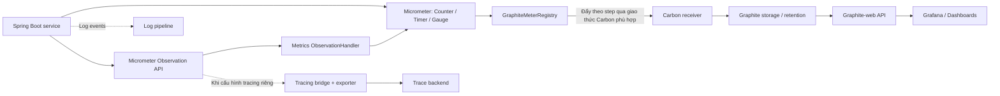
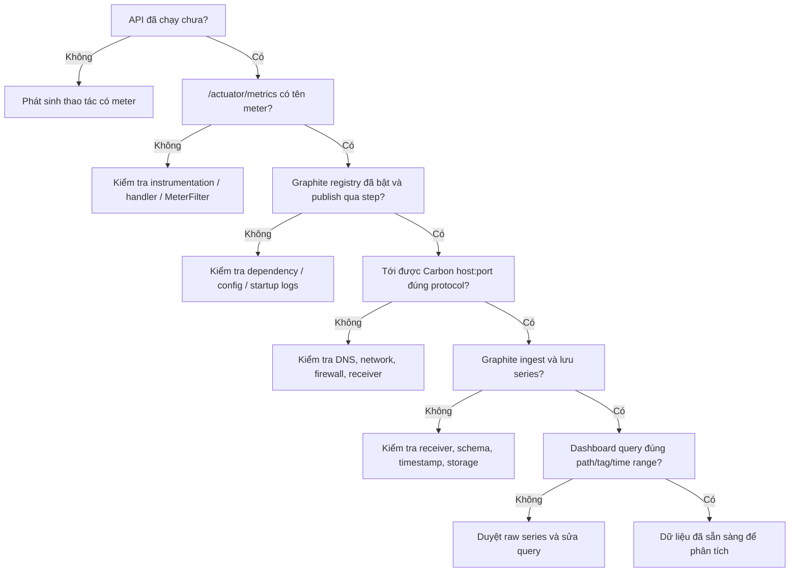

# Graphite registry

Một ứng dụng Spring Boot đã instrument thời gian xử lý thanh toán bằng Micrometer. Lệnh gọi `/actuator/metrics/checkout.payment.duration` cho thấy dữ liệu, nhưng đội vận hành đang sử dụng **Graphite** để lưu giữ chuỗi thời gian và **Grafana** để quan sát nhiều phiên bản dịch vụ. Làm thế nào để những meter trong ứng dụng được gửi đến Graphite? Tại sao tên metric ở Graphite không nhất thiết giống tên trong Java? Khi Graphite không có dữ liệu, phải kiểm tra instrumentation, registry, kết nối Carbon hay cấu hình retention trước?

Trong chương **Meter registry và exporter** của module **SPRING_BOOT_OBSERVABILITY**, **Graphite registry** là ví dụ quan trọng về mô hình **push metrics**. Micrometer cung cấp API đo trong ứng dụng, `GraphiteMeterRegistry` chuyển các meter thành các series thích hợp và chủ động gửi chúng đến Graphite theo chu kỳ. Tín hiệu metrics sau đó có thể được liên kết với logs và distributed traces để điều tra lỗi, độ trễ và tải hệ thống trong môi trường thực.

Bài này giúp bạn:

1. Phân biệt **Graphite**, **Carbon**, **Graphite-web**, **Grafana** và **Micrometer Graphite registry**.
2. Hiểu đường dữ liệu từ `MeterRegistry` và `Observation` tới Graphite, cùng khác biệt giữa push và Prometheus pull.
3. Cấu hình Spring Boot 3.x để đẩy metrics tới Carbon receiver bằng dependency `micrometer-registry-graphite`.
4. Chọn tên meter, tags, chu kỳ export và cách biểu diễn hierarchical/Graphite tags sao cho truy vấn được và không tạo cardinality quá lớn.
5. Viết instrumentation Java với Counter, Gauge/Timer hoặc Observation và xác minh dữ liệu ở cả ứng dụng lẫn Graphite.
6. Nhận biết giới hạn của Graphite khi biểu diễn timer distribution, histogram/percentile, aggregation và retention.
7. Xử lý các tình huống mất dữ liệu, nhầm timestamp, sai hostname/port, lỗi mạng, backpressure và exporter không gửi metrics.
8. Hiểu vì sao Graphite registry chỉ giải quyết **metrics**; muốn có logs và distributed tracing cần cấu hình các pipeline riêng.

## 1. Graphite registry là gì?

**Graphite** là hệ thống phục vụ thu thập, lưu giữ và truy vấn dữ liệu chuỗi thời gian (*time-series*). Một stack Graphite truyền thống thường có:

- **Carbon**: các thành phần nhận dữ liệu metrics qua giao thức phù hợp, xử lý và đưa dữ liệu vào tầng lưu trữ.
- **Whisper**: cơ chế lưu trữ time-series trên đĩa theo retention và aggregation schemes trong kiến trúc Graphite cổ điển.
- **Graphite-web**: giao diện và HTTP APIs để duyệt series, render biểu đồ hoặc truy vấn dữ liệu.
- **Grafana** (tùy chọn): công cụ dashboard có thể dùng Graphite làm data source.

Trong ứng dụng Java, **`GraphiteMeterRegistry`** là một implementation của Micrometer `MeterRegistry` được thiết kế để xuất metrics sang Graphite. Nó biết cách đọc các meter đã được đăng ký, biểu diễn chúng thành metric series và đẩy dữ liệu theo chu kỳ.

Phân biệt hai câu hỏi:

| Thành phần | Trả lời câu hỏi |
| --- | --- |
| `Counter`, `Timer`, `Gauge`, `DistributionSummary` | Ứng dụng đang đo đại lượng gì? |
| `MeterRegistry` | Những meters đó được đăng ký và quản lý ra sao? |
| `GraphiteMeterRegistry` | Làm sao đưa phép đo của Micrometer ra Graphite? |
| Carbon receiver | Gửi metrics đến endpoint nào để backend nhận? |
| Storage/retention | Backend giữ dữ liệu thô/đã gộp trong bao lâu? |
| Graphite-web/Grafana | Truy vấn, vẽ, đối chiếu và cảnh báo bằng dữ liệu như thế nào? |

**Graphite registry không phải Graphite server**. Thêm dependency trong Spring Boot chưa tạo ra một Graphite/Carbon backend, chưa tự có dashboard và chưa bảo đảm metrics được nhận hoặc lưu dài hạn.

### 1.1. Kiến trúc end-to-end



Các mũi tên metrics cho thấy đường dữ liệu logic. Micrometer Observation **không trực tiếp phát mọi metric** nếu chưa có metrics handler thích hợp; ví dụ JVM gauges có thể do meter binders tạo mà không thông qua Observation.

### 1.2. Graphite truyền thống so với Prometheus

| Khía cạnh | Graphite registry | Prometheus registry |
| --- | --- | --- |
| Mô hình cơ bản | Micrometer **push** các điểm đo theo chu kỳ đến Carbon | Prometheus server **scrape/pull** dữ liệu qua endpoint |
| Điểm đến | Carbon receiver, thường dùng cổng TCP 2003 cho plaintext | HTTP endpoint như `/actuator/prometheus` |
| Cách xác định series | Hierarchical metric paths và/hoặc tagged series tùy stack/cấu hình | Metric name + tập labels |
| Tính toán | Graphite query/render functions và retention/aggregation | PromQL, scrape storage và recording rules |
| Thu thập | Phụ thuộc step, mạng và backend nhận được dữ liệu push | Phụ thuộc scrape interval, target availability |
| Công cụ trực quan | Graphite-web hoặc Grafana data source Graphite | Prometheus UI hoặc Grafana data source Prometheus |

Không nên lấy PromQL `rate(...)` hoặc `histogram_quantile(...)` của Prometheus rồi giả định Graphite sẽ hiểu. Hai backend có model xuất dữ liệu, query language và khả năng giữ buckets khác nhau.

## 2. Một điểm đo đi từ Micrometer tới Graphite như thế nào?

Giả sử một lần thanh toán hoàn tất trong 240 ms:

1. Java code ghi sample vào một `Timer` có tên ổn định, ví dụ `checkout.payment.duration`.
2. `MeterRegistry` lưu trữ trạng thái tổng hợp cho meter và tập tag tương ứng.
3. Đến chu kỳ xuất tiếp theo, `GraphiteMeterRegistry` đọc các measurements mà nó hỗ trợ.
4. Registry biến đổi tên, tags và đại lượng đo thành chuỗi series có cú pháp phù hợp với cấu hình Graphite.
5. Registry gửi dữ liệu đến Carbon receiver qua giao thức đã chọn.
6. Backend nhận, lưu và downsample dữ liệu theo chính sách.
7. Dashboard truy vấn Graphite-web/Grafana để hiển thị thời gian, throughput, lỗi và các chỉ số khác.

Một dòng dữ liệu theo **Graphite plaintext protocol** thường có ba phần:

```text
metric.path value unix_timestamp_in_seconds
```

Ví dụ minh họa về **định dạng giao thức**, không phải cam kết tên exporter của một Timer cụ thể:

```text
demo.checkout.requests 12 1790000000
demo.worker.active 4 1790000000
```

Dòng này mang một giá trị tại một mốc thời gian. Giá trị `12` có nghĩa gì còn phụ thuộc **meter type và export semantics**: một Gauge có thể biểu diễn giá trị tức thời, trong khi Counter ở step registry có thể được biểu diễn theo khoảng đo. Không lấy riêng hình dạng của dòng dữ liệu để suy ra mọi Counter đều là một counter tích lũy suốt đời ứng dụng.

### 2.1. Step publishing

`GraphiteMeterRegistry` là registry xuất metrics theo chu kỳ (*step*). Ví dụ với `step=30s`, ứng dụng cố gắng publish định kỳ thay vì gửi một gói mạng mới ngay mỗi lần `Counter.increment()` hoặc `Timer.record()`.

```text
Thời gian:    0s           30s           60s           90s
              |-------------|-------------|-------------|
Ghi samples:    X X X X       X X X          X X X X X
Publish:                   ^             ^             ^
```

Hệ quả:

- Ngay sau khi gọi API, `/actuator/metrics` có thể hiển thị meter nhưng Graphite chưa có điểm mới vì step chưa tới.
- Dữ liệu ứng dụng và thời gian xuất có thể bị ảnh hưởng bởi network, load, stop/restart của tiến trình hoặc backend.
- Chu kỳ ngắn hơn không miễn phí: tăng tần suất gửi và số điểm lưu trữ.
- Chu kỳ dài hơn giảm số lần gửi nhưng làm dữ liệu cập nhật chậm hơn và có thể che các biến động ngắn.

**Step không thay thế histogram buckets**: 30 giây ở đây là khoảng xuất dữ liệu, không phải độ rộng bucket của phân phối latency.

## 3. Cấu hình Spring Boot để dùng Graphite registry

Phần ví dụ này dành cho **Spring Boot 3.x**, ứng dụng Java 17+ đã sử dụng Spring Boot dependency management. Tên thuộc tính và integration có thể khác ở Spring Boot 2.x hoặc 4.x; kiểm tra tài liệu đúng phiên bản trước khi triển khai.

### 3.1. Dependencies Maven

```xml
<!-- Actuator, Micrometer infrastructure và endpoints vận hành -->
<dependency>
    <groupId>org.springframework.boot</groupId>
    <artifactId>spring-boot-starter-actuator</artifactId>
</dependency>

<!-- Micrometer registry xuất dữ liệu sang Graphite -->
<dependency>
    <groupId>io.micrometer</groupId>
    <artifactId>micrometer-registry-graphite</artifactId>
</dependency>
```

Nếu triển khai HTTP API, ứng dụng vẫn cần web starter tương ứng. Hai dependencies trên không tự cung cấp HTTP server nghiệp vụ.

Spring Boot có thể auto-configure `GraphiteMeterRegistry` khi thư viện và các điều kiện cấu hình thích hợp có mặt. Nếu đã dùng auto-configuration, **không tạo một registry Graphite thứ hai một cách tùy tiện**, vì cùng một meter có thể bị xuất nhiều lần hoặc có cấu hình khác nhau.

### 3.2. Cấu hình `application.yml`

Ví dụ Carbon receiver chạy trên host nội bộ và lắng nghe plaintext TCP tại cổng 2003:

```yaml
management:
  endpoints:
    web:
      exposure:
        include: health,info,metrics

  metrics:
    tags:
      application: checkout-service
      environment: lab

  graphite:
    metrics:
      export:
        enabled: true
        host: graphite.internal.example
        port: 2003
        step: 30s
```

Các trường quan trọng:

| Thuộc tính | Ý nghĩa | Cân nhắc |
| --- | --- | --- |
| `management.graphite.metrics.export.enabled` | Bật/tắt Graphite exporter khi hỗ trợ | Tắt khi môi trường không có Graphite |
| `management.graphite.metrics.export.host` | Carbon receiver host | Không nhầm với hostname của Graphite-web/dashboard |
| `management.graphite.metrics.export.port` | Cổng receiver, ví dụ 2003 TCP plaintext | Xác nhận protocol/port thực sự của backend |
| `management.graphite.metrics.export.step` | Chu kỳ xuất series, ví dụ 30 giây | Phối hợp với retention/resolution và nhu cầu quan sát |
| `management.metrics.tags.application` | Tag chung phân biệt service | Giá trị ổn định, ít thay đổi |
| `management.metrics.tags.environment` | Tag chung phân biệt môi trường | Không gộp prod/staging vào cùng dashboard vô tình |

Đường dẫn `management.graphite.metrics.export.*` là nhóm cấu hình dùng trong Spring Boot 3.x. Một số phiên bản Spring Boot cũ dùng nhóm thuộc tính **`management.metrics.export.graphite.*`**. Không sao chép lẫn hai nhóm rồi cho rằng registry sẽ nhận cả hai.

Địa chỉ `graphite.internal.example` chỉ là **placeholder**; cần dùng host thật do môi trường cấp. Cổng 2003 là trường hợp phổ biến của **Carbon plaintext TCP**, không phải mặc định cho mọi kiểu receiver. Với một backend dùng giao thức hoặc topology khác, chọn cấu hình và receiver phù hợp.

**Không phải cứ bật Graphite registry là có `/actuator/prometheus`.** Endpoint Prometheus cần registry Prometheus riêng. Để kiểm tra meters trong ứng dụng, dùng `/actuator/metrics`; để xác nhận Graphite nhận dữ liệu, truy vấn backend Graphite hoặc quan sát Carbon receiver.

### 3.3. Tách cấu hình theo môi trường

Không hardcode địa chỉ production trong source nếu có thể dùng config deployment:

```yaml
management:
  graphite:
    metrics:
      export:
        enabled: ${GRAPHITE_ENABLED:false}
        host: ${GRAPHITE_HOST:localhost}
        port: ${GRAPHITE_PORT:2003}
        step: ${GRAPHITE_STEP:30s}
```

Các biến môi trường trên là **ví dụ**; trên production cần bảo đảm tên biến, secret management, DNS và network policy đúng quy định. Giá trị mặc định `enabled=false` có thể hữu ích trong môi trường phát triển chưa chạy receiver. Với production, thiết lập explicit để không âm thầm mất metrics khi thay đổi cấu hình.

**Lưu ý cú pháp:** Spring Boot property binding diễn giải chuỗi duration như `30s`. Khi đưa `management.graphite.metrics.export.*` vào profile khác, hãy kiểm tra file cấu hình đã thực sự được nạp; nếu không, exporter có thể dùng giá trị mặc định hoặc không hoạt động.

## 4. Viết metrics Java để Graphite có dữ liệu hữu ích

### 4.1. Dùng `MeterRegistry` do Spring Boot quản lý

Ví dụ service ghi thời gian thanh toán và các outcomes hữu hạn:

```java
import io.micrometer.core.instrument.Counter;
import io.micrometer.core.instrument.MeterRegistry;
import io.micrometer.core.instrument.Timer;
import org.springframework.stereotype.Service;

@Service
public class PaymentMetricsService {

    private final MeterRegistry registry;
    private final PaymentGateway gateway;

    public PaymentMetricsService(MeterRegistry registry, PaymentGateway gateway) {
        this.registry = registry;
        this.gateway = gateway;
    }

    public boolean authorize(String provider, String paymentToken) {
        String normalizedProvider = switch (
                provider == null ? "" : provider) {
            case "primary" -> "primary";
            case "backup" -> "backup";
            default -> "other";
        };

        Timer.Sample sample = Timer.start(registry);
        String outcome = "error";

        try {
            boolean approved = gateway.authorize(paymentToken);
            outcome = approved ? "approved" : "rejected";
            return approved;
        } finally {
            Timer timer = Timer.builder("checkout.payment.duration")
                    .description("Time spent authorizing a payment")
                    .tag("provider", normalizedProvider)
                    .tag("outcome", outcome)
                    .register(registry);

            sample.stop(timer);

            Counter.builder("checkout.payment.completed")
                    .description("Finished payment authorization attempts")
                    .tag("provider", normalizedProvider)
                    .tag("outcome", outcome)
                    .register(registry)
                    .increment();
        }
    }
}

interface PaymentGateway {
    boolean authorize(String paymentToken);
}
```

Đoạn code dùng API Micrometer thông thường, **không phụ thuộc Graphite ở tầng business service**. Chính registry được cấu hình ở Spring Boot quyết định số liệu được gửi đi đâu.

Các điểm cần chú ý:

- Tên `checkout.payment.duration` và `checkout.payment.completed` ổn định.
- `provider` chỉ có `primary`, `backup`, `other` và `outcome` chỉ có `approved`, `rejected`, `error`.
- `paymentToken` chỉ thuộc lời gọi nghiệp vụ, không đưa vào tên/tags/logs/traces.
- `finally` giúp Timer và Counter được cập nhật kể cả khi dependency ném exception.
- `Timer` vốn có count, nên Counter `checkout.payment.completed` trong ví dụ chỉ phù hợp nếu bạn **cần một metric business riêng** có hợp đồng đếm rõ. Nếu chỉ cần tổng số lần Timer ghi nhận, không cần thêm Counter trùng ngữ nghĩa.

Trong ứng dụng thực, nên quyết định một nơi sở hữu các metrics để tránh đếm hai lần. Nếu toàn bộ business step đã có Micrometer Observation và metrics handler, tạo thêm Timer trực tiếp cùng ranh giới có thể khiến dashboard có hai phép đo mô tả cùng một thao tác.

### 4.2. Với Micrometer Observation

Trong module observability của Spring Boot, bạn có thể dùng một API chung để tạo metrics và traces (khi handler tương ứng có mặt):

```java
import io.micrometer.observation.Observation;
import io.micrometer.observation.ObservationRegistry;

public boolean reserveInventory(
        ObservationRegistry observationRegistry,
        InventoryGateway inventoryGateway,
        String itemId) {

    return Observation.createNotStarted(
                    "inventory.reserve", observationRegistry)
            .contextualName("reserve inventory")
            .lowCardinalityKeyValue("operation", "reserve")
            .observe(() -> inventoryGateway.reserve(itemId));
}

interface InventoryGateway {
    boolean reserve(String itemId);
}
```

Ở đây, `inventory.reserve` có thể trở thành meter khi metrics handler hiện diện; tracing handler có thể tạo span tương ứng. **GraphiteMeterRegistry chỉ xuất metrics**; một trace span không tự được gửi đến Carbon. Để có distributed tracing, cần tracing bridge, context propagation, sampler, exporter và trace backend độc lập.

Nếu operation trả future hoặc reactive publisher, tránh dùng `observe(() -> future)` rồi tưởng observation đã bao trùm toàn bộ tác vụ async. Điểm `stop()` phải tương ứng với công việc thực sự hoàn tất hoặc bị hủy theo ranh giới đã định.

### 4.3. Gauge và dữ liệu tức thời

Với một công việc dài, Gauge phù hợp để biểu diễn số job đang chạy:

```java
import io.micrometer.core.instrument.Gauge;
import io.micrometer.core.instrument.MeterRegistry;
import java.util.concurrent.atomic.AtomicInteger;

public final class InFlightJobs {
    private final AtomicInteger count = new AtomicInteger();

    public InFlightJobs(MeterRegistry registry) {
        Gauge.builder("report.jobs.inflight", count, AtomicInteger::get)
                .description("Number of report jobs currently running")
                .register(registry);
    }

    public void jobStarted() {
        count.incrementAndGet();
    }

    public void jobFinished() {
        count.decrementAndGet();
    }
}
```

Vòng đời job phải bảo đảm `jobFinished()` trong `finally` khi thích hợp, tránh Gauge bị tăng mãi nếu task lỗi. Mẫu này cần ứng dụng giữ `InFlightJobs` còn sống; Micrometer gauge thường giữ **weak reference** tới object được quan sát để tránh rò bộ nhớ. Nếu object bị GC, giá trị gauge có thể biến mất/không còn hợp lệ. Ngoài ra, có thể dùng `AtomicInteger` đang được một Spring singleton bean sở hữu thay vì tạo một object đo rồi không giữ reference.

Không nên coi Gauge là Counter: `inflight` có thể tăng hoặc giảm, trong khi số job hoàn tất là một đại lượng đếm sự kiện.

## 5. Tên metric và tag: phần khó của Graphite registry

Micrometer sử dụng meter names dạng phân cấp bằng dấu chấm, chẳng hạn `checkout.payment.duration`. Graphite có lịch sử dùng **hierarchical paths** được phân cách bởi dấu chấm:

```text
service.checkout.payment.duration....
```

Tuy nhiên, **tags không được biểu diễn giống nhau ở mọi triển khai Graphite**. Có hai cách tư duy chính:

1. **Hierarchical naming:** Tên meter, tag keys/tag values có thể được ánh xạ thành các đoạn của path; cách sắp xếp tùy naming mapper/registry.
2. **Graphite tagged series:** Graphite phiên bản và endpoint phù hợp có thể hỗ trợ định dạng series kèm tags, về mặt ý tưởng tương tự `series.name;tag=value`.

Không nên khẳng định một chuỗi path cụ thể là đầu ra mặc định của mọi phiên bản Micrometer Graphite. Cấu hình `GraphiteConfig`, hierarchical mapper, khả năng hỗ trợ tags của backend và phiên bản Micrometer đều có thể ảnh hưởng tên cuối.

### 5.1. Vì sao mapping tags quan trọng?

Giả sử một Timer có:

```text
name    = checkout.payment.duration
provider= primary
outcome = approved
service = checkout-service
```

Để truy vấn đúng trong Graphite, bạn phải biết:

- Series thực tế mang path/tag gì?
- Giá trị provider có được map vào path hay Graphite tags?
- Một ký tự đặc biệt trong tag value có làm thay đổi cấu trúc hierarchy không?
- Nhiều instance có chung chính sách đặt tên/tag không?
- Query dùng wildcard path hay `seriesByTag(...)` trên Graphite backend có tag support?

Với hierarchical paths, vị trí mỗi đoạn rất quan trọng. Đổi thứ tự tag values hoặc thêm prefix có thể khiến query cũ không còn match. Với tagged series, key/value mang ngữ nghĩa rõ hơn nhưng cần backend và exporter tương thích.

### 5.2. Tag cardinality có thể gây bùng nổ series

Một meter có 4 providers, 3 outcomes và 10 instances đã có thể tạo tới:

```text
4 × 3 × 10 = 120 tổ hợp series
```

Nếu thêm `orderId` với 100.000 giá trị, số tổ hợp tiềm năng có thể thành 12 triệu. Số series thực tế phụ thuộc các tổ hợp đã xuất hiện, nhưng nguy cơ chi phí lưu trữ/truy vấn là rất lớn.

| Thuộc tính | Có nên làm metric dimension? | Vì sao? |
| --- | --- | --- |
| `provider=primary|backup|other` | Có | Tập giá trị nhỏ |
| `outcome=approved|rejected|error` | Có | Hữu ích khi phân tích tỷ lệ |
| `environment=prod|staging` | Có | Phân biệt môi trường |
| `http.route=/orders/{id}` | Có nếu lấy từ route template | Gom endpoints đúng ngữ nghĩa |
| `orderId`, `customerId`, `traceId` | Không | Gần như duy nhất, làm nổ cardinality |
| Raw URL, email, token | Không | Cardinality, bảo mật và dữ liệu nhạy cảm |
| Raw exception message | Không | Giá trị vô hạn; có thể chứa dữ liệu nội bộ |

Một lỗi thường gặp là nghĩ Graphite chỉ có *path* thì không chịu ảnh hưởng bởi cardinality. Thực tế, nếu đưa request ID vào path, mỗi request gần như trở thành một series mới. Nguyên tắc tối thiểu hóa labels của Prometheus vẫn áp dụng ở Graphite, dù hình thức thể hiện khác.

### 5.3. Lập bảng hợp đồng metric

Với hệ thống có nhiều teams và dashboards, nên công bố bảng:

| Thuộc tính | Ví dụ |
| --- | --- |
| Micrometer canonical meter name | `checkout.payment.duration` |
| Meter type | `Timer` |
| Unit | Thời gian; kiểm tra đơn vị khi Graphite xuất |
| Metric dimensions | `provider`, `outcome`, `application` |
| Value sets | `primary|backup|other`; `approved|rejected|error` |
| Graphite export mapping | Ghi lại series path/tag thực tế theo registry phiên bản đang dùng |
| Step và retention | 30 giây; chính sách giữ/dồn dữ liệu tương ứng |
| Người sở hữu | Team checkout |
| Consumers | Graphite-web query, Grafana dashboard, alerts |
| Điều kiện thay đổi | Có migration plan cho tên/tag/path |

Đừng đặt tên trực tiếp trong Java bằng những suffix gắn chặt với một exporter nếu sau này có thể chuyển sang Prometheus, OTLP hoặc registry khác. Dùng tên canonical dễ đọc và kiểm chứng tên xuất.

## 6. Graphite tags so với hierarchy

Graphite backend hỗ trợ tagged series trong các phiên bản thích hợp. Query dạng Graphite tags thường có hàm `seriesByTag(...)`, ví dụ minh họa cú pháp:

```text
seriesByTag('name=your.actual.series', 'application=checkout-service')
```

**`your.actual.series` chỉ là placeholder**, không phải tên Timer mặc định. Bạn cần kiểm tra **series name/tag thực tế** đã được Graphite ingest, và bảo đảm Graphite stack cùng exporter đã bật cách gửi tags phù hợp. Khi metrics được ánh xạ thành hierarchy, phải truy vấn theo path/wildcard thay vì cho rằng backend có thể lọc tag.

Các điểm cần kiểm chứng trước khi chọn chiến lược:

1. Phiên bản Graphite/Carbon hỗ trợ tagged-series ingestion hay không.
2. Registry Micrometer đang dùng ánh xạ tags thế nào.
3. Các ký tự dấu chấm, khoảng trắng, dấu chấm phẩy, dấu bằng trong key/value được xử lý hoặc làm sạch ra sao.
4. Queries hiện có dựa trên thứ tự path hay trên tên tag.
5. Mức tăng số series nếu thêm một dimension mới.

**Không thay mapping tags giữa chừng mà không có kế hoạch**. Với Graphite hierarchical, thay vị trí của một tag có thể làm toàn bộ dashboard query path cũ không còn kết quả dù backend vẫn nhận metrics.

## 7. Chu kỳ xuất, đơn vị, retention và aggregation

Graphite registry có chu kỳ xuất, còn backend Graphite có chính sách lưu trữ riêng. Hai thứ phải được thiết kế cùng nhau.

### 7.1. Step và storage resolution

Giả sử ứng dụng xuất mỗi 30 giây. Một retention scheme có thể lưu:

- Dữ liệu độ phân giải 30 giây trong khoảng thời gian ngắn.
- Dữ liệu đã gộp theo các điểm 5 phút hoặc 1 giờ trong khoảng thời gian dài hơn.

Đây là **mô hình minh họa**, không phải cấu hình mặc định của mọi Graphite stack. Các tầng lưu trữ được xác định ở phía Graphite/Carbon/Whisper (hoặc time-series backend tương thích), không tự có chỉ nhờ đặt `step: 30s` trong Spring Boot.

| Nếu cấu hình | Rủi ro |
| --- | --- |
| Export step 30s, backend retention chỉ nhận resolution 60s | Giá trị có thể bị gộp/ghi vào những slots không như mong đợi |
| Export mỗi 5 phút, dashboard muốn alert theo từng 10 giây | Không có đủ độ phân giải nguồn |
| Backend downsample bằng average cho số đếm của một khoảng | Tổng số lượng sự kiện có thể bị diễn giải sai |
| Backend downsample bằng sum cho gauge tức thời | Tăng giả tạo giá trị như CPU hoặc inflight jobs |
| Giữ raw data quá ngắn | Không điều tra được spike trong một sự cố cũ |

### 7.2. Đừng suy semantics từ suffix

Trong một hệ thống step-based, giá trị Counter xuất ra có thể là số lượng hoặc tốc độ theo khoảng tùy meter/exporter semantics. Graphite có thể downsample series bằng average, sum, max, last hoặc quy tắc khác. Vì vậy:

- Xác minh mỗi series đại diện cho **gauge tức thời**, **count trong step**, **cumulative count**, **rate** hay **total duration**.
- Chỉ dùng các hàm derivative/rate nếu semantics và hình dạng dữ liệu phù hợp.
- Đặt aggregation/retention theo loại metric thay vì áp một chính sách chung cho mọi series.
- Không cộng `sum` và `count` của Timer từ những khoảng hoặc đơn vị không tương thích.
- Ghi lại đơn vị đo khi export: thời gian có thể được đổi đơn vị theo registry config; không mặc định mọi series Timer ở Graphite đều là `seconds` chỉ vì Prometheus dùng hậu tố `_seconds`.

Cách đáng tin cậy nhất là chạy một thử nghiệm với số lần gọi và duration đã biết, rồi so sánh raw series trong Graphite qua vài step để xác nhận semantics thực tế của version đang dùng.

## 8. Timer, histogram và percentile: những giới hạn cần hiểu

Trong Spring Boot, `Timer` là công cụ đo duration của nhiều occurrence, không đồng nghĩa với một gauge “thời gian của request cuối cùng”. Registry có thể xuất các đại lượng như count, total duration, mean/max hoặc thống kê distribution được hỗ trợ.

Nhưng **khả năng xuất histogram/percentile khác nhau giữa backends**. Không nên sao chép một truy vấn Prometheus:

```promql
histogram_quantile(
  0.95,
  sum by (le) (
    rate(http_server_requests_seconds_bucket[5m])
  )
)
```

rồi chạy trực tiếp trong Graphite. `histogram_quantile` là hàm PromQL, không phải Graphite query function.

### 8.1. Tại sao không thể trung bình các p95 của nhiều instance?

Giả sử hai pods cùng xuất p95 latency:

| Pod | Request trong cửa sổ | p95 |
| --- | ---: | ---: |
| A | 100 | 100 ms |
| B | 9.900 | 800 ms |

Trung bình hai p95 là 450 ms, **không phải p95 thực của 10.000 request**. Ngay cả trung bình có trọng số của những p95 cũng không đủ để phục dựng percentile toàn hệ thống, vì thiếu hình dạng phân phối.

Nếu Graphite chỉ lưu những percentile đã được client tính riêng, hãy xem chúng là **percentile theo series/instance**, không tự tổng hợp thành “p95 toàn cluster”. Muốn có phân phối toàn hệ thống, cần phương pháp thu thập giữ được thông tin phân phối có thể hợp nhất (ví dụ histogram buckets hoặc cơ chế khác được backend hỗ trợ), cùng các buckets và semantics tương thích.

### 8.2. Graphite query functions và một bẫy percentile

Graphite có nhiều hàm tính toán trên chuỗi thời gian, như `sumSeries`, `summarize`, `movingAverage` và `nonNegativeDerivative`. Tùy phiên bản cũng có những hàm mang tên liên quan percentile.

**Không nhầm percentile của các điểm theo thời gian trong một series** với percentile của **tất cả request latencies**. Nếu một series chứa “độ trễ trung bình mỗi 30 giây”, percentile của các giá trị trung bình 30 giây không phải p95 latency của tất cả request trong khoảng đó.

Tương tự, trung bình các series “p95 theo pod” vẫn không phải p95 toàn service. Trong dashboard:

- Với throughput, kiểm tra count/rate semantics và xem có thể gộp được không.
- Với duration trung bình, có thể cần tổng duration và count tương thích.
- Với tail latency, cần các dữ liệu distribution phù hợp hoặc một backend hỗ trợ quantile aggregation đúng cách.

Hãy xác định mục tiêu SLI/SLO trước khi chọn exporter. Nếu hệ thống yêu cầu p99 toàn cluster thật sự có ý nghĩa, nên xác minh Graphite pipeline có cung cấp đúng dữ liệu và phương pháp gộp hay cần một pipeline histogram khác.

## 9. Truy vấn Graphite và xây dashboard

### 9.1. Query theo hierarchical paths

Nếu backend đang dùng hierarchical naming, Graphite-web cho phép duyệt nhánh series và các query dạng:

```text
sumSeries(your.actual.counter.paths.*)
movingAverage(your.actual.gauge.path, '5min')
```

Các đường dẫn trên là **placeholder minh họa cú pháp**, không phải metric names được cam kết từ Micrometer. Bạn phải duyệt series hoặc lấy tên đã được Carbon ingest để viết query đúng.

Graphite functions có điều kiện về loại series và cách lưu dữ liệu. Ví dụ:

- `sumSeries` phù hợp khi các series cùng đại lượng/đơn vị và có thể cộng, chẳng hạn số job đang chạy ở nhiều instances tại cùng thời điểm.
- `movingAverage` làm mượt gauge hoặc series khác, nhưng có thể che spike ngắn.
- `nonNegativeDerivative` có thể hữu ích với **counter tích lũy**, nhưng không được áp dụng mù quáng cho **step counts** hoặc một series đã biểu diễn rate.

### 9.2. Dashboard tối thiểu cho Spring Boot

| Nhóm quan sát | Metrics gợi ý | Câu hỏi được trả lời |
| --- | --- | --- |
| Traffic | Request count/rate, request totals theo endpoint | Lượng request tăng hay giảm? |
| Errors | Failure count/rate và HTTP outcomes | Request thất bại ở bước nào? |
| Latency | Timer duration, mean/max và distribution nếu backend hỗ trợ | Người dùng gặp độ trễ ở đâu? |
| Saturation | Executor queue, active threads, connection pool pending | Có nghẽn tài nguyên không? |
| JVM | Heap/non-heap memory, GC pause, CPU | Có ảnh hưởng của runtime không? |
| Business steps | Checkout authorize, inventory reserve, report generation | Khâu nghiệp vụ nào tiêu tốn thời gian? |
| Export health | Tình trạng kết nối Carbon/độ trễ ingestion | Metrics có được gửi và hiển thị đúng không? |

Tách các series theo `application`, `environment`, instance và operation phù hợp, nhưng đừng đưa request ID hoặc token vào tên/tags chỉ để lọc dễ hơn.

Một dashboard Graphite tốt không chỉ có đồ thị: cần ghi **định nghĩa của mỗi đại lượng**, chu kỳ xuất, retention và aggregation. Nếu team hiểu lầm “giá trị 12” là 12 task/giây trong khi đó là 12 task trên một step 30 giây, quyết định capacity sẽ sai.

## 10. Kết nối và bảo mật dữ liệu Graphite

Graphite plaintext TCP thường dùng **cổng 2003**, nhưng giao thức plaintext truyền dữ liệu dạng văn bản thông thường, không tự mang TLS. Để vận hành thực tế:

1. Đặt Carbon receiver trong private network hoặc hạ tầng có kiểm soát.
2. Dùng firewall, network policy và xác thực ở các lớp có hỗ trợ; tránh mở cổng ingestion công khai.
3. Nếu cần TLS qua mạng không tin cậy, cân nhắc gateway/proxy/tunnel/collector bảo vệ kết nối hoặc giao thức exporter khác đáp ứng yêu cầu. Không mặc định rằng truyền plaintext TCP tới 2003 đã được mã hóa.
4. Giới hạn tần suất và số lượng metrics/series để không gây áp lực lên Carbon/storage.
5. Theo dõi thời gian mất kết nối, lỗi publish/ingest và dung lượng backend.
6. Không đưa PII, passwords, tokens hoặc dữ liệu thanh toán vào metric paths và tags, vì metric metadata thường có phạm vi truy cập rộng trong đội vận hành.

**Bảo vệ Graphite-web/Grafana** cũng cần thiết. Chúng có thể hiển thị internal hostnames, tên service và cấu trúc hệ thống. Không dùng quyền truy cập dashboard để thay thế chính sách kiểm soát dữ liệu tại nguồn.

## 11. Vì sao không thấy metrics trong Graphite?

Có nhiều vị trí có thể thất bại:



### 11.1. Bước 1: xác nhận meter ở ứng dụng

```bash
curl -fsS http://localhost:8080/actuator/health
curl -fsS http://localhost:8080/actuator/metrics
curl -fsS http://localhost:8080/actuator/metrics/checkout.payment.duration
```

Ví dụ giả định Actuator chạy ở cổng 8080 và metrics endpoint được expose trong lab. Nếu meter không xuất hiện:

- Có thể code chưa chạy tới `Timer.record(...)` hay `Observation.stop()`.
- `MeterRegistry` có thể thiếu metrics observation handler khi bạn chỉ dùng Observation API.
- Meter bị `MeterFilter` chặn, đổi tên hoặc được đăng ký ở một registry khác.
- Bạn đang tìm tên **Graphite series** thay vì tên canonical Micrometer.

Ở bước này chưa cần kết luận Carbon hay network lỗi.

### 11.2. Bước 2: xác nhận cấu hình Graphite registry

Kiểm tra ứng dụng thực sự có `micrometer-registry-graphite`, `enabled=true`, host, port, step và profile cấu hình. Tránh khởi tạo một `GraphiteMeterRegistry` mới trong service, rồi tự hỏi vì sao metrics do Boot instrument không xuất.

Nếu có nhiều registries trong cùng ứng dụng, hiểu `CompositeMeterRegistry` và cách Boot đăng ký/customize từng registry. Đừng mặc định mọi meter xuất sang mọi registry khi code lấy `MeterRegistry` khác nhau; xác minh cách autoconfiguration thực tế đã nối các registries.

### 11.3. Bước 3: kiểm tra kết nối tới Carbon

Một số thao tác thử trong môi trường được phép:

```bash
# Khi máy có netcat: kiểm tra cổng TCP nhận kết nối hay không.
nc -vz graphite.internal.example 2003

# Khi Carbon receiver plaintext được phép nhận dòng test trong lab:
printf 'lab.graphite.connection_test 1 1790000000\n' \
  | nc graphite.internal.example 2003
```

Dòng kiểm tra trên minh họa giao thức và dùng **timestamp giả lập**, không phù hợp để kiểm tra hiển thị ở thời điểm hiện tại nếu hệ thống truy vấn dữ liệu gần đây. Khi thử thực tế cần dùng timestamp hiện tại và một namespace lab để tránh làm bẩn dữ liệu production.

**Chỉ kiểm tra trong môi trường được phép.** Nếu lệnh `nc` không có sẵn, dùng công cụ network diagnostics phù hợp. TCP connect thành công cũng chỉ chứng minh cổng đang mở; chưa chứng minh Carbon xử lý, lưu và Graphite-web truy vấn được series.

### 11.4. Bước 4: kiểm tra Graphite-web

Khi backend có Graphite-web HTTP API, endpoint `/render` thường hỗ trợ truy vấn series. Ví dụ dạng yêu cầu (thay series thực tế và địa chỉ backend của bạn):

```text
GET /render?target=your.actual.series&from=-15min&format=json
```

Những nguyên nhân vẫn có thể không thấy dữ liệu:

- Carbon đã nhận nhưng timestamp nằm ngoài khung truy vấn.
- Retention schema không khớp độ phân giải hoặc chưa có điểm lưu.
- Metric path/tag được ánh xạ khác với query.
- Dữ liệu chưa tới kỳ publish step.
- Hệ thống Graphite-web đang xem một storage/backend khác.
- Gói tin được nhận nhưng bị drop vì queue/backpressure hoặc lỗi backend.

### 11.5. Ma trận triệu chứng

| Triệu chứng | Nguyên nhân khả dĩ | Kiểm tra ưu tiên |
| --- | --- | --- |
| Không có meter tại Actuator | Chưa có sample, thiếu handler, bị filter | Code/lifecycle và `/actuator/metrics` |
| Actuator có meter, Graphite chưa có | Chưa tới step, registry tắt, exporter/network | Dependency, enabled, config, logs |
| Carbon port mở nhưng không có dữ liệu | Sai protocol, timestamp, ingestion/storage | Receiver logs và raw series |
| Một số metric biến mất | Naming mapping, tags, type, backend retention | Duyệt series và so schema |
| Metrics chỉ có một phần instances | Network policy, cấu hình khác nhau, instance chết | Config/targets từng instance |
| Dữ liệu xuất nhưng dashboard không vẽ | Query sai path/tag, time range, consolidation | Graphite-web render và dashboard |
| Dữ liệu sau nhiều ngày bị sai tỷ lệ | Aggregation/downsampling không phù hợp | Retention & aggregation schema |
| p95 toàn service phi lý | Trung bình các p95 hoặc sai distribution | Kiểm tra phương pháp gộp và metric type |
| Metrics bình thường nhưng trace mất | Tracing pipeline/sampling/propagation khác | Tracing handler, sampler, exporter, collector |

## 12. Graphite registry và OpenTelemetry/OTLP: đừng nhầm hai pipeline

`GraphiteMeterRegistry` xuất **metrics** sang Graphite. Với Micrometer Observation, bạn có thể kết hợp:

- Metrics handler → `MeterRegistry` → Graphite.
- Tracing handler → Micrometer Tracing bridge → OTLP/Zipkin exporter hoặc backend thích hợp.
- Application logs → logging framework → log pipeline.
- Trace context propagation → HTTP/message headers/async context khi được cấu hình.

```text
Một request POST /checkout
  |
  +--> Micrometer Observation
           |
           +--> Metrics Handler --> GraphiteMeterRegistry --> Carbon/Graphite
           |
           +--> Tracing Handler --> Trace bridge/exporter --> Trace backend
           |
           +--> Scope/MDC --> Log events --> Log backend
```

Một lỗi phổ biến là nhìn thấy Graphite có timer `checkout.authorize` nhưng không tìm thấy trace tương ứng, rồi thay đổi cấu hình Graphite. Hai pipeline độc lập: tracing có thể bị sampling loại, mất context qua thread hoặc HTTP client, exporter/collector lỗi, dù metrics vẫn tiếp tục xuất.

Để liên kết tín hiệu:

1. Dùng tên operation và tags hữu hạn nhất quán giữa các service.
2. Giữ `traceId`, `spanId` trong logs khi có tracing/log correlation phù hợp.
3. Không dùng trace ID làm Graphite metric dimension; mỗi trace gần như tạo một series mới.
4. Với HTTP client hoặc message broker, xác minh W3C Trace Context propagation hoặc chuẩn phù hợp.
5. Khi điều tra tail latency, dùng Graphite metrics để biết tần suất/xu hướng, trace mẫu để thấy đường đi và logs để xem exception/retry/fallback.

**Sampling của traces không đồng nghĩa chỉ xuất một phần metrics.** Chính sách tracing có thể giữ 10% trace trong khi Timer vẫn ghi duration của mọi lời gọi được instrument, nếu metrics handler và exporter hoạt động bình thường.

## 13. Lựa chọn Graphite trong một kiến trúc observability

Graphite có thể phù hợp nếu tổ chức đã có:

- Hạ tầng Carbon/Graphite-web và retention/aggregation được quản lý.
- Dashboards Grafana dùng Graphite data source.
- Quy chuẩn series hierarchical/tagged đã thống nhất.
- Nhu cầu quan sát metrics có thể biểu diễn phù hợp với Graphite storage/query semantics.

Nhưng cần cân nhắc:

| Nhu cầu | Câu hỏi trước khi quyết định |
| --- | --- |
| p99 toàn cluster | Pipeline có lưu distribution hợp nhất được không hay chỉ giữ p99 từng instance? |
| Tính toán SLO latency | Có đủ bucket/ratio metrics và định nghĩa mẫu số đúng không? |
| Cardinality tăng | Carbon/storage/Grafana có đủ sức chứa số series không? |
| Multi-tenant isolation | Metric names, tags và ingestion được tách ra sao? |
| Secure transport | Plaintext Carbon có đáp ứng chính sách mạng không? |
| Điều tra sự cố xuyên microservices | Metrics được kết hợp với tracing/log pipeline như thế nào? |
| Thay exporter trong tương lai | Canonical meter names và dashboards có hợp đồng migration không? |

Không có một registry nào tự giải quyết toàn bộ observability. Graphite là **một lựa chọn export/store metrics**; chất lượng dữ liệu vẫn phụ thuộc cách instrument, thiết kế tags, lifecycle, unit, step, retention và quy trình vận hành.

## 14. Bài thực hành: từ Spring Boot đến Graphite

Giả sử bạn có một môi trường **lab** với Spring Boot, Carbon plaintext receiver nội bộ và giao diện Graphite-web/Grafana đã được cấu hình.

### Nhiệm vụ

1. **Thiết lập dependency:** thêm `spring-boot-starter-actuator` và `micrometer-registry-graphite`, không thêm Prometheus registry nếu chỉ muốn thử Graphite.
2. **Cấu hình exporter:** thiết lập `management.graphite.metrics.export.host`, `port` và `step=30s` theo receiver lab; bật export rõ ràng.
3. **Tạo meter đơn giản:** ghi `Counter` và `Timer` với tên `checkout.payment.completed` và `checkout.payment.duration`, chỉ có `provider`/`outcome` hữu hạn.
4. **Gọi API có kiểm soát:** tạo một nhóm request `approved`, `rejected`, và một số exception thử nghiệm. Kiểm tra `/actuator/metrics` xuất hiện tên canonical.
5. **Kiểm tra sau step:** theo dõi Graphite receiver và duyệt raw series; ghi lại tên/path/tag thực tế của các measurements.
6. **Đọc các values:** thực hiện đúng 10 lời gọi ở một khoảng đo trong lab, xem count exported có semantics gì; không mặc định nó là Counter cumulative hay rate.
7. **Đối chiếu Gauge:** tạo gauge `report.jobs.inflight` và thay đổi số job đang chạy; phân biệt dữ liệu tức thời với Counter.
8. **Kiểm tra cardinality:** thử nhiều `orderId` khác nhau trong business input; bảo đảm không xuất thêm series theo order ID.
9. **Đổi step có kiểm soát:** thử 10 giây và 60 giây trong lab, quan sát độ trễ hiển thị/số điểm dữ liệu, đối chiếu với retention resolution.
10. **Thử lỗi network:** vô hiệu receiver trong lab rồi bật lại; kiểm tra ứng dụng, logging và backend phản ánh lỗi ra sao.
11. **So sánh với tracing:** nếu đang có Micrometer Tracing và OTLP pipeline, tìm trace cho một request chậm; giải thích vì sao Graphite không chứa trace span.
12. **Viết bảng bàn giao:** ghi lại meter type, units, tags, exported path, step, retention, dashboard query và owner để team khác có thể vận hành.

### Bài tập phân tích

**Tình huống A:** Sau khi startup, `/actuator/metrics/checkout.payment.duration` đã có số liệu nhưng Graphite-web chưa hiển thị ngay.

**Hướng xử lý:** Xem step publish, dependency/enable/config Graphite registry, Carbon host/port, network, ingestion và time range trước khi kết luận code instrumentation sai.

**Tình huống B:** Dashboard cộng p95 của ba pod rồi chia ba, gọi đó là “p95 checkout toàn cluster”.

**Hướng xử lý:** Sai về thống kê. Percentile không cộng gộp tuyến tính. Cần dữ liệu phân phối phù hợp hoặc phương pháp/backend hỗ trợ quantile aggregation đúng; không trung bình p95.

**Tình huống C:** Một team thêm `userId` vào hierarchical path để dễ debug.

**Hướng xử lý:** Không nên. Metric series sẽ tăng theo số user, có nguy cơ rò dữ liệu. Dùng tags hữu hạn cho metrics, log/trace correlation được bảo vệ để điều tra trường hợp riêng lẻ.

**Tình huống D:** Carbon port 2003 mở nhưng hệ thống vẫn mất metrics từ một instance.

**Hướng xử lý:** TCP connect thành công chưa chứng minh receiver đã nhận/lưu series. Kiểm tra timestamp, registry step, writer/exporter errors, ingestion queue, retention, Graphite-web backend và query path/tag.

**Tình huống E:** Graphite có metrics nhưng logs không có `traceId` khi job chạy trên executor.

**Hướng xử lý:** Đây có thể là lỗi scope/context propagation hoặc cấu hình tracing/logging, không phải Graphite exporter. Xác minh context propagation qua executor/thread và logging MDC.

## 15. Checklist vận hành Graphite registry

| Câu hỏi | Kỳ vọng trước khi triển khai production |
| --- | --- |
| Registry có được cấu hình đúng? | Có dependency, enabled, host/port/protocol/step rõ |
| Carbon receiver có thực sự hoạt động? | Có ingestion và series được lưu/truy vấn |
| Metric naming nhất quán? | Canonical name và path/tag mapping được ghi lại |
| Cardinality có kiểm soát? | Không chứa ID động, raw URL, tokens hay PII |
| Đơn vị và semantics rõ? | Gauge, step count, rate, duration không bị hiểu nhầm |
| Retention phù hợp với step? | Resolution/aggregation hợp với kiểu metric |
| Dashboard có đúng nguồn dữ liệu? | Truy vấn series thật, đúng môi trường và time range |
| Có theo dõi exporter? | Phát hiện kết nối hỏng, dữ liệu stale/mất ingest |
| Có bảo mật phù hợp? | Không mở Carbon plaintext ra mạng công cộng |
| Có liên kết tín hiệu? | Metrics đi cùng logs/traces khi cần điều tra |
| Có quy trình migration? | Đổi tên/tag/retention không âm thầm phá alerts |
| Có thử nghiệm end-to-end? | Tạo sample → Actuator → Carbon → Graphite-web/Grafana |

**Tóm lại:** Graphite registry là cầu nối đưa metrics từ Micrometer/Spring Boot đến Graphite bằng mô hình push theo chu kỳ. Phần khó không chỉ là khai báo `host` và `port` mà là giữ đúng **ngữ nghĩa phép đo, tên và tags, step, retention, aggregation và khả năng truy vết lỗi export**. Khi hiểu rõ các ranh giới này, bạn có thể đọc Graphite metrics cùng logs và distributed traces để điều tra hiệu năng một cách đáng tin cậy hơn.

### Tài liệu tham khảo

- [Micrometer — Graphite implementation](https://docs.micrometer.io/micrometer/reference/implementations/graphite.html)
- [Micrometer — Meter Registries](https://docs.micrometer.io/micrometer/reference/concepts/registry.html)
- [Micrometer — Naming Meters](https://docs.micrometer.io/micrometer/reference/concepts/naming.html)
- [Micrometer — Timers](https://docs.micrometer.io/micrometer/reference/concepts/timers.html)
- [Spring Boot — Metrics (Actuator)](https://docs.spring.io/spring-boot/reference/actuator/metrics.html)
- [Spring Boot — Observability](https://docs.spring.io/spring-boot/reference/actuator/observability.html)
- [Graphite — Feeding In Your Data](https://graphite.readthedocs.io/en/latest/feeding-carbon.html)
- [Graphite — Functions](https://graphite.readthedocs.io/en/latest/functions.html)
- [Graphite — Storage Schemas](https://graphite.readthedocs.io/en/latest/config-carbon.html)

